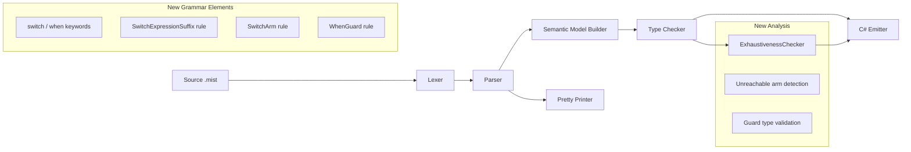
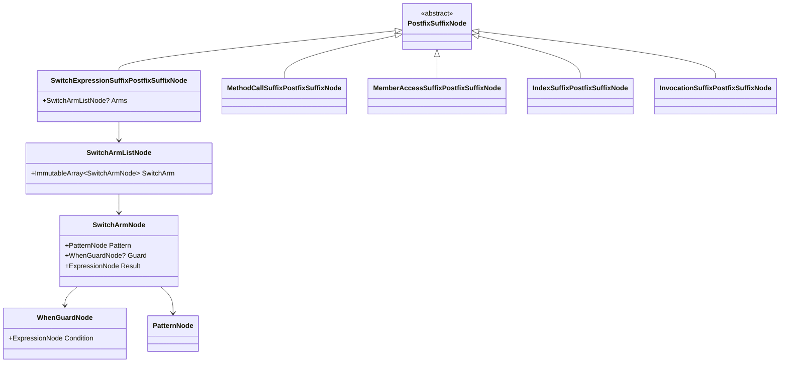

# Design Document: Switch Expressions

## Overview

This design adds exhaustive switch expressions to the Mist compiler, covering the full pipeline from grammar definition through C# emission. Switch expressions provide a concise, expression-level construct for multi-arm pattern matching that returns a value. The compiler enforces Rust-style exhaustiveness checking: it verifies at compile time that the arms collectively cover all possible values of the scrutinee's static type.

The syntax follows C#'s postfix form (`expr switch { arms }`), where each arm consists of a pattern, an optional `when` guard, and a result expression separated by `=>`. The existing pattern matching infrastructure (type patterns, constant patterns, var patterns, discard patterns, property patterns, relational patterns, logical patterns, and list patterns) is reused as the pattern language within switch arms.

The implementation touches every stage of the compiler pipeline:

1. **Grammar** — New keywords (`switch`, `when`) and a new `SwitchExpressionSuffix` postfix rule with `SwitchArm` sub-rules.
2. **Lexer** — Recognizes the new keyword tokens.
3. **Parser** — Produces AST nodes for switch expressions and their arms.
4. **Pretty Printer** — Round-trip formats switch expression AST nodes back to Mist source.
5. **Semantic Model** — Resolves arm result types, registers pattern variables in arm scopes, determines the unified result type.
6. **Type Checker** — Validates guard types, arm result type compatibility, and delegates to the exhaustiveness checker.
7. **Exhaustiveness Checker** — New analysis pass verifying complete coverage of the scrutinee type.
8. **C# Emitter** — Emits Mist switch expressions as C# switch expressions.
9. **Syntax Highlighting** — TextMate grammar updates for `switch` and `when` keywords.

## Architecture

The switch expression feature follows the existing compiler pipeline architecture. One new analysis component is introduced: the `ExhaustivenessChecker`, which runs as part of the type checker pass. All other stages are extended to handle the new AST nodes.



### Design Decisions

1. **Switch as a PostfixSuffix alternative** — The switch expression is added as a new `SwitchExpressionSuffix` alternative in the existing `PostfixSuffix` rule, alongside `MethodCallSuffix`, `MemberAccessSuffix`, `IndexSuffix`, and `InvocationSuffix`. This is the natural fit because `expr switch { ... }` is syntactically a postfix operation on the scrutinee expression. No new precedence level is needed — the existing `Postfix` rule handles it.

2. **Reuse of existing Pattern rule** — Switch arm patterns reuse the existing `Pattern` rule (which already supports type patterns, constant patterns, var patterns, discard patterns, property patterns, relational patterns, logical patterns, and list patterns). No new pattern types are introduced.

3. **Exhaustiveness checker as a separate class** — Rather than embedding exhaustiveness logic in the type checker, it is factored into a dedicated `ExhaustivenessChecker` class that the type checker invokes. This keeps the type checker focused on type validation and makes the exhaustiveness algorithm independently testable.

4. **Guards excluded from exhaustiveness** — Arms with `when` guards are never considered to definitively cover their pattern's value space, because the guard may evaluate to `false` at runtime. This matches Rust and C# semantics.

5. **Result type via common type algorithm** — The result type of a switch expression is determined by finding the common type of all arm result expressions, using the same algorithm as the existing ternary/conditional type unification (when it's added). For now, all arms must have the same type or share a common base type.

6. **C# emission is nearly 1:1** — Since C# has switch expressions with essentially the same syntax, emission is straightforward. The main complexity is union type scrutinees, which must be emitted against the union's helper type using discriminator-based pattern matching consistent with existing union emission patterns.

7. **Discard pattern `_` as universal catch-all** — The existing `_` discard pattern (already in the grammar as a valid pattern) serves as the universal catch-all in switch arms. No new syntax is needed.

## Components and Interfaces

### Grammar Changes (Source/Mist/Grammar/)

#### keywords.storm — New Keyword Tokens

```storm
// Switch expression keywords
token SWITCH = "switch";
token WHEN   = "when";
```

These are added to `keywords.storm` after the existing pattern matching keywords (`IS`, `AND`, `OR`, `NOT`).

#### Mist.storm — New PostfixSuffix Alternative

The `PostfixSuffix` rule is extended with a new `SwitchExpressionSuffix` alternative:

```storm
rule PostfixSuffix
    = DOT name:IDENTIFIER typeArgs:TypeArgumentList? LEFT_PARENTHESIS arguments:ArgumentList? RIGHT_PARENTHESIS  as MethodCallSuffix
    | DOT name:IDENTIFIER                                                         as MemberAccessSuffix
    | LEFT_BRACKET index:Expression RIGHT_BRACKET                                 as IndexSuffix
    | LEFT_PARENTHESIS arguments:ArgumentList? RIGHT_PARENTHESIS                  as InvocationSuffix
    | SWITCH LEFT_BRACE arms:SwitchArmList? RIGHT_BRACE                           as SwitchExpressionSuffix
    ;
```

#### Mist.storm — New Switch Arm Rules

```storm
rule SwitchArmList = SwitchArm (COMMA SwitchArm)* COMMA?;

rule SwitchArm = pattern:Pattern guard:WhenGuard? SUCH_THAT result:Expression;

rule WhenGuard = WHEN condition:Expression;
```

Key points:
- `SwitchArmList` uses the standard comma-separated-with-optional-trailing-comma pattern (same as `EnumMemberList`).
- `SwitchArm` reuses the existing `Pattern` rule and the existing `SUCH_THAT` (`=>`) token.
- `WhenGuard` uses the new `WHEN` keyword followed by a boolean expression.
- An empty switch body (`switch { }`) is represented by `arms` being `null` (the `?` on `SwitchArmList`).

### AST Node Design

The Storm grammar generator produces the following AST node types:



### Semantic Model Changes

#### Expression Type Resolution

The `ResolveExpression` method in `SemanticModelBuilder` is extended to handle `SwitchExpressionSuffixPostfixSuffixNode` when processing postfix suffixes:

1. **Resolve scrutinee type** — The scrutinee is the accumulated postfix expression up to the switch suffix. Its type is already resolved by the time the suffix is processed.

2. **Create arm scopes** — For each `SwitchArmNode`, create a child scope that includes any pattern variables introduced by the arm's pattern (using the existing pattern variable registration logic from `is` expressions).

3. **Resolve guard expressions** — If a `WhenGuard` is present, resolve its condition expression within the arm scope (which includes pattern variables).

4. **Resolve result expressions** — Resolve each arm's result expression within the arm scope.

5. **Determine result type** — Find the common type of all arm result expressions. If all arms have the same type, use that type. If types differ but share a common base, use the common base. If no common type exists, use `UnknownType.Instance` and let the type checker report the error.

6. **Store expression type** — Register the switch expression's type in the `expressionTypes` dictionary as the unified result type.

#### Pattern Variable Scoping

Pattern variables in switch arms follow the same scoping rules as `is` expressions:
- A type pattern `int n` introduces `n` with type `int` into the arm scope.
- A var pattern `var x` introduces `x` with the scrutinee's type into the arm scope.
- The arm scope encompasses both the guard expression and the result expression.

### Type Checker Changes

The `TypeCheckerAnalyzer` is extended with the following checks for switch expressions:

| Check | Diagnostic ID | Description |
|---|---|---|
| Non-exhaustive switch | MIST_TC_0060 | Switch expression does not cover all possible values of the scrutinee type |
| Incompatible arm types | MIST_TC_0061 | Switch arms have incompatible result types (no common type) |
| Non-bool guard | MIST_TC_0062 | When guard expression does not evaluate to bool |
| Unreachable arm | MIST_TC_0063 | Switch arm is unreachable (subsumed by preceding arm) — warning |

Note: Diagnostic IDs MIST_TC_0060–0062 are errors; MIST_TC_0063 is a warning.

The type checker processes switch expressions by:
1. Walking each arm's guard (if present) and verifying it resolves to `bool`.
2. Collecting all arm result types and verifying they have a common type.
3. Invoking the `ExhaustivenessChecker` with the scrutinee type and the list of arm patterns/guards.
4. Checking for unreachable arms (arms whose patterns are subsumed by preceding arms).

### Exhaustiveness Checker

A new class `ExhaustivenessChecker` in `Source/Mist/Analysis/Builtin/` implements the exhaustiveness algorithm:

```csharp
/// <summary>
/// Verifies that a switch expression's arms collectively cover all possible
/// values of the scrutinee's static type.
/// </summary>
internal static class ExhaustivenessChecker
{
    /// <summary>
    /// Checks exhaustiveness and returns a list of uncovered cases (empty if exhaustive).
    /// </summary>
    public static IReadOnlyList<string> CheckExhaustiveness(
        IType scrutineeType,
        IReadOnlyList<(PatternNode Pattern, bool HasGuard)> arms);
}
```

#### Algorithm

The exhaustiveness algorithm operates by case analysis on the scrutinee's static type:

1. **Any arm is a catch-all without guard** → Exhaustive. A catch-all is `_` (discard pattern) or `var x` pattern without a `when` guard.

2. **Bool scrutinee** → Track which boolean constants are covered by arms without guards. Exhaustive iff both `true` and `false` are covered.

3. **Type union scrutinee** → Flatten nested unions to leaf constituent types. Track which constituent types are covered by type pattern arms without guards. Exhaustive iff all leaf types are covered.

4. **Numeric/string/other unbounded types** → Exhaustive only if a catch-all arm (without guard) is present. Constant patterns and relational patterns alone cannot provably cover an unbounded value space (unless we implement interval analysis, which is out of scope for v1).

5. **Arms with guards** → Never count toward exhaustiveness coverage. A guarded arm may fail to match at runtime even if its pattern matches.

#### Unreachable Arm Detection

After exhaustiveness checking, the type checker performs a second pass to detect unreachable arms:

1. If a catch-all arm (`_` or `var`) without a guard appears at position `i`, all arms at positions `> i` are unreachable.
2. If a constant pattern arm at position `i` has the same constant as a preceding arm at position `j < i` (both without guards), the arm at `i` is unreachable.
3. For type patterns: if a preceding arm (without guard) already covers the same type, the later arm is unreachable.

### C# Emitter Changes

The `EmitPostfixSuffix` method in `CSharpSourceWriter` is extended with a new case:

```csharp
case SwitchExpressionSuffixPostfixSuffixNode switchExpr:
{
    var sb = new StringBuilder();
    sb.Append($"{target} switch\n");
    sb.Append(Indent("{"));
    _indentLevel++;
    
    if (switchExpr.Arms is not null)
    {
        foreach (var arm in switchExpr.Arms.SwitchArm)
        {
            sb.Append('\n');
            sb.Append(IndentStr());
            sb.Append(EmitPattern(arm.Pattern));
            if (arm.Guard is not null)
            {
                sb.Append($" when {EmitExpression(arm.Guard.Condition)}");
            }
            sb.Append($" => {EmitExpression(arm.Result)},");
        }
    }
    
    _indentLevel--;
    sb.Append('\n');
    sb.Append(Indent("}"));
    return sb.ToString();
}
```

#### Union Type Scrutinee Emission

When the scrutinee is a type union, the emitter works with the existing union helper types:

- The scrutinee expression already evaluates to the union helper type (e.g., `Union_Int32_String`).
- Type patterns in arms are emitted using the union's discriminator properties. For example, `int n` against a `int | string` scrutinee becomes a C# type pattern that matches the underlying value extracted via the union's `AsInt32` property.
- The exact emission strategy follows the existing pattern matching emission for `is` expressions against union types (using `Is{Type}` checks and `As{Type}` extraction).

### Pretty Printer Changes

The `EmitPostfixSuffix` method in `MistPrettyPrinter` is extended:

```csharp
case SwitchExpressionSuffixPostfixSuffixNode switchExpr:
{
    var sb = new StringBuilder();
    sb.Append($"{target} switch {{");
    
    if (switchExpr.Arms is not null)
    {
        var arms = switchExpr.Arms.SwitchArm;
        for (var i = 0; i < arms.Length; i++)
        {
            sb.Append(' ');
            sb.Append(EmitPattern(arms[i].Pattern));
            if (arms[i].Guard is not null)
            {
                sb.Append($" when {EmitExpression(arms[i].Guard.Condition)}");
            }
            sb.Append($" => {EmitExpression(arms[i].Result)}");
            sb.Append(',');
        }
    }
    
    sb.Append(" }");
    return sb.ToString();
}
```

The pretty printer formats switch expressions on a single line for compact output (consistent with how other expressions are printed). The C# emitter uses multi-line formatting for readability.

### Syntax Highlighting Changes

The TextMate grammar at `Editor/mist-syntax-highlighting/syntaxes/mist.tmLanguage.json` is updated:

1. **Keywords section** — Add `switch` and `when` to the `keyword.control.mist` pattern:
   ```json
   {
     "name": "keyword.control.mist",
     "match": "\\b(if|else|while|for|foreach|in|break|return|switch|when)\\b"
   }
   ```

2. **Fat arrow operator** — The existing `=>` pattern (`keyword.operator.arrow.mist`) already covers the fat arrow in switch arms. No change needed.

3. **String/comment exclusion** — The existing TextMate grammar already matches strings and comments before keywords, so `switch`/`when` inside strings or comments will not receive keyword highlighting. No change needed.

## Data Models

### Switch Expression Type Resolution

The switch expression's type is stored in the semantic model's `expressionTypes` dictionary, keyed by the `SwitchExpressionSuffixPostfixSuffixNode` AST node. The type is the unified result type of all arms.

### Exhaustiveness State

The exhaustiveness checker operates statelessly — it takes the scrutinee type and arm patterns as input and returns a list of uncovered cases. No persistent state is stored.

### Arm Pattern Classification

For exhaustiveness checking, each arm is classified into one of:

| Classification | Description | Counts toward exhaustiveness? |
|---|---|---|
| Catch-all (no guard) | `_` or `var x` pattern without `when` | Yes — covers everything |
| Catch-all (guarded) | `_` or `var x` pattern with `when` | No |
| Constant (no guard) | Literal pattern (e.g., `true`, `42`) without `when` | Yes — covers that value |
| Constant (guarded) | Literal pattern with `when` | No |
| Type (no guard) | Type pattern (e.g., `int n`) without `when` | Yes — covers that type |
| Type (guarded) | Type pattern with `when` | No |
| Other (no guard) | Relational, property, list, logical patterns without `when` | No (conservative) |
| Other (guarded) | Any pattern with `when` | No |

The "Other" category (relational, property, list, logical patterns) is conservatively treated as non-exhaustive. Full interval analysis for relational patterns is out of scope for v1.

## Correctness Properties

*A property is a characteristic or behavior that should hold true across all valid executions of a system — essentially, a formal statement about what the system should do. Properties serve as the bridge between human-readable specifications and machine-verifiable correctness guarantees.*

### Property 1: Parse–Print–Parse Round Trip

*For any* valid Mist source text containing switch expressions (with varying numbers of arms, all pattern types, optional when guards, trailing commas, switch expressions in assignment/argument/tuple contexts), parsing the source to an AST, pretty-printing the AST back to source text, and parsing the result again SHALL produce an AST structurally equivalent to the first parse.

**Validates: Requirements 2.1, 2.2, 2.3, 2.4, 2.5, 2.6, 3.1, 3.3, 3.4, 4.1, 4.2, 4.3, 4.4, 4.5, 4.6, 4.7, 4.8, 11.1, 11.2, 11.3, 11.4, 11.5, 11.6**

### Property 2: Bool Exhaustiveness

*For any* switch expression with a `bool` scrutinee and any combination of `true`/`false` constant pattern arms and catch-all arms (with or without guards), the exhaustiveness checker SHALL report the switch as exhaustive if and only if: (a) both `true` and `false` are covered by unguarded arms, OR (b) an unguarded catch-all arm (`_` or `var`) is present.

**Validates: Requirements 6.1, 6.2, 6.5, 6.7, 6.8, 15.1, 15.2, 15.3**

### Property 3: Type Union Exhaustiveness

*For any* type union scrutinee (including nested unions) and any combination of type pattern arms and catch-all arms (with or without guards), the exhaustiveness checker SHALL report the switch as exhaustive if and only if: (a) every leaf constituent type of the flattened union is covered by an unguarded type pattern arm, OR (b) an unguarded catch-all arm is present.

**Validates: Requirements 6.1, 6.3, 6.5, 6.7, 6.8, 16.1, 16.2, 16.3, 16.4**

### Property 4: Unbounded Type Exhaustiveness

*For any* switch expression with a numeric or string scrutinee and any combination of constant/relational pattern arms (with or without guards), the exhaustiveness checker SHALL report the switch as exhaustive if and only if an unguarded catch-all arm (`_` or `var`) is present.

**Validates: Requirements 6.1, 6.4, 6.5, 6.7, 6.8**

### Property 5: Unreachable Arm Detection

*For any* switch expression where an unguarded catch-all arm (`_` or `var`) appears at position `i`, the type checker SHALL emit an unreachable warning for every arm at position `j > i`. *For any* switch expression where a constant pattern arm at position `i` duplicates a preceding unguarded constant pattern arm at position `j < i`, the type checker SHALL emit an unreachable warning for the arm at position `i`.

**Validates: Requirements 7.1, 7.2, 7.3**

### Property 6: Guard Type Validation

*For any* switch arm with a `when` guard whose condition expression does not evaluate to type `bool`, the type checker SHALL emit a diagnostic error. *For any* switch arm with a `when` guard whose condition evaluates to `bool`, no guard-related diagnostic SHALL be emitted.

**Validates: Requirements 8.1, 8.2**

### Property 7: Result Type Unification

*For any* switch expression where all arm result expressions have the same type `T`, the inferred result type of the switch expression SHALL be `T`. *For any* switch expression where arm result expressions have incompatible types (no common type), the type checker SHALL emit a diagnostic error.

**Validates: Requirements 5.1, 5.2, 5.4, 5.5**

### Property 8: Pattern Variable Scoping

*For any* switch arm whose pattern introduces a pattern variable (via type pattern or var pattern), that variable SHALL be accessible with the correct type in both the arm's when guard expression and the arm's result expression.

**Validates: Requirements 4.9, 8.3, 8.4**

### Property 9: End-to-End Emission Correctness

*For any* valid, exhaustive Mist switch expression (with all pattern types, guards, and various scrutinee types including unions), the C# emitter SHALL produce output that compiles as valid C# and produces the same runtime result as the Mist source semantics specify.

**Validates: Requirements 10.1, 10.2, 10.3, 10.4, 10.5, 10.6, 10.7, 10.8, 10.9, 10.10, 10.11, 10.12**

## Error Handling

### Parser Errors

- **Missing opening brace after `switch`**: If the parser encounters `switch` without a following `{`, it emits a parse error and attempts recovery by skipping to the next statement terminator.
- **Malformed switch arm**: If a switch arm doesn't match the `Pattern (WhenGuard)? SUCH_THAT Expression` structure, the parser emits a parse error and attempts recovery by skipping to the next `,` or `}`.
- **Missing `=>` in arm**: If the parser finds a pattern and optional guard but no `=>`, it emits a parse error indicating the expected fat arrow separator.

### Type Checker Errors

| Diagnostic ID | Severity | Message Template |
|---|---|---|
| MIST_TC_0060 | Error | "Switch expression is not exhaustive. Missing cases: {cases}" |
| MIST_TC_0061 | Error | "Switch arms have incompatible types: '{type1}' and '{type2}'" |
| MIST_TC_0062 | Error | "When guard must be a boolean expression, got '{actualType}'" |
| MIST_TC_0063 | Warning | "Switch arm is unreachable" |

Each diagnostic includes:
- The diagnostic ID
- A human-readable message with specific type/case information
- The source location (via the AST node's span)
- The compilation unit path

### Emitter Error Handling

The emitter does not produce diagnostics for switch expression issues — all validation happens in earlier stages. If an unrecognized pattern variant is encountered in a switch arm, the emitter falls through to emit the pattern using the existing `EmitPattern` method (which handles all known pattern types).

## Testing Strategy

### Property-Based Tests (PBT)

The project uses FsCheck (or equivalent .NET PBT framework). Each property test runs a minimum of 100 iterations with randomly generated inputs.

**Test configuration:**
- Minimum 100 iterations per property test
- Each test tagged with: `Feature: switch-expressions, Property {N}: {description}`
- Tests use the shared `CompilerDriver` instance (no per-iteration process spawning)
- Batched compilation: generate all scenarios upfront, compile once, verify all results

**Generators produce:**
- Random valid switch expression source text with varying:
  - Scrutinee types (bool, int, string, type unions)
  - Arm counts (0 to 10)
  - Pattern types (constant, type, var, discard, property, relational, logical, list)
  - Guard presence/absence
  - Trailing comma presence/absence
  - Context (assignment RHS, method argument, tuple element)

**Properties to implement as PBT:**
1. Parse–Print–Parse round trip (Property 1) — in-process, no spawning
2. Bool exhaustiveness (Property 2) — in-process, no spawning
3. Type union exhaustiveness (Property 3) — in-process, no spawning
4. Unbounded type exhaustiveness (Property 4) — in-process, no spawning
5. Unreachable arm detection (Property 5) — in-process, no spawning
6. Guard type validation (Property 6) — in-process, no spawning
7. Result type unification (Property 7) — in-process, no spawning
8. Pattern variable scoping (Property 8) — in-process via semantic model, no spawning
9. End-to-end emission correctness (Property 9) — batched: 1 compile + 1 run for all scenarios

### Unit Tests (Example-Based)

Unit tests cover specific examples and edge cases:

- **Lexer token recognition**: Verify `switch` and `when` are lexed as correct token types.
- **Empty switch body**: Verify `x switch { }` parses correctly and exhaustiveness checker rejects it for non-uninhabited types.
- **Nested switch expressions**: Verify `(x switch { ... }) switch { ... }` parses correctly with parenthesization.
- **Switch in various contexts**: Verify parsing in assignment, argument, and tuple positions.
- **Syntax highlighting**: Verify TextMate grammar patterns match expected scopes for `switch`/`when` keywords.
- **Union scrutinee emission**: Verify the emitter produces correct discriminator-based pattern matching for union types.

### Integration Tests

- **SwitchExpressions sample compilation**: Compile `samples/SwitchExpressions/` end-to-end and verify correct output (Requirements 13.1–13.18).
- **AllFeatures sample compilation**: Compile `samples/AllFeatures/` with switch expression additions and verify all existing features still work (Requirements 14.1–14.2).

### Process Spawning Budget

Following the test-process-spawning policy:
- Properties 1–8: Zero process spawns (in-process compilation via `CompilerDriver`).
- Property 9 (emission correctness): 1 compile + 1 run per test execution (batched — all 100 scenarios compiled into a single program, run once, output lines compared).
- Integration tests: 1 compile + 1 run per sample project.

Total process spawns per full test run: ~4 (2 for property 9 batch, 2 for integration tests).
