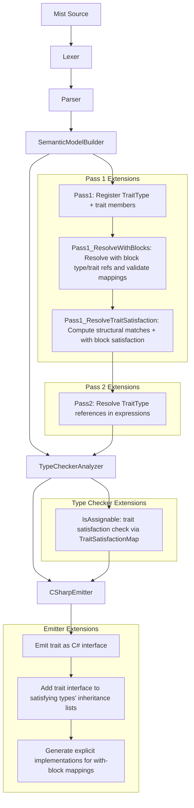
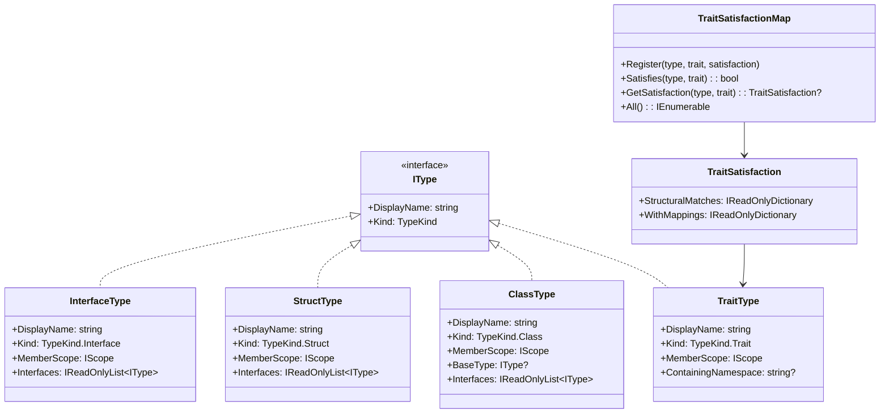
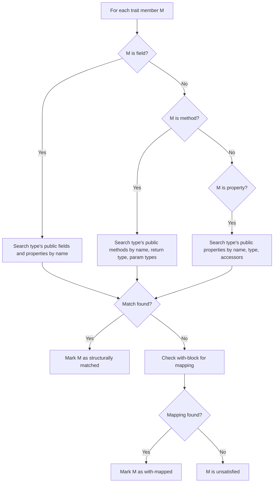

# Design Document: Traits

## Overview

This design adds traits — a structural typing mechanism — to the Mist programming language. Unlike Mist's existing interfaces (which use nominal typing via `: IFoo`), traits use late-bound structural matching: any type whose public members match the trait's declared members automatically satisfies the trait, with no explicit declaration required. When member names differ but types are compatible, an explicit `with` block maps the type's members to the trait's members.

Traits are a compile-time concept. They are lowered to C# interfaces during emission, with explicit interface implementations generated for `with` block mappings. Traits and interfaces coexist independently — satisfying a trait does not imply implementing an interface, and vice versa.

The implementation touches every stage of the compiler pipeline:

1. **Grammar** — New `TRAIT`, `WITH`, and `AS` keywords; `TraitDeclaration`, `TraitFieldDeclaration`, `TraitMethodDeclaration`, `TraitPropertyDeclaration` rules; `WithDeclaration` and `MemberMapping` rules; `TopLevelItem` extended with `WithDeclaration`
2. **Semantic Model** — New `TraitType`, `SymbolKind.Trait`, `TypeKind.Trait`; structural match checking algorithm; `with` block resolution and validation; trait satisfaction registry
3. **Type Checker** — Extend `IsAssignable` for trait assignability (structural + `with` block)
4. **C# Emitter** — Lower traits to C# interfaces; add trait interfaces to implementing types' inheritance lists; generate explicit interface implementations for `with` block mappings
5. **Pretty Printer** — Format trait declarations and `with` blocks
6. **Syntax Highlighting** — Add `trait`, `with`, and `as` to the TextMate grammar

### Design Decisions

- **Traits lower to C# interfaces**: Since C# has no native structural typing, each trait becomes a C# interface. Types that satisfy a trait (structurally or via `with`) get the generated interface added to their inheritance list. This reuses C#'s dispatch mechanism and avoids runtime reflection.
- **Explicit interface implementations for `with` mappings**: When a `with` block maps `a as x`, the emitter generates `int ITraitName.x => this.a;` (for fields/properties) or `int ITraitName.x(params) => this.a(params);` (for methods). This keeps the type's public API unchanged while satisfying the trait interface.
- **Structural match is name + type signature**: A type structurally satisfies a trait when every trait member has a corresponding public member on the type with the same name and compatible type. Fields can be matched by properties (since C# interfaces use properties for field-like members anyway).
- **`with` blocks are top-level declarations**: They sit alongside namespaces and type declarations in `TopLevelItem`, not inside type bodies. This keeps the mapping separate from the type definition, reinforcing that traits are external contracts.
- **Trait satisfaction is computed once and cached**: During a new semantic model pass (`Pass1_ResolveTraitSatisfaction`), the builder computes which types satisfy which traits (structurally or via `with` blocks) and stores the results on a `TraitSatisfactionMap`. The type checker and emitter read from this map.
- **Visibility constraint**: Only public members participate in structural matching. Private members are invisible to trait satisfaction. All trait members are implicitly public.
- **Duplicate `with` block detection**: If multiple `with` blocks exist for the same type-trait pair, a diagnostic is emitted. Only the first is used.

## Architecture

The trait feature integrates into the existing multi-pass compiler pipeline:



### Pipeline Integration Points

| Pipeline Stage | Change |
|---|---|
| `keywords.storm` | Add `TRAIT`, `WITH`, `AS` tokens |
| `Mist.storm` | Add `TraitDeclaration`, `TraitMemberDeclaration`, `TraitFieldDeclaration`, `TraitMethodDeclaration`, `TraitPropertyDeclaration`, `WithDeclaration`, `MemberMapping` rules; extend `TypeDeclaration` and `TopLevelItem` |
| `MistPrettyPrinter` | Handle `TraitTypeTypeDeclarationNode`, trait member formatting, `WithDeclaration` formatting |
| `SemanticModelBuilder` Pass 1 | Register `TraitType` and trait member symbols |
| `SemanticModelBuilder` Pass 1 (new sub-pass) | Resolve `with` blocks: validate type/trait references, validate member mappings |
| `SemanticModelBuilder` Pass 1 (new sub-pass) | Compute trait satisfaction: structural matching + `with` block combination |
| `SemanticModelBuilder` Pass 2 | Resolve `TraitType` references in type references and expressions |
| `TypeCheckerAnalyzer` | Extend `IsAssignable` to check trait satisfaction via `TraitSatisfactionMap` |
| `TypeCheckerAnalyzer` | Extend `LookupMemberType` to handle `TraitType` member scope |
| `CSharpEmitter` | Emit trait declarations as C# interfaces; add trait interfaces to satisfying types; generate explicit implementations for `with` mappings |
| `ISymbol` / `SymbolKind` | Add `Trait` variant |
| `IType` / `TypeKind` | Add `Trait` variant |
| `CSharpTypeMap` | Handle `TraitType` |
| `mist.tmLanguage.json` | Add `trait`, `with`, `as` keywords and trait declaration-name pattern |

## Components and Interfaces

### Grammar Changes (`keywords.storm`, `Mist.storm`)

**`keywords.storm`** — Add:
```
token TRAIT = "trait";
token WITH  = "with";
token AS    = "as";
```

**`Mist.storm`** — New rules:
```
rule TraitDeclaration = TRAIT name:IDENTIFIER
    LEFT_BRACE members:TraitMemberDeclaration* RIGHT_BRACE;

rule TraitMemberDeclaration
    = field:TraitFieldDeclaration       as TraitFieldMember
    | method:TraitMethodDeclaration     as TraitMethodMember
    | property:TraitPropertyDeclaration as TraitPropertyMember
    ;

rule TraitFieldDeclaration = type:TypeReference name:IDENTIFIER SEMICOLON;

rule TraitMethodDeclaration = returnType:TypeReference name:IDENTIFIER
    LEFT_PARENTHESIS parameters:ParameterList? RIGHT_PARENTHESIS SEMICOLON;

rule TraitPropertyDeclaration = type:TypeReference name:IDENTIFIER
    LEFT_BRACE accessors:InterfaceAccessorDeclaration+ RIGHT_BRACE;

rule WithDeclaration = WITH typeName:IDENTIFIER COLON traitName:IDENTIFIER
    LEFT_BRACE mappings:MemberMapping+ RIGHT_BRACE;

rule MemberMapping = sourceName:IDENTIFIER AS targetName:IDENTIFIER SEMICOLON;
```

**`Mist.storm`** — Modified rules:
```
rule TypeDeclaration
    = classDeclaration:ClassDeclaration           as ClassType
    | structDeclaration:StructDeclaration         as StructType
    | interfaceDeclaration:InterfaceDeclaration   as InterfaceType
    | traitDeclaration:TraitDeclaration           as TraitType
    ;

rule TopLevelItem
    = namespaceDeclaration:NamespaceDeclaration  as NamespaceItem
    | typeDeclaration:TypeDeclaration            as TypeItem
    | withDeclaration:WithDeclaration            as WithItem
    ;
```

**Design rationale for `TraitPropertyDeclaration`**: Trait properties reuse the existing `InterfaceAccessorDeclaration` rule (get/set followed by semicolon) since trait property signatures have the same shape as interface property signatures. This avoids duplicating grammar rules.

**Design rationale for `WithDeclaration` in `TopLevelItem`**: `with` blocks are top-level declarations rather than nested inside type bodies. This keeps the mapping external to the type, reinforcing that traits are structural contracts applied from outside. It also allows `with` blocks to be defined in separate files from the type they map.

### New Type: `TraitType` (`Source/Mist/Semantics/Model/Types/TraitType.cs`)

```csharp
public sealed class TraitType : IType
{
    public string DisplayName { get; }
    public TypeKind Kind => TypeKind.Trait;
    public IScope MemberScope { get; }
    public string? ContainingNamespace { get; }

    public TraitType(string displayName, IScope memberScope, string? containingNamespace)
    {
        DisplayName = displayName;
        MemberScope = memberScope;
        ContainingNamespace = containingNamespace;
    }
}
```

### New Data Structure: `TraitSatisfactionMap`

Stored on the `SemanticModel` and accessible via `ISemanticModel`:

```csharp
/// <summary>
/// Records which types satisfy which traits, and how (structural vs with-block).
/// </summary>
public sealed class TraitSatisfactionMap
{
    /// <summary>
    /// Key: (implementingType, traitType). Value: the satisfaction record.
    /// </summary>
    private readonly Dictionary<(IType, TraitType), TraitSatisfaction> _satisfactions = new();

    public void Register(IType type, TraitType trait, TraitSatisfaction satisfaction)
        => _satisfactions[(type, trait)] = satisfaction;

    public bool Satisfies(IType type, TraitType trait)
        => _satisfactions.ContainsKey((type, trait));

    public TraitSatisfaction? GetSatisfaction(IType type, TraitType trait)
        => _satisfactions.GetValueOrDefault((type, trait));

    public IEnumerable<(IType Type, TraitType Trait, TraitSatisfaction Satisfaction)> All()
        => _satisfactions.Select(kvp => (kvp.Key.Item1, kvp.Key.Item2, kvp.Value));
}

/// <summary>
/// Describes how a type satisfies a trait.
/// </summary>
public sealed class TraitSatisfaction
{
    /// <summary>
    /// Members matched structurally (same name, compatible type).
    /// Key: trait member name. Value: the matching type member symbol.
    /// </summary>
    public IReadOnlyDictionary<string, ISymbol> StructuralMatches { get; init; }
        = new Dictionary<string, ISymbol>();

    /// <summary>
    /// Members matched via with-block mapping.
    /// Key: trait member name. Value: (source member symbol, mapping AST node).
    /// </summary>
    public IReadOnlyDictionary<string, ISymbol> WithMappings { get; init; }
        = new Dictionary<string, ISymbol>();
}
```

### Extended Enums

**`TypeKind`** — Add variant:
```csharp
public enum TypeKind
{
    Class,
    Struct,
    Interface,
    Trait,
}
```

**`SymbolKind`** — Add variant:
```csharp
public enum SymbolKind
{
    Namespace,
    Class,
    Struct,
    Interface,
    Trait,
    Field,
    Constructor,
    Method,
    Parameter,
    LocalVariable,
    Property,
    Indexer,
}
```

### SemanticModelBuilder Extensions

#### Pass 1: Register Trait Types

In `RegisterTypeDeclaration`, add a case for `TraitTypeTypeDeclarationNode`:

```csharp
case TraitTypeTypeDeclarationNode traitTypeNode:
    RegisterTraitDeclaration(
        traitTypeNode.TraitDeclaration,
        parentScope, symbolTable, namespaceName, sourceText, diagnostics);
    break;
```

`RegisterTraitDeclaration` creates a `TraitType` with a member scope, registers a symbol with `SymbolKind.Trait`, and registers each trait member:
- `TraitFieldMember` → `SymbolKind.Field`
- `TraitMethodMember` → `SymbolKind.Method`
- `TraitPropertyMember` → `SymbolKind.Property`

#### Pass 1: Handle `WithDeclaration` in Top-Level Items

In `Pass1_RegisterTypes`, add handling for `WithItemTopLevelItemNode`:

```csharp
case WithItemTopLevelItemNode withItem:
    // Store the WithDeclaration AST node for later resolution.
    // No symbols are registered at this point — with blocks don't declare types.
    withDeclarations.Add(withItem.WithDeclaration);
    break;
```

The `with` declarations are collected during Pass 1 and processed in a dedicated sub-pass after all types are registered.

#### New Sub-Pass: `Pass1_ResolveWithBlocks`

Runs after all types are registered and interface lists are resolved. For each `WithDeclaration`:

1. Resolve `typeName` to a `ClassType` or `StructType`. Emit `MIST_TRAIT_WITH_UNDEFINED_TYPE` if not found.
2. Resolve `traitName` to a `TraitType`. Emit `MIST_TRAIT_WITH_UNDEFINED_TRAIT` if not found.
3. Check for duplicate `with` blocks for the same type-trait pair. Emit `MIST_TRAIT_DUPLICATE_WITH` if found.
4. For each `MemberMapping`:
   - Resolve `sourceName` to a public member on the type. Emit `MIST_TRAIT_WITH_UNDEFINED_SOURCE` if not found or not public.
   - Resolve `targetName` to a member in the trait. Emit `MIST_TRAIT_WITH_UNDEFINED_TARGET` if not found.
   - Check type compatibility between source and target. Emit `MIST_TRAIT_WITH_TYPE_MISMATCH` if incompatible.
5. Store validated mappings in a `WithBlockRegistry` for use by the satisfaction pass.

#### New Sub-Pass: `Pass1_ResolveTraitSatisfaction`

Runs after `with` blocks are resolved. For each trait in the program, and for each class/struct:

1. **Structural matching**: For each trait member, search the type's public members for a match:
   - **Field members**: Match by name against public fields or public properties with compatible type.
   - **Method members**: Match by name, return type, and parameter types against public methods.
   - **Property members**: Match by name, compatible type, and at least the accessors declared in the trait.
2. **With-block augmentation**: If a `with` block exists for this type-trait pair, apply its mappings to cover any trait members not structurally matched.
3. **Satisfaction check**: If all trait members are covered (structurally or via `with`), register the satisfaction in the `TraitSatisfactionMap`.
4. **No diagnostic at this point**: Trait satisfaction is lazy — a type only needs to satisfy a trait when it's assigned to a trait-typed variable. The type checker handles that.

#### Pass 2: Resolve Trait Type References

Extend type reference resolution to handle `SymbolKind.Trait` symbols, returning their `TraitType`. When an identifier resolves to a symbol with `SymbolKind.Trait`, return its `TraitType`.

### TypeCheckerAnalyzer Extensions

#### Extend `IsAssignable` for Trait Assignability

Add a new case in `IsAssignable`:

```csharp
// Trait assignability:
// A class/struct satisfying a trait (structurally or via with block)
// is assignable to that trait.
if (target is TraitType targetTrait)
{
    if (SatisfiesTrait(source, targetTrait))
        return true;
}
```

The `SatisfiesTrait` helper queries the `TraitSatisfactionMap` on the semantic model. If the source type is not in the map for the target trait, the assignment is rejected.

When the assignment is rejected, `CheckAssignability` emits a diagnostic that names the trait, the type, and lists each unsatisfied trait member (Requirement 10.1).

#### Extend `LookupMemberType` for `TraitType`

Add `TraitType` to the `memberScope` switch in `LookupMemberType`:

```csharp
TraitType tt => tt.MemberScope,
```

This allows member access on trait-typed variables to resolve against the trait's member scope (Requirements 8.1, 8.2, 8.3).

### CSharpEmitter Extensions

#### Emit Trait Declarations as C# Interfaces

Add `TraitTypeTypeDeclarationNode` case to `EmitTypeDeclaration`:

```csharp
case TraitTypeTypeDeclarationNode traitType:
    EmitTraitDeclaration(traitType.TraitDeclaration);
    break;
```

`EmitTraitDeclaration` emits a C# interface:
- Trait field members → C# interface properties with a getter: `int X { get; }`
- Trait method members → C# interface method signatures: `int Compute(int a);`
- Trait property members → C# interface property signatures with matching accessors

```csharp
private void EmitTraitDeclaration(TraitDeclarationNode traitDecl)
{
    var name = traitDecl.Name.Lexeme;
    AppendLine($"interface {name}");
    AppendLine("{");
    _indentLevel++;

    foreach (var member in traitDecl.Members)
    {
        switch (member)
        {
            case TraitFieldMemberTraitMemberDeclarationNode fieldMember:
                EmitTraitFieldAsProperty(fieldMember.Field);
                break;
            case TraitMethodMemberTraitMemberDeclarationNode methodMember:
                EmitTraitMethodDeclaration(methodMember.Method);
                break;
            case TraitPropertyMemberTraitMemberDeclarationNode propertyMember:
                EmitTraitPropertyDeclaration(propertyMember.Property);
                break;
        }
    }

    _indentLevel--;
    AppendLine("}");
}
```

#### Add Trait Interfaces to Satisfying Types

When emitting a class or struct declaration, consult the `TraitSatisfactionMap` to find all traits the type satisfies. Append the trait interface names to the type's inheritance list:

```csharp
// In EmitClassDeclaration, after building the base clause from BaseType + Interfaces:
foreach (var (_, trait, _) in model.TraitSatisfactionMap.All()
    .Where(s => ReferenceEquals(s.Type, classType)))
{
    parts.Add(trait.DisplayName);
}
```

#### Generate Explicit Implementations for `with` Mappings

For each `with`-mapped member, emit an explicit interface implementation that delegates to the source member:

```csharp
// For a field/property mapping: `a as x` where trait has `int x;`
// Emit: int ITraitName.x => this.a;

// For a method mapping: `compute as calculate` where trait has `int calculate(int a);`
// Emit: int ITraitName.calculate(int a) => this.compute(a);
```

These explicit implementations are emitted after the type's regular members, inside the class/struct body.

### MistPrettyPrinter Extensions

Add handling for:
- `TraitTypeTypeDeclarationNode` in `EmitTypeDeclaration`
- `EmitTraitDeclaration` — format `trait Name { ... }` with proper indentation
- `EmitTraitFieldDeclaration` — format `type name;`
- `EmitTraitMethodDeclaration` — format `returnType name(parameters);`
- `EmitTraitPropertyDeclaration` — format `type name { get; set; }`
- `WithItemTopLevelItemNode` in `EmitCompilationUnit` top-level item loop
- `EmitWithDeclaration` — format `with TypeName : TraitName { ... }`
- `EmitMemberMapping` — format `sourceName as targetName;`

### CSharpTypeMap Extension

Add `TraitType` case:
```csharp
TraitType t => t.DisplayName,
```

### TextMate Grammar Extensions

Add `trait` to the keyword declaration pattern:
```json
"match": "\\b(namespace|using|class|struct|interface|trait)\\b"
```

Add trait declaration name pattern:
```json
{
    "match": "\\b(trait)\\s+([a-zA-Z_]\\w*)",
    "captures": {
        "1": { "name": "keyword.declaration.mist" },
        "2": { "name": "entity.name.type.trait.mist" }
    }
}
```

Add `with` and `as` to keyword patterns:
```json
"match": "\\b(with|as)\\b"
```

### New Diagnostic IDs

| ID | Stage | Message |
|---|---|---|
| `MIST_TRAIT_WITH_UNDEFINED_TYPE` | SemanticModelConstruction | The type '{name}' in the `with` block could not be found. |
| `MIST_TRAIT_WITH_UNDEFINED_TRAIT` | SemanticModelConstruction | The trait '{name}' in the `with` block could not be found. |
| `MIST_TRAIT_DUPLICATE_WITH` | SemanticModelConstruction | Duplicate `with` block for type '{typeName}' and trait '{traitName}'. |
| `MIST_TRAIT_WITH_UNDEFINED_SOURCE` | SemanticModelConstruction | The member '{name}' does not exist as a public member on type '{typeName}'. |
| `MIST_TRAIT_WITH_UNDEFINED_TARGET` | SemanticModelConstruction | The member '{name}' does not exist in trait '{traitName}'. |
| `MIST_TRAIT_WITH_TYPE_MISMATCH` | SemanticModelConstruction | Cannot map '{typeName}.{sourceName}' to '{traitName}.{targetName}': expected type '{expected}', found '{actual}'. |
| `MIST_TRAIT_UNSATISFIED` | TypeChecker | Type '{typeName}' does not satisfy trait '{traitName}'. Missing members: {memberList}. |
| `MIST_TRAIT_MEMBER_VISIBILITY` | SemanticModelConstruction | Member '{typeName}.{memberName}' exists but is not public; trait matching requires public visibility. |
| `MIST_TRAIT_WITH_UNSATISFIED` | SemanticModelConstruction | `with` block for '{typeName} : {traitName}' does not cover all trait members. Unsatisfied: {memberList}. |

## Data Models

### TraitType



### AST Nodes (Storm-generated)

The Storm source generator will produce these node types from the grammar rules:

- `TraitDeclarationNode` — name, members array
- `TraitMemberDeclarationNode` — base for trait member variants
- `TraitFieldDeclarationNode` — type reference, name
- `TraitMethodDeclarationNode` — return type, name, optional parameter list
- `TraitPropertyDeclarationNode` — type reference, name, accessor declarations
- `TraitTypeTypeDeclarationNode` — wraps `TraitDeclarationNode` as a `TypeDeclaration` variant
- `WithDeclarationNode` — type name, trait name, mappings array
- `MemberMappingNode` — source name, target name
- `WithItemTopLevelItemNode` — wraps `WithDeclarationNode` as a `TopLevelItem` variant

### Symbol Registration

| Declaration | SymbolKind | DeclaredType |
|---|---|---|
| `trait Printable { ... }` | `Trait` | `TraitType("Printable", ...)` |
| Trait field `int x;` | `Field` | Resolved type (e.g., `Int32`) |
| Trait method `void Print();` | `Method` | Return type (e.g., `VoidType`) |
| Trait property `string Name { get; }` | `Property` | Resolved type (e.g., `String`) |

### Structural Match Algorithm




## Correctness Properties

*A property is a characteristic or behavior that should hold true across all valid executions of a system — essentially, a formal statement about what the system should do. Properties serve as the bridge between human-readable specifications and machine-verifiable correctness guarantees.*

### Property 1: Trait and with-block declaration round-trip

*For any* valid Mist AST containing trait declarations (with varying combinations of field, method, and property members, including empty traits) and `with` blocks (with varying numbers of member mappings, including same-name mappings), pretty-printing the AST and then parsing the result and pretty-printing again SHALL produce identical output.

**Validates: Requirements 1.2, 1.3, 1.4, 1.5, 1.6, 1.7, 1.8, 2.2, 2.3, 2.4, 2.5, 2.6, 3.1, 3.2, 3.3, 3.4, 3.5, 3.6, 3.7**

### Property 2: Trait type registration

*For any* set of trait declarations with varying numbers of field, method, and property members, the semantic model builder SHALL create a `TraitType` for each trait with `TypeKind.Trait`, register a symbol with `SymbolKind.Trait` in the parent scope, and register a symbol for each trait member in the trait's member scope (`SymbolKind.Field` for fields, `SymbolKind.Method` for methods, `SymbolKind.Property` for properties). The count of member symbols in the trait's member scope SHALL equal the number of members declared in the trait.

**Validates: Requirements 4.1, 4.2, 4.3**

### Property 3: Structural match correctness

*For any* type (class or struct) and *for any* trait, the structural match result SHALL be `true` if and only if every trait member has a corresponding public member on the type with the same name and compatible type signature (fields matched by public fields or properties, methods matched by name + return type + parameter types, properties matched by name + type + accessor subset). Private members SHALL be excluded from matching, and name matches with incompatible type signatures SHALL cause the match to fail.

**Validates: Requirements 5.1, 5.2, 5.3, 5.4, 5.5, 5.6, 5.7**

### Property 4: With-block validation diagnostics

*For any* `with` block that references an undefined type name, an undefined trait name, an undefined source member, an undefined target trait member, or maps a source member with an incompatible type signature, the semantic model builder SHALL emit exactly one diagnostic error for each invalid reference. *For any* duplicate `with` block for the same type-trait pair, the semantic model builder SHALL emit a diagnostic error.

**Validates: Requirements 6.2, 6.3, 6.4, 6.5, 6.6, 6.9, 10.2, 10.3, 10.4**

### Property 5: Trait satisfaction via with-block

*For any* type and trait where a `with` block provides valid mappings for all trait members not already structurally matched by name, the semantic model builder SHALL register the type as satisfying the trait in the `TraitSatisfactionMap`. Conversely, *for any* `with` block that does not cover all unmapped trait members, the semantic model builder SHALL emit a diagnostic listing the unsatisfied members.

**Validates: Requirements 6.1, 6.7, 6.8**

### Property 6: Trait assignability

*For any* type that satisfies a trait (structurally or via a `with` block), `IsAssignable(sourceType, traitType)` SHALL return `true`. *For any* type that does not satisfy a trait, `IsAssignable(sourceType, traitType)` SHALL return `false`. This applies to variable assignments, method parameter passing, and return type checking.

**Validates: Requirements 7.1, 7.2, 7.3, 7.4, 7.5**

### Property 7: Trait member access

*For any* trait-typed variable and *for any* member name, if the member name exists in the trait's member scope, `LookupMemberType` SHALL return the member's declared type without emitting a diagnostic. If the member name does not exist in the trait's member scope, `LookupMemberType` SHALL emit a `MIST_UNDEFINED_MEMBER` diagnostic.

**Validates: Requirements 8.1, 8.2, 8.3**

### Property 8: Trait C# emission correctness

*For any* valid Mist program containing trait declarations, types that structurally satisfy traits, and types that satisfy traits via `with` blocks, the emitted C# code SHALL contain: (a) a C# interface declaration for each trait with field members as properties with getters, method members as method signatures, and property members as property signatures; (b) the trait interface name in the inheritance list of each satisfying type; (c) explicit interface implementations for each `with`-mapped member that delegate to the source member.

**Validates: Requirements 9.1, 9.2, 9.3, 9.4, 9.5, 9.6, 9.7**

### Property 9: Trait and interface coexistence

*For any* type that simultaneously implements one or more interfaces (nominal typing) and satisfies one or more traits (structural typing), the compiler SHALL process both independently without conflict. Satisfying a trait SHALL NOT imply implementing an interface with the same member signatures, and implementing an interface SHALL NOT imply satisfying a trait with the same member signatures.

**Validates: Requirements 11.1, 11.2, 11.3**

## Error Handling

### Compilation Errors (Diagnostics)

| Scenario | Diagnostic ID | Severity | Recovery |
|---|---|---|---|
| Undefined type in `with` block | `MIST_TRAIT_WITH_UNDEFINED_TYPE` | Error | Skip `with` block, continue |
| Undefined trait in `with` block | `MIST_TRAIT_WITH_UNDEFINED_TRAIT` | Error | Skip `with` block, continue |
| Duplicate `with` block | `MIST_TRAIT_DUPLICATE_WITH` | Error | Use first, ignore duplicate |
| Undefined source member in mapping | `MIST_TRAIT_WITH_UNDEFINED_SOURCE` | Error | Skip mapping, continue |
| Undefined target trait member in mapping | `MIST_TRAIT_WITH_UNDEFINED_TARGET` | Error | Skip mapping, continue |
| Type mismatch in member mapping | `MIST_TRAIT_WITH_TYPE_MISMATCH` | Error | Skip mapping, continue |
| Incomplete `with` block | `MIST_TRAIT_WITH_UNSATISFIED` | Error | Report missing members, continue |
| Type not assignable to trait | `MIST_TRAIT_UNSATISFIED` | Error | Report unsatisfied members, continue |
| Private member matches trait name | `MIST_TRAIT_MEMBER_VISIBILITY` | Error | Report visibility issue, continue |
| Member not found on trait type | `MIST_UNDEFINED_MEMBER` (existing) | Error | Return `UnknownType`, continue |

### Error Recovery Strategy

The compiler follows the existing pattern of continuing compilation after errors to report as many issues as possible in a single pass:

- **Invalid `with` blocks**: The `with` block is skipped entirely if the type or trait reference is invalid. Individual invalid mappings are skipped but other mappings in the same block are still processed.
- **Unsatisfied traits**: When a type is assigned to a trait-typed variable but doesn't satisfy the trait, the diagnostic lists all unsatisfied members. Compilation continues to report further errors.
- **Duplicate `with` blocks**: The first `with` block is used; subsequent duplicates are ignored after emitting a diagnostic.
- **Visibility issues**: When a private member matches a trait member name, a specific diagnostic is emitted to guide the developer. The member is not counted as a match.

## Testing Strategy

### Property-Based Testing (FsCheck 3.1.0 + xUnit)

The project uses **FsCheck 3.1.0** with **xUnit** for property-based testing. Each correctness property maps to one or more PBT test classes.

**Configuration**: Minimum 100 iterations per property test.

**Generator extensions needed**:
- Add generators for `TraitDeclarationNode` with varying field, method, and property members
- Add generators for `WithDeclarationNode` with varying member mappings
- Add generators for `TraitType` instances with random member scopes
- Add generators for complete programs containing traits, implementing types, `with` blocks, and trait-typed variables
- Add generators for invalid programs (undefined references, type mismatches, visibility issues, duplicate `with` blocks)
- Extend `MistProgramGenerator` to include trait declarations and `with` blocks in generated programs

### Test Plan

| Property | Test Class | Type |
|---|---|---|
| Property 1: Round-trip | `TraitRoundTripPropertyTests` | PBT |
| Property 2: Type registration | `TraitTypeRegistrationPropertyTests` | PBT |
| Property 3: Structural match | `TraitStructuralMatchPropertyTests` | PBT |
| Property 4: With-block validation | `TraitWithBlockValidationPropertyTests` | PBT |
| Property 5: With-block satisfaction | `TraitWithBlockSatisfactionPropertyTests` | PBT |
| Property 6: Assignability | `TraitAssignabilityPropertyTests` | PBT |
| Property 7: Member access | `TraitMemberAccessPropertyTests` | PBT |
| Property 8: Emission correctness | `TraitEmissionPropertyTests` | PBT |
| Property 9: Coexistence | `TraitInterfaceCoexistencePropertyTests` | PBT |
| Sample app compilation | `TraitSampleIntegrationTests` | Integration |
| Syntax highlighting | Manual verification | Manual |
| CSHARP_FEATURES.md update | Manual verification | Manual |

### Unit Tests (Example-Based)

In addition to PBT, targeted unit tests cover:
- Empty trait declaration (edge case for Properties 1, 2)
- Trait with only field members (edge case for Property 3)
- Trait with only method members (edge case for Property 3)
- Trait with only property members (edge case for Property 3)
- `with` block with same-name mappings (edge case for Property 4)
- Type with both interface implementation and trait satisfaction (edge case for Property 9)
- Trait field matched by a property on the type (edge case for Property 3)
- `with` block where some members are structurally matched and others are mapped (edge case for Property 5)
- Method argument type checking through trait-typed parameter (edge case for Property 6)

### Tag Format

Each property-based test is tagged with:
```
Feature: traits, Property {number}: {property_text}
```
