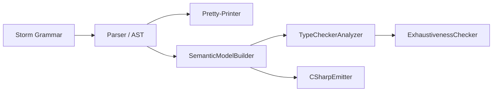

# Design Document: Tuple Positional Pattern Matching

## Overview

This design adds tuple positional patterns to the Mist compiler, enabling developers to match tuple values by position using parenthesized syntax (e.g., `(> 0, > 0)`) instead of the verbose property pattern workaround (`{ Item1: > 0, Item2: > 0 }`). The feature mirrors C#'s positional pattern syntax for tuples and integrates with every stage of the compiler pipeline.

The implementation touches:
- **Grammar** (Storm): New `TuplePositionalPattern` alternative in `PrimaryPattern`
- **Parser** (auto-generated): Produces AST nodes with `first`, `rest`, `additional` fields
- **Pretty-printer** (`MistPrettyPrinter`): Round-trip formatting support
- **Semantic model** (`SemanticModelBuilder`): Variable introduction from pattern elements
- **Type checker** (`TypeCheckerAnalyzer`): Arity validation, element type checking, nested validation
- **Exhaustiveness checker** (`ExhaustivenessChecker`): Catch-all recognition for tuple patterns
- **C# emitter** (`CSharpEmitter`): Lowering to C# positional pattern syntax
- **Diagnostics**: Clear error messages for misuse
- **TextMate grammar**: Syntax highlighting in VS Code
- **Book**: Documentation with compilable snippets
- **Sample app**: End-to-end demonstration

## Architecture

The feature follows the existing compiler pipeline architecture. Each stage processes the new `TuplePositionalPattern` node type by extending the existing pattern-handling switch statements:



**Design Decision: Grammar placement.** The `TuplePositionalPattern` alternative is placed *before* `ParenthesizedPattern` in the `PrimaryPattern` rule. The Storm parser uses ordered alternatives (PEG-style), so the presence of a comma after the first element pattern commits to the tuple interpretation. A single pattern in parentheses without a comma falls through to `ParenthesizedPattern`. This mirrors how `TupleLiteralExpression` is ordered before `ParenthesizedExpression` in the `Primary` expression rule.

**Design Decision: Field naming convention.** The AST node uses `first`, `rest`, and `additional` fields, consistent with `TupleTypeRef`, `TupleLiteralExpression`, and `TupleDeconstructionElement` throughout the grammar. `first` is the first element pattern, `rest` is the second (required for minimum arity of 2), and `additional` captures zero or more remaining elements.

**Design Decision: No trailing comma.** Unlike `SwitchArmList` and `EnumMemberList` which allow trailing commas, tuple positional patterns do not. This matches C#'s positional pattern syntax and the existing `TupleTypeRef` rule.

## Components and Interfaces

### 1. Grammar Changes (`Source/Mist/Grammar/Mist.storm`)

Add a new alternative to `PrimaryPattern` before `ParenthesizedPattern`:

```storm
rule PrimaryPattern
    = ...existing alternatives...
    | LEFT_PARENTHESIS first:Pattern COMMA rest:Pattern (COMMA additional:Pattern)* RIGHT_PARENTHESIS  as TuplePositionalPattern
    | LEFT_PARENTHESIS inner:Pattern RIGHT_PARENTHESIS                      as ParenthesizedPattern
    | literal:ConstantLiteral                                               as ConstantPattern
    ;
```

The Storm source generator will automatically produce:
- `TuplePositionalPatternPrimaryPatternNode` — the AST node class
- Properties: `First` (PatternNode), `Rest` (PatternNode), `Additionals` (IReadOnlyList<PatternNode>)

No new tokens or keywords are required. The syntax reuses `LEFT_PARENTHESIS`, `COMMA`, and `RIGHT_PARENTHESIS`.

### 2. Pretty-Printer (`Source/Mist/Parsing/MistPrettyPrinter.cs`)

Add a case to the `EmitPrimaryPattern` switch for `TuplePositionalPatternPrimaryPatternNode`:

```csharp
case TuplePositionalPatternPrimaryPatternNode tuplePattern:
{
    var elements = new List<string>();
    elements.Add(EmitPattern(tuplePattern.First));
    elements.Add(EmitPattern(tuplePattern.Rest));
    foreach (var additional in tuplePattern.Additionals)
    {
        elements.Add(EmitPattern(additional));
    }
    return $"({string.Join(", ", elements)})";
}
```

This produces `(sub1, sub2, ..., subN)` with comma-space separation and no trailing comma.

### 3. Semantic Model Builder (`Source/Mist/Semantics/Model/SemanticModelBuilder.cs`)

Two methods need extension:

**`CollectFromPattern`** — Add a case for `TuplePositionalPatternPrimaryPatternNode` that:
1. Resolves the scrutinee type to determine if it's a `TupleType`
2. If it is, iterates element patterns and recursively calls `CollectFromPattern` for each, passing the corresponding element type as the scrutinee type
3. If it's not a tuple type (or is `ErrorType`), still recurses into subpatterns using `ErrorType` as the element type (to collect variables even when types are wrong)

**`ResolvePattern`** — Add a case that recursively resolves each element subpattern, passing the corresponding tuple element type.

The variable introduction logic is handled by the existing recursive `CollectFromPattern` infrastructure — `VarPattern` and `TypePattern` cases already introduce variables into the `thenScope`. The tuple positional pattern just needs to route each element to the correct scrutinee type.

### 4. Type Checker (`Source/Mist/Analysis/Builtin/TypeCheckerAnalyzer.cs`)

Add a case to `CheckPrimaryPattern`:

```csharp
case TuplePositionalPatternPrimaryPatternNode tuplePattern:
{
    if (scrutineeType is ErrorType)
        break; // Suppress cascading errors

    if (scrutineeType is not TupleType tupleType)
    {
        diagnostics.Add(MakeDiagnostic(
            TuplePositionalPatternRequiresTupleType.Value,
            $"Positional pattern requires a tuple type, but the scrutinee has type '{scrutineeType.DisplayName}'",
            tuplePattern, model));
        break;
    }

    // Collect element patterns
    var elementPatterns = new List<PatternNode> { tuplePattern.First, tuplePattern.Rest };
    elementPatterns.AddRange(tuplePattern.Additionals);

    if (elementPatterns.Count != tupleType.Arity)
    {
        diagnostics.Add(MakeDiagnostic(
            TuplePositionalPatternArityMismatch.Value,
            $"Tuple positional pattern has {elementPatterns.Count} elements, but the tuple type '{tupleType.DisplayName}' has {tupleType.Arity} elements",
            tuplePattern, model));
        break;
    }

    // Validate each element against its corresponding type
    for (var i = 0; i < elementPatterns.Count; i++)
    {
        CheckPattern(elementPatterns[i], tupleType.ElementTypes[i], model, diagnostics);
    }
    break;
}
```

**New diagnostic IDs:**
- `TuplePositionalPatternRequiresTupleType` — applied to non-tuple scrutinee
- `TuplePositionalPatternArityMismatch` — element count doesn't match tuple arity

Element-level diagnostics (type incompatibility, relational on non-comparable) are handled by the existing `CheckPattern` recursion — each element is validated independently, so multiple errors produce multiple diagnostics.

**Duplicate pattern variable detection:** The existing infrastructure in `CollectPatternVariablesFromPattern` already detects duplicate variable names within a pattern scope. The tuple positional pattern just needs to recurse into its elements, and the existing duplicate-name check will catch conflicts across nesting levels.

### 5. Exhaustiveness Checker (`Source/Mist/Analysis/Builtin/ExhaustivenessChecker.cs`)

Extend `IsCatchAllPattern` to recognize tuple positional patterns where every element is a catch-all:

```csharp
private static bool IsCatchAllPattern(PatternNode pattern)
{
    var primary = TryGetSinglePrimaryPattern(pattern);
    if (primary is null)
        return false;

    if (primary is VarPatternPrimaryPatternNode or DiscardPatternPrimaryPatternNode)
        return true;

    // A tuple positional pattern with all catch-all elements is itself a catch-all
    if (primary is TuplePositionalPatternPrimaryPatternNode tuplePattern)
    {
        var elements = new List<PatternNode> { tuplePattern.First, tuplePattern.Rest };
        elements.AddRange(tuplePattern.Additionals);
        return elements.All(IsCatchAllPattern);
    }

    return false;
}
```

This recursive check handles nested tuple patterns: `((_, _), _)` is a catch-all for `((int, int), string)`.

### 6. C# Emitter (`Source/Mist/Backends/CSharpTranspiler/CSharpEmitter.cs`)

Two locations need extension:

**`EmitPattern` (for switch arms / direct pattern emission):**

```csharp
case TuplePositionalPatternPrimaryPatternNode tuplePattern:
{
    var elements = new List<string>();
    elements.Add(EmitPattern(tuplePattern.First, scrutineeType is TupleType tt ? tt.ElementTypes[0] : null));
    elements.Add(EmitPattern(tuplePattern.Rest, scrutineeType is TupleType tt2 ? tt2.ElementTypes[1] : null));
    var idx = 2;
    foreach (var additional in tuplePattern.Additionals)
    {
        elements.Add(EmitPattern(additional, scrutineeType is TupleType tt3 && idx < tt3.ElementTypes.Count ? tt3.ElementTypes[idx] : null));
        idx++;
    }
    return $"({string.Join(", ", elements)})";
}
```

**`EmitPatternConditions` (for `is` expression lowering to conditions):**

The emitter needs to handle tuple positional patterns in `is` expressions. Since C# supports positional patterns in `is` expressions directly, the emitter can emit `scrutinee is (p1, p2, ..., pN)` as-is. The existing `EmitPattern` method (which produces the pattern string) is used in both contexts.

**Design Decision: Direct C# positional pattern emission.** Mist's tuple positional pattern maps 1:1 to C#'s positional pattern syntax. No desugaring or transformation is needed — the emitter produces `(sub1, sub2, ..., subN)` which is valid C# for both `is` expressions and switch arms. This is the same approach used for property patterns and list patterns.

### 7. TextMate Grammar (`Editor/mist-syntax-highlighting/syntaxes/mist.tmLanguage.json`)

The existing TextMate grammar already handles the individual token types that appear within tuple positional patterns:
- Relational operators (`<`, `>`, `<=`, `>=`) → `keyword.operator.comparison.mist`
- Numeric literals → `constant.numeric.*.mist`
- Boolean literals → `constant.language.boolean.mist`
- `var` → `keyword.other.mist`
- Type names → `entity.name.type.mist`
- Primitive types → `storage.type.primitive.mist`
- `_` (discard) → `variable.language.mist`

The key concern is ensuring that identifiers or type names preceding the opening parenthesis of a tuple pattern in a pattern context are not incorrectly scoped as `entity.name.function.mist` (which would happen if the function-call pattern matches). The existing grammar's pattern for function calls requires a `.` accessor before the identifier, so standalone `identifier(` in pattern position should not trigger function-call highlighting.

Additionally, the comma-separated subpatterns within parentheses must continue receiving pattern-context highlighting. Since the TextMate grammar uses a flat token-based approach (not a recursive descent), and the individual tokens (operators, literals, keywords) are already scoped correctly at the top level, tuple positional patterns should highlight correctly without additional rules. The parentheses and commas are already handled by the `punctuation` repository.

**Verification needed:** If testing reveals that the existing grammar incorrectly highlights tuple positional patterns (e.g., treating the content after a comma as non-pattern), a dedicated pattern-context rule may be needed. This would use a `begin`/`end` pattern matching `(` to `)` in pattern position.

### 8. Diagnostic Messages

| Diagnostic ID | Severity | Message Template |
|---|---|---|
| `MIST_TC_XXXX` | Error | `Positional pattern requires a tuple type, but the scrutinee has type '{actualType}'` |
| `MIST_TC_XXXY` | Error | `Tuple positional pattern has {patternCount} elements, but the tuple type '{tupleDisplayName}' has {tupleArity} elements` |

Element-level diagnostics reuse existing diagnostic IDs (e.g., `MIST_TC_0060` for type incompatibility, relational pattern diagnostics for non-comparable types). The position information comes from the source span of the individual element pattern node.

### 9. Sample Application (`samples/TuplePatternMatching/`)

Structure:
- `samples/TuplePatternMatching/Program.mist` — Main demonstration file
- `samples/TuplePatternMatching/mist.toml` — Project file with `name = "TuplePatternMatching"`

The sample uses Allman brace style and includes `// PROOF:` comments as specified in the requirements proof code. It exercises every permutation: constant, relational, logical, var, discard, type, nested, switch arms, when guards, and 3-element patterns.

Integration: `samples/AllFeatures/Program.mist` calls `TuplePatternMatching.Program.RunDemo()`.

### 10. Book Documentation

New files:
- `book/snippets/type-system/pattern-matching/tuple-positional.mist` + `.cs`
- `book/snippets/type-system/pattern-matching/tuple-positional-nested.mist` + `.cs`
- `book/snippets/type-system/switch-expressions/tuple-positional.mist` + `.cs`

New sections:
- "Tuple Positional Patterns" in `book/src/type-system/pattern-matching.md` (after "List Patterns")
- "Tuple Positional Pattern Arms" in `book/src/type-system/switch-expressions.md` (after "Relational and Logical Patterns")

All snippets follow the book snippet policy: complete compilable programs with `using Standard;`, namespace, class with `Main`. The `.cs` files are generated by the SnippetEmitter tool.

## Data Models

### AST Node (auto-generated from Storm)

```csharp
// Generated by Storm source generator
public sealed class TuplePositionalPatternPrimaryPatternNode : PrimaryPatternNode
{
    public PatternNode First { get; }      // First element pattern
    public PatternNode Rest { get; }       // Second element pattern (required)
    public IReadOnlyList<PatternNode> Additionals { get; }  // 3rd, 4th, ... element patterns
}
```

The total arity is always `2 + Additionals.Count`.

### Type System Integration

No new types are introduced. The feature operates on the existing `TupleType` class:

```csharp
public sealed class TupleType : IType
{
    public IReadOnlyList<IType> ElementTypes { get; }
    public IReadOnlyList<string?>? ElementNames { get; }
    public int Arity => ElementTypes.Count;
}
```

The type checker uses `TupleType.ElementTypes[i]` to validate each positional element pattern against its corresponding type.

## Correctness Properties

*A property is a characteristic or behavior that should hold true across all valid executions of a system — essentially, a formal statement about what the system should do. Properties serve as the bridge between human-readable specifications and machine-verifiable correctness guarantees.*

### Property 1: Pretty-print round-trip

*For any* valid tuple positional pattern AST (with arbitrary subpatterns including nested tuple patterns, relational, logical, constant, var, discard, type, and property patterns, at any arity ≥ 2 and any nesting depth), pretty-printing the pattern to source text and then parsing that source text back SHALL produce an AST that pretty-prints to identical text.

**Validates: Requirements 1.1, 1.3, 1.4, 5.1, 6.1, 6.2, 6.3**

### Property 2: Variable introduction correctness

*For any* tuple type and any tuple positional pattern (including nested patterns at arbitrary depth) where elements are a mix of var patterns, type patterns, discard patterns, and non-binding patterns (relational, constant, logical), the semantic model builder SHALL introduce exactly the variables from var and type pattern elements into the then-branch scope, each typed according to its corresponding tuple element position (or the declared type for type patterns), and SHALL NOT introduce variables for discard or non-binding elements.

**Validates: Requirements 2.2, 2.3, 2.4, 2.5, 5.4**

### Property 3: Non-tuple type diagnostic

*For any* scrutinee type that is not a `TupleType` and not an `ErrorType`, applying a tuple positional pattern SHALL cause the type checker to emit exactly one diagnostic error whose message includes the actual scrutinee type's display name.

**Validates: Requirements 4.1, 8.1**

### Property 4: Arity mismatch diagnostic

*For any* tuple type with arity N and any tuple positional pattern with M elements where M ≠ N, the type checker SHALL emit exactly one diagnostic error whose message includes both N (expected) and M (actual).

**Validates: Requirements 4.2, 8.2**

### Property 5: Recursive element type validation

*For any* tuple type with arity N and a tuple positional pattern with N elements (including nested tuple positional patterns at any depth), the type checker SHALL validate each element subpattern against the corresponding element type of the tuple, recursively applying tuple validation when an element type is itself a `TupleType` and the subpattern is a `TuplePositionalPattern`.

**Validates: Requirements 4.3, 5.2**

### Property 6: C# emission produces valid positional pattern syntax

*For any* tuple positional pattern (with arbitrary subpatterns and nesting), the C# emitter SHALL produce output of the form `(e1, e2, ..., eN)` where each `ei` is the correct C# emission of the corresponding subpattern, and this output SHALL be identical regardless of whether the pattern appears in an `is` expression or a switch arm.

**Validates: Requirements 7.1, 7.2, 7.3, 7.4, 7.5, 7.6, 7.7**

### Property 7: Exhaustiveness for all-catch-all tuple patterns

*For any* tuple type, a switch expression arm whose pattern is a tuple positional pattern with every element being a catch-all (discard `_` or `var` pattern, recursively for nested tuples) and no when guard SHALL be treated as exhaustive by the exhaustiveness checker.

**Validates: Requirements 3.4, 3.5**

### Property 8: Per-element independent diagnostics

*For any* tuple positional pattern with K elements (K ≤ tuple arity) where J of those elements have type-incompatible subpatterns (J ≥ 1), the type checker SHALL emit at least J separate diagnostics — one for each failing element — rather than stopping at the first error.

**Validates: Requirements 8.3, 8.4**

## Error Handling

### Parse Errors

- **Single element in parentheses with comma intent:** `(x,)` — trailing comma is a parse error. The parser will report an unexpected token at `)` after the comma.
- **Empty parentheses in pattern position:** `()` — parses as an empty `ParenthesizedPattern` attempt, which will fail since `Pattern` is required inside.

### Type Checker Errors

- **Non-tuple scrutinee:** Clear message naming the actual type. No cascading — the pattern's subpatterns are not further validated.
- **Arity mismatch:** Clear message with both counts. No cascading — individual elements are not validated since positions can't be mapped.
- **Element type errors:** Each element is validated independently. Multiple errors produce multiple diagnostics. This matches the existing behavior for property patterns where each subpattern is checked independently.
- **ErrorType suppression:** When the scrutinee is `ErrorType` (from a prior error), the entire tuple pattern validation is skipped to prevent cascading noise.

### Exhaustiveness

- A tuple positional pattern is only considered a catch-all if *every* element is a catch-all (recursively). A pattern like `(_, > 0)` is NOT a catch-all because the second element is restrictive.
- When guards always prevent an arm from being considered exhaustive, regardless of the pattern.

## Testing Strategy

### Property-Based Tests (FsCheck)

The feature is well-suited for property-based testing because:
- The input space is large (arbitrary subpattern combinations, nesting depths, tuple arities)
- Universal properties hold across all valid inputs (round-trip, type validation rules)
- Pure functions with clear input/output behavior (pretty-printer, type checker diagnostics)

**Library:** FsCheck (already used in the project)
**Iterations:** Minimum 100 per property test
**Tag format:** `Feature: tuple-pattern-matching, Property {N}: {description}`

**Process spawning policy compliance:** Property tests that require compilation and execution (round-trip, emission) MUST use the batching pattern: generate all N scenarios upfront, build a single program, compile once with the shared `CompilerDriver`, run once, compare output line-by-line. Maximum 1-2 process spawns per test class.

Property tests to implement:
1. **Round-trip** (Property 1): Generate random tuple positional pattern source strings, parse, pretty-print, parse again, pretty-print again — verify idempotence. Uses in-process compilation only (no process spawn needed for parse/print).
2. **Variable introduction** (Property 2): Generate random tuple types + patterns, run `SemanticModelBuilder` in-process, verify scope contents.
3. **Non-tuple diagnostic** (Property 3): Generate random non-tuple types, compile in-process, verify diagnostic.
4. **Arity mismatch diagnostic** (Property 4): Generate random tuple types + wrong-arity patterns, compile in-process, verify diagnostic.
5. **Element validation** (Property 5): Generate matching-arity patterns with valid/invalid elements, compile in-process, verify correct diagnostics.
6. **C# emission** (Property 6): Generate random patterns, emit via `CSharpEmitter`, verify output format. In-process only.
7. **Exhaustiveness** (Property 7): Generate all-catch-all tuple patterns, verify no exhaustiveness diagnostic. In-process only.
8. **Per-element diagnostics** (Property 8): Generate patterns with multiple bad elements, verify diagnostic count. In-process only.

### Unit Tests (xUnit)

Example-based tests for:
- Grammar disambiguation: single-element `(x)` → `ParenthesizedPattern`, two-element `(x, y)` → `TuplePositionalPattern`
- Trailing comma rejection
- Specific diagnostic message content verification
- Switch arm variable scoping (variables from one arm not visible in another)
- ErrorType suppression
- Duplicate pattern variable names across nesting levels

### Integration Tests

- Sample app compilation and execution with expected output verification (1 process spawn)
- Book snippet compilation via SnippetEmitter (1 process spawn)
