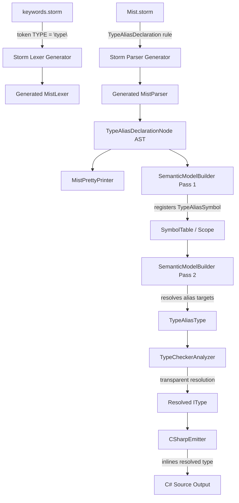
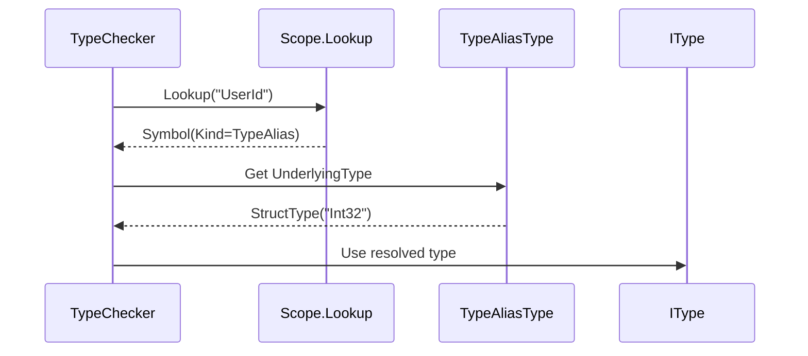

# Design Document: Type Aliases

## Overview

Type aliases introduce named type-level expressions to the Mist language. A type alias declaration (`type {name} = {type_expression};`) creates a transparent alias that resolves to its underlying type during type checking. This feature spans the full compiler pipeline: grammar definition, lexing, parsing, pretty-printing, semantic model construction, type checking, C# transpilation, and editor syntax highlighting.

The implementation follows the existing compiler architecture patterns — Storm grammar rules generate the lexer/parser, the `SemanticModelBuilder` registers aliases as symbols, the `TypeCheckerAnalyzer` resolves aliases transparently, and the `CSharpEmitter` inlines resolved types at usage sites.

### Design Decisions

1. **Transparent aliases**: Type aliases are fully transparent — they are erased during type checking. Using an alias is semantically identical to using the underlying type. This simplifies the type system (no nominal wrapper types) and matches C#'s `using` alias semantics.

2. **Inline resolution for C# emission**: Rather than emitting C# `using` alias directives (which have scoping limitations), the transpiler inlines the resolved type at every usage site. This avoids issues with C#'s restriction that `using` aliases must appear at file scope and cannot reference generic type parameters.

3. **Cycle detection in the semantic model builder**: Cyclic alias detection runs during Pass 2 (type resolution) using a visited-set approach, reporting a diagnostic and substituting `ErrorType` to prevent infinite loops.

4. **Union type aliases reuse existing infrastructure**: Union type aliases produce the same `UnionType` semantic type as inline union type references, reusing the `UnionHelperGenerator` for C# emission.

## Architecture



## Components and Interfaces

### 1. Grammar Changes (Storm)

**File: `Source/Mist/Grammar/keywords.storm`**

Add the `TYPE` keyword token:

```storm
token TYPE = "type";
```

**File: `Source/Mist/Grammar/Mist.storm`**

Add the `TypeAliasDeclaration` rule and integrate it into `TopLevelItem` and `NamespaceBodyItem`:

```storm
rule TypeAliasDeclaration = TYPE name:IDENTIFIER typeParams:TypeParameterList? 
    EQUAL type:TypeReference SEMICOLON;
```

Update `TopLevelItem`:
```storm
rule TopLevelItem
    = namespaceDeclaration:NamespaceDeclaration       as NamespaceItem
    | typeDeclaration:TypeDeclaration                  as TypeItem
    | typeAliasDeclaration:TypeAliasDeclaration        as TypeAliasItem
    | withDeclaration:WithDeclaration                  as WithItem
    | extensionDeclaration:ExtensionBlockDeclaration   as ExtensionItem
    ;
```

Update `NamespaceBodyItem`:
```storm
rule NamespaceBodyItem
    = typeDeclaration:TypeDeclaration                  as NamespaceTypeItem
    | typeAliasDeclaration:TypeAliasDeclaration        as NamespaceTypeAliasItem
    | extensionDeclaration:ExtensionBlockDeclaration   as NamespaceExtensionItem
    ;
```

### 2. AST Node Structure

The Storm source generator will produce a `TypeAliasDeclarationNode` class with the following shape (generated):

```csharp
// Generated by Storm.SourceGenerator
public sealed class TypeAliasDeclarationNode : SyntaxNode
{
    public Token Name { get; }                          // The alias identifier
    public TypeParameterListNode? TypeParams { get; }   // Optional generic params
    public TypeReferenceNode Type { get; }              // The target type expression
}
```

New `TopLevelItem` variant (generated):
```csharp
public sealed class TypeAliasItemTopLevelItemNode : TopLevelItemNode
{
    public TypeAliasDeclarationNode TypeAliasDeclaration { get; }
}
```

New `NamespaceBodyItem` variant (generated):
```csharp
public sealed class NamespaceTypeAliasItemNamespaceBodyItemNode : NamespaceBodyItemNode
{
    public TypeAliasDeclarationNode TypeAliasDeclaration { get; }
}
```

### 3. Pretty Printer Changes

**File: `Source/Mist/Parsing/MistPrettyPrinter.cs`**

Add handling for `TypeAliasDeclarationNode` in the relevant emission methods:

```csharp
private void EmitTypeAliasDeclaration(TypeAliasDeclarationNode aliasDecl)
{
    var name = aliasDecl.Name.Lexeme;
    var typeParams = EmitTypeParameterList(aliasDecl.TypeParams);
    var typeExpr = EmitTypeReference(aliasDecl.Type);
    AppendLine($"type {name}{typeParams} = {typeExpr};");
}
```

Integration points:
- `EmitCompilationUnit` — handle `TypeAliasItemTopLevelItemNode`
- `EmitNamespaceBodyItem` — handle `NamespaceTypeAliasItemNamespaceBodyItemNode`

### 4. Semantic Model Changes

**New type: `Source/Mist/Semantics/Model/Types/TypeAliasType.cs`**

```csharp
public sealed class TypeAliasType : IType
{
    public string Name { get; }
    public IType UnderlyingType { get; }
    public IReadOnlyList<TypeParameterType> TypeParameters { get; }
    public string DisplayName => Name;
    public TypeKind Kind => UnderlyingType.Kind;
}
```

**New `SymbolKind` value:**

Add `TypeAlias` to the `SymbolKind` enum in `ISymbol.cs`:

```csharp
public enum SymbolKind
{
    // ... existing values ...
    TypeAlias,
}
```

**SemanticModelBuilder changes:**

- **Pass 1**: Register `TypeAliasDeclarationNode` as a `Symbol` with `SymbolKind.TypeAlias` in the enclosing scope. Store the AST node reference for later resolution. Record type parameters on the symbol.
- **Pass 2**: Resolve the target `TypeReference` to an `IType`. Construct a `TypeAliasType` wrapping the resolved type. Detect cycles using a resolution stack (set of alias names currently being resolved); if a cycle is detected, report `MIST_SB_0060` and assign `ErrorType`.

**New diagnostic IDs:**

| ID | Condition |
|----|-----------|
| `MIST_SB_0060` | Cyclic type alias detected |
| `MIST_SB_0061` | Duplicate type alias name in scope |
| `MIST_SB_0062` | Unresolved type in alias target expression |
| `MIST_SB_0063` | Type argument count mismatch on generic alias usage |

### 5. Type Checker Changes

**File: `Source/Mist/Analysis/Builtin/TypeCheckerAnalyzer.cs`**

When resolving a type reference that names a type alias:

1. Look up the name in scope → find `Symbol` with `Kind == SymbolKind.TypeAlias`
2. Retrieve the `TypeAliasType` from the symbol's `DeclaredType`
3. If the alias is generic and type arguments are provided:
   - Verify argument count matches parameter count (else report `MIST_SB_0063`)
   - Substitute type arguments into the underlying type
4. Return the resolved underlying `IType` (transparent resolution)

The type checker treats aliases as fully transparent — after resolution, no trace of the alias remains in the type system. Assignment compatibility, member access, and operator dispatch all operate on the resolved type.

### 6. C# Transpiler Changes

**File: `Source/Mist/Backends/CSharpTranspiler/CSharpEmitter.cs`**

Type aliases are erased during transpilation. The emitter never emits a C# declaration for a type alias itself. Instead:

- **Simple aliases** (e.g., `type UserId = int;`): At every usage site, the resolved C# type is inlined (e.g., `int`).
- **Union aliases** (e.g., `type Result = int | string;`): The resolved `UnionType` is emitted using `UnionHelperGenerator.GetHelperTypeName()`, producing the same `Union_Int32_String` helper struct as inline union types.
- **Generic aliases** (e.g., `type IntList = List<int>;`): The fully substituted type is inlined at usage sites (e.g., `List<int>`).

The `CSharpTypeMap.GetTypeName()` method already handles all `IType` variants (`UnionType`, `ConstructedType`, `ArrayType`, etc.), so once the alias is resolved to its underlying type, existing emission logic handles it correctly.

**Skip emission of alias declarations**: In `CSharpSourceWriter.EmitCompilationUnit`, `TypeAliasItemTopLevelItemNode` variants are skipped (no C# output).

### 7. Editor Syntax Highlighting Changes

**File: `Editor/mist-syntax-highlighting/syntaxes/mist.tmLanguage.json`**

Add `type` to the keyword declaration pattern:

```json
{
  "name": "keyword.declaration.mist",
  "match": "\\b(namespace|using|class|struct|interface|trait|extension|type)\\b"
}
```

Add a declaration-name pattern for type alias declarations (before the generic class/struct pattern):

```json
{
  "comment": "Type alias declaration: type Foo = ..., type Bar<T> = ...",
  "match": "\\b(type)\\s+([a-zA-Z_]\\w*)\\s*(?:<([^>]+)>)?",
  "captures": {
    "1": { "name": "keyword.declaration.mist" },
    "2": { "name": "entity.name.type.alias.mist" },
    "3": { "name": "entity.name.type.parameter.mist" }
  }
}
```

## Data Models

### TypeAliasType

```
TypeAliasType
├── Name: string                        // The alias identifier (e.g., "UserId")
├── UnderlyingType: IType               // The resolved target type
├── TypeParameters: TypeParameterType[] // Generic params (empty for non-generic)
├── DisplayName: string                 // Returns Name
└── Kind: TypeKind                      // Delegates to UnderlyingType.Kind
```

### Symbol Registration

A type alias is registered as a `Symbol` in the `SymbolTable`:

```
Symbol
├── Name: "UserId"
├── Kind: SymbolKind.TypeAlias
├── Origin: SymbolOrigin.UserCode
├── ContainingScope: (enclosing namespace or global scope)
├── DeclaredType: TypeAliasType { UnderlyingType = StructType("Int32"), ... }
├── TypeParameters: [TypeParameterType("T"), ...] (for generic aliases)
└── DeclarationSpan: (source location)
```

### Resolution Flow



## Correctness Properties

*A property is a characteristic or behavior that should hold true across all valid executions of a system — essentially, a formal statement about what the system should do. Properties serve as the bridge between human-readable specifications and machine-verifiable correctness guarantees.*

### Property 1: Parsing produces correct AST structure

*For any* valid type alias source string (simple, generic with 1–5 type parameters, or with union target types of 2–5 constituents), parsing the source SHALL produce a `TypeAliasDeclarationNode` whose `Name`, `TypeParams`, and `Type` fields correctly reflect the input.

**Validates: Requirements 2.1, 2.2, 2.3**

### Property 2: Pretty-print round-trip

*For any* valid type alias declaration source string, parsing it and pretty-printing the resulting AST, then parsing and pretty-printing again, SHALL produce identical text output (idempotence).

**Validates: Requirements 3.1, 3.2, 3.3, 3.4**

### Property 3: Semantic model registration

*For any* valid type alias declaration (with or without type parameters), building the semantic model SHALL register a symbol with `SymbolKind.TypeAlias` in the enclosing scope, and the symbol's type parameters SHALL match the declaration's type parameter list.

**Validates: Requirements 4.1, 4.2**

### Property 4: Type resolution transparency

*For any* type alias pointing to a concrete type, using the alias name in a variable declaration SHALL resolve to the same `IType` as using the underlying type name directly. For generic aliases with type arguments, the resolved type SHALL equal the underlying type with substitutions applied.

**Validates: Requirements 5.1, 5.2**

### Property 5: Transpilation correctness

*For any* valid Mist program containing type alias declarations and usages (simple, generic, and union variants), transpiling to C# and compiling the output SHALL produce zero compilation errors.

**Validates: Requirements 6.1, 6.2, 6.3, 6.4**

## Error Handling

| Diagnostic ID | Stage | Condition | Message Template |
|---|---|---|---|
| `MIST_SB_0060` | Semantic Model | Cyclic type alias (A → B → A) | `Type alias '{name}' forms a cycle` |
| `MIST_SB_0061` | Semantic Model | Duplicate alias name in scope | `Type alias '{name}' is already defined in this scope` |
| `MIST_SB_0062` | Semantic Model | Unresolved type in alias target | `Type '{typeName}' could not be resolved in type alias '{aliasName}'` |
| `MIST_SB_0063` | Type Checker | Wrong number of type arguments | `Type alias '{name}' expects {expected} type argument(s) but was given {actual}` |
| `MIST_PARSE_ERROR` | Parser | Missing `=` in declaration | `Expected '=' in type alias declaration` |
| `MIST_PARSE_ERROR` | Parser | Missing `;` in declaration | `Expected ';' after type alias declaration` |
| `MIST_PARSE_ERROR` | Parser | Missing type expression | `Expected type expression after '=' in type alias declaration` |

**Error recovery strategy:**
- Parse errors: The Storm-generated parser uses its standard error recovery (skip to next synchronization point, typically `;` or `}`).
- Cycle detection: Assign `ErrorType` to the alias's `UnderlyingType` and continue. Downstream code that encounters `ErrorType` suppresses cascading diagnostics.
- Unresolved types: Same as cycles — assign `ErrorType` and continue.

## Testing Strategy

### Property-Based Tests (using FsCheck)

Each correctness property is implemented as a property-based test with minimum 100 iterations:

1. **Parsing correctness** — Generate random valid type alias source strings (varying identifier names, type parameter counts, union constituent counts). Parse and verify AST structure.
2. **Pretty-print round-trip** — Generate random valid type alias source strings. Verify `print(parse(print(parse(s)))) == print(parse(s))`.
3. **Semantic registration** — Generate random type alias declarations. Build semantic model in-process using `SharedDriver`. Verify scope contains the alias symbol with correct type parameters.
4. **Type resolution transparency** — Generate programs with type aliases and equivalent programs using the underlying type directly. Build semantic models for both and compare resolved types.
5. **Transpilation correctness** — Generate valid Mist programs with type aliases. Transpile and compile C# output. Use **batched approach** (1 compile, 1 run per test class) per workspace rules.

**Property test configuration:**
- Library: FsCheck (already used in the test project)
- Minimum iterations: 100 per property
- Tag format: `Feature: type-aliases, Property {N}: {description}`

### Unit Tests (example-based)

- Parser error cases (missing `=`, missing `;`, empty type expression)
- Duplicate alias name diagnostic
- Unresolved type in alias target diagnostic
- Cyclic alias detection (direct cycle, indirect cycle)
- Type argument count mismatch diagnostic
- Lexer: `type` as keyword vs `typeAlias` as identifier

### Process Spawning Note

Property 5 (transpilation correctness) requires compiling C# output. Per workspace rules, this will use the **batched approach**: generate all 100 scenarios upfront, build a single Mist program containing all alias variants, compile once, run once, and compare results line-by-line. This limits process spawns to 1 per test class.
