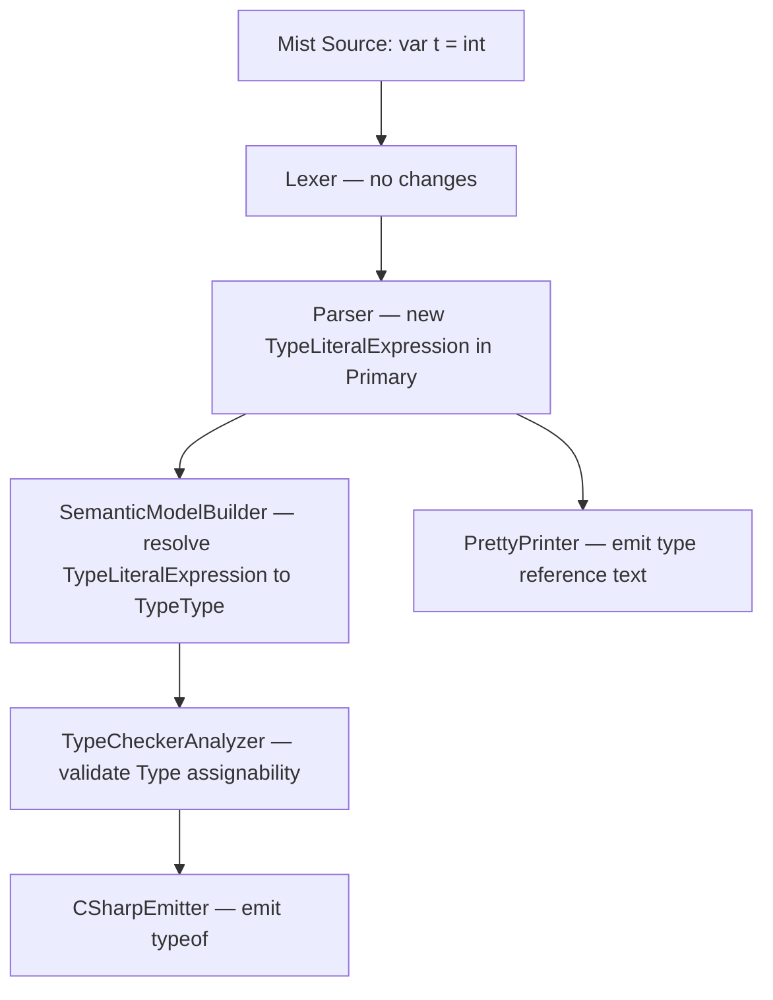

# Design Document: Type Literals

## Overview

This design adds type literal expressions to the Mist language, allowing type names to be used directly as expressions that evaluate to a value of type `Type`. In C#, obtaining a runtime `System.Type` requires the `typeof()` operator; Mist eliminates this ceremony by treating every type name as a valid expression.

The feature touches every stage of the compiler pipeline:

1. **Grammar** — A new `TypeLiteralExpression` alternative in the `Primary` rule
2. **Parser** — Disambiguation between type annotations and type literal expressions
3. **Semantic Model** — A new `TypeType` singleton, expression type recording, and variable shadowing rules
4. **Type Checker** — Validation of type mismatches involving `Type` values
5. **C# Backend** — `typeof()` emission and `System.Type` mapping
6. **Pretty Printer** — Faithful round-trip reproduction of type literal syntax

### Design Decisions

- **Non-generic metatype**: `TypeType` is a non-generic singleton (like C#'s `System.Type`), not `Type<T>`. This keeps the type system simpler and matches the C# runtime model.
- **Variable shadowing wins**: When a local variable name collides with a type name, the variable takes precedence (inner scope wins). This follows standard lexical scoping rules and matches C# behavior.
- **Parser-level disambiguation**: Primitive type keywords in expression position are unambiguously type literals because they cannot be variable names. User-defined type names require semantic analysis to distinguish from variable references.
- **Array type literals included**: `int[]` in expression position produces a type literal for the array type, matching C#'s `typeof(int[])`.

## Architecture

The feature flows through the existing compiler pipeline with targeted additions at each stage:



### Pipeline Stage Responsibilities

| Stage | Change | Files |
|-------|--------|-------|
| Grammar | Add `TypeLiteralExpression` to `Primary` rule | `Mist.storm` |
| Lexer | None — type keywords already tokenized | — |
| Parser | Storm-generated parser handles new grammar | `MistParser.cs` (no manual changes) |
| Semantic Model | New `TypeType` singleton; resolve `TypeLiteralExpression` nodes | `SemanticModelBuilder.cs`, new `TypeType.cs` |
| Type Checker | Handle `TypeType` in assignability checks | `TypeCheckerAnalyzer.cs` |
| C# Emitter | Emit `typeof(...)` for `TypeLiteralExpression` | `CSharpEmitter.cs` |
| C# Type Map | Map `TypeType` → `System.Type` | `CSharpTypeMap.cs` |
| Pretty Printer | Emit type reference text for `TypeLiteralExpression` | `MistPrettyPrinter.cs` |

## Components and Interfaces

### 1. Grammar Change (`Mist.storm`)

Add a new alternative to the `Primary` rule:

```storm
rule Primary
    = ...existing alternatives...
    | typeRef:TypeReference  as TypeLiteralExpression
    ;
```

The `TypeLiteralExpression` alternative must be placed **after** `IdentifierExpression` in the `Primary` rule. This ordering is critical because:

- Primitive type keywords (`int`, `bool`, etc.) are tokenized as their own token kinds (e.g., `INT`, `BOOL`), not as `IDENTIFIER`. The `IdentifierExpression` alternative only matches `IDENTIFIER` tokens, so it will never consume a primitive keyword. The `TypeLiteralExpression` alternative, via `TypeReference → PrimitiveTypeRef`, will match these keyword tokens.
- User-defined type names are tokenized as `IDENTIFIER`. The `IdentifierExpression` alternative will match them first, which is correct — semantic analysis later determines whether an identifier refers to a variable or a type.

This means at the parser level:
- `int` in expression position → `TypeLiteralExpression` (via `PrimitiveTypeRef`)
- `MyClass` in expression position → `IdentifierExpression` (semantic model resolves)
- `int[]` in expression position → `TypeLiteralExpression` (via `PrimitiveTypeRef` with array rank)

**Disambiguation with typed variable declarations**: The existing `VariableDeclarationStatement` rule for `TypedVariableDeclaration` matches `TypeReference IDENTIFIER EQUAL Expression SEMICOLON`. Since `Statement` is tried before `ExpressionStatement` in the `Statement` rule, `int x = 5;` will parse as a typed variable declaration, not as a type literal followed by something else. The grammar's structural precedence handles this naturally.

### 2. New Type: `TypeType` (`Source/Mist/Semantics/Model/Types/TypeType.cs`)

```csharp
public sealed class TypeType : IType
{
    public static readonly TypeType Instance = new();
    public string DisplayName => "Type";
    public TypeKind Kind => TypeKind.Class;
    private TypeType() { }
}
```

Follows the same singleton pattern as `StringType`, `VoidType`, and `UnknownType`. `TypeKind.Class` because `System.Type` is a reference type.

### 3. Semantic Model Builder Changes (`SemanticModelBuilder.cs`)

In `ResolvePrimary`, add a new case for the Storm-generated `TypeLiteralExpressionPrimaryNode`:

```csharp
case TypeLiteralExpressionPrimaryNode typeLiteral:
{
    // Resolve the TypeReference to get the referenced type (for validation).
    var referencedType = ResolveTypeReference(
        typeLiteral.TypeRef, fileScope, ambientTypeResolver,
        symbolTable, sourceText, diagnostics);
    // The expression type of a type literal is always TypeType.
    result = TypeType.Instance;
    break;
}
```

Key behaviors:
- The referenced type is resolved (triggering `MIST_UNDEFINED_TYPE` if not found)
- The expression type recorded in the expression type map is `TypeType.Instance`, not the referenced type itself
- For `var x = int;`, the inferred type of `x` becomes `TypeType`

**Variable shadowing**: No changes needed. The existing `IdentifierExpressionPrimaryNode` case in `ResolvePrimary` already does `currentScope.Lookup(name)`, which returns the innermost variable first. Since user-defined type names in expression position parse as `IdentifierExpression` (not `TypeLiteralExpression`), the scope lookup naturally shadows type names with local variables.

### 4. Type Checker Changes (`TypeCheckerAnalyzer.cs`)

In `CheckPrimaryNode`, add handling for `TypeLiteralExpressionPrimaryNode`:

```csharp
case TypeLiteralExpressionPrimaryNode:
    // Type literals are always valid primary expressions.
    // Type checking is handled by assignability checks at usage sites.
    break;
```

The existing `IsAssignable` method handles `TypeType` correctly because:
- `TypeType` to `TypeType` → identity match (same singleton reference)
- `TypeType` to `int` → different types, not numeric, returns false → `MIST_TC_0001`
- `TypeType` to `UnknownType` → returns true (error suppression)

No changes to `IsAssignable` are needed.

### 5. C# Emitter Changes (`CSharpEmitter.cs`)

In `EmitPrimary` within `CSharpSourceWriter`, add:

```csharp
case TypeLiteralExpressionPrimaryNode typeLiteral:
    return $"typeof({EmitTypeReference(typeLiteral.TypeRef)})";
```

This wraps the existing `EmitTypeReference` output in `typeof(...)`, producing:
- `int` → `typeof(int)`
- `MyClass` → `typeof(MyClass)`
- `int[]` → `typeof(int[])`

### 6. C# Type Map Changes (`CSharpTypeMap.cs`)

Add `TypeType` to the `GetTypeName` switch:

```csharp
TypeType => "System.Type",
```

This ensures that when `TypeType` appears as a declared variable type (e.g., `Type foo`), the C# emitter produces `System.Type foo`.

### 7. Pretty Printer Changes (`MistPrettyPrinter.cs`)

In `EmitPrimary`, add:

```csharp
case TypeLiteralExpressionPrimaryNode typeLiteral:
    return EmitTypeReference(typeLiteral.TypeRef);
```

This reuses the existing `EmitTypeReference` method, which already handles `PrimitiveTypeRef`, `NamedTypeRef` (with array rank), and `VoidTypeRef`.

## Data Models

### New Type: `TypeType`

| Property | Value |
|----------|-------|
| `DisplayName` | `"Type"` |
| `Kind` | `TypeKind.Class` |
| Pattern | Singleton (`TypeType.Instance`) |
| Location | `Source/Mist/Semantics/Model/Types/TypeType.cs` |

### AST Node (Storm-generated)

The Storm code generator will produce a `TypeLiteralExpressionPrimaryNode` class with:
- `TypeRef` property of type `TypeReferenceNode` — the type reference being used as an expression

### Expression Type Map Entries

| AST Node | Recorded Type |
|----------|---------------|
| `TypeLiteralExpressionPrimaryNode` | `TypeType.Instance` |
| `IdentifierExpressionPrimaryNode` (when resolving to a variable that shadows a type) | Variable's declared type |


## Correctness Properties

*A property is a characteristic or behavior that should hold true across all valid executions of a system — essentially, a formal statement about what the system should do. Properties serve as the bridge between human-readable specifications and machine-verifiable correctness guarantees.*

### Property 1: Primitive type keywords in expression position produce TypeLiteralExpression

*For any* primitive type keyword (int, uint, long, ulong, short, ushort, byte, sbyte, float, double, decimal, bool, char, string) placed in any expression position (variable initializer, method argument, return value, assignment RHS), the parser SHALL produce a `TypeLiteralExpression` AST node containing the corresponding `PrimitiveTypeRef`.

**Validates: Requirements 1.2, 2.2, 2.3, 2.4, 2.5**

### Property 2: Array type literals in expression position include array rank

*For any* valid base type (primitive or named) followed by `[]` in expression position, the parser SHALL produce a `TypeLiteralExpression` AST node whose `TypeReference` has the array rank set.

**Validates: Requirements 1.4**

### Property 3: Type annotation positions are unaffected by type literal grammar

*For any* type name appearing in a type annotation position (parameter type, field type, return type, typed variable declaration type), the parser SHALL produce a `TypeReference` node and NOT a `TypeLiteralExpression` node.

**Validates: Requirements 1.5**

### Property 4: All type literal expressions have TypeType as their expression type

*For any* valid `TypeLiteralExpression` AST node (primitive, named, or array type literal), the semantic model SHALL record the expression type as `TypeType`. Consequently, for any `var` declaration initialized with a type literal, the inferred variable type SHALL be `TypeType`.

**Validates: Requirements 3.2, 3.3**

### Property 5: Variable names shadow type names in expression position

*For any* identifier name that is both a user-defined type name and a local variable name in the current scope, when that name appears in expression position, the semantic model SHALL resolve it as the local variable reference (with the variable's declared type), not as a type literal.

**Validates: Requirements 2.6**

### Property 6: Unresolved type literals produce diagnostics

*For any* type name used in a `TypeLiteralExpression` that cannot be resolved in the current scope or imported namespaces, the semantic model builder SHALL emit a `MIST_UNDEFINED_TYPE` diagnostic.

**Validates: Requirements 4.1**

### Property 7: Type mismatch when assigning type literal to non-Type variable

*For any* primitive type keyword T and any non-`Type` declared type D, the declaration `D x = T;` SHALL produce a type mismatch diagnostic (`MIST_TC_0001`).

**Validates: Requirements 4.4**

### Property 8: C# emitter wraps type literals in typeof()

*For any* `TypeLiteralExpression` containing a type reference (primitive, named, or array), the C# emitter SHALL produce `typeof(<type_reference>)` where `<type_reference>` is the C# representation of the referenced type.

**Validates: Requirements 5.1, 5.3, 5.4**

### Property 9: Pretty printer round-trip for type literals

*For any* valid Mist source text containing type literal expressions, parsing then pretty-printing then parsing again SHALL produce an equivalent AST (round-trip idempotence).

**Validates: Requirements 6.1, 6.2, 6.3, 6.4**

## Error Handling

### Diagnostic IDs

| Diagnostic ID | Stage | Condition | Message Template |
|---------------|-------|-----------|------------------|
| `MIST_UNDEFINED_TYPE` | Semantic Model | Type literal references an unresolvable type name | `"The type '{typeName}' could not be found."` |
| `MIST_TC_0001` | Type Checker | Type literal assigned to incompatible variable type | `"Cannot assign 'Type' to '{targetType}'"` |

### Error Recovery

- **Unresolved type literal**: The semantic model builder records `TypeType.Instance` as the expression type even when the referenced type is unresolved (the `MIST_UNDEFINED_TYPE` diagnostic is still emitted). This prevents cascading errors in downstream analysis.
- **Parse errors**: If the `TypeReference` within a `TypeLiteralExpression` fails to parse (e.g., `int[` without closing bracket), the Storm parser's existing error recovery handles it. No special recovery logic is needed.

### Edge Cases

- `void` in expression position: The `TypeReference` rule includes `VoidTypeRef`. A `TypeLiteralExpression` containing `void` would parse successfully but is semantically questionable. The semantic model builder should resolve it to `TypeType.Instance` (the type of `void` as a type literal). The type checker does not need special handling — `void` as a type literal is valid in C# (`typeof(void)` is legal).
- `int[][]` (jagged arrays): Not supported in the current grammar since `TypeReference` only allows a single optional `[]` rank. This is a pre-existing limitation, not introduced by this feature.

## Syntax Highlighting (`Editor/mist-syntax-highlighting/syntaxes/mist.tmLanguage.json`)

The existing TextMate grammar already highlights primitive type keywords (`int`, `bool`, etc.) via `storage.type.primitive.mist` regardless of position (annotation or expression). No changes are needed for type literals to highlight correctly.

However, `Type` is now a built-in type name in Mist (the metatype). Add it to the `types` repository pattern so it highlights consistently with other type keywords:

```json
{
  "name": "storage.type.metatype.mist",
  "match": "\\bType\\b"
}
```

## Sample Application (`samples/TypeLiterals/Program.mist`)

A sample Mist program that exercises type literal expressions for manual validation and demonstration:

```mist
// Type Literals Sample — demonstrates using types as expressions

// Primitive type literals
var intType = int;
var boolType = bool;
var stringType = string;

// Array type literal
var intArrayType = int[];

// Explicit Type annotation
Type floatType = float;

// Void type literal
var voidType = void;

// Passing type literals as arguments
PrintType(int);
PrintType(string);
PrintType(bool);

void PrintType(Type t)
{
    Console.WriteLine(t);
}
```

Expected C# output (key lines):
```csharp
var intType = typeof(int);
var boolType = typeof(bool);
var stringType = typeof(string);
var intArrayType = typeof(int[]);
System.Type floatType = typeof(float);
var voidType = typeof(void);
PrintType(typeof(int));
PrintType(typeof(string));
PrintType(typeof(bool));
```

## Testing Strategy

### Property-Based Tests (PBT)

The feature is well-suited for property-based testing because:
- The input space is well-defined (type keywords × expression positions)
- Properties are universally quantified across all valid inputs
- Pure functions (parser, pretty printer, type resolution) have clear input/output behavior

**Library**: [FsCheck](https://fscheck.github.io/FsCheck/) for .NET (C# property-based testing)

**Configuration**: Minimum 100 iterations per property test.

**Tag format**: `Feature: type-literals, Property {number}: {property_text}`

Each correctness property (1–9) maps to a single property-based test. Generators will produce:
- Random primitive type keywords from the 14-element set
- Random expression positions (var initializer, argument, return, assignment RHS)
- Random valid Mist programs containing type literals (for round-trip testing)
- Random type/variable name collision scenarios (for shadowing tests)

### Unit Tests (Example-Based)

Unit tests complement PBT for specific scenarios:
- `Type foo = int;` — explicit `Type` annotation with type literal initializer (Req 3.4)
- `MyClass` as type literal with user-defined class in scope (Req 1.3, 4.3, 5.2)
- `typeof(MyClass)` emission for user-defined types (Req 5.2)
- Pretty printer output for user-defined type literals (Req 6.2)
- `CSharpTypeMap.GetTypeName(TypeType.Instance)` returns `"System.Type"` (Req 5.5)
- `TypeType.Instance.Kind == TypeKind.Class` (Req 3.5)

### Integration Tests

- End-to-end compilation: Mist source with type literals → C# output → Roslyn compilation succeeds
- Runtime behavior: `var t = int; Console.WriteLine(t.Name);` prints `"Int32"`
