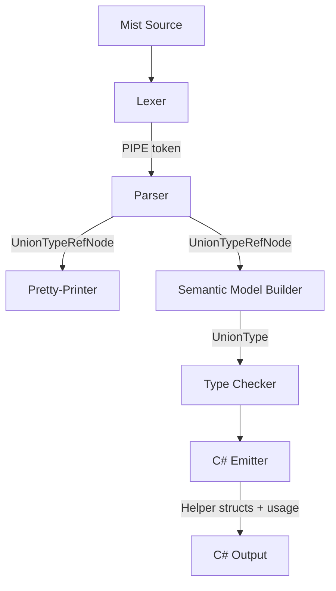

# Design Document: Type Unions

## Overview

This design adds TypeScript-style type unions to the Mist programming language. A type union is written with the `|` operator (e.g., `int | string`) and denotes a value that may be one of several types at runtime. The feature spans the full compiler pipeline: grammar, lexer, parser, pretty-printer, semantic model, type checker, and C# emitter.

The core challenge is that C# lacks native union types. The emitter generates discriminated wrapper structs (helper types) with a tag field and implicit conversion operators to achieve semantic equivalence at runtime.

**Key design decisions:**
- Union types are structural, not nominal — `int | string` and `string | int` are the same type.
- The semantic model flattens and deduplicates unions: `(int | string) | bool` becomes `UnionType([int, string, bool])`.
- The `|` token is a new `PIPE` token, distinct from `LOGICAL_OR` (`||`), using declaration-order priority in the Storm grammar.
- Helper types are value types (structs) to avoid heap allocation for common cases.
- Pattern matching on union types checks the discriminator tag and extracts the typed value.

## Architecture

The feature touches every layer of the compiler pipeline:



**Layer responsibilities:**

| Layer | Responsibility |
|-------|---------------|
| Grammar/Lexer | Define `PIPE` token; maximal-munch ensures `||` wins over `| |` |
| Parser | Produce `UnionTypeRefNode` with ordered constituent list |
| Pretty-Printer | Format `Type1 | Type2` with spaces; support round-trip |
| Semantic Model | Resolve to `UnionType`, flatten nested unions, deduplicate |
| Type Checker | Assignability rules, member access validation, pattern match validation |
| C# Emitter | Generate helper structs, emit usage with implicit conversions and discriminator checks |

## Components and Interfaces

### 1. Grammar Changes (`Mist.storm`)

Add a `PIPE` token before `LOGICAL_OR` (declaration-order priority ensures maximal-munch selects `||` for two consecutive pipes):

```storm
token PIPE = "|";
// LOGICAL_OR = "||" is already declared after this position
```

Extend the `TypeReference` rule with a `UnionTypeRef` alternative. The union operator has lower precedence than array rank, so `int[] | string` parses as `(int[]) | string`:

```storm
rule TypeReference
    = unionType:UnionTypeRef  as UnionTypeRef
    | primitiveType:PrimitiveType arrayRank:(LEFT_BRACKET RIGHT_BRACKET)?  as PrimitiveTypeRef
    | VOID as VoidTypeRef
    | UNKNOWN as UnknownTypeRef
    | name:QualifiedIdentifier typeArgs:TypeArgumentList? arrayRank:(LEFT_BRACKET RIGHT_BRACKET)? as NamedTypeRef
    | LEFT_PARENTHESIS first:TupleTypeElement COMMA rest:TupleTypeElement (COMMA additional:TupleTypeElement)* RIGHT_PARENTHESIS as TupleTypeRef
    ;

rule UnionTypeRef = first:SingleTypeRef (PIPE rest:SingleTypeRef)+;

rule SingleTypeRef
    = primitiveType:PrimitiveType arrayRank:(LEFT_BRACKET RIGHT_BRACKET)?  as PrimitiveSingleTypeRef
    | VOID as VoidSingleTypeRef
    | UNKNOWN as UnknownSingleTypeRef
    | name:QualifiedIdentifier typeArgs:TypeArgumentList? arrayRank:(LEFT_BRACKET RIGHT_BRACKET)? as NamedSingleTypeRef
    | LEFT_PARENTHESIS inner:TypeReference RIGHT_PARENTHESIS arrayRank:(LEFT_BRACKET RIGHT_BRACKET)? as ParenthesizedTypeRef
    | LEFT_PARENTHESIS first:TupleTypeElement COMMA rest:TupleTypeElement (COMMA additional:TupleTypeElement)* RIGHT_PARENTHESIS as TupleSingleTypeRef
    ;
```

**Design rationale:** The `UnionTypeRef` is a left-recursive list of `SingleTypeRef` separated by `PIPE`. By making `UnionTypeRef` the first alternative in `TypeReference`, the parser attempts union parsing first. The `SingleTypeRef` rule mirrors `TypeReference` but without the union alternative, preventing infinite left-recursion. Parenthesized grouping (`(int | string)[]`) is handled by `ParenthesizedTypeRef`.

**Disambiguation with pattern `or`:** In pattern contexts (`x is int | string`), the grammar already routes through the `Pattern` rule which has its own `OrPattern` using the `OR` keyword token. The `|` in type annotations is the `PIPE` token, while pattern `or` uses the `or` keyword. No ambiguity arises because the parser enters either the type-reference path or the pattern path based on syntactic context.

### 2. AST Node: `UnionTypeRefNode`

The Storm source generator will produce a `UnionTypeRefNode` from the grammar rule. It will contain:
- `First`: The first `SingleTypeRef` constituent
- `Rest`: An `ImmutableArray<SingleTypeRef>` of additional constituents (at least one)

### 3. Pretty-Printer Extension

The `MistPrettyPrinter.EmitTypeReference` method gains a new case:

```csharp
case UnionTypeRefTypeReferenceNode unionRef:
{
    var parts = new List<string>();
    parts.Add(EmitSingleTypeRef(unionRef.First));
    foreach (var constituent in unionRef.Rest)
    {
        parts.Add(EmitSingleTypeRef(constituent));
    }
    return string.Join(" | ", parts);
}
```

### 4. Semantic Model: `UnionType`

A new `UnionType` class in `Source/Mist/Semantics/Model/Types/`:

```csharp
public sealed class UnionType : IType
{
    /// <summary>
    /// The distinct constituent types, in canonical order (sorted by DisplayName).
    /// </summary>
    public IReadOnlyList<IType> Constituents { get; }

    public string DisplayName { get; }
    public TypeKind Kind => TypeKind.Struct; // Helper type is a value type

    public UnionType(IReadOnlyList<IType> constituents) { ... }
}
```

**Canonical ordering:** Constituents are sorted by `DisplayName` to ensure `int | string` and `string | int` produce the same `UnionType` instance (structural equality). This also ensures deterministic helper type naming.

**Construction rules (in `SemanticModelBuilder`):**
1. Resolve each constituent type reference.
2. Flatten: if a constituent is itself a `UnionType`, inline its constituents.
3. Deduplicate: remove duplicate types (by reference equality or `DisplayName` equality for structural types).
4. If only one distinct constituent remains, return that type directly (not a union).
5. Sort constituents by `DisplayName` for canonical form.
6. If any constituent resolves to `ErrorType`, include it but still produce the union (error recovery).

### 5. Type Checker Extensions

**Assignability rules** (added to `TypeCheckerAnalyzer`):

| Source Type | Target Type | Rule |
|-------------|-------------|------|
| `T` (non-union) | `UnionType` containing `T` | ✅ Valid — constituent is assignable |
| `UnionType(A, B)` | `UnionType(A, B, C)` | ✅ Valid — all source constituents are in target |
| `UnionType(A, B, C)` | `UnionType(A, B)` | ❌ Error — `C` not assignable to target |
| `UnionType(A, B)` | `T` (non-union) | ❌ Error — must narrow first |
| `UnionType(A, B)` | `UnionType(B, A)` | ✅ Same type (order-independent) |

**Member access rules:**
- For `x.Member` where `x: A | B`: allowed only if `Member` exists on both `A` and `B` with compatible signatures.
- Result type: if `A.Member` returns `RA` and `B.Member` returns `RB`, the result type is `RA | RB` (or just `RA` if `RA == RB`).

**Pattern matching rules:**
- `x is T t` where `x: A | B | C`: valid if `T` is one of `A`, `B`, `C`. Introduces `t: T`.
- `x is T t` where `T` is not a constituent: warning (pattern will never match).
- `x is var v`: introduces `v` with the full union type.

### 6. C# Emitter: Helper Type Generation

For each distinct `UnionType` in the program, the emitter generates a helper struct:

```csharp
// Generated for: int | string
[System.Runtime.CompilerServices.CompilerGenerated]
public struct Union_Int32_String
{
    private readonly byte _tag;
    private readonly object _value;

    private Union_Int32_String(byte tag, object value)
    {
        _tag = tag;
        _value = value;
    }

    public bool IsInt32 => _tag == 1;
    public bool IsString => _tag == 2;

    public int AsInt32 => _tag == 1
        ? (int)_value
        : throw new InvalidOperationException("Union does not hold Int32");
    public string AsString => _tag == 2
        ? (string)_value
        : throw new InvalidOperationException("Union does not hold String");

    public static implicit operator Union_Int32_String(int value)
        => new Union_Int32_String(1, value);
    public static implicit operator Union_Int32_String(string value)
        => new Union_Int32_String(2, value);
}
```

**Naming convention:** `Union_` + constituent type names joined by `_`, using the C# type name (e.g., `Int32`, `String`, `Boolean`). Sorted alphabetically to ensure `int | string` and `string | int` produce the same name.

**Pattern matching emission:**
```csharp
// Mist: if (x is string s) { ... }
// C# (where x is Union_Int32_String):
if (x.IsString)
{
    var s = x.AsString;
    // ... then-branch
}
```

**Helper type deduplication:** The emitter maintains a `Dictionary<string, bool>` keyed by helper type name. If the name already exists, the helper type is not re-emitted.

**Helper type file placement:** All helper types for a project are emitted into a single file `UnionHelpers.cs` in the output directory, to avoid one-file-per-union proliferation.

### 7. TextMate Grammar Update

Add a pattern to `mist.tmLanguage.json` that matches `|` in type contexts:

```json
{
    "match": "(?<=\\w|\\]|\\))\\s*(\\|)\\s*(?=\\w)",
    "captures": {
        "1": { "name": "keyword.operator.type.union.mist" }
    }
}
```

This uses lookbehind/lookahead to distinguish type-context `|` from other uses.

## Data Models

### UnionType (Semantic Model)

```
UnionType
├── Constituents: IReadOnlyList<IType>  (2+ distinct types, sorted by DisplayName)
├── DisplayName: string                  (e.g., "int | string")
└── Kind: TypeKind.Struct               (helper type is a value type)
```

### UnionTypeRefNode (AST)

```
UnionTypeRefNode (generated by Storm)
├── First: SingleTypeRefNode
└── Rest: ImmutableArray<SingleTypeRefNode>  (1+ additional constituents)
```

### Helper Type Structure (C# Output)

```
Union_{Type1}_{Type2}_...
├── _tag: byte                           (discriminator: 1-based index)
├── _value: object                       (boxed value)
├── Is{TypeN}: bool                      (tag check properties)
├── As{TypeN}: TypeN                     (extraction properties with tag validation)
└── implicit operator Union_...(TypeN)   (one per constituent; From{TypeN} factory where C# types collide)
```

### Diagnostic IDs

| ID | Severity | Condition |
|----|----------|-----------|
| `MIST_TC_0050` | Error | Non-constituent assigned to union target |
| `MIST_TC_0051` | Error | Union assigned to non-union without narrowing |
| `MIST_TC_0052` | Error | Member not present on all union constituents |
| `MIST_TC_0053` | Warning | Pattern type is not a union constituent (never matches) |
| `MIST_TC_0054` | Warning | Union has fewer than 2 distinct types after deduplication |
| `MIST_TC_0055` | Error | Union-to-union assignment with incompatible constituents |

## Correctness Properties

*A property is a characteristic or behavior that should hold true across all valid executions of a system — essentially, a formal statement about what the system should do. Properties serve as the bridge between human-readable specifications and machine-verifiable correctness guarantees.*

### Property 1: Lexer Maximal Munch — PIPE vs LOGICAL_OR

*For any* source string containing `|` characters, the lexer SHALL produce `PIPE` tokens for single `|` and `LOGICAL_OR` tokens for `||`, never producing two consecutive `PIPE` tokens where a `LOGICAL_OR` should appear.

**Validates: Requirements 1.2, 1.3**

### Property 2: Union Type Parsing Correctness

*For any* valid union type source string composed of N constituent type references separated by `|`, parsing SHALL produce a `UnionTypeRefNode` whose constituent list has exactly N elements in source order, with array rank binding tighter than `|` (so `int[] | string` produces constituents `int[]` and `string`).

**Validates: Requirements 2.2, 2.3, 2.4, 3.1, 3.2, 3.3, 3.4, 3.5**

### Property 3: Pretty-Printer Formatting

*For any* `UnionTypeRefNode` AST, the pretty-printer SHALL produce output with exactly one space before and after each `|` operator, and constituent types formatted according to their individual formatting rules.

**Validates: Requirements 4.1, 4.2, 4.3, 4.4**

### Property 4: Pretty-Printer Round-Trip

*For any* valid Mist source containing union type annotations, parsing then pretty-printing then parsing again SHALL produce an equivalent AST (same constituent types in same order, same nesting structure).

**Validates: Requirements 4.5**

### Property 5: Semantic Model Resolution with Flattening and Deduplication

*For any* union type reference, the semantic model SHALL resolve it to a `UnionType` whose constituents are the flattened, deduplicated set of resolved types — nested unions are inlined, duplicates are removed, and a single remaining constituent reduces to that type directly.

**Validates: Requirements 5.1, 5.2, 5.3, 5.4, 5.6**

### Property 6: Union Type Order Equivalence

*For any* set of distinct types, all permutations of those types in a union type annotation SHALL resolve to the same `UnionType` (same canonical constituent list, same `DisplayName`).

**Validates: Requirements 6.5**

### Property 7: Constituent Assignability

*For any* type `T` that is a constituent of a union type `U`, and for any union type `S` whose every constituent is also a constituent of `U`, assignment from `T` to `U` and from `S` to `U` SHALL be valid (no diagnostic emitted).

**Validates: Requirements 6.1, 6.2**

### Property 8: Non-Constituent Rejection

*For any* type `T` that is NOT a constituent of union type `U`, assigning `T` to `U` SHALL produce a diagnostic error. For any union type `U` assigned to a non-union type `T`, a diagnostic error SHALL be produced.

**Validates: Requirements 6.3, 6.4, 12.3, 12.4**

### Property 9: Common Member Access

*For any* union type `U` and any member name `M` that exists on ALL constituent types of `U` with compatible signatures, accessing `M` on a value of type `U` SHALL be valid, and the result type SHALL be the union of `M`'s return types across all constituents (or the single return type if all are identical).

**Validates: Requirements 7.1, 7.3**

### Property 10: Missing Member Rejection

*For any* union type `U` and any member name `M` that does NOT exist on all constituent types, accessing `M` on a value of type `U` SHALL produce a diagnostic error listing which constituents lack the member.

**Validates: Requirements 7.2, 12.2**

### Property 11: Pattern Matching Narrows to Constituent Type

*For any* union type `U` with constituent `T`, a type pattern `is T t` on a value of type `U` SHALL introduce variable `t` with type `T` (not `U`), and the type checker SHALL validate that `T` is indeed a constituent of `U`.

**Validates: Requirements 8.1, 8.2**

### Property 12: Non-Constituent Pattern Warning

*For any* union type `U` and type `T` that is NOT a constituent of `U`, a type pattern `is T t` on a value of type `U` SHALL produce a diagnostic warning indicating the pattern will never match.

**Validates: Requirements 8.3, 12.5**

### Property 13: Helper Type Structural Correctness

*For any* distinct union type with N constituents used in a program, the emitter SHALL generate exactly one helper struct with: a tag field, N `Is*` properties, N `As*` extraction properties, and N implicit conversion operators. The same union type (same constituents regardless of source order) SHALL reuse the same helper type.

**Validates: Requirements 9.1, 9.2, 9.3, 9.4, 9.5, 9.6**

### Property 14: Emitted C# Semantic Equivalence

*For any* Mist program containing union-typed values and pattern matches on those values, the emitted C# code SHALL compile without errors and produce the same observable behavior (console output, return values) as specified by Mist's type union semantics.

**Validates: Requirements 10.1, 10.2, 10.3, 10.4, 10.5, 10.6, 11.1, 11.2, 11.3**

## Error Handling

### Unresolved Constituent Types

When a constituent type in a union cannot be resolved (e.g., `int | Foo` where `Foo` is undefined):
- The semantic model uses `ErrorType.Instance` for the unresolved constituent.
- A `MIST_UNDEFINED_TYPE` diagnostic is emitted (existing behavior).
- The union is still constructed with the remaining valid constituents + ErrorType.
- The type checker treats any union containing `ErrorType` as "poisoned" — it suppresses further diagnostics on that union to avoid cascading errors.

### Degenerate Unions

- `int | int` → deduplicated to `int` (not a union). Warning `MIST_TC_0054` emitted.
- `(int | string) | int` → flattened to `int | string`. No warning (still 2 distinct types).
- Single-type "union" after deduplication → reduced to the single type.

### Pattern Matching on Unions

- Pattern type not a constituent → warning `MIST_TC_0053` (pattern will never match at runtime).
- The emitter still generates the check code (dead code) to maintain structural consistency.

### C# Emission Edge Cases

- Union with generic types: helper type name includes the constructed type name (e.g., `Union_Int32_List_1_String` for `int | List<string>`).
- Constituents sharing one C# type: a lifted value stays in the constituent name, so `int[3] | int[5]` is `Union_Int32Array3_Int32Array5` and is a different helper from `int[3] | int[4]`. C# selects a user-defined conversion by CLR type alone, so each constituent whose C# type another constituent shares gets a `From{TypeN}` factory in place of an implicit operator. The emitter calls the factory of the constituent identical to the value's Mist type (else the only constituent it widens into) wherever a value enters the helper type: initializers, assignments, arguments, returns, array and tuple elements, switch arms, casts and widening `as`. A value no single constituent claims is not given a tag; C# refuses it.

## Testing Strategy

### Unit Tests (Example-Based)

- **Lexer tests:** Verify `PIPE` token production for `|` and `LOGICAL_OR` for `||` with specific inputs.
- **Parser tests:** Verify `UnionTypeRefNode` structure for specific union type strings.
- **Semantic model tests:** Verify `UnionType` construction, flattening, deduplication with specific type combinations.
- **Type checker tests:** Verify specific assignability scenarios and diagnostic messages.
- **Emitter tests:** Verify helper type structure and usage emission for specific union types.
- **Integration tests:** Compile and run the TypeUnions sample app, verify output.

### Property-Based Tests (FsCheck)

Property-based tests use FsCheck (already in the test project) with minimum 100 iterations per property.

**Testing approach for properties that require compilation:**
- Use the shared `CompilerDriver` for in-process compilation (no process spawning for compilation).
- For properties that need runtime verification (Property 14), use the **batched testing pattern**: generate N scenarios, build a single Mist program that exercises all N, compile once, run once, compare N output lines.
- This keeps process spawns to a fixed small number (≤2 per test class: one compile, one run).

**Property test classes:**

| Test Class | Properties Covered | Approach |
|-----------|-------------------|----------|
| `UnionLexerPropertyTests` | Property 1 | In-process lexer, no process spawn |
| `UnionParserPropertyTests` | Properties 2, 3 | In-process parser, no process spawn |
| `UnionPrettyPrinterPropertyTests` | Properties 3, 4 | In-process pretty-printer, no process spawn |
| `UnionSemanticModelPropertyTests` | Properties 5, 6 | In-process semantic model builder, no process spawn |
| `UnionTypeCheckerPropertyTests` | Properties 7, 8, 9, 10, 11, 12 | In-process type checker, no process spawn |
| `UnionEmitterPropertyTests` | Properties 13, 14 | Batched: generate N programs, compile once in-process, run once |

**Tag format:** Each property test includes a comment:
```csharp
// Feature: type-unions, Property {N}: {property text}
```

**Configuration:** All FsCheck properties use `MaxTest = 100` minimum.

### Integration Tests

- Compile and run `Samples/TypeUnions/` through the full pipeline.
- Compile and run `Samples/AllFeatures/` to verify integration.
- These spawn processes but are fixed-count (not per-iteration).
