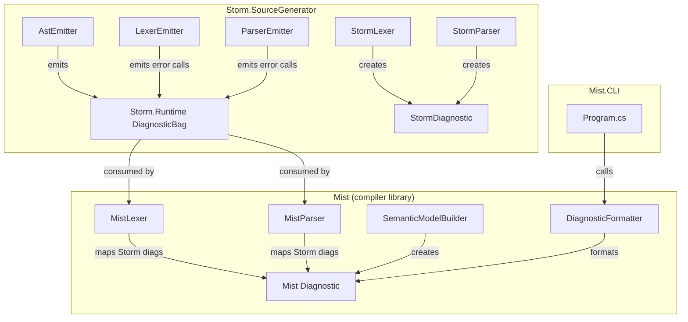
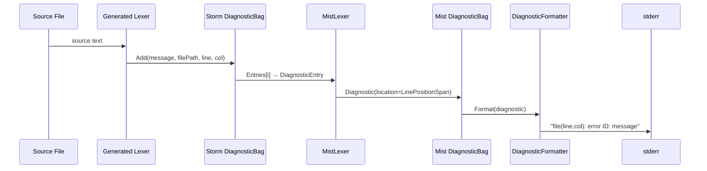

# Design Document: Unified Diagnostic Formatting

## Overview

This design addresses the inconsistent diagnostic reporting across the Mist compiler and Storm parser generator. Currently, the Storm runtime `DiagnosticBag` stores only plain string messages with no structured location data. When the `MistLexer` and `MistParser` map Storm diagnostics to Mist `Diagnostic` records, they set `Location: null` because the source information is unavailable. The `SemanticModelBuilder` similarly creates diagnostics without location information for syntax-node-related errors. Finally, the `DiagnosticFormatter` lives inside the `Mist.CLI` project, making it inaccessible to other consumers.

The design introduces four coordinated changes:

1. **Upgrade the Storm runtime `DiagnosticBag`** (emitted by `AstEmitter`) to store structured diagnostic entries containing file path, line, and column alongside the message.
2. **Propagate location data** in `MistLexer`, `MistParser`, and `SemanticModelBuilder` by extracting structured fields from Storm diagnostics and resolving syntax node spans.
3. **Relocate the `DiagnosticFormatter`** from `Mist.CLI` to `Mist.Common.Diagnostics` so it is shared across all consumers.
4. **Ensure the Storm frontend** (`StormLexer`/`StormParser`) already populates `StormDiagnostic` with file/line/column (confirmed by code review — this is already the case).

## Architecture

The changes span three projects and the generated runtime code:



### Change Flow

1. `AstEmitter.EmitRuntimeTypes()` — Upgrade the generated `DiagnosticBag` to store `DiagnosticEntry` records instead of plain strings. Add a `DiagnosticEntry` type with `Message`, `FilePath`, `Line`, `Column` fields.
2. `LexerEmitter` — Update the error-reporting call site in the generated lexer to pass file path, line, and column from the `SourceText` and current position.
3. `ParserEmitter` — Update the `Require` and `Error` helper methods to pass file path, line, and column from the current token.
4. `MistLexer.Lex()` — Extract `FilePath`, `Line`, `Column` from each `DiagnosticEntry` and construct a `LinePositionSpan` for the `Location` field.
5. `MistParser.Parse()` — Same extraction as `MistLexer`.
6. `SemanticModelBuilder` — When creating diagnostics for syntax nodes with valid spans, resolve the `SourceText` and call `ToLinePositionSpan()` to populate `Location`.
7. `DiagnosticFormatter` — Move from `Mist.CLI.Output` to `Mist.Common.Diagnostics`. Update `Mist.CLI` to reference the new location.

## Components and Interfaces

### 1. Storm Runtime DiagnosticEntry (Generated)

A new struct emitted by `AstEmitter` into the `Storm.Runtime` namespace:

```csharp
// Storm.Runtime (generated)
public readonly struct DiagnosticEntry
{
    public string Message { get; }
    public string? FilePath { get; }
    public int Line { get; }
    public int Column { get; }

    public DiagnosticEntry(string message, string? filePath, int line, int column)
    {
        Message = message;
        FilePath = filePath;
        Line = line;
        Column = column;
    }
}
```

### 2. Storm Runtime DiagnosticBag (Generated — Updated)

The existing generated `DiagnosticBag` changes from storing `List<string>` to `List<DiagnosticEntry>`:

```csharp
// Storm.Runtime (generated)
public class DiagnosticBag
{
    private readonly List<DiagnosticEntry> _entries = new();

    public void Add(string message, string? filePath, int line, int column)
    {
        _entries.Add(new DiagnosticEntry(message, filePath, line, column));
    }

    // Backward-compatible overload for callers that don't have location info
    public void Add(string message)
    {
        _entries.Add(new DiagnosticEntry(message, null, 0, 0));
    }

    public bool HasErrors => _entries.Count > 0;
    public int Count => _entries.Count;
    public IReadOnlyList<DiagnosticEntry> Entries => _entries;

    // Keep Messages for backward compatibility during migration
    public IReadOnlyList<string> Messages => _entries.Select(e => e.Message).ToList();

    public void TruncateTo(int count)
    {
        if (count >= 0 && count < _entries.Count)
            _entries.RemoveRange(count, _entries.Count - count);
    }
}
```

### 3. Generated Lexer Error Reporting (LexerEmitter Change)

The generated lexer's error path currently emits:
```csharp
diagnostics.Add($"Unexpected character '{ch}' at line {startPos.Line}, column {startPos.Column}");
```

This changes to:
```csharp
diagnostics.Add(
    $"Unexpected character '{ch}'",
    source.Path,
    startPos.Line,
    startPos.Column);
```

The message no longer embeds position information since it is now carried structurally.

### 4. Generated Parser Error Reporting (ParserEmitter Change)

The generated parser's `Require` and `Error` helpers currently embed position in the message string. They change to pass structured fields:

```csharp
// Require method
_diagnostics?.Add(
    $"Expected token kind {kind} but found '{cur.Lexeme}'",
    _tokens.Length > 0 ? _allTokens[0].Lexeme : null, // source path from TokenStream
    cur.Start.Line,
    cur.Start.Column);
```

The parser needs access to the source file path. The `Init` method will store the `SourceText.Path` from the `TokenStream` for use in error reporting.

### 5. MistLexer Diagnostic Mapping (Updated)

```csharp
// MistLexer.Lex() — mapping loop
foreach (var entry in stormDiagnostics.Entries)
{
    var location = (entry.Line > 0 && entry.Column > 0)
        ? new LinePositionSpan(
            new LinePosition(entry.Line, entry.Column),
            new LinePosition(entry.Line, entry.Column))
        : (LinePositionSpan?)null;

    diagnostics.Add(new Diagnostic(
        new DiagnosticId("MIST_LEX_ERROR"),
        DiagnosticSeverity.Error,
        PipelineStage.Lexing,
        entry.Message,
        Location: location,
        CompilationUnitPath: entry.FilePath ?? source.Path,
        AnalyzerName: null));
}
```

### 6. MistParser Diagnostic Mapping (Updated)

Same pattern as `MistLexer` — iterate `stormDiagnostics.Entries` and extract structured location.

### 7. SemanticModelBuilder Location Resolution

When the `SemanticModelBuilder` creates a diagnostic for a syntax node, it resolves the `SourceText` for that node's compilation unit and converts the node's `Span` to a `LinePositionSpan`:

```csharp
private static Diagnostic MakeDiagnosticWithLocation(
    string id,
    DiagnosticSeverity severity,
    string message,
    Storm.Runtime.SyntaxNode node,
    SourceText? sourceText)
{
    LinePositionSpan? location = null;
    string? compilationUnitPath = sourceText?.Path;

    if (sourceText is not null && node.Span.Length > 0)
    {
        var mistSpan = new SourceSpan(node.Span.Start, node.Span.Length);
        location = sourceText.ToLinePositionSpan(mistSpan);
    }

    return new Diagnostic(
        new DiagnosticId(id),
        severity,
        PipelineStage.SemanticModelConstruction,
        message,
        Location: location,
        CompilationUnitPath: compilationUnitPath,
        AnalyzerName: null);
}
```

This helper is used throughout the builder's passes wherever diagnostics reference specific syntax nodes.

### 8. DiagnosticFormatter (Relocated)

Move `DiagnosticFormatter` from `Source/Mist.CLI/Output/DiagnosticFormatter.cs` to `Source/Mist/Common/Diagnostics/DiagnosticFormatter.cs`. The implementation remains the same — it already handles all three format variants (with location, with file only, with neither). Update the namespace from `Mist.CLI.Output` to `Mist.Common.Diagnostics`.

The `Mist.CLI` project updates its `using` directive to reference the new namespace.

### 9. Storm Frontend (StormLexer / StormParser)

Code review confirms that the Storm frontend already populates `StormDiagnostic` with `FilePath`, `Line`, and `Column` from the `StormSourceText` and current token position. No changes needed here — Requirement 6 is already satisfied by the existing implementation.

## Data Models

### Existing Types (Unchanged)

| Type | Location | Description |
|------|----------|-------------|
| `Diagnostic` | `Mist.Common.Diagnostics` | Immutable record with `Id`, `Severity`, `Stage`, `Message`, `Location?`, `CompilationUnitPath?`, `AnalyzerName?` |
| `DiagnosticBag` (Mist) | `Mist.Common.Diagnostics` | Append-only collection of `Diagnostic` records |
| `LinePosition` | `Mist.Common.Text` | 1-based `(Line, Column)` record struct |
| `LinePositionSpan` | `Mist.Common.Text` | `(Start, End)` pair of `LinePosition` |
| `SourceSpan` | `Mist.Common.Text` | Offset-based `(Start, Length)` record struct |
| `SourceText` | `Mist.Common.Text` | Source file wrapper with `ToLinePositionSpan()` conversion |
| `StormDiagnostic` | `Storm.SourceGenerator.Diagnostics` | Source generator diagnostic with `FilePath`, `Line`, `Column` |

### New/Modified Types

| Type | Location | Change |
|------|----------|--------|
| `DiagnosticEntry` | `Storm.Runtime` (generated) | **New** — Structured entry with `Message`, `FilePath`, `Line`, `Column` |
| `DiagnosticBag` | `Storm.Runtime` (generated) | **Modified** — Stores `List<DiagnosticEntry>` instead of `List<string>`, exposes `Entries` property, adds overloaded `Add` method |
| `DiagnosticFormatter` | `Mist.Common.Diagnostics` | **Moved** from `Mist.CLI.Output` — same implementation, new namespace |

### Data Flow



## Correctness Properties

*A property is a characteristic or behavior that should hold true across all valid executions of a system — essentially, a formal statement about what the system should do. Properties serve as the bridge between human-readable specifications and machine-verifiable correctness guarantees.*

### Property 1: Formatter round-trip

*For any* `Diagnostic` value with a non-null `Location` and `CompilationUnitPath`, formatting the diagnostic with `DiagnosticFormatter.Format()` and then parsing the resulting string with `RoslynDiagnosticMapper.TryParse()` SHALL recover the original severity, diagnostic id, and message.

**Validates: Requirements 5.6**

### Property 2: Formatter output format

*For any* `Diagnostic` value, the string produced by `DiagnosticFormatter.Format()` SHALL match the expected pattern: `<file>(<line>,<column>): <severity> <id>: <message>` when both `Location` and `CompilationUnitPath` are present; `<file>: <severity> <id>: <message>` when only `CompilationUnitPath` is present; or `<severity> <id>: <message>` when neither is present. The severity token SHALL be the lowercase string `error` or `warning`.

**Validates: Requirements 5.1, 5.2, 5.3, 5.4**

### Property 3: MistLexer mapping preserves structured fields

*For any* Storm `DiagnosticEntry` with a non-empty file path and positive line and column values, the Mist `Diagnostic` produced by the `MistLexer` mapping SHALL have a `Location` field whose `Start.Line` and `Start.Column` match the entry's `Line` and `Column`, and a `CompilationUnitPath` matching the entry's `FilePath`.

**Validates: Requirements 2.1, 2.2**

### Property 4: MistParser mapping preserves structured fields

*For any* Storm `DiagnosticEntry` with a non-empty file path and positive line and column values, the Mist `Diagnostic` produced by the `MistParser` mapping SHALL have a `Location` field whose `Start.Line` and `Start.Column` match the entry's `Line` and `Column`, and a `CompilationUnitPath` matching the entry's `FilePath`.

**Validates: Requirements 3.1, 3.2**

### Property 5: SemanticModelBuilder span-to-location resolution

*For any* `SourceText` with non-empty content and any `SourceSpan` within that content with non-zero length, the `LinePositionSpan` produced by `SourceText.ToLinePositionSpan()` SHALL have `Start.Line >= 1` and `Start.Column >= 1`, and the diagnostic created for a syntax node at that span SHALL have a non-null `Location` matching the computed `LinePositionSpan` and a `CompilationUnitPath` matching the `SourceText.Path`.

**Validates: Requirements 4.1, 4.2, 4.3**

### Property 6: Storm frontend diagnostic location completeness

*For any* invalid Storm grammar source text with a non-null file path, all `StormDiagnostic` records produced by the `StormLexer` or `StormParser` SHALL have a non-null `FilePath` and `Line > 0` and `Column > 0`.

**Validates: Requirements 6.3**

### Property 7: Stored diagnostic location matches computed position

*For any* source text and any valid character offset within that text, the 1-based line and column stored in a `DiagnosticEntry` by the generated lexer SHALL equal the line and column computed by `SourceText.ToLinePositionSpan()` for a span starting at that offset.

**Validates: Requirements 1.5**

## Error Handling

### Generated Lexer/Parser Errors

When the generated lexer encounters an unrecognized character, it creates a `DiagnosticEntry` with the error message, source file path, and the current line/column position. The lexer continues scanning (error recovery by skipping the character). The generated parser halts on the first error (`_hasError` flag) and records the error with the current token's position.

### Missing Source Information

If a `DiagnosticEntry` has `Line == 0` and `Column == 0` (indicating no position information is available), the `MistLexer` and `MistParser` mapping code sets `Location` to `null` rather than constructing a meaningless `LinePositionSpan(0,0)`. This preserves the existing behavior for edge cases where position data is unavailable.

### SemanticModelBuilder Fallback

When the `SemanticModelBuilder` cannot resolve a `SourceText` for a syntax node (e.g., driver-level errors with no associated compilation unit), it sets `Location` to `null` and includes available context in the diagnostic message. This is the existing behavior and is preserved.

### Formatter Robustness

The `DiagnosticFormatter` handles all three cases (with location, file-only, neither) via conditional formatting. No exceptions are thrown for any combination of null/non-null fields.

### Backward Compatibility

The generated `DiagnosticBag` retains a `Messages` property (returning just the message strings) and a single-argument `Add(string)` overload for backward compatibility during migration. This ensures any existing code that reads `Messages` continues to work.

## Testing Strategy

### Property-Based Tests (FsCheck.Xunit)

Each correctness property is implemented as a property-based test using FsCheck.Xunit with a minimum of 100 iterations. The project already uses `FsCheck.Xunit` version 3.1.0.

| Property | Test Location | What It Tests |
|----------|--------------|---------------|
| Property 1: Formatter round-trip | `Test/Mist.CLI.Tests` | `Format()` → `TryParse()` recovers severity, id, message |
| Property 2: Formatter output format | `Test/Mist.CLI.Tests` | Output string matches expected pattern for each Location/Path combination |
| Property 3: MistLexer mapping | `Test/Mist.Tests` | Storm `DiagnosticEntry` fields propagate to Mist `Diagnostic` |
| Property 4: MistParser mapping | `Test/Mist.Tests` | Storm `DiagnosticEntry` fields propagate to Mist `Diagnostic` |
| Property 5: SemanticModelBuilder location | `Test/Mist.Tests` | Span-to-LinePositionSpan conversion produces valid location |
| Property 6: Storm frontend location | `Test/Storm.SourceGenerator.Tests` | StormDiagnostic has valid FilePath/Line/Column |
| Property 7: Location matches offset | `Test/Mist.Tests` | Stored line/column equals computed position from offset |

**Configuration:**
- Minimum 100 iterations per property test
- Each test tagged with: `Feature: unified-diagnostic-formatting, Property {N}: {title}`
- FsCheck generators produce random `Diagnostic` values, source texts, spans, and `DiagnosticEntry` values
- Generators constrain line/column to positive integers and file paths to non-empty strings

### Unit Tests (Example-Based)

| Test | What It Verifies |
|------|-----------------|
| `AstEmitter` output contains `DiagnosticEntry` struct | Requirement 1.1 |
| `LexerEmitter` output passes structured args to `diagnostics.Add()` | Requirement 1.2 |
| `ParserEmitter` output passes structured args to `diagnostics.Add()` | Requirement 1.3 |
| `DiagnosticEntry` storage round-trip in `DiagnosticBag` | Requirement 1.4 |
| `SemanticModelBuilder` with no `SourceText` produces null `Location` | Requirement 4.4 |
| `DiagnosticFormatter` exists in `Mist.Common.Diagnostics` namespace | Requirement 5.5 |

### Integration Tests

| Test | What It Verifies |
|------|-----------------|
| Storm frontend lexer produces located `StormDiagnostic` for `.storm` errors | Requirement 6.1 |
| Storm frontend parser produces located `StormDiagnostic` for `.storm` errors | Requirement 6.2 |
| Full pipeline compilation produces diagnostics with non-null `Location` | Requirements 7.1, 7.5 |
| `CompilerDriver` propagates diagnostics without modifying fields | Requirement 7.2 |
| CLI stderr output includes formatted diagnostics with location | Requirements 7.3, 7.4 |

