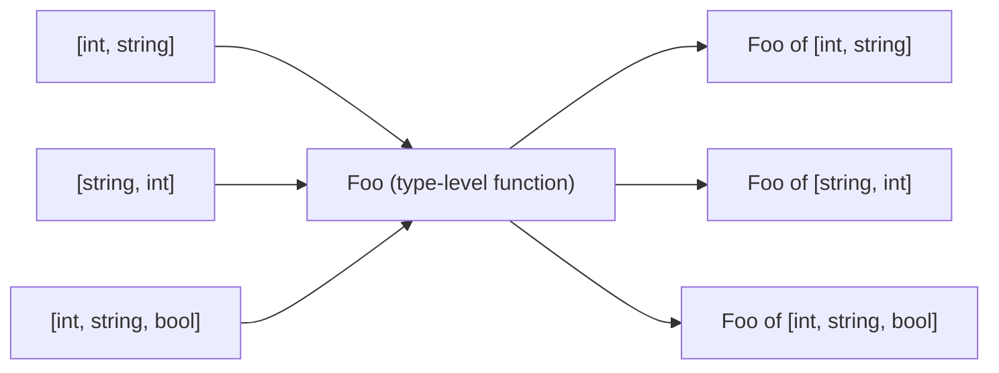
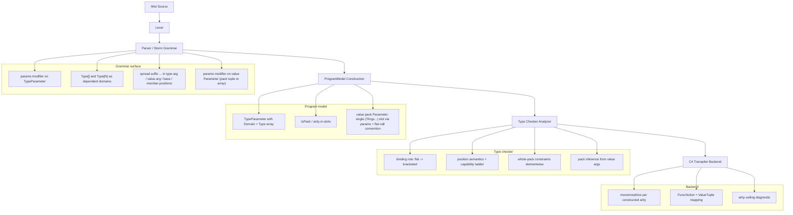

# Design Document: Variadics (Type-Parameter Packs and Value-Level params)

## Overview

This design adds variadics to Mist in two connected forms:

1. **Type-parameter packs** (variadic generics): a single type parameter that stands for an
   ordered, arity-varying list of type arguments. This lets a family such as `Func` or `Tuple`
   be written once, for all arities, where both the arity and the filled-in type arguments
   participate in type identity.
2. **Value-level `params`**: a homogeneous, C#-style variadic value parameter (for example
   `void Log(params string[] parts)`), where the callee sees a real array and the call site is
   flat. This is the homogeneous sibling of the heterogeneous type pack.

The keystone idea is that a type-parameter pack is not a new kind of entity. It is sugar for a
single **dependent type parameter** whose value type is a compile-time (comptime) `Type[]`.
Writing `params TArgs` is exactly writing `Foo<Type[]:TArgs>`. This works because Mist already has
the three ingredients: a type name in expression position is a `System.Type` value (see
[type-literals](../type-literals/design.md)); an array literal `[a, b, c]` is a first-class value
(see [array-literals](../array-literals/design.md)); and a comptime value may index type identity
(see [dependent-types](../dependent-types/design.md)). Compose them and an
array-literal-of-type-literals such as `[int, string, bool]` is a comptime readonly `Type[]` -- the
exact kind of value a dependent type parameter consumes. A variadic family is therefore a type-level
function from `Type[]` values to types, and everything else in this design follows from that single
reduction rather than from special-purpose rules.

The concrete payoff, and the motivating example kept front and center below, is collapsing the
`Func`/`Action` bootstrap: 17 hand-written intrinsic `Func` declarations plus 17 `Action` aliases
become one declaration each. The document is organized so that language semantics and the
programmer experience come first; the compiler-stage architecture that realizes those semantics is
presented afterward as supporting material.

### Foundations

This feature builds directly on the following settled specs and should be read against them:

- [dependent-types](../dependent-types/design.md) -- a comptime value participates in type identity; a type parameter may have a value domain (`N:int`).
- [type-literals](../type-literals/design.md) -- a type name in expression position is a `Type` value.
- [array-literals](../array-literals/design.md) -- `[a, b, c]` is a first-class array value.
- [value-tuples](../value-tuples/design.md) -- the value counterpart of a type pack is a tuple `(TArgs...)`.
- [type-argument-inference](../type-argument-inference/design.md) -- the positional unification engine that pack inference extends.
- [generics-type-arguments](../generics-type-arguments/design.md) -- type parameters, type arguments, constructed types, and arity-as-identity.
- [first-class-functions](../first-class-functions/design.md) -- the `Func`/`Action` family this feature rewrites.

## Motivation and Proof Point: Func / Action Before and After

Today the callable family is written out by hand, one class per arity, because the language cannot
express "a family where the number of parameter types varies."

**Before** (see `Source/Standard/Bootstrap/Func.mist`, 17 declarations):

```mist
namespace Standard;

intrinsic public class Func<TResult> { }
intrinsic public class Func<T1, TResult> { }
intrinsic public class Func<T1, T2, TResult> { }
// ... 13 more ...
intrinsic public class Func<T1, T2, T3, T4, T5, T6, T7, T8, T9, T10, T11, T12, T13, T14, T15, T16, TResult> { }
```

**Before** (see `Source/Standard/Bootstrap/Action.mist`, 17 aliases):

```mist
namespace Standard;

type Action = Func<void>;
type Action<T1> = Func<T1, void>;
type Action<T1, T2> = Func<T1, T2, void>;
// ... 13 more ...
type Action<T1, T2, T3, T4, T5, T6, T7, T8, T9, T10, T11, T12, T13, T14, T15, T16> =
    Func<T1, T2, T3, T4, T5, T6, T7, T8, T9, T10, T11, T12, T13, T14, T15, T16, void>;
```

**After** -- one declaration each:

```mist
namespace Standard;

// The trailing slot is the return type. The pack absorbs the parameter types.
// The empty pack (TArgs = []) covers the no-argument case Func<TResult>.
intrinsic public class Func<params TArgs, TResult> { }

// Action spreads the pack into Func's type-argument list, fixing the result to void.
type Action<params TArgs> = Func<TArgs..., void>;
```

The `Action` line is itself a worked demonstration of a type-array spreading into a
type-argument list. `Func<int, string>` binds `TArgs = [int]` and `TResult = string`;
`Func<string>` binds `TArgs = []` and `TResult = string`; `Action<int, string>` desugars to
`Func<int, string, void>` and hence to `TArgs = [int, string]`, `TResult = void`.

One subtlety to carry into the design: Mist's `Func` currently exposes no Mist-visible members --
invocation is special-cased in the type checker, which recognizes a `Func`-typed expression followed
by an invocation suffix. That per-arity recognition must be generalized to a single rule: an
invocation of a `Func<params TArgs, TResult>` value is well-typed when the supplied argument list
matches `TArgs` elementwise and the expression's result type is `TResult`.

## Language Model

### The Keystone: A Pack Is a Dependent Type Parameter over `Type[]`

`params TArgs` is sugar for one dependent type parameter written fully as `Foo<Type[]:TArgs>`.
`TArgs` is a comptime-known, ordered, readonly array of type literals. There is no separate "pack"
concept in the type system: a pack parameter is a dependent type parameter whose value domain is
`Type[]`, in exactly the same sense that `N:int` is a dependent type parameter whose value domain is
`int`.

Because a constructed variadic type is identified by its family together with the concrete `Type[]`
value, `Foo` behaves as a type-level function:



### Type Identity

A constructed variadic type is identified by the pair (family, the `Type[]` value). Type identity
reduces to elementwise type equality, and order matters. Therefore:

- `Foo<[int, string]>` and `Foo<[string, int]>` are distinct (order differs).
- `Foo<[int, string]>` and `Foo<[int, string, bool]>` are distinct (arity differs).

This gives "arity participates in identity" and "filled-in arguments participate in identity" for
free, with no rule beyond the array equality that [array-literals](../array-literals/design.md) and
[dependent-types](../dependent-types/design.md) already imply. It is the same principle as
`FixedBuffer<5>` differing from `FixedBuffer<6>`, lifted from `int` values to `Type[]` values.

### Declaration Syntax and Rules

Both spellings are legal and denote the same parameter:

```mist
class Foo<params TArgs> { }      // bracket-free construction sugar
class Foo<Type[]:TArgs> { }      // canonical, explicit dependent form
```

Rules:

- **`params` is construction sugar.** Declaring a pack with `params` grants bracket-free
  construction at the use site. The explicit `Type[]:` form requires the arguments to be passed
  bracketed.
- **Multiple `Type[]:` parameters are allowed** in one type-parameter list. They are disambiguated
  at the use site by writing each one's arguments in brackets `[]`. At most **one** parameter per
  list may be `params` (the single bracket-free pack); every other type-array parameter must be
  passed bracketed.
- **Why the cap is one `params`, not zero-or-many.** The limit of one sugared (`params`) pack per
  list is about **authorial intent, not ambiguity**. Multiple packs could be disambiguated by
  forcing explicit brackets at the use site, exactly as multiple `Type[]:` packs already are, so the
  cap is not needed to keep parsing or binding unambiguous. Rather, `params` is how the author
  designates the single spot where the caller may omit the brackets. This mirrors C#'s deliberate
  choice for `params string[]`: a lone array parameter could be treated as variadic with no
  ambiguity, yet C# still requires the author to opt in with `params`. Mist follows the same design,
  and the value side obeys the identical rule with explicit `(TArgs...)` tuples standing in for
  brackets.
- **Inverse sugar.** A lone `Type[]:` parameter (the only type-array parameter in the list)
  automatically becomes `params` for convenience, so a single-pack family never needs brackets.
- **Arity is counted in parameter slots.** Each `Type[]:` slot counts as exactly one slot,
  regardless of how many types it later absorbs. For example
  `Foo<TVal, Type[]:TArgs, params CtorArgs, Type[]:Args3, TRes>` has arity 5. The value-parameter
  side counts arity identically -- a value pack `params TArgs args` is a single `(TArgs...)` slot and
  the same binding rule fills it (see Value Side).
- **Binding rule: at most one unbracketed pack per list.** The unbracketed pack may appear anywhere
  -- leading, middle, or trailing. Fixed scalar slots and bracketed type-array slots bind
  positionally inward from both ends; the single unbracketed pack absorbs whatever remains in the
  middle. Empty packs are allowed, so arity-0 inputs fall out naturally (for example `Func<string>`
  gives `TArgs = []` and `TResult = string`).

Worked construction for the arity-5 type above:

```mist
// Declaration:
//   class Foo<TVal, Type[]:TArgs, params CtorArgs, Type[]:Args3, TRes> { }
new Foo<int, [a, b], x, y, z, [c], float>()
// Binds: TVal = int, TArgs = [a, b], CtorArgs = [x, y, z], Args3 = [c], TRes = float
```

This resolves precisely: `TVal` binds `int` from the left; `TArgs` takes the bracketed `[a, b]`;
`TRes` binds `float` from the right; `Args3` takes the bracketed `[c]`; and only `CtorArgs` is
unbracketed, so the leftover middle `x, y, z` is unambiguously its contents.

Finally, the flat sugar and the canonical bracketed form denote the same type. `Foo<int, string>`
and `Foo<[int, string]>` are the same type; the flat form is resolved into the bracketed form by the
binding rule.

### Position Semantics of a Pack Identifier

Inside a body, the meaning of a pack identifier `TArgs` depends on the position it appears in:

1. **Expression position.** `TArgs` is the comptime `Type[]` value itself. It supports `.Length`,
   iteration, and indexing like any comptime array.
2. **Bare type position.** ERROR. A pack is a value, not a type, so `public TArgs Item;` is illegal.
   (To place element types in type position, use indexing or spread; see below.)
3. **Indexed in type position, `TArgs[i]`.** Legal only when the length is proven to be at least
   `i + 1`. Mist has no unproven array access, so this simply reuses the existing array-bounds
   discipline. When legal, `TArgs[i]` yields a single comptime `Type` value coerced into type
   position -- the type-literal duality of [type-literals](../type-literals/design.md) run backward
   (a `Type` value becoming a type).
4. **Spread, `TArgs...`,** in a type-argument list, base/interface list, tuple-type element
   position, or member-declaring position. Expands the pack in place. Spread is definable as sugar
   over rules 1 and 3 plus comptime iteration: for `i` in `0 .. TArgs.Length`, emit a copy
   substituting the type `TArgs[i]`. A value pack parameter is **not** a spread position: it is
   declared with `params` (`params TArgs args`), not with `...` (see Value Side).

### Capability Ladder

What a pack can do is a function of what is proven about its length. Capability rises as the length
becomes more precisely known:

| Proven about length | `.Length` | iteration | `TArgs...` spread | `TArgs[i]` indexing |
|---|---|---|---|---|
| `Type[]:TArgs` (unknown length) | yes | yes | yes | ERROR |
| `Type[N]:TArgs` (exact fixed size) | yes | yes | yes | yes, for `0 .. N-1`; `TArgs[N]` is a comptime out-of-bounds error |

- The size-agnostic operations (`.Length`, iteration, `TArgs...`) are always available, even when
  the length is unknown, because they do not name a specific index.
- The exact-size row is in scope for this feature because fixed-size arrays (`Type[N]`) already
  exist in Mist.
- **Narrowing restores indexing.** An unknown-length pack can be narrowed by a guard, after which
  indexing is legal in that branch:

  ```mist
  if (TArgs is Type[3] fixed) {
      // fixed[0], fixed[1], fixed[2] are legal here
  }
  ```

- **Deferred.** Range- or refinement-bounded sizes such as `Type[2..8]` are out of scope; they
  require range-as-refinement support (see Non-Goals / Deferred).

## Value Side

The value counterpart of a type pack is a real, first-class value.

- The flattened value pack is declared `params TArgs args`: a single parameter of type `(TArgs...)`
  (equivalently `ValueTuple<TArgs>`) carrying a **flattened call convention**. Inside the body,
  `args` can be stored, returned, zipped with other packs, and forwarded.
- A plain `(TArgs...) args` -- no `params` -- is an ordinary tuple parameter: the caller passes a
  single tuple at the call site rather than a flat argument list.
- `params` is the single call-site slurp marker for value parameters. It is used uniformly whether
  the target is a pack (`params TArgs args`, yielding `ValueTuple<TArgs>`) or a homogeneous array
  (`params T[] names`, yielding `T[]`). This mirrors C#'s `params T[]` (flat call: `Log("a", "b")`)
  and lifts it from a homogeneous array to a heterogeneous pack.
- `...` is purely the spread and decompose operator; it is not a parameter-declaration marker. It
  forms tuple types (`(TArgs...)`), decomposes a tuple value at a use site (`args...`), expands a
  type pack in type-argument and base/interface lists, and generates members in a type body
  (`public TArgs... Item;`). Declaring `params TArgs args` rather than the older `TArgs... args`
  removes the overload where `...` doubled as a declaration marker, cleanly separating `params`
  (slurp) from `...` (spread).
- A variadic method therefore reads `M<params TArgs>(params TArgs args)`: the `params` in the
  type-parameter list declares the pack, and the `params` in the value-parameter list is the slurp.
  The two are intentional and unambiguous by position.

### The Value Pack Is a Tuple, Not an Array

The type `(TArgs...)` is equivalently `ValueTuple<TArgs>`. When the pack is bound to a concrete
`[t1, ..., tN]`, `args` is an ordinary value tuple `(t1, ..., tN)`.

It is a tuple and **never** an array, for a concrete, load-bearing reason. A value pack is
*heterogeneous*: element `i` has type `TArgs[i]`, so different elements may have different types. An
array is *homogeneous* and must have a single concrete element type to be allocatable. `unknown[] x = ...`
can alias an existing object, but `new unknown[]` is impossible, because allocation requires a real
element type, and generics rely on a concrete constructed type at each use. Only a struct with
per-slot typed fields -- that is, a tuple -- can hold heterogeneous values and still be allocated
once the pack is bound. Hence tuple, not array.

This is the exact symmetry of the two sides. On the type side `TArgs` really is an array (`Type[]`),
homogeneous because every element is a `Type`. On the value side the elements have different types,
so the counterpart collapses to a tuple. **The type pack is an array of `Type`; the value pack is a
tuple of the `TArgs`-typed values.**

### `args` Without `...` Is a First-Class Tuple Value

Used without `...`, `args` is an ordinary `(TArgs...)` value, usable anywhere that tuple type is
accepted. It may be:

- stored in a local (`var t = args;`),
- returned from a method whose return type is `(TArgs...)`,
- passed whole as a single argument to a parameter typed `(TArgs...)`,
- nested inside another tuple (for example `(args, 0)`),
- or deconstructed.

The only operator special to packs is `...`; every other use of `args` is just tuple behavior.

### Value-Side Spread Is General Tuple Decomposition

The value-side `...` operator is **general tuple decomposition** into argument or parameter slots. It
applies to *any* tuple value, not only to packs. For example:

```mist
var x = (7, "foo", false);
SomeMethod(x...);
```

is well-typed if and only if `SomeMethod` accepts `(int, string, bool)`. The check is purely
structural: the tuple's ordered element types must match the target slots positionally under
assignability.

`args...` is simply the case where the tuple happens to have originated from a pack; `f(args...)`
forwards `args : (TArgs...)` into the parameter slots of a `Func<params TArgs, TResult>` value.
Nothing about the operator is pack-specific.

### Value-Parameter Arity and the Shared Binding Rule

Because `params TArgs args` is a single `(TArgs...)` (`ValueTuple`) parameter, it occupies exactly
**one** parameter slot. Therefore:

- **Arity counts slots.** Method parameter arity is the number of declared parameter slots, counting
  a value pack as one slot. `Foo(int number, params TArgs args, bool enabled)` has arity **3**, not
  2 + N. This mirrors the type-parameter side exactly, where
  `class Foo<TValue, params TArgs, TResult>` has arity 3.
- **Binding reuses the type-side rule.** Call-site binding uses the same binding rule already defined
  for the type side: fixed value parameters bind positionally inward from both ends, and the
  remaining contiguous middle arguments are collected into the tuple. For example, given
  `Foo(int number, params TArgs args, bool enabled)`, the call `Foo(5, a, b, c, true)` binds
  `number = 5`, `enabled = true`, and `args = (a, b, c)`.
- **Flat versus single-tuple.** `params TArgs args` is the flattened-call form: the caller writes a
  flat argument list and the slurp collects the middle. A plainly typed `(TArgs...) args` parameter
  instead takes a single tuple argument at the call site. This mirrors C#'s `params T[]` (flat)
  versus `T[]` (single).
- **One `params` per list, and why.** At most one `params` is allowed per value-parameter list --
  whether it targets a tuple (a pack) or a homogeneous array -- and more than one is diagnostic
  `MIST_VAR_0001`, the same rule as the type side. The cap is about **authorial intent, not
  ambiguity**: multiple packs could be disambiguated by forcing explicit tuples at the use site,
  exactly as multiple type-side packs are disambiguated with brackets, but `params` is how the
  author designates the single spot where the caller may omit the tuple. This mirrors C#'s
  deliberate choice for `params string[]`: a lone array parameter could be treated as variadic with
  no ambiguity, yet C# still requires the author to opt in with `params`. Additional packs in the
  same list are therefore written as explicit `(TArgs...)` tuple parameters, each passed as one
  tuple. For example:
  - `Foo(params TArgs args)` slurps a flat argument list into `ValueTuple<TArgs>`.
  - `Foo(params TArgs first, (TArgs2...) second)` is one sugared pack plus one explicit-tuple pack.
  - `Foo((TArgs...) a, (TArgs2...) b, params string[] names)` shows the single `params` being the
    array while both packs are passed as explicit tuples.

### Unifying Principle

On both the type side and the value side a pack is a single slot; arity counts slots; and the same
binding rule fills the pack from the contiguous middle after the fixed slots bind inward from both
ends. The only difference is what the pack *is* -- a `Type[]` on the type side, a `ValueTuple<TArgs>`
on the value side.

One rule governs sugar everywhere: **exactly one sugared (`params`) pack is permitted per usage
location.** This holds uniformly across type-parameter lists (both when declaring a variadic generic
and when closing one), value-parameter lists (value packs), and variadic tuple types. Additional
packs at the same location are written explicitly -- bracketed type arguments on the type side,
explicit `(TArgs...)` tuple parameters on the value side. `params` designates the single sugared slot
where the caller may omit the brackets or the tuple; `...` spreads. Because the same
one-sugared-slot rule is shared by value packs, variadic tuples, and the closing of an open variadic
generic, `params` means the same thing in every position it appears.

### The Spread / Forward / Zip Matrix

Spreading is one idea applied to two worlds (types and values), plus their parallel combination:

| Operand | Spreads into | Example positions |
|---|---|---|
| comptime `Type[]` (for example `TArgs...`) | TYPE slots | type-argument lists, tuple-type element lists, field/member type positions, base/interface lists |
| any tuple value (for example `args...` or `x...`) | ARGUMENT slots (tuple decomposition) | call arguments, tuple literals |
| zip (for example `field... = args...`) | PAIRED positions | parallel expansion of two operands, element by element |

Zip is permitted only when the two operands are proven to have equal length -- either because they
originate from the same pack, or because equal length has otherwise been established. This keeps
`field... = args...` sound: there is always exactly one right-hand value per left-hand slot.

### Spread-Accepting Positions

A spread is accepted in each of the following positions:

- type-argument lists (for example `type Action<params TArgs> = Func<TArgs..., void>;`),
- field declarations,
- base and interface lists,
- tuple types and return types.

Value parameters are **not** a spread position: a value pack parameter is declared with `params`
(`params TArgs args`), not with a `...` spread. The `...` operator is reserved for spreading a type
pack into the type positions above, decomposing a tuple value into argument slots (`args...`),
forming tuple types (`(TArgs...)`), and generating members (`public TArgs... Item;`).

## Spread-Generated Members

When a spread appears in a member-declaring position, it generates a family of members named by a
stem plus a 1-based index:

```mist
public TArgs... Item;   // generates Item1, Item2, ..., ItemN
```

Rules:

- **Naming is stem + 1-based index** (`Item1 .. ItemN`), matching `ValueTuple` interop.
- **The stem namespace is reserved.** No other member may equal the stem or use it as a prefix; two
  spread stems may not prefix one another; and the stem must be non-empty.
- **Empty pack expands to zero members.** Length-1 gives `Item1` (the suffix is always present, even
  for a single element).
- **Multiple spreads of the same pack in one type are correlated at the same N.** For example
  `Key...` and `Value...` generate `Key1 .. KeyN` and `Value1 .. ValueN` for the same `N`.
- **Spread-generated members are themselves re-spreadable.**

## Constraints

- A **whole-pack constraint** `where TArgs : IConstraint` constrains **every element** of the pack.
  This is what makes it sound to call the constrained member on each element and on each `args[i]`:
  every element is known to satisfy the bound. Standard constraint kinds apply elementwise.
- **Per-index / per-element constraints** (for example `TArgs[0] : Foo`) are out of scope (see
  Non-Goals / Deferred).

## Method-Level Packs

A method may declare its own pack, independent of any pack on the enclosing type:

```mist
int SomeMethod<params TArgs>(params TArgs args) {
    // args : (TArgs...)
    return Consume(args...);   // forward by spreading
}
```

Inside the method, `args` has type `(TArgs...)` and is forwarded with `args...`. The method reads
`SomeMethod<params TArgs>(params TArgs args)`: the first `params` declares the type pack, the second
is the value-parameter slurp, and the two are unambiguous by position. As with type-level
declarations, each parameter list still allows at most one `params`.

## Value-Level params (New to Mist)

This spec also introduces the homogeneous, C#-style variadic value parameter:

```mist
void Log(params string[] parts) {
    // parts is a real string[]
}

Log("a", "b");   // flat call site; parts == ["a", "b"]
```

Here `parts` is a genuine `string[]` and the call site is flat. This is the homogeneous sibling of
the heterogeneous type-pack form: a type pack varies the element **types**, while value-level
`params` fixes one element type and varies the **count**.

`params` is the single call-site slurp marker for value parameters, and it works uniformly across
both value targets:

- `params TArgs args` slurps a flat argument list into the tuple `(TArgs...)` (`ValueTuple<TArgs>`)
  -- the heterogeneous value pack.
- `params T[] names` slurps a flat argument list into a homogeneous `T[]`.

At most one `params` is allowed per value-parameter list, whether it targets a tuple or an array,
under diagnostic `MIST_VAR_0001`. Additional packs in the same list are written as explicit
`(TArgs...)` tuple parameters. For example, `Foo((TArgs...) a, (TArgs2...) b, params string[] names)`
carries two explicit-tuple packs and a single `params` array.

The `params` keyword is otherwise disambiguated purely by position:

- Inside `<>` (a type-parameter list), `params TArgs` declares a **type pack**.
- In a value parameter list, `params TArgs args` declares a **value pack** (target tuple) and
  `params T[] xs` declares a **homogeneous value pack** (target array).

## Inference

Call-site inference of a type pack from value arguments is in scope. Given
`M<params TArgs>(params TArgs args)`:

```mist
M(1, "x", true);          // infers TArgs = [int, string, bool]
M<[int, string, bool]>(); // explicit form remains available as a fallback
```

This extends the existing positional unification engine of
[type-argument-inference](../type-argument-inference/design.md). Two points matter:

- Inference must solve any fixed (scalar) type parameters alongside the pack, using the same binding
  rule that resolves the flat form into the bracketed form.
- The explicit `M<[...]>(...)` form is always available when inference cannot or should not run.

## Worked Examples (Programmer Experience)

Callable family, written once:

```mist
intrinsic public class Func<params TArgs, TResult> { }
type Action<params TArgs> = Func<TArgs..., void>;

// Usage reads exactly as today:
Func<int, int, bool> isLess;      // TArgs = [int, int], TResult = bool
Func<string> getName;             // TArgs = [], TResult = string
Action<int, string> log;          // Func<int, string, void>
```

Storing and forwarding a heterogeneous argument list:

```mist
int CountThenCall<params TArgs>(params TArgs args) {
    var n = TArgs.Length;         // .Length in expression position (rule 1)
    return Sink(args...);         // spread into argument slots
}
```

A middle pack, resolved by the binding rule:

```mist
// Declaration: class Between<TFirst, params TMid, TLast> { }
new Between<int, string, bool, double>();
// TFirst = int (left end), TLast = double (right end), TMid = [string, bool]
```

## Architecture (Supporting: How Each Compiler Stage Participates)

The feature threads through the existing pipeline. No stage needs a new subsystem; each extends what
[dependent-types](../dependent-types/design.md) and
[generics-type-arguments](../generics-type-arguments/design.md) already established.



### Grammar Surface

The grammar changes are localized to the type-parameter, type-argument, and spread surfaces, in the
spirit of the minimal additions made for dependent types.

- **`params` modifier on a type parameter.** Extend the `TypeParameter` rule (currently
  `DependentTypeParameter`, `NamedConstraintDependentTypeParameter`, `RegularTypeParameter` in
  `Source/Mist/Grammar/Mist.storm`) with a pack alternative that accepts an optional `params`
  keyword and a `Type[]` (or `Type[N]`) domain annotation. `params TArgs` and `Type[]:TArgs` are two
  concrete surface spellings of the same underlying dependent parameter.
- **Type-array domains.** The dependent-parameter annotation, which today accepts a `PrimitiveType`,
  is broadened so the domain may be the metatype array `Type[]` (unknown length) or `Type[N]`
  (fixed length). This is the point where a pack becomes "a dependent type parameter over `Type[]`."
- **Spread suffix.** A postfix `...` is accepted after a pack identifier in type-argument lists,
  value-argument lists (tuple decomposition), tuple-type element lists, base/interface lists, and
  member-declaration type positions. It is **not** accepted as a value-parameter declaration marker:
  a value pack parameter is declared with `params` (see the next bullet). The flat form
  `Foo<int, string>` continues to parse through the existing `TypeArgumentList`; the binding rule (a
  program-model / type-checker concern, not a grammar concern) later folds it into the bracketed
  canonical form.
- **Value-level `params`.** The value parameter grammar accepts a leading `params` modifier whose
  target is either a pack (`params TArgs args`, a `(TArgs...)` tuple slot) or a homogeneous array
  (`params T[] xs`). Disambiguation from the type-pack `params` is structural: the type-pack `params`
  occurs inside `<>`, the value-parameter `params` in a value parameter list.

Pretty-printing round-trips each surface form (`params TArgs`, `Type[]:TArgs`, `TArgs...`, flat and
bracketed argument lists) so that parse-print-parse is stable.

### Program-Model Representation

The program model already represents a type parameter as a `TypeParameter` with an `Ordinal` and a
`Domain` (the type whose values fill the slot -- `Standard.Type` for a regular parameter,
`Standard.Int32` for `N:int`). A pack parameter is the natural next case:

- **Pack parameter.** A `TypeParameter` whose `Domain` is the comptime array `Type[]` (or `Type[N]`
  for the fixed-size rung). A small piece of derived state records that this parameter is a pack and
  whether it is the list's single unbracketed `params` slot. Everything else (name, ordinal,
  constraints) is unchanged, which is what lets the pack reuse the dependent-type machinery.
- **Arity in slots.** Arity is the number of declared slots, counting each `Type[]:` slot as one.
  The model stores the slot list; it does not pre-expand packs. Expansion is a type-checker and
  backend activity driven by a concrete `Type[]` value.
- **Constructed variadic type.** A `ConstructedType` whose argument in the pack slot is a comptime
  `Type[]` value. Type identity is the existing constructed-type identity plus elementwise array
  equality on that value (order-sensitive), matching the dependent-type equality already in place.
- **Value pack parameter.** A value `Parameter` introduced by `params` that is a **single**
  parameter slot of tuple type `(TArgs...)` carrying the flattened call convention; arity counts it
  as one slot, exactly as a type-side pack slot counts as one. The homogeneous value-level
  `params T[]` is a `Parameter` of array type introduced by the same `params` modifier and carrying
  the same flat-call flag.

Per the ProgramModel isolation rule, all of this lives in the program-model type system and its
constructor; no legacy semantic types are introduced.

### Type-Checker Rules

The type checker is where packs acquire their behavior:

- **Binding (flat to bracketed).** Given a use-site argument list and a declared slot list with at
  most one unbracketed pack, bind fixed and bracketed slots inward from both ends and assign the
  remaining middle to the pack. Reject lists with more than one unbracketed pack, and lists too
  short to fill the fixed and bracketed slots. This one binding rule is **shared** across
  type-parameter lists and value-parameter lists: a value pack is a single `(TArgs...)` slot, so the
  same inward-from-both-ends procedure fills it from the contiguous middle arguments.
- **Position semantics.** Enforce the four position rules: pack-as-value in expression position;
  error on bare-type position; bounded indexing in type position (reusing array-bounds flow
  analysis); and spread expansion elsewhere. Indexing is gated by the capability ladder, including
  guard-based narrowing (`is Type[N]`). Value-side spread (`x...`) is checked as **general tuple
  decomposition**: it applies to any tuple value, and the tuple's ordered element types must match
  the target argument or parameter slots positionally under assignability -- a decomposition or type
  mismatch is an ordinary type error, and `args...` is just the case where the tuple originated from
  a pack.
- **Constraints.** A whole-pack constraint is discharged elementwise: every element type must
  satisfy the bound before a constrained member may be used on an element or on `args[i]`.
- **Zip.** Permit `field... = args...` only when both operands are proven equal length (same origin
  or otherwise established).
- **Inference.** Extend the positional unification engine so a pack absorbs the run of value
  arguments not claimed by fixed parameters, solving fixed type parameters simultaneously. Fall back
  to explicit `<[...]>` when inference does not apply.
- **Func invocation generalization.** Replace the per-arity `Func` invocation recognition with a
  single rule: invoking a `Func<params TArgs, TResult>` value is well-typed when the argument list
  matches `TArgs` elementwise and the result type is `TResult`.

### C# Emission Strategy

The backend consumes fully resolved constructed types, so by emission time every pack has a concrete
`Type[]` value and every spread has a known length. Emission is therefore monomorphization:

- **Per-arity expansion.** For each distinct constructed arity actually used, expand spreads to their
  concrete width and emit the corresponding C# construct (a specific `Func`/`Action`/tuple/type
  argument list). This is the inverse of the "written once" source: the source has one declaration,
  the emitted C# has one shape per used arity.
- **Func / Action mapping.** A constructed `Func<params TArgs, TResult>` maps to the matching
  `System.Func<...>` or `System.Action<...>` shape. The empty pack maps to `System.Func<TResult>` or
  `System.Action`.
- **Tuples and ValueTuple.** A value pack `(TArgs...)` maps to `System.ValueTuple`. Spread-generated
  members map to `Item1 .. ItemN`, matching ValueTuple field naming.
- **Arity-ceiling diagnostic.** See the next section. This is a backend-stage check, not a core-language
  limit.

## Backend and the Arity Ceiling

- **Mist core semantics: arity is unbounded.** A pack is a real dependent value with no inherent cap.
- **The C# backend has target-imposed ceilings.** When a construction exceeds the target CLR type's
  capacity, the C# transpiler emits a diagnostic:
  - `System.Func` and `System.Action` cap at 16 input parameters.
  - `System.ValueTuple` caps at 7 elements before nesting. The transpiler may auto-nest ValueTuples
    to exceed that; synthesizing delegate types to exceed the `Func`/`Action` cap is a heavier
    change and is treated as a backend limitation for now.
- This ceiling is explicitly a per-backend limitation. Other backends may not have it, so it is
  modeled as a backend-stage diagnostic rather than a front-end (grammar, program-model, or
  type-checker) error.

## Error Handling

Diagnostics use a dedicated `MIST_VAR_*` range so they do not collide with existing ranges. Front-end
diagnostics are emitted at the earliest stage that can detect them; the arity ceiling is a backend
diagnostic.

| ID | Stage | Condition |
|----|-------|-----------|
| `MIST_VAR_0001` | Program model | More than one unbracketed pack (`params`) in a single type-parameter or value-parameter list |
| `MIST_VAR_0002` | Type checker | Pack identifier used in bare type position (a pack is a value, not a type) |
| `MIST_VAR_0003` | Type checker | Indexing `TArgs[i]` where the length is not proven to be at least `i + 1` |
| `MIST_VAR_0004` | Type checker | Out-of-bounds index on a fixed-size pack `Type[N]` (for example `TArgs[N]`) |
| `MIST_VAR_0005` | Type checker | Flat argument list cannot be bound: too few arguments to fill the fixed and bracketed slots |
| `MIST_VAR_0006` | Type checker | Zip between operands not proven to have equal length (different origin, no equal-length proof) |
| `MIST_VAR_0007` | Program model | Spread stem collides with another member (equals the stem, uses it as a prefix, or two stems prefix one another) |
| `MIST_VAR_0008` | Program model | Empty spread stem |
| `MIST_VAR_0009` | Type checker | A pack element does not satisfy a whole-pack constraint |
| `MIST_VAR_0010` | Backend | Construction exceeds the target CLR type capacity (`Func`/`Action` over 16 inputs, or non-nestable ValueTuple over 7) |

Recovery follows the established pattern: on a binding or position error the offending slot is treated
as an error type so downstream analysis can continue and report additional diagnostics in one pass.

## Testing Strategy

The feature is well suited to a dual approach because its core operations (binding, spread expansion,
type identity, round-trip printing, inference) are pure functions over structured inputs with clear
universal properties.

- **Unit / example tests** cover specific shapes and error conditions: the empty pack, a length-1
  pack, the arity-5 middle-and-bracketed construction, bare-type-position rejection, unproven-index
  rejection, stem-collision rejection, and the backend arity-ceiling diagnostic.
- **Property-based tests** cover universal behavior across generated inputs: parse-print round trips
  for all surface forms; order-sensitive and arity-sensitive type identity; flat-to-bracketed binding
  equivalence; spread width equals pack length; and pack inference agreeing with the explicit form.
  Property tests use the existing FsCheck setup, a minimum of 100 iterations per property, and the
  batched / in-process compilation approach required by the workspace test-process policy.

The formal correctness properties, with their requirement references, are added in the Correctness
Properties section after requirements are derived (design-first sequencing).

## Non-Goals / Deferred

The following are explicitly out of scope for this spec:

- **Range- or refinement-bounded pack sizes** such as `Type[2..8]`, and array slicing / range
  operations on packs. These depend on the deferred array-refinement work
  (see [adhoc-refinement-constraints](../adhoc-refinement-constraints/design.md) and
  [refinement-types](../refinement-types/design.md)). The unknown-length and exact-fixed-size
  (`Type[N]`) rungs of the capability ladder are in scope; the range rung is not.
- **Per-element / per-index type constraints** such as `TArgs[0] : Foo`. Only whole-pack constraints
  (which apply elementwise) are supported.
- **Overload resolution across differing pack shapes.** Distinguishing overloads by how their packs
  are shaped is not addressed here.

## Dependencies

- Existing language features: [dependent-types](../dependent-types/design.md),
  [type-literals](../type-literals/design.md), [array-literals](../array-literals/design.md),
  [value-tuples](../value-tuples/design.md),
  [type-argument-inference](../type-argument-inference/design.md),
  [generics-type-arguments](../generics-type-arguments/design.md),
  [first-class-functions](../first-class-functions/design.md).
- Array-bounds discipline for the indexing rules
  (see [array-bounds-flow-analysis](../array-bounds-flow-analysis/design.md)).
- The `Source/Standard/Bootstrap/Func.mist` and `Source/Standard/Bootstrap/Action.mist` bootstrap
  files, which this feature rewrites.
