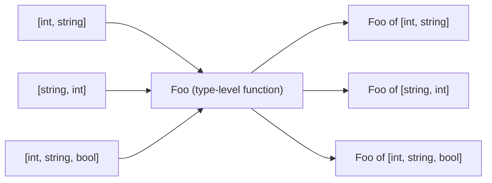
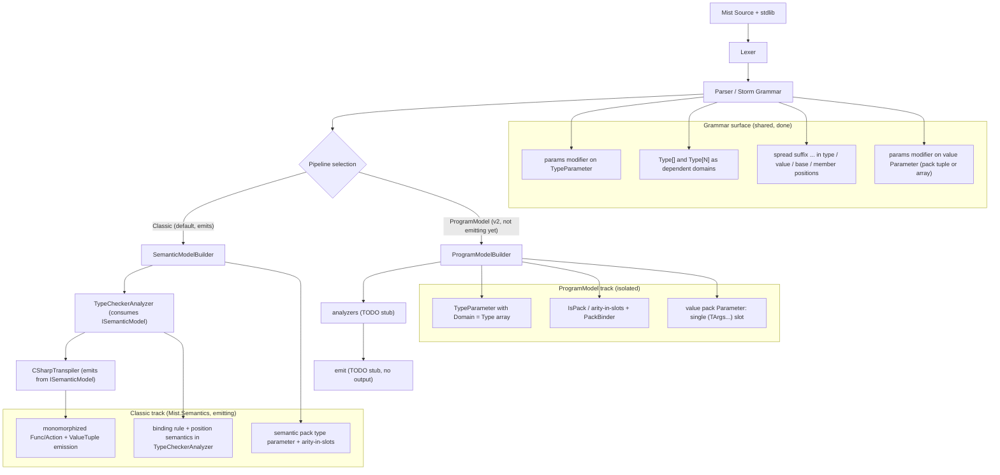

# Design Document: Variadics (Type-Parameter Packs and Value-Level params)

## Overview

This design adds variadics to Mist in two connected forms:

1. **Type-parameter packs** (variadic generics): a single type parameter that stands for an
   ordered, arity-varying list of type arguments. This lets a family such as `Func` or `Tuple`
   be written once, for all arities, where both the arity and the filled-in type arguments
   participate in type identity.
2. **Value-level `params`**: a homogeneous, C#-style variadic value parameter (for example
   `void Log(params string[] parts)`), where the callee sees a real array and the call site is
   flat. This is the homogeneous sibling of the heterogeneous type pack.

The keystone idea is that a type-parameter pack is not a new kind of entity. It is sugar for a
single **dependent type parameter** whose value type is a compile-time (comptime) `Type[]`.
Writing `params TArgs` is exactly writing `Foo<Type[]:TArgs>`. This works because Mist already has
the three ingredients: a type name in expression position is a `System.Type` value (see
[type-literals](../type-literals/design.md)); an array literal `[a, b, c]` is a first-class value
(see [array-literals](../array-literals/design.md)); and a comptime value may index type identity
(see [dependent-types](../dependent-types/design.md)). Compose them and an
array-literal-of-type-literals such as `[int, string, bool]` is a comptime readonly `Type[]` -- the
exact kind of value a dependent type parameter consumes. A variadic family is therefore a type-level
function from `Type[]` values to types, and everything else in this design follows from that single
reduction rather than from special-purpose rules.

The concrete payoff, and the motivating example kept front and center below, is collapsing the
`Func`/`Action` bootstrap: 17 hand-written intrinsic `Func` declarations plus 17 `Action` aliases
become one declaration each. The document is organized so that language semantics and the
programmer experience come first; the compiler-stage architecture that realizes those semantics is
presented afterward as supporting material.

### Foundations

This feature builds directly on the following settled specs and should be read against them:

- [dependent-types](../dependent-types/design.md) -- a comptime value participates in type identity; a type parameter may have a value domain (`N:int`).
- [type-literals](../type-literals/design.md) -- a type name in expression position is a `Type` value.
- [array-literals](../array-literals/design.md) -- `[a, b, c]` is a first-class array value.
- [value-tuples](../value-tuples/design.md) -- the value counterpart of a type pack is a tuple `(TArgs...)`.
- [type-argument-inference](../type-argument-inference/design.md) -- the positional unification engine that pack inference extends.
- [generics-type-arguments](../generics-type-arguments/design.md) -- type parameters, type arguments, constructed types, and arity-as-identity.
- [first-class-functions](../first-class-functions/design.md) -- the `Func`/`Action` family this feature rewrites.

## Motivation and Proof Point: Func / Action Before and After

Today the callable family is written out by hand, one class per arity, because the language cannot
express "a family where the number of parameter types varies."

**Before** (see `Source/Standard/Bootstrap/Func.mist`, 17 declarations):

```mist
namespace Standard;

intrinsic public class Func<TResult> { }
intrinsic public class Func<T1, TResult> { }
intrinsic public class Func<T1, T2, TResult> { }
// ... 13 more ...
intrinsic public class Func<T1, T2, T3, T4, T5, T6, T7, T8, T9, T10, T11, T12, T13, T14, T15, T16, TResult> { }
```

**Before** (see `Source/Standard/Bootstrap/Action.mist`, 17 aliases):

```mist
namespace Standard;

type Action = Func<void>;
type Action<T1> = Func<T1, void>;
type Action<T1, T2> = Func<T1, T2, void>;
// ... 13 more ...
type Action<T1, T2, T3, T4, T5, T6, T7, T8, T9, T10, T11, T12, T13, T14, T15, T16> =
    Func<T1, T2, T3, T4, T5, T6, T7, T8, T9, T10, T11, T12, T13, T14, T15, T16, void>;
```

**After** -- one declaration each:

```mist
namespace Standard;

// The trailing slot is the return type. The pack absorbs the parameter types.
// The empty pack (TArgs = []) covers the no-argument case Func<TResult>.
intrinsic public class Func<params TArgs, TResult> { }

// Action spreads the pack into Func's type-argument list, fixing the result to void.
type Action<params TArgs> = Func<TArgs..., void>;
```

The `Action` line is itself a worked demonstration of a type-array spreading into a
type-argument list. `Func<int, string>` binds `TArgs = [int]` and `TResult = string`;
`Func<string>` binds `TArgs = []` and `TResult = string`; `Action<int, string>` desugars to
`Func<int, string, void>` and hence to `TArgs = [int, string]`, `TResult = void`.

One subtlety to carry into the design: Mist's `Func` currently exposes no Mist-visible members --
invocation is special-cased in the type checker, which recognizes a `Func`-typed expression followed
by an invocation suffix. That per-arity recognition must be generalized to a single rule: an
invocation of a `Func<params TArgs, TResult>` value is well-typed when the supplied argument list
matches `TArgs` elementwise and the expression's result type is `TResult`.

## Language Model

### The Keystone: A Pack Is a Dependent Type Parameter over `Type[]`

`params TArgs` is sugar for one dependent type parameter written fully as `Foo<Type[]:TArgs>`.
`TArgs` is a comptime-known, ordered, readonly array of type literals. There is no separate "pack"
concept in the type system: a pack parameter is a dependent type parameter whose value domain is
`Type[]`, in exactly the same sense that `N:int` is a dependent type parameter whose value domain is
`int`.

Because a constructed variadic type is identified by its family together with the concrete `Type[]`
value, `Foo` behaves as a type-level function:



### Type Identity

A constructed variadic type is identified by the pair (family, the `Type[]` value). Type identity
reduces to elementwise type equality, and order matters. Therefore:

- `Foo<[int, string]>` and `Foo<[string, int]>` are distinct (order differs).
- `Foo<[int, string]>` and `Foo<[int, string, bool]>` are distinct (arity differs).

This gives "arity participates in identity" and "filled-in arguments participate in identity" for
free, with no rule beyond the array equality that [array-literals](../array-literals/design.md) and
[dependent-types](../dependent-types/design.md) already imply. It is the same principle as
`FixedBuffer<5>` differing from `FixedBuffer<6>`, lifted from `int` values to `Type[]` values.

### Declaration Syntax and Rules

Both spellings are legal and denote the same parameter:

```mist
class Foo<params TArgs> { }      // bracket-free construction sugar
class Foo<Type[]:TArgs> { }      // canonical, explicit dependent form
```

Rules:

- **`params` is construction sugar.** Declaring a pack with `params` grants bracket-free
  construction at the use site. The explicit `Type[]:` form requires the arguments to be passed
  bracketed.
- **Multiple `Type[]:` parameters are allowed** in one type-parameter list. They are disambiguated
  at the use site by writing each one's arguments in brackets `[]`. At most **one** parameter per
  list may be `params` (the single bracket-free pack); every other type-array parameter must be
  passed bracketed.
- **Why the cap is one `params`, not zero-or-many.** The limit of one sugared (`params`) pack per
  list is about **authorial intent, not ambiguity**. Multiple packs could be disambiguated by
  forcing explicit brackets at the use site, exactly as multiple `Type[]:` packs already are, so the
  cap is not needed to keep parsing or binding unambiguous. Rather, `params` is how the author
  designates the single spot where the caller may omit the brackets. This mirrors C#'s deliberate
  choice for `params string[]`: a lone array parameter could be treated as variadic with no
  ambiguity, yet C# still requires the author to opt in with `params`. Mist follows the same design,
  and the value side obeys the identical rule with explicit `(TArgs...)` tuples standing in for
  brackets.
- **Inverse sugar.** A lone `Type[]:` parameter (the only type-array parameter in the list)
  automatically becomes `params` for convenience, so a single-pack family never needs brackets.
- **Arity is counted in parameter slots.** Each `Type[]:` slot counts as exactly one slot,
  regardless of how many types it later absorbs. For example
  `Foo<TVal, Type[]:TArgs, params CtorArgs, Type[]:Args3, TRes>` has arity 5. The value-parameter
  side counts arity identically -- a value pack `params TArgs args` is a single `(TArgs...)` slot and
  the same binding rule fills it (see Value Side).
- **Binding rule: at most one unbracketed pack per list.** The unbracketed pack may appear anywhere
  -- leading, middle, or trailing. Fixed scalar slots and bracketed type-array slots bind
  positionally inward from both ends; the single unbracketed pack absorbs whatever remains in the
  middle. Empty packs are allowed, so arity-0 inputs fall out naturally (for example `Func<string>`
  gives `TArgs = []` and `TResult = string`).

Worked construction for the arity-5 type above:

```mist
// Declaration:
//   class Foo<TVal, Type[]:TArgs, params CtorArgs, Type[]:Args3, TRes> { }
new Foo<int, [a, b], x, y, z, [c], float>()
// Binds: TVal = int, TArgs = [a, b], CtorArgs = [x, y, z], Args3 = [c], TRes = float
```

This resolves precisely: `TVal` binds `int` from the left; `TArgs` takes the bracketed `[a, b]`;
`TRes` binds `float` from the right; `Args3` takes the bracketed `[c]`; and only `CtorArgs` is
unbracketed, so the leftover middle `x, y, z` is unambiguously its contents.

Finally, the flat sugar and the canonical bracketed form denote the same type. `Foo<int, string>`
and `Foo<[int, string]>` are the same type; the flat form is resolved into the bracketed form by the
binding rule.

### Declaration Kinds That May Carry a Pack

A pack type-parameter list -- written `<params TArgs>` or in the explicit `<Type[]:TArgs>` form -- is
permitted on every generic-capable declaration kind Mist provides: `class`, `struct`, `abstract` (an
abstract type), type alias (`type Name<...> = ...;`), and newtype (`type Name<...> = new Source;`), as
well as on method type-parameter lists. Nothing is special per kind: the same pack rules -- binding,
arity-in-slots, and one `params` per list -- apply uniformly wherever a pack appears.

Mist has no `interface` keyword -- abstract types (similar to, but not identical to, C#'s interfaces) fill that role -- and no `delegate`
keyword -- the callable role is filled by the `Func` class family. So there is no separate
variadic-interface or variadic-delegate form; those roles are covered by variadic abstract types and
the variadic `Func` class respectively.

One-line example per kind:

- **Variadic class:** `class Bundle<params TArgs> { }`.
- **Variadic struct:** a value type; the value tuple `(TArgs...)` is itself the canonical variadic
  struct.
- **Variadic abstract type:** an `abstract` type carrying a pack (see the next subsection).
- **Variadic alias:** `type Action<params TArgs> = Func<TArgs..., void>;`.
- **Variadic newtype:** `type Row<params TArgs> = new (TArgs...);`, which clones the source tuple's
  members into a nominally distinct type.

### Variadic Abstract Types

Because abstract types fill the role that C# interfaces play (they are similar, though not identical), a variadic abstract type is simply an abstract
type carrying a pack. For example:

```mist
abstract IApplier<params TArgs, TResult>
{
    TResult Apply(params TArgs args);
}
```

A type implements a variadic abstract type in one of two ways:

- **At a concrete arity**, where the variadic slots monomorphize. Implementing `IApplier<int, int, int>`
  (so `TArgs = [int, int]` and `TResult = int`) means providing `int Apply(int a, int b)` -- the value
  pack has been expanded to the concrete parameter list at that arity.
- **Generically**, by spreading the implementer's own pack into the base list:
  `class Boxed<params TArgs> : IApplier<TArgs..., int> { ... }`. This reuses the base-type-list spread
  (already an accepted spread position) together with the pack declaration on the abstract type.

This is not a new mechanism. A variadic abstract type is just an abstract type carrying a pack, and
implementing one is ordinary abstract-type implementation with the pack either concretized (at a
concrete arity) or spread through (for a generic implementer).

### Position Semantics of a Pack Identifier

Inside a body, the meaning of a pack identifier `TArgs` depends on the position it appears in:

1. **Expression position.** `TArgs` is the comptime `Type[]` value itself. It supports `.Length`,
   iteration, and indexing like any comptime array.
2. **Bare type position.** ERROR. A pack is a value, not a type, so `public TArgs Item;` is illegal.
   (To place element types in type position, use indexing or spread; see below.)
3. **Indexed in type position, `TArgs[i]`.** Legal only when the length is proven to be at least
   `i + 1`. Mist has no unproven array access, so this simply reuses the existing array-bounds
   discipline. When legal, `TArgs[i]` yields a single comptime `Type` value coerced into type
   position -- the type-literal duality of [type-literals](../type-literals/design.md) run backward
   (a `Type` value becoming a type).
4. **Spread, `TArgs...`,** in a type-argument list, base-type list (including implemented abstract
   types), tuple-type element position, or member-declaring position. Expands the pack in place. Spread is definable as sugar
   over rules 1 and 3 plus comptime iteration: for `i` in `0 .. TArgs.Length`, emit a copy
   substituting the type `TArgs[i]`. A value pack parameter is **not** a spread position: it is
   declared with `params` (`params TArgs args`), not with `...` (see Value Side).

### Capability Ladder

What a pack can do is a function of what is proven about its length. Capability rises as the length
becomes more precisely known:

| Proven about length | `.Length` | iteration | `TArgs...` spread | `TArgs[i]` indexing |
|---|---|---|---|---|
| `Type[]:TArgs` (unknown length) | yes | yes | yes | ERROR |
| `Type[N]:TArgs` (exact fixed size) | yes | yes | yes | yes, for `0 .. N-1`; `TArgs[N]` is a comptime out-of-bounds error |

- The size-agnostic operations (`.Length`, iteration, `TArgs...`) are always available, even when
  the length is unknown, because they do not name a specific index.
- The exact-size row is in scope for this feature because fixed-size arrays (`Type[N]`) already
  exist in Mist.
- **Narrowing restores indexing.** An unknown-length pack can be narrowed by a guard, after which
  indexing is legal in that branch:

  ```mist
  if (TArgs is Type[3] fixed) {
      // fixed[0], fixed[1], fixed[2] are legal here
  }
  ```

  In a type position `fixed[i]` names the pack's own element `TArgs[i]` rather than a type of its
  own, so a value read out of the pack at that position -- `args is (var first, var second, var third)`
  binds `first` at `TArgs[0]` -- is assignable to it. The binding exists only in the guarded branch, and
  `fixed[3]` is the same out-of-bounds error `MIST_VAR_0004` a `Type[3]:TArgs` pack draws.

  The value-side counterpart narrows the pack value with `args is (concrete tuple) x` (for example
  `args is (int, int, int) triple`), enabling a matching fixed-arity forward within that branch; see
  "Generic Body Checking and Provable Forwarding".

- **Deferred.** Range- or refinement-bounded sizes such as `Type[2..8]` are out of scope; they
  require range-as-refinement support (see Non-Goals / Deferred).

## Value Side

The value counterpart of a type pack is a real, first-class value.

- The flattened value pack is declared `params TArgs args`: a single parameter of type `(TArgs...)`
  (equivalently `ValueTuple<TArgs>`) carrying a **flattened call convention**. Inside the body,
  `args` can be stored, returned, zipped with other packs, and forwarded.
- A plain `(TArgs...) args` -- no `params` -- is an ordinary tuple parameter: the caller passes a
  single tuple at the call site rather than a flat argument list.
- `params` is the single call-site slurp marker for value parameters. It is used uniformly whether
  the target is a pack (`params TArgs args`, yielding `ValueTuple<TArgs>`) or a homogeneous array
  (`params T[] names`, yielding `T[]`). This mirrors C#'s `params T[]` (flat call: `Log("a", "b")`)
  and lifts it from a homogeneous array to a heterogeneous pack.
- `...` is purely the spread and decompose operator; it is not a parameter-declaration marker. It
  forms tuple types (`(TArgs...)`), decomposes a tuple value at a use site (`args...`), expands a
  type pack in type-argument and base-type lists (including implemented abstract types), and generates members in a type body
  (`public TArgs... Item;`). Declaring `params TArgs args` rather than the older `TArgs... args`
  removes the overload where `...` doubled as a declaration marker, cleanly separating `params`
  (slurp) from `...` (spread).
- A variadic method therefore reads `M<params TArgs>(params TArgs args)`: the `params` in the
  type-parameter list declares the pack, and the `params` in the value-parameter list is the slurp.
  The two are intentional and unambiguous by position.

### The Value Pack Is a Tuple, Not an Array

The type `(TArgs...)` is equivalently `ValueTuple<TArgs>`. When the pack is bound to a concrete
`[t1, ..., tN]`, `args` is an ordinary value tuple `(t1, ..., tN)`.

It is a tuple and **never** an array, for a concrete, load-bearing reason. A value pack is
*heterogeneous*: element `i` has type `TArgs[i]`, so different elements may have different types. An
array is *homogeneous* and must have a single concrete element type to be allocatable. `unknown[] x = ...`
can alias an existing object, but `new unknown[]` is impossible, because allocation requires a real
element type, and generics rely on a concrete constructed type at each use. Only a struct with
per-slot typed fields -- that is, a tuple -- can hold heterogeneous values and still be allocated
once the pack is bound. Hence tuple, not array.

This is the exact symmetry of the two sides. On the type side `TArgs` really is an array (`Type[]`),
homogeneous because every element is a `Type`. On the value side the elements have different types,
so the counterpart collapses to a tuple. **The type pack is an array of `Type`; the value pack is a
tuple of the `TArgs`-typed values.**

### `args` Without `...` Is a First-Class Tuple Value

Used without `...`, `args` is an ordinary `(TArgs...)` value, usable anywhere that tuple type is
accepted. It may be:

- stored in a local (`var t = args;`),
- returned from a method whose return type is `(TArgs...)`,
- passed whole as a single argument to a parameter typed `(TArgs...)`,
- nested inside another tuple (for example `(args, 0)`),
- or deconstructed.

The only operator special to packs is `...`; every other use of `args` is just tuple behavior.

### Value-Side Spread Is General Tuple Decomposition

The value-side `...` operator is **general tuple decomposition** into argument or parameter slots. It
applies to *any* tuple value, not only to packs. For example:

```mist
var x = (7, "foo", false);
SomeMethod(x...);
```

is well-typed if and only if `SomeMethod` accepts `(int, string, bool)`. The check is purely
structural: the tuple's ordered element types must match the target slots positionally under
assignability.

`args...` is simply the case where the tuple happens to have originated from a pack; `f(args...)`
forwards `args : (TArgs...)` into the parameter slots of a `Func<params TArgs, TResult>` value.
Nothing about the operator is pack-specific.

### Value-Parameter Arity and the Shared Binding Rule

Because `params TArgs args` is a single `(TArgs...)` (`ValueTuple`) parameter, it occupies exactly
**one** parameter slot. Therefore:

- **Arity counts slots.** Method parameter arity is the number of declared parameter slots, counting
  a value pack as one slot. `Foo(int number, params TArgs args, bool enabled)` has arity **3**, not
  2 + N. This mirrors the type-parameter side exactly, where
  `class Foo<TValue, params TArgs, TResult>` has arity 3.
- **Binding reuses the type-side rule.** Call-site binding uses the same binding rule already defined
  for the type side: fixed value parameters bind positionally inward from both ends, and the
  remaining contiguous middle arguments are collected into the tuple. For example, given
  `Foo(int number, params TArgs args, bool enabled)`, the call `Foo(5, a, b, c, true)` binds
  `number = 5`, `enabled = true`, and `args = (a, b, c)`.
- **Flat versus single-tuple.** `params TArgs args` is the flattened-call form: the caller writes a
  flat argument list and the slurp collects the middle. A plainly typed `(TArgs...) args` parameter
  instead takes a single tuple argument at the call site. This mirrors C#'s `params T[]` (flat)
  versus `T[]` (single).
- **One `params` per list, and why.** At most one `params` is allowed per value-parameter list --
  whether it targets a tuple (a pack) or a homogeneous array -- and more than one is diagnostic
  `MIST_VAR_0001`, the same rule as the type side. The cap is about **authorial intent, not
  ambiguity**: multiple packs could be disambiguated by forcing explicit tuples at the use site,
  exactly as multiple type-side packs are disambiguated with brackets, but `params` is how the
  author designates the single spot where the caller may omit the tuple. This mirrors C#'s
  deliberate choice for `params string[]`: a lone array parameter could be treated as variadic with
  no ambiguity, yet C# still requires the author to opt in with `params`. Additional packs in the
  same list are therefore written as explicit `(TArgs...)` tuple parameters, each passed as one
  tuple. For example:
  - `Foo(params TArgs args)` slurps a flat argument list into `ValueTuple<TArgs>`.
  - `Foo(params TArgs first, (TArgs2...) second)` is one sugared pack plus one explicit-tuple pack.
  - `Foo((TArgs...) a, (TArgs2...) b, params string[] names)` shows the single `params` being the
    array while both packs are passed as explicit tuples.

### Generic Body Checking and Provable Forwarding

A variadic method body is type-checked once, generically, and must be well-typed for every
instantiation its signature and constraints permit. This is declaration-time (definite) checking,
consistent with Mist's no-unproven-access model: the body is verified against what is *proven* about
its type parameters, not against any single instantiation. Nothing here is special to packs -- it is
the same discipline that governs an ordinary type parameter. Inside
`class Foo<TValue> { int Bar(TValue value) { return Double(value); } }` the call `Double(value)` is a
comptime error because `TValue` is not proven to be `int`, even though the body would succeed for the
one instantiation `TValue = int`. A pack parameter `TArgs : Type[]` is checked the same way: with no
constraints, `TArgs` may be any `Type[]`, so the body may only do what is provable for every such
value. There is no custom variadic rule here, only ordinary open-generic type checking.

Inside the body a value pack `args : (TArgs...)` has a **symbolic shape** -- unknown length and
unknown element types. Spreading it with `args...` is therefore well-typed only into a destination
that accepts that pack for every `TArgs`: another `params TArgs` or `(TArgs...)` parameter, or a
`Func<TArgs..., R>` value whose parameter list *is* the pack. In those destinations the match holds by
construction for all `TArgs`, so no per-instantiation reasoning is required.

Spreading a symbolic pack into a **fixed-arity** destination whose parameter list is not provably
`(TArgs...)` is rejected at the declaration with `MIST_VAR_0011`, because it cannot be proven
well-typed for every `TArgs`:

```mist
// Rejected with MIST_VAR_0011: Sum3 wants exactly (int, int, int), but TArgs is
// symbolic -- this would be ill-typed for, e.g., TArgs = [string].
int Bad<params TArgs>(params TArgs args) {
    return Sum3(args...);   // Sum3(int, int, int)
}

// Accepted: f's parameter list IS the pack, so f(args...) type-checks for all TArgs.
TResult Apply<params TArgs, TResult>(Func<TArgs..., TResult> f, params TArgs args) {
    return f(args...);
}
```

The rejection of `Sum3(args...)` is exactly the `Double(value)` rejection above, one level up: a
fixed-arity target is provably compatible only for particular pack values, and a symbolic pack is not
one of them.

A generic body can still forward into a fixed-arity destination -- it just has to prove the shape
first. This is the value-side counterpart of the type-side `TArgs is Type[N]` narrowing in the
Capability Ladder, and it is nothing new: it is ordinary flow narrowing applied to the pack *value*
through the same `is` form. Inside a branch guarded by `args is (int, int, int) triple`, the pack's
shape is proven, so `Sum3(triple...)` is well-typed within that branch even though the unnarrowed
`Sum3(args...)` is rejected with `MIST_VAR_0011`. Different branches may narrow to different shapes --
a different length and a different element type -- and forward accordingly, while a fallback branch
that proves nothing about the shape uses only the size-agnostic operations such as `TArgs.Length`. The
destination check stays honest per branch: forwarding into a destination that does not match the
narrowed shape -- for example `Sum3(pair...)` where `pair` is `(string, string)` -- is still
`MIST_VAR_0011`.

```mist
// Narrowing recovers fixed-arity forwarding: inside each `is` branch the pack shape is
// proven, so the matching fixed-arity call type-checks. A wrong-shape forward in a branch
// (for example Sum3(pair...)) would still be MIST_VAR_0011.
int Categorize<params TArgs>(params TArgs args) {
    if (args is (int, int, int) triple) {
        return Sum3(triple...);        // proven (int, int, int) here
    } else if (args is (string, string) pair) {
        return Join(pair...).Length;   // different length and element type
    } else {
        return TArgs.Length;           // size-agnostic fallback
    }
}
```

Narrowing does not relax the destination check; it only supplies a proven shape to check against.

The positional pattern is the same test spelled element by element (Requirement 12.10): inside the body,
`args is (int a, int b)` asks what `args is (int, int) pair` asks, binding each element where the type
test binds the whole. The pack's length and element types are open there, so the pattern is judged at
each instantiation rather than refused in the body. Each width is specialized to its own C# method, in
which the pattern at its own width is an ordinary tuple pattern; at any other width it lowers to a test
that compiles, declares every binding at the type its element has there, and never matches. An element
type the instantiation does not hold -- `(int a, int b)` over `(int, string)` -- is a runtime non-match
in the same way, never the never-match error a closed tuple draws.
The following contrasts the two ways a forward is still rejected -- a wrong-shape forward inside a
branch, and an unnarrowed forward with no proven shape -- so every claim above appears as an annotated
line rather than only in prose:

```mist
int StillRejected<params TArgs>(params TArgs args) {
    if (args is (string, string) pair) {
        return Sum3(pair...);   // MIST_VAR_0011: (string, string) cannot fill Sum3(int, int, int)
    }
    return Sum3(args...);       // MIST_VAR_0011: unnarrowed pack is symbolic here (Property 19)
}
```

This is the generic case of the general tuple-decomposition rule (see below), not a separate
mechanism. A **concrete** tuple decomposition -- for example `(7, "foo", false)...` -- is still
checked directly against the known destination, because its element types are known. The new rule is
only the generic case, where the pack shape is symbolic and "well-typed" must mean "provably
well-typed for every instantiation."

### Unifying Principle

On both the type side and the value side a pack is a single slot; arity counts slots; and the same
binding rule fills the pack from the contiguous middle after the fixed slots bind inward from both
ends. The only difference is what the pack *is* -- a `Type[]` on the type side, a `ValueTuple<TArgs>`
on the value side.

One rule governs sugar everywhere: **exactly one sugared (`params`) pack is permitted per usage
location.** This holds uniformly across type-parameter lists (both when declaring a variadic generic
and when closing one), value-parameter lists (value packs), and variadic tuple types. Additional
packs at the same location are written explicitly -- bracketed type arguments on the type side,
explicit `(TArgs...)` tuple parameters on the value side. `params` designates the single sugared slot
where the caller may omit the brackets or the tuple; `...` spreads. Because the same
one-sugared-slot rule is shared by value packs, variadic tuples, and the closing of an open variadic
generic, `params` means the same thing in every position it appears.

### The Spread / Forward / Zip Matrix

Spreading is one idea applied to two worlds (types and values), plus their parallel combination:

| Operand | Spreads into | Example positions |
|---|---|---|
| comptime `Type[]` (for example `TArgs...`) | TYPE slots | type-argument lists, tuple-type element lists, field/member type positions, base-type lists (including implemented abstract types) |
| any tuple value (for example `args...` or `x...`) | ARGUMENT slots (tuple decomposition) | call arguments, tuple literals |
| zip (for example `field... = args...`) | PAIRED positions | parallel expansion of two operands, element by element |

Zip is permitted only when the two operands are proven to have equal length -- either because they
originate from the same pack, or because equal length has otherwise been established. This keeps
`field... = args...` sound: there is always exactly one right-hand value per left-hand slot.

### Spread-Accepting Positions

A spread is accepted in each of the following positions:

- type-argument lists (for example `type Action<params TArgs> = Func<TArgs..., void>;`),
- field declarations,
- base-type lists (including implemented abstract types),
- tuple types and return types.

Value parameters are **not** a spread position: a value pack parameter is declared with `params`
(`params TArgs args`), not with a `...` spread. The `...` operator is reserved for spreading a type
pack into the type positions above, decomposing a tuple value into argument slots (`args...`),
forming tuple types (`(TArgs...)`), and generating members (`public TArgs... Item;`).

## Spread-Generated Members

When a spread appears in a member-declaring position, `public TArgs... Item;` declares a member
family keyed by the stem `Item`. Because the value pack is a ValueTuple, the one declaration surfaces
both the whole tuple and its elements:

```mist
public TArgs... Item;   // aggregate `Item : (TArgs...)` plus projections Item1 .. ItemN
```

Rules:

- **Aggregate stem.** The stem `Item` is a member of type `(TArgs...)` -- the whole ValueTuple.
  Reading `Item` yields the tuple, so an instance exposes both `bundle.Item` (the tuple) and
  `bundle.Item1` (its first element).
- **Element projections.** `Item1 .. ItemN` use stem + 1-based index (matching ValueTuple interop).
  `Item{k}` has type `TArgs[k-1]` and is the k-th element of `Item` (equivalently `Item.Item{k}`),
  surfaced directly on the enclosing type.
- **Member kind and accessibility.** The aggregate and its projections take the same member kind
  (field or property) and accessibility as the declaration, so `public TArgs... Item { get; }` yields
  get-only property members.
- **Reserved names.** The spread owns the stem `Item` and every `Item{i}` name: no other member may
  use `Item` or any `Item{i}`, no two spread stems may prefix one another, and the stem must be
  non-empty (`MIST_VAR_0007` / `MIST_VAR_0008`).
- **Empty and unit packs.** An empty pack yields the empty aggregate and zero projections; a length-1
  pack yields `Item : (T)` and the single projection `Item1` (the suffix is always present).
- **Correlation.** Multiple spreads of the same pack in one type are correlated at the same `N`.
- **Re-spread.** Spread-generated members are re-spreadable: `Item...` spreads the aggregate's
  elements (equivalently spreads the `Item` tuple).

## Constraints

- A **whole-pack constraint** `where TArgs : IConstraint` constrains **every element** of the pack.
  This is what makes it sound to call the constrained member on each element and on each `args[i]`:
  every element is known to satisfy the bound. Standard constraint kinds apply elementwise.
- **Per-index / per-element constraints** (for example `TArgs[0] : Foo`) are out of scope (see
  Non-Goals / Deferred).

## Method-Level Packs

A method may declare its own pack, independent of any pack on the enclosing type:

```mist
int SomeMethod<params TArgs>(params TArgs args) {
    // args : (TArgs...)
    return Consume(args...);   // forward by spreading
}
```

Inside the method, `args` has type `(TArgs...)` and is forwarded with `args...`. The method reads
`SomeMethod<params TArgs>(params TArgs args)`: the first `params` declares the type pack, the second
is the value-parameter slurp, and the two are unambiguous by position. As with type-level
declarations, each parameter list still allows at most one `params`.

## Value-Level params (New to Mist)

This spec also introduces the homogeneous, C#-style variadic value parameter:

```mist
void Log(params string[] parts) {
    // parts is a real string[]
}

Log("a", "b");   // flat call site; parts == ["a", "b"]
```

Here `parts` is a genuine `string[]` and the call site is flat. This is the homogeneous sibling of
the heterogeneous type-pack form: a type pack varies the element **types**, while value-level
`params` fixes one element type and varies the **count**.

`params` is the single call-site slurp marker for value parameters, and it works uniformly across
both value targets:

- `params TArgs args` slurps a flat argument list into the tuple `(TArgs...)` (`ValueTuple<TArgs>`)
  -- the heterogeneous value pack.
- `params T[] names` slurps a flat argument list into a homogeneous `T[]`.

At most one `params` is allowed per value-parameter list, whether it targets a tuple or an array,
under diagnostic `MIST_VAR_0001`. Additional packs in the same list are written as explicit
`(TArgs...)` tuple parameters. For example, `Foo((TArgs...) a, (TArgs2...) b, params string[] names)`
carries two explicit-tuple packs and a single `params` array.

The `params` keyword is otherwise disambiguated purely by position:

- Inside `<>` (a type-parameter list), `params TArgs` declares a **type pack**.
- In a value parameter list, `params TArgs args` declares a **value pack** (target tuple) and
  `params T[] xs` declares a **homogeneous value pack** (target array).

## Inference

Call-site inference of a type pack from value arguments is in scope. Given
`M<params TArgs>(params TArgs args)`:

```mist
M(1, "x", true);          // infers TArgs = [int, string, bool]
M<[int, string, bool]>(); // explicit form remains available as a fallback
```

This extends the existing positional unification engine of
[type-argument-inference](../type-argument-inference/design.md). Two points matter:

- Inference must solve any fixed (scalar) type parameters alongside the pack, using the same binding
  rule that resolves the flat form into the bracketed form.
- The explicit `M<[...]>(...)` form is always available when inference cannot or should not run.

## Worked Examples (Programmer Experience)

Callable family, written once:

```mist
intrinsic public class Func<params TArgs, TResult> { }
type Action<params TArgs> = Func<TArgs..., void>;

// Usage reads exactly as today:
Func<int, int, bool> isLess;      // TArgs = [int, int], TResult = bool
Func<string> getName;             // TArgs = [], TResult = string
Action<int, string> log;          // Func<int, string, void>
```

Storing and forwarding a heterogeneous argument list:

```mist
int CountThenCall<params TArgs>(params TArgs args) {
    var n = TArgs.Length;         // .Length in expression position (rule 1)
    return Sink(args...);         // spread into argument slots
}
```

A middle pack, resolved by the binding rule:

```mist
// Declaration: class Between<TFirst, params TMid, TLast> { }
new Between<int, string, bool, double>();
// TFirst = int (left end), TLast = double (right end), TMid = [string, bool]
```

## Architecture

Mist compiles through one pipeline, named **standard**. `CompilerDriver` loads sources, resolves
optional packages, lexes, and parses them (Stages 1–3 and 1.5). `StandardPipeline` then builds the
`IProgramModel` (Stage 4), runs analyzers against that model (Stage 5), and emits C# through
`CSharpEmitterV2` (Stage 6). Variadics is implemented along this same pipeline.

### Historical migration snapshot (pre-retirement)

The following architecture, diagram, implementation-status notes, and later references to parallel
tracks preserve the migration account written before Classic was retired. Statements there that
Classic is the default or only emitting pipeline, or that ProgramModel cannot emit, describe that
earlier state and are not current compiler guidance.

The shared front end (`CompilerDriver`, Stages 1-3) loads sources, loads and parses the standard
library on **every** compile, lexes, and parses. It produces ASTs and dispatches them to the selected
pipeline for Stages 4-6:

- **Classic pipeline** (`Source/Mist/Driver/ClassicPipeline.cs`) -- the **default**
  (`CompilerOptions.Pipeline` defaults to `PipelineMode.Classic`) and the **only** pipeline that
  type-checks and emits. Stage 4 builds the legacy semantic model (`Mist.Semantics.ISemanticModel`)
  via `SemanticModelBuilder`; Stage 5 runs analyzers -- including `TypeCheckerAnalyzer` -- against
  that `ISemanticModel`; Stage 6 emits C# from the same `ISemanticModel` through the `CSharpTranspiler`
  (`CSharpEmitter` / `CSharpTranspilerBackend`). This is the path that compiles and runs the runnable
  sample and the `Func`/`Action` stdlib bootstrap.
- **ProgramModel pipeline** (`Source/Mist/Driver/ExperimentalPipeline.cs`) -- the migration target.
  Stage 4 builds the `IProgramModel` via `ProgramModelBuilder`, but its analyze and emit stages are
  unfinished stubs (the emit stage returns a failure result with no output, and the mode is documented
  as not yet implemented). It does not compile or run any program yet.

Consequently **variadics is built out in both pipelines**, each with its own pack representation and
logic:

- **Classic track** -- pack representation in the legacy `Mist.Semantics` model and
  `SemanticModelBuilder`, pack type-checking in `TypeCheckerAnalyzer`, and pack emission in the
  `CSharpTranspiler`. This is the track that makes the runnable sample (Requirement 18) and the
  `Func`/`Action` bootstrap collapse (Requirement 15) actually compile and run, because Classic is the
  default emitting path.
- **ProgramModel track** -- the pack model, classification, `Type[]`-valued type identity, the binding
  rule, and the type-position capability ladder in `Source/Mist/ProgramModel/`. This track is
  deliberately **isolated** from the legacy semantic system (see the ProgramModel isolation rule under
  Data Models) and will emit once the ProgramModel pipeline's analyze and emit stages exist.

The two tracks share the grammar and pretty-printer (one surface syntax feeds both) and the
`MIST_VAR_*` diagnostics; they diverge at Stage 4 and stay separate through emission. No stage needs a
new subsystem; each extends what [dependent-types](../dependent-types/design.md) and
[generics-type-arguments](../generics-type-arguments/design.md) already established.



### Implementation Status

Because this feature is being built mid-stream, the two tracks are at different stages:

- **Already built (shared surface + ProgramModel track):** the grammar surface (`Mist.storm`) and the
  pretty-printer round-trip; the `MIST_VAR_*` diagnostic descriptors; and, in
  `Source/Mist/ProgramModel/`, the pack model and classification, constructed-type identity
  (`TypeInterner`), the binding rule (`PackBinder`), value-side and spread-generated-member
  construction, and the type-position capability ladder. All of this is reachable only through the
  non-emitting ProgramModel pipeline.
- **Pending (Classic track):** the entire classic-pipeline realization -- pack representation in the
  legacy `Mist.Semantics` model and `SemanticModelBuilder`, pack type-checking in
  `TypeCheckerAnalyzer`, and pack emission in the `CSharpTranspiler`. Because Classic is the default
  emitting path, this track is what the runnable sample and the `Func`/`Action` bootstrap collapse
  depend on to compile and run.
- **Pending (both tracks):** the expression- and body-level semantics -- spread forwarding, tuple
  decomposition, `is`-narrowing, zip, and whole-pack constraints applied inside method bodies --
  require a body/expression checker in whichever pipeline is checking programs.

## Data Models

Because the feature is realized in two pipelines, the pack has **two parallel representations** -- one
in the ProgramModel type system (the isolated track) and one in the legacy `Mist.Semantics` model
(the classic, emitting track). The two never share types; each pipeline reads only its own. Both model
the same language semantics from the Language Model section and differ only in which type system
carries them.

### ProgramModel Representation (isolated track)

The program model already represents a type parameter as a `TypeParameter` with an `Ordinal` and a
`Domain` (the type whose values fill the slot -- `Standard.Type` for a regular parameter,
`Standard.Int32` for `N:int`). A pack parameter is the natural next case:

- **Pack parameter.** A `TypeParameter` whose `Domain` is the comptime array `Type[]` (or `Type[N]`
  for the fixed-size rung). A small piece of derived state records that this parameter is a pack and
  whether it is the list's single unbracketed `params` slot. Everything else (name, ordinal,
  constraints) is unchanged, which is what lets the pack reuse the dependent-type machinery.
- **Arity in slots.** Arity is the number of declared slots, counting each `Type[]:` slot as one.
  The model stores the slot list; it does not pre-expand packs. Expansion is a type-checker and
  backend activity driven by a concrete `Type[]` value.
- **Constructed variadic type.** A `ConstructedType` whose argument in the pack slot is a comptime
  `Type[]` value. Type identity is the existing constructed-type identity plus elementwise array
  equality on that value (order-sensitive), matching the dependent-type equality already in place.
- **Value pack parameter.** A value `Parameter` introduced by `params` that is a **single**
  parameter slot of tuple type `(TArgs...)` carrying the flattened call convention; arity counts it
  as one slot, exactly as a type-side pack slot counts as one. The homogeneous value-level
  `params T[]` is a `Parameter` of array type introduced by the same `params` modifier and carrying
  the same flat-call flag.

**ProgramModel isolation rule.** This entire representation lives in the program-model type system and
its constructor; the ProgramModel track introduces **no** references to `Mist.Semantics.*` types. The
isolation rule constrains the ProgramModel track only -- it is not a prohibition on the classic track,
which legitimately extends the legacy semantic model (next).

### Legacy `Mist.Semantics` Representation (classic, emitting track)

The classic pipeline builds `Mist.Semantics.ISemanticModel` via `SemanticModelBuilder`, and both
`TypeCheckerAnalyzer` and the `CSharpTranspiler` consume that model. Variadics therefore also needs a
pack representation in the legacy semantic model, mirroring the ProgramModel one:

- **Semantic pack type parameter.** The legacy type-parameter symbol gains a pack form: a type
  parameter whose value domain is the comptime `Type[]` (or `Type[N]`), flagged as a pack and, where
  applicable, marked as the list's single unbracketed `params` slot. As in the ProgramModel track, the
  ordinal, name, and constraints are otherwise unchanged.
- **Semantic constructed variadic type.** A constructed legacy type whose pack-slot argument is a
  comptime `Type[]` value, with identity extended by order-sensitive elementwise `Type[]` equality --
  the same identity rule as the ProgramModel track, expressed over legacy semantic types.
- **Semantic value pack parameter.** A legacy value parameter (`ParameterSignature`) introduced by
  `params` that is a single slot of tuple type `(TArgs...)` (`ValueTuple<TArgs>`) carrying the
  flattened call convention; and, for the homogeneous form, a single `params T[]` array parameter
  carrying the same flat-call flag. Arity counts each as one slot.
- **Arity in slots.** Identical rule: the legacy model stores the declared slot list and counts each
  pack slot as one, deferring expansion to the type checker and backend once a concrete `Type[]` is
  bound.

The classic representation is the one that reaches emission today; the ProgramModel representation will
reach emission once the ProgramModel pipeline's emit stage exists.

## Components and Interfaces

The surface syntax (grammar and pretty-printer) is **shared** by both pipelines and is already in
place; the pack logic is then realized separately in each track's own components. The map below ties
each responsibility to the concrete component that carries it, and the behavioral rules further down
apply to whichever track is checking or emitting.

### Components by Track

**Shared (already implemented):**

- **Grammar** -- `Source/Mist/Grammar/Mist.storm` (pack declaration, spread suffix, value-level
  `params`).
- **Pretty-printer** -- `Source/Mist/Parsing/MistPrettyPrinter.cs` (round-trips every surface form).
- **Diagnostics** -- the `MIST_VAR_*` descriptors.

**Classic track (`Mist.Semantics`, the default emitting path -- pending):**

- **Semantic model + builder** -- `Source/Mist/Semantics/Model/` (semantic types and
  `SemanticModelBuilder.cs`): carries the legacy pack representation from Data Models.
- **Type checker** -- `Source/Mist/Analysis/Builtin/TypeCheckerAnalyzer.cs`: binding, position
  semantics, constraints, spread/forward/zip, inference, and `Func` invocation over the legacy model.
- **Backend** -- `Source/Mist/Backends/CSharpTranspiler/` (`CSharpEmitter.cs`, `CSharpTypeMap.cs`,
  `IntrinsicTypeMap.cs`): monomorphization and CLR mapping from the legacy semantic model.

**ProgramModel track (`Source/Mist/ProgramModel/`, isolated -- largely built):**

- **Construction** -- `Construction/TypeParameterPopulator.cs` (pack classification, arity-in-slots),
  `Construction/TypeInterner.cs` (constructed-type identity), `Construction/PackBinder.cs` (the
  flat-to-bracketed binding rule), `Construction/ParameterBuilder.cs` (value pack slot),
  `Construction/MemberTypeBuilder.cs` and `Construction/SpreadMemberBuilder.cs` (spread-generated
  members), and the `class` / `struct` / `abstract` / alias / newtype / method builders, each applying
  the same pack rules.
- This track reaches only the non-emitting ProgramModel pipeline until its analyze and emit stages are
  implemented.

### Grammar Surface

The grammar changes are localized to the type-parameter, type-argument, and spread surfaces, in the
spirit of the minimal additions made for dependent types. They are **shared** by both pipelines and
are already implemented.

- **`params` modifier on a type parameter.** Extend the `TypeParameter` rule (currently
  `DependentTypeParameter`, `NamedConstraintDependentTypeParameter`, `RegularTypeParameter` in
  `Source/Mist/Grammar/Mist.storm`) with a pack alternative that accepts an optional `params`
  keyword and a `Type[]` (or `Type[N]`) domain annotation. `params TArgs` and `Type[]:TArgs` are two
  concrete surface spellings of the same underlying dependent parameter.
- **Type-array domains.** The dependent-parameter annotation, which today accepts a `PrimitiveType`,
  is broadened so the domain may be the metatype array `Type[]` (unknown length) or `Type[N]`
  (fixed length). This is the point where a pack becomes "a dependent type parameter over `Type[]`."
- **Spread suffix.** A postfix `...` is accepted after a pack identifier in type-argument lists,
  value-argument lists (tuple decomposition), tuple-type element lists, base-type lists (including
  implemented abstract types), and member-declaration type positions. It is **not** accepted as a value-parameter declaration marker:
  a value pack parameter is declared with `params` (see the next bullet). The flat form
  `Foo<int, string>` continues to parse through the existing `TypeArgumentList`; the binding rule (a
  program-model / type-checker concern, not a grammar concern) later folds it into the bracketed
  canonical form.
- **Value-level `params`.** The value parameter grammar accepts a leading `params` modifier whose
  target is either a pack (`params TArgs args`, a `(TArgs...)` tuple slot) or a homogeneous array
  (`params T[] xs`). Disambiguation from the type-pack `params` is structural: the type-pack `params`
  occurs inside `<>`, the value-parameter `params` in a value parameter list.

Pretty-printing round-trips each surface form (`params TArgs`, `Type[]:TArgs`, `TArgs...`, flat and
bracketed argument lists) so that parse-print-parse is stable.

### Type-Checker Rules

The type checker is where packs acquire their behavior. The rule content is identical across the two
tracks; only the host differs. In the ProgramModel track these rules are seeded during construction
(notably `PackBinder` for the binding rule, already built); in the classic track they are implemented
in `TypeCheckerAnalyzer` against the legacy `Mist.Semantics` model (pending), which is the path that
actually type-checks programs today.

- **Binding (flat to bracketed).** Given a use-site argument list and a declared slot list with at
  most one unbracketed pack, bind fixed and bracketed slots inward from both ends and assign the
  remaining middle to the pack. Reject lists with more than one unbracketed pack, and lists too
  short to fill the fixed and bracketed slots. This one binding rule is **shared** across
  type-parameter lists and value-parameter lists: a value pack is a single `(TArgs...)` slot, so the
  same inward-from-both-ends procedure fills it from the contiguous middle arguments.
- **Position semantics.** Enforce the four position rules: pack-as-value in expression position;
  error on bare-type position; bounded indexing in type position (reusing array-bounds flow
  analysis); and spread expansion elsewhere. Indexing is gated by the capability ladder, including
  guard-based narrowing (`is Type[N]`). Value-side spread (`x...`) is checked as **general tuple
  decomposition**: it applies to any tuple value, and the tuple's ordered element types must match
  the target argument or parameter slots positionally under assignability -- a decomposition or type
  mismatch (the wrong number of slots, or an element not assignable to its slot) is reported as
  `MIST_VAR_0011`, and `args...` is just the case where the tuple originated from a pack. In a
  generic body the spread must be provably well-typed for **every** instantiation, exactly as any
  expression in an open generic is checked; a symbolic value pack spread into a destination that is
  not provably `(TArgs...)`-compatible (a fixed-arity signature such as `Sum3(int, int, int)`) is
  therefore rejected with `MIST_VAR_0011`, since it cannot be shown well-typed for all `TArgs`.
- **Constraints.** A whole-pack constraint is discharged elementwise: every element type must
  satisfy the bound before a constrained member may be used on an element or on `args[i]`.
- **Zip.** Permit `field... = args...` only when both operands are proven equal length (same origin
  or otherwise established).
- **Inference.** Extend the positional unification engine so a pack absorbs the run of value
  arguments not claimed by fixed parameters, solving fixed type parameters simultaneously. Fall back
  to explicit `<[...]>` when inference does not apply.
- **Func invocation generalization.** Replace the per-arity `Func` invocation recognition with a
  single rule: invoking a `Func<params TArgs, TResult>` value is well-typed when the argument list
  matches `TArgs` elementwise and the result type is `TResult`.

### C# Emission Strategy

Emission happens in the **classic** `CSharpTranspiler` (`Source/Mist/Backends/CSharpTranspiler/`),
which consumes the fully resolved legacy `Mist.Semantics` model -- it is the only emitting backend
today. (The ProgramModel pipeline's emitter is still a stub, so the ProgramModel track does not emit
yet.) By emission time every pack has a concrete `Type[]` value and every spread has a known length, so
emission is monomorphization:

- **Per-arity expansion.** For each distinct constructed arity actually used, expand spreads to their
  concrete width and emit the corresponding C# construct (a specific `Func`/`Action`/tuple/type
  argument list). This is the inverse of the "written once" source: the source has one declaration,
  the emitted C# has one shape per used arity.
- **Func / Action mapping.** A constructed `Func<params TArgs, TResult>` maps to the matching
  `System.Func<...>` or `System.Action<...>` shape. The empty pack maps to `System.Func<TResult>` or
  `System.Action`.
- **Tuples and ValueTuple.** A value pack `(TArgs...)` maps to `System.ValueTuple`. Spread-generated
  members map to `Item1 .. ItemN`, matching ValueTuple field naming.
- **Arity-ceiling diagnostic.** See the next section. This is a backend-stage check, not a core-language
  limit.

## Backend and the Arity Ceiling

- **Mist core semantics: arity is unbounded.** A pack is a real dependent value with no inherent cap.
- **The C# backend has target-imposed ceilings.** When a construction exceeds the target CLR type's
  capacity, the classic `CSharpTranspiler` (consuming the legacy `Mist.Semantics` model -- the only
  emitting backend today) emits `MIST_VAR_0010`:
  - `System.Func` and `System.Action` cap at 16 input parameters.
  - `System.ValueTuple` caps at 7 elements before nesting. The transpiler may auto-nest ValueTuples
    to exceed that; synthesizing delegate types to exceed the `Func`/`Action` cap is a heavier
    change and is treated as a backend limitation for now.
- This ceiling is explicitly a per-backend limitation. Other backends may not have it, so it is
  modeled as a backend-stage diagnostic rather than a front-end (grammar, program-model, or
  type-checker) error.

## Error Handling

Diagnostics use a dedicated `MIST_VAR_*` range so they do not collide with existing ranges. Front-end
diagnostics are emitted at the earliest stage that can detect them; the arity ceiling is a backend
diagnostic. A code marked reserved has no descriptor at the current revision, so no diagnostic carries it.

| ID | Stage | Condition |
|----|-------|-----------|
| `MIST_VAR_0001` | Program model | More than one unbracketed pack (`params`) in a single type-parameter or value-parameter list |
| `MIST_VAR_0002` | Type checker | Pack identifier used in bare type position (a pack is a value, not a type) |
| `MIST_VAR_0003` | Type checker | Indexing `TArgs[i]` where the length is not proven to be at least `i + 1` |
| `MIST_VAR_0004` | Type checker | Out-of-bounds index on a fixed-size pack `Type[N]` (for example `TArgs[N]`) |
| `MIST_VAR_0005` | Type checker | Flat argument list cannot be bound: too few arguments to fill the fixed and bracketed slots |
| `MIST_VAR_0006` | Type checker (reserved) | Zip between operands not proven to have equal length (different origin, no equal-length proof); no descriptor defines this code |
| `MIST_VAR_0007` | Program model | Spread stem collides with another member (equals the stem, uses it as a prefix, or two stems prefix one another) |
| `MIST_VAR_0008` | Program model (reserved) | Empty spread stem; no descriptor defines this code, since the grammar requires a stem identifier |
| `MIST_VAR_0009` | Type checker (reserved) | A pack element does not satisfy a whole-pack constraint; no descriptor defines this code |
| `MIST_VAR_0010` | Backend | Construction exceeds the target CLR type capacity (`Func`/`Action` over 16 inputs, or non-nestable ValueTuple over 7) |
| `MIST_VAR_0011` | Type checker | A value-side spread whose expansion cannot be proven: the operand's length is not known where it is spread and the destination is not a slot declared over the same pack, so the number of arguments it stands for is not known for every instantiation -- a symbolic value pack (`args...`) spread into a fixed-arity destination, for example. A spread of a tuple whose shape is known is expanded into its elements and judged as ordinary arguments |
| `MIST_VAR_0012` | Program model | A value-side `params` collection parameter (`params T[] xs`, or another collection a flat list is gathered into) that is not the last parameter; a value pack (`params TArgs args`) binds inward from both ends and may sit anywhere |
| `MIST_VAR_0013` | Program model | A `params` parameter that is neither a value pack nor a collection a flat list is gathered into (an array, a span, a list, or an enumerable interface), or that is passed by reference |

Recovery follows the established pattern: on a binding or position error the offending slot is treated
as an error type so downstream analysis can continue and report additional diagnostics in one pass.

## Correctness Properties

These are the executable, universal properties the implementation must satisfy. Each is a
falsifiable "for all" statement over the feature's pure operations -- binding, spread expansion,
type identity, round-trip printing, inference, and diagnostic emission -- and each lists the
requirement(s) it validates by number. They are exercised by property-based tests using the existing
FsCheck setup, a minimum of 100 iterations per property, and the batched / in-process compilation
approach required by the workspace test-process policy (generate all scenarios, compile once, run
once, compare per scenario). The vocabulary matches the language model above: pack,
`Unbracketed_Pack`, `Bracketed_Pack`, spread, zip, `Type[]` / `Type[N]`, `(TArgs...)`, and the
`MIST_VAR_*` diagnostic codes.

### Property 1: Print/parse round-trip

For every valid AST that contains variadic surface forms -- pack declarations in both the `params`
and `Type[]:` / `Type[N]:` spellings, `params TArgs args` and homogeneous `params T[]` value
parameters, plain `(TArgs...)` tuple parameters, spreads (`TArgs...` and `args...`), and both flat
and bracketed argument lists -- parsing the text produced by the pretty-printer yields an AST that is
structurally equal to the original: identical node kinds and nesting, declared identifiers, element
types, fixed-size domain lengths, and modifiers, and the same flat-versus-bracketed choice for each
argument list, disregarding source positions and formatting trivia.

**Validates: Requirements 2.1, 2.2, 2.3, 2.4, 2.5, 2.6**

### Property 2: Type identity reflects the pack value

For any variadic family `Foo` and any two comptime `Type[]` values `v1` and `v2`, the constructed
types `Foo<v1>` and `Foo<v2>` are the same type if and only if `v1` and `v2` are equal `Type[]`
values -- the same length and, at every index, elementwise-equal element types under the
type-equality relation used for ordinary type arguments -- so identity is order-sensitive and
arity-sensitive.

**Validates: Requirements 5.1, 5.2, 5.3, 5.4**

### Property 3: Flat/bracketed equivalence

For any declared slot list containing a single `Unbracketed_Pack` and any use-site argument list, the
flat construction form and its bracketed canonical form (the pack's contiguous middle run wrapped in
`[...]`) bind to identical slot assignments and denote the same type, so `Foo<int, string>` and
`Foo<[int, string]>` are interchangeable.

**Validates: Requirements 3, 4**

### Property 4: Binding determinism and totality

For any declared slot list with at most one `Unbracketed_Pack` and any argument list whose length is
at least (fixed slots + `Bracketed_Pack` slots), the binding rule yields exactly one assignment in
which the leading fixed and bracketed slots take the leading arguments in order, the trailing fixed
and bracketed slots take the trailing arguments in order, and the `Unbracketed_Pack` takes exactly
the contiguous middle run (possibly empty); every argument list shorter than that minimum is rejected
with `MIST_VAR_0005`.

**Validates: Requirements 4, 3**

### Property 5: Spread width equals source length

For any comptime `Type[]` of length N, spreading it into type slots yields exactly N types in order;
for any tuple value of N elements, decomposing it into argument slots yields exactly N arguments in
order; and an empty operand (an empty pack or an empty tuple) yields zero.

**Validates: Requirements 6.8, 8**

### Property 6: Generated-member count equals pack length

For any member spread with stem S over a pack of length N, the declaration produces the aggregate
member `S` of type `(TArgs...)` (the whole tuple) plus exactly N element-projection members S1..SN
(1-based), where each projection Sk has the pack's element type at 0-based index k-1 and equals the
k-th element of S, and both the aggregate and the projections take the spread's accessibility and
member kind; an empty pack produces the empty aggregate and zero projections; and two spreads of the
same pack in one type produce index-aligned projections at the same N.

**Validates: Requirements 10.1, 10.6, 10.7, 10.8**

### Property 7: Inference agrees with the explicit form

For any variadic method and any list of value arguments, inferring the pack (together with any fixed
type parameters) from the value arguments produces the same instantiation as supplying the explicit
bracketed type-argument form, so `M(a, b, c)` and `M<[A, B, C]>(...)` -- where Ai is the static type
of the i-th argument -- resolve identically.

**Validates: Requirements 14.1, 14.2, 14.3, 14.4**

### Property 8: Arity is slot count

For any type-parameter list and any value-parameter list, the declared arity equals the number of
declared slots, where each pack -- a type-array pack spelled `params` or `Type[]:`, or a value pack
`params TArgs args` -- counts as exactly one slot, independent of the concrete pack length it later
absorbs.

**Validates: Requirements 3.6, 7.2**

### Property 9: One sugared pack per list

For any type-parameter or value-parameter list, a list containing exactly one sugared `params`
`Unbracketed_Pack` is accepted, and a list containing two or more raises `MIST_VAR_0001`. This holds
uniformly for type-parameter lists (including method type-parameter lists) and value-parameter lists,
counting a value pack `params TArgs args` and a homogeneous `params T[]` alike as one `params`.

**Validates: Requirements 3.4, 3.5, 7.8, 7.9, 12.4, 12.5, 13.5**

### Property 10: Position-semantics soundness

For any pack identifier: use in expression position denotes the comptime `Type[]` value; use in bare
type position is rejected with `MIST_VAR_0002`; indexing an unknown-length `Type[]` pack in type
position is rejected with `MIST_VAR_0003`; indexing a fixed-size `Type[N]` pack at a comptime index i
is accepted if and only if `0 <= i < N` and otherwise raises `MIST_VAR_0004`; and guard-narrowing an
unknown-length pack to `Type[N]` restores in-range indexing within the guarded branch.

**Validates: Requirements 6.1, 6.3, 6.4, 6.5, 6.6, 6.7**

### Property 11: Tuple-decomposition well-typedness

For any tuple value `x` and any target slot list, decomposing `x...` into that slot list is
well-typed if and only if the tuple's ordered element types are positionally assignable to the target
slots; otherwise it is rejected with `MIST_VAR_0011`. This holds for every tuple value, whether or not
it originated from a pack. In a generic body, "well-typed" means provably well-typed for every
instantiation the signature and constraints permit.

**Validates: Requirements 7.5, 8.4**

### Property 12: Zip requires provably-equal length

For any two spread operands, a zip is accepted if and only if the operands are proven to have equal
length (same origin or otherwise established), in which case it produces exactly N paired positions
with each left-hand slot receiving exactly one right-hand value; otherwise it raises `MIST_VAR_0006`.

**Validates: Requirements 8.5, 8.6, 8.7**

### Property 13: Empty-pack coherence

For any family and method over an empty pack, the empty pack yields an arity-0 construction, zero
spread slots, zero generated members, the zero-argument callable (`Func<TResult>`), and vacuously
satisfies any whole-pack constraint (no `MIST_VAR_0009`).

**Validates: Requirements 4.3, 6.8, 10.6, 11.4, 15.4**

### Property 14: Unbounded front end, backend ceiling

For any pack of any element count, the grammar, program model, and type checker accept the
construction and never reject on the basis of pack length; only the backend emits `MIST_VAR_0010`,
and then only when a construction exceeds the target CLR capacity (a `System.Func` / `System.Action`
over 16 inputs, or a non-nestable `System.ValueTuple` over 7), while a `System.ValueTuple` over 7 that
can be nested is represented by nesting rather than rejected.

**Validates: Requirements 16.1, 16.2, 16.3, 16.4, 16.5**

### Property 15: Func invocation generalization

For any constructed `Func<params TArgs, TResult>` value and any invocation argument list, the
invocation is well-typed with result type `TResult` if and only if the argument list has the same
length as `TArgs` and each argument is assignable to the corresponding element type of `TArgs`; a
length mismatch or a non-assignable argument is rejected. This one rule applies at every arity,
including the empty pack (a zero-argument invocation), with no per-arity invocation recognition
retained.

**Validates: Requirements 15.6, 15.7, 15.8**

### Property 16: Whole-pack constraint enforcement

For any pack declared with a whole-pack constraint C and any non-empty binding, the construction is
well-typed if and only if every element type independently satisfies C, in which case any member
declared by C may be used on each element type and on each corresponding `args[i]`; every element
that fails C raises `MIST_VAR_0009` and is treated as an error type so downstream analysis continues.

**Validates: Requirements 11.1, 11.2, 11.3**

### Property 17: Spread accepted in every designated position

For any comptime `Type[]` spread, the spread is well-formed in each designated type position --
type-argument lists, field and member-declaration type positions, base-type lists (including
implemented abstract types), and tuple-type element lists (including tuple return types) -- contributing exactly one entry per element
(per Property 5) with no position-attributable diagnostic; and no value-parameter position is a
spread position, since a value pack is declared with `params` rather than a `...` suffix.

**Validates: Requirements 9.1, 9.2, 9.3, 9.4, 9.5**

### Property 18: Homogeneous value-level params collection

For any method with a homogeneous `params T[]` parameter and any invocation whose trailing arguments
(those supplied after the fixed leading parameters) are each assignable to T, the trailing arguments
are collected in left-to-right order into a single `T[]` of that length; an empty trailing list
yields a non-null length-0 `T[]`; and if any trailing argument is not assignable to T, the invocation
is rejected as an ordinary type error and the parameter is left unbound.

**Validates: Requirements 13.2, 13.3, 13.7**

### Property 19: Spread respects destination typing (generic enforcement)

For any variadic method, the body is type-checked generically and must be well-typed for every
instantiation. Therefore a symbolic value pack spread `args...` is accepted if and only if its
destination provably accepts the pack `(TArgs...)` for every `TArgs` -- another `params TArgs` /
`(TArgs...)` parameter, or a `Func<TArgs..., R>` value -- and is rejected with `MIST_VAR_0011` when
the destination is a fixed-arity signature not provably `(TArgs...)`-compatible (for example
forwarding `args...` into `Sum3(int, int, int)`), even though that same forward would succeed for the
single instantiation `TArgs = [int, int, int]`. This is the negative counterpart to Property 15's
positive forwarding.

**Validates: Requirements 8.4, 12.6**

### Property 20: Narrowing recovers provable forwarding

For any variadic method body, within a branch guarded by `args is T x` for a concrete tuple type `T`
(for example `args is (int, int, int) triple`), the value pack is narrowed to `T`, so spreading
`x...` into a destination whose slots match `T` is well-typed inside that branch, even though the same
spread on the unnarrowed pack is rejected outside it (Property 19). Narrowing to different tuple shapes
in different branches independently enables the forwarding appropriate to each shape, and a spread into
a destination that does not match the narrowed shape `T` is still rejected with `MIST_VAR_0011`.

**Validates: Requirements 6.7, 12.9**

### Property 21: Packs are accepted on every declaration kind

For every generic-capable declaration kind Mist provides -- `class`, `struct`, `abstract` type, type
alias, and newtype -- and for method type-parameter lists, a pack type-parameter list is accepted and
governed by the same pack rules (binding, arity-in-slots, one `params` per list). A variadic abstract
type may be declared and implemented, either at a concrete arity (its variadic member slots
monomorphize to that arity) or generically (the implementer spreads its own pack into the base-type
list). Mist has no `interface` or `delegate` keyword, so there is no distinct variadic-interface or
variadic-delegate form.

**Validates: Requirements 22.1, 22.2**

## Testing Strategy

The feature is well suited to a dual approach because its core operations (binding, spread expansion,
type identity, round-trip printing, inference) are pure functions over structured inputs with clear
universal properties.

- **Unit / example tests** cover specific shapes and error conditions: the empty pack, a length-1
  pack, the arity-5 middle-and-bracketed construction, bare-type-position rejection, unproven-index
  rejection, stem-collision rejection, and the backend arity-ceiling diagnostic.
- **Property-based tests** cover universal behavior across generated inputs: parse-print round trips
  for all surface forms; order-sensitive and arity-sensitive type identity; flat-to-bracketed binding
  equivalence; spread width equals pack length; and pack inference agreeing with the explicit form.
  Property tests use the existing FsCheck setup, a minimum of 100 iterations per property, and the
  batched / in-process compilation approach required by the workspace test-process policy.

The formal correctness properties, with their requirement references, are set out in the preceding
Correctness Properties section.

## Non-Goals / Deferred

The following are explicitly out of scope for this spec:

- **Range- or refinement-bounded pack sizes** such as `Type[2..8]`, and array slicing / range
  operations on packs. These depend on the deferred array-refinement work
  (see [adhoc-refinement-constraints](../adhoc-refinement-constraints/design.md) and
  [refinement-types](../refinement-types/design.md)). The unknown-length and exact-fixed-size
  (`Type[N]`) rungs of the capability ladder are in scope; the range rung is not.
- **Per-element / per-index type constraints** such as `TArgs[0] : Foo`. Only whole-pack constraints
  (which apply elementwise) are supported.
- **Overload resolution across differing pack shapes.** Distinguishing overloads by how their packs
  are shaped is not addressed here.

## Dependencies

- Existing language features: [dependent-types](../dependent-types/design.md),
  [type-literals](../type-literals/design.md), [array-literals](../array-literals/design.md),
  [value-tuples](../value-tuples/design.md),
  [type-argument-inference](../type-argument-inference/design.md),
  [generics-type-arguments](../generics-type-arguments/design.md),
  [first-class-functions](../first-class-functions/design.md).
- Array-bounds discipline for the indexing rules
  (see [array-bounds-flow-analysis](../array-bounds-flow-analysis/design.md)).
- The `Source/Standard/Bootstrap/Func.mist` and `Source/Standard/Bootstrap/Action.mist` bootstrap
  files, which this feature rewrites.
