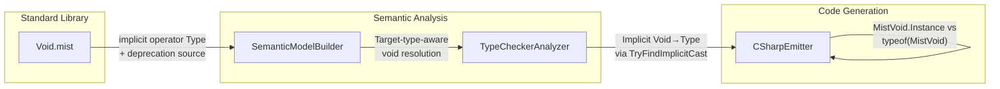

# Design Document: Void Value Literal

## Overview

This design makes the `void` keyword context-sensitive in expression position. Today, `void` in expression position always resolves as a type literal (`Standard.Type`). After this feature, the resolution depends on the target type:

- **Target type is `void`** → resolves as the Void singleton value (type: `VoidType`)
- **Target type is `Type`** → resolves as a type literal (type: `Standard.Type`) — existing behavior
- **No target type (var inference)** → resolves as a type literal (type: `Standard.Type`) — backward compat

The feature also adds an implicit `Void → Type` conversion operator on the `Void` struct, deprecates `Void.Void` with a warning diagnostic, and updates samples/book to use the new idiomatic form.

### Design Rationale

The `Void.Void` pattern leaks an implementation detail (the struct's static property) into user code. With the void-unit-type feature already making `void` a first-class value type, the natural next step is letting the `void` keyword itself serve as the value literal — mirroring how `true`/`false` are both keywords and value literals for `bool`. Target-type-driven resolution preserves backward compatibility while enabling the new value-literal semantics.

---

## Architecture

The feature modifies three compiler stages. No new pipeline stages are introduced.



### Data Flow

1. **SemanticModelBuilder** (`TypeLiteralExpressionPrimaryNode` case, ~line 20402): When the type reference is `void`, check the target type from the enclosing context. If target type is `VoidType`, record the expression type as `VoidType` instead of `Standard.Type`. Otherwise, preserve existing behavior.

2. **SemanticModelBuilder** (`MemberAccessSuffixPostfixSuffixNode` case, ~line 19570): The existing `Void.Void` special case continues to resolve as `VoidType`, but now emits a deprecation warning diagnostic.

3. **TypeCheckerAnalyzer** (`IsAssignable`): The existing `TryFindImplicitCast` fallback at the end of `IsAssignable` will find the new `implicit operator Type` on the Void struct's member scope, enabling `Void → Type` assignment without additional type checker changes.

4. **CSharpEmitter** (`TypeLiteralExpressionPrimaryNode` case, ~line 9803): When the expression resolved as a void value literal (expression type is `VoidType`), emit `MistVoid.Instance` (or `null` in optional context) instead of `typeof(MistVoid)`.

---

## Components and Interfaces

### 1. SemanticModelBuilder: Target-Type-Aware void Resolution

#### 1a. Target Type Propagation

The `TypeLiteralExpressionPrimaryNode` case currently resolves unconditionally to `Standard.Type`. The change introduces target-type awareness by threading the declared type from the enclosing context (variable declaration, parameter, return type, or generic type argument) into the resolution.

**Mechanism**: The `ResolvePostfix` → `ResolvePrimary` call chain does not currently pass a target type. Rather than threading a parameter through the entire call chain, the approach is:

1. After `ResolvePrimary` resolves a `TypeLiteralExpressionPrimaryNode` whose `TypeRef` is a `VoidTypeRefTypeReferenceNode`, record a **marker** on the expression in the expression type map indicating "void-keyword-in-expression-position".
2. At the **assignment site** (variable declaration, argument passing, return statement), the SemanticModelBuilder already knows the target type. When the initializer/argument/return value resolves to `Standard.Type` AND the underlying primary node is a `TypeLiteralExpressionPrimaryNode` with a void type reference AND the target type is `VoidType`, **re-resolve** the expression type to `VoidType`.

**Alternative (simpler)**: Since the `TypeLiteralExpressionPrimaryNode` case is a leaf in the resolution chain, we can check the target type at the point where the expression type is consumed. The SemanticModelBuilder already has access to the declared type at variable declaration sites (`ResolveVariableDeclaration`), argument sites (`ResolveArguments`), and return sites (`ResolveReturnStatement`). At each of these sites, when the resolved expression type is `Standard.Type` and the expression is a void type literal, override to `VoidType` if the target type is `VoidType`.

**Chosen approach**: Introduce an optional `targetType` parameter to `ResolvePrimary` (defaulting to `null`). When `targetType` is `VoidType` and the primary node is a `TypeLiteralExpressionPrimaryNode` with `VoidTypeRefTypeReferenceNode`, resolve as `VoidType` directly. The callers that know the target type (variable initializer resolution, argument resolution, return value resolution) pass it through.

```csharp
case TypeLiteralExpressionPrimaryNode typeLiteral:
{
    var referencedType = ResolveTypeReference(
        typeLiteral.TypeRef, fileScope, ambientTypeResolver,
        symbolTable, sourceText, diagnostics);

    // NEW: Target-type-aware void resolution.
    // When the type literal is `void` and the target type is VoidType,
    // resolve as the Void singleton value rather than the metatype Type.
    if (typeLiteral.TypeRef is VoidTypeRefTypeReferenceNode && targetType?.IsVoid() == true)
    {
        result = referencedType; // VoidType.Instance
        break;
    }

    // Existing behavior: resolve as Standard.Type (metatype).
    try
    {
        var typeGlobalScope = FindGlobalScope(fileScope) ?? fileScope;
        result = ResolveTypeKeyword(typeGlobalScope, symbolTable);
    }
    catch (StdlibMissingException)
    {
        result = LegacyPrimitiveTypes.Type;
    }
    break;
}
```

#### 1b. Target Type Sources

The target type is available at these call sites:

| Context | Target Type Source |
|---------|-------------------|
| `void x = void;` | Declared variable type from type annotation |
| `method(void)` where param is `void` | Parameter type from method signature |
| `return void;` in void method | Method return type |
| `new Result<void>(void, ...)` | Generic type argument substituted into constructor parameter type |
| `Type t = void;` | Declared variable type (`Standard.Type`) — falls through to existing behavior |
| `var x = void;` | No target type (`null`) — falls through to existing behavior |

#### 1c. Deprecation Warning for Void.Void

In the existing `MemberAccessSuffixPostfixSuffixNode` special case (~line 19570), add a diagnostic emission:

```csharp
if (targetType.IsVoid() && memberName == "Void")
{
    // NEW: Emit deprecation warning.
    diagnostics.Add(MakeDiagnosticWithLocation(
        VoidDotVoidDeprecated.Value,
        DiagnosticSeverity.Warning,
        "Use 'void' in expression position instead of 'Void.Void' to obtain the Void singleton.",
        suffix,
        sourceText));

    IType voidType;
    try
    {
        var voidGlobalScope = FindGlobalScope(fileScope) ?? fileScope;
        voidType = ResolveVoidKeyword(voidGlobalScope, symbolTable);
    }
    catch (StdlibMissingException)
    {
        voidType = targetType;
    }
    expressionTypes[suffix] = voidType;
    return voidType;
}
```

New diagnostic ID: `MIST_SM_0023` (next available in the SM series).

### 2. Standard Library: Implicit Void → Type Operator

#### 2a. Void.mist Update

Add an implicit conversion operator to the `Void` struct:

```mist
public struct Void
{
    public static Void Void { get; } = new Void();

    private Void() { }

    public static implicit operator Type(Void v)
    {
        return Type.Of(v);
    }

    public static bool operator ==(Void a, Void b)
    {
        return true;
    }

    public static bool operator !=(Void a, Void b)
    {
        return false;
    }
}
```

The `implicit operator Type` returns the `Type` instance representing `Void` by calling the existing `Type.Of()` intrinsic. This operator is discovered by `TryFindImplicitCast` when the source type is `VoidType` and the target type is `Standard.Type`, enabling assignments like `Type t = someVoidVariable;` without explicit casting.

#### 2b. Type Checker Integration

No changes to `TypeCheckerAnalyzer.IsAssignable` are needed. The existing fallback at the end of `IsAssignable`:

```csharp
if (TryFindImplicitCast(source, target, out _) is not null)
    return true;
```

will find the `operator_implicit_Type` method on the Void struct's member scope when `source` is `VoidType` and `target` is the `Type` type. The operator name follows the existing convention: `operator_implicit_{targetTypeName}`.

### 3. CSharpEmitter: Context-Sensitive void Emission

#### 3a. TypeLiteralExpressionPrimaryNode Emission

The current emitter unconditionally emits `typeof(...)` for type literals. With this feature, when the expression type recorded in the semantic model is `VoidType` (indicating value-literal resolution), emit differently:

```csharp
case TypeLiteralExpressionPrimaryNode typeLiteral:
{
    // NEW: Check if this void type literal resolved as a value literal.
    var resolvedType = _model.GetTypeOf(typeLiteral);
    if (resolvedType is not null && resolvedType.IsVoid())
    {
        // Value literal context: emit the Void singleton.
        if (_emitVoidAsNull)
            return "null";
        _needsMistVoidStruct = true;
        return "MistVoid.Instance";
    }

    // Existing behavior: type literal → typeof(...)
    return $"typeof({EmitTypeReference(typeLiteral.TypeRef)})";
}
```

#### 3b. Optional Context Handling

The existing `_emitVoidAsNull` flag (from the optional-types feature) already handles the case where a void expression targets a `T | void` union type. When `_emitVoidAsNull` is `true`, the emitter produces `null` instead of `MistVoid.Instance`. This applies to the new void value literal path without additional changes.

#### 3c. Implicit Void → Type Emission

When the emitter encounters an assignment where the source is a void-typed expression and the target is `Type`, it emits `MistVoid.Instance` and relies on the C# compiler to resolve the implicit operator on the generated `MistVoid` struct. The `MistVoid.g.cs` helper file needs an additional implicit operator:

```csharp
public static implicit operator System.Type(MistVoid v) => typeof(void);
```

This mirrors the Mist-level `implicit operator Type(Void v)` in the generated C# output. It returns a Type whose `.Name == "Void"` per Requirement 4.1 (an earlier draft used `typeof(MistVoid)`, which yields `.Name == "MistVoid"` and contradicts Requirement 4.1).

### 4. MistVoid.g.cs Update

The existing `MistVoid` struct (emitted when `_needsMistVoidStruct` is true) gains the implicit conversion:

```csharp
[System.Runtime.CompilerServices.CompilerGenerated]
public readonly struct MistVoid : System.IEquatable<MistVoid>
{
    public static readonly MistVoid Instance = default;
    public bool Equals(MistVoid other) => true;
    public override bool Equals(object? obj) => obj is MistVoid;
    public override int GetHashCode() => 0;
    public static bool operator ==(MistVoid left, MistVoid right) => true;
    public static bool operator !=(MistVoid left, MistVoid right) => false;
    public override string ToString() => "Void";

    // NEW: Implicit conversion to System.Type (mirrors Mist's Void → Type).
    // Returns a Type whose .Name == "Void" per Requirement 4.1.
    public static implicit operator System.Type(MistVoid v) => typeof(void);
}
```

---

## Data Models

### Existing Types (No Changes)

| Type | Role | Notes |
|------|------|-------|
| `VoidType` | Semantic model type for `void` | Singleton `VoidType.Instance` |
| `TypeLiteralExpressionPrimaryNode` | AST node for type keywords in expression position | Contains `TypeRef` property |
| `VoidTypeRefTypeReferenceNode` | AST node for `void` type reference | Used to identify void type literals |

### New Diagnostic IDs

| ID | Severity | Message |
|----|----------|---------|
| `MIST_SM_0023` | Warning | "Use 'void' in expression position instead of 'Void.Void' to obtain the Void singleton." |

### Modified Emitter State

| Field | Type | Change |
|-------|------|--------|
| `_needsMistVoidStruct` | `bool` | Now also set when void value literal is emitted |
| `_emitVoidAsNull` | `bool` | Applies to void value literals in optional contexts (no change to field, just broader applicability) |

### Expression Type Map Behavior Change

| Expression | Previous Type | New Type (target = void) | New Type (target = Type) | New Type (no target) |
|------------|--------------|--------------------------|--------------------------|---------------------|
| `void` (keyword in expr position) | `Standard.Type` | `VoidType` | `Standard.Type` | `Standard.Type` |

---


## Correctness Properties

*A property is a characteristic or behavior that should hold true across all valid executions of a system — essentially, a formal statement about what the system should do. Properties serve as the bridge between human-readable specifications and machine-verifiable correctness guarantees.*

### Property 1: Target-type-driven void resolution

*For any* program containing the `void` keyword in expression position with a known target type, the semantic model SHALL resolve the expression type as `VoidType` if and only if the target type is `VoidType`. When the target type is not `VoidType` (including `Standard.Type`, `int`, `string`, or any other type) or when no target type is available, the expression type SHALL be `Standard.Type`.

**Validates: Requirements 1.1, 1.6, 2.1, 3.1**

### Property 2: Implicit Void → Type conversion acceptance

*For any* program where a void-typed expression (variable, parameter, or method return value of type `void`) is assigned to a `Type`-typed target (variable, parameter, or return position), the type checker SHALL accept the assignment without error via the implicit conversion operator.

**Validates: Requirements 4.2, 4.3, 4.4**

### Property 3: Void.Void deprecation warning count

*For any* program containing N occurrences of the `Void.Void` member access expression, the compiler SHALL emit exactly N warning diagnostics with ID `MIST_SM_0023`, each with a source location pointing to the corresponding `Void.Void` expression.

**Validates: Requirements 5.2, 5.3**

### Property 4: Context-sensitive void emission

*For any* program containing `void` in expression position, the emitted C# SHALL contain `MistVoid.Instance` (or `null` in optional union context) when the expression resolved as a value literal (`VoidType`), and `typeof(MistVoid)` when the expression resolved as a type literal (`Standard.Type`).

**Validates: Requirements 6.1, 6.2, 6.4**

---

## Error Handling

### New Diagnostics

| ID | Severity | Message | Emitted By |
|----|----------|---------|------------|
| `MIST_SM_0023` | Warning | "Use 'void' in expression position instead of 'Void.Void' to obtain the Void singleton." | SemanticModelBuilder |

### Existing Diagnostics (Unchanged Behavior)

| Scenario | Diagnostic | Notes |
|----------|-----------|-------|
| `void` assigned to `int` variable | `MIST_TC_0001` (type mismatch) | `Standard.Type` is not assignable to `int` — same as today |
| `Void.Void` still compiles | None (error) | Continues to work, just with a warning |
| `void == void` in void-typed context | None | Both sides resolve as VoidType, equality accepted |

### Error Recovery

- When `void` appears in expression position with an incompatible target type (e.g., `int x = void;`), the expression resolves as `Standard.Type` (not `VoidType`), and the type checker emits the standard type mismatch diagnostic. No special error recovery needed.
- The deprecation warning does not prevent compilation — `Void.Void` remains fully functional.

---

## Testing Strategy

### Property-Based Testing

The project uses **FsCheck 3.x** with **xunit** for property-based testing. Tests use the shared `CompilerDriver` for in-process compilation (per the test-process-spawning policy).

**Library**: FsCheck 3.x + xunit  
**Configuration**: Minimum 100 iterations per property test  
**Tag format**: `Feature: void-value-literal, Property {N}: {description}`

**Batched execution approach** (per test-process-spawning policy): For properties that require runtime verification (Properties 2, 4), generate all N scenarios upfront, build a single batched Mist program that prints N result lines, compile once, run once, compare line-by-line.

**In-process compilation approach**: For properties that only need semantic model or diagnostic verification (Properties 1, 3), use `CompilerDriver.Compile()` directly without spawning any external process.

### Property Test Specifications

| Property | Generator | Assertion | Process Spawns |
|----------|-----------|-----------|----------------|
| 1: Resolution | Generate void literals in various target-type contexts (void, Type, int, string, var) | Check expression type map: VoidType iff target is void | 0 (in-process) |
| 2: Implicit conversion | Generate void-typed variables assigned to Type targets in various positions | Check no diagnostics emitted | 0 (in-process) |
| 3: Deprecation count | Generate programs with 1–5 Void.Void occurrences in random positions | Count warnings == count of Void.Void | 0 (in-process) |
| 4: Emission | Generate void literals in value-literal and type-literal contexts | Inspect emitted C# for MistVoid.Instance vs typeof(MistVoid) | 0 (in-process) |

### Unit Tests (Example-Based)

| Test | Validates |
|------|-----------|
| `void x = void;` compiles, expression type is VoidType | Req 1.2 |
| `Type t = void;` compiles, expression type is Standard.Type | Req 2.2 |
| `var x = void;` infers Standard.Type | Req 3.2 |
| `var x = void; void y = x;` produces type mismatch | Req 3.3 |
| `return void;` in void method accepted | Req 1.4 |
| `void` as argument to void parameter accepted | Req 1.3 |
| `void` in generic context `Result<void>(void, true)` accepted | Req 1.5 |
| `void v = void; Type t = v;` accepted (implicit conversion) | Req 4.2 |
| `Void.Void` still resolves as VoidType | Req 5.1 |
| `Void.Void` emits MIST_SM_0023 warning | Req 5.2 |
| Emitter produces `MistVoid.Instance` for void value literal | Req 6.1 |
| Emitter produces `typeof(MistVoid)` for void type literal | Req 6.2 |
| Emitter produces `null` for void in optional context | Req 6.4 |
| `MistVoid.g.cs` includes implicit operator Type | Req 6.5 |

### Integration Tests

| Test | Validates |
|------|-----------|
| VoidValueLiteral sample compiles and produces expected output | Req 9.2, 9.3, 9.5 |
| VoidType/VoidDemo sample compiles with zero warnings | Req 7.1, 7.5 |
| OptionalTypes/Program sample compiles with zero warnings | Req 7.2, 7.5 |
| AllFeatures sample includes VoidValueLiteral demo | Req 9.4 |
| Book snippets compile via SnippetEmitter | Req 8.6, 8.7 |
