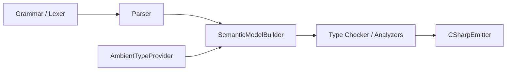

# Design Document: Abstract Type Unification

## Overview

This design describes the unification of Mist's `interface` and `trait` keywords into a single `abstract` keyword, executed across four sequential phases. The key architectural insight is that each phase has a distinct character:

- **Phase 1** — Pure mechanical rename (zero semantic change)
- **Phase 2** — Pure deletion (remove traits and with-blocks, nothing added)
- **Phase 3** — Additive (default implementations on abstract types)
- **Phase 4** — Additive (re-add with-blocks targeting abstract types)

Each phase gates on "all tests pass, all samples compile" before proceeding.

**C# Interop Invariant:** The CSharpEmitter always emits `interface` in generated C# code. The ambient type provider continues to load CLR interfaces. Mist's internal concept is "abstract type" but the interop bridge to CLR remains unchanged.

## Architecture

The compiler pipeline affected by this change is:



Each phase modifies a specific subset of these layers:

| Phase | Grammar/Lexer | Parser | SemanticModel | TypeChecker | Emitter | AmbientProvider |
|-------|--------------|--------|---------------|-------------|---------|-----------------|
| 1     | Rename       | Rename | Rename        | Rename      | Rename  | No change       |
| 2     | Delete       | Delete | Delete        | Delete      | Delete  | No change       |
| 3     | Extend       | Extend | Extend        | Extend      | Extend  | No change       |
| 4     | Re-add       | Re-add | Re-add        | Extend      | Extend  | No change       |

## Components and Interfaces

### Phase 1 — Pure Rename (interface → abstract)

Phase 1 is entirely mechanical: the same AST node structure, the same semantic type, the same emission logic — just with different names. No behavior changes.

#### Grammar Layer (`keywords.storm`, `Mist.storm`)

**Before:**
```storm
token INTERFACE = "interface";
```

**After:**
```storm
token ABSTRACT = "abstract";
```

**Parser rule rename in `Mist.storm`:**

| Before | After |
|--------|-------|
| `InterfaceDeclaration` rule | `AbstractDeclaration` rule |
| `InterfaceType` variant in `TypeDeclaration` | `AbstractType` variant |
| `InterfaceMemberDeclaration` rule | `AbstractMemberDeclaration` rule |
| `InterfaceMethodDeclaration` rule | `AbstractMethodDeclaration` rule |
| `InterfacePropertyDeclaration` rule | `AbstractPropertyDeclaration` rule |
| `InterfaceAccessorDeclaration` rule | `AbstractAccessorDeclaration` rule |
| `InterfaceMethodMember` / `InterfacePropertyMember` / etc. | `AbstractMethodMember` / `AbstractPropertyMember` / etc. |

The rule uses `ABSTRACT` instead of `INTERFACE`:
```storm
rule AbstractDeclaration = modifiers:Modifier* ABSTRACT name:IDENTIFIER
    typeParams:TypeParameterList?
    interfaceList:(COLON interfaces:BaseList)?
    constraints:WhereClause*
    LEFT_BRACE members:AbstractMemberDeclaration* RIGHT_BRACE;
```

**Removed keyword error diagnostic:** When the parser encounters `interface`, emit: `"The 'interface' keyword has been removed. Use 'abstract' instead."`

#### Semantic Model Layer

| Before | After |
|--------|-------|
| `InterfaceType.cs` | `AbstractType.cs` |
| `class InterfaceType : IType` | `class AbstractType : IType` |
| `TypeKind.Interface` | `TypeKind.Abstract` |
| `SymbolKind.Interface` (if exists) | `SymbolKind.Abstract` |
| `ConstructedType` with `InterfaceType` | `ConstructedType` with `AbstractType` |

The `AbstractType` class has the exact same fields as `InterfaceType`:
```csharp
public sealed class AbstractType : IType
{
    public string DisplayName { get; }
    public TypeKind Kind => TypeKind.Abstract;
    public IScope MemberScope { get; }
    public string? ContainingNamespace { get; }
    public IReadOnlyList<IType> Interfaces { get; internal set; } = Array.Empty<IType>();
    public IReadOnlyList<IType> TypeParameters { get; internal set; } = Array.Empty<IType>();
    public bool IsReadonly { get; internal set; }
}
```

#### SemanticModelBuilder Pass Renames

| Before | After |
|--------|-------|
| `RegisterInterfaceDeclaration` | `RegisterAbstractDeclaration` |
| `ResolveInterfaceDeclaration` | `ResolveAbstractDeclaration` |
| `Pass1_ValidateInterfaceSatisfaction` | `Pass1_ValidateAbstractSatisfaction` |
| `Pass1_DetectInterfaceCycles` | `Pass1_DetectAbstractCycles` |
| `Pass1_ResolveInterfaceLists` | `Pass1_ResolveAbstractLists` |
| `ResolveInterfaceInterfaceList` | `ResolveAbstractParentList` |
| `ResolveInterfaceNames` | `ResolveAbstractNames` |
| `RegisterInterfaceMethodDeclaration` | `RegisterAbstractMethodDeclaration` |
| `RegisterInterfacePropertyDeclaration` | `RegisterAbstractPropertyDeclaration` |

Internal helper methods that reference "Interface" in the Mist-type sense are also renamed (e.g., `FindCompilationUnitPathForInterfaceType` → `FindCompilationUnitPathForAbstractType`).

#### CSharpEmitter Rename

| Before | After |
|--------|-------|
| `EmitInterfaceDeclaration(InterfaceDeclarationNode)` | `EmitAbstractDeclaration(AbstractDeclarationNode)` |
| `EmitInterfaceMethodDeclaration` | `EmitAbstractMethodDeclaration` |
| `EmitInterfacePropertyDeclaration` | `EmitAbstractPropertyDeclaration` |

The emitted C# output is unchanged — still produces `interface` keyword in generated code.

#### Ambient Type Provider

No changes. CLR interfaces continue to be exposed as `AbstractType` instances (the rename propagates through `InterfaceType` → `AbstractType` naturally).

#### TextMate Grammar

- `interface` removed from declaration keyword list
- `abstract` added to declaration keyword scope (`keyword.declaration.mist`)
- `entity.name.type.interface.mist` → `entity.name.type.abstract.mist`
- Generic declaration pattern updated: `class|struct|abstract|trait`

#### Test and Sample Renames

All test files referencing the Mist concept of "interface" are renamed to use "abstract" (class names, method names, file names). Sample directories `Interfaces/` → `AbstractTypes/`, `ShapeInterfaces/` → `ShapeAbstracts/`, etc. The `interface` keyword in `.mist` files is replaced with `abstract`.

---

### Phase 2 — Purge Traits (Pure Deletion)

Phase 2 removes traits entirely. No new functionality is added.

#### Grammar Layer

**Deleted tokens:** `TRAIT` removed from `keywords.storm`.

**Deleted rules from `Mist.storm`:**
- `TraitDeclaration`
- `TraitMemberDeclaration` (and all variants)
- `TraitFieldDeclaration`
- `TraitMethodDeclaration`
- `TraitPropertyDeclaration`
- `WithDeclaration`
- `MemberMapping`
- `TraitType` variant removed from `TypeDeclaration` rule
- `WithItem` variant removed from `TopLevelItem` rule

**Removed keyword error diagnostics:**
- `trait` → `"The 'trait' keyword has been removed. Use 'abstract' with nominal typing (': AbstractType') or a 'with' block for retroactive conformance."`
- `with` in with-block position → error diagnostic

**Note:** The `WITH` token, `AS` token remain in the grammar because `with` is used in `WithClause` (method signature context bindings) and `with` statements. Only the `WithDeclaration` top-level rule is removed.

#### Semantic Model Layer

**Deleted files/classes:**
- `TraitType.cs` — `TraitType` class
- `ConstructedTraitType.cs` — `ConstructedTraitType` class
- `TraitSatisfactionMap.cs` — `TraitSatisfaction` and `TraitSatisfactionMap` classes
- `WithBlockRegistry.cs` — `ValidatedMemberMapping` and `WithBlockRegistry` classes
- `TypeKind.Trait` variant removed from the enum

#### SemanticModelBuilder Deletions

All trait-related passes removed:
- `RegisterTraitDeclaration`
- `ResolveTraitDeclaration`
- `Pass1_ResolveTraitParents`
- `Pass1_DetectTraitCycles` (and `DetectTraitCyclesDfsVisit`)
- `Pass1_ResolveWithBlocks` (and all helper methods: `ResolveWithBlockTypeName`, `ResolveWithBlockTraitName`, `FindTraitMember`, etc.)
- `Pass1_ResolveTraitSatisfaction` (and all structural matching logic: `TryStructuralMatch`, `TryStructuralMatchWithSubstitution`, `TryMatchTraitField`, `TryMatchTraitMethod`, `TryMatchTraitProperty`, etc.)
- `ResolveExplicitMemberTypesForTrait`
- `GetEffectiveMembers` (trait-specific)
- `CollectEffectiveMembers` (trait-specific)
- `HasTraitInBaseList`, `HasConstructedTraitInBaseList`
- `CollectConstructedTraitsFromBaseList`, `CollectConstructedTraitsFromParents`
- `RegisterTransitiveParentSatisfaction`

**Constraint system cleanup:**
- `TraitConstraints` list in `TypeParameterConstraints` — trait constraints become abstract type constraints (which already exist as `InterfaceConstraints`/`TypeConstraint`)
- `ConcreteTypeSatisfiesTrait` removed from constraint satisfaction

#### CSharpEmitter Deletions

- `EmitTraitDeclaration` (and `EmitTraitMethodDeclaration`, `EmitTraitPropertyDeclaration`, `EmitTraitFieldAsProperty`)
- `EmitExplicitTraitImplementations` — with-block emission logic
- All references to `TraitSatisfactionMap` and `WithBlockRegistry`

#### TextMate Grammar

- `trait` removed from declaration keyword list
- Generic declaration pattern updated: `class|struct|abstract`
- `entity.name.type.trait.mist` scope removed

---

### Phase 3 — Default Implementations (New Functionality)

Phase 3 adds the ability for abstract type methods to have bodies (default implementations). Properties cannot have defaults.

#### Grammar Layer

The `AbstractDeclaration` rule's member list is extended to accept members with bodies:

```storm
rule AbstractMemberDeclaration
    = method:AbstractMethodDeclaration           as AbstractMethodMember
    | property:AbstractPropertyDeclaration       as AbstractPropertyMember
    | defaultMethod:MethodDeclaration            as AbstractDefaultMethodMember
    | associatedType:AssociatedTypeSlotDeclaration as AbstractAssociatedTypeMember
    | unconstrainedAssociatedType:UnconstrainedAssociatedTypeSlotDeclaration as AbstractUnconstrainedAssociatedTypeMember
    | modifiedAssociatedType:ModifiedAssociatedTypeSlotDeclaration as AbstractModifiedAssociatedTypeMember
    | nestedType:TypeDeclaration                  as AbstractNestedTypeMember
    ;
```

The key addition is `defaultMethod:MethodDeclaration as AbstractDefaultMethodMember` — reusing the existing `MethodDeclaration` rule (which includes a body) to parse default methods.

**Error diagnostic:** If a property declaration has a body inside an abstract type, emit: `"Property slots cannot have default implementations. Only methods can have defaults."`

#### Semantic Model Layer

`AbstractType` gains a new field:

```csharp
public sealed class AbstractType : IType
{
    // ... existing fields ...

    /// <summary>
    /// Methods with default implementations. Key = method name.
    /// These do NOT need to be filled by implementers.
    /// </summary>
    public Dictionary<string, ISymbol> DefaultMethods { get; } = new();
}
```

The `SemanticModelBuilder` registration pass for abstract types is extended:
- When processing `AbstractDefaultMethodMember` nodes, register the method symbol in both the abstract type's `MemberScope` (for resolution) and in `DefaultMethods` (to distinguish from slots).

#### Type Checker Changes

`Pass1_ValidateAbstractSatisfaction` is modified:
1. When collecting required members from an abstract type, **exclude** members listed in `DefaultMethods`.
2. When a concrete type provides its own implementation for a default method with a matching signature, accept it (filling takes precedence).
3. When an abstract type inherits from another that has defaults, propagate — implementers of the child are not required to fill inherited defaults either.
4. Signature matching remains unchanged (exact match on name, return type, parameter types).

#### CSharpEmitter Changes — Default Interface Methods (DIM)

`EmitAbstractDeclaration` is extended:
1. For `AbstractDefaultMethodMember` nodes, emit a C# **default interface method** (method with body on the interface):
   ```csharp
   interface IGreeting
   {
       string Name();
       string Greet() => $"Hello, I am {this.Name()}";  // DIM
   }
   ```

2. **Forwarding stub emission:** When emitting a concrete type that does NOT override a default, emit a forwarding method:
   ```csharp
   class Person : IGreeting
   {
       public string Name() => "Alice";
       // Forwarding stub — makes DIM accessible without cast
       public string Greet() => ((IGreeting)this).Greet();
   }
   ```

3. When a concrete type provides its own implementation for a default method, emit only the concrete implementation (no forwarding).

**Design rationale:** C# DIM requires casting to the interface type to call the default. The forwarding stub ensures Rust-style semantics where the default is accessible directly on the concrete type without casting. This matches the requirement that calling through concrete type and abstract type reference produces identical behavior.

---

### Phase 4 — Late Binding via With Blocks (New Functionality)

Phase 4 re-adds `with` block support, now targeting abstract types instead of traits, with nominal (not structural) conformance establishment.

#### Grammar Layer

Re-add to `Mist.storm`:
```storm
rule WithDeclaration = WITH typeName:IDENTIFIER COLON abstractName:IDENTIFIER abstractTypeArgs:TypeArgumentList?
    LEFT_BRACE mappings:MemberMapping+ RIGHT_BRACE;

rule MemberMapping = sourceName:IDENTIFIER AS targetName:IDENTIFIER SEMICOLON;
```

The `WithItem` variant is re-added to `TopLevelItem`. The `WITH` and `AS` tokens already exist (they were retained in Phase 2 for with-clauses and with-statements).

#### Semantic Model Layer

A new `ConformanceMap` replaces the old `TraitSatisfactionMap` + `WithBlockRegistry`:

```csharp
/// <summary>
/// A validated member mapping from a with-block.
/// Maps a source member on the adapting type to a slot on the abstract type.
/// </summary>
public sealed class ConformanceMapping
{
    public required ISymbol SourceMember { get; init; }
    public required ISymbol TargetSlot { get; init; }
    public required string SourceName { get; init; }
    public required string TargetName { get; init; }
}

/// <summary>
/// Records with-block conformance registrations.
/// Key: (concreteType, abstractType). Value: list of member mappings.
/// </summary>
public sealed class ConformanceMap
{
    private readonly Dictionary<(IType, IType), List<ConformanceMapping>> _entries = new();

    public void Register(IType type, IType abstractType, ConformanceMapping mapping);
    public bool HasConformance(IType type, IType abstractType);
    public IReadOnlyList<ConformanceMapping> GetMappings(IType type, IType abstractType);
    public IEnumerable<(IType Type, IType AbstractType, IReadOnlyList<ConformanceMapping>)> All();
}
```

#### SemanticModelBuilder — New Pass

A new `Pass1_ResolveWithBlocks` pass is added (re-implemented from scratch, simpler than the old one since there's no structural matching):

1. For each `WithDeclaration` node:
   - Resolve `typeName` to a concrete type.
   - Resolve `abstractName` to an `AbstractType`.
   - For each `MemberMapping`:
     - Find `sourceName` as a public member on the concrete type.
     - Find `targetName` as a slot on the abstract type.
     - Validate signature compatibility (same return type, same parameter types).
     - Register the mapping in `ConformanceMap`.
2. Validate that all required slots (those not in `DefaultMethods`) have mappings. Default methods without mappings are automatically satisfied.
3. Error if the type already declares `: AbstractType` in its base clause (redundant conformance).
4. **Error if `typeName` resolves to a CLR/ambient type** (not defined in Mist source). Since `with` blocks work by appending the interface to the target type's inheritance list and emitting explicit implementations on it, this is impossible for types we don't own. Emit: `"Cannot use 'with' to establish conformance for CLR type '{TypeName}'. Only types defined in Mist source can be adapted via 'with' blocks."`

#### Type Checker Changes

`Pass1_ValidateAbstractSatisfaction` extended:
- When checking assignability, also consult `ConformanceMap` — a type with with-block conformance is assignable to the abstract type.

#### CSharpEmitter — With Block Emission

For each entry in `ConformanceMap`:
1. Add the abstract type's interface name to the concrete type's C# inheritance list.
2. Emit explicit interface implementations that delegate to the source member:
   ```csharp
   class Logger : INamed  // ← added by with-block
   {
       public string GetLabel() => "SystemLogger";
       // Explicit interface implementation delegating to mapped member
       string INamed.Name() => this.GetLabel();
   }
   ```
3. For default methods without mappings, emit a forwarding stub (same as Phase 3).
4. For mapped slots that have defaults, the mapping takes precedence — emit explicit implementation for the mapped member, no forwarding for the default.

## Data Models

### TypeKind Enum (Final State)

```csharp
public enum TypeKind
{
    Class,
    Struct,
    Abstract,   // was Interface; Trait removed
    Enum,
    Unknown,
    AssociatedTypeSlot,
}
```

### AbstractType (Final State — After Phase 3)

```csharp
public sealed class AbstractType : IType
{
    public string DisplayName { get; }
    public TypeKind Kind => TypeKind.Abstract;
    public IScope MemberScope { get; }
    public string? ContainingNamespace { get; }
    public IReadOnlyList<IType> Interfaces { get; internal set; } = Array.Empty<IType>();
    public IReadOnlyList<IType> TypeParameters { get; internal set; } = Array.Empty<IType>();
    public bool IsReadonly { get; internal set; }
    public bool IsCyclic { get; internal set; }

    /// <summary>
    /// Methods with default implementations (Phase 3+).
    /// Key = method name. Not required to be filled by implementers.
    /// </summary>
    public Dictionary<string, ISymbol> DefaultMethods { get; } = new();
}
```

### ConformanceMap (Phase 4)

```csharp
public sealed class ConformanceMapping
{
    public required ISymbol SourceMember { get; init; }
    public required ISymbol TargetSlot { get; init; }
    public required string SourceName { get; init; }
    public required string TargetName { get; init; }
}

public sealed class ConformanceMap
{
    private readonly Dictionary<(IType, IType), List<ConformanceMapping>> _entries = new();

    public void Register(IType type, IType abstractType, ConformanceMapping mapping) { /* ... */ }
    public bool HasConformance(IType type, IType abstractType) => _entries.ContainsKey((type, abstractType));
    public IReadOnlyList<ConformanceMapping> GetMappings(IType type, IType abstractType) { /* ... */ }
    public IEnumerable<(IType Type, IType AbstractType, IReadOnlyList<ConformanceMapping> Mappings)> All() { /* ... */ }
}
```


## Correctness Properties

*A property is a characteristic or behavior that should hold true across all valid executions of a system — essentially, a formal statement about what the system should do. Properties serve as the bridge between human-readable specifications and machine-verifiable correctness guarantees.*

### Property 1: Abstract Declaration Round-Trip

*For any* valid abstract type declaration (with arbitrary name, type parameters, base clauses, constraints, and slot/default members), parsing the source text SHALL produce an abstract declaration syntax node whose structure can be printed back and re-parsed to produce an equivalent AST.

**Validates: Requirements 1.1, 1.2, 1.3, 1.4, 1.5, 1.6, 1.7**

### Property 2: Slot vs Default Classification by Body Presence

*For any* method declaration inside an abstract type body, the method SHALL be classified as a slot if and only if it has no body (semicolon-terminated), and as a default implementation if and only if it has a braced body. The classification is determined solely by body presence.

**Validates: Requirements 13.1, 13.2, 13.5**

### Property 3: Slot Satisfaction Completeness

*For any* abstract type with N slots (members without defaults) and M default methods, a concrete type declaring `: AbstractType` SHALL be accepted by the type checker if and only if it provides public implementations matching every one of the N slot signatures. Missing any slot results in a diagnostic listing the unfilled slots. The M default methods do NOT need implementations.

**Validates: Requirements 14.1, 14.2, 14.3, 28.1, 28.2**

### Property 4: Signature Matching Exactness

*For any* slot signature and any candidate implementation on a concrete type, the type checker SHALL accept the implementation if and only if the name, return type, and all parameter types match exactly. Any mismatch in name, return type, or parameter type(s) SHALL result in rejection.

**Validates: Requirements 14.5, 28.4**

### Property 5: Inherited Slot Propagation

*For any* abstract type hierarchy (child inheriting from parent(s)), an implementer of the child abstract type SHALL be required to fill all non-default slots from the entire inheritance chain — both the child's own slots and all ancestor slots. Default methods at any level do not require filling.

**Validates: Requirements 14.6, 28.3**

### Property 6: Default Dispatch Consistency

*For any* concrete type that does NOT override a default method, calling that default method through a concrete-type reference and through an abstract-type reference SHALL produce identical behavior (same return value, same side effects).

**Validates: Requirements 15.1, 15.2**

### Property 7: Override Takes Precedence

*For any* concrete type that provides its own implementation for a method with a default, the concrete type's implementation SHALL be invoked regardless of whether the value is accessed through the concrete type reference or the abstract type reference.

**Validates: Requirements 15.3**

### Property 8: Nominal Typing Enforcement

*For any* type that structurally matches all members of an abstract type but does NOT declare `: AbstractType` in its base clause and has no `with` block establishing conformance, the type SHALL NOT be assignable to variables or parameters typed as the abstract type. Structural matching alone is insufficient.

**Validates: Requirements 7.8**

### Property 9: With-Block Establishes Assignability

*For any* valid `with TypeName : AbstractType { mappings }` declaration where all required slot mappings have compatible signatures, the declared type SHALL become assignable to variables and parameters typed as the abstract type.

**Validates: Requirements 20.1, 20.2**

### Property 10: With-Block Only Requires Non-Default Slot Mappings

*For any* abstract type with N slots and M defaults, a `with` block targeting that abstract type SHALL be accepted if and only if it provides mappings for all N slots. Mappings for default methods are optional — unmapped defaults are satisfied automatically.

**Validates: Requirements 20.3**

### Property 11: With-Block Signature Validation

*For any* member mapping in a `with` block, if the source member's type signature is incompatible with the target slot's declared signature, the compiler SHALL emit a type mismatch error at the mapping declaration point.

**Validates: Requirements 20.6**

### Property 12: Multiple With-Blocks Independence

*For any* type with multiple `with` blocks establishing conformance to different abstract types, each `with` block SHALL be validated independently. The type SHALL be assignable to each abstract type independently.

**Validates: Requirements 20.8**

### Property 13: Abstract Type Emission as C# Interface

*For any* abstract type declaration, the C# emitter SHALL produce a syntactically valid C# `interface` declaration. Slot members SHALL emit as method/property signatures. Default methods (Phase 3+) SHALL emit as default interface methods with bodies.

**Validates: Requirements 24.1, 24.2, 24.3, 24.5**

### Property 14: Diamond Inheritance — Single Implementation Satisfies Both

*For any* diamond abstract type hierarchy where two parent abstract types declare a slot with the same name and signature, a single implementation on the concrete type SHALL satisfy both parent slots simultaneously.

**Validates: Requirements 28.5**

### Property 15: Transitive Assignability Through Hierarchy

*For any* implementer of a child abstract type, the implementer SHALL be unconditionally assignable to a variable typed as any ancestor abstract type in the inheritance chain.

**Validates: Requirements 27.4**

## Error Handling

### Phase 1 Errors

| Condition | Diagnostic | Severity |
|-----------|-----------|----------|
| `interface` keyword encountered | "The 'interface' keyword has been removed. Use 'abstract' instead." | Error |
| `static` on a method, property or indexer of an abstract type (Requirement 1.3, clarified 2026-10-21) | `MIST0048`, at each offending member declaration | Error |

### Phase 2 Errors

| Condition | Diagnostic | Severity |
|-----------|-----------|----------|
| `trait` keyword encountered | "The 'trait' keyword has been removed. Use 'abstract' with nominal typing (': AbstractType') or a 'with' block for retroactive conformance." | Error |
| `with` in top-level with-block position | Error diagnostic (keyword temporarily unavailable) | Error |

### Phase 3 Errors

| Condition | Diagnostic | Severity |
|-----------|-----------|----------|
| Property with body in abstract type | "Property slots cannot have default implementations. Only methods can have defaults." | Error |
| Missing slot implementations | Lists each unfilled slot by name and signature | Error |
| Signature mismatch on override | Reports expected vs actual signature | Error |

### Phase 4 Errors

| Condition | Diagnostic | Severity |
|-----------|-----------|----------|
| Undefined type in with-block | Identifies the undefined reference | Error |
| Signature mismatch in with-block mapping | Type mismatch error at mapping declaration | Error |
| Redundant conformance (type already declares `: AbstractType`) | "Redundant conformance" error | Error |
| Missing required slot mappings | Lists unmapped required slots | Error |

### Cross-Phase Errors (Retained from current system)

| Condition | Diagnostic | Severity |
|-----------|-----------|----------|
| Cyclic abstract type inheritance | Cycle detection error | Error |
| Duplicate member declarations | Redeclaration error | Error |
| Hiding without `new` keyword | Warning about hidden member | Warning |
| `new` on non-hiding member | Warning about unnecessary `new` | Warning |

## Testing Strategy

### Dual Testing Approach

This feature uses both unit tests and property-based tests for comprehensive coverage:

- **Property-based tests (PBT):** Verify the 15 correctness properties above using generated inputs (random abstract type declarations, random slot configurations, random type hierarchies).
- **Unit tests:** Verify specific examples, error diagnostics, edge cases (empty bodies, marker types, diamond inheritance), and integration points (C# emission, sample compilation).

### Property-Based Testing Configuration

- **Library:** FsCheck (already used in the project)
- **Minimum iterations:** 100 per property test
- **Tag format:** `// Feature: abstract-type-unification, Property {N}: {title}`

### Test Categories by Phase

**Phase 1 tests (rename verification):**
- Round-trip property test: `AbstractDeclarationRoundTripPropertyTests` (Property 1)
- Example tests: `interface` keyword error diagnostic, empty body parsing
- Integration: all samples compile with `abstract`

**Phase 2 tests (deletion verification):**
- Property test: nominal typing enforcement (Property 8)
- Example tests: `trait` keyword error diagnostic
- Integration: all samples compile without traits

**Phase 3 tests (default implementations):**
- Property tests: slot vs default classification (Property 2), slot satisfaction (Property 3), signature matching (Property 4), inherited slots (Property 5), dispatch consistency (Property 6), override precedence (Property 7)
- Integration: default method samples compile and produce correct output
- Batched compilation test: generate N default-implementation scenarios, compile once, run once, verify N output lines

**Phase 4 tests (with-blocks):**
- Property tests: with-block assignability (Property 9), non-default slot mappings (Property 10), signature validation (Property 11), multiple with-blocks (Property 12)
- Property tests: emission (Property 13), diamond inheritance (Property 14), transitive assignability (Property 15)
- Integration: with-block samples compile and produce correct output

### Process Spawning Strategy

Per the Test Process Spawning Policy, tests that require compilation and execution use the **batched approach**:
1. Generate all N scenarios upfront via FsCheck generators.
2. Build a single Mist source program that exercises all N scenarios and prints N labeled output lines.
3. Compile once using the shared `CompilerDriver` (in-process).
4. Run the compiled DLL once.
5. Compare output lines against expected results.

This ensures each property test class spawns `dotnet` at most once (for execution), keeping wall-clock time under 5 seconds per class.
