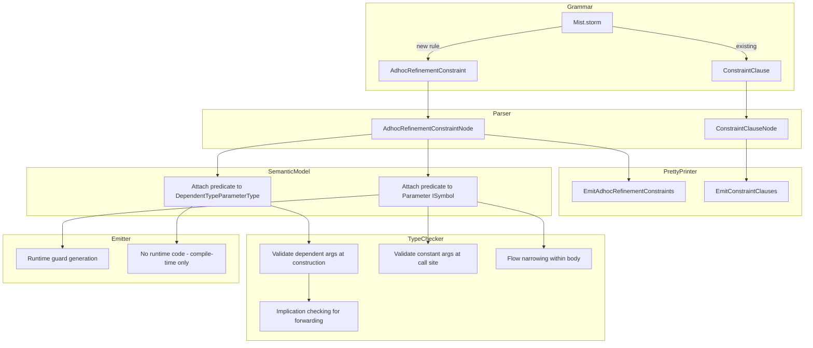

# Design Document: Adhoc Refinement Constraints

## Overview

This design adds ad-hoc refinement constraints to the Mist language — `where` clauses that attach refinement predicates directly to dependent type arguments on generic declarations and to parameters on constructors, methods, and indexers. This extends the existing refinement type system (which requires named type alias declarations) with inline, anonymous refinement constraints.

The feature touches every layer of the compiler pipeline:
1. **Grammar** — A new `AdhocRefinementConstraint` rule that coexists with the existing `ConstraintClause` rule
2. **Parser** — Disambiguation between generic constraints (`where T : class`) and refinement constraints (`where Size >= 0`) based on the presence/absence of `:` after the name
3. **Pretty-Printer** — Formatting adhoc refinement constraint clauses with correct spacing and idempotence
4. **Semantic Model** — Attaching predicates to dependent type parameters and value parameters
5. **Type Checker** — Compile-time enforcement, implication checking, flow narrowing, and predicate compatibility validation
6. **Emitter** — Runtime guard generation for parameter constraints; compile-time-only enforcement for dependent argument constraints

The design reuses the existing `RefinementPredicate` class (which wraps an `AndPatternNode` and provides `Evaluate` and `Implies` methods) and the `RefinementSolver` for implication proofs.

## Architecture



## Components and Interfaces

### 1. Grammar Extension (`Mist.storm`)

A new grammar rule `AdhocRefinementConstraint` is introduced alongside the existing `ConstraintClause`:

```
rule AdhocRefinementConstraint = WHERE name:IDENTIFIER predicate:AndPattern;
```

Declarations that currently accept `constraints:ConstraintClause*` will be extended to accept a mixed sequence. The grammar uses a unified `WhereClause` rule that the parser disambiguates:

```
rule WhereClause
    = WHERE name:IDENTIFIER COLON constraints:ConstraintList  as GenericConstraintClause
    | WHERE name:IDENTIFIER predicate:AndPattern              as AdhocRefinementConstraint
    ;
```

This leverages the existing `AndPattern` rule (which supports relational patterns, constant patterns, and logical `and` combinators) and disambiguates based on whether a `:` follows the identifier.

**Affected declarations:**
- `ClassDeclaration` — `constraints:WhereClause*`
- `StructDeclaration` — `constraints:WhereClause*`
- `InterfaceDeclaration` — `constraints:WhereClause*`
- `TraitDeclaration` — `constraints:WhereClause*`
- `TypeAliasDeclaration` — `constraints:WhereClause*`
- `MethodDeclaration` — `constraints:WhereClause*`
- `InterfaceMethodDeclaration` — `constraints:WhereClause*`
- `ConstructorDeclaration` — new `constraints:WhereClause*` field (positioned after parameter list, before constructor chain)
- `IndexerDeclaration` — new `constraints:WhereClause*` field (positioned after bracket-enclosed parameters, before accessor block)

### 2. AST Nodes

The Storm source generator will produce two new node types from the `WhereClause` rule:

- **`GenericConstraintClauseWhereClauseNode`** — equivalent to the current `ConstraintClauseNode` (name + constraint list)
- **`AdhocRefinementConstraintWhereClauseNode`** — new node carrying `name:IDENTIFIER` and `predicate:AndPatternNode`

Both are alternatives of a `WhereClauseNode` base, allowing declarations to hold `ImmutableArray<WhereClauseNode>`.

### 3. Pretty-Printer (`MistPrettyPrinter`)

A new method `EmitWhereClause` dispatches on the node type:

```csharp
private string EmitWhereClause(WhereClauseNode clause)
{
    return clause switch
    {
        GenericConstraintClauseWhereClauseNode generic =>
            $" where {generic.Name.Lexeme} : {EmitConstraintList(generic.Constraints)}",
        AdhocRefinementConstraintWhereClauseNode refinement =>
            $" where {refinement.Name.Lexeme} {EmitAndPattern(refinement.Predicate)}",
        _ => ""
    };
}
```

The existing `EmitConstraintClauses` method is replaced by `EmitWhereClauses` that iterates over the unified `WhereClauseNode` array.

### 4. Semantic Model (`SemanticModelBuilder`)

**New data stored on symbols:**

- `DependentTypeParameterType` gains an optional `RefinementPredicate? AdhocConstraint` property
- `ISymbol` for parameters gains an associated `RefinementPredicate?` stored in a lookup table on the semantic model (e.g., `Dictionary<ISymbol, RefinementPredicate>`)

**Processing logic in `SemanticModelBuilder`:**

During the constraint-resolution pass, for each `AdhocRefinementConstraintWhereClauseNode`:
1. Look up the name in the declaration's dependent type parameters and value parameters
2. If found as a dependent type parameter → attach `RefinementPredicate` to the `DependentTypeParameterType`
3. If found as a value parameter → store `RefinementPredicate` in the parameter refinement map
4. If not found → emit `MIST_REFINEMENT_0001 (historical)` diagnostic
5. If found as a regular type parameter → emit `MIST_REFINEMENT_0002 (historical)` diagnostic
6. If duplicate → emit `MIST_REFINEMENT_0003 (historical)` diagnostic

### 5. Type Checker (`TypeCheckerAnalyzer`)

**Compile-time enforcement for dependent arguments:**
- When constructing a type with a dependent argument refinement, evaluate the predicate against the compile-time constant value
- When forwarding from another dependent parameter, use `RefinementSolver.Implies` to verify the source constraint implies the target

**Compile-time enforcement for parameter arguments:**
- When calling a method/constructor/indexer with a constant argument, evaluate the predicate
- When the argument's type is a named refinement type, use `RefinementSolver.Implies` to check if the argument's predicate implies the parameter's constraint

**Flow narrowing:**
- Within a method body, treat a parameter with an adhoc refinement constraint as having an anonymous `RefinementType` (base type + predicate)
- On reassignment or compound assignment of the parameter, invalidate the narrowing

**Predicate compatibility:**
- Validate that relational predicates are only applied to comparable types (integers, char, float, double, decimal)
- Validate that relational predicates are NOT applied to `bool` or `string`
- Constant patterns and `and` combinators are valid on all equality-comparable types

**Interface/Trait method refinement constraint satisfaction (Liskov Substitution):**

This check is added to the existing `Pass1_ValidateInterfaceSatisfaction` method (for interfaces) and `Pass1_ResolveTraitSatisfaction` method (for traits) in `SemanticModelBuilder`. After a method match is confirmed (signature matches), the type checker performs an additional refinement constraint compatibility check:

Algorithm — `ValidateRefinementConstraintSatisfaction`:
1. For each matched method pair (interface/trait method → implementation method):
   a. For each parameter position `i` in the method signature:
      - Let `interfacePredicate` = the adhoc refinement constraint on the interface/trait method's parameter at position `i` (may be null)
      - Let `implPredicate` = the adhoc refinement constraint on the implementation method's parameter at position `i` (may be null)
      - **If `interfacePredicate` is null**: skip — the interface imposes no constraint, so the implementation may freely add or omit constraints.
      - **If `interfacePredicate` is non-null and `implPredicate` is null**: accept — no constraint on the implementation means it accepts all values (weaker than any predicate).
      - **If both are non-null**: check `RefinementSolver.Implies(interfacePredicate, implPredicate)`.
        - If `true`: accept — the implementation accepts everything the interface promises.
        - If `false`: emit `MIST_REFINEMENT_0009 (historical)` diagnostic — the implementation is stronger (rejects values the interface promises to accept).
   b. Each parameter is validated independently — a violation on one parameter does not prevent validation of others.
2. The same algorithm applies to indexer parameters.

This check runs during the semantic model construction phase (Pass 1d for interfaces, Pass 1g for traits), after method signature matching has already succeeded. It uses the parameter refinement map (`GetParameterRefinement`) to look up adhoc constraints on both the interface/trait method parameters and the implementation method parameters.

### 6. Emitter (`CSharpEmitter` / `CSharpSourceWriter`)

**Parameter refinement guards:**
- Extend `EmitMethodBlockWithRefinementGuards` to also collect adhoc refinement constraints from the parameter refinement map (in addition to existing named refinement type parameters)
- Generate the same guard structure: `if (!(condition)) throw new ArgumentException(...)`
- Guards are emitted in left-to-right parameter declaration order
- Compound predicates are emitted as a single `&&`-joined boolean expression

**Dependent argument refinements:**
- No runtime code generated — enforcement is purely compile-time since dependent values are always constants

**Guard elision optimization:**
- If all call sites pass only validated constants or arguments with provably-satisfying refinement types, the guard may be elided (tracked via a flag on the parameter symbol)

## Data Models

### New/Modified Types

```csharp
// Extended: DependentTypeParameterType
public sealed class DependentTypeParameterType : IType
{
    // ... existing properties ...
    
    /// <summary>
    /// Optional adhoc refinement constraint predicate attached via a where clause.
    /// Null if no adhoc refinement constraint exists for this parameter.
    /// </summary>
    public RefinementPredicate? AdhocConstraint { get; set; }
}
```

```csharp
// New: stored on ISemanticModel for parameter refinement lookups
public interface ISemanticModel
{
    // ... existing members ...
    
    /// <summary>
    /// Returns the adhoc refinement predicate for a parameter symbol, or null if none.
    /// </summary>
    RefinementPredicate? GetParameterRefinement(ISymbol parameterSymbol);
}
```

```csharp
// New diagnostic IDs
// MIST_REFINEMENT_0001: Refinement constraint references unknown name
// MIST_REFINEMENT_0002: Refinement constraint on regular type parameter
// MIST_REFINEMENT_0003: Duplicate refinement constraint on same name
// MIST_REFINEMENT_0004: Dependent argument violates refinement
// MIST_REFINEMENT_0005: Parameter argument violates refinement
// MIST_REFINEMENT_0006: Cannot prove implication for forwarding
// MIST_REFINEMENT_0007: Predicate incompatible with type
// MIST_REFINEMENT_0008: Cannot forward unconstrained to constrained
// MIST_REFINEMENT_0009: Implementation strengthens interface/trait refinement constraint (Liskov violation)
```

### Grammar Node Structure

```
WhereClauseNode (abstract)
├── GenericConstraintClauseWhereClauseNode
│   ├── Name: Token (IDENTIFIER)
│   └── Constraints: ConstraintListNode
└── AdhocRefinementConstraintWhereClauseNode
    ├── Name: Token (IDENTIFIER)
    └── Predicate: AndPatternNode
```

## Correctness Properties

*A property is a characteristic or behavior that should hold true across all valid executions of a system — essentially, a formal statement about what the system should do. Properties serve as the bridge between human-readable specifications and machine-verifiable correctness guarantees.*

### Property 1: Pretty-print round-trip (idempotence)

*For any* valid Mist source text containing adhoc refinement constraints (on type declarations, methods, constructors, and indexers, with single or compound predicates, with or without interleaved generic constraints), parsing the text and then pretty-printing the resulting AST SHALL produce text that, when parsed and pretty-printed again, yields identical output.

**Validates: Requirements 1.1, 1.3, 1.4, 1.5, 1.6, 2.1, 2.2, 2.3, 2.4, 2.5, 2.6, 3.1, 3.2, 3.3, 3.4, 3.5, 3.6, 10.1, 10.2, 10.5**

### Property 2: Semantic model predicate attachment and evaluation

*For any* declaration with an adhoc refinement constraint referencing a valid dependent type parameter or value parameter, the semantic model SHALL attach a `RefinementPredicate` to that entity such that `predicate.Evaluate(value)` returns `true` for values satisfying the constraint and `false` for values violating it.

**Validates: Requirements 4.1, 4.2, 4.3, 9.6**

### Property 3: Semantic model invalid-name diagnostics

*For any* declaration where an adhoc refinement constraint references a name that is not a dependent type parameter or value parameter on that declaration (including names that don't exist and names that are regular type parameters), the semantic model SHALL emit a diagnostic error and SHALL NOT attach a predicate for that name.

**Validates: Requirements 4.4, 4.5, 4.6**

### Property 4: Compile-time acceptance of satisfying constants

*For any* refinement predicate and compile-time constant value that satisfies the predicate, the type checker SHALL accept the construction (for dependent arguments) or call (for parameter arguments) without emitting a diagnostic error.

**Validates: Requirements 5.1, 6.1, 6.7**

### Property 5: Compile-time rejection of violating constants

*For any* refinement predicate and compile-time constant value that does NOT satisfy the predicate, the type checker SHALL emit a diagnostic error when the constant is used as a dependent type argument or as a method/constructor/indexer argument.

**Validates: Requirements 5.2, 6.2, 6.5, 6.6**

### Property 6: Predicate implication correctness

*For any* pair of refinement predicates (source, target), `RefinementSolver.Implies(source, target)` SHALL return `true` if and only if every value satisfying the source predicate also satisfies the target predicate. The type checker SHALL use this to accept forwarding/assignment when implication holds and reject it when implication does not hold.

**Validates: Requirements 5.4, 5.5, 5.6, 6.4, 8.1, 8.2, 8.3, 9.2, 9.3, 9.5**

### Property 7: Flow narrowing invalidation on reassignment

*For any* method parameter with an adhoc refinement constraint, if the parameter is reassigned or compound-assigned within the method body, the type checker SHALL reject subsequent uses of that parameter as the refined type.

**Validates: Requirements 8.5**

### Property 8: Predicate-type compatibility validation

*For any* adhoc refinement constraint, the type checker SHALL accept the predicate if and only if the predicate kind is compatible with the constrained type: relational predicates require a comparable type (integers, char, float, double, decimal) and SHALL be rejected on `bool` and `string`; constant patterns and `and` combinators are valid on all equality-comparable types.

**Validates: Requirements 11.1, 11.2, 11.3, 11.4, 11.5, 11.6, 11.7**

### Property 9: Interface/trait method refinement constraint satisfaction (Liskov Substitution)

*For any* interface or trait method with a parameter refinement constraint, and any implementing method on a class or struct, the type checker SHALL accept the implementation if and only if, for each parameter position where the interface/trait declares a refinement predicate, either (a) the implementation declares no refinement constraint on that parameter, or (b) `RefinementSolver.Implies(interfacePredicate, implPredicate)` returns `true`. If the implication does not hold (the implementation's constraint is stronger), the type checker SHALL emit a `MIST_REFINEMENT_0009 (historical)` diagnostic for that parameter. Each parameter position is validated independently.

**Validates: Requirements 17.1, 17.2, 17.3, 17.4, 17.5, 17.6, 17.7, 17.8, 17.9**

## Error Handling

### Diagnostic Errors

| ID | Condition | Message Template |
|----|-----------|-----------------|
| MIST_REFINEMENT_0001 (historical) | Where clause references unknown name | "Refinement constraint references '{Name}', which is not a dependent type parameter or parameter on this declaration." |
| MIST_REFINEMENT_0002 (historical) | Where clause targets regular type parameter | "Refinement constraints cannot be applied to type parameter '{Name}'. Refinement constraints apply only to dependent type parameters and value parameters." |
| MIST_REFINEMENT_0003 (historical) | Duplicate where clause on same name | "Duplicate refinement constraint on '{Name}'. Combine predicates using 'and' in a single where clause." |
| MIST_REFINEMENT_0004 (historical) | Dependent argument violates constraint | "Dependent type argument '{Value}' does not satisfy refinement constraint '{Predicate}' on parameter '{Name}' of type '{Type}'." |
| MIST_REFINEMENT_0005 (historical) | Parameter argument violates constraint | "Argument '{Value}' does not satisfy refinement constraint '{Predicate}' on parameter '{Name}' of method '{Method}'." |
| MIST_REFINEMENT_0006 (historical) | Cannot prove implication for forwarding | "Cannot forward dependent parameter '{SourceName}' with constraint '{SourcePredicate}' to parameter '{TargetName}' with constraint '{TargetPredicate}' because the compiler cannot prove the implication." |
| MIST_REFINEMENT_0007 (historical) | Predicate incompatible with type | "Refinement predicate '{Predicate}' is not valid for type '{Type}'. Relational patterns require a comparable type." |
| MIST_REFINEMENT_0008 (historical) | Forwarding unconstrained to constrained | "Cannot forward dependent parameter '{SourceName}' with no constraint to parameter '{TargetName}' with constraint '{TargetPredicate}' because the compiler cannot prove the implication." |
| MIST_REFINEMENT_0009 (historical) | Implementation strengthens interface/trait refinement constraint | "Implementation of '{Method}' on '{Type}' has a stronger refinement constraint '{ImplPredicate}' on parameter '{Name}' than the interface '{Interface}' requires '{InterfacePredicate}'. The implementation must accept all values the interface promises to accept." |

### Syntax Errors

- Using `or` in a refinement predicate position produces a parse error (the grammar only accepts `AndPattern`, not `OrPattern`)
- Malformed predicates (e.g., `where Size >=`) produce standard parser recovery errors

### Runtime Errors

- Generated runtime guards throw `ArgumentException` with a message containing the actual value, the violated predicate description, and the parameter name
- Guard format: `if (!(condition)) throw new ArgumentException($"Value {paramName} does not satisfy refinement '{predicate}' on type '{typeName}'", nameof(paramName));`

## Testing Strategy

### Property-Based Tests (FsCheck.Xunit)

The project uses **FsCheck.Xunit** (already a dependency in `Mist.Tests.csproj`) for property-based testing.

**Configuration:** Minimum 100 iterations per property test.

**Test classes:**

1. **`AdhocRefinementRoundTripPropertyTests`** — Property 1 (round-trip/idempotence)
   - Generates random Mist source fragments with adhoc refinement constraints
   - Parses, pretty-prints, parses again, pretty-prints again
   - Asserts the two pretty-printed outputs are identical
   - Generators cover: single/multiple constraints, compound predicates, mixed generic+refinement, all declaration kinds (class, struct, interface, trait, type alias, method, constructor, indexer)
   - Uses in-process compilation (no process spawning)
   - Tag: **Feature: adhoc-refinement-constraints, Property 1: Pretty-print round-trip**

2. **`AdhocRefinementSemanticModelPropertyTests`** — Properties 2, 3
   - Generates random declarations with valid/invalid constraint targets
   - Builds semantic model in-process
   - Asserts predicate attachment and evaluation correctness
   - Asserts diagnostics for invalid names
   - Tag: **Feature: adhoc-refinement-constraints, Property 2: Semantic model predicate attachment**
   - Tag: **Feature: adhoc-refinement-constraints, Property 3: Semantic model invalid-name diagnostics**

3. **`AdhocRefinementEnforcementPropertyTests`** — Properties 4, 5
   - Generates random predicates and constant values (both satisfying and violating)
   - Builds full programs, compiles in-process
   - Asserts correct acceptance/rejection
   - Tag: **Feature: adhoc-refinement-constraints, Property 4: Compile-time acceptance**
   - Tag: **Feature: adhoc-refinement-constraints, Property 5: Compile-time rejection**

4. **`RefinementImplicationPropertyTests`** — Property 6
   - Generates random pairs of relational predicates
   - Tests `RefinementPredicate.Implies` against a brute-force oracle (evaluate both predicates over a range of values)
   - Tag: **Feature: adhoc-refinement-constraints, Property 6: Predicate implication correctness**

5. **`AdhocRefinementFlowNarrowingPropertyTests`** — Property 7
   - Generates methods with parameter constraints followed by reassignment
   - Verifies type checker rejects post-reassignment refined usage
   - Tag: **Feature: adhoc-refinement-constraints, Property 7: Flow narrowing invalidation**

6. **`PredicateCompatibilityPropertyTests`** — Property 8
   - Generates predicate+type combinations across all primitive types
   - Verifies acceptance for compatible combinations and rejection for incompatible ones
   - Tag: **Feature: adhoc-refinement-constraints, Property 8: Predicate-type compatibility**

7. **`InterfaceTraitRefinementSatisfactionPropertyTests`** — Property 9
   - Generates random interface/trait method declarations with parameter refinement constraints
   - Pairs them with implementing methods that have: (a) the same predicate, (b) no predicate, (c) a weaker predicate (implication holds), or (d) a stronger predicate (implication fails)
   - Builds full programs in-process, verifies acceptance for cases (a)–(c) and `MIST_REFINEMENT_0009 (historical)` diagnostic for case (d)
   - Covers both interfaces and traits, single and multiple parameters, and indexer parameters
   - Generators also produce cases where the interface has no constraint (implementation may add any constraint freely)
   - Uses in-process compilation (no process spawning)
   - Tag: **Feature: adhoc-refinement-constraints, Property 9: Interface/trait refinement constraint satisfaction**

### Unit Tests (xUnit)

- Specific parsing examples (e.g., the exact AST structure for `class Array<TValue, Size:int> where Size >= 0 { }`)
- Specific error message format verification
- Edge cases: `or` in predicate position produces syntax error, empty predicate, deeply nested `and` chains
- Guard elision optimization verification
- Inheritance scenarios with fixed dependent values
- Interface refinement satisfaction: exact diagnostic message format for `MIST_REFINEMENT_0009 (historical)`
- Interface refinement satisfaction: implementation with same predicate (accepted)
- Interface refinement satisfaction: implementation with no constraint (accepted)
- Interface refinement satisfaction: implementation with stronger constraint (rejected)
- Trait refinement satisfaction: same acceptance/rejection behavior as interfaces
- Multi-parameter interface method: violation on one parameter does not suppress validation of others
- Indexer parameter refinement satisfaction check

### Integration Tests

- End-to-end compilation of sample programs with adhoc refinement constraints
- Verification that emitted C# compiles and runs correctly
- Runtime guard behavior (triggering `ArgumentException`)
- Batched approach: generate multiple scenarios, compile once, run once, compare output lines (per test-process-spawning policy)

### Process Spawning Compliance

All property-based tests use **in-process compilation** via `CompilerDriver.Compile()` — no process spawning per iteration. Integration tests that need to run compiled output use the **batched approach**: generate all scenarios, build one program, compile once, run once, compare N output lines.
