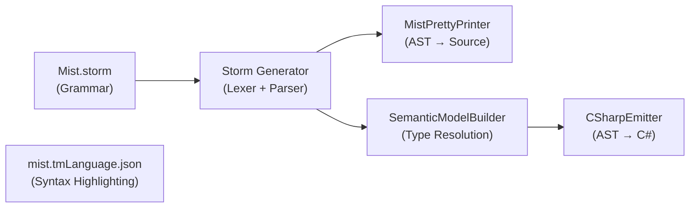

# Design Document: Binary Literals and Digit Separators

## Overview

This design adds binary literal support (`0b1010`) and digit separator support (`1_000_000`) to the Mist compiler, following C# 7 semantics. The implementation mirrors the existing hex literal pipeline: a new token in the Storm grammar, a new AST node alternative in the `Primary` rule, type resolution via the existing `ResolveIntegerLiteralType` method, verbatim emission in both the pretty printer and C# backend, and updated TextMate patterns for syntax highlighting.

Digit separators (underscores between digits) are added to all four numeric literal token definitions: `INTEGER_LITERAL`, `HEX_LITERAL`, `FLOAT_LITERAL`, and the new `BINARY_LITERAL`. The grammar enforces C# 7 placement rules: underscores are allowed only between digits, never adjacent to prefixes, suffixes, or decimal points, and never consecutive without an intervening digit.

Because the lexer and parser are Storm-generated from the grammar, most of the work is declarative — changing token regexes and adding a parser rule alternative. The hand-written code changes are small and follow established patterns in the semantic model builder, pretty printer, and C# emitter.

## Architecture

The feature touches six layers of the compiler pipeline plus the editor tooling:



1. **Grammar** (`Mist.storm`): New `BINARY_LITERAL` token, updated `INTEGER_LITERAL`/`HEX_LITERAL`/`FLOAT_LITERAL` tokens with separator support, new `BinaryLiteralExpression` alternative in `Primary`.
2. **Generated Lexer/Parser**: Automatically regenerated by the Storm source generator when the grammar changes. Produces `BinaryLiteralExpressionPrimaryNode` with a `BinaryLiteral` token property.
3. **Semantic Model** (`SemanticModelBuilder.cs`): New `case BinaryLiteralExpressionPrimaryNode` delegating to existing `ResolveIntegerLiteralType`.
4. **C# Backend** (`CSharpEmitter.cs`): New `case BinaryLiteralExpressionPrimaryNode` returning `.BinaryLiteral.Lexeme`.
5. **Pretty Printer** (`MistPrettyPrinter.cs`): New `case BinaryLiteralExpressionPrimaryNode` returning `.BinaryLiteral.Lexeme`.
6. **Syntax Highlighting** (`mist.tmLanguage.json`): New binary literal pattern, updated numeric patterns for digit separators.

### Design Decision: Verbatim Emission

Both the pretty printer and C# emitter output numeric literal lexemes verbatim (including prefix, separators, and suffix). This is the simplest correct approach because:
- C# natively supports both `0b` prefix and `_` separators, so no transformation is needed.
- The pretty printer's round-trip guarantee requires preserving the original text.
- The existing hex and integer literal emission already uses this pattern (`.Lexeme` passthrough).

### Design Decision: Grammar-Level Separator Validation

Digit separator placement rules are enforced in the grammar token regexes rather than in a separate validation pass. This means invalid separator placement (e.g., `0b_1010`, `1__000`, `100_L`) will produce lexer errors at tokenization time, consistent with how C# compilers handle these. The grammar uses the pattern `DIGIT ('_' DIGIT)*` to ensure underscores appear only between digits.

## Components and Interfaces

### Grammar Changes (`Mist.storm`)

**New fragment:**

```
fragment BINARY_DIGIT = `[01]`;
```

**New token (declared before `INTEGER_LITERAL`):**

```
token BINARY_LITERAL = "0" `[bB]` BINARY_DIGIT ('_' BINARY_DIGIT)* INT_SUFFIX?;
```

**Updated tokens with digit separator support:**

```
token HEX_LITERAL     = "0" `[xX]` HEX_DIGIT ('_' HEX_DIGIT)* INT_SUFFIX?;
token INTEGER_LITERAL  = `[0-9]` ('_' `[0-9]`)* INT_SUFFIX?;
token FLOAT_LITERAL    = `[0-9]` ('_' `[0-9]`)* "." `[0-9]` ('_' `[0-9]`)* FLOAT_SUFFIX?
                       | `[0-9]` ('_' `[0-9]`)* FLOAT_SUFFIX;
```

**New parser rule alternative in `Primary`:**

```
| binaryLiteral:BINARY_LITERAL  as BinaryLiteralExpression
```

Declared after `HexLiteralExpression` and before `FloatLiteralExpression` to group integer-family literals together.

**Token ordering in the grammar file:**

```
token HEX_LITERAL      = ...;   // before INTEGER_LITERAL (existing)
token BINARY_LITERAL   = ...;   // before INTEGER_LITERAL (new)
token INTEGER_LITERAL   = ...;
token FLOAT_LITERAL     = ...;
```

### Generated AST Node

The Storm source generator will produce `BinaryLiteralExpressionPrimaryNode` with:
- `BinaryLiteral` property of type `Storm.Runtime.Token` containing the full lexeme (e.g., `"0b1010_0000L"`).

### SemanticModelBuilder Changes

In the `switch (node)` block that resolves primary expression types (around line 7047), add:

```csharp
case BinaryLiteralExpressionPrimaryNode binLit:
    result = ResolveIntegerLiteralType(binLit.BinaryLiteral.Lexeme, fileScope, symbolTable);
    break;
```

This reuses the existing `ResolveIntegerLiteralType` method, which inspects the suffix to determine the type. The method already handles `_` characters correctly because it only checks `EndsWith("UL")`, `EndsWith("L")`, `EndsWith("U")` on the uppercased lexeme — underscores in the digit portion don't affect suffix detection.

### CSharpEmitter Changes

In the `EmitPrimary` switch (around line 2328), add:

```csharp
case BinaryLiteralExpressionPrimaryNode binLit:
    return binLit.BinaryLiteral.Lexeme;
```

### MistPrettyPrinter Changes

In the `EmitPrimary` switch (around line 1158), add:

```csharp
case BinaryLiteralExpressionPrimaryNode binLit:
    return binLit.BinaryLiteral.Lexeme;
```

### Syntax Highlighting Changes (`mist.tmLanguage.json`)

Update the `literals` repository with:

1. **New binary literal pattern** (before hex pattern):
```json
{
  "name": "constant.numeric.binary.mist",
  "match": "\\b0[bB][01](?:_?[01])*([lLuU]|UL|ul|Ul|uL|Lu|lU|LU|lu)?\\b"
}
```

2. **Updated hex pattern** (with digit separators):
```json
{
  "name": "constant.numeric.hex.mist",
  "match": "\\b0[xX][0-9a-fA-F](?:_?[0-9a-fA-F])*([lLuU]|UL|ul|Ul|uL|Lu|lU|LU|lu)?\\b"
}
```

3. **Updated float pattern** (with digit separators):
```json
{
  "name": "constant.numeric.float.mist",
  "match": "\\b[0-9](?:_?[0-9])*\\.[0-9](?:_?[0-9])*[fFdDmM]?\\b|\\b[0-9](?:_?[0-9])*[fFdDmM]\\b"
}
```

4. **Updated integer pattern** (with digit separators):
```json
{
  "name": "constant.numeric.integer.mist",
  "match": "\\b[0-9](?:_?[0-9])*([lLuU]|UL|ul|Ul|uL|Lu|lU|LU|lu)?\\b"
}
```

**Pattern ordering** in the `literals.patterns` array:
1. Binary (new)
2. Hex (updated)
3. Float (updated)
4. Integer (updated)
5. Boolean (unchanged)

### CSHARP_FEATURES.md Changes

Update two rows in the Expressions — Literals table:
- `Binary literals (\`0b1010\`)`: 🔲 → ✅, add note "C# 7; with digit separators"
- `Digit separators (\`1_000_000\`)`: 🔲 → ✅, add note "C# 7; in all numeric literal types"

## Data Models

No new data models are introduced. The feature uses existing types:

- **`Storm.Runtime.Token`**: Carries the binary literal lexeme through the pipeline.
- **`BinaryLiteralExpressionPrimaryNode`** (generated): New AST node with a `BinaryLiteral` token property. Follows the same pattern as `HexLiteralExpressionPrimaryNode`.
- **`IType`** (existing): `ResolveIntegerLiteralType` returns the appropriate primitive type (`int`, `long`, `uint`, `ulong`) based on suffix.

## Correctness Properties

*A property is a characteristic or behavior that should hold true across all valid executions of a system — essentially, a formal statement about what the system should do. Properties serve as the bridge between human-readable specifications and machine-verifiable correctness guarantees.*

### Property 1: Valid binary literals tokenize as BINARY_LITERAL

*For any* valid binary literal string (0b/0B prefix, one or more binary digits optionally separated by single underscores between digits, optional INT_SUFFIX), the lexer SHALL produce a single `BINARY_LITERAL` token whose lexeme equals the input string.

**Validates: Requirements 1.1, 1.3, 1.5**

### Property 2: Valid numeric literals with digit separators tokenize correctly

*For any* valid numeric literal with digit separators (integer with `[0-9](_[0-9])*`, hex with `0x[0-9a-fA-F](_[0-9a-fA-F])*`, float with separators in integer and fractional parts, binary with `0b[01](_[01])*`), the lexer SHALL produce a single token of the appropriate kind (`INTEGER_LITERAL`, `HEX_LITERAL`, `FLOAT_LITERAL`, or `BINARY_LITERAL`) whose lexeme equals the input string.

**Validates: Requirements 8.1, 8.2, 8.3, 8.9**

### Property 3: Binary literal type resolution follows suffix rules

*For any* binary literal with any valid suffix (none, L, l, U, u, UL, ul, Lu, lU, LU, lu), the semantic model SHALL resolve the same type as for a decimal integer literal with the same suffix (no suffix → `int`, L/l → `long`, U/u → `uint`, UL-variants → `ulong`).

**Validates: Requirements 3.1, 3.2, 3.3, 3.4, 3.5**

### Property 4: Digit separators do not affect type resolution

*For any* numeric literal (integer, hex, or binary) with valid digit separators, removing all underscores from the lexeme and resolving the type SHALL produce the same type as resolving the original lexeme with underscores.

**Validates: Requirements 8.10**

### Property 5: Pretty printer round-trip for numeric literals

*For any* valid Mist source text containing numeric literals (binary, hex, integer, or float, with or without digit separators), parsing the source then printing the AST then parsing again then printing again SHALL produce identical output on both prints.

**Validates: Requirements 5.2, 8.13**

### Property 6: Verbatim emission of numeric literals

*For any* numeric literal AST node (binary, hex, integer, or float, with or without digit separators and suffixes), both the pretty printer and the C# emitter SHALL output the token lexeme unchanged.

**Validates: Requirements 4.1, 4.2, 5.1, 8.11, 8.12**

## Error Handling

### Lexer Errors

- **Missing binary digits after prefix**: `0b` or `0B` with no following binary digit produces a lexer error diagnostic. The Storm-generated lexer handles this automatically — the token regex requires at least one binary digit after the prefix, so `0b` alone won't match `BINARY_LITERAL`. It will instead match as `0` (INTEGER_LITERAL) followed by `b` (IDENTIFIER), which will likely cause a parser error downstream. If the Storm lexer reports an explicit error, it is mapped to a `MIST0120` diagnostic by `MistLexer.cs`.

- **Invalid separator placement**: Underscores in forbidden positions (after prefix, before suffix, adjacent to decimal point, consecutive, trailing) cause the token regex to not match the full intended literal. The lexer will tokenize the valid prefix and leave the rest as separate tokens, producing parse errors. For example, `0b_1010` would lex as `0` + `b_1010` (identifier), and `1__000` would lex as `1` + `__000` (identifier).

### Semantic Errors

No new semantic errors are introduced. Binary literals use the same `ResolveIntegerLiteralType` method as decimal and hex literals, which already handles all valid suffix combinations. Invalid suffixes cannot reach the semantic model because they would fail at the lexer level.

### Backend Errors

No new backend errors. The C# emitter passes through the lexeme verbatim, and C# natively supports both `0b` prefix and `_` separators.

## Testing Strategy

### Property-Based Testing

The project uses **FsCheck 3.1.0** with **xUnit** for property-based testing. Each property test runs a minimum of 100 iterations.

**Test classes and process spawning notes:**

1. **Lexer tokenization tests** (Properties 1, 2): In-process only. Generate random valid literal strings, lex via `Mist.Generated.MistLexer.Lex()`, verify token kind and lexeme. No process spawning. ~0s overhead.

2. **Type resolution tests** (Properties 3, 4): In-process only. Call `ResolveIntegerLiteralType` directly (it's a static method). No process spawning. ~0s overhead.

3. **Pretty printer verbatim tests** (Property 6): In-process only. Construct AST nodes, call `MistPrettyPrinter.Print()`, verify output. No process spawning. ~0s overhead.

4. **Round-trip tests** (Property 5): In-process. Generate Mist source strings containing numeric literals, lex + parse via `MistLexer`/`MistParser`, print via `MistPrettyPrinter`, lex + parse again, print again, compare. No process spawning. ~0s overhead.

### Unit Tests (Example-Based)

- Token priority: `0b1010` lexes as `BINARY_LITERAL`, not `INTEGER_LITERAL` (Req 1.2).
- Expression contexts: binary literal as variable initializer, method argument (Req 2.3, 2.4).
- Edge cases for invalid separator placement (Req 1.4, 8.4–8.8): `0b_1010`, `0x_FF`, `1__000`, `100_L`, `1_.0`, `1._0`, `0b`, `0B`.
- Syntax highlighting pattern ordering (Req 6.2).

### Integration Tests

No new integration tests are needed for this feature. The existing end-to-end compilation tests (`SamplesCompileAndMatchBaselineTest`) can be extended with sample `.mist` files containing binary literals and digit separators to verify the full pipeline. This would use the existing batched compilation approach (1 compile, 1 run per sample).

### Test Tagging

Each property test is tagged with a comment referencing the design property:
```
// Feature: binary-literals, Property {N}: {property_text}
```
