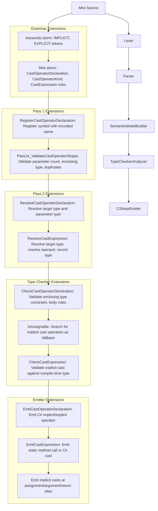
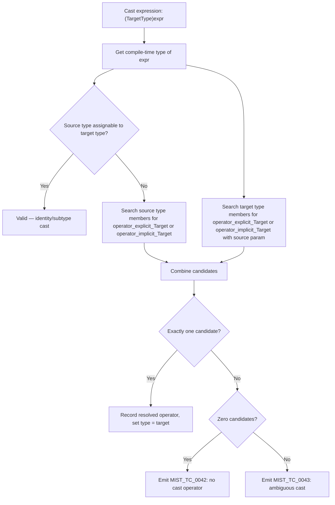
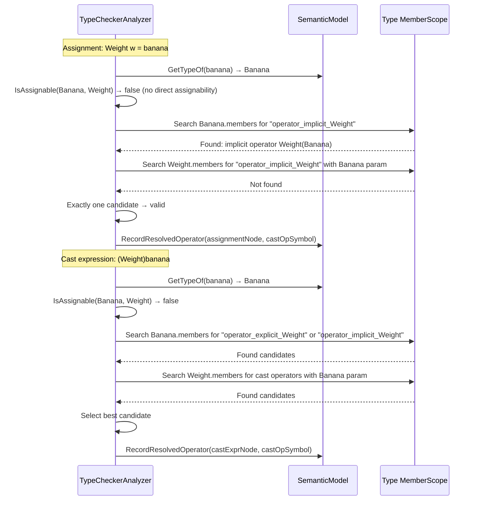
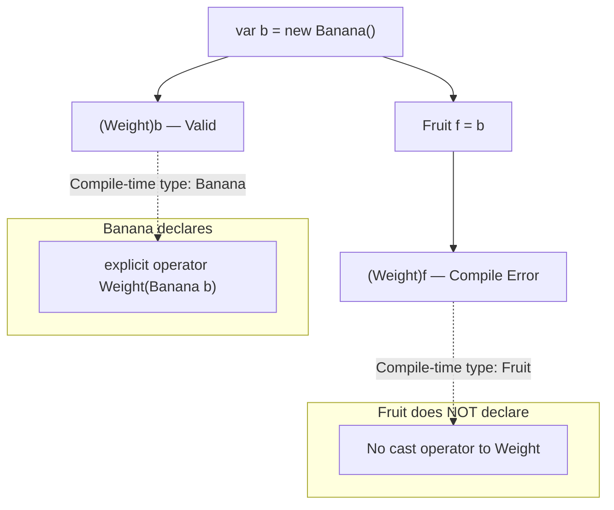

# Design Document: Cast Operators

## Overview

This design adds implicit and explicit cast operators to the Mist programming language. Cast operators allow user-defined types to declare custom type conversions, following C#'s `implicit operator` and `explicit operator` syntax with one critical difference: **explicit casts are resolved against the compile-time (static) type of the expression only**. A cast operator defined on a derived type is not visible through a base-typed variable. This eliminates all runtime cast failures by design.

The feature introduces two new constructs:

1. **Cast operator declarations** — member declarations inside classes and structs that define conversions:
   ```
   public static implicit operator Weight(Banana b) { ... }
   public static explicit operator string(Temperature t) { ... }
   ```

2. **Cast expressions** — the `(TargetType)expression` syntax for invoking explicit casts:
   ```
   var w = (Weight)banana;
   ```

Implicit casts are applied automatically by the type checker at assignment, argument, and return sites when direct assignability fails. Explicit casts require the programmer to write the cast expression syntax.

The implementation touches every stage of the compiler pipeline:

1. **Grammar** — New `IMPLICIT` and `EXPLICIT` keywords; `CastOperatorDeclaration` and `CastOperatorKind` rules; `CastExpression` in the `Unary` rule
2. **Pretty Printer** — Format cast operator declarations and cast expressions
3. **Semantic Model** — Register cast operator symbols with encoded names; register parameters
4. **Type Checker** — Validate cast operator declarations; resolve implicit casts at assignment/argument/return sites; validate explicit cast expressions against compile-time types
5. **C# Emitter** — Emit cast operator declarations as C# `implicit`/`explicit operator` methods; emit cast expressions as static method calls or C# casts
6. **Syntax Highlighting** — Add `implicit` and `explicit` to the TextMate grammar

### Design Decisions

- **Cast operators reuse the existing `OperatorDeclaration` pattern**: Cast operator symbols are registered as `SymbolKind.Method` with mangled names (e.g., `"operator_implicit_Weight"`), mirroring how arithmetic operators use `"operator+"`. This keeps the symbol table uniform and avoids new symbol kinds.
- **Cast operator lookup uses encoded names**: The naming convention `operator_implicit_{TargetType}` and `operator_explicit_{TargetType}` allows O(1) lookup by name when searching for a specific conversion, while also enabling enumeration of all cast operators on a type by prefix matching.
- **Resolved cast operators are stored on the semantic model**: Like arithmetic operator resolution, the type checker records the resolved cast operator symbol on the AST node via `RecordResolvedOperator`. The emitter reads this to determine how to emit the conversion.
- **Implicit casts are a fallback after direct assignability**: The `IsAssignable` method first checks identity, subtype, interface, trait, and numeric widening. Only when all of those fail does it search for implicit cast operators. This preserves existing behavior and prevents cast operators from shadowing inheritance relationships.
- **Both source and target types are searched for cast operators**: Consistent with C# semantics, when checking if type A can convert to type B, the compiler searches both A's members and B's members, and each one's base types, for applicable cast operators.
- **A cast is a call**: `(T)v` is sugar for a static conversion function `T.ExplicitCast(v)`, and the declared cast operators are its overloads. The operand is matched as an argument, so selection is overload resolution and a tie is an ambiguity, and the cast's type is the called operator's return type. See "Selection as Overload Resolution" below.
- **Cast expressions are added to the `Unary` rule**: The `(Type)expr` syntax has the same precedence as `!expr` and `-expr`. The parser disambiguates from `ParenthesizedExpression` by checking whether the parenthesized content is a type reference followed by a unary expression.
- **No runtime cast checks**: Since all cast validity is determined at compile time against the static type, the emitter never generates `is`/`as` checks or try-catch blocks for casts. This is the key differentiator from C#.
- **Intrinsic cast operators are supported**: The stdlib can define intrinsic cast operators (e.g., numeric conversions between primitive types) using the same `intrinsic` modifier pattern as arithmetic operators. The emitter looks up emission templates from the `IntrinsicEmissionRegistry`.

## Architecture

The cast operator feature integrates into the existing multi-pass compiler pipeline:



### Pipeline Integration Points

| Pipeline Stage | Change |
|---|---|
| `keywords.storm` | Add `IMPLICIT`, `EXPLICIT` tokens |
| `Mist.storm` | Add `CastOperatorDeclaration`, `CastOperatorKind` rules; add `CastOperatorMember` variant to `MemberDeclaration`; add `CastExpression` variant to `Unary` rule |
| `MistPrettyPrinter` | Handle `CastOperatorMemberMemberDeclarationNode` in `EmitMemberDeclaration`; handle `CastExpressionUnaryNode` in `EmitUnary` |
| `SemanticModelBuilder` Pass 1 | Register cast operator symbols with encoded names in `RegisterMemberDeclaration` |
| `SemanticModelBuilder` Pass 1 (validation) | New `Pass1e_ValidateCastOperatorShape` sub-pass for parameter count, enclosing type, and duplicate checks |
| `SemanticModelBuilder` Pass 2 | Resolve cast operator target type and parameter type; resolve cast expression target type and operand |
| `TypeCheckerAnalyzer` | Validate cast operator declarations (enclosing type constraint, body rules); extend `IsAssignable` with implicit cast fallback; validate cast expressions against compile-time type |
| `CSharpEmitter` | Emit cast operator declarations; emit cast expressions; emit implicit casts at assignment/argument/return sites |
| `CSharpTypeMap` | No changes needed (cast operators use existing type name resolution) |
| `IntrinsicEmissionRegistry` | Add `TryGetCastOperator` method for intrinsic cast emission templates |
| `mist.tmLanguage.json` | Add `implicit` and `explicit` to keyword patterns |

## Components and Interfaces

### Grammar Changes (`keywords.storm`, `Mist.storm`)

**`keywords.storm`** — Add:
```
// Cast operator keywords
token IMPLICIT = "implicit";
token EXPLICIT = "explicit";
```

**`Mist.storm`** — New rules:

```
rule CastOperatorDeclaration = modifiers:Modifier*
                               castKind:CastOperatorKind
                               OPERATOR
                               targetType:TypeReference
                               LEFT_PARENTHESIS parameters:ParameterList? RIGHT_PARENTHESIS
                               body:OperatorBody;

rule CastOperatorKind
    = IMPLICIT as ImplicitCast
    | EXPLICIT as ExplicitCast
    ;
```

**`Mist.storm`** — Modified rules:

The `MemberDeclaration` rule gains a new variant:
```
rule MemberDeclaration
    = constructor:ConstructorDeclaration as ConstructorMember
    | method:MethodDeclaration           as MethodMember
    | operator:OperatorDeclaration       as OperatorMember
    | castOperator:CastOperatorDeclaration as CastOperatorMember
    | property:PropertyDeclaration       as PropertyMember
    | indexer:IndexerDeclaration         as IndexerMember
    | field:FieldDeclaration             as FieldMember
    ;
```

The `Unary` rule gains a new variant for cast expressions:
```
rule Unary
    = LEFT_PARENTHESIS targetType:TypeReference RIGHT_PARENTHESIS operand:Unary  as CastExpression
    | EXCLAMATION operand:Unary    as LogicalNot
    | MINUS operand:Unary          as Negate
    | primary:Postfix              as PostfixExpression
    ;
```

**Design rationale for `CastOperatorDeclaration` as a separate rule**: Cast operators differ from arithmetic operators in structure — they use `implicit`/`explicit` instead of an operator symbol, and the "operator symbol" position is occupied by a type reference (the target type). A separate rule avoids overloading the `OperatorSymbol` rule and keeps the AST node types distinct.

**Design rationale for `CastExpression` in `Unary`**: The cast expression `(Type)expr` has the same precedence as unary operators in C#. Placing it in the `Unary` rule ensures correct precedence. The parser must disambiguate between `(Type)expr` (cast) and `(expr)` (parenthesized expression) — the Storm parser handles this through ordered alternatives, where the cast expression alternative is tried first. If the content inside parentheses matches a `TypeReference` followed by a `Unary` expression, it's a cast; otherwise, it falls through to `PostfixExpression` which includes `ParenthesizedExpression` in `Primary`.

**Design rationale for reusing `OperatorBody`**: Cast operator bodies follow the same pattern as arithmetic operator bodies — either a block body or a semicolon for intrinsic operators. Reusing `OperatorBody` (with its `OperatorBlockBody` and `OperatorNoBody` variants) avoids duplicating grammar rules.

### SemanticModelBuilder Extensions

#### Pass 1: Register Cast Operator Declarations

In `RegisterMemberDeclaration`, add a case for `CastOperatorMemberMemberDeclarationNode`:

```csharp
case CastOperatorMemberMemberDeclarationNode castOpMember:
    RegisterCastOperatorDeclaration(castOpMember.CastOperator, typeScope, symbolTable);
    break;
```

`RegisterCastOperatorDeclaration` creates a symbol with `SymbolKind.Method` and an encoded name:

```csharp
private static void RegisterCastOperatorDeclaration(
    CastOperatorDeclarationNode castOpDecl, Scope typeScope, SymbolTable symbolTable)
{
    // Extract the cast kind prefix.
    var kindPrefix = castOpDecl.CastKind switch
    {
        ImplicitCastCastOperatorKindNode => "implicit",
        ExplicitCastCastOperatorKindNode => "explicit",
        _ => "unknown",
    };

    // Extract the target type name from the type reference for the encoded name.
    // The full type resolution happens in Pass 2; here we use the raw lexeme.
    var targetTypeName = ExtractTypeReferenceName(castOpDecl.TargetType);
    var opName = $"operator_{kindPrefix}_{targetTypeName}";

    var opSpan = ToMistSourceSpan(castOpDecl.CastKind.Span);
    var isIntrinsic = HasIntrinsicModifier(castOpDecl.Modifiers);
    var hasBody = castOpDecl.Body is not OperatorNoBodyOperatorBodyNode;

    var opSymbol = new Symbol(
        opName, SymbolKind.Method, SymbolOrigin.UserCode, typeScope,
        declaredType: null, opSpan,
        isIntrinsic: isIntrinsic, hasBody: hasBody);
    typeScope.AddMember(opSymbol);
    symbolTable.Register(opSymbol, castOpDecl);
}
```

#### Pass 1 Validation: `Pass1e_ValidateCastOperatorShape`

A new validation sub-pass (run alongside `Pass1e_ValidateOperatorShape`) that checks cast operator declarations:

1. **Parameter count** — Cast operators must have exactly one parameter. Emit `MIST_SB_0040 (historical)` if the count is not 1.
2. **Public static** — Cast operators must be declared `public static`. Emit `MIST_SB_0041 (historical)` if either modifier is missing.
3. **Enclosing type** — Cast operators must be declared inside a class or struct. Emit `MIST_SB_0042 (historical)` if declared elsewhere.
4. **Duplicate detection** — Two cast operators with the same kind and same source-target type pair in the same type are duplicates. Emit `MIST_SB_0043 (historical)`. (Full type-based duplicate detection requires resolved types, so this is deferred to the type checker for precise checking; Pass 1 can detect name-based duplicates.)

#### Pass 2: Resolve Cast Operator Declarations

In `ResolveMemberDeclaration`, add a case for `CastOperatorMemberMemberDeclarationNode`:

```csharp
case CastOperatorMemberMemberDeclarationNode castOpMember:
    ResolveCastOperatorDeclaration(castOpMember.CastOperator, ...);
    break;
```

`ResolveCastOperatorDeclaration`:
1. Resolves the target type reference to an `IType` and sets it as the symbol's `DeclaredType` (return type).
2. Registers the single parameter as a `SymbolKind.Parameter` symbol within the cast operator's scope.
3. Resolves the body block (if present) using the same logic as `ResolveOperatorDeclaration`.

#### Pass 2: Resolve Cast Expressions

In `ResolveUnary`, add a case for `CastExpressionUnaryNode`:

```csharp
case CastExpressionUnaryNode castExpr:
    return ResolveCastExpression(castExpr, ...);
```

`ResolveCastExpression`:
1. Resolves the target type reference to an `IType`.
2. Resolves the operand expression to get its type.
3. Records the target type as the expression type of the cast expression node.
4. Returns the target type.

### TypeCheckerAnalyzer Extensions

#### Cast Operator Declaration Validation

In `CheckMethodBody`, detect when the declaring node is a `CastOperatorDeclarationNode` and perform additional validation:

1. **Enclosing type constraint** (Requirement 6.2): Either the source parameter type or the target type must be the enclosing type. Emit `MIST_TC_0040 (historical)`.
2. **Body validation** (Requirements 6.6, 6.7): Non-intrinsic cast operators must have a body; intrinsic cast operators must not. These are already handled by `Pass1e_ValidateIntrinsicMarkers` for the intrinsic case, and by the new `Pass1e_ValidateCastOperatorShape` for the body-required case.
3. **Duplicate detection** (Requirement 6.5): After types are resolved, check for duplicate cast operators with the same kind and same source-target type pair. Emit `MIST_TC_0041 (historical)`.

#### Extend `IsAssignable` for Implicit Cast Operators

Add implicit cast operator search as the last fallback in `IsAssignable`:

```csharp
// Implicit cast operator search (fallback after all other assignability checks).
// Search both source type and target type for an implicit cast operator.
if (TryFindImplicitCast(source, target) is not null)
    return true;
```

The `TryFindImplicitCast` helper:
1. Searches the source type's member scope for symbols named `operator_implicit_{targetDisplayName}`.
2. Searches the target type's member scope for symbols named `operator_implicit_{targetDisplayName}` where the parameter type matches the source type.
3. Returns the matching symbol, or `null` if none found.
4. If multiple matches are found (ambiguous), returns `null` and the caller emits an ambiguity diagnostic.

**Important**: `IsAssignable` is a static `bool` method. To support recording the resolved cast operator and detecting ambiguity, a companion method `TryResolveImplicitCast` is introduced that returns the resolved symbol (or null). The type checker calls `TryResolveImplicitCast` at assignment/argument/return sites to both check assignability and record the resolved operator.

#### Explicit Cast Expression Validation

Add a new `CheckCastExpression` method called from `CheckUnaryNode`:

```csharp
case CastExpressionUnaryNode castExpr:
    CheckCastExpression(castExpr, model, diagnostics);
    break;
```

`CheckCastExpression`:
1. Resolves the target type from the semantic model.
2. Gets the compile-time type of the operand.
3. If the operand type is already assignable to the target type (identity or subtype), the cast is valid — no operator needed. Record the expression type as the target type.
4. Otherwise, searches for an explicit or implicit cast operator on the compile-time type of the operand that converts to the target type.
5. Also searches the target type for an explicit or implicit cast operator that converts from the operand's compile-time type.
6. Searches the base types of both, since an operand is a valid argument to a parameter of its base type, and **does NOT search derived types** (Requirement 8.7).
7. If an operator is selected, records it via `RecordResolvedOperator` and sets the expression type to that operator's return type.
8. If no operator is found, emits `MIST_TC_0042 (historical)` naming the source and target types.
9. If overload resolution leaves several operators tied (ambiguous), emits `MIST_TC_0043 (historical)`.

#### Selection as Overload Resolution

A cast is a call to a conversion function (Requirement 8), so selecting its operator is overload resolution with the operand as the only argument:

1. **A cast the operand already satisfies calls nothing.** Identity and every Lossless_Conversion -- subsumption, a Standard `intrinsic` conversion, an enum to its underlying value -- need no function, so `(unknown)celsius` does not choose among Celsius's operators.
2. **Candidates** are the explicit and implicit operators declared on the operand's type, the target type, and the base types of each, whose return type reaches the target by a Lossless_Conversion.
3. **A lone candidate is selected unjudged**, as a method with one overload is: whether the operand may be passed to it is the argument check that follows, which is also what admits an integer constant into a narrower integral parameter.
4. **Otherwise a candidate is applicable** when the operand reaches its parameter by Lossless_Conversions, around at most one user-declared implicit operator. That is the "at most one user-declared conversion per value" rule: the written cast is the call, and its argument may take one implicit conversion of its own. An implicit conversion at an assignment, argument or return is the call itself, so its value may take none (Requirement 7.8).
5. **Among applicable candidates, one returning the target type itself outranks one whose result only widens into it**, since it is the target's own conversion: `(long)counter` calls `long(Counter)` rather than `int(Counter)`.
6. **The best candidate** is chosen as a call's is -- an exact parameter beats a converted one, and otherwise the narrower parameter wins. Several unbeaten candidates are an ambiguity (Requirement 8.9), including two operators of the same signature declared on the two ends, and `(double)counter` where only `int(Counter)` and `long(Counter)` widen into `double`.

The selected operator's parameter is recorded on the cast, and the operand is judged against it exactly as an argument is. A narrowing, or a second user-declared operator, is refused there.

#### Lowering Around C#'s One-Conversion Limit

C# lets a cast apply at most one user-defined conversion, and Mist does not share that rule (Requirement 8.13). An operand that reaches the called operator's parameter through a conversion C# treats as user-defined -- a declared implicit operator, an enum record's conversion to its value, a union carrier's conversion from a constituent -- is converted to the parameter type in a cast of its own first: `(Feet)reading` lowers to `((Feet)(Meters)(reading))`. The enums spec lowers a cast to an enum's lookup the same way.

#### Cast Operator Lookup Algorithm



### CSharpEmitter Extensions

#### Emit Cast Operator Declarations

In `EmitMemberDeclaration`, add a case for `CastOperatorMemberMemberDeclarationNode`:

```csharp
case CastOperatorMemberMemberDeclarationNode castOpMember:
    EmitCastOperatorDeclaration(castOpMember.CastOperator);
    break;
```

`EmitCastOperatorDeclaration`:
```csharp
private void EmitCastOperatorDeclaration(CastOperatorDeclarationNode castOpDecl)
{
    var modifiers = EmitModifiers(castOpDecl.Modifiers);
    var castKind = castOpDecl.CastKind is ImplicitCastCastOperatorKindNode
        ? "implicit" : "explicit";
    var targetType = EmitTypeReference(castOpDecl.TargetType);
    var parameters = EmitParameterList(castOpDecl.Parameters);

    AppendLine($"{modifiers}{castKind} operator {targetType}({parameters})");

    if (castOpDecl.Body is OperatorBlockBodyOperatorBodyNode blockBody)
    {
        EmitBlock(blockBody.Block);
    }
    else
    {
        // Intrinsic — should not reach here for user code.
        AppendLine(";");
    }
}
```

#### Emit Cast Expressions

In `EmitUnary`, add a case for `CastExpressionUnaryNode`:

```csharp
case CastExpressionUnaryNode castExpr:
    return EmitCastExpression(castExpr);
```

`EmitCastExpression`:
```csharp
private string EmitCastExpression(CastExpressionUnaryNode castExpr)
{
    var targetType = EmitTypeReference(castExpr.TargetType);
    var operand = EmitUnary(castExpr.Operand);

    var resolved = _model.GetResolvedOperator(castExpr);

    if (resolved is null)
    {
        // Identity/subtype cast — emit standard C# cast.
        return $"(({targetType}){operand})";
    }

    if (resolved is Symbol { IsIntrinsic: true } intrinsicSymbol)
    {
        // Intrinsic cast operator — look up emission template.
        var declaringType = GetQualifiedTypeName(intrinsicSymbol);
        var template = _intrinsicRegistry.TryGetCastOperator(declaringType, targetType);
        if (template is not null)
            return string.Format(template.Template, operand);

        // Fallback to standard C# cast if no template found.
        return $"(({targetType}){operand})";
    }

    if (resolved is Symbol nonIntrinsicSymbol)
    {
        // User-defined cast operator — emit as static method call.
        var declaringType = GetEmittedDeclaringTypeName(nonIntrinsicSymbol);
        var castKind = nonIntrinsicSymbol.Name.Contains("_implicit_")
            ? "op_Implicit" : "op_Explicit";
        return $"{declaringType}.{castKind}({operand})";
    }

    // Fallback.
    return $"(({targetType}){operand})";
}
```

#### Emit Implicit Casts at Assignment/Argument/Return Sites

When the type checker records a resolved implicit cast operator on an assignment, argument, or return node, the emitter wraps the expression in a static method call:

- **Assignments**: In `EmitAssignment`, check for a resolved operator on the assignment node. If present, wrap the RHS.
- **Arguments**: In `EmitArgumentList`, check each argument for a resolved operator. If present, wrap the argument.
- **Return statements**: In `EmitReturnStatement`, check for a resolved operator on the return node. If present, wrap the return expression.

The emission pattern is the same as for cast expressions:
```csharp
var declaringType = GetEmittedDeclaringTypeName(resolvedSymbol);
return $"{declaringType}.op_Implicit({expression})";
```

### MistPrettyPrinter Extensions

#### Cast Operator Declarations

In `EmitMemberDeclaration`, add:
```csharp
case CastOperatorMemberMemberDeclarationNode castOpMember:
    EmitCastOperatorDeclaration(castOpMember.CastOperator);
    break;
```

`EmitCastOperatorDeclaration`:
- Emits modifiers via `EmitModifiers`
- Emits `implicit` or `explicit` based on `CastOperatorKind`
- Emits `operator {TargetType}({Parameter})`
- Emits the body block or semicolon

Format: `{modifiers}implicit operator TargetType(SourceType param) { body }`

#### Cast Expressions

In `EmitUnary`, add:
```csharp
case CastExpressionUnaryNode castExpr:
    return $"({EmitTypeReference(castExpr.TargetType)}){EmitUnary(castExpr.Operand)}";
```

Format: `(TargetType)expression` — no space between the closing parenthesis and the operand.

### IntrinsicEmissionRegistry Extension

Add a new method to `IIntrinsicEmissionRegistry`:

```csharp
/// <summary>
/// Returns the emission template for an intrinsic cast operator, or null if not found.
/// </summary>
IntrinsicEmissionTemplate? TryGetCastOperator(string declaringType, string targetType);
```

The `IntrinsicEmissionTable` implements this by looking up templates keyed by `"{declaringType}.operator_implicit_{targetType}"` or `"{declaringType}.operator_explicit_{targetType}"`. Initially, no intrinsic cast operators are registered — the stdlib can add numeric conversion operators in a future iteration.

### TextMate Grammar Extensions

Add `implicit` and `explicit` to the `storage.modifier.mist` pattern:
```json
{
  "name": "storage.modifier.mist",
  "match": "\\b(public|private|static|intrinsic|implicit|explicit)\\b"
}
```

This highlights `implicit` and `explicit` with the same style as `public`, `private`, `static`, and `intrinsic`, which is appropriate since they function as modifiers on operator declarations.

### New Diagnostic IDs

| ID | Stage | Message |
|---|---|---|
| `MIST_SB_0040 (historical)` | SemanticModelConstruction | Cast operator must have exactly one parameter; found {count}. |
| `MIST_SB_0041 (historical)` | SemanticModelConstruction | Cast operator must be declared 'public static'. |
| `MIST_SB_0042 (historical)` | SemanticModelConstruction | Cast operators must be declared inside a class or struct. |
| `MIST_SB_0043 (historical)` | SemanticModelConstruction | Duplicate {kind} cast operator from '{sourceType}' to '{targetType}'. |
| `MIST_TC_0040 (historical)` | TypeChecker | Either the source type or the target type of a cast operator must be the enclosing type '{enclosingType}'. Source: '{sourceType}', Target: '{targetType}'. |
| `MIST_TC_0041 (historical)` | TypeChecker | Duplicate {kind} cast operator from '{sourceType}' to '{targetType}' in type '{enclosingType}'. |
| `MIST_TC_0042 (historical)` | TypeChecker | No cast operator is defined from '{sourceType}' to '{targetType}'. |
| `MIST_TC_0043 (historical)` | TypeChecker | Ambiguous cast from '{sourceType}' to '{targetType}': multiple cast operators are applicable. |
| `MIST_TC_0044 (historical)` | TypeChecker | Ambiguous implicit conversion from '{sourceType}' to '{targetType}': multiple implicit cast operators are applicable. |


## Data Models

### AST Nodes (Storm-generated)

The Storm source generator will produce these node types from the grammar rules:

- `CastOperatorDeclarationNode` — modifiers, cast kind, target type reference, parameter list, operator body
- `CastOperatorKindNode` — base for cast kind variants
- `ImplicitCastCastOperatorKindNode` — the `implicit` keyword variant
- `ExplicitCastCastOperatorKindNode` — the `explicit` keyword variant
- `CastOperatorMemberMemberDeclarationNode` — wraps `CastOperatorDeclarationNode` as a `MemberDeclaration` variant
- `CastExpressionUnaryNode` — target type reference, operand (Unary expression)

### Symbol Registration

| Declaration | SymbolKind | Name | DeclaredType |
|---|---|---|---|
| `implicit operator Weight(Banana b)` | `Method` | `operator_implicit_Weight` | `Weight` (resolved in Pass 2) |
| `explicit operator string(Temperature t)` | `Method` | `operator_explicit_string` | `string` (resolved in Pass 2) |
| Parameter `b` in cast operator | `Parameter` | `b` | `Banana` (resolved in Pass 2) |

### Cast Operator Resolution Data Flow



### Compile-Time Safety Model



### Interaction with Existing Type System

The cast operator feature interacts with the existing type system in a well-defined priority order:

1. **Identity** — `ReferenceEquals(source, target)` or same `DisplayName`
2. **Primitive equivalence** — `int` ↔ `Int32` migration shim
3. **Constructed type identity** — same generic definition + same type arguments
4. **Constructed type inheritance** — walk base type chain with substitution
5. **Constructed interface assignability** — check implemented constructed interfaces
6. **Numeric widening** — `HasImplicitNumericConversion`
7. **Interface assignability** — `ImplementsInterface`
8. **Subtype assignability** — walk inheritance chain
9. **Trait assignability** — `TraitSatisfactionMap.Satisfies`
10. **Implicit cast operators** ← NEW (fallback after all above)

Explicit cast expressions follow a different path — they are checked in `CheckCastExpression` and search for both explicit and implicit operators.


## Correctness Properties

*A property is a characteristic or behavior that should hold true across all valid executions of a system — essentially, a formal statement about what the system should do. Properties serve as the bridge between human-readable specifications and machine-verifiable correctness guarantees.*

### Property 1: Cast operator and cast expression round-trip

*For any* valid Mist AST containing cast operator declarations (with varying combinations of implicit/explicit kinds, target types, parameter types, block bodies, and semicolon-terminated bodies) and cast expressions (with varying target types and operand expressions), pretty-printing the AST and then parsing the result and pretty-printing again SHALL produce identical output.

**Validates: Requirements 2.1, 2.2, 2.3, 2.4, 2.5, 3.1, 3.2, 3.3, 4.1, 4.2, 4.3, 4.4, 4.5**

### Property 2: Cast operator symbol registration

*For any* set of cast operator declarations with varying cast kinds (implicit/explicit) and target types, the semantic model builder SHALL create a `SymbolKind.Method` symbol for each cast operator with a name matching the pattern `operator_{kind}_{targetType}`, register it in the enclosing type's member scope, and register a `SymbolKind.Parameter` symbol for the single parameter within the cast operator's scope. The symbol's declared type (after Pass 2 resolution) SHALL be the resolved target type.

**Validates: Requirements 5.1, 5.2, 5.3, 5.4**

### Property 3: Cast operator enclosing type constraint validation

*For any* cast operator declaration where neither the source parameter type nor the target type is the enclosing type, the type checker SHALL emit exactly one diagnostic error identifying the enclosing type, source type, and target type. Conversely, *for any* cast operator where at least one of the source or target types is the enclosing type, no enclosing-type-constraint diagnostic SHALL be emitted.

**Validates: Requirements 6.2, 13.3**

### Property 4: Cast operator parameter count validation

*For any* cast operator declaration with a parameter count other than one (zero or more than one), the semantic model builder SHALL emit exactly one diagnostic error indicating the expected parameter count. *For any* cast operator with exactly one parameter, no parameter-count diagnostic SHALL be emitted.

**Validates: Requirements 6.3, 6.4**

### Property 5: Implicit cast resolution at assignment, argument, and return sites

*For any* program where a type defines an implicit cast operator from source type S to target type T, and an assignment/argument/return site requires converting a value of type S to type T where S is not directly assignable to T, the type checker SHALL accept the conversion without emitting a type mismatch diagnostic. The type checker SHALL search for implicit cast operators on both the source type and the target type. *For any* program where multiple implicit cast operators are applicable for the same conversion, the type checker SHALL emit an ambiguity diagnostic.

**Validates: Requirements 7.1, 7.2, 7.3, 7.4, 7.5, 7.6**

### Property 6: Explicit cast expression compile-time safety

*For any* cast expression `(TargetType)expr` where exactly one best cast operator converting to `TargetType` is declared on the compile-time type of `expr`, on `TargetType`, or on a base type of either, and `expr` could be passed as an argument to that operator's parameter, the type checker SHALL accept the cast and set the expression type to that operator's return type. *For any* cast expression where two or more such operators tie under overload resolution, the type checker SHALL reject the cast as ambiguous. *For any* cast expression where the cast operator is defined only on a derived type of the compile-time type (not on the compile-time type itself), the type checker SHALL reject the cast with a diagnostic naming the compile-time type. *For any* cast expression where the compile-time type is already assignable to the target type, the cast SHALL be accepted without requiring a cast operator.

**Validates: Requirements 8.1, 8.2, 8.3, 8.4, 8.5, 8.6, 8.7, 8.8, 8.9, 8.10, 8.11, 8.12, 9.1, 9.2, 9.3**

### Property 7: Cast operator C# emission correctness

*For any* valid Mist program containing cast operator declarations and cast expressions that pass type checking, the emitted C# code SHALL contain: (a) `public static implicit operator TargetType(SourceType param) { body }` for each implicit cast operator declaration; (b) `public static explicit operator TargetType(SourceType param) { body }` for each explicit cast operator declaration; (c) a static method call pattern (e.g., `TypeName.op_Implicit(expr)` or `TypeName.op_Explicit(expr)`) for each cast expression with a resolved user-defined cast operator; (d) a standard C# cast `((TargetType)expr)` for each identity/subtype cast expression with no resolved operator.

**Validates: Requirements 10.1, 10.2, 10.3, 11.1, 11.3, 11.4, 12.1, 12.2, 12.3**

### Property 8: Direct assignability takes precedence over implicit casts

*For any* program where a type is both directly assignable to a target type (via identity, subtype, interface implementation, trait satisfaction, or numeric widening) AND defines an implicit cast operator to that target type, the type checker SHALL use the direct assignability path and SHALL NOT record a resolved cast operator on the assignment node.

**Validates: Requirements 14.1, 14.2, 14.3**

### Property 9: Cast operators coexist with arithmetic operators

*For any* type that declares both cast operators (implicit and/or explicit) and arithmetic/comparison operator overloads, the semantic model builder SHALL register all operators without conflict, and the type checker SHALL validate each operator independently without interference between cast operators and arithmetic operators.

**Validates: Requirements 14.4, 14.5**

## Error Handling

### Compilation Errors (Diagnostics)

| Scenario | Diagnostic ID | Severity | Recovery |
|---|---|---|---|
| Cast operator with wrong parameter count | `MIST_SB_0040 (historical)` | Error | Skip operator, continue |
| Cast operator not `public static` | `MIST_SB_0041 (historical)` | Error | Continue with validation |
| Cast operator outside class/struct | `MIST_SB_0042 (historical)` | Error | Skip operator, continue |
| Duplicate cast operator (same kind + types) | `MIST_SB_0043 (historical)` | Error | Keep first, skip duplicate |
| Enclosing type constraint violated | `MIST_TC_0040 (historical)` | Error | Skip operator validation, continue |
| Duplicate cast operator (type-resolved) | `MIST_TC_0041 (historical)` | Error | Keep first, skip duplicate |
| No cast operator for cast expression | `MIST_TC_0042 (historical)` | Error | Set expression type to `UnknownType`, continue |
| Ambiguous explicit cast | `MIST_TC_0043 (historical)` | Error | Set expression type to `UnknownType`, continue |
| Ambiguous implicit conversion | `MIST_TC_0044 (historical)` | Error | Reject assignment, emit diagnostic, continue |

### Error Recovery Strategy

All diagnostic errors are non-fatal — the compiler continues processing to report as many errors as possible in a single pass. When a cast operator declaration is invalid, it is still registered in the symbol table (to avoid cascading "undefined" errors) but marked so the type checker skips it during resolution. When a cast expression fails validation, the expression type is set to `UnknownType` to suppress cascading type errors downstream.

### Diagnostic Message Quality

Each diagnostic message includes:
- The **source type** and **target type** involved in the conversion
- The **enclosing type** when relevant (for declaration validation)
- The **cast kind** (implicit/explicit) when relevant
- The **compile-time type** when a cast fails due to the static-type-only rule (to help the developer understand why a cast that "should work" is rejected)

## Testing Strategy

### Property-Based Testing

The project uses **FsCheck.Xunit** (already configured in `Test/Mist.Tests/Mist.Tests.csproj`) for property-based testing.

**Configuration**:
- Minimum 100 iterations per property test
- Each property test references its design document property via tag comment
- Tag format: `Feature: cast-operators, Property {number}: {property_text}`

**Generator Strategy**:
A new `MistCastOperatorGenerator` class (in `Test/Mist.Tests/Generators/`) will generate:
- Random cast operator declarations with varying:
  - Cast kind (implicit/explicit)
  - Target type names (from a pool of valid identifiers)
  - Source parameter type names
  - Body contents (block with return statement, or semicolon for intrinsic)
  - Modifier combinations (public static, with/without intrinsic)
- Random cast expressions with varying:
  - Target type names
  - Operand expressions (identifiers, literals, nested expressions)
- Random complete programs containing classes/structs with cast operators and methods using cast expressions

### Unit Testing

Unit tests complement property tests for:
- **Parser disambiguation** (Requirement 3.4): Specific test cases for `(Type)expr` vs `(expr)` patterns
- **Intrinsic body validation** (Requirements 6.6, 6.7): Specific test cases for body/no-body rules
- **Diagnostic message content** (Requirements 13.1–13.5): Verify diagnostic messages contain expected type names
- **Sample application compilation** (Requirement 17): Integration test that compiles and runs the sample

### Test Organization

| Test File | Properties/Tests |
|---|---|
| `Test/Mist.Tests/Parsing/CastOperatorRoundTripPropertyTests.cs` | Property 1 |
| `Test/Mist.Tests/Semantics/CastOperatorRegistrationPropertyTests.cs` | Property 2 |
| `Test/Mist.Tests/Semantics/CastOperatorValidationPropertyTests.cs` | Properties 3, 4 |
| `Test/Mist.Tests/Analysis/ImplicitCastResolutionPropertyTests.cs` | Property 5 |
| `Test/Mist.Tests/Analysis/ExplicitCastSafetyPropertyTests.cs` | Property 6 |
| `Test/Mist.Tests/Backend/CastOperatorEmissionPropertyTests.cs` | Property 7 |
| `Test/Mist.Tests/Analysis/CastOperatorPriorityPropertyTests.cs` | Property 8 |
| `Test/Mist.Tests/Analysis/CastOperatorCoexistencePropertyTests.cs` | Property 9 |
| `Test/Mist.Tests/Generators/MistCastOperatorGenerator.cs` | Shared generator |
