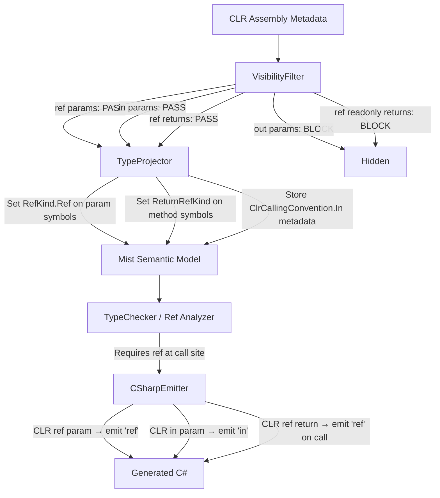

# Design Document: CLR Ref Interop

## Overview

This feature relaxes the Assembly Type Provider's `VisibilityFilter` to allow CLR methods with `ref` parameters and `ref` returns through to Mist, and updates the `TypeProjector` to project these modifiers into the Mist type system. Currently, the filter conservatively hides all methods with `ref` parameters or `ref` returns, even though Mist has full support for `ref` parameters, `ref` returns, and `ref` locals (as demonstrated in the `RefParameters` sample).

The changes are surgical:
1. **VisibilityFilter** — Remove the blanket exclusion of `ref` parameters and mutable `ref` returns. Keep `out` parameters and `ref readonly` returns filtered.
2. **TypeProjector** — Set `RefKind.Ref` on projected parameter symbols for CLR `ref` and `in` parameters, and set `ReturnRefKind = RefKind.Ref` on method symbols with mutable `ref` returns. Store a `ClrCallingConvention` flag on `in`-originated parameters so the emitter can emit `in` instead of `ref` at the C# call site.
3. **CSharpEmitter** — When emitting call-site arguments for backend-originated `ref` parameters that were originally CLR `in`, emit `in` instead of `ref`.

No grammar changes are needed — Mist already has `ref` syntax. No new diagnostics are introduced. The existing `ref` argument requirement at call sites applies naturally to projected CLR `ref` parameters.

## Architecture



The data flow is:
1. `VisibilityFilter.HasRefParameters` is modified to return `false` (no longer excludes `ref` params).
2. `VisibilityFilter.HasRefReturn` is modified to only exclude `ref readonly` returns (not mutable `ref` returns).
3. `TypeProjector.ProjectParametersWithResult` detects `IsByRef` parameters and sets `RefKind.Ref` + optional `ClrCallingConvention.In` metadata.
4. `TypeProjector.ProjectMethods` detects `ref` return types and sets `ReturnRefKind = RefKind.Ref` on the method symbol.
5. The existing type checker enforces `ref` at call sites (no changes needed).
6. `CSharpEmitter.EmitArgumentList` checks the `ClrCallingConvention` metadata to decide between emitting `ref` or `in`.

## Components and Interfaces

### VisibilityFilter Changes

**File:** `Source/Mist/Backends/CSharpTranspiler/VisibilityFilter.cs`

The `HasRefParameters` method currently returns `true` for any parameter where `IsByRef && !IsOut && !IsIn`. This will be changed to return `false` unconditionally (ref params are no longer excluded). The `in` parameter check (`IsIn`) already returns `false` (not excluded), so no change is needed there.

The `HasRefReturn` method currently returns `true` for any method with `ReturnType.IsByRef`. This will be changed to only return `true` when the return is `ref readonly` (detected via `System.Runtime.CompilerServices.IsReadOnlyAttribute` on the return parameter's custom attributes).

```csharp
// Before: excludes all ref params
private static bool HasRefParameters(MemberInfo member)
{
    foreach (var param in parameters)
    {
        if (param.ParameterType.IsByRef && !param.IsOut && !param.IsIn)
            return true;
    }
    return false;
}

// After: ref params are allowed through
private static bool HasRefParameters(MemberInfo member)
{
    // CLR ref parameters are now supported — only out params are excluded.
    return false;
}
```

```csharp
// Before: excludes all ref returns
private static bool HasRefReturn(MemberInfo member)
{
    return member switch
    {
        MethodInfo method => method.ReturnType.IsByRef,
        PropertyInfo property => property.GetGetMethod(...)?.ReturnType.IsByRef,
        _ => false,
    };
}

// After: only excludes ref readonly returns
private static bool HasRefReturn(MemberInfo member)
{
    return member switch
    {
        MethodInfo method => method.ReturnType.IsByRef && IsRefReadonlyReturn(method),
        PropertyInfo property => ...,
        _ => false,
    };
}

private static bool IsRefReadonlyReturn(MethodInfo method)
{
    // ref readonly returns carry IsReadOnlyAttribute on the return parameter
    return method.ReturnParameter
        .GetCustomAttributesData()
        .Any(a => a.AttributeType.FullName ==
            "System.Runtime.CompilerServices.IsReadOnlyAttribute");
}
```

### TypeProjector Changes

**File:** `Source/Mist/Backends/CSharpTranspiler/TypeProjector.cs`

The `ProjectParametersWithResult` method is updated to detect `IsByRef` parameters and:
1. Unwrap the by-ref type (get the element type) before projecting.
2. Set `RefKind.Ref` on the parameter symbol.
3. For `in` parameters (`IsIn == true`), store `ClrCallingConvention.In` metadata on the symbol.

The `ProjectMethods` method is updated to detect `ref` return types and:
1. Unwrap the by-ref return type before projecting.
2. Set `ReturnRefKind = RefKind.Ref` on the method symbol.

```csharp
// In ProjectParametersWithResult, for each parameter:
if (param.ParameterType.IsByRef && !param.IsOut)
{
    // Unwrap the by-ref wrapper to get the element type
    var elementType = param.ParameterType.GetElementType()!;
    scopeParamType = ProjectMemberType(elementType, stdlib);
    scopeParamSymbol.RefKind = RefKind.Ref;

    if (param.IsIn)
    {
        scopeParamSymbol.ClrCallingConvention = ClrCallingConvention.In;
    }
}
```

```csharp
// In ProjectMethods, after creating the method symbol:
if (method.ReturnType.IsByRef)
{
    // Unwrap the by-ref return type
    var elementType = method.ReturnType.GetElementType()!;
    returnType = ProjectMemberType(elementType, stdlib);
    methodSymbol.ReturnRefKind = RefKind.Ref;
}
```

### ClrCallingConvention Enum

**File:** `Source/Mist/Semantics/Model/ClrCallingConvention.cs` (new)

A simple enum to distinguish CLR `ref` from CLR `in` at the emitter level:

```csharp
namespace Mist.Semantics.Model;

/// <summary>
/// The original CLR calling convention for a parameter projected as Mist ref.
/// Used by the emitter to choose between emitting 'ref' or 'in' at the C# call site.
/// </summary>
public enum ClrCallingConvention
{
    /// <summary>Standard CLR ref parameter — emit 'ref' at call site.</summary>
    Ref,

    /// <summary>CLR in parameter — emit 'in' at call site.</summary>
    In,
}
```

### Symbol Model Extension

**File:** `Source/Mist/Semantics/Model/SymbolTable.cs`

Add a new property to `Symbol`:

```csharp
/// <summary>
/// The original CLR calling convention for this parameter, when it was projected
/// from a CLR assembly. Only meaningful for parameters with RefKind.Ref that
/// originated from the backend. Null for Mist-native parameters.
/// </summary>
public ClrCallingConvention? ClrCallingConvention { get; internal set; }
```

### CSharpEmitter Changes

**File:** `Source/Mist/Backends/CSharpTranspiler/CSharpEmitter.cs`

The `EmitArgumentList` method already handles `RefArgumentArgumentNode` by emitting `ref`. For CLR `in` parameters, the emitter needs to emit `in` instead. This requires resolving the target method's parameter symbols at the call site.

When emitting a `ref` argument for a call to a backend method, the emitter checks the corresponding parameter's `ClrCallingConvention`:
- If `ClrCallingConvention.In` → emit `in {expr}` instead of `ref {expr}`
- If `ClrCallingConvention.Ref` or `null` → emit `ref {expr}` (existing behavior)

This lookup happens in the existing ref-argument emission path where `argNodes[i] is RefArgumentArgumentNode`.

### ParameterSignature Integration

**File:** `Source/Mist/Semantics/Model/ParameterSignature.cs`

The `ExtractRefKinds` method already handles backend symbols via `Symbol.RefKind`. Since the TypeProjector now sets `RefKind.Ref` on projected CLR ref/in parameters, overload resolution and interface matching will correctly distinguish `ref` overloads from non-`ref` overloads without any changes to `ParameterSignature`.

## Data Models

### Modified: `Symbol` class

| Property | Type | Description |
|----------|------|-------------|
| `ClrCallingConvention` | `ClrCallingConvention?` | Original CLR calling convention for backend-projected ref parameters. `null` for Mist-native symbols. |

### New: `ClrCallingConvention` enum

| Value | Description |
|-------|-------------|
| `Ref` | Standard CLR `ref` — emitter produces `ref` at call site |
| `In` | CLR `in` — emitter produces `in` at call site |

### Existing (unchanged): `RefKind` enum

| Value | Description |
|-------|-------------|
| `None` | Standard pass-by-value |
| `Ref` | Mutable reference (used for both CLR `ref` and CLR `in` projected params) |
| `RefReadonly` | Readonly reference (Mist-native; on the experimental pipeline a CLR `ref readonly` result is one too, per requirements Requirement 6) |

### Projection Truth Table

| CLR Parameter Kind | Visible? | Mist RefKind | ClrCallingConvention | Emitted C# |
|-------------------|----------|--------------|---------------------|-------------|
| `ref T` | ✅ Yes | `Ref` | `Ref` | `ref arg` |
| `in T` | ✅ Yes | `Ref` | `In` | `in arg` |
| `out T` | ❌ No | — | — | — |
| Regular `T` | ✅ Yes | `None` | `null` | `arg` |

| CLR Return Kind | Visible? | Mist ReturnRefKind | Emitted C# |
|----------------|----------|-------------------|-------------|
| `ref T` (mutable) | ✅ Yes | `Ref` | `ref Method()` |
| `ref readonly T` | ✅ Yes on the experimental pipeline (classic hides it) | `RefReadonly` | `Method()` read as a value, or `ref readonly T r = ref Method()` |
| Regular `T` | ✅ Yes | `None` | `Method()` |

## Correctness Properties

*A property is a characteristic or behavior that should hold true across all valid executions of a system — essentially, a formal statement about what the system should do. Properties serve as the bridge between human-readable specifications and machine-verifiable correctness guarantees.*

### Property 1: Ref and in parameters pass through the visibility filter

*For any* CLR method or constructor whose parameters include `ref` parameters (`IsByRef && !IsOut && !IsIn`) or `in` parameters (`IsByRef && IsIn`), and no `out` parameters, `VisibilityFilter.IsMemberExcluded` SHALL return `false` (the method is visible).

**Validates: Requirements 1.1, 1.2, 3.1**

### Property 2: Out parameters remain filtered

*For any* CLR method or constructor that has at least one `out` parameter (`IsOut == true`), regardless of whether it also has `ref` or `in` parameters, `VisibilityFilter.IsMemberExcluded` SHALL return `true` (the method is hidden).

**Validates: Requirements 1.3, 6.1, 6.2**

### Property 3: Ref and in parameters projected as RefKind.Ref

*For any* CLR method parameter that is `ref` (`IsByRef && !IsOut && !IsIn`) or `in` (`IsByRef && IsIn`), the `TypeProjector` SHALL produce a parameter symbol with `RefKind == RefKind.Ref`, and the parameter's declared type SHALL be the element type (not the by-ref wrapper type).

**Validates: Requirements 2.1, 3.2**

### Property 4: Intrinsic type substitution through ref unwrapping

*For any* CLR `ref` or `in` parameter whose element type is a CLR intrinsic (e.g., `System.Int32`, `System.String`), the projected Mist parameter type SHALL be the corresponding Mist Standard Library type (e.g., `Standard.Int32`, `Standard.String`), not the raw CLR type name.

**Validates: Requirements 2.2, 3.3, 5.2**

### Property 5: Mutable ref returns pass through the visibility filter

*For any* CLR method or property with a mutable `ref` return type (`ReturnType.IsByRef == true` and NOT marked with `IsReadOnlyAttribute`), `VisibilityFilter.IsMemberExcluded` SHALL return `false` (the member is visible).

**Validates: Requirements 4.1, 4.2**

### Property 6: Ref readonly returns remain filtered

*For any* CLR method or property with a `ref readonly` return type (`ReturnType.IsByRef == true` and marked with `IsReadOnlyAttribute`), `VisibilityFilter.IsMemberExcluded` SHALL return `true` (the member is hidden).

**Validates: Requirements 4.3, 6.3**

### Property 7: Ref returns projected as ReturnRefKind.Ref

*For any* CLR method with a mutable `ref` return type, the `TypeProjector` SHALL produce a method symbol with `ReturnRefKind == RefKind.Ref`, and the method's declared return type SHALL be the element type (not the by-ref wrapper type).

**Validates: Requirements 5.1**


## Error Handling

### No New Diagnostics

This feature does not introduce new error conditions. The existing ref parameter diagnostics already cover all error cases:

| Diagnostic | Condition | Behavior |
|-----------|-----------|----------|
| `MIST_REF_0001 (historical)` | Missing `ref` keyword at call site | Already emitted by TypeChecker when a `RefKind.Ref` parameter is called without `ref` |
| `MIST_REF_0005 (historical)` | Assignment through `ref readonly` local | Already handled — not applicable here since CLR `ref readonly` returns are filtered |
| `MIST_REF_0006 (historical)` | Ref return lifetime violation | Already handled for Mist-native ref returns; applies identically to projected CLR ref returns |

### Graceful Degradation

- If `MetadataLoadContext` cannot load `IsReadOnlyAttribute` metadata (e.g., older framework assemblies), the `IsRefReadonlyReturn` check defaults to `false` (treats the return as mutable `ref`), which is the safe/permissive direction — the method becomes visible rather than hidden.
- If a CLR method has a `ref` parameter whose element type cannot be projected (e.g., references an excluded type), the existing `ReferencesExcludedType` check in `VisibilityFilter` will still exclude the entire method. No change to this behavior.

### Backward Compatibility

- Methods previously hidden by the `ref` parameter filter will now become visible. This is intentional and desired, but could theoretically cause new name resolution ambiguities if a Mist-declared method has the same name as a newly-visible CLR method. The existing overload resolution logic handles this correctly via `ParameterSignature.AreEqualWithRefKind`.
- The `in` parameter behavior changes: previously, `in` parameters were treated as pass-by-value (the method was visible but the parameter had no `ref` annotation). Now, `in` parameters are projected as `ref` parameters, requiring `ref` at the call site. This is a **breaking change** for any Mist code that currently calls CLR methods with `in` parameters without `ref`. However, since the existing book documentation states "`in` parameters are treated as regular pass-by-value parameters," this change needs to be clearly communicated.

## Testing Strategy

### Property-Based Tests (FsCheck)

Property-based tests verify the correctness properties using generated CLR method metadata. The test fixture assembly provides real CLR types with known parameter/return configurations.

**Library:** FsCheck (already used in the project)
**Minimum iterations:** 100 per property

Each property test will:
1. Use the test fixture assembly's types as input (real CLR metadata, not mocked).
2. Instantiate `VisibilityFilter` and/or `TypeProjector` with the standard configuration.
3. Assert the property holds for all fixture methods matching the test criteria.

**Tag format:** `Feature: clr-ref-interop, Property {N}: {property text}`

| Property | Test Class | What It Generates |
|----------|-----------|-------------------|
| 1 (ref/in pass through) | `ClrRefVisibilityPropertyTests` | Random selections from fixture methods with ref/in params |
| 2 (out filtered) | `ClrRefVisibilityPropertyTests` | Random selections from fixture methods with out params |
| 3 (RefKind.Ref projection) | `ClrRefProjectionPropertyTests` | Random selections from fixture methods with ref/in params |
| 4 (intrinsic substitution) | `ClrRefProjectionPropertyTests` | Fixture methods with intrinsic-typed ref/in params |
| 5 (mutable ref returns pass) | `ClrRefVisibilityPropertyTests` | Fixture methods with mutable ref returns |
| 6 (ref readonly returns filtered) | `ClrRefVisibilityPropertyTests` | Fixture methods with ref readonly returns |
| 7 (ReturnRefKind.Ref projection) | `ClrRefProjectionPropertyTests` | Fixture methods with mutable ref returns |

### Unit Tests (Example-Based)

Example-based tests cover specific integration scenarios and edge cases:

| Test | What It Verifies |
|------|-----------------|
| `RefParamMethod_IsNotExcluded` | Specific known method (e.g., `Interlocked.Exchange`) is visible |
| `OutParamMethod_IsExcluded` | Specific known method (e.g., `Dictionary.TryGetValue`) remains hidden |
| `InParamProjectedAsRef` | A fixture `in` param has `RefKind.Ref` and `ClrCallingConvention.In` |
| `RefReturnMethod_IsNotExcluded` | A fixture mutable ref return method is visible |
| `RefReadonlyReturn_IsExcluded` | A fixture ref readonly return method is hidden |
| `MixedRefAndOut_IsExcluded` | A fixture method with both ref and out params is hidden |
| `EmitterEmitsInForClrInParam` | Emitted C# uses `in` keyword for CLR `in` parameters |
| `EmitterEmitsRefForClrRefParam` | Emitted C# uses `ref` keyword for CLR `ref` parameters |

### Integration Tests (End-to-End)

The sample application (`samples/ClrRefInterop/Program.mist`) serves as the primary integration test:
- Compiles successfully with the Mist compiler
- Produces the expected labeled output when run
- Exercises all supported CLR ref interop patterns

### Test Process Spawning

The property-based tests operate entirely in-process using `VisibilityFilter` and `TypeProjector` directly — no process spawning required. The integration test (sample compilation and execution) spawns at most 1 process (to run the compiled output). This complies with the test process spawning policy.
