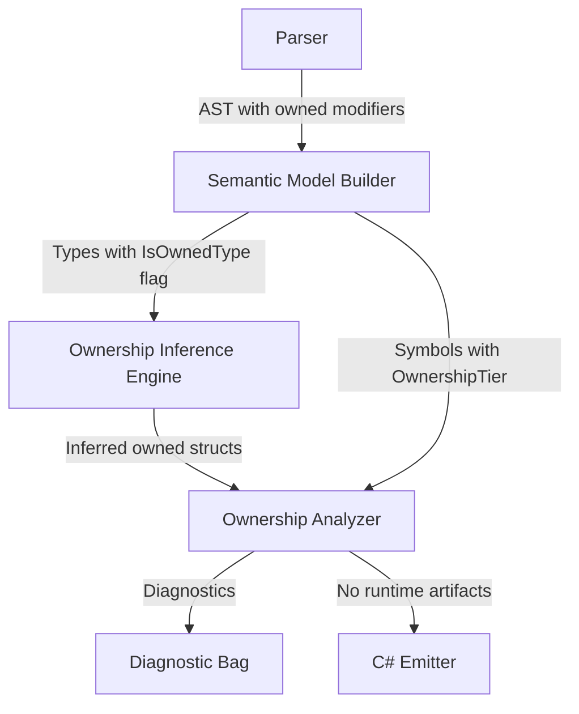
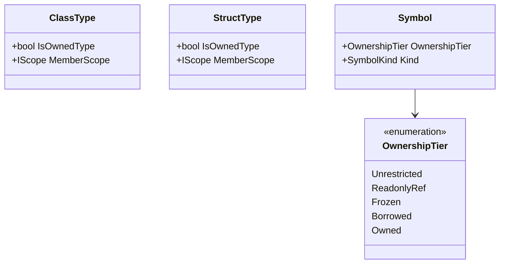
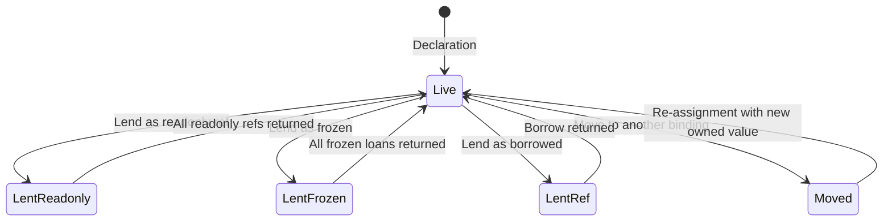

# Design Document: Deep Ownership Types

## Overview

This design implements deep ownership guarantees for the Mist programming language by redesigning the `owned` keyword to express two orthogonal concepts:

1. **Owned Type** — A type-level guarantee (`owned class Foo`) that the type's entire object graph is self-contained. Enforced by requiring all reference-type fields to themselves be owned types, recursively bootstrapped from primitives declared as `owned` in the standard library.

2. **Owned Binding** — An instance-level guarantee (`owned var x = new Foo()`) that the variable is the unique owner of the value and its entire graph. Move semantics transfer ownership; the source becomes dead after a move.

The key semantic shift: `owned` on a type no longer means "instances MUST be held as owned." It now means "instances CAN be safely owned because the type guarantees graph self-containment." Instances of owned types may be held in unrestricted bindings (no ownership tracking) or owned bindings (full deep ownership).

This is a compile-time-only system. All ownership annotations are erased during C# emission — zero runtime cost.

### Design Rationale

The separation into Owned Type vs. Owned Binding enables a future dependent type system where `owned` bindings can be moved into dependent type arguments, proving unique ownership at the point of transfer. The type-level guarantee ensures that owning the root implies owning the entire graph (no shared references within), which is the precondition for safe dependent type construction.

## Architecture

The implementation spans four compiler phases, each with a well-defined responsibility:



**Phase 1 — Parsing**: The parser already recognizes `owned` as a modifier on type declarations and as an ownership specifier on variable declarations. No grammar changes are needed.

**Phase 2 — Semantic Model Building**: The `SemanticModelBuilder` sets `IsOwnedType` on `ClassType`/`StructType` when the `owned` modifier is present. It sets `OwnershipTier.Owned` on symbols with the `owned` specifier. This phase already exists.

**Phase 3 — Ownership Inference** (new): A new `OwnershipInferenceEngine` runs after the semantic model is built but before the ownership analyzer. It infers `IsOwnedType = true` for structs whose fields are all owned types.

**Phase 4 — Ownership Analysis** (modified): The existing `OwnershipAnalyzer` is updated to implement the new semantic rules: the truth table enforcement, unrestricted binding restrictions, owned field modifier rules, and the semantic shift (removing the requirement that owned type instances must be in owned bindings).

## Components and Interfaces

### 1. OwnershipInferenceEngine (New)

A static analysis pass that infers `IsOwnedType` for structs. Modeled after `ReadonlyInferenceEngine`.

```csharp
namespace Mist.Semantics;

/// <summary>
/// Infers IsOwnedType for struct declarations that satisfy the owned-type
/// field restriction without an explicit 'owned' modifier.
/// Runs after the semantic model is built and before the OwnershipAnalyzer.
/// </summary>
public static class OwnershipInferenceEngine
{
    /// <summary>
    /// Runs ownership inference on all struct types in the model.
    /// Sets IsOwnedType = true on structs where all fields are owned types.
    /// Handles cycles by using a three-state visited set (Unknown, InProgress, Resolved).
    /// </summary>
    public static void RunInference(ISemanticModel model);
}
```

**Key design decisions:**
- Only structs are eligible for inference (Requirement 3.5). Classes require explicit annotation.
- Generic structs with type-parameter fields are NOT inferred at the declaration site (Requirement 3.7). Per-instantiation checking is deferred to a future phase.
- Zero-field structs are inferred as owned (vacuously true).
- Cycle detection uses a three-state enum: `Unknown → InProgress → Resolved`. If a struct is encountered while `InProgress`, it is not inferred as owned (conservative).

### 2. OwnershipAnalyzer (Modified)

The existing `OwnershipAnalyzer` is updated with the following changes:

**Removed behavior:**
- `ValidateOwnedTypeUsages` (Pass 2) — The check that owned type instances must be held as `owned` is removed. This implements the semantic shift (Requirement 8).

**New/modified passes:**

| Pass | Responsibility | Requirements |
|------|---------------|--------------|
| Pass 1 | Owned type field restriction (existing, unchanged) | 1.3–1.8 |
| Pass 2 | ~~Owned type usage validation~~ → **Removed** | 8.1–8.4 |
| Pass 2b (new) | Owned binding type validation | 4.3–4.6 |
| Pass 2c (new) | Owned field modifier validation | 10.1–10.7 |
| Pass 3 | Signature matching (existing, unchanged) | — |
| Pass 4 | Flow-sensitive analysis (extended) | 5, 6, 7, 11, 12 |

**Pass 2b — Owned Binding Type Validation:**
- Verifies that `owned` bindings hold values of owned types (Requirement 4.4).
- Verifies that the initializer yields unique ownership: `new`, owned-returning function, or move from another owned binding (Requirement 4.5–4.6).

**Pass 2c — Owned Field Modifier Validation:**
- Verifies that fields marked `owned` have an owned type (Requirement 10.2).
- Enforces assignment restrictions on owned fields (Requirement 10.3).
- Enforces access restrictions based on the containing instance's binding kind (Requirement 10.4–10.6).

**Pass 4 — Flow-Sensitive Analysis (Extended):**
- Implements the full truth table (Requirement 11) for state transitions.
- Adds `LentReadonly` state handling (currently the analyzer only tracks `LentFrozen` and `LentRef`).
- Enforces unrestricted binding restrictions: no `borrowed`/`frozen` into fields, only `readonly ref` to top-level fields (Requirement 7).
- Tracks whether a binding is owned vs. unrestricted to apply different access rules.

### 3. MethodFlowState (Modified)

Extended to track binding kind (owned vs. unrestricted) alongside variable state:

```csharp
/// <summary>
/// Tracks whether a variable is an owned binding or unrestricted binding.
/// Used to determine which access rules apply.
/// </summary>
public enum BindingKind
{
    /// <summary>Variable declared with 'owned' specifier.</summary>
    Owned,
    
    /// <summary>Variable without ownership annotation.</summary>
    Unrestricted,
}
```

The `MethodFlowState.VariableStates` dictionary continues to track `VariableOwnershipState` for owned bindings. A new `BindingKinds` dictionary maps each tracked variable to its `BindingKind`.

### 4. VariableOwnershipState (Unchanged)

The existing enum already defines all five states needed by the truth table:
- `Live`, `Moved`, `LentRef`, `LentFrozen`, `LentReadonly`

No changes needed.

### 5. OwnershipTier (Unchanged)

The existing enum already defines all tiers:
- `Unrestricted`, `ReadonlyRef`, `Frozen`, `Borrowed`, `Owned`

No changes needed.

### 6. C# Emitter (Minimal Changes)

The emitter already erases ownership annotations. The only change is ensuring that the removal of the "owned type requires owned binding" check doesn't break any emitter assumptions. Since the emitter never inspected `IsOwnedType` for emission decisions, no changes are needed.

### 7. TextMate Grammar (Unchanged)

The existing grammar already recognizes `owned` as `storage.modifier.mist` before `class`/`struct` and before variable types. Requirement 15 is already satisfied by the current grammar.

## Data Models

### Type-Level Ownership



`IsOwnedType` is set by:
1. The `SemanticModelBuilder` when the `owned` modifier is present on the declaration.
2. The `OwnershipInferenceEngine` for structs that satisfy the field restriction.

### Flow-Sensitive State Model



### Truth Table Enforcement Model

The truth table is encoded as a static lookup:

```csharp
private static readonly Dictionary<(VariableOwnershipState, AccessKind), bool> TruthTable = new()
{
    // Live: all permitted
    { (Live, Read), true }, { (Live, Write), true }, { (Live, LiveView), true },
    { (Live, Freeze), true }, { (Live, Borrow), true }, { (Live, Move), true },
    
    // LentReadonly: read, write, live view, freeze permitted
    { (LentReadonly, Read), true }, { (LentReadonly, Write), true },
    { (LentReadonly, LiveView), true }, { (LentReadonly, Freeze), true },
    { (LentReadonly, Borrow), false }, { (LentReadonly, Move), false },
    
    // LentFrozen: read, live view, freeze permitted
    { (LentFrozen, Read), true }, { (LentFrozen, Write), false },
    { (LentFrozen, LiveView), true }, { (LentFrozen, Freeze), true },
    { (LentFrozen, Borrow), false }, { (LentFrozen, Move), false },
    
    // LentRef: nothing permitted
    { (LentRef, Read), false }, { (LentRef, Write), false },
    { (LentRef, LiveView), false }, { (LentRef, Freeze), false },
    { (LentRef, Borrow), false }, { (LentRef, Move), false },
    
    // Moved: nothing permitted
    { (Moved, Read), false }, { (Moved, Write), false },
    { (Moved, LiveView), false }, { (Moved, Freeze), false },
    { (Moved, Borrow), false }, { (Moved, Move), false },
};
```

### AccessKind Enum (New)

```csharp
/// <summary>
/// Classifies the kind of access being attempted on an owned variable.
/// Used to look up permissions in the truth table.
/// </summary>
public enum AccessKind
{
    Read,
    Write,
    LiveView,   // Lending as readonly ref
    Freeze,     // Lending as frozen
    Borrow,     // Lending as borrowed
    Move,       // Moving to another binding
}
```

## Correctness Properties

*A property is a characteristic or behavior that should hold true across all valid executions of a system — essentially, a formal statement about what the system should do. Properties serve as the bridge between human-readable specifications and machine-verifiable correctness guarantees.*

### Property 1: Owned Type Field Restriction — Valid Fields Accepted

*For any* owned type declaration (class or struct) where every reference-type field is either declared with the `owned` specifier or has a type that is itself an owned type, the type checker SHALL accept the declaration without reporting `MIST_OWN_FIELD_NOT_OWNED (historical)`.

**Validates: Requirements 1.3, 1.5, 1.6, 2.4, 9.1**

### Property 2: Owned Type Field Restriction — Invalid Fields Rejected

*For any* owned type declaration that contains at least one reference-type field whose type is not an owned type AND the field does not have the `owned` specifier, the type checker SHALL report exactly one `MIST_OWN_FIELD_NOT_OWNED (historical)` error per violating field.

**Validates: Requirements 1.4, 13.1, 13.6**

### Property 3: Ownership Inference for Structs

*For any* struct declaration without an explicit `owned` modifier, the struct SHALL be inferred as an owned type if and only if all of its fields have types that are owned types (explicitly declared or inferred). Structs with zero fields are vacuously owned. Classes are never inferred.

**Validates: Requirements 3.1, 3.2, 3.3, 3.5, 3.6**

### Property 4: Semantic Shift — Owned Types Usable in Any Binding Context

*For any* owned type, instances SHALL be permitted in both owned bindings (`owned var x = new T()`) and unrestricted bindings (`var x = new T()`) without the type checker reporting an error. Passing an owned type instance to an unrestricted parameter SHALL also be permitted.

**Validates: Requirements 8.1, 8.2, 8.3, 8.4, 9.2, 9.3**

### Property 5: Owned Binding Requires Owned Type and Unique Initializer

*For any* variable declared with the `owned` specifier, the type checker SHALL accept the declaration if and only if (a) the variable's type is an owned type AND (b) the initializer yields unique ownership (constructor call, move from another owned binding, or call to an owned-returning function). If either condition is violated, the type checker SHALL report an error.

**Validates: Requirements 4.3, 4.4, 4.5, 4.6**

### Property 6: Move Semantics — Source Becomes Dead

*For any* owned binding that is moved (assigned to another owned binding, assigned to an unrestricted binding, or passed to an `owned` parameter), the source binding SHALL transition to the Moved state, and any subsequent read, write, lend, or move of the source SHALL produce a use-after-move error.

**Validates: Requirements 5.1, 5.2, 5.3, 5.4, 12.4**

### Property 7: Control Flow Move Tracking

*For any* owned binding that is moved in one branch of a conditional but not the other, the binding SHALL be treated as Moved at the join point. *For any* owned binding moved inside a loop body without re-assignment in the same iteration, the type checker SHALL report an error.

**Validates: Requirements 5.5, 5.6**

### Property 8: Truth Table Enforcement

*For any* owned variable in any of the five states (Live, LentReadonly, LentFrozen, LentRef, Moved) and any of the six access kinds (Read, Write, LiveView, Freeze, Borrow, Move), the type checker SHALL permit the action if and only if the truth table entry for that (state, action) pair is ✅. Specifically:
- Live: all six actions permitted
- LentReadonly: Read, Write, LiveView, Freeze permitted; Borrow, Move rejected
- LentFrozen: Read, LiveView, Freeze permitted; Write, Borrow, Move rejected
- LentRef: all six actions rejected
- Moved: all six actions rejected

**Validates: Requirements 11.1, 11.2, 11.3, 11.4, 11.5, 12.1, 12.2, 12.3, 12.7, 12.8**

### Property 9: Unrestricted Binding Restrictions

*For any* unrestricted binding holding an owned type instance, the type checker SHALL reject taking a `borrowed` or `frozen` reference to any field in the object graph, SHALL permit taking a `readonly ref` to direct (top-level) fields only, and SHALL reject passing the binding to a `borrowed` or `frozen` parameter.

**Validates: Requirements 7.2, 7.3, 7.4, 12.5, 12.6**

### Property 10: Owned Field Modifier Rules

*For any* field declared with the `owned` modifier: (a) the field's type must be an owned type, (b) assignment to the field requires a source from an owned binding, (c) `readonly ref` access is always permitted, (d) `borrowed`/`frozen` access is permitted only when the containing instance is in an owned binding, and (e) `borrowed`/`frozen` access is rejected when the containing instance is in an unrestricted binding.

**Validates: Requirements 10.2, 10.3, 10.4, 10.5, 10.6**

### Property 11: C# Emission Erasure

*For any* valid Mist program containing owned type declarations and/or owned bindings, the emitted C# code SHALL NOT contain the string `owned` as a keyword, SHALL NOT contain runtime ownership tracking code (reference counting, state fields, runtime assertions), and SHALL emit all declarations as standard C# class/struct/variable declarations.

**Validates: Requirements 14.1, 14.2, 14.3, 14.4, 14.5**

### Property 12: Round-Trip Parsing

*For any* valid owned type declaration (`owned class Foo { ... }`, `owned struct Bar { ... }`) or owned binding declaration (`owned var x = ...`, `owned Foo x = ...`), parsing the source, pretty-printing the AST, then parsing the pretty-printed output SHALL produce an equivalent syntax tree with no parse errors.

**Validates: Requirements 17.1, 17.2, 17.3**

## Error Handling

### Diagnostic Messages

All ownership diagnostics use existing diagnostic IDs from `OwnershipAnalyzer`. New diagnostics follow the same pattern:

| Diagnostic ID | Condition | Message Template |
|---|---|---|
| `MIST_OWN_FIELD_NOT_OWNED (historical)` | Non-owned ref-type field in owned type | "Reference-type field '{field}' in owned type '{type}' must be declared as 'owned' or be of an owned type" |
| `MIST_OWN_TYPE_REQUIRES_OWNED (historical)` | **Repurposed**: Owned binding with non-owned type | "Variable '{name}' declared as 'owned' requires a type declared with the 'owned' modifier, but '{type}' is not an owned type" |
| `MIST_OWN_USE_AFTER_MOVE (historical)` | Access after move | "Cannot access '{name}' — it was moved at {location}" |
| `MIST_OWN_MUTATION_BLOCKED (historical)` | Write while LentFrozen | "Cannot mutate '{name}' while a frozen ref is outstanding" |
| `MIST_OWN_EXCLUSIVE_VIOLATION (historical)` | Access while LentRef, or second borrow | "Cannot access '{name}' while a borrowed ref is outstanding" |
| `MIST_OWN_INCOMPATIBLE_LEND (historical)` | Unrestricted binding lent as borrowed/frozen | "Cannot lend unrestricted binding '{name}' as '{tier}' — only owned bindings can guarantee exclusive access" |
| `MIST_OWN_NOT_STORABLE (historical)` | Ref-tier assigned to field | "Cannot assign '{tier}' variable to field — ref-tier references are non-storable" |
| `MIST_OWN_LOOP_MOVE (historical)` | Move in loop without re-assignment | "Variable '{name}' is moved inside a loop without re-assignment" |
| `MIST_OWN_CONDITIONAL_MOVE (historical)` | Move in one branch, access after join | "Variable '{name}' may have been moved in a preceding branch" |

### Error Recovery Strategy

- When an owned type has invalid fields, the type is still registered in the semantic model (with `IsOwnedType = true`) so downstream analysis can proceed without cascading errors.
- When an owned binding has an invalid type, the binding is still tracked in flow state to avoid false-positive use-after-move errors on subsequent code.
- When inference encounters a cycle (struct A has field of struct B, struct B has field of struct A), both structs are conservatively marked as NOT owned.

## Testing Strategy

### Property-Based Tests (FsCheck)

The feature is well-suited for property-based testing because:
- The type checker operates on structured input (ASTs) with clear input/output behavior
- Universal properties hold across a wide range of type/binding configurations
- The input space is large (combinations of types, fields, bindings, states, actions)

**Library**: FsCheck (already used in the project for other property tests)

**Configuration**: Minimum 100 iterations per property test.

**Process spawning**: Following the test-process-spawning policy, property tests that require compilation will use the batched approach — generate all scenarios, build a single program, compile once via in-process `CompilerDriver`, and compare results line-by-line.

**Tag format**: Each test is tagged with a comment referencing the design property:
```csharp
// Feature: deep-ownership-types, Property 8: Truth table enforcement
```

### Property Test Implementation Strategy

| Property | Test Approach |
|----------|--------------|
| 1 (Valid fields) | Generate random owned type declarations with valid field configs, compile in-process, verify zero MIST_OWN_FIELD_NOT_OWNED (historical) diagnostics |
| 2 (Invalid fields) | Generate random owned types with at least one invalid field, compile in-process, verify MIST_OWN_FIELD_NOT_OWNED (historical) is reported |
| 3 (Inference) | Generate random structs with various field configs, compile in-process, check IsOwnedType matches expectation |
| 4 (Semantic shift) | Generate owned types in both binding contexts, compile in-process, verify no errors |
| 5 (Owned binding validation) | Generate owned bindings with valid/invalid types and initializers, verify correct accept/reject |
| 6 (Move semantics) | Generate move sequences followed by access, verify use-after-move errors |
| 7 (Control flow) | Generate conditional/loop move patterns, verify correct error reporting |
| 8 (Truth table) | Generate (state, action) pairs, construct programs that put a variable in each state and attempt each action, verify correct accept/reject |
| 9 (Unrestricted restrictions) | Generate unrestricted bindings with various borrow attempts, verify correct accept/reject |
| 10 (Owned field) | Generate owned field scenarios with various access patterns, verify correct accept/reject |
| 11 (Emission erasure) | Generate programs with owned annotations, compile to C#, verify absence of "owned" in output |
| 12 (Round-trip) | Generate random owned declarations, parse-print-parse, compare ASTs |

### Unit Tests (Example-Based)

Unit tests cover:
- Specific diagnostic message content (Requirements 13.1–13.6)
- Edge cases: zero-field structs, generic structs with type parameters, owned on interface/trait
- Integration: stdlib primitives are owned, sample app compiles and runs
- TextMate grammar patterns match expected scopes

### Integration Tests

- The `samples/DeepOwnershipTypes/Program.mist` sample serves as the primary integration test
- Compile and run the sample, verify labeled output matches expected patterns
- Verify the sample is included in `AllFeatures` orchestrator

