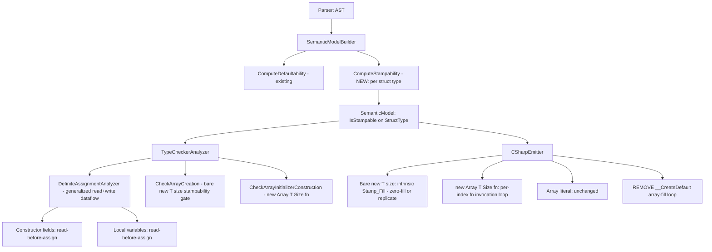

# Design Document

## Overview

This feature closes three soundness holes where Mist code can observe a value that was never explicitly assigned — currently masked by the CLR's zero-fill of all memory. It does so by:

1. Extending the existing constructor-field dataflow into a **unified read-before-assignment analysis** for constructor fields, generalized to also handle local variables.
2. Adding a **stampability classification** to the semantic model for struct types.
3. Restricting the bare `new T[size]` array form to stampable element types (compiler intrinsic, no constructor call), and introducing an **index→value initializer constructor** `new Array<T, Size>(fn)` for all other element types — while preserving array literals (`[a, b, c]`) as an always-sound path.
4. Removing the interim `__CreateDefault()` array-fill loop.
5. Migrating affected samples and the `Array` bootstrap definition.

The design reuses the existing `TypeCheckerAnalyzer` dataflow infrastructure (which already does forward, branch-intersecting assignment tracking for constructor fields) and the existing defaultability machinery in `SemanticModelBuilder` (which already walks field types and handles cycles via topological ordering), generalizing both rather than introducing parallel systems.

The classification architecture below records the original delivery. For the isolated v2 compiler, receiver-based inference, declaration guarantees, generic proof, and termination rules are superseded by [the stampability design](../stampability/design.md). A flag on a generic definition cannot describe both `Box<int>` and `Box<string>`.

## Architecture



### Component Responsibilities

| Component | Responsibility |
|---|---|
| `SemanticModelBuilder.ComputeStampability` (new) | Classify each `StructType` as stampable/not, mirroring `ComputeDefaultability`'s topological walk and cycle handling. |
| `StructType.IsStampable` (new property) | Cache the classification result on the type. |
| `DefiniteAssignmentAnalyzer` (generalized) | Forward dataflow that tracks the assigned-set and flags reads of not-yet-assigned fields/locals. Replaces the assignment-only `ComputeDefinitelyAssigned`. |
| `TypeCheckerAnalyzer.CheckArrayCreation` (new/extended) | Gate bare `new T[size]` on `T` stampable; emit `MIST_ARRAY_REQUIRES_INITIALIZER (historical)` otherwise. |
| `TypeCheckerAnalyzer` initializer-construction check (new) | Validate `new Array<T, Size>(fn)` — `fn` is index→value, result assignable to `T`. |
| `CSharpEmitter` array emission (modified) | Emit intrinsic stamp-fill for bare form; per-index `fn` loop for initializer form; remove `__CreateDefault` fill loop. |
| `Array.mist` bootstrap (modified) | Add explicit `(fn)` constructor; this suppresses the inferred parameterless `new()`. |

## Components and Interfaces

### 1. Stampability Classification (`SemanticModelBuilder`)

Add a `bool IsStampable` (default `false`, set during model construction) to `StructType`. Classes are never stampable, so no property is needed on `ClassType` (treated as `false` by the classifier).

A new pass `ComputeStampability`, invoked alongside `ComputeDefaultability` and after field types are resolved, computes the classification:

```
ComputeStampability(symbolTable, diagnostics):
    for each StructType st in topological order of struct-field dependencies:
        st.IsStampable = IsStructStampable(st, visited: {})

IsStructStampable(st, visited):
    if st in visited: return false        // cycle → conservative false (Req 3.5)
    visited += st
    for each field f in st.MemberScope (instance fields only):
        switch f.DeclaredType:
            primitive (int, bool, char, float, ...) → ok, continue
            StructType inner →
                if not IsStructStampable(inner, visited): return false
            TypeParameterType → require stampable proof or substituted actual type
            DependentTypeParameterType → return false
            ClassType / InterfaceType / TraitType / UnionType / ArrayType / others → return false  // Req 3.2, 3.3
    return true
```

Notes:
- **Cycle handling (Req 3.5):** the `visited` set prevents infinite recursion. A struct in a cycle resolves to `false` for the back-edge; the requirement's "unless every type in the cycle is otherwise stampable" is satisfied because a struct cannot transitively contain itself by value in .NET (the CLR forbids a struct having a field of its own type), so a true value-cycle is already illegal — the conservative `false` is unreachable in practice but kept as a safety net.
- This reuses the same primitive-detection helper that `IsIntrinsicallyDefaultable` uses.
- Result is cached on `StructType.IsStampable` for O(1) lookup by the Type Checker and Emitter.

### 2. Unified Definite-Assignment Dataflow (`TypeCheckerAnalyzer`)

The existing `ComputeDefinitelyAssigned` / `AnalyzeBlockForAssignments` family tracks *assignments only* and is used for the end-of-constructor check. We generalize it into a forward dataflow that also detects **reads** of not-yet-assigned locations, for both constructor fields and locals.

#### Dataflow state

```
sealed class AssignmentState
{
    HashSet<string> AssignedFields;   // this.field names definitely assigned so far
    HashSet<ISymbol> AssignedLocals;  // local symbols definitely assigned so far
    bool Terminated;                  // path has hit return/throw/break (unreachable downstream)
}
```

The analysis walks statements in order, threading a mutable `AssignmentState`. On branches (`if`/`else`), it clones the state per branch, analyzes each, then **intersects** the assigned sets at the merge (a location is assigned after the merge only if assigned on every non-terminated branch). Loops (`while`/`for`/`foreach`) analyze the body with a copy but do **not** propagate body-only assignments outward (the body may not execute), matching the existing conservative treatment — and reads inside the body are checked against the pre-loop state plus anything assigned earlier in the body (Req 2.5).

#### Read detection

Every expression is visited for **reads**. A read of:
- `this.field` (member access on `this`) where `field ∉ AssignedFields` and `field` is not in the initially-assigned set (initializer or synthetic default) → `MIST_FIELD_READ_BEFORE_ASSIGNMENT (historical)` (Req 1.1, 1.4).
- a local identifier where `localSymbol ∉ AssignedLocals` and the local had no initializer → `MIST_LOCAL_READ_BEFORE_ASSIGNMENT (historical)` (Req 2.1, 2.3).

Assignment targets are *writes*, not reads: the left-hand `this.field` / local of a simple assignment is recorded into the assigned set and not flagged. **Compound assignments** (`x += 1`) read-then-write: the read is checked first (Req 2.6), then the target is recorded.

**`this`-escape (Req 1.8):** when `this` appears as a call argument, a return value, or a method-call receiver while any non-defaultable field is unassigned, treat it as a read of all currently-unassigned non-defaultable fields and flag each.

#### Initial state

- **Fields:** seeded with fields that have explicit initializers (Req 1.2) and defaultable fields with no initializer (synthetic default injection, Req 1.3) — reusing the exact `initiallyAssigned` computation already in `CheckDefiniteAssignment`.
- **Locals:** a local with an initializer is added to `AssignedLocals` at its declaration (Req 2.2); a local without an initializer is not.

#### Integration

- The generalized dataflow runs once per constructor body (covering both field reads and locals declared in the constructor) and once per non-constructor method/function body (covering locals only).
- The existing end-of-constructor `MIST_FIELD_NOT_DEFINITELY_ASSIGNED (historical)` check (Req 1.7) is preserved: the final intersected `AssignedFields` set feeds it exactly as today.

#### Array-construction sites are fully-assigned producers

`new T[size]` (stampable), `new Array<T,Size>(fn)`, and `[a, b, c]` all produce a fully-initialized value; the local they initialize is `Assigned` immediately (Req 5.4, 5.9). No element-level tracking is required because the construction forms are total by construction.

### 3. Array Construction Type-Checking (`TypeCheckerAnalyzer`)

#### Bare `new T[size]`

Located at the existing array-creation check (`ArrayCreationExpressionPrimaryNode`). New gate:

```
on ArrayCreationExpression(elementType T, size):
    if T is StructType st and st.IsStampable: accept (stamp path)
    else if T is primitive: accept (stamp path)
    else: emit MIST_ARRAY_REQUIRES_INITIALIZER(T, reason)
```

Reason text distinguishes (Req 7.3): reference type vs. struct-with-non-stampable-field. The check reuses `StructType.IsStampable`.

#### Initializer construction `new Array<T, Size>(fn)`

This is an object-creation of the bootstrap `Array<TValue, Length>` type with a single argument. The Type Checker validates:
- exactly one argument, a function value (lambda or function reference),
- the function takes one integer-index parameter (Req 5.5),
- the function's return type is assignable to `T` (Req 5.2, 5.5).

Any `T` is accepted (Req 5.2). On signature mismatch, emit a diagnostic (Req 5.5).

#### Array literals

Unchanged — already accepted for any element type by the `array-literals` feature; this feature adds no restriction (Req 5.8). The emitter path is untouched.

### 4. C# Emission (`CSharpEmitter`)

#### Bare `new T[size]` → intrinsic Stamp_Fill

```
emit new T[size]:
    if T's stamp value == zero-fill (all stampables whose default is zero):
        emit `new T[size]`            // CLR zero-fills; no loop (Req 4.1a, 4.3)
    else:
        emit `new T[size]` then a replication of the non-zero stamp value into each slot (Req 4.1b)
```

In Mist v1, a stampable struct's `default` is always the zero value (no `default {}` block can set non-zero on a stampable struct without it ceasing to be the "all-zero" case; if such a struct has a non-zero `default {}`, the replicate path applies). The common case emits bare `new T[size]` with no loop. **The `__CreateDefault()` array-fill loop is deleted** (Req 4.4) — its code in the typed and inferred variable-declaration emission paths (added in commit `30a85aa`) is removed.

#### `new Array<T, Size>(fn)` → per-index loop

```
emit `new Array<T,Size>(fn)`:
    var __arr = new T[Size];
    for (int __i = 0; __i < Size; __i++) __arr[__i] = fn(__i);
    // __arr is the expression value
```

Emitted as an expression-positioned construction (lifted to a local in the surrounding statement, consistent with how other complex constructions are emitted). `fn(__i)` invokes the user lambda — the per-element cost is the user's, not a hidden `__CreateDefault`.

#### Array literal

Unchanged.

### 5. `Array` Bootstrap Definition (`Source/Standard/Bootstrap/Array.mist`)

Add an explicit constructor taking the index→value function. Declaring it suppresses the inferred `new()` (Req 6.4, 8.3a). The constructor is `intrinsic` — its body is supplied by the emitter's per-index loop (the bootstrap declares the shape; the emitter lowers `new Array<T,Size>(fn)`):

```mist
intrinsic public class Array<TValue, Length:ZeroOrPositiveInt> : IEnumerable<TValue>
{
    // ... existing members ...

    // Index→value initializer constructor. Suppresses the inferred new().
    intrinsic public Array(Func<int, TValue> initializer);
}
```

The `where TValue : default` constraint is **removed** because initializer construction accepts any `TValue` (Req 5.2). The bare `new T[size]` stampability gate (Type Checker) now enforces the stampable restriction for the bare path instead of a type-level `: default` constraint.

> DESIGN NOTE — `Func<int, TValue>` parameter type: the constructor parameter is the index→value function. The exact spelling of the function type in the bootstrap (`Func<int, TValue>` vs. a Mist lambda type) is confirmed during implementation against how Mist currently spells function-typed parameters; the semantic requirement is "one int-index parameter, returns TValue."

### 6. Diagnostic IDs

| ID | Severity | Stage | Trigger |
|---|---|---|---|
| `MIST_FIELD_READ_BEFORE_ASSIGNMENT (historical)` | Error | Analysis | Read of a constructor field before definite assignment (Req 1) |
| `MIST_LOCAL_READ_BEFORE_ASSIGNMENT (historical)` | Error | Analysis | Read of a local before definite assignment (Req 2) |
| `MIST_ARRAY_REQUIRES_INITIALIZER (historical)` | Error | Analysis | Bare `new T[size]` with non-stampable `T` (Req 4.2, 4.5) |

The existing `MIST_FIELD_NOT_DEFINITELY_ASSIGNED (historical)` is retained unchanged (Req 1.7).

## Data Models

### `StructType.IsStampable`
```csharp
public bool IsStampable { get; internal set; } = false;
```
Set by `ComputeStampability`. Queried by the Type Checker (array-creation gate) and the Emitter (stamp vs. replicate).

### `AssignmentState` (analysis-internal)
```csharp
sealed class AssignmentState
{
    public HashSet<string> AssignedFields { get; }
    public HashSet<ISymbol> AssignedLocals { get; }
    public bool Terminated { get; set; }
    public AssignmentState Clone();
    public void IntersectWith(AssignmentState other);  // branch merge
}
```

## Error Handling

- **Read-before-assignment** emits an error located at the offending read expression (Req 7.1, 7.2) and continues analysis (does not abort), so multiple independent violations are reported in one pass.
- **Non-stampable bare array** emits an error located at the array-creation expression with a reason and a fix suggestion (Req 7.3).
- **Cycle in stampability** is handled by the `visited` set; no diagnostic is emitted (the value-cycle is already illegal elsewhere).
- All messages are phrased in Mist terms, never C#/CLR terms (Req 7.4).

## Correctness Properties

These are the formal, executable correctness properties the implementation must uphold. They drive the property-based test suite.

### Property 1: Field read-before-assignment soundness

For any constructor body, the analyzer emits `MIST_FIELD_READ_BEFORE_ASSIGNMENT (historical)` for a non-defaultable field read if and only if there exists a control-flow path reaching that read on which the field has not been assigned (and is not pre-assigned via initializer or synthetic default).

**Validates: Requirements 1.1, 1.2, 1.3, 1.4, 1.5, 1.6, 1.8**

### Property 2: Local read-before-assignment soundness

For any method/constructor body, the analyzer emits `MIST_LOCAL_READ_BEFORE_ASSIGNMENT (historical)` for a local read if and only if there exists a control-flow path reaching that read on which the local has not been assigned (and had no initializer).

**Validates: Requirements 2.1, 2.2, 2.3, 2.4, 2.5, 2.6**

### Property 3: Stampability classification correctness

A struct receiver is stampable when its substituted instance storage, including inherited fields and automatic-property or explicit `field` accessor backing storage, is recursively stampable under the existing category gates. An unresolved stored type parameter needs `stampable` proof. Reference-bearing storage never qualifies. The modifier validates this property at declaration; it does not override it. See [stampability](../stampability/requirements.md).

**Validates: Requirements 3.1, 3.2, 3.3, 3.4, 3.5**

### Property 4: Bare-array stampability gate

`new T[size]` type-checks successfully if and only if `T` is a primitive or a stampable struct; for every other `T` it emits exactly one `MIST_ARRAY_REQUIRES_INITIALIZER (historical)`.

**Validates: Requirements 4.1, 4.2, 4.5, 4.6**

### Property 5: Initializer construction totality

For any element type `T` and size `N`, `new Array<T, N>(fn)` produces an array `a` such that `a[i] == fn(i)` for all `i ∈ [0, N)`, with no slot observable as null or unassigned.

**Validates: Requirements 5.1, 5.2, 5.3, 5.4, 6.1, 6.2**

### Property 6: No hidden default-fill

No array-creation path emits a call to `__CreateDefault()` per element; the bare stampable path emits no per-element loop, and the initializer path invokes only the user-supplied `fn`.

**Validates: Requirements 4.3, 4.4, 6.3**

> PROCESS-SPAWNING NOTE: The properties that must *run* compiled output (the runtime-behavior aspects of bare-array and initializer construction) use the batched/in-process pattern (single compile, single run, N output lines) per the test-process-spawning steering rule. The pure analyzer/classification properties run fully in-process via the shared `CompilerDriver` and spawn no external process. No per-iteration `dotnet` spawning is introduced.

## Testing Strategy

### Property-Based Tests

The six Correctness Properties above are each realized as a property-based test. Generators produce randomized constructors/methods (for Properties 1, 2), randomized struct field-type compositions (for Property 3), randomized element types (for Property 4), and randomized `(T, N, fn)` triples (for Property 5).

### Unit Tests

- Field: assigned-on-all-branches (no diagnostic), assigned-on-one-branch (diagnostic), read-after-assign (no diagnostic), `this`-escape before full assignment (diagnostic), initializer/synthetic-default pre-assignment (no diagnostic), end-of-constructor not-assigned still fires.
- Local: declared-with-initializer (no diagnostic), read-before-assign (diagnostic), conditional-merge assigned (no diagnostic), loop-body read (diagnostic), compound-assignment-before-assign (diagnostic).
- Stampability: primitive struct (stampable), nested stampable struct, struct-with-class-field (not), closed generic with substituted primitive storage (stampable), open generic with stampable proof (stampable), unresolved type-parameter storage without proof (not), struct-with-string-field (not, string is reference).
- Array: bare stampable (compiles), bare reference (`MIST_ARRAY_REQUIRES_INITIALIZER (historical)`), bare non-stampable struct (error), `new Array<Class,N>(fn)` (compiles), array literal of reference types (compiles).
- Emitter: bare stampable emits no fill loop; `new Array<T,N>(fn)` emits per-index `fn` loop; verify `__CreateDefault` is not emitted in any array path.

### Migration Verification

- Each stampable sample in Req 8.11 still compiles unchanged.
- Each migrated reference-type sample (Req 8.6–8.10) compiles and produces equivalent output.
- `samples/AllFeatures` compiles and runs with zero diagnostics of any severity (Req 8.4).
- The `DefiniteAssignment` sample's proof code compiles and produces the exact expected output (Req 9).

## Implementation Notes / Sequencing

1. Stampability classification is a prerequisite for the array-creation gate and emitter, so it lands first.
2. The definite-assignment dataflow generalization is independent of the array work and can proceed in parallel.
3. Removing the `__CreateDefault` array-fill loop must land together with the stampable-gate + initializer-constructor so no window exists where reference-type arrays are unsound *and* uncompilable.
4. Migration of samples and the `Array` bootstrap lands after the compiler changes so the migrated forms are accepted.
