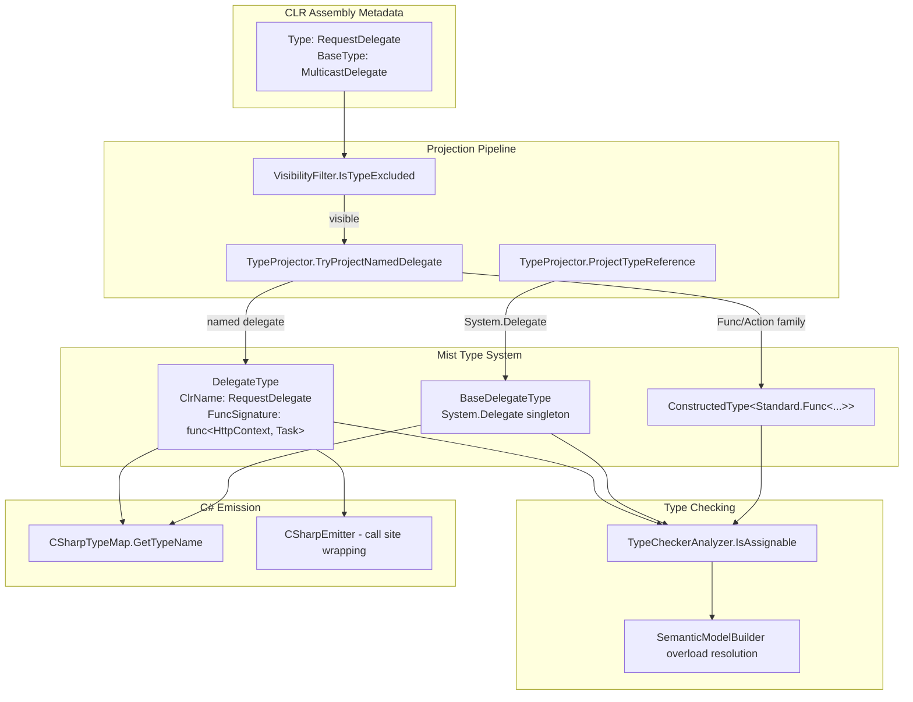

# Design Document: Delegate-Func Conversion

## Overview

This feature introduces a `DelegateType` into the Mist type system that preserves the CLR identity of named delegates (e.g., `RequestDelegate`, `Predicate<T>`, `Comparison<T>`) through projection, type checking, and C# emission. Today, `TypeProjector.TryProjectNamedDelegate` collapses every named delegate to its structural `Standard.Func<...>` equivalent, erasing the delegate's nominal identity. The emitter then produces `System.Func<...>` or `System.Action<...>` — never the original delegate type name — which causes compilation failures when the downstream C# compiler expects the specific named delegate.

The design adds:

1. **A new `DelegateType` class** implementing `IType` that wraps both the CLR delegate identity (fully qualified name, namespace, generic parameters) and the equivalent `func<...>` signature.
2. **A `BaseDelegateType` singleton** representing `System.Delegate` as the root of the delegate hierarchy.
3. **Modified projection** in `TypeProjector.TryProjectNamedDelegate` to produce `DelegateType` instead of bare `ConstructedType(Standard.Func<...>)`.
4. **Assignability rules** in `TypeCheckerAnalyzer.IsAssignable` for func↔delegate conversion and the `System.Delegate` top type.
5. **Overload resolution** preference rules in `SemanticModelBuilder` for delegate-typed parameters.
6. **Emission changes** in `CSharpTypeMap` and `CSharpEmitter` to produce the correct CLR delegate name and `new DelegateName(lambda)` wrapping.

No new Mist source-language syntax is introduced. The feature is purely a semantic model and emission pipeline change.

## Architecture



### Data Flow

1. **Assembly loading**: `AssemblyTypeProvider` reads CLR types from referenced assemblies.
2. **Visibility filtering**: `VisibilityFilter.IsTypeExcluded` allows named delegates through (they are public classes). `VisibilityFilter.IsMemberExcluded` hides overloads whose delegate parameter's `Invoke` signature references excluded types.
3. **Type projection**: `TypeProjector.ProjectTypeReference` dispatches to `TryProjectNamedDelegate`, which now returns a `DelegateType` instead of a bare `ConstructedType`.
4. **Type checking**: `TypeCheckerAnalyzer.IsAssignable` recognizes `DelegateType` and applies the func↔delegate conversion rules and the `BaseDelegateType` top-delegate rule.
5. **Overload resolution**: `SemanticModelBuilder` applies preference rules when multiple overloads accept delegate-typed or func-typed parameters.
6. **Emission**: `CSharpTypeMap.GetTypeName` emits the fully qualified CLR delegate name. `CSharpEmitter` wraps lambdas/func values in `new DelegateName(...)` at call sites where conversion is needed.

## Components and Interfaces

### 1. `DelegateType` (new class)

**Location**: `Source/Mist/Semantics/Model/Types/DelegateType.cs`

```csharp
public sealed class DelegateType : IType
{
    public string DisplayName { get; }
    public TypeKind Kind => TypeKind.Class;

    /// <summary>
    /// The fully qualified CLR type name (e.g., "System.Predicate", "Microsoft.AspNetCore.Http.RequestDelegate").
    /// Used by the emitter to produce the correct C# type name.
    /// </summary>
    public string ClrFullName { get; }

    /// <summary>
    /// The CLR namespace (e.g., "System", "Microsoft.AspNetCore.Http").
    /// </summary>
    public string ClrNamespace { get; }

    /// <summary>
    /// The simple CLR type name without namespace or generic arity suffix
    /// (e.g., "Predicate", "RequestDelegate").
    /// </summary>
    public string ClrSimpleName { get; }

    /// <summary>
    /// The equivalent func<...> type as a ConstructedType wrapping Standard.Func.
    /// The semantic model uses this for structural signature comparison.
    /// </summary>
    public ConstructedType FuncSignature { get; }

    /// <summary>
    /// Generic type parameters for open generic delegates (e.g., Predicate<T> has one TypeParameterType).
    /// Empty for non-generic delegates (e.g., RequestDelegate).
    /// </summary>
    public IReadOnlyList<IType> TypeParameters { get; }

    /// <summary>
    /// Concrete type arguments when this is a constructed generic delegate (e.g., Predicate<int>).
    /// Empty for non-generic delegates and open generic definitions.
    /// </summary>
    public IReadOnlyList<IType> TypeArguments { get; }

    /// <summary>
    /// The member scope containing members inherited from System.Delegate
    /// (GetType(), DynamicInvoke(), Method, Target, etc.).
    /// </summary>
    public IScope MemberScope { get; }
}
```

**Key design decisions**:
- `DelegateType` is a standalone `IType` implementation rather than a subclass of `ClassType`. This keeps the type system dispatch clean — pattern matching on `DelegateType` is unambiguous and doesn't interfere with existing `ClassType` branches.
- The `FuncSignature` property exposes the structural equivalence for comparison, enabling signature-compatible checks without modifying the existing `ConstructedType` comparison logic.
- `TypeKind.Class` is reused since delegates are reference types in CLR. No new `TypeKind` variant is needed.

### 2. `BaseDelegateType` (new class)

**Location**: `Source/Mist/Semantics/Model/Types/BaseDelegateType.cs`

```csharp
public sealed class BaseDelegateType : IType
{
    public static readonly BaseDelegateType Instance = new();

    public string DisplayName => "Delegate";
    public TypeKind Kind => TypeKind.Class;

    /// <summary>
    /// The member scope containing System.Delegate's own members
    /// (GetType(), DynamicInvoke(object?[]), Method, Target).
    /// </summary>
    public IScope MemberScope { get; internal set; }

    private BaseDelegateType() { }
}
```

**Key design decisions**:
- Singleton pattern matches `UnknownType.Instance` precedent.
- `System.MulticastDelegate` is NOT modeled as a separate type — it is an implementation detail. The hierarchy is flattened to `DelegateType → BaseDelegateType`.

### 3. `TypeProjector` Changes

**Location**: `Source/Mist/Backends/CSharpTranspiler/TypeProjector.cs`

**Modified method**: `TryProjectNamedDelegate`

Current behavior: Returns `ConstructedType(Standard.Func<...>)` — the delegate identity is lost.

New behavior: Returns a `DelegateType` carrying both the CLR identity and the `func<...>` signature.

```csharp
private bool TryProjectNamedDelegate(
    Type clrType,
    IStdlibTypeProvider stdlib,
    out IType delegateType)
{
    delegateType = null!;

    // All delegates inherit from System.MulticastDelegate.
    if (clrType.BaseType?.FullName != "System.MulticastDelegate")
        return false;

    var invokeMethod = clrType.GetMethod("Invoke");
    if (invokeMethod is null)
        return false;

    // Build the equivalent func<...> signature (same logic as today)
    var funcSignature = BuildFuncSignatureFromInvoke(invokeMethod, stdlib);
    if (funcSignature is null)
        return false;

    // Build the DelegateType preserving CLR identity
    delegateType = new DelegateType(
        clrFullName: clrType.FullName ?? clrType.Name,
        clrNamespace: clrType.Namespace ?? "",
        clrSimpleName: StripGenericAritySuffix(clrType.Name),
        funcSignature: funcSignature,
        typeParameters: ProjectTypeParameters(clrType, stdlib),
        typeArguments: ProjectTypeArguments(clrType, stdlib),
        memberScope: ProjectDelegateMembers(clrType, stdlib));

    return true;
}
```

**New dispatch in `ProjectTypeReference`**:

```csharp
// Project System.Delegate / System.MulticastDelegate as BaseDelegateType
if (clrType.FullName == "System.Delegate" || clrType.FullName == "System.MulticastDelegate")
{
    return BaseDelegateType.Instance;
}
```

This is placed before the existing `TryProjectStandardFuncDelegate` call.

**Generic delegate construction**: When a constructed generic like `Predicate<int>` is encountered, the projector produces a `DelegateType` with concrete `TypeArguments` and a correspondingly constructed `FuncSignature`.

### 4. `VisibilityFilter` Changes

**Location**: `Source/Mist/Backends/CSharpTranspiler/VisibilityFilter.cs`

**New logic**: A dedicated delegate visibility check for `IsMemberExcluded` when applied to methods whose parameters reference delegate types:

```csharp
// When checking if a method overload should be hidden, if a parameter's type is a
// named delegate whose Invoke signature references an excluded type (pointer, ref struct),
// hide that overload — consistent with existing per-overload filtering.
// System.Delegate and System.MulticastDelegate are never excluded as types.
```

No change to `IsTypeExcluded` — named delegates are already not excluded (they are public classes). The new check is in `IsTypeExcludedInSignature` to handle delegates whose `Invoke` uses excluded parameter types like pointers or `ref readonly` returns.

### 5. `TypeCheckerAnalyzer.IsAssignable` Changes

**Location**: `Source/Mist/Analysis/Builtin/TypeCheckerAnalyzer.cs`

New assignability rules added as a block before the existing identity check:

```csharp
// ── delegate-func-conversion: DelegateType assignability ──
//
// func<...> → DelegateType: accepted if signature-compatible
// DelegateType → func<...>: accepted if signature-compatible
// DelegateType → BaseDelegateType: always accepted
// func<...> → BaseDelegateType: always accepted
// DelegateType(A) → DelegateType(B) where A ≠ B: REJECTED (nominal distinctness)
// BaseDelegateType → DelegateType: REJECTED (cannot narrow)
// BaseDelegateType → func<...>: REJECTED (cannot narrow)

if (target is DelegateType targetDelegate)
{
    if (source is DelegateType sourceDelegate)
    {
        // Same delegate type → accept
        if (sourceDelegate.ClrFullName == targetDelegate.ClrFullName
            && TypeArgumentsMatch(sourceDelegate, targetDelegate))
            return true;
        // Different named delegates → reject (nominal distinctness, Req 6.1)
        return false;
    }
    // func<...> → DelegateType: check signature compatibility
    if (IsFuncType(source))
        return IsSignatureCompatible(source, targetDelegate.FuncSignature);
    return false;
}

if (source is DelegateType sourceDelegate2)
{
    if (target is BaseDelegateType)
        return true;  // Any delegate → System.Delegate
    // DelegateType → func<...>: check signature compatibility
    if (IsFuncType(target))
        return IsSignatureCompatible(sourceDelegate2.FuncSignature, target);
    return false;
}

if (target is BaseDelegateType)
{
    // func<...> → System.Delegate: always accepted
    if (IsFuncType(source))
        return true;
    // DelegateType → System.Delegate handled above
    return false;
}

if (source is BaseDelegateType)
{
    // System.Delegate cannot be narrowed to anything
    return false;
}
```

**Signature compatibility helper**:

```csharp
private static bool IsSignatureCompatible(IType sourceFunc, IType targetFunc)
{
    // Both must be ConstructedType wrapping Standard.Func with the same arity
    if (sourceFunc is not ConstructedType sourceCt || targetFunc is not ConstructedType targetCt)
        return false;
    if (sourceCt.TypeArguments.Count != targetCt.TypeArguments.Count)
        return false;
    // Check pairwise type argument assignability
    for (var i = 0; i < sourceCt.TypeArguments.Count; i++)
    {
        if (!IsAssignable(sourceCt.TypeArguments[i], targetCt.TypeArguments[i]))
            return false;
    }
    return true;
}
```

### 6. Overload Resolution Changes

**Location**: `Source/Mist/Semantics/Model/SemanticModelBuilder.cs`

When multiple overloads accept the same argument, preference is applied:

1. **Delegate_Type-typed argument → prefer matching Delegate_Type overload** (exact nominal match).
2. **`func<...>` argument → prefer `func<...>` overload** over Delegate_Type overload (structural match preferred).
3. **Lambda argument → prefer Delegate_Type overload** over `func<...>` overload (target-type inference favors the more specific nominal type).
4. **Delegate_Type overload vs BaseDelegateType overload → prefer Delegate_Type** (more specific).
5. **Ambiguity across multiple Delegate_Types → error diagnostic**.

These rules are implemented as an additional preference tiebreaker in the existing overload scoring logic.

### 7. `CSharpTypeMap.GetTypeName` Changes

**Location**: `Source/Mist/Backends/CSharpTranspiler/CSharpTypeMap.cs`

New pattern-match arms added before the `ClassType` fallback:

```csharp
// DelegateType → emit the fully qualified CLR delegate name
DelegateType dt when dt.TypeArguments.Count > 0
    => $"{dt.ClrNamespace}.{dt.ClrSimpleName}<{string.Join(", ", dt.TypeArguments.Select(t => GetTypeName(t, isValueContext)))}>",
DelegateType dt
    => $"{dt.ClrNamespace}.{dt.ClrSimpleName}",

// BaseDelegateType → System.Delegate
BaseDelegateType => "System.Delegate",
```

### 8. `CSharpEmitter` Call-Site Wrapping

**Location**: `Source/Mist/Backends/CSharpTranspiler/CSharpEmitter.cs`

When emitting an argument at a call site where the parameter type is a `DelegateType` and the argument is a lambda, func value, or method group:

```csharp
// Emit: new RequestDelegate(ctx => ...)
// Instead of just: ctx => ...
var wrappedArg = $"new {CSharpTypeMap.GetTypeName(parameterDelegateType)}({emittedArgument})";
```

When the target is `BaseDelegateType`, emit the lambda as-is (C# 11+ handles the conversion implicitly).

When a `DelegateType` value is passed where `func<...>` is expected, emit as-is (C# handles delegate-to-compatible-delegate implicitly).

### 9. Invocation of Delegate-Typed Values

The emitter already emits `variable(args)` for invocations. The type checker needs to recognize that a `DelegateType`-typed value is invocable:

- When a `DelegateType` is the receiver of an invocation suffix, the type checker validates arguments against `DelegateType.FuncSignature`'s parameter types and produces the return type.
- `BaseDelegateType` is NOT invocable — attempting to invoke produces an error diagnostic suggesting a cast.

## Data Models

### DelegateType State

| Field | Type | Description |
|-------|------|-------------|
| `ClrFullName` | `string` | Fully qualified CLR name (e.g., `"System.Predicate"`) |
| `ClrNamespace` | `string` | CLR namespace |
| `ClrSimpleName` | `string` | Simple name without arity suffix |
| `FuncSignature` | `ConstructedType` | Equivalent `Standard.Func<...>` for structural comparison |
| `TypeParameters` | `IReadOnlyList<IType>` | Open generic parameters (for definitions) |
| `TypeArguments` | `IReadOnlyList<IType>` | Concrete type arguments (for constructed instances) |
| `MemberScope` | `IScope` | Members from System.Delegate (DynamicInvoke, Method, Target, etc.) |

### Assignability Matrix

| Source | Target | Result | Emission |
|--------|--------|--------|----------|
| `func<A, B>` | `DelegateType(func<A, B>)` | ✓ (signature-compatible) | `new DelegateName(value)` |
| Lambda `(A) => B` | `DelegateType(func<A, B>)` | ✓ (signature-compatible) | `new DelegateName(lambda)` |
| Method group | `DelegateType(func<A, B>)` | ✓ (signature-compatible) | `new DelegateName(methodGroup)` |
| `DelegateType(func<A, B>)` | `func<A, B>` | ✓ (signature-compatible) | as-is |
| `DelegateType(X)` | `DelegateType(Y)` where X≠Y | ✗ (nominal mismatch) | error |
| `func<...>` | `BaseDelegateType` | ✓ | as-is (C# 11+) |
| `DelegateType` | `BaseDelegateType` | ✓ | as-is |
| `BaseDelegateType` | `DelegateType` | ✗ (cannot narrow) | error |
| `BaseDelegateType` | `func<...>` | ✗ (cannot narrow) | error |

### Diagnostic IDs

| ID | Severity | Condition |
|----|----------|-----------|
| `MIST_TC_XXXX (historical)` | Error | Signature mismatch: func/lambda is not signature-compatible with target DelegateType |
| `MIST_TC_XXXY (historical)` | Error | Nominal mismatch: cannot convert between two distinct named delegates |
| `MIST_TC_XXXZ (historical)` | Error | Cannot narrow System.Delegate to a specific delegate or func type |
| `MIST_TC_XXXW (historical)` | Error | System.Delegate is not directly invocable |
| `MIST_TC_XXXV (historical)` | Error | Ambiguous overload: lambda matches multiple Delegate_Type parameters |

## Correctness Properties

*A property is a characteristic or behavior that should hold true across all valid executions of a system — essentially, a formal statement about what the system should do. Properties serve as the bridge between human-readable specifications and machine-verifiable correctness guarantees.*

### Property 1: Projection preserves delegate identity

*For any* CLR type whose base type is `System.MulticastDelegate` and whose fully qualified name is not in the `System.Func` or `System.Action` family, projecting it through `TypeProjector` SHALL produce a `DelegateType` whose `ClrFullName` equals the original CLR type's `FullName`, whose `ClrNamespace` equals the original namespace, whose `TypeArguments` correspond to the CLR type's generic arguments (if any), and whose `FuncSignature` is a valid `ConstructedType` wrapping `Standard.Func` with arity equal to the delegate's `Invoke` method parameter count plus one.

**Validates: Requirements 1.1, 1.3, 1.5, 1.6**

### Property 2: Type map emits correct CLR delegate name

*For any* `DelegateType` with a non-empty `ClrNamespace` and `ClrSimpleName`, calling `CSharpTypeMap.GetTypeName` SHALL produce a string that starts with `ClrNamespace`, contains `ClrSimpleName`, and — when `TypeArguments` is non-empty — includes the C# names of all type arguments in angle brackets. The result SHALL never contain `System.Func` or `System.Action`.

**Validates: Requirements 1.8, 4.1, 4.2, 4.6**

### Property 3: func-to-delegate assignability iff signature-compatible

*For any* `DelegateType` D with equivalent `func<A1, ..., AN, R>` signature and any `ConstructedType` F wrapping `Standard.Func<B1, ..., BN, S>`, `IsAssignable(F, D)` SHALL return `true` if and only if N equals the parameter count AND each `Bi` is assignable to `Ai` AND `S` is assignable to `R`.

**Validates: Requirements 2.1, 2.2, 2.3, 2.4, 2.5, 6.2**

### Property 4: delegate-to-func assignability

*For any* `DelegateType` D, `IsAssignable(D, D.FuncSignature)` SHALL return `true`. That is, a named delegate value is always assignable to a variable of its equivalent `func<...>` type.

**Validates: Requirements 1.4, 6.3, 8.4**

### Property 5: Any delegate or func assignable to BaseDelegateType

*For any* `DelegateType` D, `IsAssignable(D, BaseDelegateType.Instance)` SHALL return `true`. *For any* `ConstructedType` F wrapping `Standard.Func<...>`, `IsAssignable(F, BaseDelegateType.Instance)` SHALL return `true`.

**Validates: Requirements 3.2, 3.3, 6.4, 6.5**

### Property 6: BaseDelegateType cannot narrow and is not invocable

*For any* `DelegateType` D and any `ConstructedType` F wrapping `Standard.Func<...>`, `IsAssignable(BaseDelegateType.Instance, D)` SHALL return `false` AND `IsAssignable(BaseDelegateType.Instance, F)` SHALL return `false`. Additionally, *for any* argument list, attempting to type-check an invocation on a `BaseDelegateType`-typed value SHALL produce an error diagnostic.

**Validates: Requirements 3.6, 3.7, 6.7**

### Property 7: Distinct named delegates are nominally non-convertible

*For any* two `DelegateType` instances D1 and D2 where `D1.ClrFullName ≠ D2.ClrFullName`, `IsAssignable(D1, D2)` SHALL return `false` even when `D1.FuncSignature` and `D2.FuncSignature` are structurally identical.

**Validates: Requirements 6.1, 6.6**

### Property 8: Emitter wraps func-to-delegate conversion

*For any* `DelegateType` D and any expression E whose type is a signature-compatible `func<...>` or lambda, the emitted C# at a call site passing E to a D-typed parameter SHALL contain the substring `new {GetTypeName(D)}({emitted E})`.

**Validates: Requirements 4.3, 4.7**

### Property 9: Visibility filter — public delegates visible, excluded-signature delegates hidden

*For any* public CLR delegate type whose `Invoke` method does NOT reference pointer types, ref structs, or `ref readonly` returns, `VisibilityFilter.IsTypeExcluded` SHALL return `false`. Conversely, *for any* delegate whose `Invoke` references a pointer type or has a `ref readonly` return, the delegate SHALL be hidden.

**Validates: Requirements 5.1, 5.2**

### Property 10: Overload resolution prefers more specific delegate type

*For any* overload set containing (a) an overload accepting `DelegateType` D and (b) an overload accepting `BaseDelegateType`, when the argument is a lambda or `func<...>` that is signature-compatible with D, the resolution SHALL select overload (a). *For any* overload set containing an overload accepting `DelegateType` D and an overload accepting the equivalent `func<...>`, when the argument is a lambda, the resolution SHALL prefer the `DelegateType` overload.

**Validates: Requirements 7.1, 7.2, 7.4**

### Property 11: Delegate invocation type-checks against FuncSignature

*For any* `DelegateType` D with `FuncSignature = func<P1, ..., PN, R>`, invoking a value of type D with arguments `(a1, ..., aN)` SHALL type-check successfully if each `ai` is assignable to `Pi`, and the result type SHALL be `R`. Invoking with wrong argument count or incompatible argument types SHALL produce an error diagnostic.

**Validates: Requirements 8.1, 8.3**


## Error Handling

### Type Checking Errors

| Condition | Diagnostic | Message Template |
|-----------|-----------|-----------------|
| func/lambda signature incompatible with target DelegateType | `MIST_TC_0090 (historical)` | `Cannot convert '{sourceSignature}' to delegate type '{delegateName}': {mismatchReason}` |
| Assignment between two distinct named delegates | `MIST_TC_0091 (historical)` | `Cannot convert delegate '{sourceName}' to '{targetName}': named delegates are nominally distinct even when their signatures match` |
| Narrowing from System.Delegate to specific type | `MIST_TC_0092 (historical)` | `Cannot implicitly convert 'System.Delegate' to '{targetTypeName}': use a cast to a specific delegate or func type` |
| Invocation on System.Delegate | `MIST_TC_0093 (historical)` | `Cannot invoke a value of type 'System.Delegate' directly: cast to a specific delegate type or func<...> first` |
| Ambiguous overload resolution with multiple delegate types | `MIST_TC_0094 (historical)` | `Ambiguous call: argument is compatible with both '{delegateName1}' and '{delegateName2}'` |
| Method group has zero matching overloads for delegate target | `MIST_TC_0095 (historical)` | `No overload of '{methodName}' matches delegate type '{delegateName}'` |
| Method group has multiple matching overloads for delegate target | `MIST_TC_0096 (historical)` | `Multiple overloads of '{methodName}' match delegate type '{delegateName}'` |
| Wrong argument count on delegate invocation | existing `MIST_TC_0007 (historical)` | Reuse existing argument count mismatch diagnostic |
| Incompatible argument type on delegate invocation | existing `MIST_TC_0008 (historical)` | Reuse existing type mismatch diagnostic |

### Projection Errors (graceful degradation)

- If a delegate's `Invoke` method cannot be reflected (should not happen for valid assemblies), fall through to the existing `ProjectSimpleTypeReference` path — the delegate is projected as a plain `ClassType`. The user sees the delegate as a regular class rather than a callable type. This is a defensive fallback, not expected in practice.
- If the `Standard.Func` family is not yet loaded (stdlib fallback provider before Pass 1), `TryProjectNamedDelegate` returns `false` and the type is re-resolved after `UpdateStdlibProvider` — same behavior as today.

### Runtime Errors

No new runtime errors are introduced. All validation is at compile time. The generated C# is valid and the downstream C# compiler provides an additional safety net.

## Testing Strategy

### Property-Based Tests (FsCheck)

Each property from the Correctness Properties section is implemented as a property-based test using FsCheck. The test project is `Test/Mist.Tests`.

**Configuration**:
- Minimum 100 iterations per property test
- Each test references its design property via tag comment
- Tag format: `Feature: delegate-func-conversion, Property {N}: {title}`

**Generator design**:
- `DelegateTypeGenerator`: Produces random `DelegateType` instances with varying CLR names (1-3 namespace segments), varying simple names, and varying `FuncSignature` arities (0-5 parameters, void and non-void return types).
- `FuncTypeGenerator`: Produces random `ConstructedType` instances wrapping `Standard.Func` with varying arity to test assignability.
- `SignatureCompatiblePairGenerator`: Produces (DelegateType, ConstructedType) pairs that are guaranteed signature-compatible.
- `SignatureIncompatiblePairGenerator`: Produces pairs that differ in parameter count or types.

**Test structure** (batched, per Test Process Spawning Policy):
- Properties 1-11 test the in-process semantic model (TypeProjector, IsAssignable, CSharpTypeMap) without spawning external processes.
- The integration test (sample compilation) spawns `dotnet` exactly once per test run (compile + run the sample).

### Unit Tests (example-based)

| Test | What it verifies |
|------|-----------------|
| `ProjectSystemFuncNotWrapped` | System.Func<int, string> projects to ConstructedType, not DelegateType |
| `ProjectSystemActionNotWrapped` | System.Action, System.Action<int> project to ConstructedType |
| `ProjectSystemDelegateSingleton` | System.Delegate and System.MulticastDelegate project to BaseDelegateType.Instance |
| `TargetTypeInferenceLambda` | Lambda `x => x > 0` targeting Predicate<int> infers x:int |
| `MethodGroupAmbiguityError` | Method group with 2 compatible overloads produces error diagnostic |
| `BaseDelegateMemberAccess` | .GetType(), .Method, .Target resolve on BaseDelegateType-typed value |
| `EmitLambdaToBaseDelegateNoWrap` | Lambda→System.Delegate emits lambda as-is (C# 11+ conversion) |
| `EmitDelegateToFuncNoWrap` | DelegateType→func assignment emits value as-is |
| `VisibilityFilterSystemDelegateNotHidden` | System.Delegate is never excluded |
| `VisibilityFilterPointerDelegateHidden` | Delegate with pointer param in Invoke is hidden |

### Integration Test

A single integration test compiles and runs `samples/DelegateFuncConversion/Program.mist`:
- Resolves `Microsoft.AspNetCore.App` framework reference
- Compiles in-process using `CompilerDriver`
- Spawns `dotnet` once to run the compiled DLL
- Asserts exit code 0
- Asserts stdout matches expected output byte-for-byte
- Configures UTF-8 stdout/stderr encoding per Test UTF-8 Encoding Policy

This test spawns `dotnet` **1 time** per test run (batched: all proof code patterns execute in a single process).
