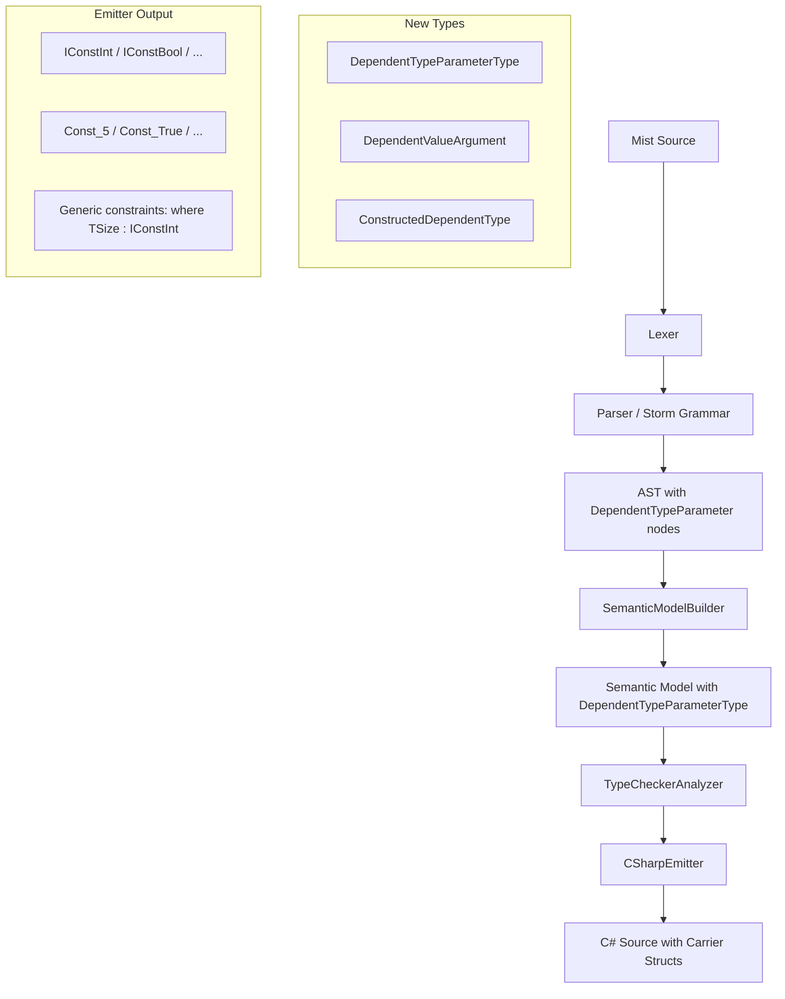

# Design Document: Dependent Type Parameters

## Overview

This design adds dependent type parameters to the Mist programming language. A dependent type parameter allows a generic type parameter position to accept a compile-time constant value instead of a type, making that value part of the type identity (e.g., `FixedBuffer<5>` is distinct from `FixedBuffer<6>`).

The implementation spans the full compiler pipeline:
1. **Grammar** — Extend `TypeParameter` and `TypeArgumentList` rules in Storm format
2. **AST** — New node variants for dependent parameters and value arguments
3. **Lexer** — No changes (existing tokens suffice)
4. **Parser** — Storm-generated from grammar changes
5. **Pretty-Printer** — Emit `Name:Type` for dependent parameters, literal values for arguments
6. **Semantic Model** — New `DependentTypeParameterType`, registration in scopes, implicit property generation
7. **Type Checker** — Validate allowed types, compile-time constants, type equality, pattern matching
8. **C# Emitter** — Const-carrier interfaces, carrier structs, constrained generic parameters

**Key design decision:** The C# emission strategy uses static abstract interface members with carrier structs (Option C from the requirements). Each primitive type that can be a dependent parameter gets a const-carrier interface (e.g., `IConstInt`). Each unique dependent value used in the program gets a carrier struct (e.g., `struct Const_5 : IConstInt`). Dependent type parameters become regular C# generic type parameters constrained to the carrier interface.

## Architecture



## Components and Interfaces

### 1. Grammar Changes (Storm Format)

The grammar changes are minimal and localized to two rules: `TypeParameter` and `TypeArgumentList`.

**TypeParameter rule — add dependent annotation:**

```storm
rule TypeParameter
    = name:IDENTIFIER COLON valueType:PrimitiveType  as DependentTypeParameter
    | name:IDENTIFIER                                 as RegularTypeParameter
    ;
```

The `DependentTypeParameter` alternative must come first so the parser greedily matches `Size:int` as a dependent parameter rather than stopping at `Size`.

**TypeArgumentList rule — add value arguments:**

```storm
rule TypeArgumentList = LESS_THAN TypeArgument (COMMA TypeArgument)* GREATER_THAN;

rule TypeArgument
    = MINUS literal:INTEGER_LITERAL   as NegatedIntegerTypeArgument
    | literal:INTEGER_LITERAL         as IntegerLiteralTypeArgument
    | literal:HEX_LITERAL             as HexLiteralTypeArgument
    | literal:BINARY_LITERAL          as BinaryLiteralTypeArgument
    | TRUE                            as TrueLiteralTypeArgument
    | FALSE                           as FalseLiteralTypeArgument
    | literal:CHAR_LITERAL            as CharLiteralTypeArgument
    | constRef:IDENTIFIER             as ConstReferenceTypeArgument
    | type:TypeReference              as TypeReferenceTypeArgument
    ;
```

The `ConstReferenceTypeArgument` and `TypeReferenceTypeArgument` alternatives are ambiguous for a bare `IDENTIFIER`. The parser resolves this by trying `ConstReferenceTypeArgument` first (a single identifier). The semantic model builder later determines whether the identifier is a const reference or a type name based on scope resolution. If it resolves to a type, it is treated as a `TypeReferenceTypeArgument`; if it resolves to a const declaration, it is treated as a dependent value argument.

**Disambiguation strategy:** Since a bare identifier like `MAX_SIZE` could be either a type name or a const reference, the grammar captures it as `ConstReferenceTypeArgument` at the syntactic level. The semantic model builder performs the disambiguation during Pass 1 (type registration) by checking whether the identifier resolves to a const declaration or a type in the current scope.

**Existing rules that use TypeArgumentList** (no changes needed):
- `BaseTypeRef`, `ObjectCreationExpression`, `MethodCallSuffix`, `NamedTypeRef`, `NamedSingleTypeRef` — all already reference `TypeArgumentList`, so they automatically support dependent type arguments.

### 2. AST Node Additions

The Storm source generator will produce these new AST node types from the grammar changes:

**From `TypeParameter` rule:**
- `DependentTypeParameterTypeParameterNode` — fields: `Name` (Token), `ValueType` (PrimitiveTypeNode)
- `RegularTypeParameterTypeParameterNode` — fields: `Name` (Token)

**From `TypeArgument` rule:**
- `NegatedIntegerTypeArgumentTypeArgumentNode` — fields: `Literal` (Token)
- `IntegerLiteralTypeArgumentTypeArgumentNode` — fields: `Literal` (Token)
- `HexLiteralTypeArgumentTypeArgumentNode` — fields: `Literal` (Token)
- `BinaryLiteralTypeArgumentTypeArgumentNode` — fields: `Literal` (Token)
- `TrueLiteralTypeArgumentTypeArgumentNode`
- `FalseLiteralTypeArgumentTypeArgumentNode`
- `CharLiteralTypeArgumentTypeArgumentNode` — fields: `Literal` (Token)
- `ConstReferenceTypeArgumentTypeArgumentNode` — fields: `ConstRef` (Token)
- `TypeReferenceTypeArgumentTypeArgumentNode` — fields: `Type` (TypeReferenceNode)

### 3. Lexer Changes

**No lexer changes are required.** The existing token set already includes:
- `COLON` for the `:Type` annotation syntax
- `MINUS` for negated literals
- `INTEGER_LITERAL`, `HEX_LITERAL`, `BINARY_LITERAL` for numeric values
- `TRUE`, `FALSE` for boolean values
- `CHAR_LITERAL` for character values
- `IDENTIFIER` for const references
- All primitive type keywords (`INT`, `UINT`, `LONG`, etc.)

### 4. Parser Changes

The parser is Storm-generated from the grammar. The only manual change is updating the `TypeParameterList` and introducing the `TypeArgument` / `TypeArgumentList` rules as described above. The Storm source generator handles the rest.

**Impact on existing `TypeArgumentList` usage:** Currently, `TypeArgumentList` is defined as:
```storm
rule TypeArgumentList = LESS_THAN TypeReference (COMMA TypeReference)* GREATER_THAN;
```

This changes to use `TypeArgument` instead of `TypeReference`, which is a breaking grammar change. All existing code that passes type references as type arguments continues to work because `TypeReferenceTypeArgument` captures the existing behavior.

### 5. Pretty-Printer Changes

The `MistPrettyPrinter` needs updates in two areas:

**Type parameter list emission (`EmitTypeParameterList`):**
```csharp
// Current: emits "T" for each parameter
// New: emits "T" for regular, "Size:int" for dependent
private string EmitTypeParameterList(TypeParameterListNode? typeParams)
{
    if (typeParams is null) return "";
    var parts = new List<string>();
    foreach (var child in typeParams.Children())
    {
        if (child is DependentTypeParameterTypeParameterNode dep)
            parts.Add($"{dep.Name.Lexeme}:{EmitPrimitiveType(dep.ValueType)}");
        else if (child is RegularTypeParameterTypeParameterNode reg)
            parts.Add(reg.Name.Lexeme);
    }
    return $"<{string.Join(", ", parts)}>";
}
```

**Type argument list emission (`EmitTypeArgumentList`):**
```csharp
// Current: emits type references
// New: emits type references OR literal values
private string EmitTypeArgumentList(TypeArgumentListNode? typeArgs)
{
    if (typeArgs is null) return "";
    var parts = new List<string>();
    foreach (var child in typeArgs.Children())
    {
        switch (child)
        {
            case NegatedIntegerTypeArgumentTypeArgumentNode neg:
                parts.Add($"-{neg.Literal.Lexeme}");
                break;
            case IntegerLiteralTypeArgumentTypeArgumentNode intLit:
                parts.Add(intLit.Literal.Lexeme);
                break;
            case HexLiteralTypeArgumentTypeArgumentNode hexLit:
                parts.Add(hexLit.Literal.Lexeme);
                break;
            case BinaryLiteralTypeArgumentTypeArgumentNode binLit:
                parts.Add(binLit.Literal.Lexeme);
                break;
            case TrueLiteralTypeArgumentTypeArgumentNode:
                parts.Add("true");
                break;
            case FalseLiteralTypeArgumentTypeArgumentNode:
                parts.Add("false");
                break;
            case CharLiteralTypeArgumentTypeArgumentNode charLit:
                parts.Add(charLit.Literal.Lexeme);
                break;
            case ConstReferenceTypeArgumentTypeArgumentNode constRef:
                parts.Add(constRef.ConstRef.Lexeme);
                break;
            case TypeReferenceTypeArgumentTypeArgumentNode typeRef:
                parts.Add(EmitTypeReference(typeRef.Type));
                break;
        }
    }
    return $"<{string.Join(", ", parts)}>";
}
```

### 6. Semantic Model Changes

#### New Type: `DependentTypeParameterType`

```csharp
public sealed class DependentTypeParameterType : IType
{
    public string DisplayName { get; }
    public TypeKind Kind => TypeKind.Struct; // Value type semantics
    public string Name { get; }
    public int Ordinal { get; }
    
    /// <summary>
    /// The value type of this dependent parameter (e.g., int, bool, char).
    /// This is the IType representing the primitive type annotation.
    /// </summary>
    public IType ValueType { get; }
    
    public DependentTypeParameterType(string name, int ordinal, IType valueType)
    {
        Name = name;
        DisplayName = name;
        Ordinal = ordinal;
        ValueType = valueType;
    }
}
```

#### New Type: `DependentValueArgument`

Represents a concrete dependent value in a constructed type:

```csharp
public sealed class DependentValueArgument
{
    /// <summary>The compile-time constant value.</summary>
    public object Value { get; }
    
    /// <summary>The type of the value (int, bool, char, etc.).</summary>
    public IType ValueType { get; }
    
    /// <summary>Display string for diagnostics (e.g., "5", "true", "'x'").</summary>
    public string DisplayValue { get; }
    
    public DependentValueArgument(object value, IType valueType, string displayValue)
    {
        Value = value;
        ValueType = valueType;
        DisplayValue = displayValue;
    }
}
```

#### Extended `ConstructedType`

The existing `ConstructedType` stores `IReadOnlyList<IType> TypeArguments`. For dependent types, we extend this with a parallel list:

```csharp
// Added to ConstructedType:
/// <summary>
/// Dependent value arguments, indexed by position in the type parameter list.
/// Null entries indicate regular type arguments at that position.
/// Null if the type has no dependent parameters.
/// </summary>
public IReadOnlyList<DependentValueArgument?>? DependentArguments { get; }
```

For type equality, two `ConstructedType` instances are equal when:
1. Same `GenericDefinition`
2. All regular type arguments are equal
3. All dependent value arguments have equal values (using `object.Equals`)

#### SemanticModelBuilder Changes

**Pass 1 (Type Registration):**
- When processing `TypeParameterList`, detect `DependentTypeParameterTypeParameterNode` variants
- Create `DependentTypeParameterType` instances instead of `TypeParameterType` for dependent parameters
- Store both regular and dependent parameters in the type's `TypeParameters` list (preserving order)
- Validate that the value type annotation is in the allowed set

**Pass 2 (Member Resolution):**
- For each `DependentTypeParameterType` on a type, generate an implicit `ISymbol` representing the dependent property (public static get-only, with the value type as its declared type)
- Register the dependent parameter name in the type's scope as a compile-time constant
- For method-level dependent parameters, register in the method's lexical scope

**Disambiguation of `ConstReferenceTypeArgument`:**
- During type argument resolution, look up the identifier in scope
- If it resolves to a const field/variable → treat as dependent value argument
- If it resolves to a type → treat as regular type argument
- If unresolved → emit diagnostic

### 7. Type Checker Changes

#### Allowed Value Types Validation

```csharp
private static readonly HashSet<string> AllowedDependentTypes = new(StringComparer.Ordinal)
{
    "int", "uint", "long", "ulong", "short", "ushort", "byte", "sbyte", "bool", "char",
    "Int32", "UInt32", "Int64", "UInt64", "Int16", "UInt16", "Byte", "SByte", "Boolean", "Char",
};
```

Emit `MIST0407` if a type not in this set is used as a dependent type annotation.

#### Compile-Time Constant Validation

When resolving type arguments for a dependent parameter position:
- Accept: integer literals, boolean literals, char literals, negated integer literals, hex/binary literals
- Accept: identifiers that resolve to `const` declarations
- Reject: any expression, variable, method call, property access → emit `MIST_DT_0002 (historical)`

#### Type Equality

Extend the existing type equality logic:
- `ConstructedType` equality checks `DependentArguments` values using `object.Equals`
- `FixedBuffer<5>` ≠ `FixedBuffer<6>` because `5.Equals(6)` is false
- `FixedBuffer<5>` = `FixedBuffer<5>` because `5.Equals(5)` is true

#### Pattern Matching

- Allow `is` patterns against closed dependent types (all dependent args are concrete values)
- Reject patterns against open dependent types (dependent args contain unresolved parameters) → emit `MIST_DT_0007 (historical)`

#### Inheritance Validation

- When a derived type forwards a dependent parameter to a base type, validate that the value type is assignable (widening only: `int` → `long` is OK, `long` → `int` is not)
- Emit `MIST0281` for narrowing violations

#### New Diagnostic IDs

| ID | Condition |
|----|-----------|
| `MIST0407` | Unsupported type used as dependent type annotation |
| `MIST_DT_0002 (historical)` | Non-constant expression in dependent type argument position |
| `MIST0280` | Type mismatch between dependent argument and parameter annotation |
| `MIST0281` | Narrowing violation in dependent parameter forwarding |
| `MIST0282` | Dependent parameter name conflicts with member name |
| `MIST_DT_0006 (historical)` | Missing dependent type arguments |
| `MIST_DT_0007 (historical)` | Pattern match against open dependent type |

### 8. C# Emitter Changes

#### Const-Carrier Interface Generation

For each primitive type used as a dependent parameter anywhere in the program, emit one interface:

```csharp
public interface IConstInt { static abstract int Value { get; } }
public interface IConstUint { static abstract uint Value { get; } }
public interface IConstLong { static abstract long Value { get; } }
public interface IConstUlong { static abstract ulong Value { get; } }
public interface IConstShort { static abstract short Value { get; } }
public interface IConstUshort { static abstract ushort Value { get; } }
public interface IConstByte { static abstract byte Value { get; } }
public interface IConstSbyte { static abstract sbyte Value { get; } }
public interface IConstBool { static abstract bool Value { get; } }
public interface IConstChar { static abstract char Value { get; } }
```

These are emitted into a single `DependentTypeHelpers.g.cs` file.

#### Carrier Struct Generation

For each unique (type, value) pair used as a dependent type argument in the program:

```csharp
public struct Const_Int_5 : IConstInt { public static int Value => 5; }
public struct Const_Int_Neg1 : IConstInt { public static int Value => -1; }
public struct Const_Bool_True : IConstBool { public static bool Value => true; }
public struct Const_Char_X : IConstChar { public static char Value => 'x'; }
```

**Naming convention:** `Const_{Type}_{Value}` where:
- Type is the C# keyword capitalized (Int, Uint, Long, Bool, Char, etc.)
- Value is the literal representation with special characters escaped:
  - Negative numbers: `Neg` prefix (e.g., `Const_Int_Neg1`)
  - Boolean: `True` / `False`
  - Char: the character name or hex code for non-alphanumeric (e.g., `Const_Char_X`, `Const_Char_0x20`)

#### Type Declaration Emission

A Mist class with dependent parameters:
```mist
class FixedBuffer<Size:int> { }
```

Emits as:
```csharp
[DependentType("Size", typeof(int))]
public class FixedBuffer<TSize> where TSize : IConstInt
{
    public static int Size => TSize.Value;
}
```

#### Mixed Parameter Lists

```mist
class TypedBuffer<T, Size:int> where T : class { }
```

Emits as:
```csharp
public class TypedBuffer<T, TSize> where T : class where TSize : IConstInt
{
    public static int Size => TSize.Value;
}
```

The dependent parameter name is prefixed with `T` in the C# output to follow C# generic naming conventions and avoid collisions with the generated property name.

#### Object Construction

```mist
var buf = new FixedBuffer<5>();
```

Emits as:
```csharp
var buf = new FixedBuffer<Const_Int_5>();
```

#### Dependent Property Access

```mist
var size = FixedBuffer<5>.Size;
```

Emits as:
```csharp
var size = FixedBuffer<Const_Int_5>.Size;
```

#### Open Dependent Types (Methods)

```mist
void Process<N:int>(FixedBuffer<N> buf) { }
```

Emits as:
```csharp
void Process<TN>(FixedBuffer<TN> buf) where TN : IConstInt { }
```

#### Custom Attribute for Reflection

```csharp
[AttributeUsage(AttributeTargets.Class | AttributeTargets.Struct | AttributeTargets.Interface,
    AllowMultiple = true)]
public sealed class DependentTypeAttribute : Attribute
{
    public string ParameterName { get; }
    public Type ValueType { get; }
    
    public DependentTypeAttribute(string parameterName, Type valueType)
    {
        ParameterName = parameterName;
        ValueType = valueType;
    }
}

[AttributeUsage(AttributeTargets.Property)]
public sealed class DependentTypeValueAttribute : Attribute
{
    public string ParameterName { get; }
    public object Value { get; }
    
    public DependentTypeValueAttribute(string parameterName, object value)
    {
        ParameterName = parameterName;
        Value = value;
    }
}
```

### 9. Pattern Matching with Dependent Types

Pattern matching against closed dependent types works by checking the carrier struct type argument at runtime:

```mist
if (x is FixedBuffer<5>) { ... }
```

Emits as:
```csharp
if (x is FixedBuffer<Const_Int_5>) { ... }
```

This works naturally because `FixedBuffer<Const_Int_5>` and `FixedBuffer<Const_Int_6>` are distinct C# types at the CLR level.

**Open dependent types are rejected at compile time:**
```mist
void Foo<N:int>(FixedBuffer<N> buf) {
    if (buf is FixedBuffer<5>) { }  // ERROR: MIST_DT_0007
}
```

The type checker detects that `buf` has type `FixedBuffer<N>` where `N` is an open parameter, and the pattern `FixedBuffer<5>` is a closed type. Since C# erases generic type parameters at runtime for reference types, this pattern match would be unreliable. The type checker rejects it with a clear diagnostic.

**Exception:** If `FixedBuffer` is a struct (value type), the CLR preserves full generic type information, and the pattern match is valid. However, for simplicity and consistency in v1, we reject all pattern matches against open dependent types regardless of value/reference type distinction.

### 10. Inheritance and Forwarding

**Fixing a dependent value:**
```mist
class SmallBuffer : FixedBuffer<10> { }
```

Emits as:
```csharp
public class SmallBuffer : FixedBuffer<Const_Int_10>
{
    // Inherits: public static int Size => Const_Int_10.Value; (returns 10)
}
```

**Forwarding a dependent parameter:**
```mist
class ResizableBuffer<N:int> : FixedBuffer<N> { }
```

Emits as:
```csharp
public class ResizableBuffer<TN> : FixedBuffer<TN> where TN : IConstInt
{
    // Inherits: public static int Size => TN.Value;
}
```

**Widening validation:** If a derived type forwards `N:int` to a base parameter of type `long`, the emitter constrains `TN` to `IConstInt` but the base expects `IConstLong`. The type checker validates this during semantic analysis and emits `MIST0281` if the widening is invalid.

### 11. Error Diagnostic Implementation

All diagnostics are emitted through the existing `DiagnosticBag` infrastructure. New diagnostic IDs are allocated in the `MIST_DT_* (historical scheme)` range to avoid conflicts with existing `MIST_TC_* (historical scheme)`, `MIST_SB_* (historical scheme)`, and `MIST_CONSTRAINT_* (historical scheme)` ranges.

Each diagnostic includes:
- The diagnostic ID
- Severity (all are Error except where noted)
- Pipeline stage (Semantics for `MIST0407`/`0005`/`0006`, Analysis for `MIST_DT_0002 (historical)`/`0003`/`0004`/`0007`)
- A human-readable message following the format specified in Requirement 15
- Source location pointing to the offending token/node

## Correctness Properties

*A property is a characteristic or behavior that should hold true across all valid executions of a system — essentially, a formal statement about what the system should do. Properties serve as the bridge between human-readable specifications and machine-verifiable correctness guarantees.*

### Property 1: Parse–Print Round Trip

*For any* valid Mist AST containing dependent type parameter declarations and/or dependent type arguments, pretty-printing the AST to source text and then parsing that source text back SHALL produce an equivalent AST.

**Validates: Requirements 1.1, 1.2, 1.3, 1.4, 1.5, 2.1, 2.2, 2.3, 2.4, 2.5, 2.6, 3.1, 3.2, 3.3, 3.4, 3.5, 3.6**

### Property 2: Disallowed Dependent Type Annotations Produce Diagnostics

*For any* type annotation that is not in the allowed set {int, uint, long, ulong, short, ushort, byte, sbyte, bool, char}, using it as a Dependent_Type_Annotation SHALL cause the compiler to emit diagnostic `MIST0407`.

**Validates: Requirements 4.2, 4.3, 4.4, 4.5, 4.6, 15.4**

### Property 3: Non-Constant Dependent Arguments Produce Diagnostics

*For any* expression that is not a literal or const reference, using it as a dependent type argument SHALL cause the compiler to emit diagnostic `MIST_DT_0002 (historical)`.

**Validates: Requirements 5.1, 5.3, 15.1, 15.6**

### Property 4: Dependent Type Equality

*For any* two Constructed_Dependent_Types with the same base generic type, they SHALL be considered equal by the type checker if and only if all their dependent type argument values are identical (using value equality).

**Validates: Requirements 8.1, 8.2**

### Property 5: Open Dependent Type Pattern Rejection

*For any* pattern match expression where the pattern type contains an unresolved dependent type parameter (an open dependent type), the type checker SHALL emit diagnostic `MIST_DT_0007 (historical)`.

**Validates: Requirements 9.3, 9.4, 15.7**

### Property 6: Emitter Produces Compilable C#

*For any* valid Mist program containing dependent type declarations and usages (that passes type checking without errors), the C# emitter SHALL produce output that compiles without errors on .NET 10.

**Validates: Requirements 13.1, 13.2, 13.3, 13.4, 13.5, 13.6, 13.7, 13.8, 13.9**

### Property 7: Carrier Struct Uniqueness

*For any* set of dependent type argument usages in a program, the emitter SHALL produce exactly one carrier struct per unique (primitive type, value) pair. Two usages of the same value and type SHALL share the same carrier struct.

**Validates: Requirements 13.3, 13.6**

### Property 8: Dependent Property Generation

*For any* type with N dependent type parameters, the semantic model builder SHALL generate exactly N implicit public static get-only properties, each with the correct name (matching the parameter name) and the correct type (matching the Dependent_Type_Annotation).

**Validates: Requirements 7.1, 7.2, 7.5**

## Data Models

### DependentTypeParameterType

| Field | Type | Description |
|-------|------|-------------|
| `Name` | `string` | Parameter name (e.g., "Size") |
| `DisplayName` | `string` | Same as Name |
| `Kind` | `TypeKind` | Always `TypeKind.Struct` |
| `Ordinal` | `int` | Position in type parameter list (0-based) |
| `ValueType` | `IType` | The primitive type (e.g., int, bool) |

### DependentValueArgument

| Field | Type | Description |
|-------|------|-------------|
| `Value` | `object` | The boxed compile-time constant |
| `ValueType` | `IType` | The type of the value |
| `DisplayValue` | `string` | Human-readable representation |

### Carrier Struct Registry (Emitter-internal)

| Field | Type | Description |
|-------|------|-------------|
| `ValueType` | `string` | C# type keyword (e.g., "int") |
| `Value` | `object` | The constant value |
| `StructName` | `string` | Generated struct name (e.g., "Const_Int_5") |
| `InterfaceName` | `string` | Carrier interface (e.g., "IConstInt") |


## Error Handling

### Diagnostic Strategy

All dependent type diagnostics use the `MIST_DT_* (historical scheme)` prefix to avoid conflicts with existing diagnostic ranges. Diagnostics are emitted at the earliest pipeline stage that can detect the error:

| Stage | Diagnostics | Rationale |
|-------|-------------|-----------|
| Semantic Model (Pass 1) | `MIST0407`, `MIST0282`, `MIST_DT_0006 (historical)` | Type annotation validation and name collision detection happen during type registration |
| Type Checker (Analysis) | `MIST_DT_0002 (historical)`, `MIST0280`, `MIST0281`, `MIST_DT_0007 (historical)` | Constant validation, type matching, widening checks, and pattern matching validation require full type resolution |

### Error Recovery

When a dependent type error is detected:
- **Invalid annotation type (`MIST0407`):** The parameter is still registered in the semantic model as a `DependentTypeParameterType` with an `ErrorType` value type. This allows downstream analysis to continue without cascading errors.
- **Non-constant argument (`MIST_DT_0002 (historical)`):** The argument position is treated as an `ErrorType` in the constructed type. Type checking continues with the error type.
- **Type mismatch (`MIST0280`):** Same recovery as non-constant — use `ErrorType` for the argument.
- **Narrowing violation (`MIST0281`):** The forwarding is accepted for the purpose of continued analysis, but the diagnostic is emitted.
- **Name collision (`MIST0282`):** The dependent parameter takes precedence in scope resolution (consistent with how type parameters shadow members in C#).
- **Missing arguments (`MIST_DT_0006 (historical)`):** The type is treated as if all dependent arguments are `ErrorType`.
- **Open type pattern (`MIST_DT_0007 (historical)`):** The pattern is treated as always-false for reachability analysis.

### Diagnostic Message Formats

```
MIST0407: Type '{Type}' cannot be used as a dependent type parameter. Only primitive integral types, bool, and char are allowed.
MIST_DT_0002: Dependent type argument must be a compile-time constant. '{Expression}' cannot be evaluated at compile time.
MIST0280: Dependent type argument '{Value}' of type '{ActualType}' is not assignable to dependent parameter '{ParamName}' of type '{ExpectedType}'.
MIST0281: Dependent type parameter '{Name}' of type '{DerivedType}' on '{DerivedClass}' cannot be forwarded to parameter '{BaseName}' of type '{BaseType}' on '{BaseClass}' because '{DerivedType}' is not implicitly convertible to '{BaseType}'.
MIST0282: Dependent type parameter '{Name}' conflicts with member '{Name}' declared in type '{Type}'. Rename either the parameter or the member.
MIST_DT_0006: Type '{Type}' requires {N} dependent type argument(s) but none were provided.
MIST_DT_0007: Cannot pattern match against open dependent type '{Type}'. Pattern matching requires concrete dependent values.
```

## Testing Strategy

### Dual Testing Approach

This feature uses both property-based tests and example-based unit tests:

**Property-Based Tests (using FsCheck):**
- Minimum 100 iterations per property test
- Each property test references its design document property
- Tag format: `Feature: dependent-types, Property {number}: {property_text}`
- Tests are batched to avoid process spawning overhead (per workspace policy)

**Example-Based Unit Tests:**
- Specific error cases (disallowed types, name collisions)
- Integration with existing features (generics, pattern matching, inheritance)
- TextMate grammar scope verification

### Test Organization

```
Tests/
├── DependentTypes/
│   ├── DependentTypeRoundTripPropertyTests.cs    (Property 1)
│   ├── DependentTypeAnnotationValidationTests.cs (Property 2, examples)
│   ├── DependentTypeConstantValidationTests.cs   (Property 3)
│   ├── DependentTypeEqualityPropertyTests.cs     (Property 4)
│   ├── DependentTypePatternMatchTests.cs         (Property 5, examples)
│   ├── DependentTypeEmitterPropertyTests.cs      (Property 6)
│   ├── DependentTypeCarrierStructTests.cs        (Property 7)
│   ├── DependentTypePropertyGenerationTests.cs   (Property 8)
│   ├── DependentTypeInheritanceTests.cs          (examples)
│   └── DependentTypeIntegrationTests.cs          (end-to-end)
```

### Property Test Implementation Notes

**Property 1 (Round Trip):** Uses a custom FsCheck generator that produces random AST fragments containing dependent type parameters and arguments. The generator creates:
- Random parameter names (valid identifiers)
- Random primitive type annotations from the allowed set
- Random literal values appropriate for each type
- Random mixed parameter lists

The test compiles: `print(parse(print(ast))) == print(ast)` using string equality on the pretty-printed output.

**Property 6 (Emitter Correctness):** Uses the batched test pattern per workspace policy:
1. Generate 100 random valid Mist programs with dependent types
2. Build a single batched program that includes all scenarios
3. Compile once with the Mist compiler (in-process via `CompilerDriver`)
4. Compile the emitted C# once with `dotnet build`
5. Verify exit code 0

This results in exactly 1 process spawn per test run (the `dotnet build` of the emitted C#).

### Integration Test Strategy

The sample application at `samples/DependentTypes/Program.mist` serves as the primary integration test. It exercises all feature permutations and prints labeled output. The CI pipeline:
1. Compiles the sample with the Mist compiler
2. Runs the emitted C# project
3. Compares stdout against expected output

### PBT Library

- **Library:** FsCheck 2.x (already used in the test project)
- **Iterations:** 100 minimum per property
- **Shrinking:** Enabled for all generators to produce minimal failing examples
