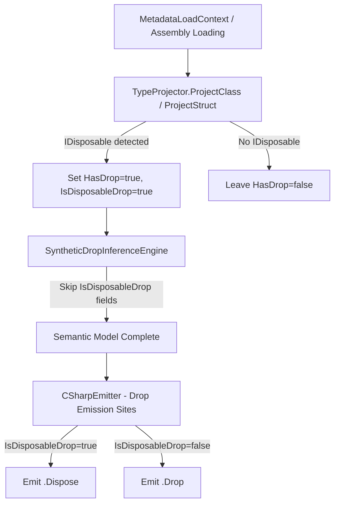

# Design Document: Disposable-Drop Interop

## Overview

This feature bridges .NET's `System.IDisposable` cleanup pattern with Mist's drop semantics. CLR types that implement `IDisposable` are automatically recognized as droppable during type projection, enabling them to participate in `with` blocks without Mist-side wrapper code. The emitter emits `.Dispose()` instead of `.Drop()` at drop emission sites when the type's droppability originates from `IDisposable`.

The design introduces a single new boolean flag (`IsDisposableDrop`) on `ClassType` and `StructType` to differentiate IDisposable-sourced drops from explicit Mist `Drop()` methods. This flag drives both emitter behavior (`.Dispose()` vs `.Drop()`) and synthetic drop inference exclusion.

Key design principles:
- **Explicit over implicit**: An explicit `Drop()` method always takes precedence over IDisposable-based drops.
- **CLR-only**: Only CLR types projected from .NET assemblies receive automatic IDisposable detection. Mist types implementing `IDisposable` are unaffected.
- **No cascading**: IDisposable fields do not trigger synthetic drop inference on their containing Mist types.

## Architecture

The feature touches four existing compiler stages without introducing new stages or phases:



**Stage integration points:**

1. **Type Projection (existing stage)**: `TypeProjector.ProjectClass` and `TypeProjector.ProjectStruct` gain IDisposable interface detection after projecting interfaces.
2. **Synthetic Drop Inference (existing Stage 4d)**: `SyntheticDropInferenceEngine.IsDroppable` gains a filter to exclude types where `IsDisposableDrop = true`.
3. **Code Emission (existing stage)**: `EmitChainedDropExpression` gains a check on `IsDisposableDrop` to emit `.Dispose()` instead of `.Drop()`.
4. **Drop Analyzer (no change needed)**: The analyzer already reads `HasDrop` from the type — since IDisposable types will have `HasDrop = true`, the analyzer's flow analysis works unchanged.

## Components and Interfaces

### New Property: `IsDisposableDrop`

Added to both `ClassType` and `StructType`:

```csharp
/// <summary>
/// Indicates that this type's droppability originates from implementing
/// System.IDisposable (CLR interop) rather than an explicit Mist Drop() method.
/// When true, the emitter emits .Dispose() instead of .Drop() at drop emission sites.
/// </summary>
public bool IsDisposableDrop { get; internal set; }
```

### Modified: `TypeProjector.ProjectClass` / `TypeProjector.ProjectStruct`

After projecting interfaces (`classType.Abstracts = ProjectInterfaces(...)`), a new helper checks whether the CLR type implements `System.IDisposable`:

```csharp
private static bool ImplementsIDisposable(Type clrType)
{
    return clrType.GetInterfaces()
        .Any(i => i.FullName == "System.IDisposable");
}
```

This uses `GetInterfaces()` which returns all transitively implemented interfaces, covering both direct implementation and inheritance through intermediate interfaces (Requirement 1.4).

If `IDisposable` is detected AND the type does not have an explicit `Drop` method (public parameterless method named "Drop"), the projector sets:
- `HasDrop = true`
- `IsDisposableDrop = true`

If the type has both IDisposable AND a public parameterless `Drop` method:
- `HasDrop = true`
- `IsDisposableDrop = false` (explicit Drop takes precedence)

### Modified: `SyntheticDropInferenceEngine.IsDroppable`

The existing `IsDroppable` method gains a guard: when the resolved type has `IsDisposableDrop = true`, return `false`. This prevents IDisposable fields from triggering synthetic drop cascading.

```csharp
case ClassType ct when ct.IsDisposableDrop:
    return false;
case StructType st when st.IsDisposableDrop:
    return false;
```

### Modified: `CSharpEmitter.EmitChainedDropExpression`

The static method that builds chained drop expressions is modified to check `IsDisposableDrop` on the resolved type. When true, it emits `.Dispose()` instead of `.Drop()`:

```csharp
// Existing:
currentExpr = $"{baseExpr}.Drop()";

// New logic:
if (IsDisposableDrop(type))
    currentExpr = $"{baseExpr}.Dispose()";
else
    currentExpr = $"{baseExpr}.Drop()";
```

A helper `IsDisposableDrop(IType)` resolves through `ConstructedType` and `TypeAliasType` to check the flag on the underlying definition:

```csharp
private static bool IsDisposableDrop(IType type) => type switch
{
    ConstructedType ct => IsDisposableDrop(ct.GenericDefinition),
    TypeAliasType alias => IsDisposableDrop(alias.UnderlyingType),
    ClassType c => c.IsDisposableDrop,
    StructType s => s.IsDisposableDrop,
    _ => false,
};
```

### Modified: `CSharpEmitter.EmitDroppableLocalWithWrapping`

The fallback expressions that don't go through `EmitChainedDropExpression` (the non-null `declType` path) already call `EmitChainedDropExpression`, which will pick up the new logic. The fallback string-based paths (`$"{localName}.Drop()"`) only fire when `declType` is null, which won't happen for properly-projected CLR types. No change needed for these fallback paths.

### Mist-Declared Types: No Auto-Detection

The `RecognizeDropMethods` pass in `SemanticModelBuilder` runs only on Mist-declared types (those with AST `MethodDeclarationNode`). Since CLR types have no AST nodes, they pass through `TypeProjector` instead. This natural separation means:
- Mist types implementing `IDisposable` are handled by `RecognizeDropMethods` which only looks for `Drop()` methods, never checks interfaces.
- CLR types are handled by `TypeProjector` which checks for `IDisposable`.

No additional guard is needed to prevent Mist types from getting `IsDisposableDrop = true` — the two paths are already structurally separate.

### Drop Analyzer: No Changes Required

The `DropAnalyzer` and `TypeHasDrop` helper already check `HasDrop` on the type. Since IDisposable CLR types will have `HasDrop = true`, the flow analysis, with-block validation, and diagnostics all work correctly without modification. The analyzer doesn't need to know *why* a type is droppable — only *that* it is.

## Data Models

### ClassType (modified)

| Property | Type | Description |
|---|---|---|
| `IsDisposableDrop` | `bool` | `true` when droppability comes from IDisposable, `false` otherwise. Default: `false`. |

### StructType (modified)

| Property | Type | Description |
|---|---|---|
| `IsDisposableDrop` | `bool` | `true` when droppability comes from IDisposable, `false` otherwise. Default: `false`. |

### Decision table: TypeProjector flag assignment

| CLR Type Condition | HasDrop | IsDisposableDrop |
|---|---|---|
| Implements IDisposable, no Drop() method | `true` | `true` |
| Implements IDisposable AND has Drop() method | `true` | `false` |
| No IDisposable, no Drop() method | `false` | `false` |
| No IDisposable, has Drop() method | `true` | `false` |
| Implements IAsyncDisposable only | `false` | `false` |
| Implements both IDisposable and IAsyncDisposable | `true` | `true` |

### Decision table: Emitter drop call

| Type Condition | Emitted Call |
|---|---|
| `IsDisposableDrop = true` | `.Dispose()` |
| `IsDisposableDrop = false`, `HasDrop = true` | `.Drop()` |
| Task-like type | `await expr` |


## Correctness Properties

*A property is a characteristic or behavior that should hold true across all valid executions of a system — essentially, a formal statement about what the system should do. Properties serve as the bridge between human-readable specifications and machine-verifiable correctness guarantees.*

### Property 1: Emitter dispatch correctness

*For any* droppable non-task-like type at a drop emission site, the emitted call string contains `.Dispose()` if and only if the type has `IsDisposableDrop = true`, and contains `.Drop()` if and only if the type has `IsDisposableDrop = false`.

**Validates: Requirements 2.3, 3.1, 3.2**

### Property 2: Synthetic drop inference exclusion

*For any* Mist-declared type whose fields include types with `IsDisposableDrop = true`, the `SyntheticDropInferenceEngine` shall not include those fields in the synthesized drop field list. Only fields whose type has `HasDrop = true` AND `IsDisposableDrop = false` shall contribute to synthetic drop inference.

**Validates: Requirements 5.1, 5.2, 5.3**

## Error Handling

### Type Projection Errors

- **Missing metadata**: If `Type.GetInterfaces()` throws during IDisposable detection (e.g., due to corrupted assembly metadata), the projector catches the exception and treats the type as non-disposable (`HasDrop = false`, `IsDisposableDrop = false`). This is consistent with the existing `IsRefStruct` detection pattern which also wraps reflection calls in try/catch.
- **Unresolvable IDisposable**: If the `System.IDisposable` interface type itself cannot be resolved from the loaded assemblies (unlikely but possible with minimal reference sets), the detector skips IDisposable recognition silently. No diagnostic is emitted because this is a framework-level absence, not a user error.

### Emitter Errors

- **Null type at emission site**: The existing guard `type is not null` in `EmitWithBlockDropCall` already handles the case where type resolution fails. If a type is null, no drop call is emitted. The new `IsDisposableDrop` check is only reached when the type is already confirmed non-null and droppable.
- **Chained drop with IDisposable**: IDisposable types should not have a `DropReturnType` (Dispose() returns void in the CLR pattern). The chaining logic naturally terminates when `DropReturnType` is null, so no special handling is needed.

### Diagnostic Behavior

No new diagnostics are introduced by this feature. The existing drop analyzer diagnostics apply unchanged:
- Using a droppable type outside a `with` block in a linear/relevant context still produces `MIST_DROP_USE_AFTER_MOVE (historical)` or equivalent.
- The presence or absence of `IsDisposableDrop` does not affect which diagnostics fire — only `HasDrop` and the substructural discipline determine diagnostic behavior.

## Testing Strategy

### Property-Based Tests

Property-based testing is appropriate for this feature because:
- The emitter dispatch logic (Property 1) can be tested by generating random type configurations and verifying the emitted string.
- The synthetic drop inference exclusion (Property 2) can be tested by generating random field compositions and verifying the inference result.

**Library**: FsCheck (already used in the project)
**Iterations**: Minimum 100 per property test

**Property Test 1: Emitter dispatch correctness**
- Generate random type configurations: `(HasDrop=true, IsDisposableDrop: bool)`
- For each configuration, call the emitter's drop expression builder
- Assert: output contains `.Dispose()` iff `IsDisposableDrop=true`, output contains `.Drop()` iff `IsDisposableDrop=false`
- Tag: **Feature: disposable-drop-interop, Property 1: Emitter dispatch correctness**

**Property Test 2: Synthetic drop inference exclusion**
- Generate random Mist type configurations with N fields, each field having a random `(HasDrop, IsDisposableDrop)` configuration
- Run the inference engine logic (or the `IsDroppable` filter directly)
- Assert: no field with `IsDisposableDrop=true` appears in the synthesized drop field list
- Assert: all fields with `HasDrop=true` AND `IsDisposableDrop=false` DO appear in the synthesized drop field list
- Tag: **Feature: disposable-drop-interop, Property 2: Synthetic drop inference exclusion**

**Process note**: Both property tests operate in-process without spawning external processes. They test the pure logic of the emitter helper and inference engine filter, not end-to-end compilation. This keeps iteration cost negligible (< 1ms per iteration).

### Unit Tests (Example-Based)

| Test | Validates | Strategy |
|---|---|---|
| IDisposable CLR type gets HasDrop=true | Req 1.1 | Project `System.IO.MemoryStream`, assert `HasDrop=true` |
| IDisposable CLR type gets IsDisposableDrop=true | Req 1.2 | Same type, assert `IsDisposableDrop=true` |
| Non-IDisposable CLR type unchanged | Req 1.3 | Project `System.String`, assert `HasDrop=false` |
| Transitive IDisposable (via interface chain) | Req 1.4 | Project `System.IO.Stream`, assert flags set |
| Generic IDisposable type | Req 1.5 | Project a generic CLR type implementing IDisposable |
| CLR type with Drop() method AND IDisposable | Req 2.2 | Custom test type or mock, assert `IsDisposableDrop=false` |
| With-block emits Dispose() in finally | Req 3.3 | End-to-end compile, inspect emitted C# |
| IAsyncDisposable only → not droppable | Req 6.1 | Project type with only IAsyncDisposable |
| Both IAsyncDisposable and IDisposable | Req 6.2 | Project type, assert recognized via IDisposable |
| Mist type with IDisposable not auto-droppable | Req 7.1, 7.3 | Compile Mist type, assert `HasDrop=false` |
| Mist type with IDisposable + Drop() | Req 7.2 | Compile, assert `HasDrop=true`, `IsDisposableDrop=false` |

### Integration Tests

| Test | Validates | Strategy |
|---|---|---|
| Sample app compiles and runs | Req 8.1–8.5 | Compile `samples/DisposableDropInterop/Program.mist`, run, verify expected output (1 process spawn) |
| Book snippets compile | Req 9.5 | Run SnippetEmitter tool (1 process spawn) |
