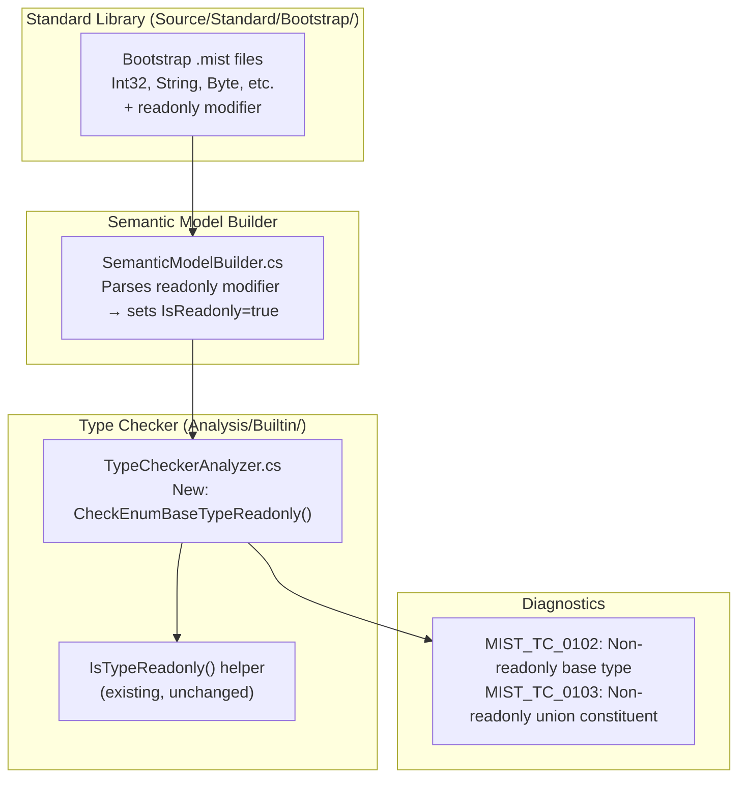

# Design Document: Enum Readonly Restriction

## Overview

This feature adds a compile-time constraint requiring that the base type (underlying type) of every enum declaration must be a readonly type. This ensures enum member values are immutable constants, aligning with the semantic expectation that enum values never change after definition.

The implementation spans three layers:

1. **Standard Library** — Mark all bootstrap types (`Int32`, `String`, `Byte`, etc.) with the `readonly` modifier in their `.mist` definitions so the semantic model recognizes them as readonly without special-case logic.
2. **Type Checker** — Add validation in `TypeCheckerAnalyzer` that rejects enum declarations whose resolved base type (explicit or inferred) is not readonly. For union base types, every constituent must be readonly.
3. **Diagnostics** — Emit clear error messages with unique diagnostic IDs identifying the enum name and the offending non-readonly type.

The existing `IsTypeReadonly()` helper (present in both `TypeCheckerAnalyzer` and `ReadonlyAnalyzer`) already handles the readonly check for `ClassType`, `StructType`, `InterfaceType`, and `TraitType`. No new readonly-checking infrastructure is needed — the feature simply invokes this existing query at enum declaration validation time.

## Architecture



### Data Flow

1. The parser reads `readonly struct Int32 { ... }` from bootstrap `.mist` files.
2. `SemanticModelBuilder` sets `IsReadonly = true` on the resulting `StructType` (or `ClassType`, etc.).
3. During the `Analyze()` pass, `TypeCheckerAnalyzer` iterates all enum symbols.
4. For each enum, it resolves the `UnderlyingType` and calls `IsTypeReadonly()`.
5. If the type is a `UnionType`, it checks each constituent individually.
6. Non-readonly types produce a diagnostic with the appropriate ID and message.

### Design Decisions

- **No special-case logic for primitives**: By marking bootstrap types `readonly` in their source definitions, the type checker uses the same general-purpose `IsTypeReadonly()` path for all types. This is simpler and more maintainable than a hardcoded list.
- **Validation in TypeCheckerAnalyzer (not SemanticModelBuilder)**: The semantic model builder resolves types; the type checker enforces constraints. This follows the existing separation of concerns (e.g., refinement predicate readonly checks are in `TypeCheckerAnalyzer`).
- **Two diagnostic IDs**: One for "base type is not readonly" and one for "union constituent is not readonly". This gives developers precise information about which part of a union type is problematic.
- **Diagnostic IDs MIST_TC_0102 (historical) and MIST_TC_0103* (historical scheme)*: These follow sequentially after the existing highest ID (`MIST_TC_0101 (historical)` for `PatternIncompatibleRefinement`).

## Components and Interfaces

### 1. Bootstrap Type Definitions (Modified)

**Location**: `Source/Standard/Bootstrap/*.mist`

Each bootstrap type file gains the `readonly` modifier on its type declaration:

```mist
// Before:
intrinsic public struct Int32 { ... }

// After:
intrinsic public readonly struct Int32 { ... }
```

All 14 bootstrap types (`Int32`, `Int16`, `Int64`, `UInt16`, `UInt32`, `UInt64`, `Byte`, `SByte`, `Boolean`, `String`, `Char`, `Single`, `Double`, `Decimal`) receive this change.

### 2. TypeCheckerAnalyzer — Enum Base Type Validation (New)

**Location**: `Source/Mist/Analysis/Builtin/TypeCheckerAnalyzer.cs`

New diagnostic ID declarations:

```csharp
/// <summary>
/// An enum declaration's base type (explicit or inferred) is not readonly.
/// Enum base types must be readonly to ensure member values are immutable.
/// </summary>
internal static readonly DiagnosticId EnumBaseTypeNotReadonly = new("MIST_TC_0102");

/// <summary>
/// A constituent type within a union base type of an enum is not readonly.
/// All constituent types in a union enum base must be readonly.
/// </summary>
internal static readonly DiagnosticId EnumUnionConstituentNotReadonly = new("MIST_TC_0103");
```

New validation method:

```csharp
/// <summary>
/// Validates that all enum declarations have readonly base types.
/// For union base types, each constituent is checked individually.
/// </summary>
private static void CheckEnumBaseTypeReadonly(ISemanticModel model, DiagnosticBag diagnostics)
{
    foreach (var symbol in model.AllSymbols)
    {
        if (symbol.Kind != SymbolKind.Enum)
            continue;

        if (symbol.DeclaredType is not EnumType enumType)
            continue;

        var underlyingType = enumType.UnderlyingType;
        if (underlyingType is null || underlyingType is ErrorType)
            continue;

        if (underlyingType is UnionType unionType)
        {
            // Check each constituent individually.
            foreach (var constituent in unionType.Constituents)
            {
                if (!IsTypeReadonly(constituent))
                {
                    diagnostics.Add(MakeDiagnostic(
                        EnumUnionConstituentNotReadonly.Value,
                        $"Enum '{enumType.DisplayName}' has a non-readonly union constituent " +
                        $"type '{constituent.DisplayName}'. All constituent types in an enum's " +
                        $"union base type must be readonly.",
                        model.GetDeclaringNode(symbol),
                        model));
                }
            }
        }
        else
        {
            if (!IsTypeReadonly(underlyingType))
            {
                diagnostics.Add(MakeDiagnostic(
                    EnumBaseTypeNotReadonly.Value,
                    $"Enum '{enumType.DisplayName}' has a non-readonly base type " +
                    $"'{underlyingType.DisplayName}'. Enum base types must be readonly.",
                    model.GetDeclaringNode(symbol),
                    model));
            }
        }
    }
}
```

This method is called from the existing `Analyze()` method, after enum types have been fully resolved.

### 3. IsTypeReadonly — Existing Helper (Unchanged)

**Location**: `TypeCheckerAnalyzer.cs` line 7070, `ReadonlyAnalyzer.cs` line 1589

```csharp
private static bool IsTypeReadonly(IType type)
{
    return type switch
    {
        ClassType ct => ct.IsReadonly,
        StructType st => st.IsReadonly,
        InterfaceType it => it.IsReadonly,
        TraitType tt => tt.IsReadonly,
        _ => false,
    };
}
```

No changes needed. Bootstrap types will now have `IsReadonly = true` set by the semantic model builder when it processes the `readonly` modifier from their source definitions.

### 4. Sample Application (New)

**Location**: `samples/EnumReadonlyRestriction/Program.mist`

Demonstrates all valid patterns: primitive base types, readonly struct/class base types, name-only enums, union of readonly types, member access, implicit conversion, and pattern matching.

## Data Models

### EnumType (Existing, Unchanged)

```csharp
public sealed class EnumType : IType
{
    public string DisplayName { get; }
    public TypeKind Kind => TypeKind.Enum;
    public IType UnderlyingType { get; internal set; }
    public IReadOnlyList<EnumMemberInfo> Members { get; internal set; }
    public IScope MemberScope { get; }
    public string? ContainingNamespace { get; }
}
```

The `UnderlyingType` property holds the resolved base type. For union enums, this is a `UnionType` instance whose `Constituents` list contains the individual types.

### UnionType (Existing, Unchanged)

```csharp
public sealed class UnionType : IType
{
    public IReadOnlyList<IType> Constituents { get; }
    public string DisplayName { get; }
    public TypeKind Kind => TypeKind.Struct;
}
```

### StructType / ClassType / InterfaceType / TraitType (Existing, Unchanged)

All have `public bool IsReadonly { get; internal set; }` which is set by `SemanticModelBuilder` when the `readonly` modifier is present on the declaration.

### Diagnostic Model

| ID | Condition | Message Template |
|----|-----------|-----------------|
| `MIST_TC_0102 (historical)` | Enum base type is not readonly | `"Enum '{EnumName}' has a non-readonly base type '{TypeName}'. Enum base types must be readonly."` |
| `MIST_TC_0103 (historical)` | Union constituent is not readonly | `"Enum '{EnumName}' has a non-readonly union constituent type '{TypeName}'. All constituent types in an enum's union base type must be readonly."` |

Both diagnostics have severity `Error`.


## Correctness Properties

*A property is a characteristic or behavior that should hold true across all valid executions of a system — essentially, a formal statement about what the system should do. Properties serve as the bridge between human-readable specifications and machine-verifiable correctness guarantees.*

### Property 1: Readonly modifier propagation

*For any* type declaration (struct, class, interface, or trait) that includes the `readonly` modifier, the semantic model SHALL set `IsReadonly = true` on the resulting type, and for any type declaration without the `readonly` modifier, `IsReadonly` SHALL be `false`.

**Validates: Requirements 1.15**

### Property 2: Readonly base type acceptance

*For any* enum declaration whose resolved underlying type is a readonly type (struct, class, interface, or trait with `IsReadonly = true`), the type checker SHALL emit zero `MIST_TC_0102 (historical)` diagnostics for that enum.

**Validates: Requirements 2.1, 3.1, 5.1, 5.2, 5.3, 5.4**

### Property 3: Non-readonly base type rejection

*For any* enum declaration whose resolved underlying type is not a readonly type and is not a union type, the type checker SHALL emit exactly one `MIST_TC_0102 (historical)` diagnostic whose message contains both the enum's display name and the non-readonly type's display name, with severity `Error`.

**Validates: Requirements 2.2, 3.2, 4.1, 4.2, 4.4, 4.5**

### Property 4: All-readonly union acceptance

*For any* enum declaration whose resolved underlying type is a union type where every constituent is readonly, the type checker SHALL emit zero `MIST_TC_0103 (historical)` diagnostics for that enum.

**Validates: Requirements 2.3, 3.3**

### Property 5: Non-readonly union constituent rejection

*For any* enum declaration whose resolved underlying type is a union type containing at least one non-readonly constituent, the type checker SHALL emit exactly one `MIST_TC_0103 (historical)` diagnostic per non-readonly constituent, each message containing the enum's display name and the specific non-readonly constituent's display name, with severity `Error`.

**Validates: Requirements 2.4, 3.4, 4.3, 4.4, 4.5**

## Error Handling

### Diagnostic Emission

| Scenario | Diagnostic ID | Severity | Message |
|----------|--------------|----------|---------|
| Enum base type is not readonly | `MIST_TC_0102 (historical)` | Error | `"Enum '{EnumName}' has a non-readonly base type '{TypeName}'. Enum base types must be readonly."` |
| Union constituent is not readonly | `MIST_TC_0103 (historical)` | Error | `"Enum '{EnumName}' has a non-readonly union constituent type '{TypeName}'. All constituent types in an enum's union base type must be readonly."` |

### Edge Cases

- **ErrorType as underlying type**: If the underlying type could not be resolved (e.g., due to a prior error), the validation skips the enum. This prevents cascading errors.
- **Null underlying type**: If `UnderlyingType` is null (should not happen for well-formed enums), the validation skips the enum.
- **Name-only enums**: These infer `Byte` as the underlying type. Since `Byte` is now marked readonly, they pass validation without issue.
- **Existing enum samples**: The existing `samples/Enums/Program.mist` uses `Vec2` (non-readonly struct) and `Label` (non-readonly class) as enum base types. These will need to be updated to include the `readonly` modifier to continue compiling.

### Backward Compatibility

This is a **breaking change** for any user code that defines enums with non-readonly base types. The mitigation is straightforward: add the `readonly` modifier to the base type declaration. The diagnostic message clearly states what is required.

### Impact on Existing Samples

The existing `samples/Enums/Program.mist` declares `Vec2` (struct) and `Label` (class) without the `readonly` modifier and uses them as enum base types. After this feature, those declarations will produce `MIST_TC_0102 (historical)` errors.

**Resolution**: The `Vec2` and `Label` types in `samples/Enums/Program.mist` must be updated to include the `readonly` modifier. This is not "modifying working code in another sample" — it is updating the sample to conform to a new language rule, analogous to how adding a new keyword would require updating samples that used that identifier as a variable name. The types themselves are genuinely immutable (their fields are only set in constructors), so adding `readonly` is semantically correct.

Note: Per the sample-app-integrity steering, if the compiler change causes the existing sample to fail, the correct fix is to make the sample conform to the new language rule (add `readonly` to the type declarations), not to weaken the compiler check.

## Testing Strategy

### Property-Based Tests (FsCheck)

Property-based tests validate the five correctness properties above. Each test generates 100+ random scenarios using FsCheck.

**Library**: FsCheck (already used throughout the test suite)
**Configuration**: `MaxTest = 100` per property

| Property | Test Class | Strategy |
|----------|-----------|----------|
| Property 1 | `ReadonlyModifierPropagationPropertyTests` | Generate random type declarations with/without `readonly`. Build semantic model in-process. Verify `IsReadonly` matches. |
| Property 2 | `EnumReadonlyAcceptancePropertyTests` | Generate random enum declarations with readonly base types (all four type kinds). Build semantic model + run type checker in-process. Verify zero `MIST_TC_0102 (historical)` diagnostics. |
| Property 3 | `EnumNonReadonlyRejectionPropertyTests` | Generate random enum declarations with non-readonly base types. Build semantic model + run type checker in-process. Verify exactly one `MIST_TC_0102 (historical)` with correct message content and severity. |
| Property 4 | `EnumReadonlyUnionAcceptancePropertyTests` | Generate random enum declarations with union base types where all constituents are readonly. Verify zero `MIST_TC_0103 (historical)` diagnostics. |
| Property 5 | `EnumNonReadonlyUnionRejectionPropertyTests` | Generate random enum declarations with union base types containing non-readonly constituents. Verify correct count and content of `MIST_TC_0103 (historical)` diagnostics. |

All property tests use in-process compilation via `SemanticModelBuilder` and `TypeCheckerAnalyzer` — no process spawning.

**Tag format**: `Feature: enum-readonly-restriction, Property {N}: {property_text}`

### Unit Tests (Example-Based)

| Test | Purpose |
|------|---------|
| Bootstrap types are readonly | Verify all 14 bootstrap types have `IsReadonly = true` after semantic model construction |
| Diagnostic message contains "must be readonly" | Verify the specific phrasing in error messages |
| Diagnostic IDs are unique | Verify `MIST_TC_0102 (historical)` and `MIST_TC_0103 (historical)` don't collide with existing IDs |
| Existing enum features still work | Verify member access, implicit conversion, pattern matching with readonly base types |

### Integration Tests

| Test | Purpose |
|------|---------|
| Sample compiles and runs | Verify `samples/EnumReadonlyRestriction/Program.mist` compiles and produces expected output |
| AllFeatures includes sample | Verify the AllFeatures orchestrator calls `EnumReadonlyRestriction.Program.RunDemo()` |
| Existing Enums sample still compiles | Verify `samples/Enums/Program.mist` compiles after adding `readonly` to `Vec2` and `Label` |
