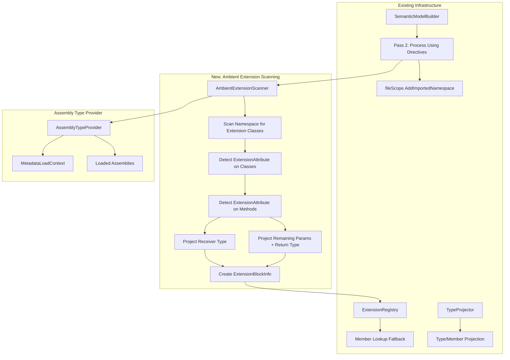

# Design Document: Ambient Extension Method Binding

## Overview

This feature extends the Assembly Type Provider to detect C# extension methods in referenced .NET assemblies and register them in the existing Extension Registry, making them available as instance methods when their containing namespace is imported via a `using` directive.

The implementation leverages the existing infrastructure: `AssemblyTypeProvider` for metadata reading, `TypeProjector` for type projection, `ExtensionRegistry` for member lookup fallback, and the namespace visibility filtering already used by Mist-native extension blocks. The key new component is an `AmbientExtensionScanner` that identifies extension methods by checking for `[System.Runtime.CompilerServices.ExtensionAttribute]` on static classes and their methods.

### Key Design Decisions

1. **Reuse ExtensionRegistry**: Ambient extension methods are registered as `ExtensionBlockInfo` entries in the same `ExtensionRegistry` used by Mist-native extensions. This means the existing member lookup fallback, specificity ordering, and namespace visibility filtering all work without modification.
2. **Lazy per-namespace scanning**: Extension methods are discovered only when a namespace is first imported. The scanner caches results per namespace so subsequent imports (in other files) reuse the cached data.
3. **Grouped by receiver type**: All extension methods in a namespace targeting the same receiver type are grouped into a single `ExtensionBlockInfo` with a shared member scope, matching the structure of Mist-native extension blocks.
4. **Receiver parameter excluded from projected signature**: The first parameter (receiver) is consumed by the `ExtensionBlockInfo.ReceiverType` field. The method symbol's parameter list contains only the remaining parameters, consistent with how Mist-native extension methods work.
5. **Ambiguity with Mist-native extensions**: When both a Mist-native extension and an ambient extension provide the same member for the same receiver type, the type checker reports an ambiguity error — the same behavior as two ambient extensions from different namespaces conflicting.
6. **Emission as static calls**: The C# emitter produces static method invocations on the original extension static class, passing the receiver as the first argument. This is the standard C# calling convention for extension methods.

## Architecture



### Pipeline Integration

1. **During Pass 2** (`Pass2_ResolveTypes`), when processing `using` directives, the `SemanticModelBuilder` already validates namespace existence and records imported namespaces on the file scope.
2. **New step**: After confirming a namespace exists in the ambient type resolver, the `SemanticModelBuilder` calls `AmbientExtensionScanner.GetExtensionsForNamespace(namespaceName)` to discover extension methods.
3. **Registration**: Discovered extension methods are projected and registered in the `ExtensionRegistry` (the same registry used for Mist-native extensions).
4. **Lookup**: The existing member lookup fallback in the type checker already queries the `ExtensionRegistry` and filters by `ContainingNamespace` — no changes needed there.

### Timing Consideration

The ambient extension scanning must happen **before** Pass 2 resolves method bodies, but **after** the `ExtensionRegistry` is created. The natural integration point is during `Pass2_RegisterExtensionMembers` (Phase A), which already runs before Pass 2 and populates the `ExtensionRegistry` with Mist-native extensions. Ambient extensions are registered in the same phase.

## Components and Interfaces

### 1. AmbientExtensionScanner

New class responsible for discovering extension methods in .NET assemblies:

```csharp
/// <summary>
/// Scans .NET assemblies for C# extension methods (static methods decorated with
/// [System.Runtime.CompilerServices.ExtensionAttribute] in static classes also
/// decorated with the same attribute). Results are cached per namespace.
/// </summary>
internal sealed class AmbientExtensionScanner
{
    private readonly IReadOnlyList<LoadedAssemblyInfo> _assemblies;
    private readonly MetadataLoadContext _metadataContext;
    private readonly Dictionary<string, IReadOnlyList<AmbientExtensionMethodInfo>> _cache;

    /// <summary>
    /// Returns all extension methods declared in the given namespace across all
    /// loaded assemblies. Results are cached for subsequent calls.
    /// </summary>
    public IReadOnlyList<AmbientExtensionMethodInfo> GetExtensionsForNamespace(string namespaceName);
}
```

### 2. AmbientExtensionMethodInfo

Data class holding the raw metadata for a discovered extension method:

```csharp
/// <summary>
/// Raw metadata for a single C# extension method discovered in a .NET assembly.
/// </summary>
internal sealed class AmbientExtensionMethodInfo
{
    /// <summary>The CLR namespace of the containing static class.</summary>
    public required string Namespace { get; init; }

    /// <summary>The full name of the containing static class (for emission).</summary>
    public required string ContainingClassName { get; init; }

    /// <summary>The method name.</summary>
    public required string MethodName { get; init; }

    /// <summary>The CLR Type of the first parameter (receiver).</summary>
    public required Type ReceiverClrType { get; init; }

    /// <summary>The remaining CLR parameters (excluding receiver).</summary>
    public required IReadOnlyList<ParameterInfo> RemainingParameters { get; init; }

    /// <summary>The CLR return type.</summary>
    public required Type ReturnClrType { get; init; }

    /// <summary>Whether the method is a generic method definition.</summary>
    public required bool IsGenericMethod { get; init; }

    /// <summary>Generic type parameters on the method (empty if non-generic).</summary>
    public required IReadOnlyList<Type> MethodTypeParameters { get; init; }

    /// <summary>The MethodInfo for emission metadata.</summary>
    public required MethodInfo MethodInfo { get; init; }
}
```

### 3. IAmbientTypeResolver Extension

Add a new method to the `IAmbientTypeResolver` interface for extension method discovery:

```csharp
public interface IAmbientTypeResolver
{
    // ... existing methods ...

    /// <summary>
    /// Returns all C# extension methods declared in the given namespace.
    /// Returns an empty list if the namespace has no extension methods.
    /// </summary>
    IReadOnlyList<AmbientExtensionMethodInfo> GetExtensionMethodsInNamespace(string namespaceName);
}
```

### 4. AssemblyTypeProvider Changes

The `AssemblyTypeProvider` gains an `AmbientExtensionScanner` instance and delegates the new interface method to it:

```csharp
internal sealed class AssemblyTypeProvider : IAmbientTypeResolver, IDisposable
{
    private readonly AmbientExtensionScanner _extensionScanner;

    // New method implementation
    public IReadOnlyList<AmbientExtensionMethodInfo> GetExtensionMethodsInNamespace(string namespaceName)
    {
        return _extensionScanner.GetExtensionsForNamespace(namespaceName);
    }
}
```

### 5. SemanticModelBuilder Changes

During the extension registration phase (Pass 2e Phase A), after registering Mist-native extensions, the builder queries the ambient type resolver for extension methods in each imported namespace and registers them:

```csharp
// In Pass2_RegisterExtensionMembers or a new Pass2_RegisterAmbientExtensions:
private static void RegisterAmbientExtensions(
    IAmbientTypeResolver ambientTypeResolver,
    ExtensionRegistry extensionRegistry,
    IReadOnlyList<string> importedNamespaces,
    TypeProjector projector,
    IStdlibTypeProvider stdlib)
{
    foreach (var ns in importedNamespaces)
    {
        var ambientExtensions = ambientTypeResolver.GetExtensionMethodsInNamespace(ns);
        if (ambientExtensions.Count == 0) continue;

        // Group by receiver type
        var byReceiver = ambientExtensions.GroupBy(e => e.ReceiverClrType, TypeIdentityComparer.Instance);

        foreach (var group in byReceiver)
        {
            var receiverType = projector.ProjectTypeReference(group.Key, stdlib);
            var memberScope = new Scope(parent: null);

            foreach (var ext in group)
            {
                // Project method symbol (excluding receiver parameter)
                var returnType = projector.ProjectTypeReference(ext.ReturnClrType, stdlib);
                var methodSymbol = new Symbol(ext.MethodName, SymbolKind.Method,
                    SymbolOrigin.Backend, memberScope, returnType, null);

                // Project remaining parameters
                var paramScope = new Scope(memberScope);
                var paramSymbols = projector.ProjectParametersWithResult(
                    ext.RemainingParameters, paramScope, stdlib);
                methodSymbol.Parameters = paramSymbols;

                // Project method-level type parameters
                if (ext.IsGenericMethod)
                {
                    methodSymbol.TypeParameters = projector.ProjectMethodTypeParameters(
                        ext.MethodInfo, stdlib);
                }

                memberScope.AddMember(methodSymbol);
            }

            var blockInfo = new ExtensionBlockInfo
            {
                ReceiverType = receiverType,
                ReceiverParameterName = "self",
                MemberScope = memberScope,
                TypeParameters = Array.Empty<TypeParameterType>(),
                ContainingNamespace = ns,
                DeclaringNode = null!, // No AST node for ambient extensions
            };

            extensionRegistry.Register(blockInfo);
        }
    }
}
```

### 6. ExtensionBlockInfo Changes

The `DeclaringNode` property needs to become nullable to support ambient extensions (which have no AST node):

```csharp
public sealed class ExtensionBlockInfo
{
    // Change from required to nullable for ambient extensions
    public required Storm.Runtime.SyntaxNode? DeclaringNode { get; init; }

    /// <summary>
    /// Whether this extension block originated from a .NET assembly (ambient)
    /// rather than Mist source code.
    /// </summary>
    public bool IsAmbient => DeclaringNode is null;

    /// <summary>
    /// The fully-qualified name of the containing static class (for ambient extensions).
    /// Used by the emitter to generate static method calls.
    /// Null for Mist-native extensions.
    /// </summary>
    public string? AmbientStaticClassName { get; init; }
}
```

### 7. CSharpEmitter Changes

When emitting a call to an ambient extension method, the emitter produces a static method invocation:

```csharp
// When the resolved extension is ambient (IsAmbient == true):
// Instead of: receiver.MethodName(args)
// Emit: Namespace.StaticClassName.MethodName(receiver, args)

// Example for LINQ Where:
// Mist: numbers.Where(n => n > 5)
// C#:   System.Linq.Enumerable.Where(numbers, n => n > 5)
```

The emitter identifies ambient extensions by checking `ExtensionBlockInfo.IsAmbient` on the resolved extension block.

## Data Models

### Extension Method Discovery Cache

```csharp
// Cached per namespace in AmbientExtensionScanner
Dictionary<string, IReadOnlyList<AmbientExtensionMethodInfo>> _cache;
```

### Extension Detection Algorithm

```
For each loaded assembly:
  For each exported type in the target namespace:
    If type is static class AND has [ExtensionAttribute]:
      For each public static method on the class:
        If method has [ExtensionAttribute] AND has at least 1 parameter:
          Record as AmbientExtensionMethodInfo
```

The `[ExtensionAttribute]` check uses `Type.GetCustomAttributesData()` to inspect attributes without loading the attribute type itself (metadata-only inspection via `MetadataLoadContext`).

### Receiver Type Grouping

Extension methods are grouped by their receiver CLR type using structural type identity (namespace + name + generic arity). All methods with the same receiver type in the same namespace are placed in a single `ExtensionBlockInfo`.

## Correctness Properties

### Property 1: Extension Method Detection Completeness

*For any* public static method in a loaded assembly that is (a) in a static class decorated with `[ExtensionAttribute]`, (b) itself decorated with `[ExtensionAttribute]`, and (c) has at least one parameter, the `AmbientExtensionScanner` SHALL include it in the results for that namespace. Methods not meeting all three criteria SHALL be excluded.

**Validates: Requirements 1.1, 1.2, 1.3, 1.4, 1.5**

### Property 2: Receiver Parameter Exclusion

*For any* ambient extension method with N total CLR parameters, the projected Mist method symbol SHALL have exactly N-1 parameters (the receiver is consumed by `ExtensionBlockInfo.ReceiverType`). The parameter names, types, and order of the remaining N-1 parameters SHALL match the CLR method's parameters at positions 1 through N-1.

**Validates: Requirements 2.4, 4.2**

### Property 3: Namespace Visibility Filtering

*For any* ambient extension method registered with `ContainingNamespace = X`, the type checker SHALL include it in member lookup candidates if and only if namespace X is in the current file's imported namespaces set. This is the same filtering applied to Mist-native extensions.

**Validates: Requirements 3.1, 3.2, 3.3, 3.4**

### Property 4: Own Members Shadow Extensions

*For any* type T that has both an own member named M and an ambient extension method named M, member lookup on T for name M SHALL resolve to the own member. The ambient extension SHALL NOT appear in the candidate set when the own member matches.

**Validates: Requirements 4.3**

### Property 5: Discovery Caching Identity

*For any* namespace queried through `GetExtensionsForNamespace`, subsequent queries for the same namespace SHALL return the same cached result without re-scanning assembly metadata.

**Validates: Requirements 11.1, 11.2**

### Property 6: Receiver Type Grouping Correctness

*For any* set of N extension methods in a namespace targeting K distinct receiver types, the scanner SHALL produce exactly K `ExtensionBlockInfo` entries, each containing exactly the methods whose receiver type matches that group's key.

**Validates: Requirements 2.2, 2.5**

### Property 7: Generic Method Type Parameter Projection

*For any* generic ambient extension method with M type parameters, the projected Mist method symbol SHALL have exactly M type parameters with names matching the CLR type parameter names.

**Validates: Requirements 2.7, 5.1**

## Error Handling

### Diagnostic Categories

| Diagnostic ID | Severity | Condition | Recovery |
|--------------|----------|-----------|----------|
| `MIST_UNDEFINED_MEMBER (historical)` | Error | No own member or extension found | Standard existing diagnostic |
| `MIST_TC_0082 (historical)` | Error | Ambiguous extension (multiple equally-specific candidates) | Report all candidates |
| `MIST_TC_TYPE_MISMATCH (historical)` | Error | Call arguments don't match extension params | Report expected vs actual types |

No new diagnostic IDs are needed — the existing diagnostics cover all error cases for ambient extensions because they flow through the same `ExtensionRegistry` lookup path.

### Error Recovery

- If an extension method's receiver type cannot be projected (references an excluded type), the method is silently skipped.
- If an extension method's parameter types cannot be projected, the method is silently skipped.
- If `GetCustomAttributesData()` throws for a type or method, that type/method is skipped and scanning continues.

## Testing Strategy

### Property-Based Tests (FsCheck)

Property-based tests validate the universal correctness properties. Tests use in-process compilation via `CompilerDriver.Compile()` — no external process spawning per iteration.

1. **ExtensionDetectionCompleteness** — Scan `System.Linq` namespace, verify all known LINQ extension methods are detected. Generate subsets of methods and verify detection matches the attribute criteria.
2. **ReceiverParameterExclusion** — For all detected extension methods, verify projected parameter count is N-1 and parameter types match positions 1..N-1.
3. **ReceiverTypeGrouping** — For all extension methods in a namespace, verify grouping produces correct number of ExtensionBlockInfo entries with correct member counts.
4. **DiscoveryCaching** — Query the same namespace multiple times, verify reference equality of results.

### Unit Tests (xUnit)

Example-based tests for specific scenarios:

- `System.Linq.Enumerable.Where<T>` is detected as an extension method
- `System.Linq.Enumerable.Count<T>` (parameterless overload) is detected
- Non-extension static methods in `Enumerable` are NOT detected
- Extension methods in non-imported namespaces are not available
- Extension methods become available after adding `using System.Linq`
- Ambiguity between Mist-native extension and ambient extension produces error
- Generic type inference works for `Where<T>` on `IEnumerable<int>`
- Chained extension calls resolve correctly

### Integration Tests

End-to-end tests that compile and run Mist programs:

- Sample application (`samples/ExtensionMethodBinding/Program.mist`) compiles and produces expected output
- AllFeatures orchestrator includes the new sample and passes
- Programs without `using System.Linq` cannot call LINQ methods (negative test)

**Process spawning**: Integration tests use the batched approach — 1 compile, 1 run, verify output lines. No per-iteration process spawning.
