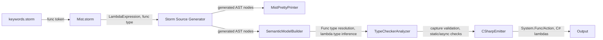
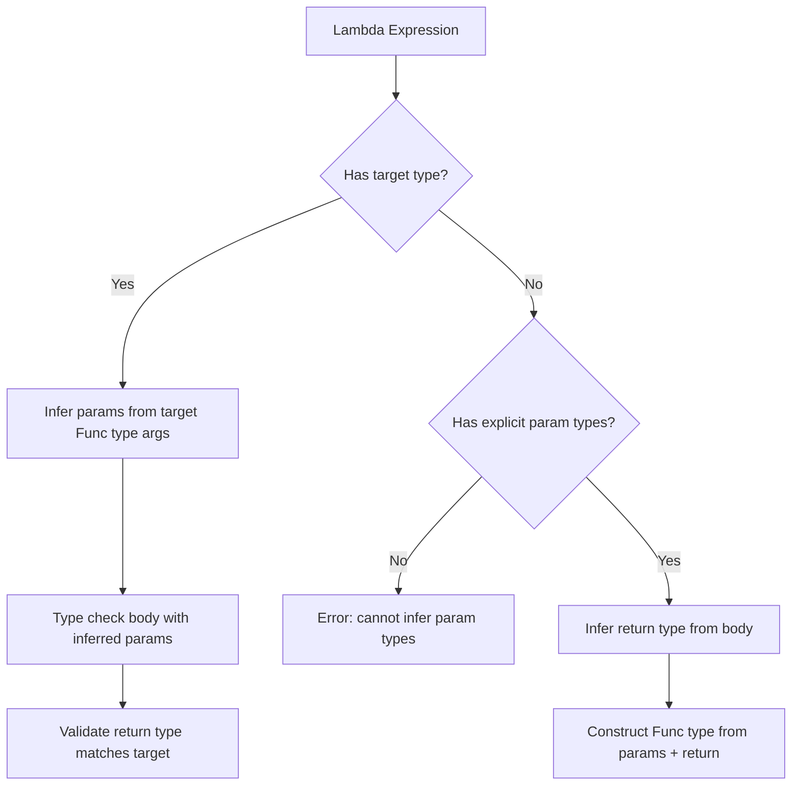
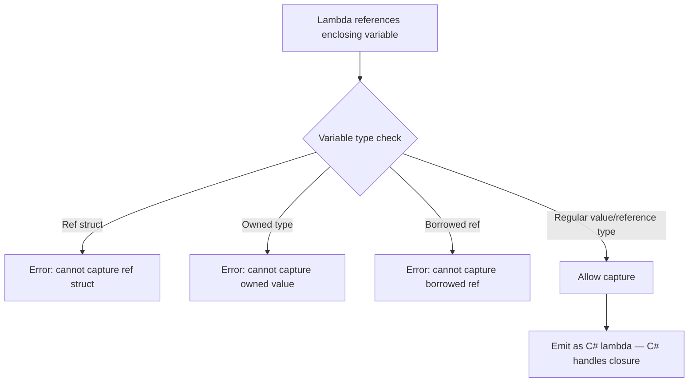

# Design Document: First-Class Functions and Lambdas

## Overview

This design adds first-class functions and lambda expressions to the Mist language. The model unifies all callable types under a single `Func<TParams..., TResult>` generic type family. Since `void` is a real unit type in Mist, there is no need for a separate `Action` type — `Action<T>` is simply a type alias for `Func<T, void>`. The lowercase keyword `func` serves as a reserved alias for `Standard.Func`, following the same pattern as `int` → `Int32`.

The core abstractions are:

1. **`Func<T1, ..., TN, TResult>`** — the intrinsic type family representing callable values (last type arg = return type)
2. **`func` keyword** — lowercase alias for `Standard.Func`, a first-class type keyword
3. **`Action<T1, ..., TN>`** — type alias family for `Func<T1, ..., TN, void>` (sugar for void-return)
4. **Lambda expressions** — anonymous functions using `=>` syntax (expression-bodied and block-bodied)
5. **Static lambdas** — `static` modifier prohibits variable capture
6. **Async lambdas** — `async` modifier enables explicit async context within the lambda
7. **Variable capture** — by-reference capture with closure generation delegated to C#

Parser prerequisite (resolved): deep type-argument lists such as `Func<T1, ..., T16, TResult>` previously triggered exponential parser backtracking; this is now fixed by the selective packrat memoization feature, so the full `Func`/`Action` arity range parses in linear time and is no longer a parse-time concern for this feature.

Lambda precedence (resolved in this design): lambdas reuse the `=>` (`SUCH_THAT`) token, which is also the separator in switch arms and the body marker in expression-bodied members. Naively placing lambda in the high-precedence `Primary` rule lets a switch-arm `when` guard greedily parse a trailing lambda and steal the arm's `=>`, violating Requirement 12.5. This design places lambda at the **lowest** precedence (peer of assignment) and **bounds** the switch-arm guard/pattern below lambda — mirroring how C#/Roslyn solves the same conflict. The full analysis, grammar rules, and downstream migration scope are in [Grammar Changes](#3-grammar-changes).

### Design Rationale

Mist's approach differs from C#'s delegate system:

- **No `delegate` keyword**: Since Mist has type aliases and `Func` types are structural (two `Func` types with the same type arguments are the same type), named delegates add no value beyond what `type Predicate<T> = func<T, bool>;` provides.
- **Unified `Func` family**: Because `void` is a real type, `Func<T, void>` is valid. `Action<T>` is pure sugar.
- **`func` as keyword**: Makes function types feel foundational, not library-level. Consistent with `int`, `string`, `void`.
- **Capture restrictions**: Ref structs and owned types cannot be captured — this preserves stack-only and ownership invariants without requiring complex escape analysis.

## Architecture

The feature follows the existing compiler pipeline:



### Type System Integration

The `Func` type family is structural — two `Func` types with identical type arguments are the same type regardless of how they were declared:

| Mist Source | Resolved Type | C# Emission |
|---|---|---|
| `func<int, string>` | `Standard.Func<Int32, String>` | `System.Func<int, string>` |
| `Func<int, string>` | `Standard.Func<Int32, String>` | `System.Func<int, string>` |
| `func<int, void>` | `Standard.Func<Int32, Void>` | `System.Action<int>` |
| `Action<int>` | `Standard.Func<Int32, Void>` | `System.Action<int>` |
| `func<void>` | `Standard.Func<Void>` | `System.Action` |
| `Action` | `Standard.Func<Void>` | `System.Action` |

### Lambda Type Inference Strategy

Lambda type inference follows a target-type-driven approach:

1. **Target type available** (explicit variable type, parameter type): Infer lambda parameter types from the target `Func` type's type arguments.
2. **Explicit lambda parameters with `var`**: Infer return type from expression/block body, construct `Func` type.
3. **No target type, implicit parameters**: Error — cannot infer parameter types.



### Capture Semantics

Lambdas capture variables by reference. The Mist compiler does NOT generate closure classes — it delegates closure generation entirely to C#'s lambda compilation. This is possible because:

1. Mist lambdas emit as C# lambdas
2. C# handles all closure class generation, variable lifting, and per-iteration capture
3. Mist only needs to validate capture restrictions (ref structs, owned types) at the type-checking level



## Components and Interfaces

### 1. Standard Library: Func Declaration (`Source/Standard/Bootstrap/Func.mist`)

```mist
namespace Standard;

// Func type family: arity 0 (just return type) through 16 parameters + return type.
// The last type argument is always the return type.

intrinsic public class Func<TResult> { }
intrinsic public class Func<T1, TResult> { }
intrinsic public class Func<T1, T2, TResult> { }
intrinsic public class Func<T1, T2, T3, TResult> { }
intrinsic public class Func<T1, T2, T3, T4, TResult> { }
intrinsic public class Func<T1, T2, T3, T4, T5, TResult> { }
intrinsic public class Func<T1, T2, T3, T4, T5, T6, TResult> { }
intrinsic public class Func<T1, T2, T3, T4, T5, T6, T7, TResult> { }
intrinsic public class Func<T1, T2, T3, T4, T5, T6, T7, T8, TResult> { }
intrinsic public class Func<T1, T2, T3, T4, T5, T6, T7, T8, T9, TResult> { }
intrinsic public class Func<T1, T2, T3, T4, T5, T6, T7, T8, T9, T10, TResult> { }
intrinsic public class Func<T1, T2, T3, T4, T5, T6, T7, T8, T9, T10, T11, TResult> { }
intrinsic public class Func<T1, T2, T3, T4, T5, T6, T7, T8, T9, T10, T11, T12, TResult> { }
intrinsic public class Func<T1, T2, T3, T4, T5, T6, T7, T8, T9, T10, T11, T12, T13, TResult> { }
intrinsic public class Func<T1, T2, T3, T4, T5, T6, T7, T8, T9, T10, T11, T12, T13, T14, TResult> { }
intrinsic public class Func<T1, T2, T3, T4, T5, T6, T7, T8, T9, T10, T11, T12, T13, T14, T15, TResult> { }
intrinsic public class Func<T1, T2, T3, T4, T5, T6, T7, T8, T9, T10, T11, T12, T13, T14, T15, T16, TResult> { }
```

Each `Func` variant is an intrinsic class with `IsBackendBacked = true`. The semantic model builder recognizes these by their `Standard.Func` qualified name and arity. They have no Mist-visible members — invocation is handled by the type checker recognizing `Func`-typed expressions followed by `InvocationSuffix`.

### 2. Standard Library: Action Aliases (`Source/Standard/Bootstrap/Action.mist`)

```mist
namespace Standard;

// Action type alias family: sugar for Func<..., void>
type Action = Func<void>;
type Action<T1> = Func<T1, void>;
type Action<T1, T2> = Func<T1, T2, void>;
type Action<T1, T2, T3> = Func<T1, T2, T3, void>;
type Action<T1, T2, T3, T4> = Func<T1, T2, T3, T4, void>;
type Action<T1, T2, T3, T4, T5> = Func<T1, T2, T3, T4, T5, void>;
type Action<T1, T2, T3, T4, T5, T6> = Func<T1, T2, T3, T4, T5, T6, void>;
type Action<T1, T2, T3, T4, T5, T6, T7> = Func<T1, T2, T3, T4, T5, T6, T7, void>;
type Action<T1, T2, T3, T4, T5, T6, T7, T8> = Func<T1, T2, T3, T4, T5, T6, T7, T8, void>;
type Action<T1, T2, T3, T4, T5, T6, T7, T8, T9> = Func<T1, T2, T3, T4, T5, T6, T7, T8, T9, void>;
type Action<T1, T2, T3, T4, T5, T6, T7, T8, T9, T10> = Func<T1, T2, T3, T4, T5, T6, T7, T8, T9, T10, void>;
type Action<T1, T2, T3, T4, T5, T6, T7, T8, T9, T10, T11> = Func<T1, T2, T3, T4, T5, T6, T7, T8, T9, T10, T11, void>;
type Action<T1, T2, T3, T4, T5, T6, T7, T8, T9, T10, T11, T12> = Func<T1, T2, T3, T4, T5, T6, T7, T8, T9, T10, T11, T12, void>;
type Action<T1, T2, T3, T4, T5, T6, T7, T8, T9, T10, T11, T12, T13> = Func<T1, T2, T3, T4, T5, T6, T7, T8, T9, T10, T11, T12, T13, void>;
type Action<T1, T2, T3, T4, T5, T6, T7, T8, T9, T10, T11, T12, T13, T14> = Func<T1, T2, T3, T4, T5, T6, T7, T8, T9, T10, T11, T12, T13, T14, void>;
type Action<T1, T2, T3, T4, T5, T6, T7, T8, T9, T10, T11, T12, T13, T14, T15> = Func<T1, T2, T3, T4, T5, T6, T7, T8, T9, T10, T11, T12, T13, T14, T15, void>;
type Action<T1, T2, T3, T4, T5, T6, T7, T8, T9, T10, T11, T12, T13, T14, T15, T16> = Func<T1, T2, T3, T4, T5, T6, T7, T8, T9, T10, T11, T12, T13, T14, T15, T16, void>;
```

These use the existing type alias mechanism. The semantic model builder resolves `Action<int>` → `Func<int, void>` transparently.

### 3. Grammar Changes

#### New Keyword Token (`keywords.storm`)

```storm
token FUNC = "func";
```

#### SingleTypeRef Rule Extension (`Mist.storm`)

The `func` keyword is added as a dedicated alternative in the `SingleTypeRef` rule. It is NOT added to `TypeReference`, which is now the flat union `first:SingleTypeRef (PIPE rest:SingleTypeRef)*` and no longer an alternation of type forms. It is also NOT added to `PrimitiveType`, because `func` always carries a type-argument list (it's always `func<...>`).

```storm
rule SingleTypeRef
    = ...existing alternatives (PrimitiveSingleTypeRef, VoidSingleTypeRef,
      UnknownSingleTypeRef, NamedSingleTypeRef, ParenthesizedTypeRef, TupleSingleTypeRef)...
    | FUNC typeArgs:TypeArgumentList as FuncSingleTypeRef
    ;
```

`func` is the `FUNC` keyword token, not an `IDENTIFIER`, so it cannot flow through `NamedSingleTypeRef`'s `QualifiedIdentifier`. Combined with the fact that it always requires a type-argument list, this means it needs its own alternative rather than being reachable through any existing one. The generated node is `FuncSingleTypeRefSingleTypeRefNode` (the emitter's node name for a `FuncSingleTypeRef`-labeled `SingleTypeRef` alternative), which the semantic model builder maps to `Standard.Func<...>` with the appropriate arity.

Because `TypeReference` composes `SingleTypeRef` elements, adding `func<...>` here makes it automatically usable as a union member — e.g. `func<int, bool> | string` parses with no additional grammar changes.

#### Lambda Expression Grammar and Precedence (`Mist.storm`)

##### Why the original `Primary`-level placement is wrong

The original design added lambda as an alternative in the `Primary` rule — the **highest** precedence tier in the chain:

```
Expression → Assignment → VoidCoalescing → LogicalOr → LogicalAnd → Equality
           → Relational → Additive → Multiplicative → Unary → Postfix → Primary
```

It justified this with a "Precedence note" claiming the switch-arm `=>` and the lambda `=>` were "syntactically distinct" because switch arms appear inside `switch { }` and lambdas appear in `Primary`. **That claim is false in a recursive-descent / PEG parser.** The switch-arm grammar is:

```storm
rule SwitchArm = pattern:Pattern guard:WhenGuard? SUCH_THAT result:Expression;
rule WhenGuard = WHEN condition:Expression;
```

The guard's `condition` is parsed as a full `Expression`. `Expression` descends the entire precedence chain down into `Primary`, where the original design placed lambda. So when the parser reaches the `=>` after a guard, it is *inside* the guard's `Expression` parse, and a lambda alternative in `Primary` will greedily match `condition => result` as a single-parameter lambda. The arm is then stranded with no `=>`/result. The contexts are **not** distinct: the guard's `Expression` reaches lambda through the precedence chain.

This is the concrete bug:

```mist
value switch { int n when predicate => n.ToString(), _ => "none" }
```

With lambda in `Primary`, `predicate` is the guard `condition`, and `predicate => n.ToString()` is parsed as a lambda *inside* the guard, leaving the `int n` arm with no separator and no result. The implementer (now-cancelled run) made this worse by moving lambda to the **first** alternative in `Primary` to make a standalone `x => ...` parse — pushing lambda even higher in precedence, the opposite of what Requirement 12.5 demands.

##### How C# solves it (design reference)

C# does **not** solve this in its grammar — Roslyn's parser is hand-written. C# treats a lambda as the **lowest-precedence** expression form, a peer of assignment. When parsing a switch arm, Roslyn parses the pattern and the `when` guard with a bounded precedence **floor** of `Precedence.Coalescing` (`ParseWhenClause(Precedence.Coalescing)` / `ParsePattern(Precedence.Coalescing)`). That floor excludes exactly three forms — assignment, lambda, and the ternary conditional (whose branches could themselves contain a lambda) — while permitting everything above the floor: `??`, `||`, `&&`, comparisons, arithmetic, member access, and method/delegate invocation. The floor exists precisely so the parser leaves the arm's `=>` token unconsumed for the switch arm to claim. A documented consequence: a lambda or conditional is only allowed in a guard if parenthesized, and even then a bare lambda fails to type-check because a guard must be `bool` (the lambda would have to be invoked to yield a bool).

Mist mirrors this, but because Mist encodes precedence **structurally** (a chain of rules) rather than with a numeric precedence parameter, the "floor" is expressed by binding the guard to a specific rule in the chain rather than passing a precedence value.

##### Chosen placement: lambda as a peer of assignment at the `Expression` level

Lambda is placed at the **lowest** binding precedence by splitting the top-level `Expression` rule into two alternatives — lambda and assignment:

```storm
rule Expression
    = lambda:LambdaExpression  as LambdaForm
    | assignment:Assignment    as AssignmentForm
    ;
```

This makes `Expression` an **abstract** node with two sealed subtypes — `LambdaFormExpressionNode` (carrying `Lambda`) and `AssignmentFormExpressionNode` (carrying `Assignment`); see [Node-Shape Change and Migration Scope](#node-shape-change-and-migration-scope). (The Storm emitter names an alternative's node `<Label><RuleName>Node`, so label `LambdaForm` in rule `Expression` emits `LambdaFormExpressionNode`.) Lambda binds looser than assignment, which is exactly Requirement 12.5 ("lower precedence than assignment").

`LambdaExpression` itself is unchanged in shape, but its body alternatives now recurse correctly through the new low-precedence `Expression`:

```storm
rule LambdaExpression
    = modifiers:LambdaModifier* params:LambdaParameterList SUCH_THAT body:Block       as BlockLambda
    | modifiers:LambdaModifier* params:LambdaParameterList SUCH_THAT body:Expression   as ExpressionLambda
    ;

rule LambdaModifier
    = STATIC as StaticLambdaModifier
    | ASYNC  as AsyncLambdaModifier
    ;

rule LambdaParameterList
    = LEFT_PARENTHESIS params:LambdaParamList? RIGHT_PARENTHESIS  as ParenthesizedLambdaParams
    | name:IDENTIFIER                                              as SingleImplicitParam
    ;

rule LambdaParamList = LambdaParam (COMMA LambdaParam)*;

rule LambdaParam
    = type:TypeReference name:IDENTIFIER  as TypedLambdaParam
    | name:IDENTIFIER                      as UntypedLambdaParam
    ;
```

**Lambda is removed from `Primary` entirely.** The `Primary` rule reverts to its pre-feature alternatives (literals, `this`, `new`, parenthesized/tuple expressions, identifiers, type literals, etc.) with no lambda alternative. The `Unary` rule comment about trying `Postfix` before the `ASYNC`/`AWAIT` prefix operators is updated: an `async`-prefixed lambda (`async x => ...`) is now recognized at the `Expression` level (via the `LambdaExpression` alternative whose `LambdaModifier*` accepts `async`), not in `Primary`. Because `Expression` tries the `LambdaExpression` alternative before `Assignment`, a leading `static`/`async` followed by a lambda parameter list resolves as a lambda; non-lambda inputs (e.g. `async foo()`) fail the `LambdaExpression` alternative and fall through to `Assignment`, which reaches `AsyncExpression` in `Unary` as before.

##### Why ordered choice makes this unambiguous

PEG ordered choice tries `LambdaExpression` first at the `Expression` level. `LambdaExpression` only succeeds if it matches a parameter list **and** a trailing `SUCH_THAT`:
- `x => x + 1` — `SingleImplicitParam` (`x`) then `=>` → lambda.
- `(x) => ...`, `(x, y) => ...`, `(int x) => ...`, `() => ...` — `ParenthesizedLambdaParams` then `=>` → lambda.
- `(a + b)`, a bare identifier `x`, `f = 1` — the `LambdaExpression` attempt fails at the missing `=>` (or the parenthesized-params parse fails), the parser backtracks, and `Assignment` handles it.

Because lambda is attempted at the top of `Expression` and the whole chain is below it, a lambda can appear anywhere a value is expected, and it binds looser than every operator including `=`.

##### Reaching lambda from every value position

Placing lambda at the `Expression` level (not inside `Assignment`) requires one supporting change so that the existing value positions still reach it. The assignment RHS is currently `value:Assignment`, which would **not** reach the lambda alternative (lambda is now *above* `Assignment`). The fix widens the assignment RHS to a full `Expression`:

```storm
rule Assignment = target:VoidCoalescing (operator:(EQUAL | QUESTION_QUESTION_EQUAL) value:Expression)?;
```

With this single change, every value position reaches lambda, because every value position ultimately parses an `Expression`:

| Position | Grammar path | Reaches lambda? |
|---|---|---|
| `f = a => a + 1` | `Assignment.value` is now `Expression` → tries `LambdaExpression` first | yes |
| `call(x => x + 1)` | `ArgumentList` → `Argument` → `expression:Expression` | yes |
| `return x => x + 1;` | `ReturnStatement` → `value:Expression` | yes |
| `func<int,int> f = x => x + 1;` | `VarDeclaration`/`FieldDeclaration` initializer → `Expression` | yes |
| `x => y => x + y` (nested) | `ExpressionLambda.body` is `Expression` → tries `LambdaExpression` first | yes (right-associative) |
| element of array/tuple literal | those literals parse element `Expression`s | yes |

Right-associativity falls out naturally: `f = x => x + 1` parses as `f = (x => x + 1)` because the `Assignment` RHS is a full `Expression` that prefers the lambda alternative; and `x => y => x + y` parses as `x => (y => (x + y))` because the lambda body is itself an `Expression` that prefers the lambda alternative.

#### Bounded Switch-Arm Guard (and Relational-Pattern Constant)

To keep the arm's `=>` unconsumed, the guard and the arm-side relational-pattern constants are **bounded below lambda and assignment** — the Mist analogue of Roslyn's `Precedence.Coalescing` floor. The floor is expressed structurally by binding these positions to the existing `VoidCoalescing` rule instead of the full `Expression` rule:

```storm
rule WhenGuard = WHEN condition:VoidCoalescing;
```

`VoidCoalescing` is the rule for `??`, and it transitively reaches `||`, `&&`, equality, relational, arithmetic, unary, postfix (method/delegate invocation, member access, indexing), and primary. It does **not** reach `Assignment` or the lambda alternative, which sit above it. This is exactly the C# floor: `??` and everything tighter is allowed in a guard; assignment, lambda, and (Mist has no ternary) are excluded. The arm's `=>` is therefore always left for `SwitchArm` to consume.

The relational-pattern constants on the arm-pattern side have the same exposure (a pattern like `< limit` is immediately followed by the arm `=>`), so they are bounded the same way:

```storm
rule PrimaryPattern
    = ...
    | LESS_THAN constant:VoidCoalescing                  as LessThanRelationalPattern
    | GREATER_THAN constant:VoidCoalescing               as GreaterThanRelationalPattern
    | LESS_THAN_OR_EQUAL constant:VoidCoalescing         as LessThanOrEqualRelationalPattern
    | GREATER_THAN_OR_EQUAL constant:VoidCoalescing      as GreaterThanOrEqualRelationalPattern
    ...
    ;
```

Relational-pattern constants are compile-time constant comparands; a lambda or assignment in that position was never meaningful, so bounding them to `VoidCoalescing` removes no legitimate program. (The `IsExpression` relational operator inside the expression `Relational` rule is unaffected — it is not adjacent to an arm `=>` and keeps using `Additive`/`Pattern` as today.)

If a developer genuinely needs a lambda or assignment inside a guard, parenthesization reaches the full `Expression` again through `Primary`'s `ParenthesizedExpression` (`( Expression )`) — the same escape hatch C# documents. A bare lambda guard still fails type-checking because a guard must be `bool` (see Error Handling), matching C# semantics.

##### Worked parse examples

Non-conflicting guard (`>` is a comparison, well above the floor):

```mist
value switch { int n when n > 7 => n.ToString(), _ => "none" }
```

`when n > 7` parses as `VoidCoalescing → ... → Relational` (`n > 7`), the arm `=>` is left for `SwitchArm`, and `n.ToString()` is the result. Correct.

The previously-broken case (regression target):

```mist
value switch { int n when predicate => n.ToString(), _ => "none" }
```

`when predicate` parses as `VoidCoalescing` resolving to the identifier `predicate`. `VoidCoalescing` cannot reach the lambda alternative, so it stops at `predicate`; the `=>` is left for `SwitchArm`, and `n.ToString()` is the arm result. Correct — the guard no longer swallows the `=>`.

Invoked predicate (invocation is `Postfix`, above the floor):

```mist
value switch { int n when isOdd(n) => n.ToString(), _ => "none" }
```

`when isOdd(n)` parses as a `Postfix` invocation inside `VoidCoalescing`; the `=>` and result attach to the arm. Correct, and this is the idiomatic way to use a predicate in a guard (invoke it to get a `bool`).

#### No Other `Expression`-then-`=>` Collision Sites

A grep of every `SUCH_THAT` use confirms the switch arm is the **only** place where a full `Expression` is immediately followed by `=>`:

- **Expression-bodied property** (`ExpressionBodiedProperty`): `... SUCH_THAT body:Expression SEMICOLON`. The `=>` *precedes* the body. A lambda in that body (`int Prop => x => x + 1;`) is valid and unambiguous — there is no trailing `=>` to contend for.
- **Expression-bodied accessors** (`ExpressionGetAccessor`, `ExpressionSetAccessor`, `ExpressionInitAccessor`): same shape — `GET/SET/INIT SUCH_THAT expression:Expression SEMICOLON`. The `=>` precedes the body; no collision.
- **Lambda bodies** (`ExpressionLambda`): `... SUCH_THAT body:Expression`. The `=>` precedes the body; nested lambdas are right-associative as shown above.

Only `SwitchArm` has the dangerous `<Expression> => <Expression>` adjacency, and it is fixed by the bounded guard/pattern. No other site needs changing.

#### Node-Shape Change and Migration Scope

Splitting `Expression` into named alternatives changes its generated node from a sealed wrapper into an abstract base, which ripples to accessor sites. The counts below were verified against the current `Source/Mist` tree (excluding generated `obj/` and test code).

**What changes in the generated AST.** Today `rule Expression = Assignment;` (a single production) emits:

```csharp
public sealed class ExpressionNode : SyntaxNode { public AssignmentNode Assignment { get; set; } }
```

Every consumer reaches the assignment via `expr.Assignment`. After the split, `Expression` has named alternatives and the emitter produces an **abstract** `ExpressionNode` with two sealed subtypes — `LambdaFormExpressionNode` (carrying `Lambda`) and `AssignmentFormExpressionNode` (carrying `Assignment`). The bare `ExpressionNode.Assignment` property disappears.

**Primary ripple — `ExpressionNode.Assignment` (~13 source sites).** The semantic model, type checker, both emitters, and the refinement engine reach the assignment via `expr.Assignment`. Verified source (non-test, non-generated) accessor sites: `SemanticModelBuilder.cs` (5), `TypeCheckerAnalyzer.cs` (≈9 navigation helpers + `CheckExpression`), `CSharpEmitter.cs` (≈6), `MistPrettyPrinter.cs` (1), `SemanticModel.cs` (1), `OwnershipAnalyzer.cs` (≈4), `RefinementPredicate.cs` (1). Each site must first dispatch on the `Expression` subtype: if it is the lambda subtype, handle the lambda (resolve/emit/print the lambda); otherwise read `.Assignment` as before. In practice this is done by adding a single helper (e.g. `ExpressionNode.AsAssignmentOrNull()` / a `switch` on the two subtypes) and routing the existing call sites through it, so the change is mechanical rather than 13 independent rewrites. Test code additionally constructs `new ExpressionNode { Assignment = ... }` in generators and assertions; those must switch to the new sealed subtype constructor (`new AssignmentFormExpressionNode { Assignment = ... }`). The test-side count is larger but mechanical (constructor + `.Assignment` reads in `Test/Mist.Tests/**`).

**Supporting ripple — assignment RHS type change (small).** Widening `Assignment.value` from `Assignment` to `Expression` changes the type of `AssignmentNode.Value` from `AssignmentNode` to `ExpressionNode`. The recursive resolver `ResolveAssignment(assignment.Value, ...)` becomes `ResolveExpression(assignment.Value, ...)` (one call-site redirect in `SemanticModelBuilder`), and the few places that read `assignment.Value` as an `AssignmentNode` (e.g. pretty-printer `EmitAssignment`, emitter value emission) now receive an `ExpressionNode` and call the `Expression`-level emit/resolve entry point. These are the same handful of sites already enumerated in the primary ripple.

**Guard/pattern rebind ripple (≈7 source sites, zero node-shape change).** Rebinding `WhenGuard.condition` and the four relational-pattern constants from `Expression` to `VoidCoalescing` changes the static type of `WhenGuardNode.Condition` (and the relational patterns' `Constant`) from `ExpressionNode` to `VoidCoalescingNode`. The existing consumers all have ready counterparts:
- Semantic model: `ResolveExpression(arm.Guard.Condition, ...)` → `ResolveVoidCoalescing(arm.Guard.Condition, ...)`. `ResolveVoidCoalescing` already records its result into `expressionTypes`, so `model.GetTypeOf(arm.Guard.Condition)` keeps working for the type checker's `bool` check.
- Type checker: `CheckExpression(arm.Guard.Condition, ...)` → `CheckVoidCoalescingNode(arm.Guard.Condition, ...)` (the latter already exists).
- Pretty printer: `EmitExpression(arm.Guard.Condition)` → `EmitVoidCoalescing(arm.Guard.Condition)` (already exists). Same for the four relational-pattern `Constant` emits in the pretty printer and C# emitter.
- C# emitter: the four `EmitExpression(arm.Guard.Condition)` arm sites → `EmitVoidCoalescing(...)`; relational-pattern `Constant` emits likewise.
- Refinement engine / relational-pattern constant readers (`RefinementPredicate.cs`, `TypeCheckerAnalyzer.cs` constraint extraction, `SemanticModelBuilder` constant resolution) accept the constant node and walk downward; walking from `VoidCoalescingNode` instead of `ExpressionNode` is one fewer wrapper hop and requires only the entry call to change.

This is why the guard fix is deliberately bound to the **existing** `VoidCoalescing` rule rather than introducing a new alias rule (e.g. `rule BoundedExpression = VoidCoalescing;`). A new alias rule would emit a brand-new `BoundedExpressionNode : SyntaxNode` that is **not** an `ExpressionNode` and has **no** existing resolver/emitter, forcing new `ResolveBoundedExpression`/`EmitBoundedExpression`/`CheckBoundedExpression` methods. Reusing `VoidCoalescing` reuses the existing `ResolveVoidCoalescing`/`EmitVoidCoalescing`/`CheckVoidCoalescingNode` plumbing, reducing the guard fix to a ~2-line grammar change plus call-site redirects.

**Placement options considered.**

| Option | Grammar | Which node becomes abstract | Verified migration scope | Decision |
|---|---|---|---|---|
| **(a) Split `Expression` into `lambda \| assignment`** | `rule Expression = lambda:LambdaExpression \| assignment:Assignment;` | `ExpressionNode` (most-referenced expression type) | ~13 source `.Assignment` sites, routed through one helper; mechanical test-constructor updates | **Chosen** |
| (b) Lambda as a low-precedence alternative inside `Assignment` | `rule Assignment = lambda:LambdaExpression \| target:VoidCoalescing (... )?;` | `AssignmentNode` | ~120 source `.Target`/`.Value` sites (≈85 in `TypeCheckerAnalyzer`, ≈32 in `CSharpEmitter`, ≈26 each in `OwnershipAnalyzer`/`ReadonlyAnalyzer`); `is/case AssignmentNode` (12 sites) still works | Rejected — ~10× the churn |
| (c) New precedence tier between `Expression` and `Assignment` | `rule Expression = LambdaOrAssignment;` + `rule LambdaOrAssignment = lambda:LambdaExpression \| assignment:Assignment;` | new `LambdaOrAssignmentNode`; `ExpressionNode` stays sealed but its child becomes `LambdaOrAssignmentNode` (not `AssignmentNode`) | `ExpressionNode.Assignment` still disappears (becomes `.LambdaOrAssignment`), so the same ~13 sites change AND a new resolver tier is added | Rejected — same accessor churn as (a) plus an extra node type and resolver |

Option (a) is chosen: it satisfies Requirement 12.5 (lambda strictly below assignment), keeps the migration mechanical and localized to ~13 source sites behind one helper, and adds no new resolver tier. Option (b)'s ~120-site churn is an order of magnitude larger for no precedence benefit, and option (c) pays (a)'s accessor cost plus an extra node type.

### 4. Semantic Model Builder Changes

#### Pass 1: Func Type Registration

The `Func` types are registered as intrinsic classes during stdlib loading (same as `Int32`, `String`, etc.). No special Pass 1 logic is needed beyond what already exists for intrinsic types.

#### Pass 2: Lambda Expression Type Resolution

When the semantic model builder encounters a lambda expression (the `LambdaFormExpressionNode` subtype of `ExpressionNode`, wrapping a `LambdaExpressionNode`), it:

1. **Determines the target type** from context (variable declaration type, parameter type, return type)
2. **Resolves parameter types**:
   - If parameters are explicitly typed: use declared types
   - If parameters are implicitly typed: infer from target type's `Func` type arguments
   - If no target type and implicit params: defer to type checker (which will error)
3. **Resolves body type**:
   - Expression body: type of the expression
   - Block body: common type of all `return` statements
4. **Constructs the lambda's `Func` type**: `Func<param1Type, param2Type, ..., returnType>`
5. **Records the expression type** in the semantic model

#### Pass 2: Method Group Conversion

When an identifier expression appears in a context expecting a `Func` type and the identifier resolves to a method symbol (not a variable), the semantic model builder performs method group conversion:

1. Check that the method's parameter types match the target `Func` type's parameter type arguments
2. Check that the method's return type matches the target `Func` type's return type argument
3. Record the expression type as the target `Func` type

#### Pass 2: Func-Typed Invocation

When a `PostfixSuffix` of kind `InvocationSuffix` is applied to an expression whose type is a `Func` type (specifically a `ConstructedType` whose `GenericDefinition` is one of the `Standard.Func` classes):

1. Extract parameter types from the `Func` type's type arguments (all but the last)
2. Extract return type from the last type argument
3. Type-check arguments against parameter types
4. Record the invocation expression's type as the return type

### 5. Type Checker Changes

#### Lambda Capture Validation

The type checker walks the lambda body and identifies all references to variables from enclosing scopes. For each captured variable:

- If the variable's type is a ref struct → error `MIST_TC_0110 (historical)`
- If the variable has `owned` ownership → error `MIST_TC_0111 (historical)`
- If the variable has `ref`/`frozen ref`/`readonly ref`/`borrowed` ownership → error `MIST_TC_0112 (historical)`

#### Static Lambda Validation

For lambdas with the `static` modifier, the type checker verifies that the body references ONLY:
- The lambda's own parameters
- Static fields and constants
- Type names

Any reference to a local variable, instance field, or `this` → error `MIST_TC_0113 (historical)`.

#### Async Lambda Validation

For lambdas with the `async` modifier:
- `await` expressions are permitted in the body
- The inferred return type is wrapped in `Task<T>`

For lambdas WITHOUT `async`:
- `await` expressions are forbidden → error `MIST_TC_0114 (historical)`
- Auto-await rules apply (same as sync methods calling async methods)

#### Mixed Parameter Type Validation

If a lambda parameter list mixes typed and untyped parameters → error `MIST_TC_0115 (historical)`.

### 6. C# Emitter Changes

#### Func Type Emission (`CSharpTypeMap.cs`)

Add logic to `GetTypeName` for `ConstructedType` instances whose `GenericDefinition` is a `Standard.Func` class:

```
if last type argument is Void:
    if arity == 1 (just return type): emit "System.Action"
    else: emit "System.Action<T1, ..., TN-1>"
else:
    emit "System.Func<T1, ..., TN>"
```

This maps:
- `Func<void>` → `System.Action`
- `Func<int, void>` → `System.Action<int>`
- `Func<int, string>` → `System.Func<int, string>`

#### Lambda Expression Emission

When the emitter encounters a lambda expression (the `LambdaFormExpressionNode` subtype, wrapping a `LambdaExpressionNode`):

1. Emit modifiers: `static` → C# `static`, `async` → C# `async`
2. Emit parameter list: `(type1 name1, type2 name2)` or just `(name1, name2)` for inferred types
3. Emit `=>`
4. Emit body: expression directly, or `{ statements }` for block body

For non-async lambdas that call async methods (auto-await), the emitter adds `async` to the C# lambda (same pattern as sync methods calling async methods).

#### Method Group Emission

When the emitter encounters a method group conversion (identifier expression whose semantic type is a `Func` type and whose symbol is a method), emit just the method name — C# handles implicit delegate conversion.

#### Func-Typed Invocation Emission

When the emitter encounters an invocation on a `Func`-typed expression, emit standard C# delegate invocation: `variable(args)`.

### 7. Assembly Type Provider Changes

#### Delegate Projection

When the `TypeProjector` encounters a .NET delegate type in an ambient assembly:

- `System.Func<T1, ..., TN, TResult>` → project as `Standard.Func<T1, ..., TN, TResult>`
- `System.Action<T1, ..., TN>` → project as `Standard.Func<T1, ..., TN, Void>` (which is `Action<T1, ..., TN>`)
- `System.Action` (non-generic) → project as `Standard.Func<Void>` (which is `Action`)
- Named delegates (e.g., `Predicate<T>`, `Comparison<T>`) → project as type alias to equivalent `Func` type based on the delegate's `Invoke` method signature

For emission, when Mist code interacts with an API expecting a specific named delegate type, the emitter uses the original C# delegate type name to ensure compilation succeeds.

### 8. Pretty Printer Changes

Add cases to `MistPrettyPrinter`:

- `FuncSingleTypeRefSingleTypeRefNode` → emit `func<T1, T2, ..., TReturn>`
- `LambdaFormExpressionNode` (wrapping `LambdaExpressionNode`) → emit `[static] [async] params => body`
- Expression lambda: `params => expr`
- Block lambda: `params => { stmts }`
- Single param without parens: `x => expr`
- Zero params: `() => expr`
- Typed params: `(int x, string y) => expr`

Because `Expression` is now abstract (lambda vs. assignment), `EmitExpression(ExpressionNode)` first dispatches on the subtype: the `LambdaFormExpressionNode` subtype emits the lambda; the `AssignmentFormExpressionNode` subtype delegates to the existing `EmitAssignment(assignment)` path. The switch-arm guard and relational-pattern constants are now `VoidCoalescingNode`, so the printer emits them via the existing `EmitVoidCoalescing` rather than `EmitExpression` (see migration scope).

### 9. TextMate Grammar Changes

Add `func` to the type keywords pattern (alongside `int`, `string`, `void`, etc.):

```json
{
  "match": "\\b(int|uint|long|ulong|short|ushort|byte|sbyte|float|double|decimal|bool|char|string|regex|void|unknown|func)\\b",
  "name": "storage.type.primitive.mist"
}
```

The `static` and `async` modifiers before lambdas are already covered by existing modifier patterns.

### 10. Book Highlight.js Changes

Add `func` to the `RESERVED_TYPES` string in `book/theme/mist-lang.js`:

```javascript
var RESERVED_TYPES = 'int uint long ulong short ushort byte sbyte float double decimal bool char string regex void unknown var func';
```

## Diagnostic ID Allocation

| ID | Condition | Requirement |
|---|---|---|
| `MIST_TC_0110 (historical)` | Lambda captures a ref struct variable | 11.1 |
| `MIST_TC_0111 (historical)` | Lambda captures an owned-type variable | 11.2, 11.3 |
| `MIST_TC_0112 (historical)` | Lambda captures a borrowed/frozen/readonly ref variable | 11.4, 11.5, 11.6 |
| `MIST_TC_0113 (historical)` | Static lambda references enclosing variable | 8.2, 8.4 |
| `MIST_TC_0114 (historical)` | `await` in non-async lambda body | 9.5 |
| `MIST_TC_0115 (historical)` | Mixed typed/untyped lambda parameters | 4.7, 4.8 |
| `MIST_TC_0116 (historical)` | Lambda parameter types cannot be inferred (no target type) | 6.6 |
| `MIST_TC_0117 (historical)` | Inconsistent return types in block lambda | 6.7 |
| `MIST_TC_0118 (historical)` | Missing return in non-void block lambda | 5.4 |
| `MIST_TC_0119 (historical)` | Func invocation argument count mismatch | 7.9 |
| `MIST_TC_0120 (historical)` | Func invocation argument type mismatch | 7.10 |
| `MIST_TC_0121 (historical)` | Ambiguous method group (multiple overloads match) | 7.8 |

## Data Models

### LambdaExpressionInfo (Semantic Model)

The semantic model stores metadata about each lambda expression for use by the type checker and emitter:

```
LambdaExpressionInfo:
  - Parameters: ImmutableArray<(string Name, IType Type)>
  - ReturnType: IType
  - FuncType: ConstructedType (the full Func<...> type)
  - IsStatic: bool
  - IsAsync: bool
  - CapturedVariables: ImmutableArray<ISymbol>
  - BodyKind: Expression | Block
```

### Func Type Recognition

A type is recognized as a `Func` type when:
1. It is a `ConstructedType`
2. Its `GenericDefinition` is a `ClassType` with `DisplayName == "Func"` and `ContainingNamespace == "Standard"` and `IsBackendBacked == true`

Helper method: `IsFuncType(IType type)` → bool

## Interaction with Existing Features

### Type Aliases

`type Predicate<T> = func<T, bool>;` works through the existing type alias mechanism. The alias resolves to `Func<T, bool>`, and lambda type inference sees through the alias to extract parameter/return types.

### Generics

`Func` types can be used as generic type arguments: `List<func<int, string>>`. This works naturally because `Func` types are just `ConstructedType` instances.

### Ownership System

`Func`-typed values are reference types (closures are heap-allocated). They support all ownership specifiers valid for reference types. Invocation is a read operation (permitted on `readonly ref` and `frozen ref`).

### Structured Concurrency

Async lambdas interact with the existing structured concurrency system:
- Non-async lambda calling async method → auto-await (emitter adds `async` to C# lambda)
- Async lambda → explicit `Task<T>` return type, `await` permitted in body
- Scope-exit await rules apply within async lambda bodies

### Extension Methods

Lambdas can be passed to extension methods that accept `Func` parameters. The type inference system infers lambda parameter types from the extension method's parameter type.


## Correctness Properties

### Property 1: Func Type Structural Equality

Two `Func` types with the same number of type arguments and identical corresponding type arguments MUST resolve to the same type. `func<int, string>`, `Func<int, string>`, and any type alias that resolves to `Func<int, string>` are all the same type.

- **Validates: Requirements 1.6, 2.3, 16.4**

### Property 2: Lambda Type Inference Completeness

For every lambda expression that has either (a) a target type providing parameter types, or (b) explicitly-typed parameters, the compiler MUST successfully infer a complete `Func` type. No valid lambda should produce an "unknown type" result.

- **Validates: Requirements 6.1, 6.2, 6.3, 6.4, 6.5**

### Property 3: Capture-by-Reference Semantics

Mutations to a captured variable inside a lambda MUST be visible outside the lambda, and mutations outside MUST be visible inside. This is verified by the sample app's capture test (increment counter, observe shared state).

- **Validates: Requirements 10.1, 10.2**

### Property 4: Static Lambda Isolation

A static lambda MUST NOT reference any variable from an enclosing scope. The type checker MUST reject any such reference with `MIST_TC_0113 (historical)`. The resulting `Func` type is identical to a non-static lambda with the same signature.

- **Validates: Requirements 8.2, 8.3, 8.4, 8.5**

### Property 5: Async Lambda Return Type Wrapping

An async lambda with body type `T` MUST have inferred type `func<..., Task<T>>`. A non-async lambda calling an async method MUST auto-await (body type is `T`, not `Task<T>`), but the emitted C# lambda is marked `async`.

- **Validates: Requirements 9.2, 9.3, 9.6, 9.8, 9.9**

### Property 6: Pretty-Print Round-Trip

For all valid `func` type references and lambda expressions: `print(parse(print(ast))) == print(ast)`.

- **Validates: Requirements 13.7, 13.8**

### Property 7: C# Emission Correctness

- `Func<T1, ..., TN, TResult>` where TResult ≠ void → `System.Func<T1, ..., TN, TResult>`
- `Func<T1, ..., TN, void>` → `System.Action<T1, ..., TN>`
- `Func<void>` → `System.Action`

- **Validates: Requirements 14.1, 14.2, 14.3**

### Property 8: Switch-Arm Guard Never Captures a Trailing Lambda

For any switch expression whose arm has a `when` guard immediately followed by the arm `=>` and a result, the parser MUST attach the `=>` and result to the arm — the guard MUST NOT consume the `=>` as a lambda. Formally: for all guard conditions `c` drawn from the bounded (`VoidCoalescing`-level) grammar and all result expressions `r`, parsing `pattern when c => r` yields an arm with a non-null guard whose condition is `c` and whose result is `r`, and the guard condition is not a lambda node. This is the direct regression guard for the original defect (`when predicate => ...`).

- **Validates: Requirements 12.5**

### Property 9: Lambda Is Lowest-Precedence and Right-Associative

For any lambda `L`, parsing `f = L` yields an assignment whose value is the lambda `L` (i.e. `f = (L)`, never `(f = ...) => ...`), and parsing a nested lambda `x => y => body` yields right-nested lambdas `x => (y => body)`. Lambda binds looser than assignment and every operator.

- **Validates: Requirements 12.5, 4.1**

### Property 10: Lambda Is Reachable From Every Value Position

For any lambda `L`, embedding `L` as an assignment RHS (`f = L`), a call argument (`g(L)`), a return value (`return L;`), and a nested lambda body (`x => L`) each parses to a lambda node in the corresponding AST slot. Relocating lambda to the `Expression` level (and widening the assignment RHS to `Expression`) preserves reachability in all value positions.

- **Validates: Requirements 7.1, 7.2, 7.3, 12.3**

The lambda pretty-print round-trip (Property 6) is strengthened to generate lambdas in these positions and inside bounded-guard switch arms, so the round-trip exercises the new precedence placement.

## Error Handling

### Compile-Time Errors

| Diagnostic | Trigger | Recovery |
|---|---|---|
| `MIST_TC_0110 (historical)` | Lambda captures ref struct | Report error, skip capture validation for that variable |
| `MIST_TC_0111 (historical)` | Lambda captures owned type | Report error, skip capture validation |
| `MIST_TC_0112 (historical)` | Lambda captures borrowed/frozen/readonly ref | Report error, skip capture validation |
| `MIST_TC_0113 (historical)` | Static lambda references enclosing variable | Report error, continue type checking body |
| `MIST_TC_0114 (historical)` | `await` in non-async lambda | Report error, treat as if async for continued analysis |
| `MIST_TC_0115 (historical)` | Mixed typed/untyped lambda params | Report error, treat all as untyped for continued analysis |
| `MIST_TC_0116 (historical)` | Cannot infer lambda param types | Report error, assign ErrorType to params |
| `MIST_TC_0117 (historical)` | Inconsistent return types in block lambda | Report error, use first return type |
| `MIST_TC_0118 (historical)` | Missing return in non-void block lambda | Report error |
| `MIST_TC_0119 (historical)` | Func invocation arg count mismatch | Report error |
| `MIST_TC_0120 (historical)` | Func invocation arg type mismatch | Report error per mismatched arg |
| `MIST_TC_0121 (historical)` | Ambiguous method group | Report error listing matching overloads |

All errors are non-fatal — the compiler continues analysis after reporting, using `ErrorType` where a type cannot be determined. This ensures the developer sees all errors in a single compilation pass.

## Testing Strategy

### Unit Tests (In-Process, No Process Spawning)

1. **Parser tests**: Verify that all lambda syntax variants produce correct AST node types. Test each form: single param, multi-param, zero-param, typed params, block body, expression body, static modifier, async modifier. Additionally verify the **precedence placement**:
   - `f = x => x + 1` parses as `f = (x => x + 1)` (assignment RHS is the lambda), confirming lambda binds looser than `=`.
   - `x => y => x + y` parses as `x => (y => (x + y))` (right-associative nesting).
   - Lambda appears correctly as a call argument, a `return` value, and an array/tuple element.
   - **Regression**: `value switch { int n when predicate => n.ToString(), _ => "none" }` parses into two well-formed arms; the first arm has a guard whose condition is the identifier `predicate` (not a lambda) and a result of `n.ToString()`. Also cover `when n > 7 => ...` and `when isOdd(n) => ...`.

2. **Pretty-printer round-trip tests**: Parse → print → parse → print produces identical output for all lambda and func type syntax variants, including lambdas in RHS / argument / return / nested positions and inside bounded-guard switch arms.

### Property-Based Tests (Batched / In-Process)

These implement the Correctness Properties. Each runs a minimum of 100 generated iterations, parses in-process (no process spawning), and is tagged with its design property.

- **Property 6** — lambda/func round-trip (extended to the new precedence positions).
- **Property 8** — switch-arm guard never captures a trailing lambda. Generator: arms of the form `pattern when <VoidCoalescing-level guard> => <result>`, plus the explicit `when predicate => ...` regression case; assert the arm guard/result split is correct and the guard is not a lambda node.
- **Property 9** — lambda lowest-precedence / right-associative. Generator: `f = <lambda>` and nested `x => y => <body>`; assert the parse tree shape.
- **Property 10** — lambda reachable from every value position. Generator: embed a generated lambda in RHS / argument / return / nested-body slots; assert a lambda node appears in each slot.

Tag format: **Feature: first-class-functions, Property {number}: {property_text}**. These are parse-only / pretty-print property tests, so they run fully in-process and do not spawn `dotnet`.

3. **Semantic model tests**: Verify type resolution for `func<int, string>`, lambda type inference from target types, method group conversion, and Func-typed invocation return types.

4. **Type checker diagnostic tests**: Verify each diagnostic fires correctly — capture restrictions, static lambda violations, mixed params, missing returns, etc.

### Integration Tests (Batched, Minimal Process Spawning)

5. **End-to-end compilation test**: Compile a Mist program using all lambda features through the full pipeline and verify the emitted C# compiles and runs correctly. Uses batched approach: one compile, one run, multiple output lines verified.

6. **Sample app verification**: The `FirstClassFunctions` sample app serves as the primary integration test. One compile + one run, output compared line-by-line against expected output.

### What Is NOT Tested

- Closure class generation details (delegated to C# compiler)
- Runtime performance of closures (out of scope for correctness)
- Interaction with garbage collection (runtime concern)
