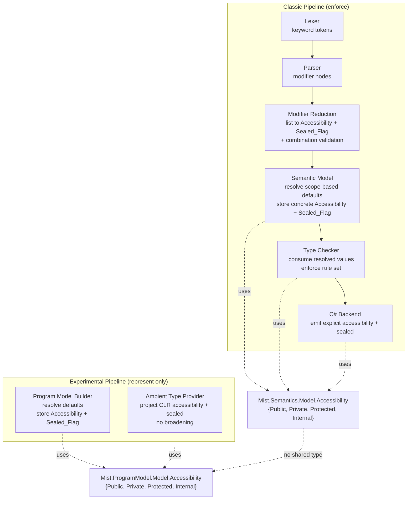

# Design Document

## Overview

This feature adds a C#-style accessibility model to Mist — the four levels `public`, `private`, `protected`, and `internal` plus the `sealed` type modifier — and wires it through both compiler pipelines.

The classic pipeline (Lexer → Parser → Semantic Model → Type Checker → C# Backend) gains **full enforcement**: it lexes the new keywords, parses them into a single resolved accessibility value plus a separate sealed flag, resolves scope-based defaults during Semantic Model construction, enforces the complete C# accessibility rule set in the Type Checker, and emits explicit accessibility and `sealed` in the generated C#.

The experimental pipeline (Program Model + Ambient Type Provider) gains **representation only**: it models the same accessibility value and sealed flag on every declaration and projects CLR accessibility/sealed state onto the four-level enum, but adds **no** enforcement analyzer and **no** emitter changes.

The core representational change is replacing the per-keyword accessibility booleans in each pipeline with a single `Accessibility` enum. Each pipeline defines its **own** enum idiomatically within its layer; there is deliberately no third, shared, cross-pipeline accessibility type. The `sealed` modifier is modeled separately as a boolean `Sealed_Flag` on type declarations, never as an enum value.

### Key research findings that shape the design

The design is grounded in the current state of the source (verified during research):

- **Classic Type Checker** (`Analysis/Builtin/TypeCheckerAnalyzer.cs`) currently reads accessibility *on demand* from AST modifier nodes via `GetMemberModifiers(declaringNode)`, using a private `MemberModifiers(bool IsPublic, bool IsPrivate, bool IsStatic)` record struct and a private `AccessLevel` enum whose `Protected`/`Internal` members are commented out. It has a documented special case that defaults **struct** members without a modifier to **public** ("C++ struct semantics"). No resolved accessibility is stored on the Semantic Model today.
- **Classic Semantic Model** carries no accessibility on `ISymbol`/`Symbol` (`Semantics/Contracts/ISymbol.cs`, `Semantics/Model/SymbolTable.cs`). `ClassType` already has an `IsSealed` bool (set only for CLR-projected types); `StructType` has none. Both have `MemberScope`, `BaseType`, etc.
- **Program Model** `MemberModifiers` (`ProgramModel/Model/MemberModifiers.cs`) has `IsPublic`/`IsPrivate`/`IsProtected` (no `IsInternal`, no enum). `StructType` is inheritable (`ProgramModel/Model/Types/StructType.cs`, with `BaseType`/`GetAncestorChain` on the classic side).
- **Ambient Type Provider** represents sealed via a `Mist.Sentinel.Sealed` attribute derived from `clrType.IsSealed` (`AmbientProvider/SentinelAttributes.cs`), treating a CLR static class (abstract+sealed) as neither. Projectors collapse `IsFamily`/`IsFamilyOrAssembly` → `IsProtected` and skip `assembly`/`private`/`family-and-assembly` members (`AmbientProvider/FieldProjector.cs`). `TypeProjector.CreateShell` sets `MemberModifiers` but no first-class sealed flag on the type.
- **Grammar** (`Grammar/tokens/keywords.storm`, `Grammar/Mist.storm`) defines `PUBLIC`/`PRIVATE`/`STATIC` keyword tokens and a shared `Modifier` rule (`PUBLIC as PublicModifier | PRIVATE as PrivateModifier | ...`). The Storm-generated lexer/parser is regenerated from these files.
- **C# Backend** `EmitModifiers` (`CSharpTranspiler/CSharpEmitter.cs`) only maps `public`/`private`/`static`; class/struct/enum emission prepends `public ` when neither `public` nor `private` is present. Critically, struct emission **drops the base struct** from the base list (`"The CLR does not support struct inheritance, so we must NOT emit ': BaseStruct'"`), and C# structs cannot legally carry `protected` members — so inheritable/protected/sealed structs need a lowering decision (see Req 15.4).
- **Diagnostic registry** infrastructure is already complete (`Common/Diagnostics/DiagnosticDescriptor.cs`, `DiagnosticBag.Report`/`ReportAtNode`, and per-area registry classes under `Descriptors/`). New diagnostics are added as `public static readonly DiagnosticDescriptor` fields; IDs follow the `MIST_TC_*` / `MIST_PARSE_*` scheme.

### Dependency and ordering relationship with `diagnostic-descriptor-system`

The in-flight `specs/diagnostic-descriptor-system/` spec migrates all diagnostics to the centralized `DiagnosticDescriptor` registry. Its infrastructure tasks (the `DiagnosticDescriptor` type, `DiagnosticBag.Report`/`ReportAtNode`, and every per-area registry class including `TypeCheckDiagnostics`, `ParserDiagnostics`, `SemanticDiagnostics`, `ProgramModelDiagnostics`) are **already complete** (tasks 1–23 done). The remaining tasks are a registry ID-uniqueness test (24), a grep check that forbids inline `new DiagnosticId(` outside registries (25), a steering file (26), and a final `dotnet format` (27).

Consequences for this feature:

- **No hard blocker.** This feature only *adds* new `DiagnosticDescriptor` entries to existing registry classes, exactly as Requirement 14 mandates. The registry API it depends on is in place.
- **Ordering / soft dependency.** New descriptors must (a) use IDs unique across *all* registry classes so the uniqueness test (descriptor-system task 24) still passes when it lands, and (b) be emitted only via `DiagnosticBag.Report`/`ReportAtNode` with no inline `new DiagnosticId(` at emission sites, so the grep check (task 25) stays green. Both are already required by Requirement 14 here, so the two specs are mutually consistent; this feature should reference the *registry classes*, not re-introduce local `DiagnosticId` fields on `TypeCheckerAnalyzer`.
- The exact numeric IDs are assigned at implementation time to the next free `MIST_TC_*` / `MIST_PARSE_*` codes after inspecting the registry, mirroring the reallocation strategy already documented in `TypeCheckerAnalyzer.cs`.

## Architecture

### Two enums, one per pipeline



The two `Accessibility` enums are structurally identical (same four values) but are **separate definitions**: the classic one lives in `Mist.Semantics.Model` and the experimental one in `Mist.ProgramModel.Model`. The Program Model isolation rule (no references to `Mist.Semantics.*`) forbids sharing, and Requirements 3.5 / 4.5 forbid a third cross-pipeline type. Neither enum includes a `sealed` value; `sealed` is a separate boolean on type declarations in each pipeline.

### Where accessibility is decided vs. consumed

A single conceptual reduction — *"modifier list + enclosing scope kind → concrete `Accessibility` + `Sealed_Flag`"* — is the heart of the feature. It runs in two places (one per pipeline) and is split into two responsibilities to honor the requirements' component assignments:

1. **Explicit reduction + combination validation** (Requirement 2). When a declaration carries explicit access modifiers, they reduce to exactly one `Accessibility` value; `sealed` sets the `Sealed_Flag` independently. Illegal combinations (more than one access modifier — Req 2.6) are reported at the **parse** stage, co-located with the existing post-parse validation in `MistParser.cs` that already emits `MIST_PARSE_*` diagnostics.
2. **Default resolution** (Requirement 5). When a declaration has no explicit access modifier, the enclosing **scope kind** determines the default (namespace/compilation → `Internal`; class/struct → `Private`; interface/enum → `Public`; nested type → its enclosing scope's rule). This resolution runs during **Semantic Model construction** (classic) and **Program Model construction** (experimental), and the concrete value is stored on the declaration.

The **Type Checker never computes a default** (Req 5.11): every declaration it inspects already carries a concrete `Accessibility`. This is the central invariant that lets enforcement read a single value rather than re-deriving accessibility from scattered rules.

### Compilation-as-assembly boundary

Each whole compilation is treated as one implicit assembly (Req 6). "Same assembly" is defined as "same compilation." The Type Checker derives the boundary from the compilation unit: a reference is cross-assembly when the referenced declaration originates from an `External_Assembly` (a CLR/backend-projected type, or a separately-compiled Mist project unit — detectable via the existing `SymbolOrigin.Backend` marker and the `OriginProjectPath`/referenced-unit tracking already used by `CheckEntryPoint`). `internal` is visible within the same compilation and hidden across this boundary.

## Components and Interfaces

### 1. Lexer (classic) — Requirement 1

Add three keyword tokens to `Grammar/tokens/keywords.storm`:

```
token PROTECTED = "protected";
token INTERNAL  = "internal";
token SEALED    = "sealed";
```

The Storm-generated `MistLexer` picks these up automatically after regeneration; no hand-written lexer change is needed (`Lexing/MistLexer.cs` delegates to Storm).

### 2. Parser + Modifier Reduction (classic) — Requirement 2

Extend the shared `Modifier` rule in `Grammar/Mist.storm`:

```
rule Modifier
    = PUBLIC     as PublicModifier
    | PRIVATE    as PrivateModifier
    | PROTECTED  as ProtectedModifier
    | INTERNAL   as InternalModifier
    | SEALED     as SealedModifier
    | STATIC     as StaticModifier
    | INTRINSIC  as IntrinsicModifier
    | READONLY   as ReadonlyModifier
    | ...
    ;
```

This yields generated `ProtectedModifierModifierNode`, `InternalModifierModifierNode`, and `SealedModifierModifierNode` in the AST. The rule stays permissive (`Modifier*`), so combination legality is validated after parsing rather than in the grammar (the grammar cannot express "at most one access modifier" without ambiguity).

A pure reduction helper is the single source of truth for turning a modifier list into an accessibility decision:

```csharp
// Classic side, in Mist.Semantics.Model
internal static class AccessibilityFacts
{
    // Returns the explicit Accessibility if exactly one access modifier is present;
    // null if none is present (caller resolves the scope-based default).
    // Reports MIST_PARSE_* if more than one access modifier is present.
    public static Accessibility? TryReduceExplicit(
        IReadOnlyList<ModifierNode> modifiers, out int accessModifierCount);

    // True if the SEALED modifier is present, independent of the access modifier.
    public static bool HasSealed(IReadOnlyList<ModifierNode> modifiers);
}
```

Combination validation surfaced at the parse stage (Req 2.6): if `accessModifierCount > 1`, emit a new `ParserDiagnostics` descriptor (e.g. `MultipleAccessModifiers`, `MIST_PARSE_*`, `PipelineStage.Parsing`) explaining that Mist has four standalone access levels and no combined levels. `sealed` is orthogonal and never counts as an access modifier.

### 3. Semantic Model (classic) — Requirements 3, 5, 6

**New enum** in `Mist.Semantics.Model`:

```csharp
namespace Mist.Semantics.Model;

/// <summary>The declared accessibility of a Mist declaration (classic pipeline).</summary>
public enum Accessibility
{
    Public,
    Private,
    Protected,
    Internal,
}
```

**Storage on declarations.** Add a resolved `Accessibility` to the member symbol and to the type objects:

- `ISymbol` / `Symbol` (`Semantics/Contracts/ISymbol.cs`, `Semantics/Model/SymbolTable.cs`): add `Accessibility Accessibility { get; }` (settable internally during construction). Applies to fields, methods, constructors, properties, indexers, and the type-declaration symbols.
- Type objects that need their own accessibility as *types* (`ClassType`, `StructType`, `AbstractType`, `EnumType`, `TypeAliasType`, `NewtypeType`): add `Accessibility Accessibility { get; internal set; }`. The type-declaration symbol and its `IType` carry the same resolved value.
- **Sealed flag**: `StructType` gains `bool IsSealed { get; internal set; }` to match `ClassType.IsSealed` (which already exists). For user-declared types, `IsSealed` is now set from the `Sealed_Flag` (previously it was set only for CLR-projected `ClassType`s).

**Default resolution** during `SemanticModelBuilder` construction. For each declaration:

1. Call `AccessibilityFacts.TryReduceExplicit(...)`. If it returns a value, store it.
2. Otherwise resolve the scope-kind default (Req 5.1–5.7):

| Enclosing scope kind | Default |
|---|---|
| namespace / compilation (global) | `Internal` |
| class / struct | `Private` |
| interface (abstract) / enum | `Public` |
| nested type (declared inside a class/struct) | `Private` |

3. Set `IsSealed` from `AccessibilityFacts.HasSealed(...)` on `ClassType`/`StructType`.

After Pass-1 construction completes, **every** applicable declaration carries a concrete `Accessibility` and every type carries a concrete `IsSealed` (Req 5.10). The **struct-member default flips from public to private** — the old "C++ struct semantics" branch is removed and struct members follow the class/struct rule (`Private`) exactly as C# does (Req 5.3).

**Compilation-as-assembly** (Req 6): expose a helper on the Type Checker that answers "is this reference cross-assembly?" by checking whether the referenced symbol's origin is external to the current compilation. Backend-origin symbols (`SymbolOrigin.Backend`) and symbols from referenced project units are external; everything else is same-compilation.

### 4. Type Checker (classic) — Requirements 5.11, 6, 7, 8, 9, 10, 11, 12, 13

`TypeCheckerAnalyzer` is refactored to **consume** the resolved `Accessibility` and `IsSealed` rather than reading AST modifiers:

- Replace the private `MemberModifiers(IsPublic, IsPrivate, IsStatic)` reads and the commented-out `AccessLevel` enum with reads of `symbol.Accessibility`. The `GetMemberModifiers` AST helper is retained only for `IsStatic` (a non-accessibility modifier) or migrated to read staticness from the symbol; accessibility no longer flows from the AST here.
- **Delete the struct-member-defaults-to-public branch** in `CheckMemberAccessModifiers`. Access decisions now use the resolved value uniformly for classes and structs.

New/expanded enforcement (all emitting `TypeCheckDiagnostics` descriptors at `PipelineStage.Analysis`):

- **Member-access enforcement** (Req 7): compute each member's *accessibility domain* from its resolved `Accessibility` and its declaring type, and reject references from outside it. `Private` → declaring type (and its nested types, Req 11.3) only; `Protected` → declaring type or a derived type; `Internal` → same compilation only (cross-`External_Assembly` reference is an error, Req 6.4/7.3).
- **Accessibility-consistency ("less accessible than")** (Req 8): for every declaration, verify that no type exposed in its signature (return type, parameter types, field/property/indexer type, generic constraints) is *less accessible* than the declaration. This requires an accessibility ordering (`Private < Protected/Internal < Public`, with `Protected` and `Internal` incomparable — matching C#'s "at least as accessible as" partial order).
- **Base-type / implemented-interface accessibility** (Req 9): a base class, implemented interface, or base interface must be at least as accessible as the deriving/implementing type.
- **Override / interface-implementation** (Req 10): overrides and interface implementations obey the C# accessibility rules for their position.
- **Nested-type accessibility domain** (Req 11): a nested type's domain is the intersection of its own accessibility and its enclosing type's domain; references from outside are rejected; a member referenced from a nested type of the same declaring type is inside the domain.
- **Sealed inheritance** (Req 12): deriving from a `sealed` class or `sealed` struct is an error, for both user-declared sealed Mist types and sealed types projected from `External_Assembly`s (the classic pipeline reads `IsSealed` on `ClassType`/`StructType`, which is populated for both). Non-sealed bases are permitted.
- **Sealed × Mist-specific constructs** (Req 12.5–12.9): a type **alias** of a sealed type is accepted (aliases are transparent — no new type); a **refinement** over a sealed type or over an alias of one is accepted (narrows values, does not extend); a **newtype** wrapping a sealed type is an **error** (it builds a new nominal type); `sealed` on a **type alias** is an **error** (`sealed` is meaningful only on class/struct); a type alias may itself carry any of the four accessibility modifiers, enforced like any other declaration.
- **Protected in sealed** (Req 13): a `Protected` member on a non-sealed class/struct is fully enforced with no warning; a `Protected` member declared inside a `sealed` class/struct **compiles** but emits a **warning-severity** diagnostic (the single `Allow_But_Warn` case, mirroring C# CS0628). `sealed` is not supported on methods/non-type members (Req 13.3) — a placement check rejects it.

### 5. C# Backend (classic) — Requirement 15

`EmitModifiers` is extended to render the full accessibility keyword sequence and `sealed`:

- Map `ProtectedModifierModifierNode` → `protected`, `InternalModifierModifierNode` → `internal`, `SealedModifierModifierNode` → `sealed`.
- Emit accessibility from the **resolved** `Accessibility` value (not merely the raw modifier list), so that a declaration whose effective accessibility is `Private` emits an explicit `private` keyword rather than relying on the C# implicit default (Req 15.2). Class/struct/enum emission stops prepending a blanket `public ` and instead emits the resolved value.
- Emit `sealed` on an emitted **class** whose `Sealed_Flag` is set (Req 15.3).

**Struct-lowering design decision (Req 15.4).** Because Mist structs are inheritable and may be `sealed` or carry `protected` members — none of which a C# value-type `struct` can legally express (C# forbids struct inheritance and `protected` struct members, and C# structs are implicitly sealed) — the backend lowers a Mist struct to a **C# reference type (`class`) when, and only when, the struct cannot be represented as a legal C# `struct`**: specifically when it (a) declares a base struct, (b) is the base of another struct, or (c) declares a `protected` member. Such a class emits normal C# inheritance (`: BaseStruct`), `protected` members, and — if `sealed` — the `sealed` keyword. A "plain" struct (no base, not a base, no `protected` member) continues to emit as a C# `struct`; if it is `sealed`, the keyword is simply omitted because C# structs are already implicitly sealed. This decision fixes only the *mechanism*; the observable guarantee (Req 15.5 — generated C# compiles without C# accessibility errors for every accepted input) is what the sample proves. Applied to the proof code: `Vector` and `UnitVector` lower to C# classes (protected member / inheritance), `Frozen` stays a C# struct with `sealed` omitted.

### 6. Program Model (experimental) — Requirements 4, 16

**New enum** in `Mist.ProgramModel.Model` (separate definition, obeys the isolation rule):

```csharp
namespace Mist.ProgramModel.Model;

/// <summary>The declared accessibility of a declaration (experimental pipeline).</summary>
public enum Accessibility
{
    Public,
    Private,
    Protected,
    Internal,
}
```

**`MemberModifiers` migration** (`ProgramModel/Model/MemberModifiers.cs`): replace the `IsPublic`/`IsPrivate`/`IsProtected` booleans with a single `Accessibility Accessibility { get; init; }` field. `Internal` becomes expressible for the first time. Non-accessibility modifiers (`IsStatic`, `IsReadonly`, `IsAsync`, `IsRef`, discipline, etc.) are unchanged. Every existing reader of the removed booleans (e.g. `AmbientProvider` projectors, `PropertyAccessor.IsPrivate`) migrates to the enum.

**Sealed flag**: add a first-class `bool` sealed flag to type declarations in the Program Model (on the type model, distinct from `MemberModifiers`), populated during construction and by the Ambient Type Provider. This is separate from the `Accessibility` enum (Req 4.2).

**Default resolution** during Program Model construction mirrors the classic scope-kind rule (Req 5.7, 5.9) so both pipelines record the same default for the same declaration position; the concrete value is stored on every declaration (Req 5.10). The experimental pipeline gains **no** enforcement analyzer (Req 16.3) and **no** emitter change (Req 16.4).

### 7. Ambient Type Provider (experimental) — Requirement 16

The projectors are updated to populate the new enum and the first-class sealed flag:

- **Accessibility mapping** (Req 16.6), applied in `FieldProjector`, `MethodProjector`, `PropertyProjector`, `ConstructorProjector`, `IndexerProjector`, `OperatorProjector`, `TypeProjector`, and nested-type projection, using a shared helper:

| CLR accessibility | Mist `Accessibility` |
|---|---|
| public | `Public` |
| family (protected) | `Protected` |
| family-or-assembly (protected internal) | `Protected` |
| private | `Private` |
| assembly (internal) | `Private` |
| family-and-assembly (private protected) | `Private` |

  The mapping **never broadens** and **never** produces Mist `Internal` (which would incorrectly widen an external member into the consumer's compilation). The same rule applies to nested-type CLR accessibility forms. Note the projectors already only *project* public/protected members today; assembly/private/family-and-assembly members that are nonetheless projected (e.g. an inherited protected-internal member surfaced through reflection) map to `Private`, not `Internal`.

- **Sealed flag from CLR** (Req 16.5): `TypeProjector.CreateShell` sets the first-class sealed flag from `clrType.IsSealed`, treating a CLR **static class** (a type that is both `IsAbstract` and `IsSealed`) as **neither** sealed nor abstract — matching the existing `SentinelAttributes.ApplyTypeAttributes` behavior. This first-class flag is **reconciled** with the pre-existing `Mist.Sentinel.Sealed` sentinel-attribute mechanism the emitter relies on: the sentinel continues to be applied for emitter compatibility, and the first-class flag is derived from the same `clrType.IsSealed`/static-class logic, so the two representations always agree.

- **First-class projection** (Req 16.1, 16.2): Program Model declarations and all projected CLR/imported/Mist types and members carry both the `Accessibility` value and the sealed flag.

### 8. Existing-violation cleanup — Requirement 18

Enabling classic enforcement flags existing declarations. The cleanup edits only what must change, using the narrowest sufficient accessibility (least privilege, minimal touch), with two mandatory correctness overrides:

- **Struct-member flip** (Req 18.5, 18.6): every existing struct member that relied on the old public default and is referenced across an accessibility boundary gets the narrowest explicit modifier that keeps the existing usage legal. The flip is applied in full; correctness wins over touch-count.
- **Stdlib intended-public upgrade** (Req 18.7): standard-library types/members left unspecified are upgraded to explicit `public` (their intended accessibility), because a top-level type defaults to `Internal` and `internal` is compilation-scoped — an unspecified stdlib declaration would otherwise become invisible to consuming compilations.

The audit spans compiler Mist sources, samples, snippets, and test `.mist` fixtures; the end state builds with zero errors and zero warnings under the new rules (Req 18.8).

### 9. TextMate grammar + book highlighting — Requirement 19

Add `protected`, `internal`, and `sealed` to the `storage.modifier.mist` pattern in `Editor/mist-syntax-highlighting/syntaxes/mist.tmLanguage.json`. Keep the book's highlighter in sync by adding the same three keywords to the `MODIFIERS` list in **both** `book/theme/mist-lang.js` and `book/theme/highlight.js`.

### 10. Sample application — Requirement 20

Create `samples/FullAccessibilityModel/` with the locked proof code **verbatim and immutable** (`Shape.mist`, `Square.mist`, `Ledger.mist`, `Vector.mist`, `UnitVector.mist`, `Frozen.mist`, `Program.mist`) plus a `mist.toml` (`name = "FullAccessibilityModel"`). Register it in `samples/AllFeatures/mist.toml` under `[references]` and add `FullAccessibilityModel.Program.RunDemo();` to `samples/AllFeatures/Program.mist`. The sample must build and run warning-free and produce the exact locked expected output. If the proof code or its output ever appears inconsistent with a requirement during implementation, the implementer halts and requests user intervention rather than weakening the implementation or the proof code (Req 20.7).

### 11. Book chapter — Requirement 21

Add an **Accessibility** chapter under the **Object Model** section of `book/src/` (adjacent to Inheritance/Abstract Types, since accessibility governs member/type visibility), with compiled snippets under `book/snippets/object-model/accessibility/` (each `.mist` paired with a SnippetEmitter-generated `.cs`). Cover the four levels, Mist's omission of `protected internal` / `private protected` and their collapse on projection, scope-based defaults, the compilation-as-assembly boundary for `internal`, `sealed` classes and structs, and the single `Allow_But_Warn` case. Reference the chapter from `book/src/SUMMARY.md`.

## Data Models

### Classic `Accessibility` enum (`Mist.Semantics.Model`)

```csharp
public enum Accessibility { Public, Private, Protected, Internal }
```

### Experimental `Accessibility` enum (`Mist.ProgramModel.Model`)

```csharp
public enum Accessibility { Public, Private, Protected, Internal }
```

Two independent definitions; no shared/third type (Req 3.4, 3.5, 4.4, 4.5).

### Accessibility ordering (partial order)

Used by the "less accessible than" checks (Req 8, 9) and by projection non-broadening (Req 16.6). It is the C# partial order, not a total order:

```
Private  <  Protected  <  Public
Private  <  Internal   <  Public
Protected  and  Internal  are incomparable
```

"A is at least as accessible as B" means A ≥ B in this partial order. Because `Protected` and `Internal` are incomparable, neither is "at least as accessible as" the other — matching C#. This is captured as a helper:

```csharp
// classic side
internal static class AccessibilityOrder
{
    // True if `a` is at least as accessible as `b` in the C# partial order.
    public static bool IsAtLeastAsAccessibleAs(Accessibility a, Accessibility b);
}
```

### Classic member accessibility storage

```csharp
public interface ISymbol
{
    // ... existing members ...
    Accessibility Accessibility { get; }   // NEW — resolved, concrete
}
```

`Symbol` implements the setter internally; the value is assigned during Semantic Model construction and is never `null`/pending afterward (Req 5.10).

### Classic type accessibility + sealed storage

```csharp
public sealed class ClassType : IType
{
    // ... existing ...
    public Accessibility Accessibility { get; internal set; }   // NEW
    public bool IsSealed { get; internal set; }                 // EXISTS; now set for user types too
}

public sealed class StructType : IType
{
    // ... existing ...
    public Accessibility Accessibility { get; internal set; }   // NEW
    public bool IsSealed { get; internal set; }                 // NEW — mirrors ClassType
    public IType? BaseType { get; internal set; }               // EXISTS — structs are inheritable
}
```

`AbstractType`, `EnumType`, `TypeAliasType`, and `NewtypeType` likewise gain a resolved `Accessibility`. Only `ClassType`/`StructType` carry `IsSealed` (Req 12: `sealed` applies to classes and structs only).

### Experimental `MemberModifiers` (migrated)

```csharp
public record struct MemberModifiers
{
    public Accessibility Accessibility { get; init; }   // REPLACES IsPublic/IsPrivate/IsProtected
    public bool IsStatic { get; init; }
    public bool IsReadonly { get; init; }
    public bool IsAsync { get; init; }
    public bool IsIntrinsic { get; init; }
    public bool IsOwned { get; init; }
    public bool IsRef { get; init; }
    public SubstructuralDiscipline Discipline { get; init; }
}
```

The experimental type model additionally carries a first-class `bool` sealed flag on type declarations (separate from `MemberModifiers`), populated during construction and by the Ambient Type Provider (Req 4.2, 16.1, 16.5).

### CLR accessibility → Mist `Accessibility` projection table

The non-broadening mapping (Req 16.6), keyed off `System.Reflection` predicates:

| Reflection predicate (field/method/etc.) | Mist `Accessibility` |
|---|---|
| `IsPublic` | `Public` |
| `IsFamily` | `Protected` |
| `IsFamilyOrAssembly` | `Protected` |
| `IsPrivate` | `Private` |
| `IsAssembly` | `Private` |
| `IsFamilyAndAssembly` | `Private` |

Never yields `Internal`. Sealed comes from `Type.IsSealed` with the static-class (abstract+sealed) exception mapping to "not sealed."

### Modifier-list → accessibility decision (reduction)

Input: the AST `Modifier*` list on a declaration and the kind of the enclosing scope. Output: exactly one `Accessibility` plus a `Sealed_Flag`, or a diagnostic. Decision table for the explicit-modifier reduction (Req 2.1–2.6):

| Access modifiers present | Result |
|---|---|
| exactly `public` | `Public` |
| exactly `private` | `Private` |
| exactly `protected` | `Protected` |
| exactly `internal` | `Internal` |
| none | resolve scope-kind default (Req 5) |
| more than one | error `MIST_PARSE_*` (multiple access modifiers) |

`sealed` sets `Sealed_Flag = true` independently and never participates in the access-modifier count.

## Correctness Properties

A property is a characteristic or behavior that should hold true across all valid executions of a system — essentially, a formal statement about what the system should do. Properties serve as the bridge between human-readable specifications and machine-verifiable correctness guarantees.

The properties below were derived from the acceptance-criteria prework and then reflected to remove redundancy: the four single-modifier reduction criteria (2.1–2.4) collapse into one mapping property; the scope-kind default criteria (5.1–5.6) collapse into one resolved-default property; the six "less accessible than" signature criteria (8.1–8.6) collapse into one iff property; the base/interface criteria (9.1–9.4) into one; the override/interface-impl criteria (10.1–10.3) into one; the sealed-inheritance criteria (12.1–12.4) into one; and the positive-path "permit within domain" criteria (6.3, 7.4) are expressed as the accepting half of the member-access properties rather than as standalone properties. Architectural, definitional, documentation, and pure build/refactor criteria (3.3–3.5, 4.3–4.5, 5.11, 6.1, 6.2, 6.5, 14.x, 16.3, 16.4, 17.x, 18.1–18.7, 20.7, 21.1–21.4) are not encoded as properties; they are covered by build checks and the integration/example/smoke tests in the Testing Strategy.

### Property 1: Single access modifier reduces to that accessibility

*For any* declaration whose only access modifier is exactly one of `public`, `private`, `protected`, or `internal`, the reduced Accessibility value equals that modifier's corresponding enum value.

**Validates: Requirements 2.1, 2.2, 2.3, 2.4**

### Property 2: Sealed is orthogonal to accessibility

*For any* modifier list, reducing the list with the `sealed` modifier added yields the same Accessibility value as reducing it without `sealed`, and sets the Sealed_Flag; reducing a list without `sealed` leaves the Sealed_Flag unset.

**Validates: Requirements 2.5**

### Property 3: Multiple access modifiers are rejected

*For any* modifier list containing two or more distinct access modifiers, the reduction reports a multiple-access-modifier error.

**Validates: Requirements 2.6**

### Property 4: Default accessibility follows the enclosing scope kind

*For any* declaration that has no explicit access modifier, the resolved Accessibility equals the scope-kind default of its immediately enclosing scope: `Internal` for a namespace/compilation (global) scope, `Private` for a class or struct scope, `Public` for an interface or enum scope, and `Private` for a nested type — matching the accessibility C# assigns to the equivalent declaration position.

**Validates: Requirements 5.1, 5.2, 5.3, 5.4, 5.5, 5.6**

### Property 5: Every declaration carries a concrete resolved accessibility

*For any* valid program, after Semantic Model construction completes, every applicable declaration carries a concrete Accessibility enum value, with no declaration retaining an unspecified or default-pending state.

**Validates: Requirements 3.1, 5.8, 5.10**

### Property 6: Both pipelines resolve the same default for the same position

*For any* declaration position with no explicit access modifier, the classic default resolution and the experimental default resolution produce the same Accessibility value.

**Validates: Requirements 5.7**

### Property 7: Private members are reachable only within the declaring type's domain

*For any* `Private` member, a reference from outside the accessibility domain of the member's declaring type is reported as an accessibility-violation error, and a reference from within that domain (including from a nested type of the same declaring type) is accepted without an accessibility diagnostic.

**Validates: Requirements 7.1, 7.4, 11.3**

### Property 8: Protected members are reachable only from the declaring or derived types

*For any* `Protected` member, a reference from a location that is neither the declaring type nor a type derived from the declaring type is reported as an accessibility-violation error, and a reference from the declaring type or a derived type is accepted without a warning (protected on a non-sealed type is fully enforced with no spurious diagnostic).

**Validates: Requirements 7.2, 7.4, 13.1**

### Property 9: Internal members respect the compilation-as-assembly boundary

*For any* `Internal` member, a reference from elsewhere within the same compilation is accepted without an accessibility diagnostic, and a reference from an External_Assembly is reported as an accessibility-violation error.

**Validates: Requirements 6.3, 6.4, 7.3**

### Property 10: A declaration is never more accessible than the types in its signature

*For any* declaration, an inconsistent-accessibility error is reported if and only if some type exposed in its signature — return type, parameter type, field type, property or indexer type, or generic constraint type — is not at least as accessible as the declaration itself.

**Validates: Requirements 8.1, 8.2, 8.3, 8.4, 8.5, 8.6**

### Property 11: Base types and interfaces are at least as accessible as the deriving type

*For any* type, a base/interface accessibility error is reported if and only if its base class, an implemented interface, or a base interface is not at least as accessible as the type itself.

**Validates: Requirements 9.1, 9.2, 9.3, 9.4**

### Property 12: Overrides and interface implementations obey position accessibility rules

*For any* overriding member or interface-implementing member, an accessibility-violation error is reported if and only if its accessibility violates the C# accessibility rule for that position.

**Validates: Requirements 10.1, 10.2, 10.3**

### Property 13: A nested type's domain is the intersection of its own accessibility and its enclosing type's domain

*For any* nested type, its accessibility domain is computed from both its declared Accessibility and the accessibility domain of its enclosing type; a reference from outside that computed domain is reported as an accessibility-violation error, and a reference from within it is accepted.

**Validates: Requirements 11.1, 11.2**

### Property 14: Deriving from a sealed type is rejected, from a non-sealed type is accepted

*For any* type, declaring a sealed class or sealed struct — whether user-declared or projected from an External_Assembly — as its base type is reported as a sealed-inheritance error, while declaring a non-sealed base type is accepted without a sealed-inheritance diagnostic; and declaring a class or struct with the `sealed` modifier is itself accepted without a diagnostic.

**Validates: Requirements 12.1, 12.2, 12.3, 12.4**

### Property 15: Sealed interacts correctly with Mist-specific type constructs

*For any* sealed type, a type alias targeting it is accepted with no sealed diagnostic, a refinement declared over it (or over an alias of it) is accepted with no sealed diagnostic, and a newtype wrapping it is reported as an error.

**Validates: Requirements 12.5, 12.6, 12.7**

### Property 16: Sealed is valid only on class and struct declarations

*For any* declaration bearing the `sealed` modifier that is not a class or struct type declaration — a type alias, a method, or any other non-type member — an error is reported.

**Validates: Requirements 12.9, 13.3**

### Property 17: A protected member in a sealed type compiles with exactly one warning

*For any* sealed class or sealed struct that declares a `Protected` member, the declaration compiles and exactly one warning-severity diagnostic (the CS0628 analog) is reported for that member; *for any* non-sealed class or struct with a `Protected` member, no such warning is reported.

**Validates: Requirements 13.1, 13.2**

### Property 18: Emitted C# carries the explicit accessibility and sealed keywords

*For any* declaration accepted by the classic pipeline, the emitted C# includes an explicit accessibility keyword sequence corresponding to the declaration's resolved Accessibility value — emitting an explicit `private` when the effective accessibility is `Private` rather than relying on the C# implicit default — and a `sealed` keyword on any emitted class whose Sealed_Flag is set.

**Validates: Requirements 15.1, 15.2, 15.3**

### Property 19: Accepted programs emit valid, compilable C#

*For any* program accepted by the classic pipeline — including programs exercising inheritable structs, sealed structs, and `protected` struct members — the emitted C# compiles without C# accessibility errors.

**Validates: Requirements 15.4, 15.5**

### Property 20: CLR accessibility projects to the four-level enum without broadening

*For any* CLR member or type accessibility value, the projected Mist Accessibility follows the fixed mapping — public → `Public`, family → `Protected`, family-or-assembly → `Protected`, and private, assembly, or family-and-assembly → `Private` — which never broadens access and never yields Mist `Internal`.

**Validates: Requirements 16.6**

### Property 21: CLR sealed state projects to the first-class sealed flag with the static-class exception

*For any* CLR type, the projected first-class sealed flag equals the type's `IsSealed` state, except that a CLR static class (a type that is both abstract and sealed) projects as neither sealed nor abstract.

**Validates: Requirements 16.5**

## Error Handling

### Diagnostic surfaces and severities

All new diagnostics are added as `DiagnosticDescriptor` fields in the existing registry classes (Requirement 14), reusing the established shape (`Id`, `DefaultSeverity`, `Stage`, `MessageTemplate`) with no changes to the registry or `DiagnosticDescriptor` structure. Emission uses `DiagnosticBag.Report` / `ReportAtNode` — never inline `new DiagnosticId(...)` at call sites. Exact numeric IDs are assigned at implementation time to the next free codes after inspecting the registry.

| Condition | Registry class | Severity | Stage | Requirement |
|---|---|---|---|---|
| More than one access modifier on a declaration | `ParserDiagnostics` (`MIST_PARSE_*`) | Error | Parsing | 2.6 |
| Private member referenced outside its domain | `TypeCheckDiagnostics` (`MIST_TC_*`) | Error | Analysis | 7.1 |
| Protected member referenced from non-declaring/non-derived location | `TypeCheckDiagnostics` | Error | Analysis | 7.2 |
| Internal member referenced from an External_Assembly | `TypeCheckDiagnostics` | Error | Analysis | 6.4, 7.3 |
| Inconsistent accessibility (signature exposes less-accessible type) | `TypeCheckDiagnostics` | Error | Analysis | 8.1–8.5 |
| Base type / interface less accessible than deriving type | `TypeCheckDiagnostics` | Error | Analysis | 9.1–9.3 |
| Override / interface-implementation accessibility violation | `TypeCheckDiagnostics` | Error | Analysis | 10.1, 10.2 |
| Nested type referenced outside its computed domain | `TypeCheckDiagnostics` | Error | Analysis | 11.2 |
| Deriving from a sealed class/struct | `TypeCheckDiagnostics` | Error | Analysis | 12.2 |
| Newtype wrapping a sealed type | `TypeCheckDiagnostics` | Error | Analysis | 12.7 |
| `sealed` on a type alias / non-type member | `TypeCheckDiagnostics` | Error | Analysis | 12.9, 13.3 |
| Protected member inside a sealed type (Allow_But_Warn) | `TypeCheckDiagnostics` | **Warning** | Analysis | 13.2 |

The protected-in-sealed diagnostic is the **only** warning-severity addition (the single `Allow_But_Warn` case); every other new diagnostic is an error, and everything not listed is accept-clean.

### Error-suppression and recovery conventions

The Type Checker follows the file's existing conventions: `ErrorType` operands and already-errored declarations suppress cascading accessibility diagnostics, and each declaration/reference reports at most one accessibility diagnostic. Accessibility enforcement reads only resolved values, so a declaration whose accessibility could not be resolved (defensive/should-not-happen after Property 5) is skipped rather than crashing.

### Interaction with the zero-warnings policy

Because the workspace enforces zero warnings, the protected-in-sealed **warning** must not appear anywhere in the compiler sources, samples, snippets, or test fixtures. The locked sample proof code is deliberately constructed to avoid it (`Frozen` is a sealed struct with **no** protected member), and the existing-violation cleanup (Requirement 18) removes any incidental occurrences so the whole codebase builds clean.

### Halt-on-inconsistency for the sample (Requirement 20.7)

If, during implementation, the locked proof code or its expected output appears inconsistent with a requirement, the implementer halts and requests user intervention rather than weakening the implementation or editing the immutable proof code. The proof code is authoritative for the definition of done.

## Testing Strategy

### Dual approach

- **Property tests** verify the universal properties above across many generated inputs (minimum 100 iterations each, using the project's property-based testing library — FsCheck, consistent with the existing `*PropertyTests` suites).
- **Unit / example tests** verify specific examples, edge cases, and the keyword/grammar cases.
- **Integration tests** verify cross-assembly behavior, the experimental-pipeline representation, and the end-to-end sample.

Each property test carries a tag comment: **Feature: full-accessibility-model, Property {number}: {property text}**.

### In-process compilation (no per-iteration process spawns)

Enforcement and reduction/default properties (Properties 1–17) compile Mist source **in-process** via a shared `CompilerDriver` (as the existing property suites do) and inspect the resulting `DiagnosticBag`; they do **not** run the output, so they spawn no external process and can run 100+ iterations cheaply. The round-trip property (Property 19) emits C# and compiles it **in-process via Roslyn** (`CSharpCompilationDriver`), asserting no C# accessibility/compile errors — also no `dotnet` process spawn. Generators produce random declarations, member/reference sites, type hierarchies, and modifier lists; a small executable-semantics oracle (the accessibility partial order + scope-kind default table + domain computation described in Data Models) supplies the expected accept/reject outcome for each generated input.

### Property test mapping

| Property | Realization |
|---|---|
| 1–3 (reduction, sealed orthogonality, multi-modifier) | Pure `AccessibilityFacts` reduction over generated modifier lists |
| 4 (scope-kind default) | Generate modifier-free declarations in each scope kind; assert resolved value |
| 5 (completeness) | Build model for generated programs; assert no pending accessibility |
| 6 (cross-pipeline agreement) | Run both default resolvers on the same generated position; assert equality |
| 7–9 (private/protected/internal domains) | Generate members + reference sites (including derived types and external-marked sites); assert accept/reject |
| 10–13 (consistency, base/interface, override/impl, nested domain) | Generate signatures/hierarchies with randomized accessibilities; assert iff against the ordering oracle |
| 14–17 (sealed inheritance, sealed interactions, sealed placement, protected-in-sealed) | Generate sealed/non-sealed bases, alias/refinement/newtype over sealed, sealed on various declaration kinds, protected members in sealed/non-sealed types |
| 18 (explicit emission) | Emit C# for generated declarations; assert the keyword sequence matches the resolved value |
| 19 (round-trip valid C#) | Emit + in-process Roslyn compile a generated corpus of accepted programs; assert zero accessibility errors |
| 20–21 (CLR projection) | Pure projection helpers over generated CLR accessibility/sealed shapes (using reflection predicates or a modeled enum); assert the mapping table and the static-class exception |

### Example, edge-case, and integration tests

- **Lexer (1.1–1.5)**: five example tests asserting each keyword lexes to its token.
- **Sealed-flag structure (3.2)**: example tests that a sealed vs. non-sealed declaration sets `IsSealed` independently of `Accessibility`.
- **TextMate grammar (19.1–19.3)**: example/snapshot tests that `protected`, `internal`, and `sealed` scope as `storage.modifier.mist`.
- **Experimental representation (4.1, 4.2, 5.9, 16.1, 16.2)**: integration tests that build the Program Model / project representative CLR types and confirm both the `Accessibility` value and the sealed flag are populated (the ProgramModel has no dedicated unit tests by policy — exercised indirectly).
- **Cross-assembly internal (6.4 end-to-end)**: an integration test with a referenced project/CLR type confirming an `internal` member is rejected across the boundary and permitted within the compilation.
- **Sample proof code (20.1–20.6)**: an integration test compiles and runs `samples/FullAccessibilityModel` (directly and via `AllFeatures`) and asserts the exact locked stdout with zero warnings. This test spawns `dotnet` a **small fixed number of times** (compile in-process, then run the built DLL once); per the workspace process-spawning approval policy, this is flagged for user review during task planning before the test is written.
- **Book snippets (21.3)**: the SnippetEmitter compiles every accessibility snippet (paired `.mist`/`.cs`) successfully.

### Whole-codebase verification (Requirement 18.8)

After the cleanup edits, a full build of the compiler sources, samples, snippets, and test `.mist` fixtures must complete with **zero errors and zero warnings** under the new rules, and `dotnet format --verify-no-changes` must pass for touched `Source/` files. This is the smoke gate that confirms the existing-violation cleanup and the struct-member flip were applied completely.

### Process-spawning note

No property test spawns a process per iteration. The only process-spawning test is the sample proof-code integration test, which spawns a small, fixed number of times (well under the forbidden 100+ threshold) and requires explicit user approval per the workspace policy before it is added to the task list.
