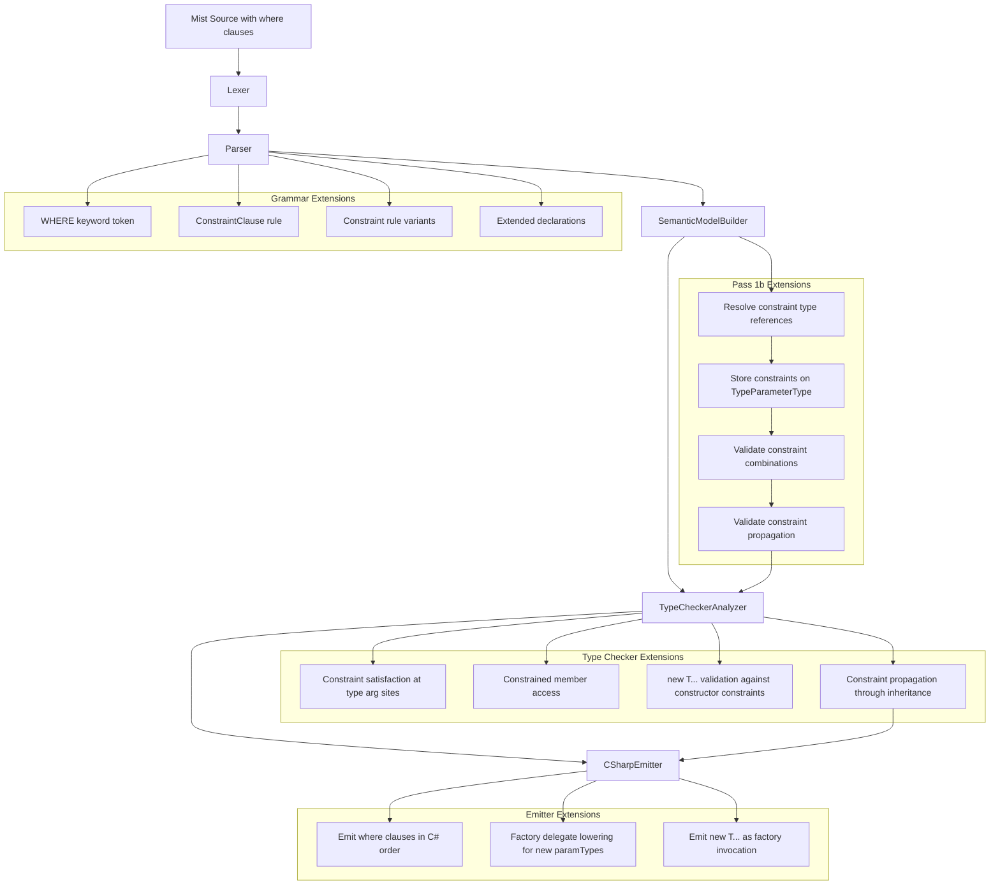

# Design Document: Generic Constraints

## Overview

This design adds generic constraints (`where` clauses) to the Mist programming language. Generic constraints restrict which types can be used as type arguments, enabling the compiler to guarantee that type arguments satisfy certain contracts. This allows generic code to safely access members defined by the constraint and enables the compiler to reject invalid type arguments at the call site.

The implementation touches every stage of the compiler pipeline:

1. **Grammar** — New `WHERE` keyword, `ConstraintClause` and `Constraint` rules; extended `ClassDeclaration`, `StructDeclaration`, `InterfaceDeclaration`, `MethodDeclaration`, `InterfaceMethodDeclaration`, and `TypeAliasDeclaration` rules
2. **Pretty Printer** — Format constraint clauses preserving source order
3. **Semantic Model** — Extended `TypeParameterType` with constraint storage; constraint resolution in Pass 1b; constraint validation rules
4. **Type Checker** — Constraint satisfaction checking at type argument sites; constrained member access; `new T(...)` validation; constraint propagation through inheritance
5. **C# Emitter** — Emit `where` clauses with C#-required ordering; factory delegate lowering for parameterized constructor constraints
6. **Syntax Highlighting** — Add `where` keyword and constraint clause patterns to the TextMate grammar

### Design Decisions

- **Constraint storage on `TypeParameterType`**: Constraints are stored directly on the `TypeParameterType` instance via a new `Constraints` property. This keeps constraint information co-located with the type parameter it applies to, making it available throughout the pipeline without additional lookups.

- **Resolution in Pass 1b**: Constraint clauses are resolved in Pass 1b (after base types and interface lists are resolved) because constraints reference types that must already be registered. This parallels how base type resolution works.

- **Parameterized constructor constraint lowering**: Since C# only supports `new()` (parameterless) constructor constraints, parameterized constructor constraints (e.g., `new(int)`) are lowered to a **factory delegate parameter** pattern. The generic type/method receives an additional `Func<TArgs, T>` parameter that the caller must supply. This is the simplest lowering that preserves type safety without requiring runtime reflection.

- **Conjunctive semantics for multiple constructor constraints**: When multiple `new(...)` constraints are declared on the same type parameter, the type argument must have a matching constructor for every one of them, because the generic body may call any of them. Inside the body, each `new T(...)` expression is validated against the specific signatures declared.

- **Constraint ordering is a C# emission concern only**: Mist accepts constraints in any order. The pretty printer preserves source order. Only the C# emitter reorders to satisfy C#'s required order (`class`/`struct` → base class → interfaces → `new()`).

- **Constraint propagation uses "at least as restrictive" semantics**: When a derived type inherits from a constrained base, the derived type's constraints on the same type parameter must be at least as restrictive (i.e., a superset of the base's constraints).

## Architecture



### Pipeline Integration Points

| Pipeline Stage | Change |
|---|---|
| `keywords.storm` | Add `WHERE` keyword token |
| `Mist.storm` | Add `ConstraintClause`, `Constraint` rules; extend `ClassDeclaration`, `StructDeclaration`, `InterfaceDeclaration`, `MethodDeclaration`, `InterfaceMethodDeclaration`, `TypeAliasDeclaration` |
| `MistPrettyPrinter` | Emit constraint clauses after declaration headers, preserving source order |
| `SemanticModelBuilder` Pass 1b | Resolve constraint type references; store on `TypeParameterType.Constraints`; validate combinations; check propagation |
| `TypeCheckerAnalyzer` | Check constraint satisfaction at all type argument usage sites; validate `new T(...)` against constructor constraints; enable constrained member access |
| `CSharpEmitter` | Emit `where` clauses with C#-required ordering; emit factory delegate parameters for parameterized `new(...)` constraints; emit factory invocations for `new T(args)` |
| `mist.tmLanguage.json` | Add `where` keyword highlighting and constraint clause patterns |

## Components and Interfaces

### Grammar Changes (`keywords.storm`)

**New keyword:**

```
token WHERE = "where";
```

### Grammar Changes (`Mist.storm`)

**New rules:**

```
rule ConstraintClause = WHERE name:IDENTIFIER COLON constraints:ConstraintList;

rule ConstraintList = Constraint (COMMA Constraint)*;

rule Constraint
    = CLASS                                                                    as ClassConstraint
    | STRUCT                                                                   as StructConstraint
    | NEW LEFT_PARENTHESIS paramTypes:ConstraintParameterTypeList? RIGHT_PARENTHESIS  as ConstructorConstraint
    | type:TypeReference                                                       as TypeConstraint
    ;

rule ConstraintParameterTypeList = TypeReference (COMMA TypeReference)*;
```

**Modified rules:**

```
rule ClassDeclaration = modifiers:Modifier* CLASS name:IDENTIFIER
    typeParams:TypeParameterList?
    baseClause:(COLON baseList:BaseList)?
    constraints:ConstraintClause*
    LEFT_BRACE members:MemberDeclaration* RIGHT_BRACE;

rule StructDeclaration = modifiers:Modifier* STRUCT name:IDENTIFIER
    typeParams:TypeParameterList?
    interfaceList:(COLON interfaces:BaseList)?
    constraints:ConstraintClause*
    LEFT_BRACE members:MemberDeclaration* RIGHT_BRACE;

rule InterfaceDeclaration = INTERFACE name:IDENTIFIER
    typeParams:TypeParameterList?
    interfaceList:(COLON interfaces:BaseList)?
    constraints:ConstraintClause*
    LEFT_BRACE members:InterfaceMemberDeclaration* RIGHT_BRACE;

rule MethodDeclaration = modifiers:Modifier* returnType:TypeReference name:IDENTIFIER
    typeParams:TypeParameterList?
    LEFT_PARENTHESIS parameters:ParameterList? RIGHT_PARENTHESIS
    constraints:ConstraintClause*
    body:MethodBody;

rule InterfaceMethodDeclaration = returnType:TypeReference name:IDENTIFIER
    typeParams:TypeParameterList?
    LEFT_PARENTHESIS parameters:ParameterList? RIGHT_PARENTHESIS
    constraints:ConstraintClause*
    SEMICOLON;

rule TypeAliasDeclaration = TYPE name:IDENTIFIER typeParams:TypeParameterList?
    EQUAL type:TypeReference
    constraints:ConstraintClause*
    SEMICOLON;
```

### Semantic Model Changes

**Extended `TypeParameterType`:**

```csharp
public sealed class TypeParameterType : IType
{
    public string DisplayName { get; }
    public TypeKind Kind => TypeKind.Class;
    public string Name { get; }
    public int Ordinal { get; }

    /// <summary>
    /// The constraints declared on this type parameter.
    /// Null if no constraints are declared (unconstrained).
    /// </summary>
    public TypeParameterConstraints? Constraints { get; internal set; }

    public TypeParameterType(string name, int ordinal) { ... }
}
```

**New `TypeParameterConstraints` class:**

```csharp
/// <summary>
/// Stores all constraints declared on a single type parameter.
/// </summary>
public sealed class TypeParameterConstraints
{
    /// <summary>Whether the 'class' (reference type) constraint is present.</summary>
    public bool HasClassConstraint { get; init; }

    /// <summary>Whether the 'struct' (value type) constraint is present.</summary>
    public bool HasStructConstraint { get; init; }

    /// <summary>
    /// The base class constraint, if any. At most one is allowed.
    /// </summary>
    public IType? BaseClassConstraint { get; init; }

    /// <summary>
    /// Interface constraints (including trait constraints lowered to interfaces).
    /// </summary>
    public IReadOnlyList<IType> InterfaceConstraints { get; init; }
        = Array.Empty<IType>();

    /// <summary>
    /// Trait constraints.
    /// </summary>
    public IReadOnlyList<IType> TraitConstraints { get; init; }
        = Array.Empty<IType>();

    /// <summary>
    /// Constructor constraints. Each entry is a list of parameter types
    /// for one constructor signature. Empty list = new().
    /// Multiple entries are conjunctive: every signature is required.
    /// </summary>
    public IReadOnlyList<IReadOnlyList<IType>> ConstructorConstraints { get; init; }
        = Array.Empty<IReadOnlyList<IType>>();
}
```

### Constraint Resolution (Pass 1b)

Constraint resolution happens in a new sub-pass within Pass 1b, after base types and interface lists are resolved. The process:

1. For each type/method/type alias declaration with constraint clauses:
   a. Validate the `where` clause references a valid type parameter name
   b. Validate no duplicate `where` clauses for the same type parameter
   c. For each constraint in the clause:
      - `class` → set `HasClassConstraint = true`
      - `struct` → set `HasStructConstraint = true`
      - `new(...)` → resolve parameter types, add to `ConstructorConstraints`
      - Type reference → resolve to `IType`, classify as base class, interface, or trait constraint
   d. Validate constraint combinations (class+struct mutual exclusion, single base class, etc.)
   e. Store the `TypeParameterConstraints` on the `TypeParameterType`

2. After all constraints are resolved, validate constraint propagation:
   - For each type that inherits from a constrained generic base, verify the derived type's constraints are at least as restrictive

### Constraint Satisfaction Checking (Type Checker)

A new method `CheckConstraintSatisfaction` is added to `TypeCheckerAnalyzer`:

```csharp
private static void CheckConstraintSatisfaction(
    IType typeArgument,
    TypeParameterType typeParameter,
    SyntaxNode node,
    ISemanticModel model,
    DiagnosticBag diagnostics)
{
    var constraints = typeParameter.Constraints;
    if (constraints is null) return;

    // Check class constraint
    if (constraints.HasClassConstraint && typeArgument.Kind == TypeKind.Struct)
        // emit error

    // Check struct constraint
    if (constraints.HasStructConstraint && typeArgument.Kind != TypeKind.Struct)
        // emit error

    // Check base class constraint
    if (constraints.BaseClassConstraint is not null)
        // verify typeArgument derives from base class

    // Check interface constraints
    foreach (var iface in constraints.InterfaceConstraints)
        // verify typeArgument implements interface

    // Check trait constraints
    foreach (var trait in constraints.TraitConstraints)
        // verify typeArgument satisfies trait

    // Check constructor constraints (conjunctive)
    foreach signature in constraints.ConstructorConstraints
        // verify typeArgument has a matching constructor for this signature
}
```

This method is called from:
- `CheckObjectCreation` — when constructing a generic type with type arguments
- `CheckPostfixNode` — when a generic method is invoked with type arguments
- `Pass1_ResolveBaseTypes` — when a constrained generic is used in an inheritance clause

### Constrained Member Access

When resolving member access on a value of type `TypeParameterType`, the semantic model builder checks the type parameter's constraints to determine available members:

1. If the type parameter has interface constraints → members from those interfaces are accessible
2. If the type parameter has trait constraints → members from those traits are accessible
3. If the type parameter has a base class constraint → members from that class (and its ancestors) are accessible
4. If none of the above provide the requested member → emit "member not available" diagnostic

This is implemented by extending the member lookup logic in `LookupMemberType` to check `TypeParameterType.Constraints` when the receiver type is a `TypeParameterType`.

### `new T(...)` Validation

When a `new T(...)` expression is encountered where `T` is a `TypeParameterType`:

1. Check that `T` has at least one constructor constraint
2. Collect the argument types of the `new T(...)` call
3. Check if any declared constructor constraint signature matches the argument types
4. If no match → emit diagnostic listing available constructor constraint signatures

### C# Emission Strategy

#### Standard Constraints (class, struct, interface, base class, new())

These map directly to C# `where` clauses:

```mist
class Sorter<T> where T : class, IComparable<T>, new() { ... }
```

Emits as:

```csharp
class Sorter<T> where T : class, IComparable<T>, new() { ... }
```

The emitter reorders constraints to C#'s required order regardless of source order.

#### Parameterized Constructor Constraints (Factory Delegate Lowering)

Since C# does not support `new(int)` or `new(int, string)` in `where` clauses, parameterized constructor constraints are lowered to factory delegate parameters.

**Mist source:**

```mist
class Factory<T> where T : new(int) {
    public T Create(int value) {
        return new T(value);
    }
}
```

**Emitted C#:**

```csharp
class Factory<T>
{
    private readonly Func<int, T> _factory_int;

    public Factory(Func<int, T> factory_int)
    {
        _factory_int = factory_int;
    }

    public T Create(int value)
    {
        return _factory_int(value);
    }
}
```

**Call site transformation:**

```mist
var f = new Factory<MyClass>();
```

Emits as:

```csharp
var f = new Factory<MyClass>((arg0) => new MyClass(arg0));
```

**Multiple parameterized constructor constraints:**

```mist
class MultiFactory<T> where T : new(), new(int), new(bool) { ... }
```

Emits with multiple factory delegates:

```csharp
class MultiFactory<T> where T : new()
{
    private readonly Func<int, T> _factory_int;
    private readonly Func<bool, T> _factory_bool;

    public MultiFactory(Func<int, T> factory_int, Func<bool, T> factory_bool)
    {
        _factory_int = factory_int;
        _factory_bool = factory_bool;
    }
}
```

Note: `new()` (parameterless) is emitted as a native C# `new()` constraint. Only parameterized variants need the factory delegate pattern.

**For generic methods with parameterized constructor constraints:**

```mist
public T Create<T>(int value) where T : new(int) {
    return new T(value);
}
```

Emits as:

```csharp
public T Create<T>(int value, Func<int, T> factory_int)
{
    return factory_int(value);
}
```

The factory delegate is added as an additional parameter to the method.

#### Trait Constraints

Traits are lowered to interfaces in C#, so trait constraints emit as the corresponding interface name:

```mist
class Printer<T> where T : Printable { ... }
```

Emits as:

```csharp
class Printer<T> where T : Printable { ... }
```

(Since `trait Printable` is already lowered to `interface Printable` in C#.)

#### Constrained Type Aliases

Type aliases with constraints enforce the constraints at every usage site where type arguments are supplied. Since type aliases are erased during emission (they resolve to their underlying type), the constraints are checked by the type checker but do not appear in the emitted C#.

```mist
type StructList<T> = List<T> where T : struct;

// Usage:
var x: StructList<int>;       // OK — int is a struct
var y: StructList<string>;    // Error — string is not a struct
```

Emits as (the alias is erased):

```csharp
List<int> x;       // constraint was checked at compile time
// List<string> y; // rejected by Mist type checker, never emitted
```

The constraint resolution and satisfaction checking for type aliases follows the same path as other declarations — constraints are stored on the `TypeParameterType` of the alias, and `CheckConstraintSatisfaction` is called when the alias is used with concrete type arguments.

## Data Models

### TypeParameterConstraints

| Field | Type | Description |
|---|---|---|
| `HasClassConstraint` | `bool` | Whether `class` constraint is present |
| `HasStructConstraint` | `bool` | Whether `struct` constraint is present |
| `BaseClassConstraint` | `IType?` | The base class constraint type, if any |
| `InterfaceConstraints` | `IReadOnlyList<IType>` | Interface constraint types |
| `TraitConstraints` | `IReadOnlyList<IType>` | Trait constraint types |
| `ConstructorConstraints` | `IReadOnlyList<IReadOnlyList<IType>>` | Constructor parameter type lists (conjunctive: every signature is required) |

### Constraint Validation Rules

| Rule | Condition | Diagnostic |
|---|---|---|
| Mutual exclusion | `class` + `struct` on same type param | Error |
| Redundant new() | `struct` + `new()` on same type param | Warning |
| Single base class | >1 base class constraint | Error |
| Struct as base | Base class constraint references a struct | Error |
| Base + struct | Base class constraint + `struct` | Error |
| Duplicate where | Multiple `where` clauses for same type param | Error |
| Undefined type param | `where` references non-existent type param | Error |
| Unresolvable type | Constraint type cannot be resolved | Error |

### Constraint Satisfaction Rules

| Constraint Kind | Satisfaction Condition |
|---|---|
| `class` | Type argument has `TypeKind.Class` or `TypeKind.Interface` |
| `struct` | Type argument has `TypeKind.Struct` |
| Base class | Type argument is or derives from the base class |
| Interface | Type argument implements the interface |
| Trait | Type argument satisfies the trait (structural match) |
| `new()` | Type argument has a public parameterless constructor (or is a struct) |
| `new(T1, T2, ...)` | Type argument has a public constructor with matching parameter types |
| Multiple `new(...)` (conjunctive) | Type argument satisfies every one of the constructor constraints |

## Correctness Properties

*A property is a characteristic or behavior that should hold true across all valid executions of a system — essentially, a formal statement about what the system should do. Properties serve as the bridge between human-readable specifications and machine-verifiable correctness guarantees.*

### Property 1: Constraint Clause Round-Trip

*For any* valid Mist declaration (class, struct, interface, method, or interface method) with any combination of constraint clauses containing any valid constraint variants (class, struct, type reference, new(...)), parsing the source text then pretty-printing then re-parsing SHALL produce an equivalent AST.

**Validates: Requirements 2.7, 9.2, 9.3**

### Property 2: Constraint Satisfaction Correctness

*For any* constrained generic type and any type argument, the type checker SHALL accept the type argument if and only if it satisfies all declared constraints (class/struct kind check, base class derivation, interface implementation, trait satisfaction, and a matching constructor for every declared constructor constraint).

**Validates: Requirements 5.1, 5.2, 5.3, 5.4, 5.5, 5.6, 5.7, 5.8, 5.9, 5.10**

### Property 3: Constraint Emission Ordering

*For any* Mist declaration with constraints written in any order, the emitted C# `where` clause SHALL contain the constraints in C#'s required order: `class`/`struct` first, then base class, then interfaces/traits, then `new()` last — regardless of the source order in Mist.

**Validates: Requirements 8.8, 9.1**

### Property 4: Constructor Constraint `new T(...)` Validation

*For any* generic body containing a `new T(...)` expression where `T` has one or more constructor constraints, the type checker SHALL accept the expression if and only if the argument types match at least one of the declared constructor constraint signatures.

**Validates: Requirements 6.5, 6.6**

### Property 5: Constrained Member Accessibility

*For any* type parameter with interface, trait, or base class constraints, all members defined by those constraints (and only those members) SHALL be accessible on values of that type parameter within the generic body.

**Validates: Requirements 6.1, 6.2, 6.3, 6.4, 6.7**

### Property 6: Constraint Propagation Through Inheritance

*For any* generic type `Derived<T>` that inherits from a constrained generic type `Base<T>`, the compiler SHALL accept the inheritance if and only if the constraints on `Derived`'s type parameter `T` are at least as restrictive as the constraints on `Base`'s type parameter `T`.

**Validates: Requirements 7.1, 7.2, 7.3**

## Error Handling

### Diagnostic IDs

| ID | Severity | Message Template |
|---|---|---|
| `MIST_CONSTRAINT_0001 (historical)` | Error | "Type parameter '{Name}' is not defined on '{DeclaringType}'." |
| `MIST_CONSTRAINT_0002 (historical)` | Error | "The 'class' and 'struct' constraints are mutually exclusive on type parameter '{TypeParam}'." |
| `MIST_CONSTRAINT_0003 (historical)` | Warning | "The 'new()' constraint is redundant on type parameter '{TypeParam}' because all structs have a parameterless constructor." |
| `MIST_CONSTRAINT_0004 (historical)` | Error | "At most one base class constraint is allowed on type parameter '{TypeParam}'." |
| `MIST_CONSTRAINT_0005 (historical)` | Error | "Struct '{TypeName}' cannot be used as a base class constraint." |
| `MIST_CONSTRAINT_0006 (historical)` | Error | "A base class constraint is incompatible with the 'struct' constraint on type parameter '{TypeParam}'." |
| `MIST_CONSTRAINT_0007 (historical)` | Error | "Type parameter '{TypeParam}' cannot have multiple 'where' clauses. Combine constraints in a single clause." |
| `MIST_CONSTRAINT_0008 (historical)` | Error | "Constraint type '{TypeName}' could not be resolved." |
| `MIST_CONSTRAINT_0009 (historical)` | Error | "Type '{TypeArg}' does not implement interface '{Interface}' required by type parameter '{TypeParam}' of '{GenericType}'." |
| `MIST_CONSTRAINT_0010 (historical)` | Error | "Type '{TypeArg}' does not satisfy trait '{Trait}' required by type parameter '{TypeParam}' of '{GenericType}'." |
| `MIST_CONSTRAINT_0011 (historical)` | Error | "Type '{TypeArg}' does not derive from '{BaseClass}' required by type parameter '{TypeParam}' of '{GenericType}'." |
| `MIST_CONSTRAINT_0012 (historical)` | Error | "Type '{TypeArg}' must be a reference type to satisfy the 'class' constraint on type parameter '{TypeParam}'." |
| `MIST_CONSTRAINT_0013 (historical)` | Error | "Type '{TypeArg}' must be a value type to satisfy the 'struct' constraint on type parameter '{TypeParam}'." |
| `MIST_CONSTRAINT_0014 (historical)` | Error | "Type '{TypeArg}' must have a public parameterless constructor to satisfy the 'new()' constraint on type parameter '{TypeParam}'." |
| `MIST_CONSTRAINT_0015 (historical)` | Error | "Type '{TypeArg}' must have a public constructor with parameters '({ParamTypes})' to satisfy the 'new({ParamTypes})' constraint on type parameter '{TypeParam}'." |
| `MIST_CONSTRAINT_0016 (historical)` | Error | "No constructor constraint on type parameter '{TypeParam}' matches arguments '({ArgTypes})'. Available constructor constraints: {signatures}." |
| `MIST_CONSTRAINT_0017 (historical)` | Error | "Type '{DerivedType}' must declare constraints at least as restrictive as '{BaseType}' for type parameter '{TypeParam}'." |

### Error Recovery Strategy

- **Parse errors**: If a constraint clause is malformed, the parser recovers at the next `{` (opening brace of the declaration body). The declaration is still parsed but with an empty/partial constraint list.
- **Resolution errors**: If a constraint type cannot be resolved, the constraint is recorded as an `ErrorType` constraint. Downstream checks skip `ErrorType` constraints to avoid cascading errors.
- **Validation errors**: Constraint validation errors (mutual exclusion, duplicate where clauses, etc.) are reported but do not prevent further compilation. The semantic model stores the constraints as-is, and the type checker operates on whatever was resolved.

## Testing Strategy

### Property-Based Testing

Property-based tests will use **FsCheck** (the .NET property-based testing library already available in the test project) with a minimum of 100 iterations per property.

Each property test will:
1. Generate random valid Mist source programs with constraint clauses
2. Compile them through the relevant pipeline stages
3. Verify the property holds

**Test configuration:**
- Minimum 100 iterations per property
- Custom generators for valid Mist constraint clause syntax
- Batched compilation (single process spawn per test class) per the test-process-spawning policy

**Property test tags:**
- `Feature: generic-constraints, Property 1: Constraint Clause Round-Trip`
- `Feature: generic-constraints, Property 2: Constraint Satisfaction Correctness`
- `Feature: generic-constraints, Property 3: Constraint Emission Ordering`
- `Feature: generic-constraints, Property 4: Constructor Constraint new T(...) Validation`
- `Feature: generic-constraints, Property 5: Constrained Member Accessibility`
- `Feature: generic-constraints, Property 6: Constraint Propagation Through Inheritance`

### Unit Testing

Unit tests cover specific examples, edge cases, and error conditions:

- Each diagnostic message format (Requirements 10.1–10.10)
- Backward compatibility with unconstrained generics
- Factory delegate lowering for parameterized constructor constraints
- Multiple constructor constraints, every signature required
- Constraint ordering preservation in pretty printer vs reordering in emitter
- Integration with existing features (traits, interfaces, inheritance)

### Integration Testing

- End-to-end compilation of the `samples/GenericConstraints/Program.mist` sample
- Verification that emitted C# compiles and runs correctly
- Baseline comparison for emitted C# output
