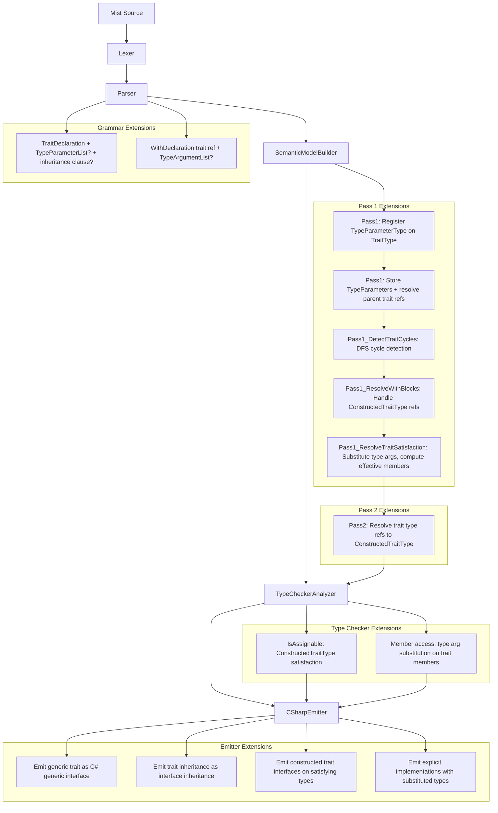
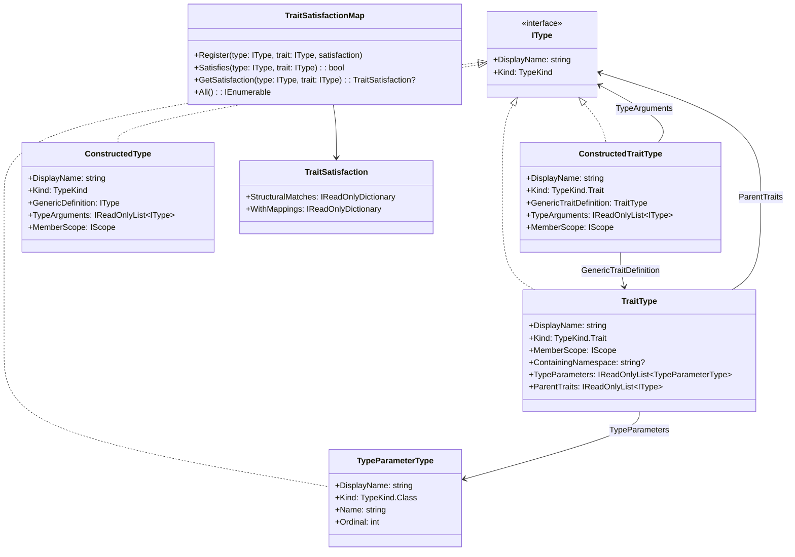
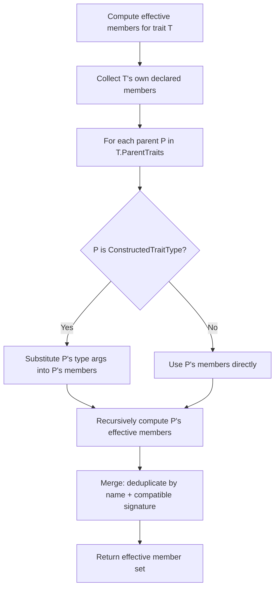

# Design Document: Generic Traits

## Overview

This design extends the Mist trait system with two capabilities: **type parameters on traits** (generic traits) and **trait inheritance** (trait composition). Together, these enable rich structural typing contracts like `trait Comparable<T> { int CompareTo(T other); }` and hierarchical composition like `trait Sortable<T> : Comparable<T> { int Priority(); }`.

Generic traits build on two existing implementations:
- **Traits** (`specs/traits/`): Structural typing, `with` blocks, `TraitType`, `TraitSatisfactionMap`, C# interface emission.
- **Generics** (`specs/generics-type-arguments/`): `TypeParameterList`, `TypeArgumentList`, `ConstructedType`, `TypeParameterType`, generic resolution for classes/structs/interfaces/methods.

The generics spec explicitly excluded traits. This design fills that gap by reusing the existing `TypeParameterType` and introducing a `ConstructedTraitType` (analogous to `ConstructedType` for classes/structs/interfaces). Trait inheritance is a new concept not present in either existing spec.

The implementation touches every stage of the compiler pipeline:

1. **Grammar** — Extend `TraitDeclaration` with optional `TypeParameterList` and optional inheritance clause; extend `WithDeclaration` trait reference with optional `TypeArgumentList`
2. **Pretty Printer** — Format type parameter lists on traits, inheritance clauses, and type argument lists on trait references in `with` blocks and type references
3. **Semantic Model** — Add `TypeParameters` and `ParentTraits` to `TraitType`; introduce `ConstructedTraitType`; extend `TraitSatisfactionMap` and `WithBlockRegistry` to handle constructed trait types; add cycle detection for trait inheritance
4. **Type Checker** — Extend `IsAssignable` for `ConstructedTraitType`; extend member access to substitute type arguments on trait members
5. **C# Emitter** — Emit generic trait interfaces with type parameters; emit interface inheritance for trait inheritance; emit constructed trait interfaces in type inheritance lists
6. **Syntax Highlighting** — Add `trait` to the generic declaration-names pattern

### Design Decisions

- **`ConstructedTraitType` parallels `ConstructedType`**: Just as `ConstructedType` wraps a `ClassType`/`StructType`/`InterfaceType` with type arguments, `ConstructedTraitType` wraps a `TraitType` with type arguments. This keeps the existing `ConstructedType.MemberScope` switch clean (it doesn't need to handle traits) and gives trait-specific logic a dedicated type.
- **`TraitType` gains `TypeParameters` and `ParentTraits`**: Rather than creating a separate `GenericTraitType`, we add optional properties to the existing `TraitType`. A non-generic trait simply has an empty `TypeParameters` list. This mirrors how `ClassType`/`StructType`/`InterfaceType` gained `TypeParameters` in the generics spec.
- **Trait inheritance maps to C# interface inheritance**: Since traits lower to C# interfaces, trait inheritance (`trait Sortable<T> : Comparable<T>`) maps directly to C# interface inheritance (`interface Sortable<T> : Comparable<T>`). The C# type system then transitively enforces parent interfaces.
- **Effective members are computed, not stored**: When checking satisfaction of a trait with parents, the semantic model builder computes the effective member set by walking the parent chain. This avoids duplicating member symbols and handles diamond inheritance naturally (same member from two paths counts once).
- **`TraitSatisfactionMap` keys on `IType` for the trait side**: The map currently uses `TraitType` as the trait key. For generic traits, we need to distinguish `Comparable<int>` from `Comparable<string>`. The map will accept both `TraitType` (non-generic) and `ConstructedTraitType` (generic) via a common base or by changing the key type. We'll use `IType` for the trait key position.
- **Cycle detection uses a DFS on the trait inheritance graph**: Before computing effective members, a dedicated sub-pass detects cycles in the trait inheritance graph and emits diagnostics. Traits involved in cycles are excluded from satisfaction checking.
- **Type argument substitution reuses the existing `SubstituteType` helper**: The generics spec introduced a substitution helper for `ConstructedType` member access. We extend it to handle `ConstructedTraitType` member access identically.

## Architecture



### Pipeline Integration Points

| Pipeline Stage | Change |
|---|---|
| `Mist.storm` | Extend `TraitDeclaration` with `typeParams:TypeParameterList?` and `parentTraits:(COLON parents:BaseList)?`; extend `WithDeclaration` trait name to `traitName:IDENTIFIER traitTypeArgs:TypeArgumentList?` |
| `MistPrettyPrinter` | Emit type parameter lists on trait declarations; emit inheritance clauses; emit type argument lists on trait references in `with` blocks and type references |
| `SemanticModelBuilder` Pass 1 | Create `TypeParameterType` for each trait type parameter; store on `TraitType.TypeParameters`; register in trait's member scope; resolve parent trait references |
| `SemanticModelBuilder` Pass 1 (new) | Detect cycles in trait inheritance graph |
| `SemanticModelBuilder` Pass 1 | Extend `with` block resolution to handle `ConstructedTraitType` |
| `SemanticModelBuilder` Pass 1 | Extend trait satisfaction to compute effective members (own + inherited), substitute type arguments |
| `SemanticModelBuilder` Pass 2 | Resolve trait type references with type arguments to `ConstructedTraitType` |
| `TypeCheckerAnalyzer` | Extend `IsAssignable` for `ConstructedTraitType`; extend member access substitution |
| `CSharpEmitter` | Emit generic trait interfaces; emit interface inheritance; emit constructed trait interfaces on satisfying types; emit explicit implementations with substituted types |
| `TraitType` | Add `TypeParameters`, `ParentTraits` properties |
| `TraitSatisfactionMap` | Change trait key from `TraitType` to `IType` to support `ConstructedTraitType` |
| `WithBlockRegistry` | Change trait key from `TraitType` to `IType` to support `ConstructedTraitType` |
| `CSharpTypeMap` | Handle `ConstructedTraitType` |
| `mist.tmLanguage.json` | Add `trait` to generic declaration-names pattern |

## Components and Interfaces

### Grammar Changes (`Mist.storm`)

**Modified `TraitDeclaration` rule:**
```
rule TraitDeclaration = TRAIT name:IDENTIFIER
    typeParams:TypeParameterList?
    parentTraits:(COLON parents:BaseList)?
    LEFT_BRACE members:TraitMemberDeclaration* RIGHT_BRACE;
```

This follows the same pattern as `InterfaceDeclaration`:
```
rule InterfaceDeclaration = INTERFACE name:IDENTIFIER
    typeParams:TypeParameterList?
    interfaceList:(COLON interfaces:BaseList)?
    LEFT_BRACE members:InterfaceMemberDeclaration* RIGHT_BRACE;
```

The `BaseList` rule (already defined) handles comma-separated type references with optional type arguments:
```
rule BaseList = first:BaseTypeRef (COMMA rest:BaseTypeRef)*;
rule BaseTypeRef = name:IDENTIFIER typeArgs:TypeArgumentList?;
```

**Modified `WithDeclaration` rule:**
```
rule WithDeclaration = WITH typeName:IDENTIFIER COLON
    traitName:IDENTIFIER traitTypeArgs:TypeArgumentList?
    LEFT_BRACE mappings:MemberMapping+ RIGHT_BRACE;
```

**Design rationale**: The `TraitDeclaration` extension reuses `TypeParameterList` and `BaseList` — both already defined by the generics spec. No new grammar rules are needed, only modifications to existing rules. The `WithDeclaration` gains an optional `TypeArgumentList` on the trait reference, following the same pattern as `BaseTypeRef`.

### New Type: `ConstructedTraitType`

```csharp
/// <summary>
/// Represents a generic trait with all type parameters substituted by concrete type arguments
/// (e.g., <c>Comparable&lt;int&gt;</c>, <c>Converter&lt;string, int&gt;</c>).
/// Analogous to <see cref="ConstructedType"/> for classes/structs/interfaces.
/// </summary>
public sealed class ConstructedTraitType : IType
{
    public string DisplayName { get; }
    public TypeKind Kind => TypeKind.Trait;

    /// <summary>The unparameterized generic trait definition.</summary>
    public TraitType GenericTraitDefinition { get; }

    /// <summary>The concrete type arguments substituted for the type parameters.</summary>
    public IReadOnlyList<IType> TypeArguments { get; }

    /// <summary>The member scope of the generic definition (members resolved with substitution).</summary>
    public IScope MemberScope => GenericTraitDefinition.MemberScope;

    public ConstructedTraitType(TraitType genericTraitDefinition, IReadOnlyList<IType> typeArguments)
    {
        GenericTraitDefinition = genericTraitDefinition;
        TypeArguments = typeArguments;

        var argNames = string.Join(", ", typeArguments.Select(a => a.DisplayName));
        DisplayName = $"{genericTraitDefinition.DisplayName}<{argNames}>";
    }
}
```

### Extended `TraitType`

```csharp
public sealed class TraitType : IType
{
    public string DisplayName { get; }
    public TypeKind Kind => TypeKind.Trait;
    public IScope MemberScope { get; }
    public string? ContainingNamespace { get; }

    /// <summary>Type parameters declared on this trait (empty for non-generic traits).</summary>
    public IReadOnlyList<TypeParameterType> TypeParameters { get; internal set; }
        = Array.Empty<TypeParameterType>();

    /// <summary>
    /// Resolved parent traits (may be TraitType or ConstructedTraitType).
    /// Empty for traits with no inheritance clause.
    /// </summary>
    public IReadOnlyList<IType> ParentTraits { get; internal set; }
        = Array.Empty<IType>();

    public TraitType(string displayName, IScope memberScope, string? containingNamespace)
    {
        DisplayName = displayName;
        MemberScope = memberScope;
        ContainingNamespace = containingNamespace;
    }
}
```

### Extended `TraitSatisfactionMap`

The trait key changes from `TraitType` to `IType` to accommodate both `TraitType` (non-generic) and `ConstructedTraitType` (generic):

```csharp
public sealed class TraitSatisfactionMap
{
    private readonly Dictionary<(IType ImplementingType, IType Trait), TraitSatisfaction> _satisfactions = new();

    public void Register(IType type, IType trait, TraitSatisfaction satisfaction)
        => _satisfactions[(type, trait)] = satisfaction;

    public bool Satisfies(IType type, IType trait)
        => _satisfactions.ContainsKey((type, trait));

    public TraitSatisfaction? GetSatisfaction(IType type, IType trait)
        => _satisfactions.GetValueOrDefault((type, trait));

    public IEnumerable<(IType Type, IType Trait, TraitSatisfaction Satisfaction)> All()
        => _satisfactions.Select(kvp => (kvp.Key.ImplementingType, kvp.Key.Trait, kvp.Value));
}
```

### Extended `WithBlockRegistry`

Similarly, the trait key changes from `TraitType` to `IType`:

```csharp
public sealed class WithBlockRegistry
{
    private readonly Dictionary<(IType Type, IType Trait), List<ValidatedMemberMapping>> _mappings = new();

    // ... same API, but accepts ConstructedTraitType as the trait key
}
```

### SemanticModelBuilder Extensions

#### Pass 1: Register Trait Type Parameters

When registering a `TraitDeclaration` that has a `TypeParameterList`:

1. For each identifier in the `TypeParameterList`, create a `TypeParameterType(name, ordinal)`.
2. Store the list on `traitType.TypeParameters = typeParams`.
3. Register each `TypeParameterType` as a symbol in the trait's member scope so that trait member signatures can reference them.
4. Check for duplicate type parameter names and emit `MIST_DUPLICATE_TYPE_PARAMETER (historical)` if found.

#### Pass 1: Resolve Parent Trait References

After all types are registered, resolve the inheritance clause on each trait:

1. For each `BaseTypeRef` in the `parents` list:
   - Resolve the name to a symbol. If it's not a `TraitType`, emit `MIST_TRAIT_PARENT_NOT_TRAIT (historical)`.
   - If the parent trait is generic and no type arguments are provided, emit `MIST_MISSING_TYPE_ARGUMENTS (historical)`.
   - If type arguments are provided but arity doesn't match, emit `MIST_ARITY_MISMATCH (historical)`.
   - If the parent trait is generic with correct type arguments, construct a `ConstructedTraitType`.
   - If the parent trait is non-generic and no type arguments are provided, use the `TraitType` directly.
2. Check for duplicate parents (same trait with same type arguments). Emit `MIST_TRAIT_DUPLICATE_PARENT (historical)` if found.
3. Store the resolved list on `traitType.ParentTraits`.

#### Pass 1: Detect Trait Inheritance Cycles

A dedicated sub-pass performs DFS on the trait inheritance graph:

1. Build an adjacency list from each trait to its parent traits (using the `GenericTraitDefinition` for constructed parents).
2. Run DFS with coloring (white/gray/black). When a gray node is revisited, a cycle is detected.
3. Emit `MIST_TRAIT_INHERITANCE_CYCLE (historical)` for each trait involved in a cycle.
4. Mark cyclic traits so they are excluded from satisfaction computation.

#### Pass 1: Extend `with` Block Resolution for Generic Traits

When resolving a `WithDeclaration`:

1. Resolve `traitName` + `traitTypeArgs` to either a `TraitType` (non-generic) or `ConstructedTraitType` (generic).
2. If the trait is generic and no type arguments are provided, emit `MIST_MISSING_TYPE_ARGUMENTS (historical)`.
3. If type arguments are provided but arity doesn't match, emit `MIST_ARITY_MISMATCH (historical)`.
4. When validating member mappings, substitute type parameters with type arguments before checking type compatibility. For example, if the trait member is `T Value` and `T=int`, the source member must be compatible with `int`.

#### Pass 1: Extend Trait Satisfaction for Generic Traits

When computing satisfaction:

1. **Effective members**: For a trait (or constructed trait), compute the full set of members by:
   - Starting with the trait's own declared members (with type argument substitution for constructed traits).
   - Walking the parent chain, collecting each parent's members (with appropriate substitution).
   - Deduplicating: if a member with the same name and compatible signature appears from multiple paths, count it once.
2. **Structural matching with substitution**: When matching against a `ConstructedTraitType`, substitute type parameters in member signatures before comparing. E.g., trait member `int CompareTo(T other)` with `T=int` matches type member `int CompareTo(int other)`.
3. **Transitive parent satisfaction**: When a type satisfies a child trait, also register satisfaction for each parent trait (with appropriate type argument substitution from the child's inheritance clause).
4. **Same-name deduplication**: If a parent trait member has the same name and compatible signature as the child trait's own member, treat them as a single requirement.

#### Pass 2: Resolve Trait Type References

Extend type reference resolution:

1. When a `NamedTypeRef` resolves to a `TraitType` with type parameters:
   - If type arguments are provided and arity matches, construct a `ConstructedTraitType`.
   - If type arguments are missing, emit `MIST_MISSING_TYPE_ARGUMENTS (historical)`.
   - If arity doesn't match, emit `MIST_ARITY_MISMATCH (historical)`.
2. When a `NamedTypeRef` resolves to a non-generic `TraitType`:
   - If type arguments are provided, emit `MIST_NOT_GENERIC (historical)`.
   - Otherwise, return the `TraitType` directly.

### TypeCheckerAnalyzer Extensions

#### Extend `IsAssignable` for Constructed Trait Types

```csharp
// Constructed trait assignability:
if (target is ConstructedTraitType targetConstructedTrait)
{
    if (SatisfiesTrait(source, targetConstructedTrait))
        return true;
}

// Non-generic trait assignability (existing):
if (target is TraitType targetTrait)
{
    if (SatisfiesTrait(source, targetTrait))
        return true;
}
```

The `SatisfiesTrait` helper queries the `TraitSatisfactionMap` using the target trait (either `TraitType` or `ConstructedTraitType`) as the key.

**Distinctness**: `Comparable<int>` and `Comparable<string>` are distinct types. Assignment between them is rejected because they are different keys in the satisfaction map.

#### Extend Member Access for Constructed Trait Types

When resolving member access on a `ConstructedTraitType`:

1. Look up the member name in the trait's `MemberScope`.
2. Get the member's declared type.
3. Substitute type parameters using the constructed trait's type arguments (reusing the existing `SubstituteType` helper).
4. Return the substituted type.

For method calls on constructed trait-typed variables, validate arguments against the substituted parameter types.

### CSharpEmitter Extensions

#### Emit Generic Trait as C# Generic Interface

```csharp
// trait Comparable<T> { int CompareTo(T other); }
// →
// interface Comparable<T> { int CompareTo(T other); }
```

Emit the type parameter list after the interface name. Trait member signatures use the type parameter names directly (no substitution at the interface level).

#### Emit Trait Inheritance as Interface Inheritance

```csharp
// trait Sortable<T> : Comparable<T> { int Priority(); }
// →
// interface Sortable<T> : Comparable<T> { int Priority(); }

// trait Named : Displayable<string> { ... }
// →
// interface Named : Displayable<string> { ... }
```

#### Emit Constructed Trait Interfaces on Satisfying Types

```csharp
// class IntSorter satisfies Comparable<int> structurally
// →
// class IntSorter : Comparable<int> { ... }

// class Wrapper<T> satisfies Comparable<T>
// →
// class Wrapper<T> : Comparable<T> { ... }
```

When a type satisfies a child trait, emit only the child trait interface. C# interface inheritance handles the parent transitively.

#### Emit Explicit Implementations with Substituted Types

```csharp
// with Product : Comparable<int> { price as CompareTo; }
// where trait has: int CompareTo(T other) and T=int
// →
// int Comparable<int>.CompareTo(int other) => this.price;  // for field-like
// or
// int Comparable<int>.CompareTo(int other) => this.Compare(other);  // for method
```

### MistPrettyPrinter Extensions

Extend trait declaration formatting:
- Emit type parameter list after trait name: `trait Comparable<T>`
- Emit inheritance clause: `trait Sortable<T> : Comparable<T>, OtherTrait`
- Emit type argument list on trait references in `with` blocks: `with Product : Comparable<int>`

### CSharpTypeMap Extension

Add `ConstructedTraitType` case:
```csharp
ConstructedTraitType ct => $"{ct.GenericTraitDefinition.DisplayName}<{string.Join(", ", ct.TypeArguments.Select(GetTypeName))}>",
```

### TextMate Grammar Extensions

Add `trait` to the existing generic declaration-names pattern (alongside `class`, `struct`, `interface`):

```json
{
    "match": "\\b(class|struct|interface|trait)\\s+([a-zA-Z_]\\w*)\\s*(<[^>]+>)",
    "captures": {
        "1": { "name": "keyword.declaration.mist" },
        "2": { "name": "entity.name.type.mist" },
        "3": { "patterns": [{ "include": "#type-parameters" }] }
    }
}
```

The existing non-generic `trait` declaration-name pattern remains as a fallback for `trait Printable { ... }`.

### New Diagnostic IDs

| ID | Stage | Message |
|---|---|---|
| `MIST_TRAIT_PARENT_NOT_TRAIT (historical)` | SemanticModelConstruction | '{name}' in the trait inheritance clause is not a trait. Only traits can be extended by other traits. |
| `MIST_TRAIT_INHERITANCE_CYCLE (historical)` | SemanticModelConstruction | Trait inheritance cycle detected: {cycle_description}. |
| `MIST_TRAIT_DUPLICATE_PARENT (historical)` | SemanticModelConstruction | Trait '{traitName}' lists parent '{parentName}' more than once. |

Existing diagnostics reused with trait-specific context:
- `MIST_ARITY_MISMATCH (historical)` — when a generic trait is referenced with wrong number of type arguments
- `MIST_MISSING_TYPE_ARGUMENTS (historical)` — when a generic trait is referenced without type arguments
- `MIST_NOT_GENERIC (historical)` — when type arguments are provided to a non-generic trait
- `MIST_DUPLICATE_TYPE_PARAMETER (historical)` — when a trait's type parameter list has duplicates
- `MIST_TRAIT_UNSATISFIED (historical)` — extended to show substituted types for generic traits
- `MIST_TRAIT_WITH_TYPE_MISMATCH (historical)` — extended to show substituted types

## Data Models

### Type Hierarchy with Generic Traits



### AST Node Changes

The Storm source generator will produce these modified node types:

- **Modified `TraitDeclarationNode`** — gains optional `TypeParams` field (`TypeParameterListNode?`) and optional `ParentTraits` field (containing `BaseListNode?`)
- **Modified `WithDeclarationNode`** — gains optional `TraitTypeArgs` field (`TypeArgumentListNode?`)

Existing nodes remain unchanged:
- `TypeParameterListNode` (from generics spec)
- `TypeArgumentListNode` (from generics spec)
- `BaseListNode` / `BaseTypeRefNode` (from generics spec)

### Effective Members Computation



### Type Argument Substitution in Trait Satisfaction

```
Example:
  trait Comparable<T> { int CompareTo(T other); }
  trait Sortable<T> : Comparable<T> { int Priority(); }
  class IntSorter { int CompareTo(int other) { ... } int Priority() { ... } }

Checking IntSorter against Sortable<int>:
  1. Effective members of Sortable<int>:
     - Own: int Priority() [no substitution needed, no type params in signature]
     - From Comparable<T> with T=int: int CompareTo(int other)
  2. Structural match:
     - IntSorter.CompareTo(int) matches int CompareTo(int other) ✓
     - IntSorter.Priority() matches int Priority() ✓
  3. Register: IntSorter satisfies Sortable<int>
  4. Transitive: IntSorter satisfies Comparable<int>
```

### Symbol Registration for Generic Traits

| Declaration | SymbolKind | DeclaredType | TypeParameters |
|---|---|---|---|
| `trait Comparable<T> { ... }` | `Trait` | `TraitType("Comparable", ...)` | `[TypeParameterType("T", 0)]` |
| `trait Converter<TIn, TOut> { ... }` | `Trait` | `TraitType("Converter", ...)` | `[TypeParameterType("TIn", 0), TypeParameterType("TOut", 1)]` |
| `trait Sortable<T> : Comparable<T> { ... }` | `Trait` | `TraitType("Sortable", ...)` | `[TypeParameterType("T", 0)]`, ParentTraits: `[ConstructedTraitType(Comparable, [T])]` |
| Trait field `T Value;` | `Field` | `TypeParameterType("T", 0)` | — |
| Trait method `int CompareTo(T other);` | `Method` | Return: `Int32`, Params: `[TypeParameterType("T", 0)]` | — |


## Correctness Properties

*A property is a characteristic or behavior that should hold true across all valid executions of a system — essentially, a formal statement about what the system should do. Properties serve as the bridge between human-readable specifications and machine-verifiable correctness guarantees.*

### Property 1: Generic trait and inheritance syntax round-trip

*For any* valid Mist AST containing trait declarations with varying combinations of type parameter lists (0, 1, 2+ parameters), inheritance clauses (0, 1, 2+ parent traits, with and without type arguments), trait member signatures referencing type parameters, `with` blocks referencing generic traits with type argument lists, and constructed trait type references (including nested generics like `Comparable<List<int>>`), pretty-printing the AST and then parsing the result and pretty-printing again SHALL produce identical output.

**Validates: Requirements 1.1, 1.2, 1.3, 1.4, 1.5, 2.1, 2.2, 2.3, 2.4, 2.5, 2.6, 6.1, 6.2, 6.3, 7.1, 7.2, 7.5, 8.1, 8.2, 9.1, 9.2, 9.3, 9.4, 9.5**

### Property 2: Trait type parameter registration

*For any* generic trait declaration with N type parameters (N ≥ 1), the semantic model builder SHALL create exactly N `TypeParameterType` instances with correct ordinals (0 through N-1), store them on the `TraitType.TypeParameters` property, and register each as a resolvable type in the trait's member scope. Trait member signatures that reference a type parameter name SHALL resolve to the corresponding `TypeParameterType`. *For any* trait whose `TypeParameterList` contains duplicate identifier names, the semantic model builder SHALL emit a `MIST_DUPLICATE_TYPE_PARAMETER (historical)` diagnostic.

**Validates: Requirements 10.1, 10.2, 10.3, 10.4**

### Property 3: Trait inheritance validation diagnostics

*For any* trait declaration whose inheritance clause references a name that resolves to a class, struct, or interface (not a trait), the semantic model builder SHALL emit a `MIST_TRAIT_PARENT_NOT_TRAIT (historical)` diagnostic. *For any* trait inheritance graph containing a cycle, the semantic model builder SHALL emit a `MIST_TRAIT_INHERITANCE_CYCLE (historical)` diagnostic for each trait involved. *For any* trait that lists the same parent trait more than once in its inheritance clause, the semantic model builder SHALL emit a `MIST_TRAIT_DUPLICATE_PARENT (historical)` diagnostic.

**Validates: Requirements 3.2, 3.5, 3.6, 17.6, 17.7, 17.8**

### Property 4: Arity and missing type argument diagnostics for trait references

*For any* type reference, `with` block trait reference, or parent trait reference that names a generic trait without providing a type argument list, the compiler SHALL emit a diagnostic indicating type arguments are required. *For any* such reference that provides a different number of type arguments than the trait declares type parameters, the compiler SHALL emit a diagnostic indicating the arity mismatch (expected vs actual).

**Validates: Requirements 3.3, 3.4, 7.3, 7.4, 8.3, 8.4, 17.1, 17.2, 17.4**

### Property 5: Trait inheritance resolution and effective members

*For any* valid trait hierarchy (no cycles, all parents resolve to traits with correct arity), the semantic model builder SHALL store the resolved parent traits on `TraitType.ParentTraits`. The effective member set of a trait SHALL be the union of its own declared members and all members inherited from parent traits (transitively), with members sharing the same name and compatible signature deduplicated to a single requirement.

**Validates: Requirements 3.1, 3.7, 4.1, 4.4**

### Property 6: Structural match with type argument substitution

*For any* type (class or struct) and *for any* constructed trait type, the structural match result SHALL be `true` if and only if every effective member of the constructed trait (after substituting type parameters with the provided type arguments) has a corresponding public member on the type with the same name and compatible type signature. This includes: method parameters substituted from type parameters to concrete types, return types substituted, and field types substituted.

**Validates: Requirements 12.1, 12.2, 12.3, 12.4, 12.5, 12.6**

### Property 7: With block validation for generic traits

*For any* `with` block that references a generic trait with type arguments, the semantic model builder SHALL resolve the trait to a `ConstructedTraitType` and validate each member mapping against the substituted member signatures. *For any* valid `with` block that covers all unmapped trait members (after substitution), the type SHALL be registered as satisfying the constructed trait. *For any* `with` block that does not cover all members, a diagnostic SHALL be emitted listing unsatisfied members with their substituted types. *For any* mapping where the source member type is incompatible with the substituted target member type, a diagnostic SHALL be emitted.

**Validates: Requirements 13.1, 13.2, 13.3, 13.4, 17.5**

### Property 8: Trait assignability with generic traits

*For any* type that satisfies a constructed trait (structurally or via `with` block), `IsAssignable(sourceType, constructedTraitType)` SHALL return `true`. *For any* type that does not satisfy a constructed trait, `IsAssignable` SHALL return `false` and a diagnostic SHALL be emitted. *For any* type that satisfies a child trait, the `TraitSatisfactionMap` SHALL also record satisfaction of each parent trait (with appropriate type argument substitution). *For any* two constructed trait types with the same generic definition but different type arguments (e.g., `Comparable<int>` vs `Comparable<string>`), they SHALL be treated as distinct non-assignable types.

**Validates: Requirements 4.2, 4.3, 4.5, 14.1, 14.2, 14.3, 14.4, 14.5, 14.6, 17.3**

### Property 9: Member access on constructed trait types with substitution

*For any* member access on a variable typed as a `ConstructedTraitType`, the resolved member type SHALL have all type parameters substituted with the corresponding type arguments from the constructed trait. For method calls, argument types SHALL be validated against the substituted parameter types.

**Validates: Requirements 15.1, 15.2**

### Property 10: C# emission correctness for generic traits

*For any* valid Mist program containing generic trait declarations, trait inheritance, types that structurally satisfy constructed traits, and types that satisfy constructed traits via `with` blocks, the emitted C# code SHALL contain: (a) a C# generic interface for each generic trait with correct type parameters; (b) interface inheritance for trait inheritance (parent interfaces in the child interface's inheritance list); (c) the constructed trait interface in the inheritance list of each satisfying type; (d) explicit interface implementations with substituted types for `with`-mapped members; (e) only the child trait interface on types satisfying a child trait (C# handles parent transitivity).

**Validates: Requirements 5.1, 5.2, 5.3, 16.1, 16.2, 16.3, 16.4, 16.5, 16.6**

## Error Handling

### Compilation Errors (Diagnostics)

| Scenario | Diagnostic ID | Severity | Recovery |
|---|---|---|---|
| Parent reference is not a trait | `MIST_TRAIT_PARENT_NOT_TRAIT (historical)` | Error | Skip parent, continue with remaining parents |
| Cycle in trait inheritance | `MIST_TRAIT_INHERITANCE_CYCLE (historical)` | Error | Exclude cyclic traits from satisfaction computation |
| Duplicate parent trait | `MIST_TRAIT_DUPLICATE_PARENT (historical)` | Error | Use first occurrence, ignore duplicate |
| Generic trait referenced without type args | `MIST_MISSING_TYPE_ARGUMENTS (historical)` | Error | Skip reference, return `UnknownType` |
| Wrong number of type arguments on trait | `MIST_ARITY_MISMATCH (historical)` | Error | Skip reference, return `UnknownType` |
| Type arguments on non-generic trait | `MIST_NOT_GENERIC (historical)` | Error | Ignore type arguments, use trait directly |
| Duplicate type parameter name on trait | `MIST_DUPLICATE_TYPE_PARAMETER (historical)` | Error | Use first occurrence, skip duplicate |
| Type does not satisfy constructed trait | `MIST_TRAIT_UNSATISFIED (historical)` | Error | Report unsatisfied members with substituted types, continue |
| With block type mismatch after substitution | `MIST_TRAIT_WITH_TYPE_MISMATCH (historical)` | Error | Skip mapping, continue |
| Incomplete with block after substitution | `MIST_TRAIT_WITH_UNSATISFIED (historical)` | Error | Report missing members with substituted types, continue |
| With block references generic trait without type args | `MIST_MISSING_TYPE_ARGUMENTS (historical)` | Error | Skip with block, continue |
| With block references generic trait with wrong arity | `MIST_ARITY_MISMATCH (historical)` | Error | Skip with block, continue |

### Error Recovery Strategy

The compiler follows the existing pattern of continuing compilation after errors to report as many issues as possible in a single pass:

- **Invalid parent traits**: Each invalid parent is skipped; remaining parents are still resolved. The trait's effective members exclude the invalid parent's contributions.
- **Cyclic inheritance**: Traits in a cycle are marked and excluded from satisfaction computation. Other traits that don't participate in the cycle continue normally.
- **Arity mismatches**: The reference resolves to `UnknownType`, allowing downstream code to continue without cascading errors.
- **Unsatisfied traits**: The diagnostic lists all unsatisfied members with their substituted types. Compilation continues to report further errors.

## Testing Strategy

### Property-Based Testing (FsCheck 3.1.0 + xUnit)

The project uses **FsCheck 3.1.0** with **xUnit** for property-based testing. Each correctness property maps to one or more PBT test classes.

**Configuration**: Minimum 100 iterations per property test.

**Generator extensions needed**:
- Extend trait declaration generators to include optional `TypeParameterList` (0, 1, 2, 3 type parameters)
- Add generators for trait inheritance clauses (0, 1, 2+ parent traits, with/without type arguments)
- Add generators for `ConstructedTraitType` references in type positions
- Add generators for `with` blocks referencing generic traits with type argument lists
- Add generators for trait member signatures that reference type parameters
- Add generators for invalid programs: cyclic inheritance, arity mismatches, non-trait parents, duplicate parents, duplicate type params
- Add generators for types that structurally satisfy constructed traits (matching members with substituted types)
- Add generators for types that do NOT satisfy constructed traits (missing members, type mismatches after substitution)

### Test Plan

| Property | Test Class | Type |
|---|---|---|
| Property 1: Round-trip | `GenericTraitRoundTripPropertyTests` | PBT |
| Property 2: Type parameter registration | `GenericTraitTypeParamRegistrationPropertyTests` | PBT |
| Property 3: Inheritance validation diagnostics | `TraitInheritanceValidationPropertyTests` | PBT |
| Property 4: Arity/missing-args diagnostics | `GenericTraitArityDiagnosticPropertyTests` | PBT |
| Property 5: Inheritance resolution & effective members | `TraitEffectiveMembersPropertyTests` | PBT |
| Property 6: Structural match with substitution | `GenericTraitStructuralMatchPropertyTests` | PBT |
| Property 7: With block validation for generic traits | `GenericTraitWithBlockPropertyTests` | PBT |
| Property 8: Assignability with generic traits | `GenericTraitAssignabilityPropertyTests` | PBT |
| Property 9: Member access with substitution | `GenericTraitMemberAccessPropertyTests` | PBT |
| Property 10: C# emission correctness | `GenericTraitEmissionPropertyTests` | PBT |
| Sample app compilation | `GenericTraitSampleIntegrationTests` | Integration |
| Syntax highlighting | Manual verification | Manual |

### Unit Tests (Example-Based)

In addition to PBT, targeted unit tests cover:
- Non-generic trait with inheritance clause (edge case for Properties 1, 5)
- Generic trait with no inheritance (edge case for Properties 1, 2)
- Trait inheriting from a non-generic parent (edge case for Property 5)
- Trait inheriting from a constructed generic parent with concrete args (edge case for Property 5)
- Diamond inheritance (trait C extends A and B, both extend D) — deduplication (edge case for Property 5)
- `with` block for a constructed trait where all members are structurally matched (edge case for Property 7)
- Open generic trait in class inheritance (e.g., `class Wrapper<T>` satisfies `Comparable<T>`) (edge case for Property 8)
- Forward reference to a generic trait defined later in the file (edge case for Property 4)
- Undefined member access on constructed trait type (edge case for Property 9)

### Tag Format

Each property-based test is tagged with:
```
Feature: generic-traits, Property {number}: {property_text}
```
