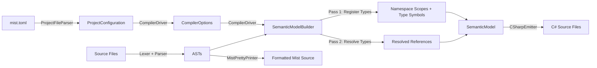

# Design Document: Inferred Namespaces

## Overview

This feature extends the Mist compiler to support **inferred namespaces** — automatic namespace assignment based on file location — and **multiple namespace declarations per file**. It touches every stage of the compilation pipeline:

1. **Project configuration** (`mist.toml`): A new optional `namespace_root` field sets the root segment for all inferred namespaces.
2. **Grammar** (`Mist.storm`): The `CompilationUnit` rule changes from allowing zero-or-one namespace to allowing zero-or-more, interleaved with top-level type declarations.
3. **Semantic model** (`SemanticModelBuilder`): Computes inferred namespaces from file paths, handles multiple namespace scopes per file, and implements C#-style same-namespace resolution.
4. **C# emitter** (`CSharpEmitter`): Emits correct namespace declarations (file-scoped or block) for both inferred and explicit namespaces.
5. **Pretty printer** (`MistPrettyPrinter`): Formats files with multiple namespace declarations while preserving round-trip fidelity.

### Design Rationale

The design mirrors C#'s namespace semantics because Mist targets C# as its primary backend. This means:
- Inferred namespaces follow the same `Root.Folder.Subfolder` convention as C# project defaults.
- Same-namespace types can reference each other without `using`, matching C# behavior.
- The grammar extension to multiple namespaces per file is a natural generalization that C# also supports.

### Breaking Change

Files without an explicit namespace currently place types in the global scope. After this change, they will be placed under the inferred namespace (equal to `NamespaceRoot`). This is an intentional behavioral change documented in Requirement 12.3. Developers needing the old behavior can add explicit namespace declarations.

### Current implementation and historical sections

The feature now runs through the standard pipeline. `NamespaceBuilder` decides each file's namespace, inferring it from `NamespaceRoot` and the file's folder where none is declared, while `CompilationUnitBuilder` builds the program model's units. `CSharpEmitterV2` writes the namespace declarations and the `using` directives that `UsingSelection` keeps (Requirement 8).

Section 5 (`SemanticModelBuilder` and `ISemanticModelBuilder`), section 7 (`CSharpEmitter` / `CSharpSourceWriter`) and "Semantic Errors (SemanticModelBuilder)" are historical. They describe the classic compiler this feature was first built in, which is no longer in the tree, and are not current compiler guidance. The same applies wherever those classes are named elsewhere: the Overview's component list, the Architecture diagram and the unit-test notes. The requirements and correctness properties are the contract.

## Architecture

The feature flows through the compilation pipeline in this order:



### Key Design Decisions

1. **Namespace computation is a pure function**: `ComputeInferredNamespace(namespaceRoot, projectFolder, filePath)` is a stateless computation that normalizes path separators to dots. This makes it easy to test and reason about.

2. **Grammar uses a top-level item list**: Rather than the current `usings* namespace? types*` structure, the new grammar uses `usings* items*` where each item is either a namespace declaration or a type declaration. This naturally supports interleaving.

3. **Inferred namespace is computed once per file in Pass 1**: The semantic model builder computes the inferred namespace for each file before processing its declarations. Types outside any explicit namespace are registered under this inferred namespace.

4. **Same-namespace resolution uses the existing scope chain**: The file-level scope's parent is set to the namespace scope, so `Lookup` naturally searches the namespace scope before the global scope. No special resolution logic is needed.

## Components and Interfaces

### 1. ProjectConfiguration (Modified)

**File**: `Source/Mist/Driver/Contracts/ProjectConfiguration.cs`

```csharp
public sealed record ProjectConfiguration(string Name, string NamespaceRoot);
```

The `NamespaceRoot` field is always populated — either from the explicit `namespace_root` field in `mist.toml` or defaulted to `Name`.

### 2. CompilerOptions (Modified)

**File**: `Source/Mist/Driver/Contracts/CompilerOptions.cs`

```csharp
public sealed record CompilerOptions(
    string ProjectFolder,
    ImmutableArray<string> SourcePaths,
    BackendId Backend,
    string OutputDirectory,
    string BinDirectory,
    string ProjectName,
    string NamespaceRoot,                    // NEW
    ImmutableArray<string> EnabledAnalyzerIds);
```

### 3. ProjectFileParser (Modified)

**File**: `Source/Mist/Driver/ProjectFileParser.cs`

New behavior in `Parse()`:
- After reading `name`, check for optional `namespace_root` field.
- If present and non-empty: validate characters (same regex as `name`), use as `NamespaceRoot`.
- If present but empty/whitespace: report `MIST0056` error.
- If present but invalid characters: report `MIST0057` error.
- If absent: default `NamespaceRoot` to `name`.

### 4. Grammar (Modified)

**File**: `Source/Mist/Grammar/Mist.storm`

Current:
```
rule CompilationUnit = usings:UsingDeclaration* namespace:NamespaceDeclaration? types:TypeDeclaration*;
```

New:
```
rule CompilationUnit = usings:UsingDeclaration* items:TopLevelItem*;

rule TopLevelItem
    = namespaceDeclaration:NamespaceDeclaration  as NamespaceItem
    | typeDeclaration:TypeDeclaration            as TypeItem
    ;
```

The `NamespaceDeclaration` rule itself is unchanged — it already supports both `FileScopedNamespace` and `BlockNamespace` variants. The key change is that `CompilationUnit` now accepts a list of items that can be namespaces or types in any order and quantity.

### 5. SemanticModelBuilder (Modified)

**File**: `Source/Mist/Semantics/Model/SemanticModelBuilder.cs`

#### Build Method Signature Change

```csharp
public ISemanticModel Build(
    MistCompilation compilation,
    ImmutableArray<SyntaxNode> asts,
    IAmbientTypeResolver? ambientTypeResolver,
    string namespaceRoot,       // NEW
    string projectFolder,       // NEW
    DiagnosticBag diagnostics)
```

#### ISemanticModelBuilder Interface Change

```csharp
public interface ISemanticModelBuilder
{
    ISemanticModel Build(
        MistCompilation compilation,
        ImmutableArray<SyntaxNode> asts,
        IAmbientTypeResolver? ambientTypeResolver,
        string namespaceRoot,
        string projectFolder,
        DiagnosticBag diagnostics);
}
```

#### Inferred Namespace Computation (New Static Method)

```csharp
internal static string ComputeInferredNamespace(
    string namespaceRoot, string projectFolder, string filePath)
{
    var relativePath = Path.GetRelativePath(projectFolder, Path.GetDirectoryName(filePath)!);
    if (relativePath == "." || string.IsNullOrEmpty(relativePath))
        return namespaceRoot;

    var segments = relativePath
        .Replace(Path.DirectorySeparatorChar, '.')
        .Replace(Path.AltDirectorySeparatorChar, '.');
    return $"{namespaceRoot}.{segments}";
}
```

#### Pass 1 Changes

The `Pass1_RegisterTypes` method changes to:

1. Compute the inferred namespace for the file using `ComputeInferredNamespace`.
2. Iterate over `TopLevelItem` nodes in the new grammar structure.
3. Track the "current namespace" — initially the inferred namespace.
4. For each `NamespaceItem`:
   - If file-scoped: update the current namespace to the declared name. Register subsequent types under this namespace until the next namespace declaration.
   - If block: register only the enclosed types under the declared namespace. The current namespace is unchanged after the block.
5. For each `TypeItem`: register the type under the current namespace.
6. Use `FindExistingNamespaceScope` to reuse namespace scopes across files (existing pattern).

#### Pass 2 Changes — Same-Namespace Resolution

The `Pass2_ResolveTypes` method changes to:

1. For each file, determine which namespace scopes are active (inferred + any explicit namespaces).
2. When creating the file-level scope, set its parent to the primary namespace scope (inferred namespace for top-level types, explicit namespace for types within a namespace declaration).
3. The existing `Scope.Lookup` chain naturally searches: local scope → file scope → namespace scope → global scope. This gives same-namespace types priority over global types.
4. For `using` declarations, add imported namespaces to the file scope (existing `AddImportedNamespace` pattern).
5. When resolving a type name, after checking the scope chain, also check imported namespaces for matches. If multiple imported namespaces contain the same type name, report an ambiguity error.

### 6. CompilerDriver (Modified)

**File**: `Source/Mist/Driver/CompilerDriver.cs`

The `Compile` method passes `options.NamespaceRoot` and `options.ProjectFolder` to `semanticModelBuilder.Build()`.

### 7. CSharpEmitter / CSharpSourceWriter (Modified)

**File**: `Source/Mist/Backends/CSharpTranspiler/CSharpEmitter.cs`

#### Changes to CSharpSourceWriter.EmitCompilationUnit

The emitter needs to handle the new `TopLevelItem` grammar structure:

1. Emit `using` directives (existing behavior + source `using` declarations).
2. For types that belong to the inferred namespace (no explicit namespace in source), emit a file-scoped `namespace X.Y.Z;` declaration before the types.
3. For explicit file-scoped namespaces, emit `namespace X.Y.Z;` as today.
4. For explicit block namespaces, emit `namespace X.Y.Z { ... }` as today.
5. When a file has multiple namespaces, emit each namespace section with its associated types.

The emitter determines a type's namespace by looking up the symbol's `ContainingNamespace` from the semantic model. For inferred namespaces, this will be the computed namespace string.

### 8. MistPrettyPrinter (Modified)

**File**: `Source/Mist/Parsing/MistPrettyPrinter.cs`

The `EmitCompilationUnit` method changes to iterate over `TopLevelItem` nodes instead of the current `namespace? types*` structure:

1. Emit `using` declarations (unchanged).
2. For each `TopLevelItem`:
   - `NamespaceItem`: emit the namespace declaration (file-scoped or block, using existing `EmitNamespaceDeclaration`).
   - `TypeItem`: emit the type declaration (using existing `EmitTypeDeclaration`).

## Data Models

### ProjectConfiguration

```
ProjectConfiguration
├── Name: string              (required, from mist.toml "name")
└── NamespaceRoot: string     (resolved: namespace_root or Name)
```

### CompilerOptions

```
CompilerOptions
├── ProjectFolder: string     (existing)
├── SourcePaths: string[]     (existing)
├── Backend: BackendId        (existing)
├── OutputDirectory: string   (existing)
├── BinDirectory: string      (existing)
├── ProjectName: string       (existing)
├── NamespaceRoot: string     (NEW - from ProjectConfiguration)
└── EnabledAnalyzerIds: string[] (existing)
```

### Grammar AST (New Structure)

```
CompilationUnit
├── Usings: UsingDeclaration[]
└── Items: TopLevelItem[]
    ├── NamespaceItem
    │   └── NamespaceDeclaration (FileScopedNamespace | BlockNamespace)
    └── TypeItem
        └── TypeDeclaration (ClassType | StructType | InterfaceType)
```

### Namespace Scope Hierarchy

```
GlobalScope
├── NamespaceScope("MyProject")
│   ├── ClassSymbol("Program")
│   └── ClassSymbol("Config")
├── NamespaceScope("MyProject.Models")
│   ├── ClassSymbol("Player")
│   └── StructSymbol("Point")
└── NamespaceScope("MyProject.Models.Game")
    └── ClassSymbol("GameState")
```

### Diagnostic IDs (New)

| ID | Severity | Description |
|----|----------|-------------|
| `MIST0056` | Error | `namespace_root` is present but empty/whitespace |
| `MIST0057` | Error | `namespace_root` contains invalid characters |
| `MIST0293` | Error | `using` references a namespace that doesn't exist (existing, severity unchanged) |
| `MIST_AMBIGUOUS_TYPE (historical)` | Error | Type name is ambiguous due to multiple `using` imports |


## Correctness Properties

*A property is a characteristic or behavior that should hold true across all valid executions of a system — essentially, a formal statement about what the system should do. Properties serve as the bridge between human-readable specifications and machine-verifiable correctness guarantees.*

### Property 1: NamespaceRoot Resolution

*For any* valid `mist.toml` with a `name` field and an optional `namespace_root` field, the resolved `NamespaceRoot` SHALL equal the `namespace_root` value when it is present and non-empty, and SHALL equal the `name` value when `namespace_root` is absent.

**Validates: Requirements 1.2, 1.3, 12.1**

### Property 2: NamespaceRoot Validation

*For any* string value provided as `namespace_root` in `mist.toml`, parsing SHALL succeed if and only if the value is non-empty, non-whitespace, and contains only alphanumeric characters, underscores, hyphens, and periods. Parsing SHALL produce an error diagnostic for any value that violates these constraints.

**Validates: Requirements 1.4, 1.5, 1.6**

### Property 3: Inferred Namespace Computation

*For any* valid namespace root string and any file path relative to the project folder, the computed inferred namespace SHALL equal the namespace root when the file is in the project root directory, and SHALL equal `{namespaceRoot}.{folder1}.{folder2}...{folderN}` when the file is in a nested subdirectory, regardless of the operating system path separator character.

**Validates: Requirements 3.1, 3.2, 3.3, 3.4, 3.5**

### Property 4: Type Registration Under Inferred Namespace

*For any* source file with no explicit namespace declaration, all types declared in that file SHALL have their `ContainingNamespace` set to the computed inferred namespace for that file's location.

**Validates: Requirements 3.6, 3.7**

### Property 5: Multi-Namespace Parsing

*For any* syntactically valid Mist source file containing zero or more namespace declarations (file-scoped, block, or mixed) interleaved with type declarations, the parser SHALL produce a valid AST without errors.

**Validates: Requirements 4.1, 4.2, 4.5, 4.6**

### Property 6: File-Scoped Namespace Type Association

*For any* file containing one or more file-scoped namespace declarations, each type declaration following a file-scoped namespace SHALL be registered under that namespace until the next namespace declaration or end of file.

**Validates: Requirements 4.3, 5.2**

### Property 7: Block Namespace Type Association

*For any* file containing block namespace declarations, only the type declarations enclosed within the braces of a block namespace SHALL be registered under that namespace. Types declared outside the block SHALL not be affected.

**Validates: Requirements 4.4, 5.3**

### Property 8: Top-Level Types Default to Inferred Namespace

*For any* file containing both explicit namespace declarations and top-level type declarations outside any namespace, the top-level types SHALL be registered under the file's inferred namespace.

**Validates: Requirements 5.4, 9.1, 9.2**

### Property 9: Cross-File Namespace Scope Merging

*For any* set of source files where two or more files declare the same namespace name (whether explicitly or via inference), all types from those files SHALL be registered in the same namespace scope.

**Validates: Requirements 5.1, 5.5**

### Property 10: Same-Namespace Type Resolution

*For any* two types in the same namespace (whether inferred or explicit), a reference from one type to the other by simple name SHALL resolve successfully without a `using` declaration. Conversely, *for any* two types in different namespaces, a reference by simple name SHALL fail to resolve without a `using` declaration for the target namespace.

**Validates: Requirements 6.1, 6.2, 6.3, 6.4**

### Property 11: Using Declaration Enables Cross-Namespace Resolution

*For any* `using` declaration that names an existing namespace, all types from that namespace SHALL be resolvable by simple name in the importing file.

**Validates: Requirements 7.1**

### Property 12: Non-Existent Namespace Using Diagnostic

*For any* `using` declaration that names a namespace not defined in the compilation (and not provided by the ambient type resolver), the semantic model builder SHALL produce a diagnostic.

**Validates: Requirements 7.2**

### Property 13: Ambiguous Type Reference Diagnostic

*For any* file that imports two or more namespaces via `using` declarations where those namespaces contain types with the same simple name, referencing that name without qualification SHALL produce an ambiguity error diagnostic.

**Validates: Requirements 7.3**

### Property 14: C# Emitter Namespace Output

*For any* Mist source file with namespace declarations (inferred or explicit), the emitted C# output SHALL contain the corresponding namespace declarations with their associated types. File-scoped Mist namespaces and inferred namespaces SHALL produce file-scoped C# namespace declarations. Block Mist namespaces SHALL produce block C# namespace declarations.

**Validates: Requirements 8.1, 8.2, 8.3, 8.4, 8.5**

### Property 15: C# Emitter Using Directive Output

*For any* Mist source file with `using` declarations, the emitted C# output SHALL contain a corresponding `using` directive for each declared namespace that C# has, and none for a namespace whose declarations all erase.

**Validates: Requirements 8.6**

### Property 16: Pretty Printer Namespace Round-Trip

*For any* valid Mist source file containing namespace declarations, parsing the source, pretty-printing the AST, and parsing the result again SHALL produce an equivalent AST.

**Validates: Requirements 11.1, 11.2, 11.3, 11.4**

## Error Handling

### Configuration Errors (ProjectFileParser)

| Condition | Diagnostic ID | Severity | Message |
|-----------|--------------|----------|---------|
| `namespace_root` is empty or whitespace | `MIST0056` | Error | "Namespace root in '{filePath}' must not be empty or whitespace when specified." |
| `namespace_root` has invalid characters | `MIST0057` | Error | "Namespace root in '{filePath}' contains invalid characters: {list}. Only alphanumeric characters, hyphens, underscores, and periods are allowed." |

### Semantic Errors (SemanticModelBuilder)

| Condition | Diagnostic ID | Severity | Message |
|-----------|--------------|----------|---------|
| `using` references unknown namespace | `MIST0293` | Error | "The namespace '{name}' could not be found." (existing) |
| Ambiguous type from multiple `using` imports | `MIST_AMBIGUOUS_TYPE (historical)` | Error | "The type name '{name}' is ambiguous between namespaces '{ns1}' and '{ns2}'." |

### Graceful Degradation

- If `namespace_root` validation fails, the parser returns `null` and compilation stops (existing pattern).
- If the inferred namespace computation encounters an unexpected path (e.g., file outside project folder), the builder falls back to using `NamespaceRoot` alone as the namespace.
- If a `using` declaration references a non-existent namespace, the diagnostic is reported but compilation continues — types from that namespace simply won't resolve.

## Testing Strategy

### Testing Framework

- **xUnit** for test execution
- **FsCheck.Xunit** for property-based testing (already in `Mist.Tests.csproj`)
- Minimum **100 iterations** per property test

### Property-Based Tests

Each correctness property maps to one or more property-based tests using FsCheck generators:

| Property | Test File | Generator Strategy |
|----------|-----------|-------------------|
| P1: NamespaceRoot Resolution | `Backend/NamespaceRootResolutionPropertyTests.cs` | Generate random valid `name` and optional `namespace_root` strings |
| P2: NamespaceRoot Validation | `Backend/NamespaceRootValidationPropertyTests.cs` | Generate random strings with valid/invalid characters |
| P3: Inferred Namespace Computation | `Semantics/InferredNamespaceComputationPropertyTests.cs` | Generate random namespace roots and relative file paths |
| P4: Type Registration Under Inferred NS | `Semantics/InferredNamespaceRegistrationPropertyTests.cs` | Generate Mist source files without namespaces at various paths |
| P5: Multi-Namespace Parsing | `Parsing/MultiNamespaceParsingPropertyTests.cs` | Generate files with 0-3 namespace declarations of mixed styles |
| P6: File-Scoped NS Association | `Semantics/FileScopedNamespaceAssociationPropertyTests.cs` | Generate files with file-scoped namespaces and subsequent types |
| P7: Block NS Association | `Semantics/BlockNamespaceAssociationPropertyTests.cs` | Generate files with block namespaces and types inside/outside |
| P8: Top-Level Types to Inferred NS | `Semantics/TopLevelTypeInferredNamespacePropertyTests.cs` | Generate files with explicit namespaces and top-level types |
| P9: Cross-File NS Merging | `Semantics/NamespaceMergingPropertyTests.cs` | Generate multiple files declaring the same namespace |
| P10: Same-Namespace Resolution | `Semantics/SameNamespaceResolutionPropertyTests.cs` | Generate type pairs in same/different namespaces with cross-references |
| P11: Using Declaration Resolution | `Semantics/UsingDeclarationResolutionPropertyTests.cs` | Generate files with using declarations and cross-namespace references |
| P12: Non-Existent NS Diagnostic | `Semantics/UndefinedNamespaceDiagnosticPropertyTests.cs` | Generate using declarations for random non-existent namespace names |
| P13: Ambiguous Type Diagnostic | `Semantics/AmbiguousTypeReferencePropertyTests.cs` | Generate two namespaces with same-named types, import both |
| P14: C# Emitter NS Output | `Backend/NamespaceEmissionPropertyTests.cs` | Generate files with various namespace configurations, verify C# output |
| P15: C# Emitter Using Output | `Backend/UsingDirectiveEmissionPropertyTests.cs` | Generate files with using declarations, verify C# output |
| P16: Pretty Printer Round-Trip | `Parsing/NamespaceRoundTripPropertyTests.cs` | Generate valid Mist source with namespaces, verify parse→print→parse equivalence |

### Tag Format

Each property test is tagged with a comment referencing the design property:

```csharp
// Feature: inferred-namespaces, Property 3: For any valid namespace root and file path,
// the computed inferred namespace follows the formula {root}.{folder1}.{folder2}...
```

### Unit Tests (Example-Based)

Unit tests complement property tests for specific scenarios:

- **ProjectFileParser**: Specific TOML inputs with expected outputs (happy path, missing field, invalid characters).
- **Grammar**: Specific multi-namespace file structures that exercise edge cases (empty file, namespace-only file, types-only file).
- **SemanticModelBuilder**: Specific namespace resolution scenarios (same-namespace reference, cross-namespace with using, ambiguity).
- **CSharpEmitter**: Golden-file tests comparing emitted C# against expected output for specific namespace configurations.
- **Sample project**: Integration test that compiles `samples/Namespaces` end-to-end.

### Integration Tests

- End-to-end compilation of the `samples/Namespaces` project through the full pipeline.
- Backward compatibility test: compile existing sample projects (e.g., `samples/HelloMist`) and verify they still produce correct output (types now under inferred namespace).
