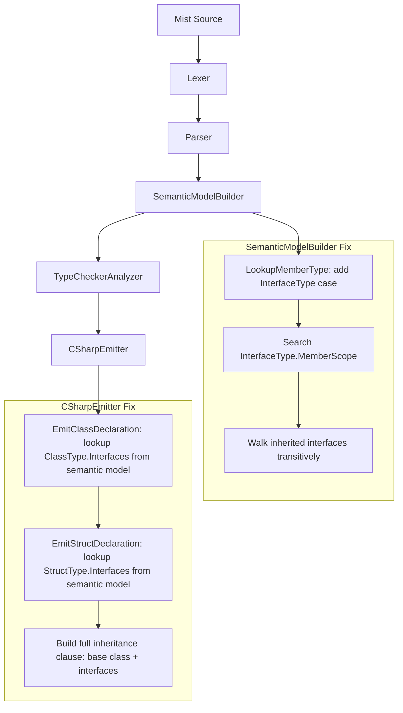
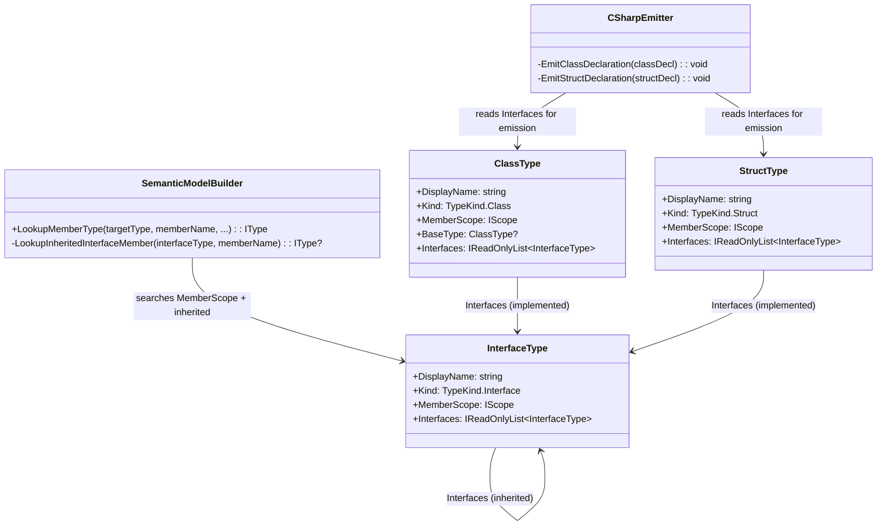
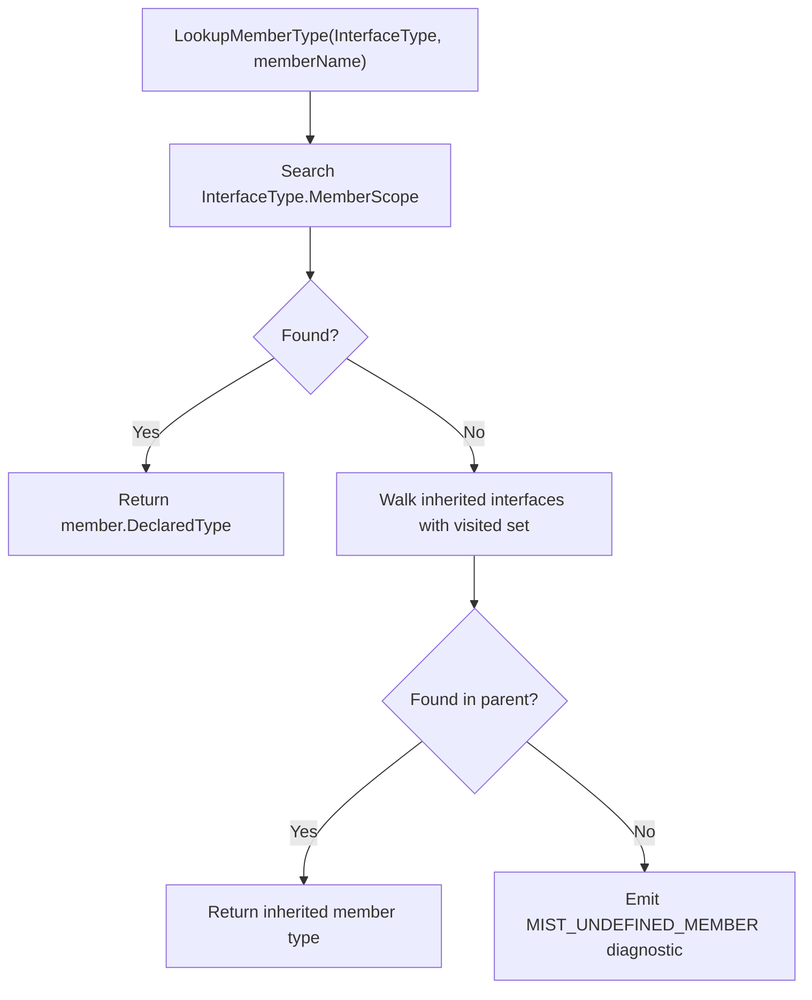

# Design Document: Interface Member Dispatch

## Overview

This design addresses the gaps that prevent interfaces from being fully functional end-to-end in the Mist compiler. While the interfaces spec delivered interface declarations, implementation validation, subtype assignability, and C# emission of interface declarations, three critical pieces are missing:

1. **`LookupMemberType` doesn't handle `InterfaceType`** — The switch in `SemanticModelBuilder.LookupMemberType` (line 3107) maps `InterfaceType` to `null` via the `_ => null` fallback, so calling a method on an interface-typed variable produces a `MIST_UNDEFINED_MEMBER (historical)` error.
2. **`EmitClassDeclaration` omits interface lists** — The emitter only emits `baseClause = $" : {baseName}"` using `classDecl.BaseClassName.Lexeme`. It doesn't consult the semantic model's `ClassType.Interfaces` to append interface names, so the transpiled C# class doesn't implement its interfaces.
3. **No AllFeatures sample files exercise interfaces** — The `samples/AllFeatures/` directory has no `.mist` files defining or using interfaces.

### Design Decisions

- **Transitive interface member lookup**: When resolving a member on an `InterfaceType`, the builder searches the interface's own `MemberScope` first, then walks inherited interfaces transitively using a visited set (same pattern as `InterfaceListContains` in the type checker). This handles diamond inheritance without duplication or infinite loops.
- **Semantic model for class interface emission**: Rather than parsing additional identifiers from the AST's `BaseClause` (the Storm source generator only exposes the first identifier as `BaseClassName`), the emitter looks up the class symbol's resolved `ClassType.Interfaces` list from the semantic model. This is more robust and consistent with how `EmitStructDeclaration` should also work.
- **Struct emitter also needs fixing**: The existing `EmitStructDeclaration` has the same single-interface limitation — it only emits `structDecl.InterfaceName.Lexeme`. Both class and struct emitters should use the semantic model's resolved `Interfaces` list to emit the full comma-separated interface list.
- **Sample files follow existing patterns**: `Circle.mist` and `Rectangle.mist` follow the same namespace/class structure as `Point.mist`, `Color.mist`, etc.

## Architecture

The changes integrate into the existing compiler pipeline at two points:



### Change Summary

| Component | File | Change |
|---|---|---|
| `LookupMemberType` | `SemanticModelBuilder.cs` | Add `InterfaceType it => it.MemberScope` to the switch, then add transitive inherited interface search after the direct scope lookup |
| `EmitClassDeclaration` | `CSharpEmitter.cs` | Look up the class symbol's `ClassType.Interfaces` from the semantic model and append interface names to the base clause |
| `EmitStructDeclaration` | `CSharpEmitter.cs` | Look up the struct symbol's `StructType.Interfaces` from the semantic model and emit the full interface list |
| `IShape.mist` | `samples/AllFeatures/` | New file: `IShape` interface with `Describe`/`Area`, `IResizable` extending `IShape` with `ResizedArea` |
| `Circle.mist` | `samples/AllFeatures/` | New file: `Circle` class implementing `IShape` |
| `Rectangle.mist` | `samples/AllFeatures/` | New file: `Rectangle` class implementing `IResizable` |
| `Program.mist` | `samples/AllFeatures/` | Add section 25: interface exercising with concrete calls, interface-typed variables, a static helper accepting `IShape`, and inherited interface member dispatch |

## Components and Interfaces

### SemanticModelBuilder: `LookupMemberType` Fix

The current switch statement:

```csharp
IScope? memberScope = targetType switch
{
    ClassType ct => ct.MemberScope,
    StructType st => st.MemberScope,
    ArrayType => null,
    StringType => null,
    _ => null,  // InterfaceType falls through here
};
```

**Change 1**: Add `InterfaceType` to the switch:

```csharp
IScope? memberScope = targetType switch
{
    ClassType ct => ct.MemberScope,
    StructType st => st.MemberScope,
    InterfaceType it => it.MemberScope,
    ArrayType => null,
    StringType => null,
    _ => null,
};
```

**Change 2**: After the existing `else if (memberScope is not null)` block that does a simple `memberScope.Lookup(memberName)`, add transitive inherited interface search. When the direct scope lookup returns null for an `InterfaceType`, walk the inherited interfaces:

```csharp
else if (memberScope is not null)
{
    var member = memberScope.Lookup(memberName);
    if (member is not null)
    {
        return member.DeclaredType ?? UnknownType.Instance;
    }

    // For interface types, walk inherited interfaces transitively.
    if (targetType is InterfaceType interfaceTarget)
    {
        var result = LookupInheritedInterfaceMember(interfaceTarget, memberName);
        if (result is not null)
        {
            return result;
        }
    }
}
```

**New helper method** `LookupInheritedInterfaceMember`:

```csharp
private static IType? LookupInheritedInterfaceMember(
    InterfaceType interfaceType,
    string memberName)
{
    var visited = new HashSet<InterfaceType>(ReferenceEqualityComparer.Instance);
    return LookupInheritedInterfaceMemberCore(interfaceType.Interfaces, memberName, visited);
}

private static IType? LookupInheritedInterfaceMemberCore(
    IReadOnlyList<InterfaceType> interfaces,
    string memberName,
    HashSet<InterfaceType> visited)
{
    foreach (var iface in interfaces)
    {
        if (!visited.Add(iface))
            continue;

        var member = iface.MemberScope.Lookup(memberName);
        if (member is not null)
        {
            return member.DeclaredType ?? UnknownType.Instance;
        }

        var inherited = LookupInheritedInterfaceMemberCore(iface.Interfaces, memberName, visited);
        if (inherited is not null)
        {
            return inherited;
        }
    }

    return null;
}
```

This uses the same visited-set pattern as `InterfaceListContains` in the type checker, handling diamond inheritance and preventing infinite loops.

### CSharpEmitter: `EmitClassDeclaration` Fix

The current code only emits the base class name from the AST:

```csharp
if (classDecl.BaseClause is not null)
{
    var baseName = classDecl.BaseClassName.Lexeme;
    baseClause = $" : {baseName}";
}
```

**Change**: Look up the class symbol from the semantic model, get its `ClassType`, and build the full inheritance clause from both `BaseType` and `Interfaces`:

```csharp
var baseClause = "";
var symbol = _model.GetDeclaredSymbol(classDecl);
if (symbol?.DeclaredType is ClassType classType)
{
    var parts = new List<string>();

    // Base class (if any)
    if (classType.BaseType is not null)
    {
        parts.Add(classType.BaseType.DisplayName);
    }

    // Interfaces
    foreach (var iface in classType.Interfaces)
    {
        parts.Add(iface.DisplayName);
    }

    if (parts.Count > 0)
    {
        baseClause = $" : {string.Join(", ", parts)}";
    }
}
else if (classDecl.BaseClause is not null)
{
    // Fallback to AST if semantic model lookup fails
    var baseName = classDecl.BaseClassName.Lexeme;
    baseClause = $" : {baseName}";
}
```

### CSharpEmitter: `EmitStructDeclaration` Fix

The current code only emits the first interface name from the AST:

```csharp
if (structDecl.InterfaceList is not null)
{
    var interfaceName = structDecl.InterfaceName.Lexeme;
    interfaceList = $" : {interfaceName}";
}
```

**Change**: Use the semantic model's resolved `StructType.Interfaces` list:

```csharp
var interfaceList = "";
var symbol = _model.GetDeclaredSymbol(structDecl);
if (symbol?.DeclaredType is StructType structType && structType.Interfaces.Count > 0)
{
    var names = structType.Interfaces.Select(i => i.DisplayName);
    interfaceList = $" : {string.Join(", ", names)}";
}
else if (structDecl.InterfaceList is not null)
{
    // Fallback to AST if semantic model lookup fails
    var interfaceName = structDecl.InterfaceName.Lexeme;
    interfaceList = $" : {interfaceName}";
}
```

### AllFeatures Sample Files

#### `IShape.mist`

```mist
using System;

namespace AllFeatures;

public interface IShape
{
    string Describe();
    double Area();
}

public interface IResizable : IShape
{
    double ResizedArea(double factor);
}
```

#### `Circle.mist`

```mist
using System;

namespace AllFeatures;

public class Circle : IShape
{
    private double _radius;

    public Circle(double radius)
    {
        _radius = radius;
    }

    public string Describe()
    {
        return $"Circle(radius={_radius})";
    }

    public double Area()
    {
        return 3.14159265 * _radius * _radius;
    }
}
```

#### `Rectangle.mist`

```mist
using System;

namespace AllFeatures;

public class Rectangle : IResizable
{
    private double _width;
    private double _height;

    public Rectangle(double width, double height)
    {
        _width = width;
        _height = height;
    }

    public string Describe()
    {
        return $"Rectangle(width={_width}, height={_height})";
    }

    public double Area()
    {
        return _width * _height;
    }

    public double ResizedArea(double factor)
    {
        return _width * factor * _height * factor;
    }
}
```

#### `Program.mist` — Section 25

Added after section 24 (static utility class), before the final "Done" line:

```mist
// 25. Interfaces: declaration, implementation, polymorphic dispatch
var circle = new Circle(5.0);
var rect = new Rectangle(3.0, 4.0);
Console.WriteLine($"circle={circle.Describe()} area={circle.Area()}");
Console.WriteLine($"rect={rect.Describe()} area={rect.Area()}");

// Interface-typed variables
IShape shape1 = circle;
Console.WriteLine($"shape1={shape1.Describe()} area={shape1.Area()}");
IShape shape2 = rect;
Console.WriteLine($"shape2={shape2.Describe()} area={shape2.Area()}");

// IResizable-typed variable (child interface)
IResizable resizable = rect;
Console.WriteLine($"resizable area={resizable.ResizedArea(2.0)}");

// Inherited interface member dispatch: call IShape.Describe through IResizable reference
Console.WriteLine($"resizable desc={resizable.Describe()}");

// Static helper accepting IShape parameter
Console.WriteLine($"helper circle: {DescribeShape(circle)}");
Console.WriteLine($"helper rect: {DescribeShape(rect)}");
```

A static helper method added to the `Program` class:

```mist
private static string DescribeShape(IShape shape)
{
    return $"{shape.Describe()} has area {shape.Area()}";
}
```

## Data Models

### Modified Types

No new types are introduced. The changes modify behavior of existing components:



### Member Lookup Flow




## Correctness Properties

*A property is a characteristic or behavior that should hold true across all valid executions of a system — essentially, a formal statement about what the system should do. Properties serve as the bridge between human-readable specifications and machine-verifiable correctness guarantees.*

### Property Reflection

After analyzing all acceptance criteria, the following consolidations were made:

- **1.1, 1.2, 1.3, 5.1, 6.1** all test the same `LookupMemberType` code path for `InterfaceType` — finding a member in the interface's own scope or in inherited interfaces transitively. 1.3 is the return-value aspect of 1.1. 5.1 is the same lookup through a parameter (the target type is still `InterfaceType`). 6.1 is the same transitive walk. These consolidate into **Property 1**.
- **1.4** tests the error case (member not found) — a distinct property. This becomes **Property 2**.
- **2.1, 2.2, 2.4** all test class C# emission with interfaces. 2.2 (no base class) is a subset of 2.1 (base class + interfaces). 2.4 (ordering) is verified within the same emission check. These consolidate into **Property 3**.
- **1.5** (diamond inheritance) is an edge case covered by Property 1's generators.
- **2.3** (no base class, no interfaces) is an edge case covered by Property 3's generators.
- **3.x, 4.x, 5.2, 5.3, 6.2** are integration/smoke tests for the AllFeatures sample — not suitable for PBT.

### Property 1: Interface member lookup resolves correctly through hierarchy

*For any* `InterfaceType` hierarchy (with varying depth, width, and diamond patterns) and *for any* member name that exists in the hierarchy (either in the target interface's own `MemberScope` or in any transitively inherited interface's `MemberScope`), calling `LookupMemberType` with the target interface and that member name SHALL return the member's declared type and SHALL NOT emit any diagnostic.

**Validates: Requirements 1.1, 1.2, 1.3, 5.1, 6.1**

### Property 2: Interface member lookup emits diagnostic for missing members

*For any* `InterfaceType` hierarchy and *for any* member name that does NOT exist in the target interface's `MemberScope` or any transitively inherited interface's `MemberScope`, calling `LookupMemberType` SHALL emit exactly one `MIST_UNDEFINED_MEMBER (historical)` diagnostic and SHALL return `UnknownType`.

**Validates: Requirements 1.4**

### Property 3: Class C# emission includes complete inheritance clause

*For any* `ClassType` with a resolved `BaseType` and/or a non-empty `Interfaces` list, the emitted C# class declaration SHALL contain an inheritance clause listing the base class name (if present) followed by all interface names in the same order as `ClassType.Interfaces`. When both `BaseType` is null and `Interfaces` is empty, the emitted declaration SHALL contain no inheritance clause.

**Validates: Requirements 2.1, 2.2, 2.3, 2.4**

## Error Handling

### Diagnostics

| Scenario | Diagnostic ID | Severity | Recovery |
|---|---|---|---|
| Member not found on interface type (direct or inherited) | `MIST_UNDEFINED_MEMBER (historical)` (existing) | Error | Return `UnknownType.Instance`, continue compilation |

No new diagnostic IDs are introduced. The existing `MIST_UNDEFINED_MEMBER (historical)` diagnostic is already defined and used for class/struct member lookup failures. The `InterfaceType` case reuses it.

### Error Recovery Strategy

- **Member not found on interface**: `LookupMemberType` returns `UnknownType.Instance` (same as for class/struct), which suppresses cascading type errors in downstream expressions.
- **Emitter fallback**: If the semantic model lookup for a class/struct symbol fails (e.g., due to earlier errors), the emitter falls back to the AST-based approach (existing behavior for the base class name).

## Testing Strategy

### Property-Based Testing (FsCheck 3.1.0 + xUnit)

The project uses **FsCheck 3.1.0** with **xUnit** for property-based testing. Each correctness property maps to a PBT test class.

**Configuration**: Minimum 100 iterations per property test.

**Generator requirements**:
- Generate `InterfaceType` instances with random methods in `MemberScope`
- Generate interface inheritance hierarchies (chains, trees, diamonds) by setting `InterfaceType.Interfaces`
- Generate `ClassType` instances with random `BaseType` and `Interfaces` combinations
- Generate member names that exist/don't exist in the hierarchy

| Property | Test Class | Type |
|---|---|---|
| Property 1: Interface member lookup resolves | `InterfaceMemberLookupPropertyTests` | PBT |
| Property 2: Interface member lookup missing diagnostic | `InterfaceMemberLookupMissingPropertyTests` | PBT |
| Property 3: Class emission inheritance clause | `ClassEmissionInheritancePropertyTests` | PBT |
| AllFeatures compilation | `AllFeaturesInterfaceIntegrationTests` | Integration |
| AllFeatures runtime output | `AllFeaturesInterfaceIntegrationTests` | Integration |

### Tag Format

Each property-based test is tagged with:
```
Feature: interface-member-dispatch, Property {number}: {property_text}
```

### Unit Tests (Example-Based)

Targeted unit tests cover specific edge cases:
- Empty interface (no methods, no parents) — member lookup returns diagnostic
- Diamond inheritance — member found without duplication
- Deep inheritance chain (3+ levels) — member found at bottom
- Class with base class providing all interface methods — emitter includes both base and interfaces
- Class with no base class and no interfaces — emitter omits inheritance clause
- Struct with multiple interfaces — emitter includes full list

### Integration Tests

- Compile all `samples/AllFeatures/*.mist` files through the full pipeline and verify zero diagnostics
- Run the compiled output and verify stdout contains expected interface dispatch output lines:
  - `circle=Circle(radius=5)` 
  - `shape1=Circle(radius=5)`
  - `shape2=Rectangle(width=3, height=4)`
  - `resizable desc=Rectangle(width=3, height=4)` (inherited interface member dispatch)
  - `helper circle:` and `helper rect:` (interface-typed parameter dispatch)
