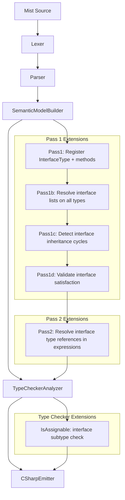
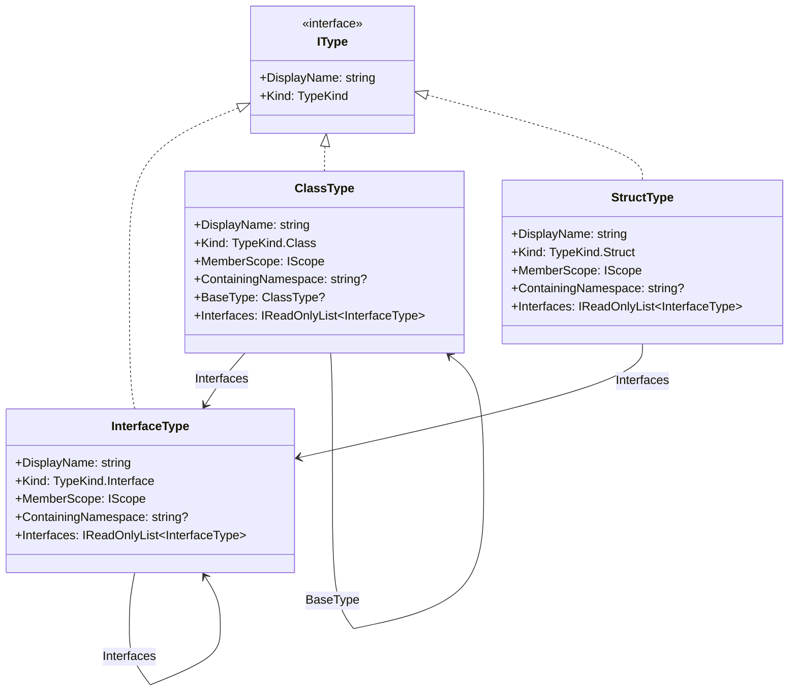

# Design Document: Interfaces

## Overview

This design adds interface types to the Mist programming language. An interface defines a contract of method signatures that implementing types must provide. Classes, structs, and other interfaces can implement zero or more interfaces, enabling multi-inheritance at the interface level.

The implementation touches every stage of the compiler pipeline:

1. **Grammar** — New `INTERFACE` keyword, `InterfaceDeclaration` and `InterfaceMethodDeclaration` rules, extended `ClassDeclaration` and `StructDeclaration` rules with interface lists
2. **Semantic Model** — New `InterfaceType`, `SymbolKind.Interface`, `TypeKind.Interface`, interface resolution, cycle detection, and interface satisfaction validation
3. **Type Checker** — Extended `IsAssignable` to support interface subtype assignability
4. **C# Emitter** — Emit C# `interface` declarations and interface lists on classes/structs
5. **Pretty Printer** — Format interface declarations and interface lists
6. **Syntax Highlighting** — Add `interface` to the TextMate grammar

### Design Decisions

- **No modifiers on interface methods**: Interface methods have no access modifiers, `static`, or `virtual` keywords. This simplifies the initial implementation and matches the user's specification.
- **Interface satisfaction via signature matching**: A method satisfies an interface method if it has the same name, return type, and parameter types. Method overloading is not yet supported in Mist, so name alone is sufficient for lookup, but return type and parameter types are still validated.
- **Inherited method satisfaction**: When checking if a class implements an interface, the checker walks the class's base type chain to find methods. This reuses the existing single-inheritance infrastructure.
- **Cycle detection reuses the existing pattern**: The existing `Pass1_DetectCycles` for class inheritance is extended with a parallel pass for interface inheritance cycles.

## Architecture

The interface feature integrates into the existing multi-pass compiler pipeline:



### Pipeline Integration Points

| Pipeline Stage | Change |
|---|---|
| `keywords.storm` | Add `INTERFACE` token |
| `Mist.storm` | Add `InterfaceDeclaration`, `InterfaceMethodDeclaration` rules; extend `TypeDeclaration`, `ClassDeclaration`, `StructDeclaration` |
| `MistPrettyPrinter` | Handle `InterfaceTypeTypeDeclarationNode`, interface method formatting, interface lists on all type declarations |
| `SemanticModelBuilder` Pass 1 | Register `InterfaceType` and interface method symbols |
| `SemanticModelBuilder` Pass 1b | Resolve interface lists on classes, structs, and interfaces (new sub-pass after base type resolution) |
| `SemanticModelBuilder` Pass 1c | Detect interface inheritance cycles (new sub-pass) |
| `SemanticModelBuilder` Pass 1d (new) | Validate interface satisfaction for classes and structs |
| `SemanticModelBuilder` Pass 2 | Resolve `InterfaceType` references in expressions and type references |
| `TypeCheckerAnalyzer` | Extend `IsAssignable` to handle interface subtype relationships |
| `CSharpEmitter` | Emit interface declarations, interface method signatures, and interface lists on classes/structs |
| `ISymbol` / `SymbolKind` | Add `Interface` variant |
| `IType` / `TypeKind` | Add `Interface` variant |
| `CSharpTypeMap` | Handle `InterfaceType` |
| `mist.tmLanguage.json` | Add `interface` keyword and declaration-name pattern |

## Components and Interfaces

### Grammar Changes (`keywords.storm`, `Mist.storm`)

**`keywords.storm`** — Add:
```
token INTERFACE = "interface";
```

**`Mist.storm`** — New rules:
```
rule InterfaceDeclaration = INTERFACE name:IDENTIFIER
    interfaceList:(COLON interfaceName:IDENTIFIER (COMMA IDENTIFIER)*)?
    LEFT_BRACE methods:InterfaceMethodDeclaration* RIGHT_BRACE;

rule InterfaceMethodDeclaration = returnType:TypeReference name:IDENTIFIER
    LEFT_PARENTHESIS parameters:ParameterList? RIGHT_PARENTHESIS SEMICOLON;
```

**`Mist.storm`** — Modified rules:
```
rule TypeDeclaration
    = classDeclaration:ClassDeclaration       as ClassType
    | structDeclaration:StructDeclaration     as StructType
    | interfaceDeclaration:InterfaceDeclaration as InterfaceType
    ;

rule ClassDeclaration = modifiers:Modifier* CLASS name:IDENTIFIER
    baseClause:(COLON baseClassName:IDENTIFIER (COMMA IDENTIFIER)*)?
    LEFT_BRACE members:MemberDeclaration* RIGHT_BRACE;

rule StructDeclaration = modifiers:Modifier* STRUCT name:IDENTIFIER
    interfaceList:(COLON interfaceName:IDENTIFIER (COMMA IDENTIFIER)*)?
    LEFT_BRACE members:MemberDeclaration* RIGHT_BRACE;
```

**Design rationale for `ClassDeclaration` base clause**: The existing `ClassDeclaration` uses `baseClass:(COLON baseClassName:IDENTIFIER)?` for single inheritance. The new grammar extends this to `baseClause:(COLON baseClassName:IDENTIFIER (COMMA IDENTIFIER)*)?`. The first identifier after the colon is always treated as either a base class name or an interface name. The semantic model builder determines which it is during resolution (Pass 1b) by checking whether the resolved type is a `ClassType` or `InterfaceType`. If the first name resolves to an interface, there is no base class and all names are interfaces.

### New Type: `InterfaceType` (`Source/Mist/Semantics/Model/Types/InterfaceType.cs`)

```csharp
public sealed class InterfaceType : IType
{
    public string DisplayName { get; }
    public TypeKind Kind => TypeKind.Interface;
    public IScope MemberScope { get; }
    public string? ContainingNamespace { get; }
    public IReadOnlyList<InterfaceType> Interfaces { get; internal set; }

    public InterfaceType(string displayName, IScope memberScope, string? containingNamespace)
    {
        DisplayName = displayName;
        MemberScope = memberScope;
        ContainingNamespace = containingNamespace;
        Interfaces = Array.Empty<InterfaceType>();
    }
}
```

### Extended Types

**`ClassType`** — Add `Interfaces` property:
```csharp
public IReadOnlyList<InterfaceType> Interfaces { get; internal set; }
    = Array.Empty<InterfaceType>();
```

**`StructType`** — Add `Interfaces` property:
```csharp
public IReadOnlyList<InterfaceType> Interfaces { get; internal set; }
    = Array.Empty<InterfaceType>();
```

**`TypeKind`** — Add variant:
```csharp
public enum TypeKind
{
    Class,
    Struct,
    Interface,
}
```

**`SymbolKind`** — Add variant:
```csharp
public enum SymbolKind
{
    Namespace,
    Class,
    Struct,
    Interface,
    Field,
    Constructor,
    Method,
    Parameter,
    LocalVariable,
}
```

### SemanticModelBuilder Extensions

#### Pass 1: Register Interface Types

In `RegisterTypeDeclaration`, add a case for `InterfaceTypeTypeDeclarationNode`:

```csharp
case InterfaceTypeTypeDeclarationNode interfaceTypeNode:
    RegisterInterfaceDeclaration(
        interfaceTypeNode.InterfaceDeclaration,
        parentScope, symbolTable, namespaceName, diagnostics);
    break;
```

`RegisterInterfaceDeclaration` creates an `InterfaceType` with a member scope, registers a symbol with `SymbolKind.Interface`, and registers each `InterfaceMethodDeclaration` as a `SymbolKind.Method` in the interface's member scope.

#### Pass 1b: Resolve Interface Lists

After resolving base types for classes, a new sub-pass resolves interface lists on all types:

1. For each class symbol: parse the base clause to separate the base class (if any) from interface names. Resolve each interface name to an `InterfaceType`. Store on `ClassType.Interfaces`.
2. For each struct symbol: resolve each interface name in the interface list to an `InterfaceType`. Store on `StructType.Interfaces`.
3. For each interface symbol: resolve each interface name in the interface list to an `InterfaceType`. Store on `InterfaceType.Interfaces`.

Diagnostics emitted:
- `MIST_UNDEFINED_INTERFACE (historical)`: Interface name not found in scope
- `MIST_NOT_AN_INTERFACE (historical)`: Name resolves to a class or struct, not an interface

#### Pass 1c: Detect Interface Inheritance Cycles

Walk each interface's `Interfaces` chain using a visited set. If a cycle is detected:
- Emit `MIST_CIRCULAR_INTERFACE_INHERITANCE (historical)` diagnostic
- Break the cycle by removing the back-edge from the `Interfaces` list

#### Pass 1d: Validate Interface Satisfaction (new pass)

For each class and struct that implements interfaces:

1. Collect all required methods by walking the interface hierarchy transitively (using a visited set to handle diamond inheritance).
2. For each required method, search for a matching method in the implementing type's member scope. For classes, also walk the base type chain.
3. A method matches if it has the same name, same return type, and same parameter types (count and types).
4. Emit `MIST_MISSING_INTERFACE_METHOD (historical)` for each unmatched method.
5. Emit `MIST_INTERFACE_METHOD_SIGNATURE_MISMATCH (historical)` if a method with the correct name exists but has a different signature.

#### Pass 2: Resolve Interface Type References

Extend the type reference resolution to handle `InterfaceType` the same way `ClassType` and `StructType` are handled. When an identifier resolves to a symbol with `SymbolKind.Interface`, return its `InterfaceType`.

### TypeCheckerAnalyzer Extensions

Extend `IsAssignable` to handle interface subtype relationships:

```csharp
// Interface assignability:
// A class/struct implementing an interface (directly or transitively) is assignable to that interface.
// An interface is assignable to any interface it inherits from (directly or transitively).
if (target is InterfaceType targetInterface)
{
    if (ImplementsInterface(source, targetInterface))
        return true;
}
```

The `ImplementsInterface` helper:
1. If `source` is a `ClassType`: check `ClassType.Interfaces` recursively, and also walk `BaseType` chain checking each ancestor's interfaces.
2. If `source` is a `StructType`: check `StructType.Interfaces` recursively.
3. If `source` is an `InterfaceType`: check if `source` equals `target` or if any of `source.Interfaces` (transitively) includes `target`.

### CSharpEmitter Extensions

Add `EmitInterfaceDeclaration` method:
```csharp
private void EmitInterfaceDeclaration(InterfaceDeclarationNode interfaceDecl)
{
    var name = interfaceDecl.Name.Lexeme;
    var interfaceList = EmitInterfaceList(interfaceDecl);
    AppendLine($"interface {name}{interfaceList}");
    AppendLine("{");
    _indentLevel++;
    foreach (var method in interfaceDecl.Methods)
    {
        EmitInterfaceMethodDeclaration(method);
    }
    _indentLevel--;
    AppendLine("}");
}
```

Extend `EmitClassDeclaration` and `EmitStructDeclaration` to include interface lists in the inheritance clause.

### MistPrettyPrinter Extensions

Add handling for `InterfaceTypeTypeDeclarationNode` in `EmitTypeDeclaration`. Add `EmitInterfaceDeclaration` and `EmitInterfaceMethodDeclaration` methods. Extend `EmitClassDeclaration` and `EmitStructDeclaration` to format interface lists.

### CSharpTypeMap Extension

Add `InterfaceType` case:
```csharp
InterfaceType i => i.DisplayName,
```

### TextMate Grammar Extensions

Add `interface` to the keyword declaration pattern:
```json
"match": "\\b(namespace|using|class|struct|interface)\\b"
```

Add interface declaration name pattern:
```json
{
    "match": "\\b(interface)\\s+([a-zA-Z_]\\w*)",
    "captures": {
        "1": { "name": "keyword.declaration.mist" },
        "2": { "name": "entity.name.type.interface.mist" }
    }
}
```

### New Diagnostic IDs

| ID | Stage | Message |
|---|---|---|
| `MIST_UNDEFINED_INTERFACE (historical)` | SemanticModelConstruction | The interface type '{name}' could not be found. |
| `MIST_NOT_AN_INTERFACE (historical)` | SemanticModelConstruction | '{name}' is not an interface; only interfaces can appear in an interface list. |
| `MIST_CIRCULAR_INTERFACE_INHERITANCE (historical)` | SemanticModelConstruction | Circular interface inheritance detected: '{chain}'. |
| `MIST_MISSING_INTERFACE_METHOD (historical)` | SemanticModelConstruction | '{typeName}' does not implement interface method '{interfaceName}.{methodName}'. |
| `MIST_INTERFACE_METHOD_SIGNATURE_MISMATCH (historical)` | SemanticModelConstruction | '{typeName}.{methodName}' does not match the signature required by interface '{interfaceName}': expected '{expectedSig}', found '{actualSig}'. |

## Data Models

### InterfaceType



### AST Nodes (Storm-generated)

The Storm source generator will produce these node types from the grammar rules:

- `InterfaceDeclarationNode` — name, optional interface list, methods array
- `InterfaceMethodDeclarationNode` — return type, name, optional parameter list
- `InterfaceTypeTypeDeclarationNode` — wraps `InterfaceDeclarationNode` as a `TypeDeclaration` variant

### Symbol Registration

| Declaration | SymbolKind | DeclaredType |
|---|---|---|
| `interface IFoo { ... }` | `Interface` | `InterfaceType("IFoo", ...)` |
| Interface method `void Bar();` | `Method` | Return type (e.g., `VoidType`) |


## Correctness Properties

*A property is a characteristic or behavior that should hold true across all valid executions of a system — essentially, a formal statement about what the system should do. Properties serve as the bridge between human-readable specifications and machine-verifiable correctness guarantees.*

### Property 1: Interface declaration round-trip

*For any* valid Mist AST containing interface declarations (with varying method counts, parameter lists, and interface inheritance lists), class declarations with interface lists (with or without a base class), and struct declarations with interface lists, pretty-printing the AST and then parsing the result and pretty-printing again SHALL produce identical output.

**Validates: Requirements 1.2, 1.3, 1.5, 1.6, 2.1, 2.2, 2.3, 2.4, 2.5, 2.6, 3.1, 3.2, 3.3, 3.4, 3.5, 3.6, 3.7**

### Property 2: Interface type registration

*For any* set of interface declarations with varying numbers of methods, the semantic model builder SHALL create an `InterfaceType` for each interface with `TypeKind.Interface`, register a symbol with `SymbolKind.Interface` in the parent scope, and register a `SymbolKind.Method` symbol for each interface method in the interface's member scope. The count of method symbols in the interface's member scope SHALL equal the number of methods declared in the interface.

**Validates: Requirements 4.1, 4.2, 4.3, 4.4**

### Property 3: Interface resolution on implementing types

*For any* valid program where classes, structs, or interfaces declare interface lists referencing defined interfaces (including forward references), the semantic model builder SHALL resolve all interface names to `InterfaceType` instances and store them on the implementing type's `Interfaces` property. The count of resolved interfaces SHALL equal the count of interface names in the declaration.

**Validates: Requirements 5.1, 5.4, 5.5**

### Property 4: Invalid interface reference diagnostic

*For any* type declaration that references a name in its interface list where that name is either undefined or resolves to a class or struct (not an interface), the semantic model builder SHALL emit a diagnostic error. If the name is undefined, the diagnostic SHALL be `MIST_UNDEFINED_INTERFACE (historical)`. If the name resolves to a non-interface type, the diagnostic SHALL be `MIST_NOT_AN_INTERFACE (historical)`.

**Validates: Requirements 5.2, 5.3**

### Property 5: Interface inheritance cycle detection

*For any* set of interfaces that form a circular inheritance chain (including self-inheritance), the semantic model builder SHALL emit a `MIST_CIRCULAR_INTERFACE_INHERITANCE (historical)` diagnostic and the compilation SHALL complete without infinite loops.

**Validates: Requirements 6.1, 6.2, 6.3**

### Property 6: Interface satisfaction

*For any* class or struct that implements one or more interfaces (directly or transitively through interface inheritance), if the implementing type (or, for classes, any of its base types) provides a method matching every required interface method's signature (name, return type, and parameter types), then the semantic model builder SHALL emit no `MIST_MISSING_INTERFACE_METHOD (historical)` diagnostics. Conversely, for each required method that is not provided, exactly one `MIST_MISSING_INTERFACE_METHOD (historical)` diagnostic SHALL be emitted.

**Validates: Requirements 7.1, 7.2, 7.3, 7.4**

### Property 7: Interface method signature mismatch diagnostic

*For any* class or struct that implements an interface and provides a method with the correct name but a mismatched return type or parameter types compared to the interface method, the semantic model builder SHALL emit a `MIST_INTERFACE_METHOD_SIGNATURE_MISMATCH (historical)` diagnostic.

**Validates: Requirements 7.5**

### Property 8: Interface subtype assignability

*For any* type that implements an interface (directly or transitively), assigning a value of that type to a variable typed as the implemented interface SHALL be accepted by the type checker with no diagnostic. This applies to class-to-interface, struct-to-interface, and interface-to-parent-interface assignments, and extends to method parameter passing and return type checking.

**Validates: Requirements 8.1, 8.3, 8.4, 8.5**

### Property 9: Non-implementing type is not assignable to interface

*For any* type that does not implement a given interface (neither directly nor transitively), assigning a value of that type to a variable typed as that interface SHALL cause the type checker to emit a diagnostic error.

**Validates: Requirements 8.2**

### Property 10: Interface C# emission correctness

*For any* valid Mist program containing interface declarations, classes/structs implementing interfaces, and interface-to-interface inheritance, the emitted C# code SHALL contain syntactically correct C# interface declarations, interface method signatures, and inheritance lists that match the Mist source structure.

**Validates: Requirements 9.1, 9.2, 9.3, 9.4, 9.5, 9.6**

## Error Handling

### Compilation Errors (Diagnostics)

| Scenario | Diagnostic ID | Severity | Recovery |
|---|---|---|---|
| Interface name in interface list not found | `MIST_UNDEFINED_INTERFACE (historical)` | Error | Skip interface, continue resolution |
| Non-interface type in interface list | `MIST_NOT_AN_INTERFACE (historical)` | Error | Skip entry, continue resolution |
| Circular interface inheritance | `MIST_CIRCULAR_INTERFACE_INHERITANCE (historical)` | Error | Break cycle by removing back-edge |
| Missing interface method implementation | `MIST_MISSING_INTERFACE_METHOD (historical)` | Error | Report each missing method, continue |
| Interface method signature mismatch | `MIST_INTERFACE_METHOD_SIGNATURE_MISMATCH (historical)` | Error | Report mismatch, continue |
| Type not assignable to interface | `MIST_TC_0001 (historical)` (existing) | Error | Existing type checker handling |

### Error Recovery Strategy

The compiler follows the existing pattern of continuing compilation after errors to report as many issues as possible in a single pass:

- **Unresolved interfaces**: The type's `Interfaces` list omits the unresolved entry. Subsequent passes (satisfaction checking, assignability) operate on the successfully resolved interfaces only.
- **Circular inheritance**: The cycle is broken by clearing the back-edge. The affected interface's `Interfaces` list is truncated at the cycle point.
- **Missing methods**: All missing methods are reported individually. The compilation continues to the type checker but short-circuits before emission (existing behavior when semantic errors are present).

## Testing Strategy

### Property-Based Testing (FsCheck)

The project uses **FsCheck 3.1.0** with **xUnit** for property-based testing. Each correctness property maps to one or more PBT test classes.

**Configuration**: Minimum 100 iterations per property test.

**Generator extensions needed**:
- Extend `MistAstGenerator` with generators for `InterfaceDeclarationNode`, `InterfaceMethodDeclarationNode`, and interface lists on class/struct declarations
- Extend `MistProgramGenerator` with generators for complete programs containing interfaces, implementing types, and interface hierarchies
- Add generators for invalid programs (undefined interfaces, non-interface types in lists, circular inheritance, missing methods, signature mismatches)

### Test Plan

| Property | Test Class | Type |
|---|---|---|
| Property 1: Round-trip | `InterfaceRoundTripPropertyTests` | PBT |
| Property 2: Type registration | `InterfaceTypeRegistrationPropertyTests` | PBT |
| Property 3: Interface resolution | `InterfaceResolutionPropertyTests` | PBT |
| Property 4: Invalid reference diagnostic | `InvalidInterfaceReferencePropertyTests` | PBT |
| Property 5: Cycle detection | `InterfaceCycleDetectionPropertyTests` | PBT |
| Property 6: Interface satisfaction | `InterfaceSatisfactionPropertyTests` | PBT |
| Property 7: Signature mismatch | `InterfaceSignatureMismatchPropertyTests` | PBT |
| Property 8: Subtype assignability | `InterfaceAssignabilityPropertyTests` | PBT |
| Property 9: Non-assignability | `InterfaceNonAssignabilityPropertyTests` | PBT |
| Property 10: Emission correctness | `InterfaceEmissionPropertyTests` | PBT |
| Sample app compilation | `InterfaceSampleIntegrationTests` | Integration |
| Syntax highlighting | Manual verification | Manual |
| CSHARP_FEATURES.md update | Manual verification | Manual |

### Unit Tests (Example-Based)

In addition to PBT, targeted unit tests cover:
- Empty interface declaration (edge case for Property 1)
- Interface with no implementors (edge case for Property 6)
- Diamond interface inheritance (edge case for Properties 3, 6)
- Class with base class + interfaces where base class provides all interface methods (edge case for Property 6)
- Self-referencing interface (edge case for Property 5)

### Tag Format

Each property-based test is tagged with:
```
Feature: interfaces, Property {number}: {property_text}
```
