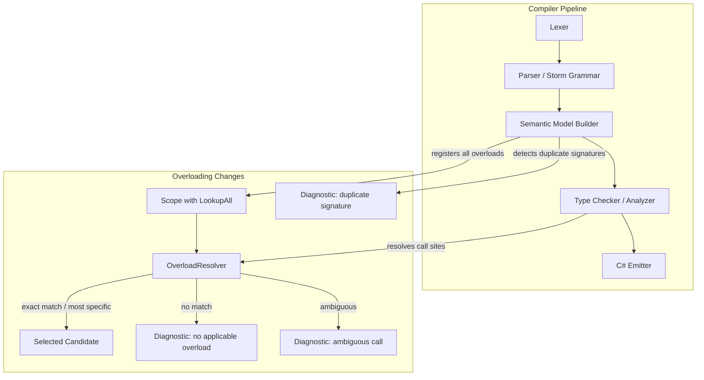
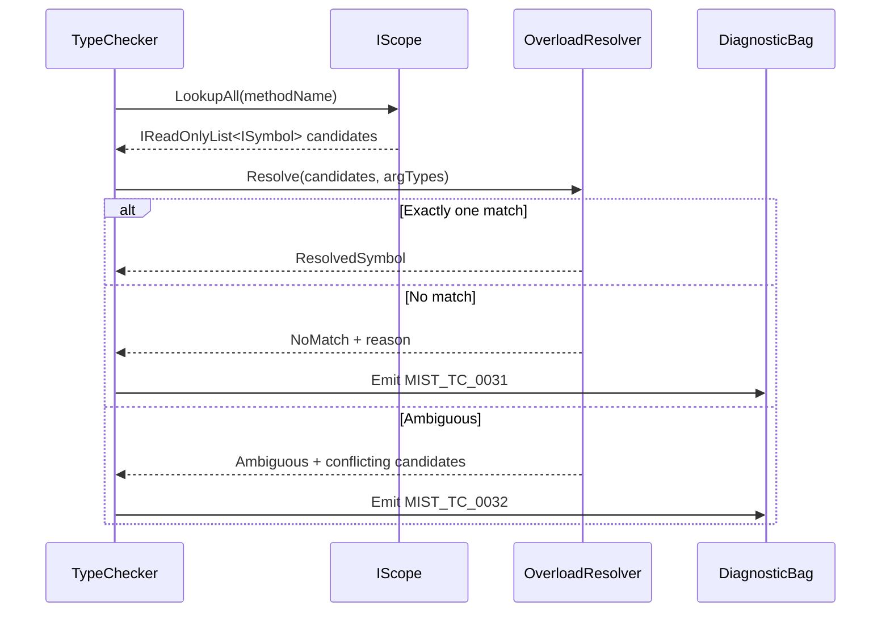

# Design Document: Method Overloading

## Overview

This design adds C#-style method and constructor overloading to the Mist compiler. The core change is evolving the symbol model from "one symbol per name per scope" to "multiple symbols per name per scope" for methods and constructors, then adding an overload resolution algorithm to select the correct target at each call site.

The feature touches four compiler stages:

1. **Scope & Symbol Model** — `IScope` gains a `LookupAll` method; `Scope` stores multiple same-named symbols.
2. **Semantic Model Builder** — Registers all overloads, detects duplicate signatures, validates interface satisfaction with overloads.
3. **Type Checker** — New `OverloadResolver` selects the best candidate from an overload set or emits diagnostics for ambiguous/unresolvable calls.
4. **C# Emitter** — Emits all overloads (already works per-symbol, minimal changes needed).

### Design Rationale

The existing `IScope.Lookup(string name)` returns the first match. Rather than replacing it (which would break all existing callers), we add `LookupAll(string name)` alongside it. The single-symbol `Lookup` remains for backward compatibility — most compiler passes only need one symbol (fields, variables, properties). The overload resolver is the primary consumer of `LookupAll`.

Overload resolution is implemented as a standalone static class (`OverloadResolver`) rather than being embedded in the type checker. This keeps the resolution algorithm testable in isolation and reusable for both method calls and constructor calls.

## Architecture



### Data Flow for Overload Resolution



## Components and Interfaces

### 1. IScope Extension

**File:** `Source/Mist/Semantics/Contracts/IScope.cs`

```csharp
public interface IScope
{
    IScope? Parent { get; }
    IReadOnlyList<ISymbol> Members { get; }

    // Existing — returns first match, walks parent chain. Unchanged.
    ISymbol? Lookup(string name);

    // New — returns ALL symbols with the given name from this scope
    // and all ancestor scopes.
    IReadOnlyList<ISymbol> LookupAll(string name);
}
```

**Design Decision:** `LookupAll` traverses the full parent chain, collecting all matches. For overload resolution across inheritance, the type checker will also explicitly walk the type hierarchy's member scopes (via `ClassType.BaseType.MemberScope`) to build the complete overload set including inherited methods.

### 2. Scope Implementation

**File:** `Source/Mist/Semantics/Model/Scope.cs`

```csharp
public IReadOnlyList<ISymbol> LookupAll(string name)
{
    var results = new List<ISymbol>();
    CollectAll(name, results);
    return results;
}

private void CollectAll(string name, List<ISymbol> results)
{
    foreach (var member in _members)
    {
        if (member.Name == name)
            results.Add(member);
    }
    if (Parent is Scope parentScope)
        parentScope.CollectAll(name, results);
    else
        Parent?.LookupAll(name); // fallback for non-Scope parents
}
```

The existing `Lookup(string name)` remains unchanged — it returns the first match. This preserves backward compatibility for all existing callers (field lookups, variable lookups, type lookups, etc.).

### 3. Parameter Signature Extraction

A new utility is needed to extract the ordered list of parameter types from a method or constructor symbol. This is used by both the duplicate-signature detector and the overload resolver.

**File:** `Source/Mist/Semantics/Model/ParameterSignature.cs` (new)

```csharp
/// <summary>
/// Extracts and compares parameter signatures for overload resolution.
/// A parameter signature is the ordered list of parameter types,
/// excluding return type and parameter names.
/// </summary>
public static class ParameterSignature
{
    /// <summary>
    /// Extracts the parameter types from a method or constructor's declaring AST node.
    /// </summary>
    public static IReadOnlyList<IType> Extract(
        ISymbol symbol, ISemanticModel model)
    {
        // Get declaring node, extract ParameterListNode, resolve each parameter's type.
        // Returns empty list for parameterless methods/constructors.
    }

    /// <summary>
    /// Returns true if two parameter signatures are identical
    /// (same count, same types in order).
    /// </summary>
    public static bool AreEqual(
        IReadOnlyList<IType> a, IReadOnlyList<IType> b)
    {
        if (a.Count != b.Count) return false;
        for (int i = 0; i < a.Count; i++)
            if (a[i].DisplayName != b[i].DisplayName) return false;
        return true;
    }
}
```

### 4. Overload Resolver

**File:** `Source/Mist/Analysis/Builtin/OverloadResolver.cs` (new)

The resolver is a pure static class with no mutable state. It takes a list of candidate symbols and the argument types at the call site, and returns a resolution result.

```csharp
public enum OverloadResolutionStatus
{
    Success,
    NoApplicableCandidate,
    AmbiguousCall,
}

public readonly record struct OverloadResolutionResult(
    OverloadResolutionStatus Status,
    ISymbol? BestCandidate,
    IReadOnlyList<ISymbol>? AmbiguousCandidates);

public static class OverloadResolver
{
    public static OverloadResolutionResult Resolve(
        IReadOnlyList<ISymbol> candidates,
        IReadOnlyList<IType> argumentTypes,
        ISemanticModel model)
    {
        // Step 1: Filter to applicable candidates
        //   - Parameter count matches argument count
        //   - Each argument type is assignable to the corresponding parameter type
        //
        // Step 2: If zero applicable → NoApplicableCandidate
        //
        // Step 3: If exactly one applicable → Success
        //
        // Step 4: If multiple applicable, find most specific:
        //   - Candidate A is more specific than B if for every parameter position,
        //     A's parameter type is assignable to B's parameter type,
        //     but not vice versa for at least one position.
        //   - Prefer exact matches over assignable matches.
        //
        // Step 5: If no single most specific → AmbiguousCall
    }
}
```

#### Resolution Algorithm Detail

```
RESOLVE(candidates, argTypes):
  applicable = []
  for each candidate in candidates:
    paramTypes = ParameterSignature.Extract(candidate)
    if paramTypes.Count != argTypes.Count: skip
    if all argTypes[i] assignable to paramTypes[i]: add to applicable

  if applicable.Count == 0: return NoApplicableCandidate
  if applicable.Count == 1: return Success(applicable[0])

  // Find most specific among applicable
  best = applicable[0]
  for i = 1 to applicable.Count - 1:
    if applicable[i] is more specific than best:
      best = applicable[i]
    else if best is NOT more specific than applicable[i]:
      // Neither is more specific — potential ambiguity
      best = null; break

  if best != null:
    // Verify best is more specific than ALL others
    for each other in applicable where other != best:
      if best is NOT more specific than other:
        return AmbiguousCall(applicable)
    return Success(best)
  else:
    return AmbiguousCall(applicable)

MORE_SPECIFIC(A, B):
  // A is more specific than B if:
  // - For all i: A.paramTypes[i] is assignable to B.paramTypes[i]
  // - For at least one i: B.paramTypes[i] is NOT assignable to A.paramTypes[i]
  allAtoB = true
  anyBnotToA = false
  for each position i:
    if NOT IsAssignable(A.params[i], B.params[i]): allAtoB = false
    if NOT IsAssignable(B.params[i], A.params[i]): anyBnotToA = true
  return allAtoB AND anyBnotToA
```

### 5. Semantic Model Builder Changes

**File:** `Source/Mist/Semantics/Model/SemanticModelBuilder.cs`

#### Pass 1 Changes — Registration

Currently, `RegisterMethodDeclaration` and `RegisterConstructorDeclaration` unconditionally add symbols to the type scope. This already supports multiple same-named symbols because `Scope.AddMember` just appends to a list. No change needed for registration itself.

#### New Pass — Duplicate Signature Detection

A new pass (`Pass1_CheckDuplicateSignatures`) runs after Pass 2 (type resolution), because parameter types must be resolved before signatures can be compared.

```
Pass1_CheckDuplicateSignatures(symbolTable, diagnostics):
  for each type symbol (Class, Struct, Interface):
    memberScope = type.MemberScope
    // Group methods by name
    methodGroups = memberScope.Members
      .Where(m => m.Kind == Method)
      .GroupBy(m => m.Name)
    for each group with count > 1:
      for each pair (a, b) where a appears before b:
        if ParameterSignature.AreEqual(Extract(a), Extract(b)):
          emit MIST_SM_0020: "Duplicate method signature '{name}({sig})'"

    // Same for constructors
    constructorGroup = memberScope.Members
      .Where(m => m.Kind == Constructor)
    for each pair of constructors:
      if ParameterSignature.AreEqual(Extract(a), Extract(b)):
        emit MIST_SM_0021: "Duplicate constructor signature"
```

#### Interface Satisfaction Changes

The existing `Pass1_ValidateInterfaceSatisfaction` currently matches interface methods to implementing type methods by name only. It must be updated to match by name AND parameter signature:

```
For each interface method:
  Find all methods in implementing type with same name
  Check if any has a matching parameter signature
  If none matches → emit diagnostic with the specific signature
```

#### Member Redeclaration Changes

The existing `Pass1_CheckMemberRedeclarations` flags any derived-class member with the same name as a base-class member. For methods and constructors, this must be relaxed: same name with a different parameter signature is a valid overload, not a redeclaration. Only same name + same signature is a redeclaration error.

### 6. Type Checker Changes

**File:** `Source/Mist/Analysis/Builtin/TypeCheckerAnalyzer.cs`

#### Method Call Resolution

`CheckMethodCallArguments` and `CheckInvocationArguments` currently look up a single symbol via `model.GetDeclaredSymbol(callSite)`. They must be updated to:

1. Collect the full overload set (via `LookupAll` on the target type's member scope, plus inherited methods from base types).
2. Collect argument types from the call site.
3. Call `OverloadResolver.Resolve(candidates, argTypes, model)`.
4. On `NoApplicableCandidate`: emit `MIST_TC_0031 (historical)`.
5. On `AmbiguousCall`: emit `MIST_TC_0032 (historical)`.
6. On `Success`: proceed with the resolved symbol for further type checking.

#### Constructor Call Resolution

`CheckObjectCreation` already has rudimentary constructor matching. It must be updated to use `OverloadResolver.Resolve` for consistency.

#### Constructor Chain Resolution

`CheckConstructorChain` already searches for matching constructors. It must be updated to use `OverloadResolver.Resolve` and emit the new diagnostic IDs.

#### New Diagnostic IDs

| ID | Severity | Message Template |
|---|---|---|
| `MIST_SM_0020 (historical)` | Error | Type '{typeName}' already defines a method '{methodName}' with the same parameter types |
| `MIST_SM_0021 (historical)` | Error | Type '{typeName}' already defines a constructor with the same parameter types |
| `MIST_TC_0031 (historical)` | Error | No overload for method '{methodName}' matches the argument types ({argTypes}) |
| `MIST_TC_0032 (historical)` | Error | Ambiguous call to '{methodName}' — candidates: {sig1}, {sig2} |
| `MIST_SM_0022 (historical)` | Error | '{typeName}' does not implement interface method '{interfaceName}.{methodName}({sig})' |

### 7. C# Emitter Changes

**File:** `Source/Mist/Backends/CSharpTranspiler/CSharpEmitter.cs`

The emitter already walks `classDecl.Members` and emits each method/constructor individually via `EmitMemberDeclaration`. Since the semantic model now registers all overloads as separate symbols, and the AST contains all method declaration nodes, the emitter naturally emits all overloads without structural changes.

The only verification needed is that the emitter does not skip or deduplicate methods with the same name.

## Data Models

### Parameter Signature

A parameter signature is represented as `IReadOnlyList<IType>` — the ordered list of resolved parameter types. This is extracted on-demand from the AST via the semantic model rather than stored on the symbol, keeping the `ISymbol` interface unchanged.

### Overload Resolution Result

```csharp
public enum OverloadResolutionStatus { Success, NoApplicableCandidate, AmbiguousCall }

public readonly record struct OverloadResolutionResult(
    OverloadResolutionStatus Status,
    ISymbol? BestCandidate,
    IReadOnlyList<ISymbol>? AmbiguousCandidates);
```

### Scope Changes

No new data structures in `Scope`. The existing `List<ISymbol> _members` already supports multiple same-named entries. `LookupAll` is a query method, not a storage change.

## Correctness Properties

*A property is a characteristic or behavior that should hold true across all valid executions of a system — essentially, a formal statement about what the system should do. Properties serve as the bridge between human-readable specifications and machine-verifiable correctness guarantees.*

### Property 1: Overload registration preserves all distinct signatures

*For any* type (class, struct, or interface) containing N method or constructor declarations sharing a name but with pairwise-distinct parameter signatures, the semantic model builder SHALL register exactly N symbols with that name in the type's member scope.

**Validates: Requirements 1.1, 2.1, 6.1**

### Property 2: Duplicate signature detection

*For any* type containing two method declarations (or two constructor declarations) with the same name and identical parameter signatures, the semantic model builder SHALL emit a duplicate-signature diagnostic error.

**Validates: Requirements 1.2, 1.4, 2.2**

### Property 3: Multi-symbol scope lookup returns all matches

*For any* scope containing N symbols with the same name, calling `LookupAll(name)` SHALL return a collection of exactly N symbols.

**Validates: Requirements 1.3, 8.1**

### Property 4: Scope chain traversal collects from ancestors

*For any* nested scope chain where symbols with the same name exist at multiple levels, calling `LookupAll(name)` on the innermost scope SHALL return symbols from the current scope and all ancestor scopes.

**Validates: Requirements 8.3**

### Property 5: Backward-compatible single lookup

*For any* scope where a name maps to exactly one symbol, calling `Lookup(name)` SHALL return that symbol (preserving existing behavior).

**Validates: Requirements 8.2**

### Property 6: Single applicable overload resolves without error

*For any* overload set and call site where exactly one candidate's parameter signature is applicable (via exact match or type assignability), the overload resolver SHALL select that candidate and the type checker SHALL emit no overload-related diagnostic.

**Validates: Requirements 3.1, 3.2, 2.3**

### Property 7: Most-specific candidate wins

*For any* overload set where multiple candidates are applicable but one has strictly more specific parameter types than all others, the overload resolver SHALL select the most-specific candidate.

**Validates: Requirements 3.3**

### Property 8: No applicable candidate produces diagnostic

*For any* overload set and call site where no candidate's parameter count or types match the arguments, the type checker SHALL emit a diagnostic error.

**Validates: Requirements 3.4, 3.5**

### Property 9: Ambiguous call produces diagnostic

*For any* overload set and call site where two or more candidates are equally applicable and no single most-specific candidate exists, the type checker SHALL emit an ambiguity diagnostic.

**Validates: Requirements 4.1, 4.3**

### Property 10: Cross-hierarchy overloading is not a redeclaration error

*For any* class hierarchy where a derived class declares a method with the same name as a base class method but a different parameter signature, the semantic model builder SHALL NOT emit a redeclaration diagnostic.

**Validates: Requirements 5.1**

### Property 11: Cross-hierarchy same-signature is a redeclaration error

*For any* class hierarchy where a derived class declares a method with the same name and identical parameter signature as a base class method, the semantic model builder SHALL emit a redeclaration diagnostic.

**Validates: Requirements 5.2**

### Property 12: Inherited methods included in overload resolution

*For any* method call on a derived type where the matching overload is declared in a base class, the overload resolver SHALL find and select that inherited candidate.

**Validates: Requirements 3.6, 5.3**

### Property 13: Interface overload satisfaction

*For any* interface with overloaded methods and an implementing class, the semantic model builder SHALL emit a diagnostic for each interface method signature not matched by the implementing class, and SHALL emit no diagnostic when all signatures are matched.

**Validates: Requirements 6.2, 6.3**

### Property 14: Overload emission completeness

*For any* type with N overloaded methods (or constructors) sharing a name, the C# emitter SHALL produce exactly N separate C# method (or constructor) declarations with that name.

**Validates: Requirements 7.1, 7.2**

### Property 15: Round-trip compilation of overloaded programs

*For any* valid Mist program containing overloaded methods and/or constructors, the full pipeline (parse → semantic model → type check → emit → Roslyn compile) SHALL produce a successful C# compilation.

**Validates: Requirements 7.3**

## Error Handling

### Diagnostic Strategy

All new diagnostics follow the existing pattern: a `DiagnosticId` string, `DiagnosticSeverity.Error`, the relevant `PipelineStage`, a human-readable message, and source location from the AST node.

| Scenario | Diagnostic ID | Stage | Message |
|---|---|---|---|
| Duplicate method signature | `MIST_SM_0020 (historical)` | SemanticModelConstruction | Type '{type}' already defines method '{name}' with parameter types ({types}) |
| Duplicate constructor signature | `MIST_SM_0021 (historical)` | SemanticModelConstruction | Type '{type}' already defines a constructor with parameter types ({types}) |
| No applicable overload | `MIST_TC_0031 (historical)` | Analysis | No overload for '{name}' matches argument types ({types}) |
| Ambiguous overload | `MIST_TC_0032 (historical)` | Analysis | Call to '{name}' is ambiguous between: {sig1} and {sig2} |
| Missing interface overload | `MIST_SM_0022 (historical)` | SemanticModelConstruction | '{type}' does not implement '{interface}.{name}({types})' |

### Error Recovery

- When duplicate signatures are detected, both symbols remain registered. The duplicate diagnostic is informational — the compiler continues processing.
- When overload resolution fails (no match or ambiguous), the type checker assigns `UnknownType` to the call expression and continues. This prevents cascading errors from the unresolved call.
- When interface satisfaction fails for overloaded methods, each missing signature gets its own diagnostic so the developer can see exactly which overloads are missing.

### Backward Compatibility

- `IScope.Lookup(string name)` behavior is unchanged. Existing code that calls `Lookup` for fields, variables, properties, and types continues to work.
- The existing `MIST_TC_0002 (historical)` (argument type mismatch) and `MIST_TC_0011 (historical)` (no matching constructor) diagnostics are superseded by the new overload-aware diagnostics (`MIST_TC_0031 (historical)`, `MIST_TC_0032 (historical)`) only when multiple candidates exist. For single-method lookups, the existing diagnostics remain.

## Testing Strategy

### Property-Based Tests (FsCheck)

The project uses **FsCheck 3.1.0** with **xUnit** for property-based testing. Each correctness property above maps to one or more property-based tests with a minimum of 100 iterations.

**Generators needed:**
- `GenOverloadedMethods(name, n)` — generates N method declarations sharing a name with distinct parameter signatures
- `GenOverloadedConstructors(n)` — generates N constructor declarations with distinct parameter signatures
- `GenDuplicateSignatureMethods(name)` — generates two methods with the same name and same parameter signature
- `GenOverloadCallSite(overloadSet, matchIndex)` — generates a call site whose arguments match the overload at `matchIndex`
- `GenAmbiguousCallSite(overloadSet)` — generates a call site where multiple overloads are equally applicable
- `GenClassHierarchyWithOverloads()` — generates base/derived class pairs with overloaded methods

**Tag format:** Each test is tagged with a comment referencing the design property:
```csharp
// Feature: method-overloading, Property 1: Overload registration preserves all distinct signatures
```

### Unit Tests (xUnit)

Unit tests cover specific examples and edge cases:
- Zero-parameter vs one-parameter overload
- Overloads differing only in return type (should error)
- Constructor chaining (`: this(...)` and `: base(...)`) with overloads
- Ambiguity between two overloads with equally-applicable types
- Diagnostic message content verification (requirement 4.2)
- Backward compatibility: existing single-method programs produce no new diagnostics

### Integration Tests

End-to-end tests compile sample Mist programs with overloaded methods through the full pipeline and verify:
- Successful Roslyn compilation of the emitted C#
- Correct runtime behavior of overloaded method dispatch
