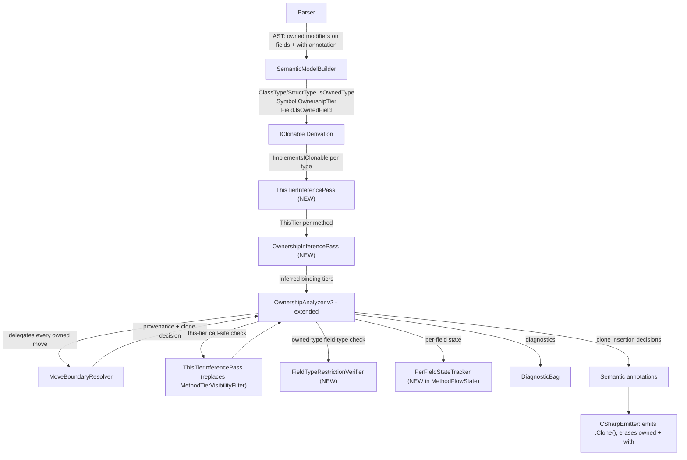

# Design Document: Owned Fields

## Overview

Owned Fields is a **delta on top of ownership-v2** (spec: `ownership-v2`). It reintroduces the `owned` modifier on individual fields with new semantics: an `owned` field enforces provenance on writes and restricts extraction (move, borrow, freeze, readonly ref) to callers holding an owned parent binding. The feature enables "jagged ownership" — parts of an object graph opt into ownership while parts don't — without requiring the entire type to be declared `owned`.

This document references requirements from `requirements.md` by number throughout (e.g., "Req 4 AC 2"). It also cross-references the ownership-v2 design where components are being extended.

### What changes from ownership-v2

1. **`RejectOwnedFieldModifier` pass is deleted** (Req 7) — the hard error `MIST_OWN_FIELD_MODIFIER_REMOVED (historical)` is removed. The `owned` field modifier becomes valid syntax with new semantics.
2. **Per-field state tracking** (Req 16) — the flow-sensitive analysis extends to track each owned field's state independently within `MethodFlowState`.
3. **Shared vs owned parent access rules** (Req 2) — the Type_Checker distinguishes operations on owned fields based on whether the parent is owned or shared.
4. **This-tier inference** (Req 17) — a new compiler pass infers what ownership tier a method requires on `this` from its usage of owned fields.
5. **Ownership inference on local bindings** (Req 18) — a fixed-point algorithm infers tiers for `var` declarations.
6. **Field-type restriction restored for `owned type`** (Req 4) — new pass in `CooperationContractVerifier` checks that all fields of an `owned type` are owned types, implement `IClonable<T>`, or are value types.
7. **`MethodTierVisibilityFilter` removed** (Req 6) — blanket method hiding replaced by this-tier call-site checking.
8. **`with {tier}` syntax** (Req 17 AC 8–12) — explicit this-tier annotation on method declarations.

### What stays the same from ownership-v2

- `owned var x = ...` binding-level ownership
- Move semantics, lending system, truth table (states: Live/LentReadonly/LentFrozen/LentRef/Moved)
- `IClonable<T>` bridging and auto-derivation
- Zero runtime cost — ownership erased, `.Clone()` inserted at move boundaries
- `MoveBoundaryResolver` as single enforcement point
- `CooperationContractVerifier` behavioral verification (field assignments from owned sources)

## Architecture

### Extended analysis pipeline

The owned-fields feature adds two new passes to the pipeline and extends the existing passes:



### Pass mapping: ownership-v2 → owned-fields

| ownership-v2 Pass | Disposition in owned-fields |
|---|---|
| Pass A `RejectOwnedOnInterfacesAndTraits` | **Kept** unchanged |
| Pass B `RejectOwnedFieldModifier` | **DELETED** (Req 7 AC 2) |
| Pass B2 `RejectOwnedBindingOnSubstructuralTypes` | **Kept** unchanged |
| Pass C Cooperation contract | **Behavioral pass REMOVED** — subsumed by provenance on owned fields (Req 8 + Req 3). Field-type restriction (Req 4) survives as standalone check. |
| Pass D Flow-sensitive analysis | **Extended** with per-field state tracking (Req 16) + this-tier checking (Req 17) |
| — (new) | **New** `ThisTierInferencePass` (Req 17) |
| — (new) | **New** `OwnershipInferencePass` (Req 18) |
| — (new) | **New** `FieldTypeRestrictionVerifier` (Req 4) |

## Components and Interfaces

### Component 1: `ThisTierInferencePass` (new)

**Purpose**: Infers the minimum ownership tier required on `this` for each method by analyzing the method body's usage of owned fields. The inferred tier is used at call sites to verify the caller provides sufficient access (Req 17).

**Location**: `Source/Mist/Analysis/Builtin/ThisTierInferencePass.cs`

```csharp
namespace Mist.Analysis.Builtin;

/// <summary>
/// Infers the minimum ownership tier required on 'this' for each method by analyzing
/// owned-field usage in the method body (Requirement 17).
/// 
/// The inference composes across multiple field accesses (most restrictive wins) and
/// transitively through helper calls on 'this'. An explicit 'with {tier}' annotation
/// overrides inference but is validated against the body's actual requirements.
/// </summary>
public sealed class ThisTierInferencePass
{
    /// <summary>
    /// Analyzes all methods in the model and records their inferred this-tier on the symbol.
    /// </summary>
    public void Analyze(ISemanticModel model, DiagnosticBag diagnostics);

    /// <summary>
    /// Returns the inferred or declared this-tier for a method symbol.
    /// </summary>
    public static ThisTier GetThisTier(ISymbol methodSymbol);
}

/// <summary>
/// The ownership tier required on 'this' for a method to execute safely.
/// </summary>
public enum ThisTier
{
    /// <summary>No tier requirement — callable from any binding (shared or owned).</summary>
    None,

    /// <summary>Requires at least readonly ref access to 'this'.</summary>
    ReadonlyRef,

    /// <summary>Requires at least frozen access to 'this'.</summary>
    Frozen,

    /// <summary>Requires at least borrowed (exclusive mutable) access to 'this'.</summary>
    Borrowed,

    /// <summary>Consumes 'this' — the caller's binding is moved into the method.</summary>
    Owned,
}
```

**Algorithm** (Req 17 AC 1–7):

```pascal
ALGORITHM InferThisTier(method, model)
BEGIN
    // If method has explicit 'with {tier}' annotation, use it but validate
    IF HasExplicitWithAnnotation(method) THEN
        declaredTier := ParseWithAnnotation(method)
        requiredTier := ComputeRequiredTier(method.Body, model)
        IF declaredTier < requiredTier THEN
            Report(MIST_OWN_THIS_TIER_INSUFFICIENT, method, declaredTier, requiredTier)
        RETURN declaredTier

    // Analyze method body for owned-field operations
    maxTier := None
    FOR EACH fieldAccess IN OwnedFieldAccesses(method.Body) DO
        IF fieldAccess.Kind IN {Move, Write} THEN
            maxTier := Max(maxTier, Borrowed)
        ELSE IF fieldAccess.Kind IN {Freeze, FrozenRef} THEN
            maxTier := Max(maxTier, Frozen)
        ELSE IF fieldAccess.Kind == Read THEN
            maxTier := Max(maxTier, ReadonlyRef)

    // Transitive composition through helper calls on 'this' (Req 17 AC 7)
    FOR EACH call IN HelperCallsOnThis(method.Body) DO
        calleeTier := GetThisTier(call.TargetMethod)
        maxTier := Max(maxTier, calleeTier)

    RETURN maxTier
END
```

**Responsibilities**:
- Runs after IClonable derivation and before the flow-sensitive analysis
- Records the inferred `ThisTier` on each method symbol for consumption by the flow-sensitive pass
- Validates explicit `with` annotations against actual body requirements (Req 17 AC 11)
- Handles transitive composition: method A calls method B on `this` → A requires at least B's tier (Req 17 AC 7)

### Component 2: `OwnershipInferencePass` (new)

**Purpose**: Infers ownership tiers for `var`-declared local variables by analyzing all uses within the enclosing function, avoiding the need for explicit annotations on every binding (Req 18).

**Location**: `Source/Mist/Analysis/Builtin/OwnershipInferencePass.cs`

```csharp
namespace Mist.Analysis.Builtin;

/// <summary>
/// Infers ownership tiers for local 'var' bindings by finding the minimum tier
/// that satisfies all uses of each variable within the enclosing function (Requirement 18).
/// 
/// Uses a fixed-point algorithm over all var bindings in a function simultaneously,
/// trying tiers from most permissive to least: owned → borrowed → frozen → readonly ref → shared.
/// Shared is always a valid fallback (Req 18 AC 6).
/// </summary>
public sealed class OwnershipInferencePass
{
    /// <summary>
    /// Infers binding tiers for all var declarations in the given function body.
    /// Returns the inferred bindings indexed by symbol.
    /// </summary>
    public IReadOnlyDictionary<ISymbol, InferredBinding> InferBindings(
        SyntaxNode functionBody,
        ISemanticModel model,
        DiagnosticBag diagnostics);
}

/// <summary>
/// The result of ownership inference for a single local binding.
/// </summary>
public readonly record struct InferredBinding(
    ISymbol Symbol,
    OwnershipTier InferredTier,
    InferenceReason Reason);

/// <summary>
/// Why a particular tier was chosen during inference.
/// </summary>
public enum InferenceReason
{
    /// <summary>Constructor or owned-returning init → starts as owned candidate.</summary>
    OwnedInit,

    /// <summary>Used as receiver for a method requiring a specific this-tier.</summary>
    ThisTierRequired,

    /// <summary>Passed to an owned parameter → must be owned (consumed).</summary>
    OwnedParamConsumption,

    /// <summary>No ownership usage detected → shared fallback.</summary>
    SharedFallback,

    /// <summary>Inference conflict resolved by downgrade.</summary>
    Downgraded,
}
```

**Algorithm** (Req 18 AC 1–5, 12):

```pascal
ALGORITHM InferBindings(functionBody, model)
BEGIN
    // Collect all var declarations (no explicit specifier)
    bindings := CollectVarDeclarations(functionBody)

    // Initialize candidates
    FOR EACH b IN bindings DO
        IF IsConstructorOrOwnedCall(b.Initializer) THEN
            b.Candidate := Owned
        ELSE
            b.Candidate := Owned  // start optimistic, downgrade on conflict

    // Fixed-point iteration (Req 18 AC 12)
    REPEAT
        changed := false
        FOR EACH b IN bindings DO
            FOR EACH use IN AllUses(b.Symbol, functionBody) DO
                requiredTier := TierRequiredByUse(use, bindings)
                IF Conflicts(b.Candidate, requiredTier) THEN
                    newTier := Downgrade(b.Candidate)
                    IF newTier != b.Candidate THEN
                        b.Candidate := newTier
                        changed := true
    UNTIL NOT changed

    // Validate — shared always succeeds (Req 18 AC 6-7)
    FOR EACH b IN bindings DO
        IF b.Candidate == None THEN
            b.Candidate := Shared  // ultimate fallback

    RETURN bindings
END

FUNCTION Downgrade(tier)
    // Req 18 AC 2: try from most to least permissive
    MATCH tier:
        Owned → Borrowed
        Borrowed → Frozen
        Frozen → ReadonlyRef
        ReadonlyRef → Shared
        Shared → ERROR  // should never happen (shared never conflicts)
END
```

**Responsibilities**:
- Runs after `ThisTierInferencePass` (needs this-tier info to know what receivers require)
- Operates within a single function scope (Req 18 AC 11)
- Handles mutual dependencies between variables via fixed-point (Req 18 AC 12)
- Does not apply to variables with explicit specifiers (`owned var`, `borrowed var`, etc.) — those are validated directly (Req 18 AC 8)

### Component 3: `FieldTypeRestrictionVerifier` (new)

**Purpose**: Verifies that all fields of an `owned type` have types that are themselves owned types, implement `IClonable<T>`, or are value types — ensuring `owned type` guarantees full graph ownership (Req 4).

**Location**: `Source/Mist/Analysis/Builtin/FieldTypeRestrictionVerifier.cs`

```csharp
namespace Mist.Analysis.Builtin;

/// <summary>
/// Verifies the field-type restriction for types declared 'owned' (Requirement 4).
/// All fields of an owned type must have types that are:
///   - Another owned type (Req 4 AC 1)
///   - A type implementing IClonable&lt;T&gt; (Req 4 AC 2)
///   - A value type (Req 4 AC 3)
/// 
/// Runs after IClonable derivation so auto-derived implementations are considered (Req 4 AC 5).
/// </summary>
public sealed class FieldTypeRestrictionVerifier
{
    /// <summary>
    /// Checks all fields of an owned type against the field-type restriction.
    /// Reports MIST_OWN_FIELD_TYPE_VIOLATION for each violating field.
    /// </summary>
    public static void Verify(
        IType ownedType,
        ISemanticModel model,
        DiagnosticBag diagnostics);
}
```

**Algorithm** (Req 4 AC 1–6):

```pascal
ALGORITHM VerifyFieldTypeRestriction(ownedType, model)
BEGIN
    FOR EACH field IN InstanceFields(ownedType) DO
        fieldType := TypeOf(field)

        // Value types (struct, primitive) — always accepted (Req 4 AC 3)
        IF IsValueType(fieldType) THEN CONTINUE

        // Another owned type — accepted (Req 4 AC 1)
        IF IsOwnedType(fieldType) THEN CONTINUE

        // Implements IClonable<T> — accepted (Req 4 AC 2)
        IF ImplementsIClonable(fieldType) THEN CONTINUE

        // Generic type parameter — check constraints (Req 4 AC 6)
        IF IsTypeParameter(fieldType) THEN
            IF NOT HasOwnedOrClonableConstraint(fieldType) THEN
                Report(MIST_OWN_FIELD_TYPE_VIOLATION, field, fieldType,
                    "unconstrained type parameter")
            CONTINUE

        // Reference type that is not owned and not clonable — violation (Req 4 AC 4)
        Report(MIST_OWN_FIELD_TYPE_VIOLATION, field, fieldType,
            "non-owned reference type without IClonable<T>")
END
```

**Responsibilities**:
- Called from `CooperationContractVerifier` as a separate pass (Req 5 AC 4)
- Runs after IClonable derivation is complete (Req 4 AC 5)
- Reports violations independently of behavioral contract violations (Req 5 AC 3–4)

### Component 4: `PerFieldStateTracker` (extension of `MethodFlowState`)

**Purpose**: Extends the flow-sensitive analysis to track each owned field's state independently within `MethodFlowState`. Computes composite state for parent-binding restrictions (Req 16).

**Location**: Extension within `Source/Mist/Analysis/Builtin/MethodFlowState.cs`

```csharp
// Added to MethodFlowState
/// <summary>
/// Per-field ownership state for instances held in owned bindings.
/// Key: the parent binding symbol. Value: map from field symbol to its current state.
/// Only tracked for owned bindings whose type has owned fields (Req 16 AC 1).
/// </summary>
public Dictionary<ISymbol, Dictionary<ISymbol, VariableOwnershipState>> FieldStates { get; }

/// <summary>
/// Records the source location where each field was moved, for diagnostic reporting.
/// Key: (parentSymbol, fieldSymbol). Only populated for fields in Moved state.
/// </summary>
public Dictionary<(ISymbol Parent, ISymbol Field), SourceSpan> FieldMoveLocations { get; }
```

**Composite state computation** (Req 16 AC 9–14):

```pascal
FUNCTION CompositeState(parentSymbol, fieldStates)
BEGIN
    maxState := Live
    FOR EACH (field, state) IN fieldStates[parentSymbol] DO
        maxState := Max(maxState, state)
    RETURN maxState
END

// Ordering: Live(0) < LentReadonly(1) < LentFrozen(2) < LentRef(3) = Moved(4)
// This matches the existing VariableOwnershipState enum values.
```

**Key behaviors**:

1. **Parent binding remains Live** (Req 16 AC 15): A child field moving to Moved does NOT transition the parent binding's `VariableStates[parent]` entry. The parent stays `Live` — composite state is a restriction on whole-object operations only.

2. **Field restoration** (Req 16 AC 6, 16): Writing a new owned value into a Moved field brings it back to Live. This is permitted because the parent binding itself is still Live (addressable), even though composite state may be Moved.

3. **Sibling independence** (Req 16 AC 22): Field A being borrowed does NOT prevent operations on Field B. Each field's state is checked independently.

4. **Parent-to-child restriction** (Req 16 AC 19–21): When the parent itself is externally lent (e.g., frozen), child field operations are restricted by the parent's externally-imposed state.

5. **Method calls with partial states** (Req 16 AC 23–24): Use this-tier inference to determine which fields a method accesses, then check each accessed field's state.

**Fork/Merge extensions**:

```csharp
// In Fork(): deep-clone FieldStates and FieldMoveLocations
// In Merge(): for each parent, for each field, take MoreRestrictiveState
```

### Modified Component 1: `OwnershipAnalyzer` (orchestrator changes)

The `OwnershipAnalyzer` (at `Source/Mist/Analysis/Builtin/OwnershipAnalyzer.cs`) is modified to:

1. **Delete** `RejectOwnedFieldModifier` pass and its call site (Req 7 AC 2)
2. **Delete** `MIST_OWN_FIELD_MODIFIER_REMOVED (historical)` diagnostic and message builder (Req 7 AC 1)
3. **Add** `ThisTierInferencePass` invocation before flow-sensitive analysis
4. **Add** `OwnershipInferencePass` invocation before flow-sensitive analysis
5. **Add** `FieldTypeRestrictionVerifier` invocation in the cooperation contract loop
6. **Extend** `AnalyzeFlowSensitive` to initialize and query per-field state
7. **Extend** method-call checking to verify this-tier at call sites

```csharp
public void Analyze(ISemanticModel model, DiagnosticBag diagnostics)
{
    var resolver = new MoveBoundaryResolver();
    var thisTierPass = new ThisTierInferencePass();
    var inferencePass = new OwnershipInferencePass();

    // Pass A: declaration validation (interface/trait owned rejection; unchanged)
    RejectOwnedOnInterfacesAndTraits(model, diagnostics);

    // Pass B: DELETED — RejectOwnedFieldModifier removed (Req 7 AC 2)

    // Pass B2: reject owned binding on substructural types (unchanged)
    RejectOwnedBindingOnSubstructuralTypes(model, diagnostics);

    // Pass C: field-type restriction for owned types (Req 4, Req 5)
    // Behavioral cooperation contract is subsumed by provenance on owned fields (Req 8 + Req 3)
    foreach (var t in OwnedTypes(model))
        FieldTypeRestrictionVerifier.Verify(t, model, diagnostics);

    // Pass D-pre: this-tier inference (NEW — Req 17)
    thisTierPass.Analyze(model, diagnostics);

    // Pass D: flow-sensitive analysis (extended with per-field state + this-tier call-site checking)
    // MethodTierVisibilityFilter is REMOVED — replaced by this-tier check (Req 6)
    AnalyzeFlowSensitive(model, resolver, thisTierPass, inferencePass, diagnostics);
}
```

### Modified Component 2: `MethodTierVisibilityFilter` (REMOVED)

The existing `MethodTierVisibilityFilter` (at `Source/Mist/Analysis/Builtin/MethodTierVisibilityFilter.cs`) and the `MIST_OWN_MUTABLE_HIDDEN (historical)` diagnostic are **removed entirely** (Req 6). The blanket method-hiding logic is replaced by the this-tier call-site check (Req 17 AC 15–16): a method is callable if the caller's binding tier satisfies the method's inferred or declared this-tier. No separate visibility filter is needed.

The flow-sensitive analysis now checks `ThisTierInferencePass.GetThisTier(method)` against the caller's binding tier directly. If the tier is insufficient, `MIST_OWN_THIS_TIER_MISMATCH (historical)` is emitted instead of the old `MIST_OWN_MUTABLE_HIDDEN (historical)`.

### Modified Component 3: `MoveBoundaryResolver` (field-level awareness)

The existing `MoveBoundaryResolver` (at `Source/Mist/Analysis/Builtin/MoveBoundaryResolver.cs`) is extended to handle owned-field assignment sites with awareness of per-field state:

1. **Shared parent field writes** (Req 2 AC 2): When the parent is shared, the resolver still enforces provenance on the source — multiple aliases can independently write owned values into the field.
2. **Owned parent field writes** (Req 2 AC 1): Through an owned parent, all operations including move-out are permitted (subject to per-field state).
3. **Field move-out** (Req 16 AC 2): Moving out of an owned field through an owned parent transitions that field to Moved in the per-field state tracker.

The resolver's `OwnedMoveSite` enum already includes `OwnedFieldAssignment`. No structural change to the resolver API is needed — the per-field state update is handled by the caller (the flow-sensitive analysis) after the resolver approves the move.

### Modified Component 4: `CooperationContractVerifier` (behavioral pass removed)

The existing `CooperationContractVerifier` (at `Source/Mist/Analysis/Builtin/CooperationContractVerifier.cs`) is **removed** from the pipeline for owned types. Its behavioral verification (all field assignments from owned sources) is subsumed by owned-field provenance enforcement (Req 8) applied uniformly to all owned fields — and since `owned type` treats all fields as owned (Req 3), every field assignment is already covered.

The only owned-type-specific check that survives is the `FieldTypeRestrictionVerifier`, which is invoked directly from the orchestrator (not wrapped in the contract verifier).

## Data Models

### `FieldOwnershipState` — per-field state within `MethodFlowState`

```csharp
// Within MethodFlowState:
/// <summary>
/// Per-field ownership states for instances in owned bindings.
/// Outer key: parent binding symbol (the owned var).
/// Inner key: field symbol.
/// Value: current state of that field.
/// </summary>
public Dictionary<ISymbol, Dictionary<ISymbol, VariableOwnershipState>> FieldStates { get; }
```

**Initialization**: When an owned binding is registered for a type with owned fields, all owned fields start at `Live`.

**State transitions** (same values as `VariableOwnershipState`):
- `Live` → `Moved` (field moved out)
- `Live` → `LentRef` (field borrowed)
- `Live` → `LentFrozen` (field frozen)
- `Live` → `LentReadonly` (field readonly-ref'd)
- `Moved` → `Live` (restored by writing a new owned value)
- `LentRef/LentFrozen/LentReadonly` → `Live` (borrow scope ends)

### `ThisTier` enum

```csharp
public enum ThisTier
{
    None = 0,        // no requirement — callable from any binding
    ReadonlyRef = 1, // requires at least readonly ref on this
    Frozen = 2,      // requires at least frozen on this
    Borrowed = 3,    // requires at least borrowed on this
    Owned = 4,       // consumes this (move)
}
```

**Ordering**: `None < ReadonlyRef < Frozen < Borrowed < Owned`. A caller satisfies a method's requirement if their binding's tier >= the method's required tier.

**Satisfaction table** (Req 17 AC 15):

| Caller binding | Satisfies |
|---|---|
| owned | All tiers (None, ReadonlyRef, Frozen, Borrowed, Owned) |
| borrowed | None, ReadonlyRef, Frozen, Borrowed |
| frozen | None, ReadonlyRef, Frozen |
| readonly ref | None, ReadonlyRef |
| shared (no tier) | None only |

### `InferredBinding` — result of ownership inference

```csharp
public readonly record struct InferredBinding(
    ISymbol Symbol,
    OwnershipTier InferredTier,
    InferenceReason Reason);
```

Used by the flow-sensitive analysis to determine what tier each `var` binding operates at.

### Type model extension

```csharp
// On field symbols:
/// <summary>
/// Whether this field is declared with the 'owned' ownership specifier.
/// Set during semantic model building from the field declaration's ownership specifier.
/// </summary>
public bool IsOwnedField { get; }
```

For `owned type` instances, all instance fields are treated as if `IsOwnedField == true` (Req 3 AC 1), regardless of explicit annotation.

## Grammar Changes

### `with {tier}` on method declarations (Req 17 AC 8–9)

The `Mist.storm` grammar is extended to accept an optional `with {tier}` clause after the method parameter list and before the body:

```
MethodDeclaration:
    Modifiers ReturnType Identifier '(' ParameterList ')' WithClause? Body

WithClause:
    'with' OwnershipTierKeyword

OwnershipTierKeyword:
    'owned' | 'borrowed' | 'frozen' | 'readonly' 'ref'
```

The `with` annotation is sugar for `with {tier} {ParentType} this` — it applies to the implicit `this` parameter (Req 17 AC 9).

### Owned field modifier (already parseable)

The `owned` specifier on field declarations is already parsed by the grammar (`FieldDeclaration` allows `ownershipSpecifier:OwnershipSpecifier?`). The ownership-v2 spec rejected it semantically via `RejectOwnedFieldModifier`. This work simply **deletes that rejection** — the grammar needs no modification for field declarations.

## Correctness Properties

These properties target property-based testing with **FsCheck**, matching the existing Mist test suite. Each is universally quantified over generated programs/types. All use **in-process `CompilerDriver.Compile()`** — no per-iteration process spawning.

### Property 1: This-tier inference soundness (Req 17 AC 1–6)

For all methods m with owned-field accesses, the inferred this-tier is the **minimum** tier that satisfies all field operations in the body. That is: the inferred tier permits every operation, and the tier one step below it does NOT permit at least one operation.

```
∀ method m:
    LET inferred = InferThisTier(m)
    LET required = MaxTierFromFieldOps(m.Body)
    inferred == required
```

**Validates: Requirements 17.1, 17.2, 17.3, 17.4, 17.5, 17.6**

### Property 2: Ownership inference soundness (Req 18 AC 1–5)

For all `var` bindings b in a function, the inferred tier satisfies all uses of b. If the tier were downgraded one step, at least one use would produce an error.

```
∀ function f, ∀ var binding b ∈ f:
    LET tier = InferTier(b)
    AllUsesSatisfied(b, tier) == true
    ∧ (tier == Shared ∨ ¬AllUsesSatisfied(b, Downgrade(tier)))
```

**Validates: Requirements 18.1, 18.2, 18.3, 18.4, 18.5**

### Property 3: Composite state is max(child states) (Req 16 AC 9–14)

For all owned bindings with per-field state, the composite state equals the most restrictive state among all owned fields, using the defined ordering.

```
∀ owned binding p with fields f₁...fₙ:
    CompositeState(p) == Max(State(f₁), State(f₂), ..., State(fₙ))
```

**Validates: Requirements 16.9, 16.10, 16.11, 16.12, 16.13, 16.14**

### Property 4: Shared parent blocks extraction (Req 2 AC 4–5)

For all shared parent bindings and owned fields, move/borrow/freeze/readonly-ref operations produce an error, while write-with-provenance and clone-read are permitted.

```
∀ shared binding p, ∀ owned field f ∈ p:
    Extract(p.f) produces MIST_OWN_SHARED_EXTRACT error
    ∧ Write(p.f, ownedSource) succeeds
    ∧ CloneRead(p.f) succeeds IFF IClonable(typeof(f))
```

**Validates: Requirements 2.2, 2.3, 2.4, 2.5, 2.6**

### Property 5: Siblings are independent (Req 16 AC 22)

For all owned bindings with multiple owned fields where field A is in a non-Live state, operations on sibling field B are unaffected (assuming the composite state permits B's operation via the parent-to-child rule).

```
∀ owned binding p with fields A, B where State(A) == LentRef:
    Read(p.B) permitted ∧ Write(p.B) permitted ∧ Move(p.B) permitted
    // Because parent composite is LentRef, but parent is actually Live,
    // and sibling operations are independent — WAIT: composite LentRef
    // means parent as a whole is locked, but individual field ops are independent.
    // Actually: sibling check is NOT restricted by another sibling's loan.
    // Parent-to-child restriction only applies from EXTERNAL loans on parent.
```

**Clarification**: Sibling independence means field A being borrowed does NOT prevent field B operations. The composite state restricts whole-object operations (passing parent to another binding), not per-field access. Per-field access is gated only by that specific field's state and any external loans on the parent.

**Validates: Requirements 16.22**

### Property 6: Field-type restriction correctness (Req 4)

For all owned types T, T compiles without `MIST_OWN_FIELD_TYPE_VIOLATION (historical)` ⟺ every field's type is owned OR implements `IClonable<T>` OR is a value type.

```
∀ owned type T:
    Compiles(T) ⟺ ∀ field f ∈ T:
        IsOwnedType(typeof(f)) ∨ ImplementsIClonable(typeof(f)) ∨ IsValueType(typeof(f))
```

**Validates: Requirements 4.1, 4.2, 4.3, 4.4**

### Property 7: Provenance on owned fields (Req 8)

For all owned-field assignments (regardless of parent tier), the source must satisfy `MoveBoundaryResolver` — identical to the existing owned-binding provenance rules.

```
∀ assignment target.OwnedField = source:
    Accepted ⟺ Resolver.Resolve(source, site: OwnedFieldAssignment) ∉ {Error}
```

**Validates: Requirements 8.1, 8.2, 8.3, 8.4**

### Property 8: With-annotation validation (Req 17 AC 10–12)

For all methods with explicit `with {tier}`, the declared tier is accepted ⟺ tier >= inferred minimum. Under-declared tiers produce `MIST_OWN_THIS_TIER_INSUFFICIENT (historical)`.

```
∀ method m with 'with declared':
    Compiles(m) ⟺ declared >= InferredMinimum(m.Body)
```

**Validates: Requirements 17.10, 17.11, 17.12**

### Property 9: Existing truth table preserved (Req 7 of ownership-v2)

The existing truth table from ownership-v2 is unchanged. For all states s and actions a applied to a parent binding's composite state, the permissions equal the v2 truth table.

```
∀ state s, action a:
    Permitted(s, a) == V2TruthTable(s, a)
```

**Validates: Requirements 16.9, 16.10, 16.11, 16.12, 16.13, 16.14**

## Error Handling

### New diagnostics

| Diagnostic ID | Trigger | Message template | Requirement |
|---|---|---|---|
| `MIST_OWN_SHARED_EXTRACT (historical)` | Move/borrow/freeze/readonly-ref of owned field through shared parent | "Cannot {operation} owned field '{field}' through a shared binding — extracting from an owned field requires an owned binding to the parent" | Req 2 AC 5, Req 11 AC 1 |
| `MIST_OWN_FIELD_TYPE_VIOLATION (historical)` | Owned type has field whose type is non-owned, non-IClonable reference type | "Field '{field}' of owned type '{type}' has type '{fieldType}' which is not an owned type and does not implement IClonable<{fieldType}> — all fields of an owned type must be owned types, implement IClonable, or be value types" | Req 4 AC 4, Req 11 AC 2 |
| `MIST_OWN_THIS_TIER_INSUFFICIENT (historical)` | Method's explicit `with {tier}` is less restrictive than body requires | "Method '{method}' declares 'with {declared}' but the body requires at least '{required}' — {operation} on owned field '{field}' requires {required} access" | Req 17 AC 11 |
| `MIST_OWN_THIS_TIER_MISMATCH (historical)` | Call site receiver binding does not satisfy method's this-tier | "Cannot call '{method}' which requires '{requiredTier}' access to 'this' — the receiver '{receiver}' only provides '{actualTier}' access" | Req 17 AC 16 |
| `MIST_OWN_SHARED_READ_NOT_CLONABLE (historical)` | Read of owned field through shared parent where type is not IClonable | "Cannot read owned field '{field}' through a shared binding — the field type '{type}' does not implement IClonable<{type}> and the field cannot be moved out through a shared parent" | Req 2 AC 6, Req 11 AC 7 |
| `MIST_OWN_INFERENCE_FAILURE (historical)` | Ownership inference cannot find a consistent tier assignment | "Cannot infer ownership for '{binding}' — conflicting uses require {tierA} but {use} requires {tierB}. Add an explicit ownership specifier to resolve" | Req 18 AC 5 |
| `MIST_OWN_STATIC_FIELD_OWNED (historical)` | `owned` modifier on a static field | "Static field '{field}' cannot be marked 'owned' — ownership semantics require an instance-level owner" | Req 1 AC 5, Req 11 AC 4 |

### Removed diagnostics

| Diagnostic ID | Status | Reason |
|---|---|---|
| `MIST_OWN_FIELD_MODIFIER_REMOVED (historical)` | **DELETED** | The `owned` field modifier is now valid (Req 7 AC 1) |
| `MIST_OWN_MUTABLE_HIDDEN (historical)` | **DELETED** | Blanket method hiding removed; replaced by `MIST_OWN_THIS_TIER_MISMATCH (historical)` (Req 6) |
| `MIST_OWN_CONTRACT_VIOLATION (historical)` | **DELETED** | Behavioral cooperation contract subsumed by provenance on owned fields (Req 8 + Req 3) |

### Kept diagnostics (unchanged from ownership-v2)

All remaining ownership diagnostics: `MIST_OWN_USE_AFTER_MOVE (historical)`, `MIST_OWN_REQUIRES_OWNED (historical)`, `MIST_OWN_NOT_CLONABLE (historical)`, `MIST_OWN_INTERFACE_FORBIDDEN (historical)`, `MIST_OWN_INCOMPATIBLE_LEND (historical)`, `MIST_OWN_MUTATION_BLOCKED (historical)`, `MIST_OWN_EXCLUSIVE_VIOLATION (historical)`, `MIST_OWN_SUBSTRUCTURAL_BINDING (historical)`.

## Testing Strategy

### Unit testing

- **`ThisTierInferencePass`**: table-driven tests over method bodies with various owned-field access patterns (read-only, write, move, freeze, borrow, helper calls) verifying the inferred `ThisTier`. Covers Req 17 AC 1–7.
- **`OwnershipInferencePass`**: test functions with var bindings exercising each downgrade step. Covers Req 18 AC 1–5.
- **`FieldTypeRestrictionVerifier`**: owned types with all-owned-fields, all-clonable fields, mixed, violating fields. Covers Req 4 AC 1–6.
- **`PerFieldStateTracker`**: composite state computation, partial move/restore, sibling independence, parent-to-child restriction. Covers Req 16 AC 1–24.
- **This-tier call-site checking**: verify `MIST_OWN_THIS_TIER_MISMATCH (historical)` fires when caller tier is insufficient. Covers Req 17 AC 15–16.
- **Diagnostic removal**: assert `MIST_OWN_FIELD_MODIFIER_REMOVED (historical)`, `MIST_OWN_MUTABLE_HIDDEN (historical)`, and `MIST_OWN_CONTRACT_VIOLATION (historical)` are never emitted for any input (Req 6, Req 7).
- **Owned field provenance**: assignments through shared/owned parents with owned/non-owned/clonable sources. Covers Req 8.
- **Shared parent extraction blocked**: assert `MIST_OWN_SHARED_EXTRACT (historical)` fires for move/borrow/freeze/readonly-ref through shared parent. Covers Req 2 AC 4–6.

### Property-based testing (FsCheck)

Properties 1–9 above. All use **in-process `CompilerDriver.Compile()`** — no per-iteration process spawning. Properties inspect diagnostics and semantic model only. If any property is later found to need per-iteration process execution, that will be raised for approval before implementation.

### Integration testing

- The `samples/Ownership/Program.mist` proof code is updated with owned-field demonstrations (Req 14). Every `// PROOF:` block must compile and produce the exact expected stdout. The proof code is immutable per `sample-proof-code.md`.
- AllFeatures orchestrator wiring remains unchanged (same sample name and entry point).

### Round-trip testing

- Parser round-trip property tests extended for `owned` field declarations and `with {tier}` annotations.

## Migration

### Deleted from ownership-v2's implementation

| Item | Location | Reason |
|---|---|---|
| `RejectOwnedFieldModifier` method | `OwnershipAnalyzer.cs` | Req 7 AC 2 — owned field modifier is now valid |
| `MIST_OWN_FIELD_MODIFIER_REMOVED (historical)` diagnostic ID + message | `OwnershipAnalyzer.cs` | Req 7 AC 1 |
| `FieldModifierRemovedMessage` helper | `OwnershipAnalyzer.cs` | Req 7 AC 1 |
| `MethodTierVisibilityFilter` class | `MethodTierVisibilityFilter.cs` | Req 6 — replaced by this-tier call-site check |
| `MIST_OWN_MUTABLE_HIDDEN (historical)` diagnostic ID + message | `OwnershipAnalyzer.cs` | Req 6 AC 2 — replaced by `MIST_OWN_THIS_TIER_MISMATCH (historical)` |
| `CooperationContractVerifier` class | `CooperationContractVerifier.cs` | Req 5 AC 4 — behavioral contract subsumed by provenance on owned fields |
| `MIST_OWN_CONTRACT_VIOLATION (historical)` diagnostic ID + message | `OwnershipAnalyzer.cs` | Subsumed by provenance error on owned fields |
| Unit tests asserting `MIST_OWN_FIELD_MODIFIER_REMOVED (historical)` | `Test/Mist.Tests/` | Req 7 AC 4 |
| Unit tests for `MethodTierVisibilityFilter` | `Test/Mist.Tests/` | Req 6 — component removed |
| Unit tests for `CooperationContractVerifier` | `Test/Mist.Tests/` | Component removed |

### Modified from ownership-v2's implementation

| Item | Location | Change |
|---|---|---|
| `OwnershipAnalyzer.Analyze()` | `OwnershipAnalyzer.cs` | Remove Pass B call; add ThisTierInference, OwnershipInference, FieldTypeRestriction calls |
| `MethodTierVisibilityFilter` | `MethodTierVisibilityFilter.cs` | **REMOVED** — replaced by this-tier call-site check (Req 6, Req 17 AC 15–16) |
| `MethodFlowState` | `MethodFlowState.cs` | Add `FieldStates`, `FieldMoveLocations` dictionaries; extend `Fork()`/`Merge()` |
| `CooperationContractVerifier` | `CooperationContractVerifier.cs` | **REMOVED** — behavioral pass subsumed by provenance on owned fields (Req 8 + Req 3). FieldTypeRestrictionVerifier replaces the structural check. |
| `MoveBoundaryResolver` | `MoveBoundaryResolver.cs` | No API change; caller extends to update per-field state after resolution |
| `AnalyzeFlowSensitive` | `OwnershipAnalyzer.cs` | Initialize per-field state; check field access through shared/owned parent; composite state checks; this-tier call-site verification |

### New additions

| Item | Location |
|---|---|
| `ThisTierInferencePass.cs` | `Source/Mist/Analysis/Builtin/` |
| `OwnershipInferencePass.cs` | `Source/Mist/Analysis/Builtin/` |
| `FieldTypeRestrictionVerifier.cs` | `Source/Mist/Analysis/Builtin/` |
| `ThisTier` enum | `Source/Mist/Analysis/Builtin/ThisTier.cs` |
| `InferredBinding` record | `Source/Mist/Analysis/Builtin/InferredBinding.cs` |
| `with` clause grammar rule | `Source/Mist/Grammar/Mist.storm` |
| Proof code additions | `samples/Ownership/Program.mist` |
| Book section on owned fields | `book/src/advanced/ownership.md` (appended) |

## Known Limitations and Design Decisions

### LD-1: Shared parent can still write to owned fields

Through a shared parent, writes with provenance are permitted (Req 2 AC 2). This means multiple aliases can independently write owned values into the same field. Each write is individually safe (source is owned), but the field's previous value is overwritten without being consumed — it is silently dropped. This is consistent with normal assignment semantics and does not introduce aliasing.

### LD-2: This-tier inference is modular, not whole-program

The this-tier inference operates per-type. It cannot see through virtual dispatch — at the call site, the static type's inferred tier is used. This means interface/trait methods must declare their tier explicitly (or inherit None). This is conservative and may require explicit `with` annotations on interface method signatures in the future.

### LD-3: Ownership inference may differ from programmer intent

The inference algorithm selects the minimum tier. A programmer who wants a binding to be `owned` for documentation/API clarity should use explicit annotation. The inference is an ergonomic convenience, not a replacement for intentional design.

### LD-4: Composite state is conservative for whole-object operations

If field A is Moved, the composite state is Moved, blocking the parent from being passed anywhere as a whole — even if the target only reads field B. This is conservative but safe. Future work could introduce "partial type" witnesses to allow subset operations.

## Dependencies

- **FsCheck** — property-based testing (existing dependency)
- **Storm** grammar/source generators — for `with` clause grammar addition (`Mist.storm`)
- Existing compiler phases: `SemanticModelBuilder`, `ReadonlyInferenceEngine`, `CSharpEmitter`, `DiagnosticBag`, `AnalyzerRunner`, `IClonable` derivation pass
- Ownership-v2 components: `MoveBoundaryResolver`, `MethodFlowState`, `VariableOwnershipState`, truth table machinery (note: `CooperationContractVerifier` and `MethodTierVisibilityFilter` are removed by this spec)
