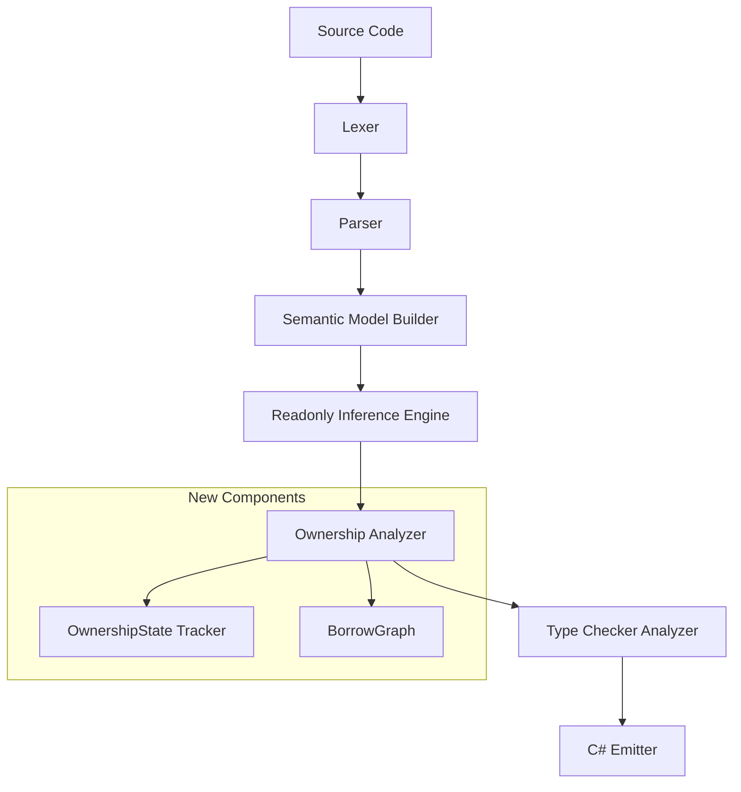

# Design Document: Ownership System

## Overview

This design introduces a compile-time ownership and reference system to the Mist language. The system adds five tiers of reference access — unrestricted (default), `readonly ref`, `frozen ref`, `ref`, and `owned` — that govern how variables interact with heap-allocated objects. All enforcement is purely compile-time; the emitted C# is identical whether annotations exist or not.

The implementation spans the full compiler pipeline:

1. **Lexer** — Three new keyword tokens: `owned`, `frozen`, `ref`
2. **Parser** — Grammar rules for ownership specifiers on variables, parameters, return types, and type declarations
3. **Semantic Model** — An `OwnershipTier` enum on symbols, plus tracking for owned type declarations
4. **Analysis** — A new `OwnershipAnalyzer` that enforces all borrow, move, lifetime, and mutation-blocking rules
5. **Emitter** — Ownership annotations are erased; emitted C# is unchanged
6. **TextMate Grammar** — Syntax highlighting for `owned`, `frozen`, `ref`

### Design Rationale

The ownership system is modeled as a **static analysis pass** rather than a type-system extension. This keeps the semantic model's type hierarchy unchanged (no "owned wrapper types") and concentrates all enforcement logic in a single analyzer. The analyzer operates on the semantic model after type resolution, using a flow-sensitive analysis to track ownership state through control flow.

This approach mirrors how the existing `ReadonlyInferenceEngine` works — a post-semantic-model pass that classifies symbols — but extends it with flow-sensitive state tracking for moves and borrows.

## Architecture



The ownership analyzer runs as a registered `IAnalyzer` in the `AnalyzerRunner` pipeline. It executes after the `ReadonlyInferenceEngine` (so readonly status is available) and before or alongside the type checker (so ownership errors are reported in the same diagnostic pass).

### Key Architectural Decisions

1. **Single analyzer, not a type-system change**: Ownership tiers are metadata on symbols, not new types. This avoids combinatorial explosion in type compatibility checks.

2. **Flow-sensitive analysis**: Move tracking and borrow lifetimes require per-statement state. The analyzer walks method bodies in control-flow order, maintaining an `OwnershipState` map from variable → current state (owned, moved, borrowed-out, frozen-out, etc.).

3. **Scope-based lifetime model**: Rather than Rust's named lifetimes, borrows are tied to lexical scopes. A `ref` created in a block dies at the block's end. This is simpler and sufficient for Mist's design (no lifetime annotations needed).

4. **Owned types as a sentinel rule**: Owned types (`owned class Foo`) are a declaration-site constraint that propagates to all usage sites. The analyzer checks field types at declaration time and variable types at usage sites.

## Components and Interfaces

### 1. Lexer Changes (keywords.storm)

New keyword tokens added to `keywords.storm`:

```storm
token OWNED  = "owned";
token FROZEN = "frozen";
token REF    = "ref";
```

These are reserved keywords — they cannot be used as identifiers.

### 2. Grammar Changes (Mist.storm)

#### Ownership Specifier Rule

```storm
rule OwnershipSpecifier
    = OWNED                as OwnedSpecifier
    | FROZEN REF           as FrozenRefSpecifier
    | READONLY REF         as ReadonlyRefSpecifier
    | REF                  as RefSpecifier
    ;
```

#### Modified Rules

The `OwnershipSpecifier` is integrated into:

- **Variable declarations**: `ownership:OwnershipSpecifier? type:TypeReference name:IDENTIFIER ...`
- **Parameters**: `modifier:READONLY? ownership:OwnershipSpecifier? type:TypeReference name:IDENTIFIER`
- **Return types**: `ownership:OwnershipSpecifier? returnType:TypeReference` (only `owned` is valid here)
- **Type declarations**: `modifiers:Modifier* ownership:OWNED? CLASS name:IDENTIFIER ...` (for owned types)

#### Modifier Rule Extension

```storm
rule Modifier
    = PUBLIC    as PublicModifier
    | PRIVATE   as PrivateModifier
    | STATIC    as StaticModifier
    | INTRINSIC as IntrinsicModifier
    | READONLY  as ReadonlyModifier
    | OWNED     as OwnedModifier
    ;
```

The `OWNED` modifier on type declarations (`owned class Foo`) is handled via the existing `Modifier` rule, keeping it consistent with how `readonly` already works on members.

### 3. Semantic Model Extensions

#### OwnershipTier Enum

```csharp
namespace Mist.Semantics.Model;

/// <summary>
/// The ownership tier of a variable, parameter, or return type.
/// </summary>
public enum OwnershipTier
{
    /// <summary>No ownership annotation. Standard reference semantics.</summary>
    Unrestricted,

    /// <summary>readonly ref — live readonly view, non-storable.</summary>
    ReadonlyRef,

    /// <summary>frozen ref — immutable view that blocks owner mutation, non-storable.</summary>
    FrozenRef,

    /// <summary>ref — borrowed mutable, non-storable.</summary>
    Ref,

    /// <summary>owned — sole ownership, storable, full control.</summary>
    Owned,
}
```

#### Symbol Extensions

The existing `Symbol` class gains:

```csharp
/// <summary>The ownership tier declared on this symbol (variable, parameter, field).</summary>
public OwnershipTier OwnershipTier { get; set; } = OwnershipTier.Unrestricted;
```

#### Type Extensions

Type declarations gain an `IsOwnedType` flag:

```csharp
/// <summary>Whether this type is declared as an owned type (owned class/struct).</summary>
public bool IsOwnedType { get; set; }
```

### 4. Ownership Analyzer

A new `OwnershipAnalyzer : IAnalyzer` that performs:

1. **Declaration validation**: Checks owned type field constraints, rejects owned types implementing interfaces/traits.
2. **Flow analysis**: Walks method bodies tracking variable states.
3. **Borrow checking**: Validates lending compatibility, exclusivity, and lifetime containment.
4. **Move tracking**: Detects use-after-move, tracks conditional moves.
5. **Mutation blocking**: Enforces frozen-ref and ref exclusivity constraints.

#### OwnershipState (per-variable flow state)

```csharp
public enum VariableOwnershipState
{
    /// <summary>Variable is live and accessible.</summary>
    Live,

    /// <summary>Variable has been moved; access is an error.</summary>
    Moved,

    /// <summary>Variable is lent as ref; owner has no access.</summary>
    LentRef,

    /// <summary>Variable is lent as frozen ref; owner cannot mutate.</summary>
    LentFrozen,

    /// <summary>Variable is lent as readonly ref; owner retains full access.</summary>
    LentReadonly,
}
```

#### BorrowGraph

Tracks active borrows and their scopes:

```csharp
public sealed class BorrowEntry
{
    public ISymbol Lender { get; }
    public ISymbol Borrower { get; }
    public OwnershipTier BorrowTier { get; }
    public int ScopeDepth { get; }
}
```

When a scope exits, all borrows at that depth are released and lender states are restored.

### 5. C# Emitter (No Changes)

The `CSharpEmitter` ignores ownership annotations entirely. The `OwnershipSpecifier` AST nodes are not visited during emission. Variables emit as standard C# references. Moves emit as standard assignments (no nulling of source).

### 6. TextMate Grammar

Add `owned`, `frozen`, and `ref` to the `storage.modifier.mist` scope in `mist.tmLanguage.json`, matching at word boundaries.

### 7. Pretty Printer

The `MistPrettyPrinter` is extended to emit ownership specifiers in their correct positions:
- Before type references in variable declarations
- Before parameter types
- Before return types
- As a modifier on type declarations (`owned class`)

## Data Models

### AST Nodes (Generated by Storm)

```
OwnershipSpecifierNode (abstract)
├── OwnedSpecifierNode
├── FrozenRefSpecifierNode
├── ReadonlyRefSpecifierNode
└── RefSpecifierNode
```

These nodes appear as optional children on:
- `VariableDeclarationStatement` (typed variant)
- `Parameter`
- `MethodDeclaration` (return type position)
- `FieldDeclaration`

### Diagnostic IDs

| ID | Description |
|----|-------------|
| `MIST_OWN_USE_AFTER_MOVE (historical)` | Access to a variable after it has been moved |
| `MIST_OWN_REF_ESCAPE (historical)` | A ref escapes its declaring scope |
| `MIST_OWN_MUTATION_BLOCKED (historical)` | Mutation attempted while frozen ref is outstanding |
| `MIST_OWN_NOT_STORABLE (historical)` | Ref assigned to a field or collection |
| `MIST_OWN_EXCLUSIVE_VIOLATION (historical)` | Multiple mutable borrows or access during ref loan |
| `MIST_OWN_INCOMPATIBLE_LEND (historical)` | Lending from a tier that cannot provide the requested tier |
| `MIST_OWN_FIELD_NOT_OWNED (historical)` | Reference-type field in owned type is not owned |
| `MIST_OWN_TYPE_REQUIRES_OWNED (historical)` | Owned type instance not held as owned |
| `MIST_OWN_INTERFACE_FORBIDDEN (historical)` | Owned type attempts to implement interface/trait |
| `MIST_OWN_SIGNATURE_MISMATCH (historical)` | Ownership specifier mismatch in interface/trait satisfaction |
| `MIST_OWN_INVALID_RETURN_SPEC (historical)` | Non-owned specifier used on return type |
| `MIST_OWN_CONDITIONAL_MOVE (historical)` | Variable moved in one branch, accessed in another |
| `MIST_OWN_LOOP_MOVE (historical)` | Variable moved in loop without re-assignment |
| `MIST_OWN_UNRESTRICTED_TO_REF (historical)` | Unrestricted variable passed to ref/frozen ref parameter |
| `MIST_OWN_DUPLICATE_SPECIFIER (historical)` | Multiple ownership specifiers on same declaration |

### Flow Analysis State

```
MethodFlowState
├── variableStates: Map<ISymbol, VariableOwnershipState>
├── moveLocations: Map<ISymbol, SourceSpan>
├── activeBorrows: List<BorrowEntry>
└── scopeDepth: int
```

The flow state is cloned at branch points (if/else, loops) and merged at join points. At a join:
- If a variable is `Moved` in any branch, it is `Moved` at the join (conservative).
- Borrow entries from inner scopes are released before the join.


## Correctness Properties

*A property is a characteristic or behavior that should hold true across all valid executions of a system — essentially, a formal statement about what the system should do. Properties serve as the bridge between human-readable specifications and machine-verifiable correctness guarantees.*

### Property 1: Ownership-annotated round-trip parsing

*For any* valid Mist AST containing ownership specifiers (`owned`, `ref`, `readonly ref`, `frozen ref`) on variables, parameters, return types, and type declarations, pretty-printing the AST and then parsing the result and pretty-printing again SHALL produce identical output. Compound specifiers (`readonly ref`, `frozen ref`) SHALL be preserved through the cycle.

**Validates: Requirements 20.1, 20.2, 20.3, 2.1, 2.2, 2.3, 2.4, 2.5**

### Property 2: Lending compatibility matrix

*For any* variable at ownership tier X passed to a parameter at ownership tier Y, the compiler SHALL accept the call if and only if the (X, Y) pair is in the permitted set: {(owned, owned), (owned, ref), (owned, readonly ref), (owned, frozen ref), (ref, ref), (ref, readonly ref), (ref, frozen ref), (readonly ref, readonly ref), (frozen ref, frozen ref), (frozen ref, readonly ref), (unrestricted, readonly ref), (unrestricted, unrestricted)}. Value types SHALL satisfy any tier regardless of source tier. All other combinations SHALL produce a diagnostic error.

**Validates: Requirements 3.5, 3.6, 3.7, 3.8, 6.5, 6.6, 6.7, 7.6, 7.7, 7.8, 12.1, 12.2, 12.3, 12.4, 12.5, 12.6, 14.1, 14.2, 15.1, 15.3**

### Property 3: Non-storability enforcement

*For any* variable declared as `ref`, `readonly ref`, or `frozen ref`, any attempt to assign it to a field, collection element, or return it from a method SHALL produce a diagnostic error. The variable's lifetime SHALL NOT exceed its declaring scope.

**Validates: Requirements 4.4, 4.8, 5.2, 5.8, 6.2, 6.9, 11.1, 11.4, 11.5**

### Property 4: Move tracking and use-after-move detection

*For any* owned variable that is moved (assigned to another owned variable or passed to an owned parameter), any subsequent access without an intervening re-assignment SHALL produce a use-after-move diagnostic identifying the variable name, the move location, and the invalid access location. In conditional branches, if a variable is moved in one branch, access in a subsequent branch where it was moved SHALL produce an error.

**Validates: Requirements 7.4, 7.5, 7.9, 10.1, 10.2, 10.3, 10.4, 10.5, 10.7, 16.1**

### Property 5: Mutation blocking under frozen ref

*For any* owner (or ref holder) that has lent a `frozen ref`, any attempt to mutate the object through the lender SHALL produce a diagnostic error while the frozen ref is outstanding. When all frozen refs are returned (scope exit), mutation access SHALL be restored.

**Validates: Requirements 5.3, 5.4, 5.6, 6.7, 7.8, 7.11, 13.1, 13.2, 13.6**

### Property 6: Ref exclusivity

*For any* owner that has lent a `ref`, the owner SHALL have no access (read or write) to the object until the ref is returned. Only one `ref` SHALL be outstanding from an owner at a time. A second `ref` lend while one is outstanding SHALL produce a diagnostic error.

**Validates: Requirements 6.3, 6.4, 7.12, 13.3, 13.7, 16.7**

### Property 7: Owned type field constraints

*For any* type declared as `owned class` or `owned struct`, all reference-type fields SHALL themselves be declared as `owned` or be of an owned type. Any reference-type field without the `owned` specifier SHALL produce a diagnostic error. Instances of owned types SHALL always be held in `owned` variables. Owned types SHALL NOT implement interfaces or satisfy traits.

**Validates: Requirements 8.3, 8.4, 8.5, 8.6, 8.7, 8.8, 8.9, 16.5**

### Property 8: Ownership signature matching

*For any* interface method with ownership specifiers on parameters or return types, an implementing method SHALL match those specifiers exactly. Any mismatch SHALL produce a diagnostic error. The same rule applies to structural trait matching.

**Validates: Requirements 9.1, 9.2, 9.3, 9.4**

### Property 9: Emission erasure

*For any* valid Mist program with ownership annotations, the emitted C# SHALL be identical to the C# emitted for the same program with all ownership annotations removed. No runtime ownership tracking, reference counting, state fields, or runtime assertions SHALL be present in the output.

**Validates: Requirements 17.1, 17.2, 17.3, 17.4, 17.5**

## Error Handling

### Diagnostic Strategy

All ownership errors are reported as compile-time diagnostics with severity `Error`. The analyzer collects all violations in a single pass rather than stopping at the first error, allowing developers to see all ownership issues at once.

### Error Recovery

The ownership analyzer is designed to be resilient:
- If a variable's ownership tier cannot be determined (e.g., due to earlier parse errors), it defaults to `Unrestricted` and no ownership diagnostics are reported for that variable.
- If the semantic model is incomplete (unresolved types), the analyzer skips ownership checks for affected declarations.
- Move tracking uses conservative analysis at join points: if any branch moves a variable, it's considered moved at the join.

### Diagnostic Message Format

Each diagnostic includes:
1. **Error ID** (e.g., `MIST_OWN_USE_AFTER_MOVE (historical)`)
2. **Primary location** — the offending access/operation
3. **Related location(s)** — where the move/borrow occurred
4. **Explanation** — human-readable description of why the operation is invalid

Example:
```
error MIST_OWN_USE_AFTER_MOVE: Variable 'x' was moved at line 5 and cannot be accessed here.
  --> src/main.mist:8:5
  |
5 |     owned Foo y = x;  // move occurs here
  |                   ^
8 |     x.DoSomething();  // error: use after move
  |     ^
```

### Interaction with Existing Diagnostics

The ownership analyzer runs independently of the type checker. Both may report errors on the same code. The ownership analyzer does NOT suppress type-checker diagnostics and vice versa. If a program has both type errors and ownership errors, both are reported.

## Testing Strategy

### Property-Based Tests (FsCheck)

The project uses **FsCheck 3.x with xUnit** for property-based testing. Each correctness property maps to one or more property-based test classes.

**Configuration:**
- Minimum 100 iterations per property test (`MaxTest = 100`)
- Each test is tagged with a comment referencing the design property
- Tag format: `Feature: ownership-system, Property {number}: {property_text}`

**Test Architecture (per steering rules):**
- Tests use the shared `CompilerDriver` for in-process compilation
- No per-iteration process spawning — all compilation is in-process
- For end-to-end tests requiring execution, use batched approach: generate all scenarios, build one program, compile once, run once, compare output lines

**Generators:**
A new `MistOwnershipGenerator` class in `Test/Mist.Tests/Generators/` provides:
- `GenOwnershipSpecifier()` — generates random ownership specifiers
- `GenOwnershipAnnotatedDeclaration()` — generates variable/parameter/return declarations with ownership
- `GenOwnedTypeDeclaration()` — generates owned class/struct declarations
- `GenOwnershipProgram()` — generates complete programs with ownership patterns
- `GenLendingScenario()` — generates (source tier, target tier, program) triples
- `GenMoveScenario()` — generates programs with move patterns

### Unit Tests (xUnit)

Unit tests cover:
- Specific examples for each diagnostic ID (one test per diagnostic type)
- Edge cases: empty programs, programs with only value types, programs mixing owned and unrestricted
- Integration with existing features: ownership + generics, ownership + traits, ownership + readonly contexts

### Test Organization

```
Test/Mist.Tests/
├── Lexing/
│   └── OwnershipKeywordTests.cs          (Req 1.1-1.3, 1.10)
├── Parsing/
│   └── OwnershipRoundTripPropertyTests.cs (Property 1)
├── Analysis/
│   ├── OwnershipLendingPropertyTests.cs   (Property 2)
│   ├── OwnershipStorabilityPropertyTests.cs (Property 3)
│   ├── OwnershipMovePropertyTests.cs      (Property 4)
│   ├── OwnershipFrozenBlockingPropertyTests.cs (Property 5)
│   ├── OwnershipExclusivityPropertyTests.cs (Property 6)
│   ├── OwnedTypeConstraintPropertyTests.cs (Property 7)
│   └── OwnershipSignaturePropertyTests.cs  (Property 8)
├── Backend/
│   └── OwnershipErasurePropertyTests.cs   (Property 9)
└── Integration/
    └── OwnershipSampleCompileTest.cs      (Req 19)
```

### Process Spawning Compliance

Per the test-process-spawning steering rule:
- All property tests compile in-process using the shared `CompilerDriver`
- The only process spawn is for the sample compilation integration test (1 spawn total)
- Property tests that need to verify emitted C# behavior use the batched pattern: generate N scenarios → build one combined program → compile once → run once → compare N output lines
