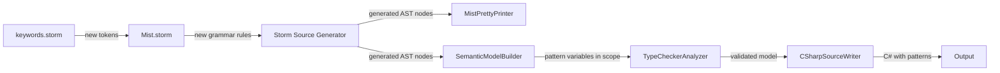

# Design Document: Pattern Matching (`is` Expressions)

## Overview

This design adds C#-style pattern matching to the Mist compiler via `is` expressions. The feature enables developers to test values against shapes (types, constants, structures) and extract data in a concise, declarative style. The scope is limited to `expression is pattern` — no `switch` statements or `switch` expressions.

The implementation touches every stage of the compiler pipeline:

1. **Lexing**: New keyword tokens (`is`, `and`, `or`, `not`) and the `..` token
2. **Parsing**: New grammar rules for patterns and `is` expressions, producing new AST node types
3. **Pretty-printing**: Round-trip-faithful formatting of all pattern constructs
4. **Semantic model**: Pattern variable registration and scoping in `if` condition → then branch
5. **Type checking**: Validation of pattern correctness (type existence, property existence, type compatibility, logical pattern constraints)
6. **C# emission**: Direct lowering to equivalent C# pattern matching syntax
7. **Editor support**: Syntax highlighting for new keywords
8. **Documentation**: CSHARP_FEATURES.md updates and a sample application

### Design Rationale

Mist's pattern matching maps directly to C# pattern matching because:
- C# already supports all the pattern kinds Mist introduces
- Direct lowering avoids complex desugaring and preserves debuggability
- The `is` expression at relational precedence matches C#'s own precedence rules

Mist intentionally omits null-related patterns (Mist has no `null`) and positional/tuple patterns (Mist has no tuples or `Deconstruct` yet).

## Architecture

The feature follows the existing compiler pipeline architecture. Each stage is extended, not restructured.



### Precedence Integration

The `is` keyword is integrated at the **relational** precedence level. The current grammar rule:

```
rule Relational = left:Additive (operator:(...) right:Additive)*;
```

becomes:

```
rule Relational
    = left:Additive IS pattern:Pattern                                          as IsExpression
    | left:Additive (operator:(...) right:Additive)*                            as RelationalComparison
    ;
```

This ensures `x is int i && y > 0` parses as `(x is int i) && (y > 0)`, matching C# semantics.

**Important**: The `Relational` rule currently produces a `RelationalNode` used throughout the codebase (emitter, type checker, semantic model builder, pretty-printer). Splitting it into two alternatives (`IsExpression` and `RelationalComparison`) means Storm will generate `IsExpressionRelationalNode` and `RelationalComparisonRelationalNode` subtypes. All existing code that references `RelationalNode` properties (`.Left`, `.Right`, `.Operator`) must be updated to match on `RelationalComparisonRelationalNode` instead, since those properties only exist on the comparison alternative. The `IsExpressionRelationalNode` will have `.Left` (the scrutinee expression) and `.Pattern` (the pattern AST).

## Components and Interfaces

### 1. Grammar Changes (`keywords.storm` + `Mist.storm`)

#### New Keyword Tokens (`keywords.storm`)

```storm
// Pattern matching keywords
token IS  = "is";
token AND = "and";
token OR  = "or";
token NOT = "not";
```

#### New Punctuation Token (`Mist.storm`)

The `DOTDOT` token must be declared **before** the existing `DOT` token so that maximal-munch selects `..` over two `.` tokens:

```storm
token DOTDOT = "..";   // Must appear before DOT
token DOT    = ".";
```

#### Underscore Token

The discard pattern uses `_`. Since `_` is a valid identifier in the current grammar (`IDENTIFIER = [a-zA-Z_][a-zA-Z0-9_]*`), the parser will receive it as an `IDENTIFIER` token with lexeme `"_"`. The grammar rule for `PrimaryPattern` will match this by checking the identifier's lexeme value. No new token is needed — this matches C#'s approach where `_` is contextually a discard.

#### Pattern Grammar Rules (`Mist.storm`)

```storm
rule Pattern = OrPattern;

rule OrPattern = left:AndPattern (OR right:AndPattern)*;

rule AndPattern = left:UnaryPattern (AND right:UnaryPattern)*;

rule UnaryPattern
    = NOT operand:PrimaryPattern   as NotPattern
    | primary:PrimaryPattern       as DirectPattern
    ;

rule PrimaryPattern
    = type:TypeReference name:IDENTIFIER                                    as TypePattern
    | VAR name:IDENTIFIER                                                   as VarPattern
    | LESS_THAN constant:Expression                                         as LessThanRelationalPattern
    | GREATER_THAN constant:Expression                                      as GreaterThanRelationalPattern
    | LESS_THAN_OR_EQUAL constant:Expression                                as LessThanOrEqualRelationalPattern
    | GREATER_THAN_OR_EQUAL constant:Expression                             as GreaterThanOrEqualRelationalPattern
    | typeName:QualifiedIdentifier? LEFT_BRACE subpatterns:PropertySubpatternList? RIGHT_BRACE name:IDENTIFIER?  as PropertyPattern
    | LEFT_BRACKET elements:ListPatternElementList? RIGHT_BRACKET           as ListPattern
    | LEFT_PARENTHESIS inner:Pattern RIGHT_PARENTHESIS                      as ParenthesizedPattern
    | literal:ConstantLiteral                                               as ConstantPattern
    ;

rule ConstantLiteral
    = INTEGER_LITERAL   as IntegerConstant
    | FLOAT_LITERAL     as FloatConstant
    | STRING_LITERAL    as StringConstant
    | CHAR_LITERAL      as CharConstant
    | TRUE              as TrueConstant
    | FALSE             as FalseConstant
    ;

rule PropertySubpatternList = PropertySubpattern (COMMA PropertySubpattern)*;

rule PropertySubpattern = name:IDENTIFIER COLON pattern:Pattern;

rule ListPatternElementList = ListPatternElement (COMMA ListPatternElement)*;

rule ListPatternElement
    = pattern:Pattern                          as PatternElement
    | DOTDOT name:IDENTIFIER?                  as SliceElement
    ;
```

**Design decisions**:

- **TypePattern vs ConstantPattern ambiguity**: A bare identifier like `x is Foo` could be a type pattern (without a binding variable) or a constant pattern (referencing a constant named `Foo`). Since Mist does not yet support constant references in patterns and the primary use case is type checking, the grammar prioritizes `TypePattern` (type reference + identifier). A bare type check without binding (e.g., `x is string`) is handled by the type pattern with the identifier being the binding variable — matching C# semantics where `x is string` is a type test and `x is string s` is a type test with binding. For a bare type test without binding, users write `x is string _` using the discard.
- **Relational pattern constants**: Relational patterns use `Expression` for the constant to allow the parser to handle numeric literals with signs (e.g., `> -5`). The type checker validates that the expression is a compile-time constant.
- **Property pattern type prefix**: The optional `typeName` before `{` allows patterns like `x is MyClass { Name: "John" }`. The `QualifiedIdentifier?` is optional to support anonymous property patterns like `x is { Length: > 0 }`.
- **Discard pattern**: Rather than adding a dedicated `UNDERSCORE` token, the discard pattern `_` is recognized by the `TypePattern` alternative when the identifier lexeme is `"_"` and there is no preceding type reference. Alternatively, the parser can check for a standalone `IDENTIFIER` with lexeme `"_"` as a separate alternative. The exact disambiguation will be handled during implementation — the key constraint is that `_` alone matches as a discard, while `Type _` matches as a type pattern with a discard binding.

#### Modified Relational Rule

```storm
rule Relational
    = left:Additive IS pattern:Pattern                                          as IsExpression
    | left:Additive (operator:(LESS_THAN | GREATER_THAN | LESS_THAN_OR_EQUAL
                              | GREATER_THAN_OR_EQUAL) right:Additive)*         as RelationalComparison
    ;
```

### 2. AST Nodes (Storm-Generated)

Storm's source generator will produce the following node types from the grammar rules above. These are listed for reference — they are auto-generated, not hand-written.

| Grammar Rule | Generated Node Type | Key Properties |
|---|---|---|
| `Pattern` | `PatternNode` | Dispatches to `OrPatternNode` |
| `OrPattern` | `OrPatternNode` | `Left: AndPatternNode`, `Right: AndPatternNode?` |
| `AndPattern` | `AndPatternNode` | `Left: UnaryPatternNode`, `Right: UnaryPatternNode?` |
| `UnaryPattern` | `NotPatternUnaryPatternNode`, `DirectPatternUnaryPatternNode` | |
| `PrimaryPattern` | `TypePatternPrimaryPatternNode`, `VarPatternPrimaryPatternNode`, etc. | |
| `Relational` (is) | `IsExpressionRelationalNode` | `Left: AdditiveNode`, `Pattern: PatternNode` |
| `Relational` (cmp) | `RelationalComparisonRelationalNode` | `Left: AdditiveNode`, `Operator`, `Right: AdditiveNode` |

### 3. Pretty-Printer Changes (`MistPrettyPrinter.cs`)

The `EmitRelational` method currently handles `RelationalNode` directly. After the grammar change, it must dispatch on the two subtypes:

```csharp
private string EmitRelational(RelationalNode relational)
{
    switch (relational)
    {
        case IsExpressionRelationalNode isExpr:
            var scrutinee = EmitAdditive(isExpr.Left);
            var pattern = EmitPattern(isExpr.Pattern);
            return $"{scrutinee} is {pattern}";

        case RelationalComparisonRelationalNode cmp:
            var left = EmitAdditive(cmp.Left);
            if (cmp.Right is not null && !ReferenceEquals(cmp.Right, cmp.Left))
            {
                var op = cmp.Operator.Lexeme;
                var right = EmitAdditive(cmp.Right);
                return $"{left} {op} {right}";
            }
            return left;

        default:
            return "";
    }
}
```

New `EmitPattern` method with recursive dispatch for all pattern kinds:

```csharp
private string EmitPattern(PatternNode pattern) { /* dispatch to OrPattern */ }
private string EmitOrPattern(OrPatternNode pattern) { /* "left or right" */ }
private string EmitAndPattern(AndPatternNode pattern) { /* "left and right" */ }
private string EmitUnaryPattern(UnaryPatternNode pattern) { /* "not pattern" or direct */ }
private string EmitPrimaryPattern(PrimaryPatternNode pattern)
{
    // switch on: TypePattern, VarPattern, ConstantPattern,
    // RelationalPattern variants, PropertyPattern, ListPattern,
    // ParenthesizedPattern
}
```

### 4. Semantic Model Changes (`SemanticModelBuilder.cs`)

#### Pattern Variable Scoping

The `ResolveIfStatement` method currently resolves the condition and then the then-branch in the same scope. For pattern matching, it must:

1. Resolve the condition expression (which may contain `is` expressions)
2. Collect pattern variables introduced by `is` expressions in the condition
3. Create a child scope for the then-branch containing those pattern variables
4. Resolve the then-branch in that child scope

```csharp
private static void ResolveIfStatement(IfStatementNode ifStmt, ...)
{
    ResolveExpression(ifStmt.Condition, blockScope, ...);

    // Collect pattern variables from is-expressions in the condition
    var thenScope = new Scope(parent: blockScope);
    CollectPatternVariables(ifStmt.Condition, thenScope, symbolTable, ...);

    ResolveBlock(ifStmt.ThenBranch, thenScope, ...);
    // else branch does NOT get pattern variables
}
```

The `CollectPatternVariables` method walks the condition expression tree looking for `IsExpressionRelationalNode` nodes and extracts variable bindings from their patterns:

- **Type pattern** (`Type name`): Register `name` as `SymbolKind.LocalVariable` with the pattern's type
- **Var pattern** (`var name`): Register `name` as `SymbolKind.LocalVariable` with the scrutinee's static type
- **Discard pattern** (`_`): No variable registered
- **Property pattern** with trailing identifier: Register the identifier
- **Logical patterns**: Recursively collect from subpatterns (with validation deferred to type checker)

#### ResolveRelational Changes

The `ResolveRelational` method must handle the new `IsExpressionRelationalNode`:

```csharp
private static IType ResolveRelational(RelationalNode node, ...)
{
    switch (node)
    {
        case IsExpressionRelationalNode isExpr:
            var scrutineeType = ResolveAdditive(isExpr.Left, ...);
            ResolvePattern(isExpr.Pattern, scrutineeType, ...);
            var boolType = ResolvePrimitiveByKeyword("bool", ...);
            expressionTypes[node] = boolType;
            return boolType;

        case RelationalComparisonRelationalNode cmp:
            // existing relational comparison logic
            ...
    }
}
```

The `ResolvePattern` method resolves type references within patterns (e.g., the type in a type pattern, the type prefix in a property pattern) and records expression types for constant sub-expressions.

### 5. Type Checker Changes (`TypeCheckerAnalyzer.cs`)

#### New Diagnostic IDs

```csharp
// Pattern matching diagnostic IDs
internal static readonly DiagnosticId PatternUndefinedType = new("MIST_TC_0050");
internal static readonly DiagnosticId PatternConstantTypeMismatch = new("MIST_TC_0051");
internal static readonly DiagnosticId PatternRelationalNonComparable = new("MIST_TC_0052");
internal static readonly DiagnosticId PatternUndefinedProperty = new("MIST_TC_0053");
internal static readonly DiagnosticId PatternListRequiresArray = new("MIST_TC_0054");
internal static readonly DiagnosticId PatternListTooManyElements = new("MIST_TC_0055");
internal static readonly DiagnosticId PatternOrInconsistentVariables = new("MIST_TC_0056");
internal static readonly DiagnosticId PatternNotCannotBindVariable = new("MIST_TC_0057");
```

#### CheckRelationalNode Changes

```csharp
private void CheckRelationalNode(RelationalNode node, ISemanticModel model, DiagnosticBag diagnostics)
{
    switch (node)
    {
        case IsExpressionRelationalNode isExpr:
            CheckAdditiveNode(isExpr.Left, model, diagnostics);
            var scrutineeType = model.GetTypeOf(isExpr.Left);
            CheckPattern(isExpr.Pattern, scrutineeType, model, diagnostics);
            break;

        case RelationalComparisonRelationalNode cmp:
            // existing relational comparison logic
            CheckAdditiveNode(cmp.Left, model, diagnostics);
            if (cmp.Right is not null) { ... }
            break;
    }
}
```

#### Pattern Validation Rules

The `CheckPattern` method recursively validates each pattern kind:

| Pattern Kind | Validation |
|---|---|
| Type pattern | Verify type exists in scope (MIST_TC_0050 (historical)) |
| Constant pattern | Verify constant type is compatible with scrutinee (MIST_TC_0051 (historical)) |
| Relational pattern | Verify scrutinee supports comparison operators (MIST_TC_0052 (historical)); verify constant type compatible (MIST_TC_0051 (historical)) |
| Property pattern | Verify each property name exists on scrutinee type (MIST_TC_0053 (historical)); recursively validate subpatterns |
| List pattern | Verify scrutinee is array type (MIST_TC_0054 (historical)); warn if too many fixed elements (MIST_TC_0055 (historical)); recursively validate element patterns against element type |
| Or pattern | Validate each alternative; verify all alternatives introduce same variables with same types (MIST_TC_0056 (historical)) |
| Not pattern | Validate operand; verify operand introduces no variables (MIST_TC_0057 (historical)) |
| And pattern | Validate each operand against scrutinee type |
| Var pattern | Always valid; type is scrutinee type |
| Discard pattern | Always valid |
| Parenthesized pattern | Recursively validate inner pattern |

### 6. C# Emitter Changes (`CSharpSourceWriter`)

#### EmitRelational Changes

```csharp
private string EmitRelational(RelationalNode relational)
{
    switch (relational)
    {
        case IsExpressionRelationalNode isExpr:
            var scrutinee = EmitAdditive(isExpr.Left);
            var pattern = EmitPattern(isExpr.Pattern);
            return $"{scrutinee} is {pattern}";

        case RelationalComparisonRelationalNode cmp:
            // existing logic using EmitBinaryOperator
            ...
    }
}
```

The `EmitPattern` method produces C# pattern syntax. Since Mist patterns map 1:1 to C# patterns, the emission is straightforward:

| Mist Pattern | C# Output |
|---|---|
| `Type name` | `Type name` |
| `var name` | `var name` |
| `_` | `_` |
| `42` | `42` |
| `> 0` | `> 0` |
| `{ Name: "John" }` | `{ Name: "John" }` |
| `Type { Name: "John" } obj` | `Type { Name: "John" } obj` |
| `[1, 2, ..]` | `[1, 2, ..]` |
| `[1, .. rest]` | `[1, .. var rest]` |
| `p1 and p2` | `p1 and p2` |
| `p1 or p2` | `p1 or p2` |
| `not p` | `not p` |
| `(p)` | `(p)` |

**Note on slice variables**: In C#, a slice pattern with a variable binding requires `.. var name` syntax. The emitter must insert the `var` keyword when a slice element has an identifier.

#### Void-Method Analysis Update

The `ScanRelationalForValueReturningCalls` method must be updated to handle the new `RelationalNode` subtypes, dispatching to the appropriate scan logic for `IsExpressionRelationalNode` vs `RelationalComparisonRelationalNode`.

### 7. Syntax Highlighting Changes (`mist.tmLanguage.json`)

Add `is` to the keyword operator pattern and `and`, `or`, `not` to a new logical keyword pattern:

```json
{
    "name": "keyword.operator.mist",
    "match": "\\b(is)\\b|==|!=|<=|>=|<|>"
},
{
    "name": "keyword.operator.logical.mist",
    "match": "\\b(and|or|not)\\b|&&|\\|\\||!"
}
```

The existing `keyword.operator.comparison.mist` and `keyword.operator.logical.mist` patterns are updated to include the new keywords. The `is` keyword goes in the operator category (like C#), while `and`, `or`, `not` go in the logical operator category.

### 8. Documentation Updates

- **CSHARP_FEATURES.md**: Mark implemented pattern kinds as ✅ in the Pattern Matching section; mark `is` pattern matching and `Discard (_)` as ✅ in Expressions — Other; update Summary counts.
- **Sample application**: Create `samples/PatternMatching/` with a Mist program demonstrating type patterns, property patterns, relational/logical patterns, and list patterns.

## Data Models

### New AST Node Types (Storm-Generated)

The Storm source generator produces these from the grammar rules. No hand-written data models are needed.

```
PatternNode
├── OrPatternNode { Left: AndPatternNode, Right: AndPatternNode[] }
│   └── AndPatternNode { Left: UnaryPatternNode, Right: UnaryPatternNode[] }
│       └── UnaryPatternNode
│           ├── NotPatternUnaryPatternNode { Operand: PrimaryPatternNode }
│           └── DirectPatternUnaryPatternNode { Primary: PrimaryPatternNode }
│               └── PrimaryPatternNode
│                   ├── TypePatternPrimaryPatternNode { Type: TypeReferenceNode, Name: Token }
│                   ├── VarPatternPrimaryPatternNode { Name: Token }
│                   ├── ConstantPatternPrimaryPatternNode { Literal: ConstantLiteralNode }
│                   ├── LessThanRelationalPatternPrimaryPatternNode { Constant: ExpressionNode }
│                   ├── GreaterThanRelationalPatternPrimaryPatternNode { Constant: ExpressionNode }
│                   ├── LessThanOrEqualRelationalPatternPrimaryPatternNode { Constant: ExpressionNode }
│                   ├── GreaterThanOrEqualRelationalPatternPrimaryPatternNode { Constant: ExpressionNode }
│                   ├── PropertyPatternPrimaryPatternNode { TypeName: QualifiedIdentifierNode?, Subpatterns: PropertySubpatternListNode?, Name: Token? }
│                   ├── ListPatternPrimaryPatternNode { Elements: ListPatternElementListNode? }
│                   └── ParenthesizedPatternPrimaryPatternNode { Inner: PatternNode }

RelationalNode
├── IsExpressionRelationalNode { Left: AdditiveNode, Pattern: PatternNode }
└── RelationalComparisonRelationalNode { Left: AdditiveNode, Operator: Token, Right: AdditiveNode }
```

### Semantic Model Extensions

No new `IType` or `ISymbol` subtypes are needed. Pattern variables are registered as standard `Symbol` instances with `SymbolKind.LocalVariable`. The type of a pattern variable is:

- **Type pattern**: The type referenced in the pattern
- **Var pattern**: The static type of the scrutinee expression
- **Property pattern with identifier**: The scrutinee type (or the type specified in the pattern prefix)

### Diagnostic IDs

| ID | Severity | Stage | Description |
|---|---|---|---|
| `MIST_TC_0050 (historical)` | Error | Analysis | Type pattern references undefined type |
| `MIST_TC_0051 (historical)` | Error | Analysis | Constant pattern type incompatible with scrutinee |
| `MIST_TC_0052 (historical)` | Error | Analysis | Relational pattern on non-comparable type |
| `MIST_TC_0053 (historical)` | Error | Analysis | Property pattern references undefined property |
| `MIST_TC_0054 (historical)` | Error | Analysis | List pattern applied to non-array type |
| `MIST_TC_0055 (historical)` | Warning | Analysis | List pattern has more fixed elements than array |
| `MIST_TC_0056 (historical)` | Error | Analysis | Or pattern has inconsistent variable bindings |
| `MIST_TC_0057 (historical)` | Error | Analysis | Not pattern attempts to bind a variable |

## Correctness Properties

*A property is a characteristic or behavior that should hold true across all valid executions of a system — essentially, a formal statement about what the system should do. Properties serve as the bridge between human-readable specifications and machine-verifiable correctness guarantees.*

### Property 1: Pattern Matching Round-Trip

*For any* valid Mist source program containing `is` expressions with any combination of pattern kinds (type, constant, var, discard, property, relational, logical, list, parenthesized), parsing the source text and then pretty-printing the resulting AST and then parsing the pretty-printed text SHALL produce an equivalent AST.

**Validates: Requirements 2.8, 3.3, 4.1, 4.2, 4.3, 4.4, 4.5, 4.6, 4.7, 4.8, 4.9, 4.10, 4.11, 4.12**

### Property 2: Pattern Variable Scoping in Then Branch

*For any* `if` statement whose condition contains an `is` expression with a type pattern or var pattern that introduces a variable binding, the pattern variable SHALL be resolvable by name in the then-branch scope and SHALL have `SymbolKind.LocalVariable` with the correct type (the pattern type for type patterns, the scrutinee type for var patterns).

**Validates: Requirements 5.1, 5.2, 5.3**

### Property 3: Discard Pattern Non-Binding

*For any* `if` statement whose condition contains an `is` expression with a discard pattern `_`, the then-branch scope SHALL NOT contain any new variable introduced by the discard pattern.

**Validates: Requirements 5.4**

### Property 4: Is-Expression Evaluates to Bool

*For any* valid `is` expression (with any pattern kind), the semantic model SHALL record the expression type as `bool`.

**Validates: Requirements 6.1**

### Property 5: Undefined Type in Pattern Produces Diagnostic

*For any* type pattern that references a type name not defined in any reachable scope, the type checker SHALL emit a diagnostic with ID `MIST_TC_0050 (historical)`.

**Validates: Requirements 6.2, 10.1**

### Property 6: Or-Pattern Variable Consistency

*For any* `or` pattern whose alternatives introduce different sets of variable names (or the same names with different types), the type checker SHALL emit a diagnostic with ID `MIST_TC_0056 (historical)`.

**Validates: Requirements 7.1, 10.6**

### Property 7: Not-Pattern Variable Restriction

*For any* `not` pattern whose operand introduces a pattern variable (via type pattern or var pattern), the type checker SHALL emit a diagnostic with ID `MIST_TC_0057 (historical)`.

**Validates: Requirements 7.2, 10.7**

### Property 8: Emission Structural Correctness

*For any* valid Mist program containing `is` expressions with patterns, the emitted C# source text SHALL contain the corresponding C# pattern syntax (e.g., `is Type name` for type patterns, `is [1, 2, ..]` for list patterns, `is > 0 and < 100` for logical/relational patterns).

**Validates: Requirements 8.1, 8.2, 8.3, 8.4, 8.5, 8.6, 8.7, 8.8, 9.1, 9.2, 9.3, 9.4, 9.5, 9.6, 9.7, 9.8, 9.9, 9.10, 9.11, 9.12, 9.13**

## Error Handling

### Parse Errors

The Storm-generated parser handles parse errors via its existing error recovery mechanism. If a pattern is syntactically malformed (e.g., `x is {` without closing brace), the parser emits a `MIST0122` diagnostic and attempts recovery. No special pattern-specific parse error handling is needed beyond what Storm provides.

### Semantic Errors

Pattern-related semantic errors are reported as diagnostics with specific IDs (see Diagnostic IDs table above). Each diagnostic includes:
- The diagnostic ID for programmatic identification
- A human-readable message naming the relevant entities (type name, property name, variable name)
- The source location of the offending pattern
- The compilation unit path

### Cascading Error Suppression

Following the existing pattern in the type checker, if the scrutinee type is `UnknownType` (indicating a prior error), pattern validation is skipped to avoid cascading diagnostics. Similarly, if a type pattern references an undefined type, the type checker records `UnknownType` for the pattern variable to suppress downstream errors.

### Zero Warnings Policy

All new code must compile with zero warnings. The new diagnostic ID `MIST_TC_0055 (historical)` (list pattern too many elements) is a **warning**, not an error. This is intentional — it warns about a pattern that will never match but is not a type error. No `#pragma warning disable` suppressions are introduced.

## Testing Strategy

### Dual Testing Approach

The testing strategy uses both property-based tests (for universal properties) and example-based tests (for specific scenarios and edge cases).

### Property-Based Testing

**Library**: FsCheck.Xunit (already in the test project)

**Configuration**: Minimum 100 iterations per property test.

**Process Spawning Policy**: All property-based tests operate in-process using the compiler's internal APIs (`MistLexer`, `MistParser`, `MistPrettyPrinter`, `SemanticModelBuilder`, `TypeCheckerAnalyzer`, `CSharpSourceWriter`). No external process spawning occurs during property test iterations. The round-trip property test (Property 1) uses parse → print → parse, which is entirely in-process. The emission property test (Property 8) verifies the emitted C# string structurally (contains expected substrings) rather than compiling it, avoiding process spawning.

**Generator Design**: A `MistPatternGenerator` will generate random valid Mist source programs containing `is` expressions with various pattern kinds. The generator produces complete compilable programs (with a class, a Main method, and variable declarations for scrutinees) to ensure the full pipeline can process them.

**Tag Format**: Each property test is tagged with a comment referencing the design property:
```csharp
// Feature: pattern-matching, Property 1: Pattern Matching Round-Trip
```

### Property Tests

| Property | Test Class | What It Tests |
|---|---|---|
| 1: Round-Trip | `PatternMatchingRoundTripPropertyTests` | Parse → print → parse equivalence for all pattern kinds |
| 2: Variable Scoping | `PatternVariableScopingPropertyTests` | Pattern variables in then-branch scope with correct type |
| 3: Discard Non-Binding | `PatternDiscardNonBindingPropertyTests` | Discard patterns don't introduce variables |
| 4: Bool Type | `IsExpressionBoolTypePropertyTests` | Is-expressions evaluate to bool |
| 5: Undefined Type | `PatternUndefinedTypeDiagnosticPropertyTests` | Undefined types in patterns produce diagnostics |
| 6: Or Consistency | `OrPatternVariableConsistencyPropertyTests` | Inconsistent or-pattern variables produce diagnostics |
| 7: Not Restriction | `NotPatternVariableRestrictionPropertyTests` | Not-patterns with variables produce diagnostics |
| 8: Emission | `PatternEmissionPropertyTests` | Emitted C# contains correct pattern syntax |

### Example-Based Tests

| Test Class | What It Tests |
|---|---|
| `PatternParsingTests` | Specific parsing examples for each pattern kind |
| `PatternPrecedenceTests` | `is` at relational precedence level |
| `PatternTypeCheckerTests` | Specific type checker scenarios (constant mismatch, non-comparable relational, undefined property, non-array list) |
| `PatternEmissionExampleTests` | Specific emission examples for each pattern kind |

### Integration Test

| Test Class | What It Tests |
|---|---|
| `PatternMatchingSampleCompileTest` | The sample application compiles and runs through the full pipeline |

**Process Spawning Note**: The integration test compiles the sample application using the in-process `CompilerDriver` and spawns `dotnet` once to run the compiled output. This is a fixed 1 process spawn per test run, well within the policy limit.
