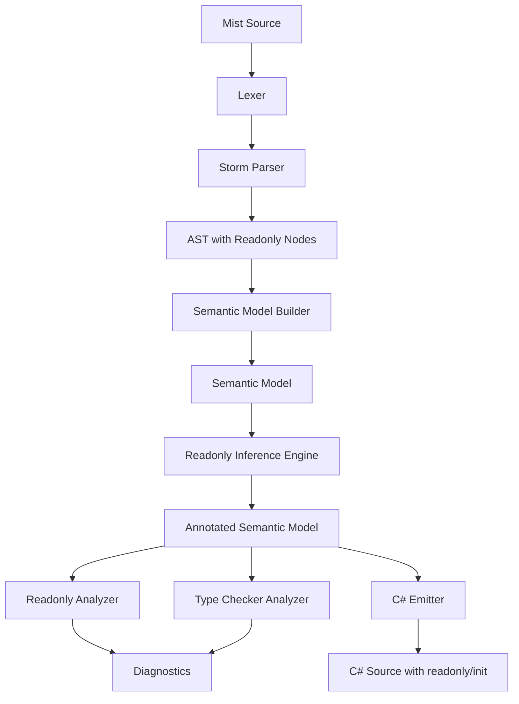
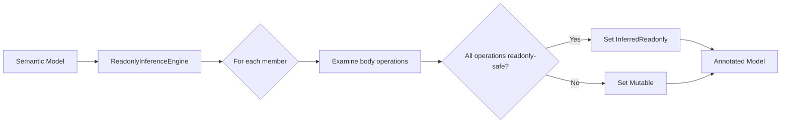
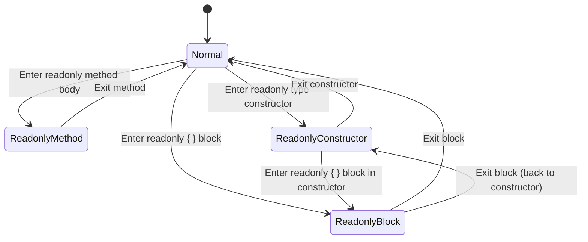

# Design Document: Readonly Contexts

## Overview

This document describes the design for adding readonly contexts to the Mist programming language. Readonly contexts provide a transitive immutability guarantee: within a readonly context, code may only interact with other readonly-qualified sites. This prevents post-construction mutation and enables the compiler to reason about side-effect freedom.

The feature spans the entire compiler pipeline:
1. **Grammar & Parsing** — New `readonly` and `mutable` keywords, readonly modifier on declarations, readonly parameters, readonly blocks, and generic constraints.
2. **Semantic Model** — Readonly status tracking (explicit and inferred) on types, members, and parameters.
3. **Analysis** — A new `ReadonlyAnalyzer` that enforces base rules, constructor privilege, backing field exemption, and readonly block override.
4. **Inference** — A `ReadonlyInferenceEngine` that performs local analysis to classify members as implicitly readonly.
5. **C# Emission** — Zero-cost compile-time enforcement with appropriate C# `readonly`/`init` modifiers in emitted code.
6. **TextMate Grammar** — Syntax highlighting for `readonly` and `mutable` keywords.

### Design Principles

- **Compile-time only**: No runtime overhead. All enforcement happens during analysis.
- **Transitive**: Readonly contexts cannot call non-readonly code, creating a closed world of safe operations.
- **Local inference**: Each member proves its own readonly status independently — no whole-program analysis.
- **Constructor privilege**: Constructors can initialize readonly state, but explicit `readonly { }` blocks can opt out of this privilege.
- **Composable with generics**: `where T : readonly` and `where T : mutable` constraints express mutability requirements on type parameters.

## Architecture



### Pipeline Integration

The readonly feature integrates at multiple pipeline stages:

| Stage | Component | Responsibility |
|-------|-----------|---------------|
| Lexing | `MistLexer` | Tokenize `readonly` and `mutable` keywords |
| Parsing | Storm-generated parser | Produce AST nodes with `ReadonlyModifier` |
| Semantic Model | `SemanticModelBuilder` | Record explicit readonly status on symbols |
| Inference | `ReadonlyInferenceEngine` | Classify members as implicitly readonly |
| Analysis | `ReadonlyAnalyzer` | Enforce readonly context rules |
| Type Checking | `TypeCheckerAnalyzer` | Validate generic constraints, interface contracts |
| Emission | `CSharpEmitter` | Emit C# `readonly`/`init` modifiers |

## Components and Interfaces

### 1. Grammar Changes (`Mist.storm` and `keywords.storm`)

#### New Keywords

Add to `keywords.storm`:

```storm
token READONLY = "readonly";
token MUTABLE  = "mutable";
```

#### Modifier Rule Extension

Extend the `Modifier` rule to include `ReadonlyModifier`:

```storm
rule Modifier
    = PUBLIC    as PublicModifier
    | PRIVATE   as PrivateModifier
    | STATIC    as StaticModifier
    | INTRINSIC as IntrinsicModifier
    | READONLY  as ReadonlyModifier
    ;
```

#### Readonly Block Statement

Add a new statement alternative for readonly blocks:

```storm
rule Statement
    = variableDeclaration:VariableDeclarationStatement   as VariableDeclarationStatement
    | returnStatement:ReturnStatement                     as ReturnStatement
    | ifStatement:IfStatement                             as IfStatement
    | whileStatement:WhileStatement                       as WhileStatement
    | forStatement:ForStatement                           as ForStatement
    | foreachStatement:ForeachStatement                   as ForeachStatement
    | breakStatement:BreakStatement                       as BreakStatement
    | readonlyBlock:ReadonlyBlockStatement                as ReadonlyBlockStatement
    | expressionStatement:ExpressionStatement             as ExpressionStatement
    ;

rule ReadonlyBlockStatement = READONLY body:Block;
```

The `ReadonlyBlockStatement` must appear before `ExpressionStatement` in the alternatives to avoid ambiguity (the parser would otherwise try to parse `readonly` as an identifier expression).

#### Readonly Parameters

Extend the `Parameter` rule to support an optional `readonly` modifier:

```storm
rule Parameter = modifier:READONLY? type:TypeReference name:IDENTIFIER;
```

#### Generic Constraint Extension

Extend the `Constraint` rule to include readonly and mutable constraints:

```storm
rule Constraint
    = CLASS                                                                    as ClassConstraint
    | STRUCT                                                                   as StructConstraint
    | READONLY                                                                 as ReadonlyConstraint
    | MUTABLE                                                                  as MutableConstraint
    | NEW LEFT_PARENTHESIS paramTypes:ConstraintParameterTypeList? RIGHT_PARENTHESIS  as ConstructorConstraint
    | type:TypeReference                                                       as TypeConstraint
    ;
```

### 2. AST/CST Node Flow

The Storm source generator produces C# node types from the grammar rules. The key new/modified nodes:

| Grammar Rule | Generated Node Type | Purpose |
|---|---|---|
| `Modifier → READONLY` | `ReadonlyModifierModifierNode` | Readonly modifier on declarations |
| `ReadonlyBlockStatement` | `ReadonlyBlockStatementStatementNode` | Readonly block in statement position |
| `Parameter` (with modifier) | `ParameterNode` with `Modifier` field | Readonly parameter |
| `Constraint → READONLY` | `ReadonlyConstraintConstraintNode` | Generic readonly constraint |
| `Constraint → MUTABLE` | `MutableConstraintConstraintNode` | Generic mutable constraint |

The existing `FieldDeclaration`, `PropertyDeclaration`, `MethodDeclaration`, `ConstructorDeclaration`, `ClassDeclaration`, `StructDeclaration`, `InterfaceDeclaration`, `TraitDeclaration`, and `IndexerDeclaration` rules already accept a `modifiers:Modifier*` prefix, so adding `ReadonlyModifier` to the `Modifier` rule automatically enables `readonly` on all these declarations without further grammar changes.

### 3. Semantic Model Representation

#### ReadonlyStatus Enum

```csharp
/// <summary>
/// Tracks the readonly classification of a symbol.
/// </summary>
public enum ReadonlyStatus
{
    /// <summary>Not yet determined (pre-inference).</summary>
    Unknown,

    /// <summary>Explicitly marked readonly by the developer.</summary>
    ExplicitReadonly,

    /// <summary>Inferred as readonly by the ReadonlyInferenceEngine.</summary>
    InferredReadonly,

    /// <summary>Implicitly readonly because the containing type is readonly.</summary>
    ImplicitReadonly,

    /// <summary>Not readonly (mutable).</summary>
    Mutable,
}
```

#### Symbol Extensions

Add `ReadonlyStatus` to the relevant symbol metadata:

- **Fields**: `FieldSymbol.ReadonlyStatus` — tracks whether the field is readonly.
- **Properties**: `PropertyInfo.ReadonlyStatus` — tracks whether the property is readonly.
- **Indexers**: `IndexerInfo.ReadonlyStatus` — tracks whether the indexer is readonly.
- **Methods**: `MethodSymbol.ReadonlyStatus` — tracks whether the method is readonly.
- **Constructors**: `ConstructorSymbol.ReadonlyStatus` — tracks whether the constructor is readonly.
- **Parameters**: `ParameterSignature.IsReadonly` — boolean flag for readonly parameters.

#### Type-Level Readonly

Add `IsReadonly` to type representations:

```csharp
// On ClassType, StructType, InterfaceType, TraitType:
public bool IsReadonly { get; internal set; }
```

When `IsReadonly` is true on a type, the semantic model builder sets all member symbols to `ReadonlyStatus.ImplicitReadonly` during construction.

#### TypeParameterConstraints Extension

```csharp
public sealed class TypeParameterConstraints
{
    // ... existing properties ...

    /// <summary>Whether the 'readonly' constraint is present.</summary>
    public bool HasReadonlyConstraint { get; init; }

    /// <summary>Whether the 'mutable' constraint is present.</summary>
    public bool HasMutableConstraint { get; init; }
}
```

### 4. Readonly Inference Engine

The `ReadonlyInferenceEngine` runs as a post-processing pass after the semantic model is built but before the analyzers run. It examines each member's body to determine if it qualifies as implicitly readonly.

#### Algorithm

```
For each type in the semantic model:
  For each member (field, property, indexer, method, constructor):
    If member is already ExplicitReadonly or ImplicitReadonly:
      Skip (already classified)
    Else:
      Classify the member by examining its body
```

#### Classification Rules

A member is inferred as readonly if its body contains ONLY:
1. Literal expressions
2. Field read access (reading `this.field` or `field`)
3. Local variable declarations and assignments
4. Calls to methods that are readonly (explicit, inferred, or implicit)
5. Calls to property or indexer getters that are readonly
6. `new` expressions targeting readonly constructors
7. Arithmetic/logical operations on local values
8. Control flow (if/while/for) where all branches satisfy the above

A member is NOT inferred as readonly if its body contains ANY:
1. Field assignment (`this.field = value` or `field = value`)
2. Calls to non-readonly methods
3. Calls to non-readonly property or indexer getters
4. Calls to any property or indexer setter
5. `new` expressions targeting non-readonly constructors

#### Locality Principle

The inference engine does NOT traverse into called methods. It only checks whether the called method's `ReadonlyStatus` is one of `ExplicitReadonly`, `InferredReadonly`, or `ImplicitReadonly`. This ensures:
- No circular dependency issues
- Predictable performance (linear in total AST size)
- Clear reasoning for developers

#### Processing Order

Because inference is local, processing order does not matter for correctness. However, for efficiency, the engine processes members in declaration order within each type. If a method A calls method B in the same type, and B hasn't been classified yet, the engine conservatively treats B as mutable. A second pass resolves these cases (fixed-point iteration with a maximum of 2 passes).

#### Constructor Inference

A constructor is inferred as readonly when:
- It only assigns to fields of `this` (the declaring type's own fields)
- It does not call any non-readonly methods or getters
- It does not call any property or indexer setters (other than readonly property/indexer setters on `this`)
- All `new` expressions target readonly constructors

### 5. Readonly Analyzer

The `ReadonlyAnalyzer` implements `IAnalyzer` and enforces the readonly context rules defined in Requirement 10.

```csharp
public sealed class ReadonlyAnalyzer : IAnalyzer
{
    public string AnalyzerId => "readonly-context";

    public void Analyze(ISemanticModel model, DiagnosticBag diagnostics)
    {
        // Walk all type declarations
        // For each member with ReadonlyStatus != Mutable:
        //   Validate the body against readonly context rules
        // For each ReadonlyBlockStatement:
        //   Validate the block body against readonly context rules
    }
}
```

#### Context Stack

The analyzer maintains a context stack to track the current enforcement mode:

```csharp
private enum ContextKind
{
    Normal,              // No readonly restrictions
    ReadonlyMethod,      // Readonly method body — base rules only
    ReadonlyGetter,      // Readonly property/indexer getter — base rules only
    ReadonlySetter,      // Readonly property setter — base rules + backing field exemption
    ReadonlyIndexerSetter, // Readonly indexer setter — base rules only (no backing field exemption)
    ReadonlyConstructor, // Readonly type constructor — base rules + constructor privilege
    ReadonlyBlock,       // Explicit readonly block — base rules only (overrides constructor privilege)
}
```

#### Base Rules Enforcement

For each expression/statement in a readonly context, the analyzer checks:

| Operation | Rule | Action |
|-----------|------|--------|
| Field read | Permitted (rule 1) | No diagnostic |
| Field assignment | Prohibited (rule 6) | Emit `MIST_RO_0001 (historical)` |
| Readonly method call | Permitted (rule 2) | No diagnostic |
| Non-readonly method call | Prohibited (rule 7) | Emit `MIST_RO_0002 (historical)` |
| Readonly property/indexer getter call | Permitted (rule 3) | No diagnostic |
| Non-readonly property/indexer getter call | Prohibited (rule 8) | Emit `MIST_RO_0003 (historical)` |
| Any property/indexer setter call | Prohibited (rule 9) | Emit `MIST_RO_0004 (historical)` |
| Local variable decl/assign | Permitted (rule 4) | No diagnostic |
| `new` with readonly ctor | Permitted (rule 5) | No diagnostic |
| `new` with non-readonly ctor | Prohibited (rule 10) | Emit `MIST_RO_0005 (historical)` |

#### Exception: Constructor Privilege (Rule 11)

When `ContextKind == ReadonlyConstructor`:
- Field assignment to `this.field` is permitted (overrides rule 6)
- Calling readonly property/indexer setters on `this` is permitted (overrides rule 9)
- All other base rules still apply

#### Exception: Backing Field Exemption (Rule 12)

When `ContextKind == ReadonlySetter`:
- `field = value` (the backing field keyword) is permitted (overrides rule 6)
- All other field assignments remain prohibited

#### Exception: Readonly Block Override (Rules 13–14)

When a `readonly { }` block is encountered inside a constructor:
- Push `ContextKind.ReadonlyBlock` onto the context stack
- This overrides `ReadonlyConstructor` — constructor privilege is suspended
- Base rules apply without exception within the block

### 6. Readonly Parameters

#### Semantic Representation

```csharp
public sealed record ParameterSignature(
    string Name,
    IType Type,
    bool IsReadonly  // NEW: true when parameter has readonly modifier
);
```

#### Enforcement

The `ReadonlyAnalyzer` treats a readonly parameter as a "readonly receiver" — any operation on the parameter is subject to readonly context rules:

- Calling a non-readonly method on a readonly parameter → `MIST_RO_0006 (historical)`
- Assigning to a field of a readonly parameter → `MIST_RO_0007 (historical)`
- Calling a non-readonly setter on a readonly parameter → `MIST_RO_0008 (historical)`

This is NOT the same as the method body being in a readonly context. The method itself may be mutable, but it promises not to mutate the specific parameter.

#### Call-Site Checking

The `TypeCheckerAnalyzer` validates at call sites:
- If the argument's type is a readonly type (`IsReadonly == true`), the corresponding parameter MUST be marked `readonly`.
- If the argument's type is mutable, either parameter kind is acceptable.

### 7. Generic Constraints Integration

#### Constraint Parsing

The grammar extension adds `ReadonlyConstraint` and `MutableConstraint` alternatives to the `Constraint` rule. The semantic model builder populates `TypeParameterConstraints.HasReadonlyConstraint` and `HasMutableConstraint`.

#### Type Argument Validation

During generic instantiation (in `TypeCheckerAnalyzer`):

```
For each type parameter T with constraints:
  If HasReadonlyConstraint:
    Verify the type argument is a readonly type (IsReadonly == true)
    If not → emit MIST_TC_0070
  If HasMutableConstraint:
    Verify the type argument is NOT a readonly type
    If readonly → emit MIST_TC_0071
```

#### Member Access on Constrained Type Parameters

When the `ReadonlyAnalyzer` encounters member access on a value of type `T` where `T` has a readonly constraint:
- All member access is treated as if the receiver is in a readonly context
- Non-readonly methods/getters on `T` are prohibited

When `T` has a mutable constraint (or no constraint):
- Normal member access rules apply
- Mutation is permitted

### 8. Interface/Trait Readonly Contracts

#### Contract Propagation

When an interface or trait is marked `readonly`:
- All its members are implicitly readonly (`ReadonlyStatus.ImplicitReadonly`)
- Individual members can also be explicitly marked readonly (redundant but allowed)

#### Implementation Verification

During type checking (in `TypeCheckerAnalyzer`), when verifying interface/trait implementations:

```
For each interface/trait member M that is readonly:
  Find the implementing member I in the implementing type
  If I.ReadonlyStatus == Mutable:
    Emit MIST_TC_0072: "Method 'X' must be readonly to satisfy interface 'Y'"
```

The implementing type does NOT need to be readonly itself — only the specific members that correspond to readonly interface members must be readonly (explicit or inferred).

### 9. C# Emission Strategy

The readonly feature is enforced entirely at compile time. The C# emission uses appropriate C# modifiers where they exist, but does not emit runtime checks.

#### Emission Rules

| Mist Construct | C# Emission |
|---|---|
| `readonly` field | `readonly` field |
| `readonly` property (with setter) | Property with `init` accessor |
| `readonly` property (get-only) | Get-only property (no change) |
| `readonly` indexer (with setter) | Indexer with `init` accessor |
| `readonly` indexer (get-only) | Get-only indexer (no change) |
| `readonly struct` | `readonly struct` |
| `readonly` method on struct | `readonly` method |
| `readonly` method on class | Regular method (C# has no `readonly` method on classes) |
| `readonly` constructor | Regular constructor (no C# equivalent) |
| `readonly { }` block | Regular block (enforcement is compile-time only) |
| `readonly` parameter | Regular parameter (enforcement is compile-time only) |
| `where T : readonly` | Constraint is erased (no C# equivalent) |
| `where T : mutable` | Constraint is erased (no C# equivalent) |

#### Rationale

- C# `readonly` on fields prevents reassignment — matches Mist semantics exactly.
- C# `init` on property setters restricts calls to constructors/init contexts — matches Mist's "setter only callable from constructor" semantics.
- C# `readonly struct` prevents all field mutation in struct methods — matches Mist's readonly struct semantics.
- C# `readonly` on struct methods prevents `this` mutation — matches Mist's readonly method on struct.
- For classes, C# has no `readonly` method concept, so the modifier is simply not emitted. Mist's compile-time enforcement is sufficient.
- Generic constraints are erased because C# has no equivalent. The Mist compiler has already validated them.

### 10. TextMate Grammar Changes

Add `readonly` and `mutable` to the storage modifier pattern:

```json
{
  "name": "storage.modifier.mist",
  "match": "\\b(public|private|static|intrinsic|implicit|explicit|readonly|mutable)\\b"
}
```

The `readonly` keyword in block position (`readonly { ... }`) will be highlighted as a storage modifier, which is appropriate since it introduces a readonly context. No additional patterns are needed — the existing brace matching handles the block body.

## Data Models

### Diagnostic IDs

| ID | Severity | Message Template |
|---|---|---|
| `MIST_RO_0001 (historical)` | Error | "Cannot assign to field '{name}' within a readonly context" |
| `MIST_RO_0002 (historical)` | Error | "Cannot call non-readonly method '{name}' within a readonly context" |
| `MIST_RO_0003 (historical)` | Error | "Cannot call non-readonly property getter '{name}' within a readonly context" |
| `MIST_RO_0004 (historical)` | Error | "Cannot call property setter '{name}' within a readonly context" |
| `MIST_RO_0005 (historical)` | Error | "Cannot allocate type '{name}' within a readonly context: constructor is not readonly" |
| `MIST_RO_0006 (historical)` | Error | "Cannot call non-readonly method '{name}' on readonly parameter '{param}'" |
| `MIST_RO_0007 (historical)` | Error | "Cannot assign to field '{name}' on readonly parameter '{param}'" |
| `MIST_RO_0008 (historical)` | Error | "Cannot call property setter '{name}' on readonly parameter '{param}'" |
| `MIST_RO_0009 (historical)` | Error | "Cannot assign to readonly field '{name}' outside of a constructor" |
| `MIST_RO_0010 (historical)` | Error | "Cannot assign to field '{name}' within a readonly block (constructor privilege is suspended)" |
| `MIST_TC_0070 (historical)` | Error | "Type argument '{type}' does not satisfy the 'readonly' constraint on type parameter '{param}'" |
| `MIST_TC_0071 (historical)` | Error | "Type argument '{type}' does not satisfy the 'mutable' constraint on type parameter '{param}' (type is readonly)" |
| `MIST_TC_0072 (historical)` | Error | "Method '{method}' must be readonly to satisfy readonly contract from '{interface}'" |
| `MIST_TC_0073 (historical)` | Error | "Cannot pass readonly type '{type}' to non-readonly parameter '{param}'" |

### ReadonlyInferenceEngine Data Flow



### Context Stack for Analyzer



## Correctness Properties

*A property is a characteristic or behavior that should hold true across all valid executions of a system — essentially, a formal statement about what the system should do. Properties serve as the bridge between human-readable specifications and machine-verifiable correctness guarantees.*

### Property 1: Readonly Modifier Parsing Preservation

*For any* valid declaration (field, property, method, constructor, class, struct, interface, or trait) with any combination of modifiers including `readonly`, parsing the source SHALL produce an AST node with a `ReadonlyModifier` node attached alongside all other specified modifiers.

**Validates: Requirements 1.1, 1.2, 1.3, 1.4, 1.5, 1.6, 1.7, 1.8, 1.9**

### Property 2: Readonly Block Parsing

*For any* valid list of statements wrapped in a `readonly { ... }` block, parsing the source SHALL produce a `ReadonlyBlockStatement` node whose body contains AST nodes corresponding to the enclosed statements.

**Validates: Requirements 2.1**

### Property 3: Readonly Field Assignment Prohibition

*For any* field marked `readonly` and any assignment to that field occurring outside a constructor of the declaring type, the type checker SHALL report a diagnostic error.

**Validates: Requirements 4.1, 4.4**

### Property 4: Constructor Privilege for Readonly Fields

*For any* readonly field and any assignment to that field within a constructor of the declaring type (outside of a readonly block), the type checker SHALL accept the assignment without error.

**Validates: Requirements 4.2, 5.2**

### Property 5: Readonly Context Permitted Operations

*For any* readonly context (method, getter, block, or constructor), operations that exclusively read fields, call readonly methods, call readonly property getters, declare/assign local variables, or allocate via readonly constructors SHALL produce no readonly-related diagnostics.

**Validates: Requirements 10.1, 10.2, 10.3, 10.4, 10.5**

### Property 6: Readonly Context Prohibited Operations

*For any* readonly context (method, getter, or block without constructor privilege), operations that assign to fields, call non-readonly methods, call non-readonly property getters, call any property setter, or allocate via non-readonly constructors SHALL each produce a diagnostic error.

**Validates: Requirements 10.6, 10.7, 10.8, 10.9, 10.10**

### Property 7: Readonly Block Overrides Constructor Privilege

*For any* constructor of a readonly type containing a `readonly { ... }` block, field assignments and setter calls within that block SHALL produce diagnostic errors (constructor privilege is suspended).

**Validates: Requirements 8.2, 10.13, 10.14**

### Property 8: Backing Field Exemption

*For any* readonly property with a setter body, the assignment `field = value` within that setter body SHALL be permitted without error, while all other field assignments within the same setter body SHALL produce errors.

**Validates: Requirements 5.3, 5.4, 10.12**

### Property 9: Readonly Method Body Enforcement

*For any* method marked `readonly`, its body SHALL be subject to readonly context base rules with no additional exceptions — any non-readonly operation within the body SHALL produce a diagnostic.

**Validates: Requirements 6.1**

### Property 10: Readonly Type Implicit Member Readonly

*For any* type marked `readonly`, all of its members SHALL be treated as implicitly readonly, and the constructor body SHALL be subject to readonly context rules with constructor privilege.

**Validates: Requirements 7.1, 7.2**

### Property 11: Readonly Inference Locality

*For any* method that calls another method, the inference engine SHALL classify the calling method based solely on the called method's readonly status (not by traversing into the called method's body).

**Validates: Requirements 9.1, 9.8**

### Property 12: Readonly Inference Classification

*For any* member whose body contains only literal expressions, field reads, local variable operations, calls to readonly methods/getters, and allocations via readonly constructors, the inference engine SHALL classify that member as `InferredReadonly`.

**Validates: Requirements 9.2, 9.3, 9.4, 9.5, 9.6, 9.7**

### Property 13: Readonly Parameter Enforcement

*For any* parameter marked `readonly`, calling a non-readonly method on it, assigning to its fields, or calling a non-readonly setter on it SHALL each produce a diagnostic error.

**Validates: Requirements 13.2, 13.3, 13.4**

### Property 14: Readonly Type Argument Passing

*For any* call site where a readonly type is passed as an argument, the corresponding parameter MUST be marked `readonly`; passing a non-readonly type SHALL be accepted for both readonly and non-readonly parameter positions.

**Validates: Requirements 13.5, 13.6**

### Property 15: Generic Readonly/Mutable Constraint Checking

*For any* generic instantiation where a type parameter has a `readonly` constraint, providing a non-readonly type argument SHALL produce an error; where a type parameter has a `mutable` constraint, providing a readonly type argument SHALL produce an error.

**Validates: Requirements 11.1, 11.2, 11.7**

### Property 16: Generic Readonly Constraint Member Access

*For any* generic body where a type parameter `T` has a `readonly` constraint, accessing non-readonly members on a value of type `T` SHALL produce errors; where `T` has a `mutable` constraint, accessing non-readonly members SHALL be permitted.

**Validates: Requirements 11.3, 11.4**

### Property 17: Interface/Trait Readonly Contract Enforcement

*For any* type implementing a readonly interface or trait, each implementing member that corresponds to a readonly interface member MUST itself be readonly (explicit or inferred); non-readonly implementations SHALL produce a diagnostic error.

**Validates: Requirements 12.2, 12.3, 12.6**

### Property 18: C# Emission of Readonly Constructs

*For any* readonly field, the emitted C# SHALL contain the `readonly` modifier; for any readonly property with a setter, the emitted C# SHALL use `init` instead of `set`; for any readonly struct, the emitted C# SHALL contain `readonly struct`; for any readonly method on a struct, the emitted C# SHALL contain the `readonly` modifier on the method.

**Validates: Requirements 16.1, 16.2, 16.4, 16.5**

### Property 19: Round-Trip Parsing

*For any* valid readonly syntax construct (readonly member declarations, readonly type declarations, readonly block statements, readonly parameters, and readonly/mutable generic constraints), parsing the source, printing the AST back to source, then parsing again SHALL produce an equivalent syntax tree.

**Validates: Requirements 19.1, 19.2**

## Error Handling

### Parse Errors

- If `readonly` appears in an invalid position (e.g., `readonly 42`), the Storm parser's error recovery will report a syntax error at the unexpected token. No special handling is needed beyond the standard parser error recovery.
- If `mutable` appears outside a constraint clause, the parser will report a syntax error.

### Semantic Errors

- Conflicting modifiers: If both `readonly` and `mutable` appear on the same declaration, the semantic model builder reports an error during construction.
- Readonly on non-applicable targets: If `readonly` appears on a local variable declaration (not supported), the semantic model builder reports an error.

### Inference Failures

- The inference engine never fails — it always produces a classification. If it cannot prove a member is readonly, it classifies it as `Mutable`. This is conservative and safe.
- Circular references between members in the same type are handled by the two-pass approach: if the first pass cannot resolve a dependency, the second pass uses the first pass's results.

### Diagnostic Quality

All diagnostics include:
- The source location (line/column span) of the violation
- The name of the offending symbol (field, method, property, or constructor)
- The name of the readonly context that prohibits the operation
- A clear explanation of why the operation is prohibited

## Testing Strategy

### Property-Based Tests (FsCheck)

The feature is well-suited to property-based testing because:
- The parser has clear input/output behavior (source text → AST)
- The analyzer has clear rules (readonly context + operation → accept/reject)
- The inference engine has deterministic classification logic
- The emitter has clear mapping rules (Mist construct → C# construct)

**Library**: FsCheck (already used in the project for other property tests)

**Configuration**: Minimum 100 iterations per property test.

**Tag format**: `Feature: readonly-contexts, Property {N}: {property_text}`

Each correctness property (1–19) maps to one property-based test. Tests use the batched compilation approach (per `test-process-spawning.md`): generate all scenarios upfront, build a single program, compile once, run once, compare results.

### Unit Tests (xUnit)

Unit tests cover:
- Specific diagnostic message content (Requirement 15)
- Edge cases: nested readonly blocks, readonly blocks in non-readonly constructors
- Specific examples: readonly type constructor calling static non-readonly method
- Smoke tests: keyword tokenization, TextMate grammar patterns

### Integration Tests

- Sample application (`samples/ReadonlyContexts/Program.mist`) exercises all permutations
- End-to-end compilation and execution verifies the feature works through the full pipeline

### Test Organization

```
Tests/
  Mist.Tests/
    ReadonlyContexts/
      ReadonlyParsingPropertyTests.cs      — Properties 1, 2, 19
      ReadonlyAnalyzerPropertyTests.cs     — Properties 3–10, 13
      ReadonlyInferencePropertyTests.cs    — Properties 11, 12
      ReadonlyGenericsPropertyTests.cs     — Properties 15, 16
      ReadonlyInterfacePropertyTests.cs    — Property 17
      ReadonlyEmissionPropertyTests.cs     — Property 18
      ReadonlyParameterPropertyTests.cs    — Property 14
      ReadonlyDiagnosticTests.cs           — Unit tests for diagnostic messages
      ReadonlyEdgeCaseTests.cs             — Edge cases and examples
```
