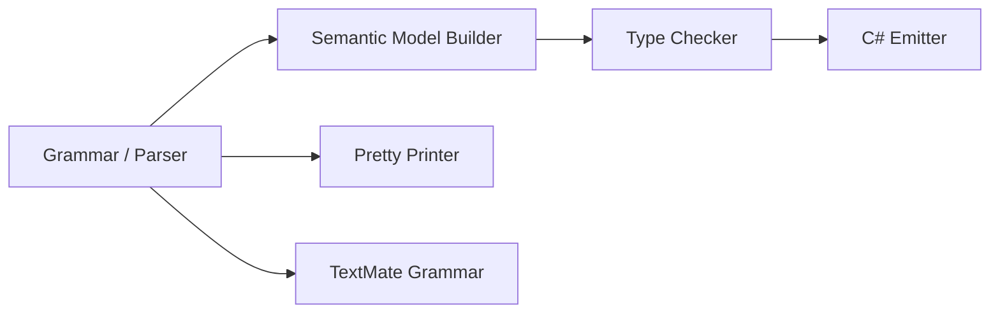

# Design Document: Ref Parameters

## Overview

This design adds C#-style `ref` semantics to the Mist programming language — ref parameters, ref returns, and ref locals. These constructs provide variable-level indirection: a `ref` creates an alias to a storage location so that reads and writes through the alias operate on the original location.

The `ref` keyword is already defined in `keywords.storm` and used in the `OwnershipSpecifier` grammar rule (as the `RefSpecifier` alternative). This design repurposes the same keyword token in new syntactic positions (parameter modifier, return type modifier, local variable modifier, and call-site argument annotation) while maintaining backward compatibility with the existing `readonly ref` ownership specifier.

### Design Rationale

1. **Reuse existing token**: The `REF` keyword token already exists. No lexer changes are needed.
2. **Grammar disambiguation**: `readonly ref` in parameter position remains the `ReadonlyRefSpecifier` ownership specifier. A bare `ref` not preceded by `readonly` in parameter position is the new ref-parameter modifier. The keyword orderings `readonly ref` and `ref readonly` are semantically identical — both produce the same AST node (`ReadonlyRefSpecifier`).
3. **Semantic model extension**: A new `RefKind` enum on parameter, method, and local variable symbols cleanly separates ref semantics from ownership semantics.
4. **Safety-first**: Ref safety rules (no dangling references, no field storage, no lambda capture) are enforced at compile time by the type checker, mirroring C#'s ref safety guarantees.

## Architecture

The feature touches every stage of the compiler pipeline:



1. **Grammar (`Mist.storm`)** — New AST node variants for ref-annotated parameters, ref return types, ref local declarations, and ref-annotated arguments.
2. **Semantic Model Builder** — Records `RefKind` on parameter symbols, method return symbols, and local variable symbols.
3. **Type Checker (`TypeCheckerAnalyzer`)** — Validates ref safety rules: assignable storage locations, lifetime analysis, no field storage, no lambda capture, exact type matching.
4. **C# Emitter (`CSharpSourceWriter`)** — Emits `ref` / `ref readonly` annotations in the generated C# code.
5. **Pretty Printer (`MistPrettyPrinter`)** — Emits `ref` / `readonly ref` annotations when printing AST nodes back to source text.
6. **TextMate Grammar** — Ensures `ref` receives `storage.modifier.mist` scope in the new positions.

## Components and Interfaces

### 1. Grammar Changes (`Mist.storm`)

#### Parameter Rule

The existing `Parameter` rule:
```
rule Parameter = modifier:READONLY? ownershipSpecifier:OwnershipSpecifier? type:TypeReference name:(IDENTIFIER | DISCARD);
```

Becomes:
```
rule Parameter = modifier:READONLY? refModifier:REF? ownershipSpecifier:OwnershipSpecifier? type:TypeReference name:(IDENTIFIER | DISCARD);
```

The `refModifier` field is optional. When present alongside an `ownershipSpecifier`, the semantic model builder emits a diagnostic (mutual exclusivity). The parser accepts both to provide better error recovery and diagnostics.

#### Method Return Type

The existing `MethodDeclaration` rule uses `returnOwnership:OwnershipSpecifier?` before the return type. The `OwnershipSpecifier` rule already includes `REF as RefSpecifier` and `READONLY REF as ReadonlyRefSpecifier`. For ref returns, we reuse these existing alternatives:

- `ref int` return → parsed as `RefSpecifier` in `returnOwnership` position
- `readonly ref int` return → parsed as `ReadonlyRefSpecifier` in `returnOwnership` position

The semantic model builder distinguishes between "ref as ownership" and "ref as ref-return" based on context: when `RefSpecifier` or `ReadonlyRefSpecifier` appears on a method return type, it is interpreted as a ref return modifier (not an ownership tier).

#### Variable Declaration

The existing `VariableDeclarationStatement` rule for typed declarations:
```
rule VariableDeclarationStatement
    = ownershipSpecifier:OwnershipSpecifier? type:TypeReference name:IDENTIFIER EQUAL initializer:Expression SEMICOLON as TypedVariableDeclaration
    ...
```

The `OwnershipSpecifier` rule already includes `REF as RefSpecifier` and `READONLY REF as ReadonlyRefSpecifier`. For ref locals:
- `ref int x = ref y;` → parsed with `RefSpecifier` as the ownership specifier
- `readonly ref int x = ref y;` → parsed with `ReadonlyRefSpecifier` as the ownership specifier

The semantic model builder interprets these as ref locals rather than ownership annotations based on the initializer form (presence of `ref` on the initializer expression).

#### Argument Annotation

A new rule for ref-annotated arguments in call expressions:

```
rule ArgumentList = Argument (COMMA Argument)*;
rule Argument
    = REF expression:Expression  as RefArgument
    | expression:Expression      as ValueArgument
    ;
```

This replaces the current `ArgumentList = Expression (COMMA Expression)*` rule. The `RefArgument` alternative produces a distinct AST node that the type checker validates.

#### Return Statement

The existing `ReturnStatement` rule:
```
rule ReturnStatement = RETURN value:Expression? SEMICOLON;
```

Becomes:
```
rule ReturnStatement = RETURN refKeyword:REF? value:Expression? SEMICOLON;
```

The `refKeyword` field indicates a `return ref expr;` statement for ref-returning methods.

### 2. Semantic Model (`RefKind` Enum)

```csharp
namespace Mist.Semantics.Model;

/// <summary>
/// The ref kind of a parameter, return type, or local variable.
/// Orthogonal to OwnershipTier — a symbol has exactly one of each.
/// </summary>
public enum RefKind
{
    /// <summary>No ref annotation. Standard pass-by-value / return-by-value.</summary>
    None,

    /// <summary>ref — mutable reference to a storage location.</summary>
    Ref,

    /// <summary>ref readonly — readonly reference to a storage location.</summary>
    RefReadonly,
}
```

The `ISymbol` interface does not change. Instead, the concrete `Symbol` class (or a new `IParameterSymbol` / `ILocalSymbol` interface) exposes `RefKind`. The `SemanticModelBuilder` sets this property during Pass 1 when processing parameter, method, and local variable declarations.

### 3. Type Checker Extensions

The `TypeCheckerAnalyzer` gains new validation passes:

| Validation | Trigger | Diagnostic ID |
|---|---|---|
| Ref argument is assignable storage location | Call expression with `RefArgument` | `MIST_REF_0001 (historical)` |
| Ref keyword required at call site | Call to ref-parameter method without `ref` | `MIST_REF_0002 (historical)` |
| Spurious ref at call site | `ref` on argument for non-ref parameter | `MIST_REF_0003 (historical)` |
| Ref + owned mutual exclusivity | Parameter with both ref and `owned` | `MIST_REF_0004 (historical)` |
| Ref + borrowed/frozen redundancy | Parameter with both ref and `borrowed`/`frozen` | `MIST_REF_0013 (historical)` (warning) |
| Ref readonly assignment prohibition | Assignment through ref readonly local/return | `MIST_REF_0005 (historical)` |
| Ref return lifetime (dangling reference) | `return ref localVar;` | `MIST_REF_0006 (historical)` |
| Ref type exact match | Ref argument type ≠ parameter type | `MIST_REF_0007 (historical)` |
| Ref field storage prohibition | Storing ref in a field | `MIST_REF_0008 (historical)` |
| Ref readonly return assignment | Assignment through ref readonly return | `MIST_REF_0009 (historical)` |
| Ref local requires initializer | `ref int x;` without `= ref ...` | `MIST_REF_0010 (historical)` |
| Ref lambda capture prohibition | Ref local captured by closure | `MIST_REF_0011 (historical)` |
| Ref on an operator or cast-operator parameter (Requirement 1.2, corrected 2026-10-21) | Bare `ref` on such a parameter, refused at the parameter | `MIST0041` |
| Readonly ref on an operator or cast-operator parameter (Requirement 1.2, decided 2026-10-22) | `readonly ref` on such a parameter, refused at the parameter | `MIST0042` |
| Ref overload distinction | Overload resolution considers RefKind | (no diagnostic — resolution logic) |
| Interface/trait RefKind match | Implementing method RefKind ≠ interface | `MIST_REF_0012 (historical)` |

### 4. C# Emitter Extensions

The `CSharpSourceWriter` class is extended to:

- Emit `ref` before parameter types when `RefKind == Ref`
- Emit `ref readonly` before parameter types when `RefKind == RefReadonly`
- Emit `ref` / `ref readonly` before method return types
- Emit `ref` / `ref readonly` before local variable types
- Emit `ref` before arguments at call sites
- Emit `return ref expr;` for ref-returning methods

### 5. Pretty Printer Extensions

The `MistPrettyPrinter` class is extended to:

- Emit `ref ` before parameter types when the `refModifier` AST field is present
- Emit `ref ` or `readonly ref ` before method return types based on the `returnOwnership` node type in ref-return context
- Emit `ref ` or `readonly ref ` before local variable types
- Emit `ref ` before arguments in call expressions when the argument is a `RefArgument` node

### 6. TextMate Grammar

The existing TextMate grammar already assigns `storage.modifier.mist` to `ref` via the ownership specifier patterns. The grammar needs to ensure that `ref` in the new positions (argument prefix, local variable prefix) also receives the same scope. Since `ref` is matched as a keyword at word boundaries, the existing pattern likely covers these cases. Verification is needed to confirm no gaps exist.

## Data Models

### AST Node Types (Storm-generated)

| Node | Fields | Purpose |
|---|---|---|
| `ParameterNode` | `modifier: READONLY?`, `refModifier: REF?`, `ownershipSpecifier: OwnershipSpecifier?`, `type: TypeReference`, `name: IDENTIFIER \| DISCARD` | Parameter with optional ref modifier |
| `RefArgumentArgumentNode` | `expression: Expression` | Ref-annotated argument at call site |
| `ValueArgumentArgumentNode` | `expression: Expression` | Normal (by-value) argument at call site |
| `ReturnStatementNode` | `refKeyword: REF?`, `value: Expression?` | Return statement with optional ref |

### Semantic Model Types

| Type | Properties | Purpose |
|---|---|---|
| `RefKind` (enum) | `None`, `Ref`, `RefReadonly` | Ref classification for symbols |
| Parameter symbol | `RefKind`, `OwnershipTier`, `DeclaredType` | Full parameter metadata |
| Method symbol | `ReturnRefKind`, `ReturnOwnershipTier`, `ReturnType` | Full method return metadata |
| Local variable symbol | `RefKind`, `OwnershipTier`, `DeclaredType` | Full local variable metadata |

### Diagnostic IDs

| ID | Message Template |
|---|---|
| `MIST_REF_0001 (historical)` | "A ref argument must be an assignable variable, field, or array element; '{0}' is not a valid storage location" |
| `MIST_REF_0002 (historical)` | "Argument for ref parameter '{0}' must be prefixed with the 'ref' keyword" |
| `MIST_REF_0003 (historical)` | "Parameter '{0}' is not declared as ref; remove the 'ref' keyword from the argument" |
| `MIST_REF_0004 (historical)` | "The 'ref' modifier and 'owned' specifier are mutually exclusive on a parameter" |
| `MIST_REF_0005 (historical)` | "Cannot assign through a ref readonly reference" |
| `MIST_REF_0006 (historical)` | "Cannot return a reference to local variable or non-ref parameter '{0}'; its storage is destroyed when the method returns" |
| `MIST_REF_0007 (historical)` | "Ref argument type '{0}' must match parameter type '{1}' exactly; no implicit conversions are allowed for ref arguments" |
| `MIST_REF_0008 (historical)` | "Cannot store a ref in a field; refs are stack-only aliases" |
| `MIST_REF_0009 (historical)` | "Cannot assign through a ref readonly return value" |
| `MIST_REF_0010 (historical)` | "A ref local variable must be initialized at declaration" |
| `MIST_REF_0011 (historical)` | "Cannot capture ref local '{0}' in a lambda or closure" |
| `MIST_REF_0012 (historical)` | "Method '{0}' does not match interface/trait method '{1}': parameter ref kinds must match exactly" |
| `MIST_REF_0013 (historical)` | "The ownership specifier '{0}' is redundant on a ref parameter (ref already implies a borrow)" |


## Correctness Properties

*A property is a characteristic or behavior that should hold true across all valid executions of a system — essentially, a formal statement about what the system should do. Properties serve as the bridge between human-readable specifications and machine-verifiable correctness guarantees.*

### Property 1: Pretty Printer Round-Trip

*For any* valid Mist source text containing ref-annotated declarations (ref parameters, ref returns, ref locals, ref arguments), parsing the source and pretty-printing the resulting AST, then parsing the output and pretty-printing again, SHALL produce character-for-character identical output on both emissions.

**Validates: Requirements 11.1, 11.2, 11.3, 11.4, 11.5, 11.6**

### Property 2: Ref Mutation Visibility

*For any* Mist program where a variable is passed as a `ref` argument and the callee assigns a new value to the ref parameter, the caller's variable SHALL hold the new value after the call returns. This holds for struct variables, struct fields, and array elements.

**Validates: Requirements 3.1, 3.2, 4.7, 5.4, 10.1, 10.2, 10.5**

### Property 3: Ref Requires Assignable Storage Location

*For any* expression that is not an assignable storage location (literals, temporaries, method return values, arithmetic results, readonly bindings, frozen variables, readonly-ref-ownership variables), using that expression as a `ref` argument SHALL produce a diagnostic error.

**Validates: Requirements 2.5, 3.3, 9.4, 9.5, 10.4, 14.1**

### Property 4: Ref and Owned Mutual Exclusivity

*For any* parameter declaration that combines the `ref` modifier with the `owned` ownership specifier, the compiler SHALL produce a diagnostic error indicating mutual exclusivity. *For any* parameter declaration that combines `ref` with `borrowed` or `frozen`, the compiler SHALL produce a diagnostic warning indicating redundancy (but the program remains valid).

**Validates: Requirements 1.3, 1.4, 9.1, 14.6**

### Property 5: Ref Type Exact Match

*For any* ref argument whose static type differs from the ref parameter's declared type (even if the types are related by subtyping or implicit conversion), the type checker SHALL produce a diagnostic error.

**Validates: Requirements 3.4, 5.9, 14.7**

### Property 6: Ref Return Lifetime Safety

*For any* method declared with a `ref` or `ref readonly` return type, if the return expression references a local variable, a non-ref parameter, a literal, or an expression result, the type checker SHALL produce a diagnostic error indicating a dangling reference.

**Validates: Requirements 4.3, 4.5, 4.6, 6.2, 14.5**

### Property 7: Ref Readonly Assignment Prohibition

*For any* attempt to assign through a `ref readonly` local or a `ref readonly` return value, the type checker SHALL produce a diagnostic error.

**Validates: Requirements 4.8, 5.6, 14.4, 14.9**

### Property 8: Ref Call-Site Annotation Enforcement

*For any* call to a method with a `ref` parameter where the argument is missing the `ref` keyword, the type checker SHALL produce a diagnostic error. Conversely, *for any* call where `ref` appears on an argument for a non-ref parameter, the type checker SHALL produce a diagnostic error.

**Validates: Requirements 2.2, 2.3, 14.2, 14.3**

### Property 9: Semantic Model RefKind Recording

*For any* ref-annotated parameter, method return type, or local variable declaration, the semantic model SHALL record the correct `RefKind` value (`Ref` or `RefReadonly`) on the corresponding symbol.

**Validates: Requirements 7.1, 7.2, 7.3**

### Property 10: RefKind Overload Distinction

*For any* two methods in the same type with identical names and parameter types that differ only in `RefKind` on one or more parameters, the type checker SHALL treat them as distinct overloads (no duplicate-signature diagnostic).

**Validates: Requirements 7.4**

### Property 11: RefKind Interface and Trait Matching

*For any* interface or trait method with a `ref` parameter, an implementing method whose corresponding parameter is not `ref` (or vice versa) SHALL produce a diagnostic error indicating a RefKind mismatch.

**Validates: Requirements 7.5, 7.6**

### Property 12: C# Emission Preserves Ref Annotations

*For any* Mist program containing ref parameters, ref returns, ref locals, or ref arguments that compiles without diagnostics, the emitted C# source SHALL contain the corresponding `ref` (or `ref readonly`) keywords in the correct positions (parameter types, return types, local declarations, arguments, return statements).

**Validates: Requirements 8.1, 8.2, 8.3, 8.4, 8.5, 8.6**

### Property 13: Ref Field Storage Prohibition

*For any* attempt to assign a ref (parameter or local) to a field, the type checker SHALL produce a diagnostic error indicating that refs cannot be stored in fields.

**Validates: Requirements 6.5, 14.8**

### Property 14: Ref Lambda Capture Prohibition

*For any* lambda or closure that captures a ref local variable, the type checker SHALL produce a diagnostic error indicating that ref locals cannot be captured.

**Validates: Requirements 6.7, 14.11**

## Error Handling

### Parser Error Recovery

When the parser encounters an invalid ref annotation (e.g., `ref ref T x` or `ref owned T x`), it should:
1. Report the diagnostic at the offending token position.
2. Continue parsing by consuming the duplicate/conflicting modifier and treating the parameter as if only one modifier were present.
3. Produce a valid (though diagnostically flagged) AST node so downstream phases can still operate.

### Type Checker Error Cascading

Ref-related diagnostics should not cascade. Specifically:
- If a `ref` argument fails the "assignable storage location" check, the type checker should NOT also report a type mismatch error for the same argument.
- If a `ref` return fails the lifetime check, the type checker should NOT also report a "missing ref at call site" error for callers of that method.
- Each ref violation produces exactly one diagnostic per violation site.

### Semantic Model Resilience

If a parameter has both `ref` and the `owned` ownership specifier (an invalid combination), the semantic model builder should:
1. Record `RefKind.Ref` on the parameter (honoring the explicit `ref`).
2. Record `OwnershipTier.Unrestricted` (ignoring the conflicting ownership specifier).
3. Emit the mutual-exclusivity error diagnostic (`MIST_REF_0004 (historical)`).

If a parameter has both `ref` and `borrowed` or `frozen` (a redundant but valid combination), the semantic model builder should:
1. Record `RefKind.Ref` on the parameter.
2. Record `OwnershipTier.Unrestricted` (the ownership specifier is ignored since ref subsumes it).
3. Emit the redundancy warning diagnostic (`MIST_REF_0013 (historical)`).

This ensures downstream phases see a consistent model even for erroneous or redundant source.

## Testing Strategy

### Unit Tests (Example-Based)

Unit tests cover specific scenarios and edge cases:

- **Parser tests**: Verify AST structure for each ref-annotated declaration kind (method, constructor, indexer, operator, cast operator parameters; ref returns; ref locals; ref arguments). The operator and cast-operator forms parse but are refused once the declaration is built (Requirement 1.2, corrected 2026-10-21).
- **Diagnostic tests**: Verify each diagnostic ID is produced for its triggering condition with the correct message and location.
- **Emitter tests**: Verify emitted C# for specific ref patterns matches expected output.
- **TextMate grammar tests**: Verify scope assignment for `ref` in various positions using vscode-textmate or snapshot tests.
- **Sample app integration**: Compile and run `samples/RefParameters/Program.mist`, verify exit code 0 and expected stdout output.

### Property-Based Tests (FsCheck)

Property-based tests use FsCheck (already in the project via `FsCheck.Xunit 3.1.0`) to verify universal properties across generated inputs.

**Configuration**: Minimum 100 iterations per property test.

**Tag format**: Each property test includes a comment referencing the design property:
```csharp
// Feature: ref-parameters, Property 1: Pretty Printer Round-Trip
```

**Key property tests**:

1. **Round-trip property (Property 1)**: Generate random valid ref-annotated Mist source fragments, parse → print → parse → print, verify idempotence. Uses the existing `MistLexer` + `MistParser` + `MistPrettyPrinter` pipeline in-process (no process spawning).

2. **Semantic model RefKind recording (Property 9)**: Generate random ref parameter/return/local declarations, build semantic model in-process via `SemanticModelBuilder`, verify `RefKind` values on resulting symbols.

3. **C# emission correctness (Property 12)**: Generate random valid ref-annotated programs, compile in-process via `CompilerDriver`, use `CSharpEmitter.EmitToMemory()` to get emitted C# strings, verify `ref` / `ref readonly` keywords appear in correct positions. No process spawning needed.

4. **Type checker diagnostic properties (Properties 3–8, 10–14)**: Generate programs with specific ref violations, compile in-process, verify the expected diagnostic ID is present in the result. Uses batched generation (generate N scenarios, compile each in-process, verify diagnostics) — no process spawning.

**Process spawning**: The round-trip and semantic model tests require zero process spawns (all in-process). The mutation visibility property (Property 2) requires compiling and running generated programs — this uses the batched approach per the test-process-spawning steering: generate all scenarios, build one combined program, compile once, run once, compare N output lines.

