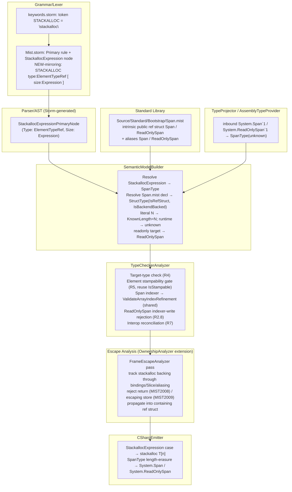

# Design Document: Stack-Only Types (`Span<T>`, `ReadOnlySpan<T>`, `stackalloc`)

## Overview

This feature adds three capabilities to Mist, all built on the already-shipped `ref struct` mechanism:

1. **Dependent-typed `Standard.Span<T, Length>` and `Standard.ReadOnlySpan<T, Length>`** — intrinsic `ref struct` types in the standard library, modeled exactly on the existing `Array<TValue, Length:ZeroOrPositiveInt>` intrinsic, backed by CLR `System.Span<T>` / `System.ReadOnlySpan<T>`. (Requirements 1, 2)
2. **A `stackalloc T[n]` expression** that allocates a contiguous stack block and yields a `Span<T, Length>` (or `ReadOnlySpan<T, Length>` in a read-only target context). (Requirements 3, 4, 5, 6)
3. **Frame-escape analysis** — the genuinely new analysis — ensuring a stackalloc-backed span cannot outlive the stack frame that allocated it. (Requirement 8)

The design rests on two existing precedents and reuses them rather than reinventing:

- **The `Array<T, Length>` precedent for the type system and interop.** `Array<T, Length>` is *not* modeled as a `ConstructedType`; it is a dedicated `ArrayType` IType carrying `ElementType` + `KnownLength`/`SymbolicLengthId`. Use-sites (`T[]`, `new T[n]`, inbound CLR arrays) are routed to `ArrayType`, the bounds machinery (`ValidateArrayIndexRefinement`) reads its length fields, the emitter erases length via the branch `ArrayType a => $"{...}[]"`, and inbound CLR arrays project to an unknown-length `ArrayType`. Span mirrors every one of these steps. This is explicitly **not** the `Task` precedent (a single `BackingTypes` entry + `IntrinsicTypeMap` projection); see the type-representation decision in §"Data Models".
- **The `ref struct` precedent for stack-only-ness and heap-escape.** `ref struct` already parses, sets `StructType.IsRefStruct`, emits C# `ref struct`, projects inbound (`clrType.IsByRefLike → IsRefStruct`), and enforces heap-escape (`MIST2002`–`MIST2007`, `RefStructCannotBeOptional`, `MIST_TC_0123 (historical)`). Span values reuse all of it. Frame-escape is the *new* hazard those rules do not cover: a stackalloc-backed span points into the current frame, so it must not be returned or stored where it outlives the frame.

The bounds-checking story is intentionally identical to arrays: full static checking when `Length` is a known constant, lower-bound-only (`>= 0`) with the upper bound deferred to the CLR at runtime when `Length` is unknown. This runtime-fallback gap is the same one arrays have today; it is tracked as a separate CRITICAL item in `project/TODO.md` and this design **deliberately mirrors current array behavior and does not close it** (Requirements notes; Requirement 14.6).

## Architecture

### Pipeline touchpoints



### Data-flow summary

1. **Lex/parse** `stackalloc T[n]` into a dedicated `StackallocExpressionPrimaryNode` (mirrors `ArrayCreationExpressionPrimaryNode`).
2. **Resolve** the node in `SemanticModelBuilder` to a `SpanType` (the new dedicated IType, §"Data Models"): element type `T`, `KnownLength = N` for a literal size or unknown otherwise, `IsReadOnly` driven by the read-only target context.
3. **Type-check** in `TypeCheckerAnalyzer`: validate the target-type context (R4), the element-type stampability (R5, reusing `StructType.IsStampable`), index refinements (R1.5/R2.5 via the shared array-bounds helper), read-only indexer writes (R2.8), and interop reconciliation across the C# boundary (R7).
4. **Escape-analyze** in the new frame-escape pass (hosted alongside `OwnershipAnalyzer`): track stackalloc backing and reject frame escape (R8).
5. **Emit** C# `stackalloc T[n]` and erase `Length` so `SpanType` lowers to `System.Span<T>` / `System.ReadOnlySpan<T>` (R6, R7).
6. **Project** inbound CLR `System.Span` / `System.ReadOnlySpan` to `SpanType` with `Length = unknown` (R7, R9).

## Components and Interfaces

### 1. Grammar / Lexer (`Source/Mist/Grammar/`)

**`keywords.storm`** — add one token, grouped with the other expression keywords:

```storm
// Stack allocation keyword
token STACKALLOC = "stackalloc";
```

**`Mist.storm`** — add one `Primary` alternative directly beside `ArrayCreationExpression`, mirroring its shape (`NEW type:ElementTypeRef LEFT_BRACKET size:Expression RIGHT_BRACKET`):

```storm
| STACKALLOC type:ElementTypeRef LEFT_BRACKET size:Expression RIGHT_BRACKET     as StackallocExpression
```

Reusing the existing `ElementTypeRef` rule (which already powers array creation and disambiguates `int[3]` element-type vs sized-array) gives single-dimensional `stackalloc T[n]` with exactly one element-type child and one size-expression child (R3.2, R3.3). Because the alternative *requires* `LEFT_BRACKET size:Expression RIGHT_BRACKET`, a `stackalloc T` (no brackets, R3.4) or `stackalloc T[]` (empty brackets, R3.5) does not match this alternative; the parser produces no `StackallocExpression` node, emits a recovery diagnostic, and continues — exactly as the equally-bracket-requiring `ArrayCreationExpression` handles the same shapes. (R3.1–R3.6)

Storm generates a `StackallocExpressionPrimaryNode` with `Type` (an `ElementTypeRefNode`) and `Size` (an `ExpressionNode`) — the same accessor shape Storm generated for `ArrayCreationExpressionPrimaryNode`.

### 2. Standard library (`Source/Standard/Bootstrap/Span.mist`)

A new file declaring both intrinsics, modeled byte-for-byte on `Array.mist`'s structure (`ZeroOrPositiveInt` already exists in `Array.mist`, same `Standard` namespace, so it is in scope):

```mist
namespace Standard;

intrinsic public ref struct Span<T, Length:ZeroOrPositiveInt> : IEnumerable<T>
{
    public type SpanBounds = ZeroOrPositiveInt and < Length;

    intrinsic public Int32 Length { get; }

    intrinsic public T this[SpanBounds index];

    intrinsic public Span<T, unknown> Slice(SpanBounds start, Int32 length);

    intrinsic public struct Enumerator : IEnumerator<T> {
        intrinsic public bool MoveNext();
        intrinsic public T Current { get; }
    }

    intrinsic public Enumerator GetEnumerator();
}

intrinsic public ref struct ReadOnlySpan<T, Length:ZeroOrPositiveInt> : IEnumerable<T>
{
    public type SpanBounds = ZeroOrPositiveInt and < Length;

    intrinsic public Int32 Length { get; }

    intrinsic public T this[SpanBounds index];

    intrinsic public ReadOnlySpan<T, unknown> Slice(SpanBounds start, Int32 length);

    intrinsic public struct Enumerator : IEnumerator<T> {
        intrinsic public bool MoveNext();
        intrinsic public T Current { get; }
    }

    intrinsic public Enumerator GetEnumerator();
}

type Span<T> = Span<T, unknown>;
type ReadOnlySpan<T> = ReadOnlySpan<T, unknown>;
```

This declaration's role mirrors `Array.mist`: it documents the API surface and registers a `StructType` (with `IsRefStruct = true`, `IsBackendBacked = true`) so the type name resolves and the indexer's `SpanBounds` refinement is on record, but actual *use-sites* are routed to the dedicated `SpanType` IType (see §"Data Models"), just as `Array<T,Length>` use-sites are routed to `ArrayType`. (R1.1–R1.8, R2.1–R2.8)

The `Slice` return type is written as `Span<T, unknown>` in the declaration because the dependent `Length2` inference (literal length argument → known, else unknown; R1.6/R2.6) is performed by the type checker at the call site against the dedicated `SpanType`, the same way `KnownLength` is inferred for array creation rather than read from the declaration.

> **Note on `ref struct` as a stdlib modifier.** `ref struct` already parses (`SemanticModelBuilder` sets `structType.IsRefStruct = HasRefModifier(...)`). Combined with `intrinsic` (which sets `IsBackendBacked`), the Span declaration produces a backend-backed ref-struct `StructType`. R1.3/R2.3 require that registration to set `IsRefStruct = true` or fail; this is satisfied by the existing `HasRefModifier` path, and the model builder asserts the invariant for these two canonical types.

### 3. Parser/AST → SemanticModelBuilder (`Source/Mist/Semantics/Model/SemanticModelBuilder.cs`)

Add a resolution case for `StackallocExpressionPrimaryNode`, structurally mirroring the existing `ArrayCreationExpressionPrimaryNode` case (which uses `ResolveElementTypeRef` + `TryExtractIntegerLiteral`):

```csharp
case StackallocExpressionPrimaryNode stackalloc:
{
    var elementType = ResolveElementTypeRef(stackalloc.Type, ...);
    ResolveExpression(stackalloc.Size, ...);
    var literalSize = TryExtractIntegerLiteral(stackalloc.Size);
    var isReadOnly = ReadonlyTargetInEffect();   // from target-type context (R4.3/R4.5)
    result = literalSize.HasValue
        ? new SpanType(elementType, literalSize.Value, isReadOnly)   // known length
        : new SpanType(elementType, isReadOnly);                      // unknown length
    break;
}
```

The read-only target context is threaded the same way the builder already threads `_emptyArrayTargetType` for array literals: when the expected type at the stackalloc position is a `ReadOnlySpan<T, Length>` family `SpanType`, the result is a `ReadOnlySpan` `SpanType`; otherwise it is a mutable `Span` `SpanType` (R4.1–R4.3).

The builder also recognizes the `Standard.Span` / `Standard.ReadOnlySpan` declarations from `Span.mist` and (a) asserts `IsRefStruct`/`IsBackendBacked` (R1.3/R2.3), and (b) resolves the `Span<T>` / `ReadOnlySpan<T>` aliases to `SpanType(T, unknown)`.

### 4. TypeCheckerAnalyzer (`Source/Mist/Analysis/Builtin/TypeCheckerAnalyzer.cs`)

This analyzer gains the following responsibilities (each detailed in §"Data Models" / §"Error Handling"):

- **Stackalloc target-type check (R4.6, R4.7, R4.8):** verify the stackalloc result is consumed only in a `var` / `Span<T,Length>` / `ReadOnlySpan<T,Length>` (or alias) context, that the size is integer-typed (`IsIntLike`, the same predicate array size uses at `MIST_TC_0012 (historical)`), and emit a mismatch diagnostic otherwise.
- **Element-type stampability gate (R5):** reuse `StructType.IsStampable` (+ `IsPrimitiveStructByName` fallback) — the *same* gate the bare-`new T[size]` path already uses (`TypeCheckerAnalyzer` ~line 12816) — but anchored at the element-type node and with span-specific messages distinguishing reference type / non-stampable struct / ref struct / unconstrained type parameter.
- **Index refinement (R1.5, R2.5):** route `SpanType` indexing through the **shared** array-bounds helper (see refactor below), giving identical full-static / lower-bound-only behavior.
- **Read-only indexer write rejection (R2.8):** reject assignment whose target is the indexer of a read-only `SpanType`, independent of length validation.
- **Interop reconciliation (R7):** treat `SpanType` and inbound-projected `System.Span`/`System.ReadOnlySpan` as the same logical type, reconciling element types and span kind in both directions.

**Bounds-machinery reuse (no parallel checker).** `ValidateArrayIndexRefinement(indexSuffix, ArrayType, ...)` builds its target constraints purely from `(long? KnownLength, int? SymbolicLengthId)`. Extract that core into a shared helper:

```csharp
// New shared helper — the existing 3-case logic verbatim, parameterized on length.
private void ValidateLengthIndexRefinement(
    IndexSuffixPostfixSuffixNode indexSuffix,
    long? knownLength, int? symbolicLengthId,
    ISemanticModel model, DiagnosticBag diagnostics);
```

`ValidateArrayIndexRefinement` becomes a one-line adapter (`=> ValidateLengthIndexRefinement(indexSuffix, arrayType.KnownLength, arrayType.SymbolicLengthId, ...)`), and the index-dispatch site gains a sibling branch:

```csharp
if (targetType is ArrayType arrayTarget)
    ValidateArrayIndexRefinement(indexSuffix, arrayTarget, model, diagnostics);
else if (targetType is SpanType spanTarget)
    ValidateLengthIndexRefinement(indexSuffix, spanTarget.KnownLength, spanTarget.SymbolicLengthId, model, diagnostics);
else if (targetType is not null)
    ValidateIndexerParameterRefinement(indexSuffix, targetType, model, diagnostics);
```

This is reuse of the existing array machinery (identical predicate construction and literal/narrowing/refinement 3-case logic), not a second bounds checker. (Requirements notes; R1.5, R2.5, R14.6)

### 5. Frame-escape analysis (new pass alongside `OwnershipAnalyzer`)

The escape analysis is a new pass, `FrameEscapeAnalyzer`, that reuses the `OwnershipAnalyzer`'s existing flow-sensitive infrastructure (the same per-method-body walk that already powers `MIST_OWN_REF_ESCAPE (historical)` — "a ref escapes its declaring scope"). It is the genuinely new component; details in §"Frame-Escape Analysis Algorithm". It runs as part of analysis (registered in the analyzer list consumed by `AnalyzerRunner`) after the type checker so span types are resolved.

### 6. CSharpEmitter (`Source/Mist/Backends/CSharpTranspiler/`)

- **`CSharpEmitter.cs`:** add a `StackallocExpressionPrimaryNode` case beside the `ArrayCreationExpressionPrimaryNode` case (~line 11967):

```csharp
case StackallocExpressionPrimaryNode stackalloc:
{
    var type = EmitElementTypeRef(stackalloc.Type);
    var size = EmitExpression(stackalloc.Size);
    return $"stackalloc {type}[{size}]";
}
```

- **`CSharpTypeMap.cs`:** add a length-erasing branch beside `ArrayType a => $"{...}[]"` (line 214):

```csharp
SpanType s when s.IsReadOnly => $"System.ReadOnlySpan<{GetTypeName(s.ElementType, isValueContext)}>",
SpanType s                   => $"System.Span<{GetTypeName(s.ElementType, isValueContext)}>",
```

This is the Array length-erasure path (R7.1/R7.2 explicitly require this and forbid the `Task`/`IntrinsicTypeMap` Constructed+`BackingTypes` path). `TypeContainsUnknown` also gains a `SpanType s => TypeContainsUnknown(s.ElementType)` arm beside the `ArrayType` arm so an unknown *element* type is handled like arrays (the unknown *Length* is irrelevant to emission since it is erased).

### 7. TypeProjector / AssemblyTypeProvider (`Source/Mist/Backends/CSharpTranspiler/`)

- **`TypeProjector.cs`:** in `ProjectTypeReference`, recognize constructed CLR `System.Span\`1` / `System.ReadOnlySpan\`1` and project to `SpanType(projectedElement, isReadOnly, length: unknown)` — mirroring the inbound-array arm (`clrType.IsArray → new ArrayType(projectedElement)`) which already projects to an unknown-length array. The projection enforces `Length == unknown` (R7.3). The existing `ProjectStruct` `IsByRefLike → IsRefStruct` path is retained for *all other* CLR ref structs (R9.1) and is reached only when the type is not recognized as the Span/ReadOnlySpan intrinsic.
- **`AssemblyTypeProvider`:** the arity-2-vs-arity-1 mismatch (Mist `Span<T, Length>` vs CLR `System.Span\`1`) is handled exactly like `Array<T, Length>` ↔ `T[]`: the inbound CLR type carries one generic argument (the element), and projection synthesizes the `SpanType` whose `Length` is unknown — no attempt to fabricate a `Length` argument. `SynthesizeDuckTypedIEnumerable` already special-cases `Span<T>` for the enumerable pattern and is retained.

## Data Models

### Type-representation decision: dedicated `SpanType` (mirror `ArrayType`), not `ConstructedType`

**Decision:** Represent applied span types at use-sites with a new dedicated IType, `SpanType`, modeled exactly on `ArrayType`, rather than as a `ConstructedType` over the intrinsic Span `StructType` with a dependent `Length` argument.

**Justification (grounded in the firm anchors and the code):**

1. **Interop must follow the Array precedent, which *is* the dedicated-IType path.** R7.1/R7.2 require `Span<T,Length>` to lower to `System.Span<T>` via the *same length-erasure path* that lowers `Array<T,Length>` to `T[]`, and explicitly forbid the `Task` path (a single `BackingTypes` entry resolved through `IntrinsicTypeMap`/`ConstructedType`). In the code, the Array length-erasure path is the `CSharpTypeMap` branch `ArrayType a => $"{GetTypeName(a.ElementType)}[]"` — keyed on a dedicated IType. A `ConstructedType` representation would route emission through the generic Constructed branches (the `Task`/`Func` style), which is exactly what the anchor forbids. A dedicated `SpanType` gives a one-line, anchor-faithful erasure branch.

2. **Bounds checking must reuse `ValidateArrayIndexRefinement`, which reads `KnownLength`/`SymbolicLengthId` off a dedicated IType.** A `SpanType` exposing those same fields plugs into the extracted shared helper with zero translation. A `ConstructedType` would store its length as a `DependentValueArgument`, and indexing a `ConstructedType` flows through `ValidateIndexerParameterRefinement` (the general declared-`SpanBounds`-param path), a *different* code path from the array machinery the anchor names — and one that does not reproduce array's exact "defer upper bound to runtime when unknown" 3-case behavior.

3. **`Array<T,Length>` itself is modeled this way.** The bootstrap `Array<TValue, Length>` declaration is special-cased and *not* used at use-sites (`SemanticModelBuilder` comment: "not resolvable via normal name lookup… Route 'Array'… to produce an `ArrayType` directly"). Anchor #4 says to study how the Array intrinsic dependent type is modeled and mirror it — that model is `ArrayType`, so the faithful mirror is `SpanType`.

4. **Heap-escape reuse is preserved by a small, bounded recognition change.** Arrays are reference types; spans are ref structs, so `SpanType.Kind => TypeKind.Struct` and span values must be recognized as ref structs at the existing heap-escape sites. The central predicate `IsRefStructType(IType)` is extended to also return `true` for `SpanType`, and the handful of inline `StructType { IsRefStruct: true }` match sites (`MIST2002` field, `MIST2003` property, `MIST2005` union in `SemanticModelBuilder`/`TypeCheckerAnalyzer`, `RefStructCannotBeOptional`, `MIST2004` generic arg, `MIST2007` interface, `MIST_TC_0123 (historical)` capture) are routed through that predicate. This is "reuse existing ref-struct machinery" (anchor #6) and keeps R9.3 (all heap-escape diagnostics still fire for spans) working with no parallel logic.

**Trade-off acknowledged:** the `ConstructedType` route would inherit heap-escape recognition "for free" (it is already matched by `IsRefStructType`'s second arm), but it would break the two anchors that matter most here (Array-precedent emission and `ValidateArrayIndexRefinement` reuse). The bounded recognition change for `SpanType` is the smaller, more faithful cost.

### `SpanType` (new) — `Source/Mist/Semantics/Model/Types/SpanType.cs`

Modeled field-for-field on `ArrayType`, plus an `IsReadOnly` discriminator and `Kind => TypeKind.Struct`:

```csharp
public sealed class SpanType : IType
{
    public IType ElementType { get; }
    public bool IsReadOnly { get; }              // false = Span, true = ReadOnlySpan

    /// Known compile-time length (literal stackalloc size, literal Slice length).
    /// Null = unknown (alias, runtime size, inbound projection).
    public long? KnownLength { get; }
    /// Symbolic length identity for unknown-but-referenceable lengths (parity with ArrayType).
    public int? SymbolicLengthId { get; }

    public TypeKind Kind => TypeKind.Struct;     // ref struct ⇒ value/struct kind
    public string DisplayName => /* "Span<T, N>" | "Span<T>" | "ReadOnlySpan<T, N>" | "ReadOnlySpan<T>" */;

    public SpanType(IType elementType, bool isReadOnly);                       // unknown length
    public SpanType(IType elementType, long knownLength, bool isReadOnly);     // known length
    public SpanType(IType elementType, int symbolicLengthId, bool isReadOnly); // symbolic length
}
```

This deliberately reuses the three-constructor shape of `ArrayType` (unknown / known / symbolic) so the literal→known, runtime→unknown, and inbound→unknown flows are line-for-line analogous to arrays.

### Length inference and widening

| Source | Resulting `SpanType` | Mirrors array |
|---|---|---|
| `stackalloc T[4]` (literal) | `KnownLength = 4` | `new T[3]` → `ArrayType(T, 3)` |
| `stackalloc T[n]` (runtime) | `KnownLength = null` (unknown) | `new T[expr]` → `ArrayType(T)` |
| `Span<T>` alias / `AsSpan()` / inbound projection | unknown | `T[]` / inbound array |
| `Slice(start, len)` with literal `len` | `KnownLength = len` | n/a (Span-specific, same rule) |
| `Slice(start, len)` with runtime `len` | unknown | n/a |

**Known→unknown widening (R4.4):** assigning a `SpanType(T, KnownLength=N)` initializer to a binding annotated `Span<T>` (= `SpanType(T, unknown)`) is a permitted widening that erases the known length — accepted by the assignability rule exactly as `int[] x = new int[3]` is (the array assignability path already permits `ArrayType(T, known)` → `ArrayType(T, unknown)`). The mutable-vs-readonly kind must still match; `ReadOnlySpan` target → `IsReadOnly = true` result (R4.5).

### Diagnostic identifiers (concrete proposals)

Following R8.7 (continue the ref-struct `MIST20xx` convention) and R14.1 (`MIST_TC_xxxx` type-checker, `MISTxxxx` semantic, parser-stage IDs for parser errors). Final numbers within each family are subject to picking the next free value at implementation time; the proposals below are concrete and non-colliding with existing IDs:

| ID | Stage | Condition | Requirement |
|---|---|---|---|
| `MIST2008` | escape | stackalloc-backed span **returned** from a method | 8.2 |
| `MIST2009` | escape | stackalloc-backed span **stored** where it outlives the frame (incl. propagation into a containing ref struct, R8.5) | 8.3, 8.5 |
| `MIST_TC_0150 (historical)` | type-checker | stackalloc result used where target is neither `Span<T>` nor `ReadOnlySpan<T>` (R4.6) | 4.6, 14.4 |
| `MIST_TC_0151 (historical)` | type-checker | stackalloc size not integer-typed (R4.8) | 4.8 |
| `MIST_TC_0152 (historical)` | type-checker | stackalloc element type is a reference type | 5.4, 14.3 |
| `MIST_TC_0153 (historical)` | type-checker | stackalloc element type is a non-stampable struct | 5.5, 14.3 |
| `MIST_TC_0154 (historical)` | type-checker | stackalloc element type is a ref struct | 5.6, 14.3 |
| `MIST_TC_0155 (historical)` | type-checker | stackalloc element type is an unconstrained type parameter | 5.7 |
| `MIST_TC_0156 (historical)` | type-checker | assignment through a `ReadOnlySpan` indexer | 2.8 |
| `MIST0124` | parser | `stackalloc T` / `stackalloc T[]` (missing/empty size) | 3.4, 3.5 |

Existing heap-escape IDs (`MIST2002`–`MIST2007`, `RefStructCannotBeOptional`, `MIST_TC_0123 (historical)`) are **reused unchanged** for spans at heap-escape positions (R9.3); no new IDs are minted for those.

## Frame-Escape Analysis Algorithm

This is the genuinely new analysis. It is modeled on C#'s ref-safety semantics, **may be stricter than C# but MUST never false-accept** (R8.4): when in doubt, reject.

### Placement

A new flow-sensitive pass, `FrameEscapeAnalyzer`, hosted with the `OwnershipAnalyzer` machinery. Rationale: `OwnershipAnalyzer` already performs the exact kind of per-method-body, flow-sensitive walk this needs and already owns the closely-related diagnostic `MIST_OWN_REF_ESCAPE (historical)` ("a ref escapes its declaring scope"). Frame escape for stackalloc-backed spans is the span-typed analogue of ref escape, so it reuses that traversal scaffold rather than introducing a parallel walker (anchor #6, R8.7). It runs after the type checker (so every expression has a resolved `SpanType`) and before emission (so a detected escape suppresses C# output for the affected compilation, R8.2/R8.3).

### Tracking lattice

Each span-typed local/temporary is tagged with a **stack-backing fact**:

- `StackBacked` — the value is (transitively) backed by a `stackalloc` in the *current* frame.
- `NotStackBacked` — the value comes from a non-stackalloc source (a parameter, an `AsSpan()` result, a heap array view, an inbound projection, etc.). Such values never trigger frame-escape (R9.4).

The fact originates at a `StackallocExpressionPrimaryNode` (`StackBacked`) and propagates through:

- **Frame-local bindings:** `var s = stackalloc T[n];` and any subsequent `var t = s;` copy the fact (R8.1). A binding's fact is fixed by its declaration, as C#'s ref-safety context is, so a later assignment neither clears it nor adds it (see rule 2).
- **`Slice` results:** `s.Slice(a, b)` carries the backing of its receiver (the slice aliases the same stack memory) (R8.1).
- **Aliasing expressions** the analysis can see carry the backing (assignment of one span binding to another, ternary/`switch` whose arms are stack-backed, etc.).
- **Containing ref struct (R8.5):** storing a `StackBacked` span into a field of *another* ref struct value `r` propagates `StackBacked` to `r`. Thereafter `r` is treated as stack-backed for the return/store rules, matching C#'s treatment of ref-struct fields.

When propagation cannot be proven safe (e.g., the value passes through an opaque construct the analysis does not model), the pass treats the result as `StackBacked` (conservative), preserving the no-false-accept guarantee.

### Rejection rules

Let `e` be an expression evaluating to a `StackBacked` value.

1. **Return (R8.2 → `MIST2008`):** if `e` is (or flows into) a `return` expression of the enclosing method, reject at the return expression. A stackalloc-backed span cannot be returned.
2. **Escaping store (R8.3 → `MIST2009`):** if `e` is assigned/stored into a location whose lifetime exceeds the current frame — a field or property of a heap object, a `static`/captured binding, an `out`/`ref` parameter that outlives the call, or an element of a heap collection — reject at the store. Storing into a binding declared `StackBacked` is fine; storing into one declared from heap memory or from nothing is rejected, because C# fixes that binding's context at its declaration and would reject the emitted program (R8.4). A call that could store its argument into such a binding — a non-`readonly` method of a ref struct receiver, or a `ref` ref-struct argument — is rejected at the argument for the same reason.
3. **Containing-ref-struct propagation (R8.5):** after a `StackBacked` span is stored into ref struct `r`'s field, rules 1 and 2 apply to `r` (returning/storing `r` is a frame escape).

### Acceptance rules (R8.6, R9.4)

The pass emits **no** diagnostic when a `StackBacked` span is:

- used as a frame-local variable, read, written through its indexer,
- sliced into another span used within the same frame,
- iterated with `foreach`,
- or passed as a method argument where it does not escape beyond the call's duration (the callee parameter is an ordinary `Span<T>`/`ReadOnlySpan<T>` parameter — the default; the span is borrowed for the call). A `NotStackBacked` span is never flagged (R9.4).

### Soundness statement

> **No accepted program produces a dangling stack reference.** For every program the analyzer accepts, no `StackBacked` value is reachable after the frame that allocated it returns. Equivalently: every execution path on which a `stackalloc`-backed span (or a ref struct transitively holding one) could outlive its allocating frame is rejected at compile time with `MIST2008` or `MIST2009`. The analysis is permitted to reject programs C# would accept (stricter), but never accepts a program that escapes (no false-accept). (R8.4)

### Relationship to C# ref-safety

The C# compiler will *also* reject the equivalent escape (its own ref-safety rules), so a missed Mist rejection would surface as a downstream C# error rather than unsafe code — but the design's contract is to reject in Mist with a clear `MIST20xx` diagnostic before emission, so the user never sees a raw C# ref-safety error. Where Mist's modeling is incomplete, it errs strict (rejects), per R8.4.

## Stackalloc Type-Inference Rules (consolidated)

For `stackalloc T[n]` in target-type context `Ctx`:

1. **Element type** `T` must be a `Stampable_Type` (`StructType.IsStampable`, R5). Otherwise reject with the appropriate `MIST_TC_015 (historical){2,3,4,5}` and assign no span type.
2. **Size** `n` must be integer-typed (`IsIntLike(typeof(n))`, R4.7). Otherwise `MIST_TC_0151 (historical)`.
3. **Length:** literal `N` → `KnownLength = N`; non-literal → unknown (R4.1, R4.2).
4. **Kind:** if `Ctx` is a `ReadOnlySpan<T,Length>` family target → `IsReadOnly = true` (R4.3, R4.5); else `IsReadOnly = false` (mutable `Span`).
5. **Allowed contexts (R4.6):** `var` declaration (infers the `SpanType`), explicit `Span<T,Length>`/`ReadOnlySpan<T,Length>`, or the `Span<T>`/`ReadOnlySpan<T>` aliases. Any other target (e.g., `int`, `Array<T,Length>`, an arithmetic operand) → `MIST_TC_0150 (historical)`, naming both the stackalloc result type and the expected type.
6. **Widening (R4.4):** `SpanType(T, known)` initializer → `Span<T>` (unknown) binding is accepted (length erased), kind permitting.

## Interop Reconciliation Rules (consolidated, R7/R9)

- **Outbound emission:** any `SpanType` → `System.Span<T>` (mutable) / `System.ReadOnlySpan<T>` (read-only), `Length` erased (R7.1, R7.2).
- **Inbound projection:** CLR `System.Span\`1` → `SpanType(elem, isReadOnly:false, unknown)`; `System.ReadOnlySpan\`1` → `SpanType(elem, isReadOnly:true, unknown)`; `Length` enforced `== unknown` (R7.3).
- **Identity/unification:** a `SpanType` and the projected CLR span are the **same `IType` identity** after projection (the projector produces a `SpanType`, not a foreign struct), so `Span<int> v = arr.AsSpan();` and passing a Mist span to a `System.Span<T>` parameter both succeed without conversion once element types reconcile (R7.4, R7.5, R7.6, R9.2).
- **Rejection (R7.7):** differing span kind (mutable vs read-only) or non-reconcilable element types → mismatch diagnostic; binding/call left unmodified.
- **Other CLR ref structs (R9.1):** any `IsByRefLike` CLR type that is *not* `System.Span`/`System.ReadOnlySpan` continues to project via `ProjectStruct` to a `StructType{IsRefStruct=true}` with no `Standard.*` identity.

## Correctness Properties

*A property is a characteristic or behavior that should hold true across all valid executions of a system — essentially, a formal statement about what the system should do. Properties serve as the bridge between human-readable specifications and machine-verifiable correctness guarantees.*

PBT (property-based testing) **is** appropriate for this feature: parsing, type inference, the element-type gate, length-erasure emission, inbound projection, interop unification, and frame-escape are all logic with large/infinite input spaces and universal "for all" statements, and all are testable **in-process** (parse / `SemanticModelBuilder` / `TypeCheckerAnalyzer` / `CSharpTypeMap` / `TypeProjector` / `FrameEscapeAnalyzer`) with **no process spawning**. Acceptance criteria that are one-shot configuration (declarations, docs), pure runtime-value observation (live `Length`/aliasing), or end-to-end C# compile-ability are handled by SMOKE / EXAMPLE / INTEGRATION tests in the Testing Strategy instead.

The properties below are the consolidated, non-redundant set produced by the prework reflection.

### Property 1: Alias resolution

*For any* element type `T` and span kind `K ∈ {Span, ReadOnlySpan}`, resolving the alias `K<T>` yields a `SpanType` with element `T`, `IsReadOnly == (K == ReadOnlySpan)`, and unknown length (`KnownLength == null && SymbolicLengthId == null`).

**Validates: Requirements 1.2, 2.2**

### Property 2: Stackalloc parsing structure and round-trip

*For any* element-type reference `T` and size expression `n`, parsing `stackalloc T[n]` produces exactly one `StackallocExpression` node with exactly one element-type child and exactly one size-expression child, and pretty-printing then re-parsing preserves that structure.

**Validates: Requirements 3.2, 3.6**

### Property 3: Stackalloc missing/empty size is rejected and recovered

*For any* element-type reference `T`, parsing `stackalloc T` (no brackets) or `stackalloc T[]` (empty brackets) produces no `StackallocExpression` node, emits the recovery diagnostic `MIST0124`, and parsing continues.

**Validates: Requirements 3.4, 3.5**

### Property 4: Length and kind inference

*For any* stampable element type `T`, size expression `n`, and target context `Ctx`: type-checking `stackalloc T[n]` yields a `SpanType` whose `KnownLength` equals `N` when `n` is the integer literal `N` and is unknown otherwise, and whose `IsReadOnly` is `true` iff `Ctx` is a `ReadOnlySpan<T, Length>` family target.

**Validates: Requirements 4.1, 4.2, 4.3, 4.5**

### Property 5: Known-to-unknown widening

*For any* stampable element type `T`, literal length `N`, and span kind `K`, initializing a binding annotated `K<T>` (unknown length) with a `stackalloc T[N]` of matching kind is accepted with no diagnostic (the known length is erased), exactly as `int[] x = new int[N]` is accepted for arrays.

**Validates: Requirements 4.4, 4.5**

### Property 6: Stackalloc target-type restriction

*For any* target type `Ctx`, `stackalloc T[n]` is accepted iff `Ctx` is `var`, a `Span<T, Length>` family type, or a `ReadOnlySpan<T, Length>` family type; for any other `Ctx` (e.g., `int`, `Array<T, Length>`, an arithmetic operand) it is rejected with `MIST_TC_0150 (historical)` whose message names both the stackalloc result type and the expected type.

**Validates: Requirements 4.6, 14.4**

### Property 7: Stackalloc size must be integer-typed

*For any* size expression `n`, `stackalloc T[n]` is accepted (with respect to the size) iff the type of `n` is `Int32` or implicitly convertible to `Int32`; otherwise it is rejected with `MIST_TC_0151 (historical)` whose message names the type of `n`.

**Validates: Requirements 4.7, 4.8**

### Property 8: Element-type stampability gate (array parity)

*For any* element type `T`, `stackalloc T[n]` is accepted iff `T` is a `Stampable_Type` (`StructType.IsStampable`), which holds iff the bare array creation `new T[n]` is accepted by the existing stampability gate.

**Validates: Requirements 5.1, 5.2, 5.3**

### Property 9: Non-stampable element rejection carries the correct reason

*For any* non-stampable element type `T`, `stackalloc T[n]` is rejected, no span type is assigned, and the emitted diagnostic, anchored at the element type, is exactly: `MIST_TC_0152 (historical)` when `T` is a reference type, `MIST_TC_0153 (historical)` when `T` is a struct with one or more non-stampable fields, `MIST_TC_0154 (historical)` when `T` is a ref struct, and `MIST_TC_0155 (historical)` when `T` is an unconstrained type parameter.

**Validates: Requirements 5.4, 5.5, 5.6, 5.7, 14.3**

### Property 10: Read-only indexer assignment is always rejected

*For any* value of a `ReadOnlySpan<T, Length>` family type and *any* index expression (in range or out of range), an assignment whose target is the span's indexer is rejected with `MIST_TC_0156 (historical)`, independently of any length validation.

**Validates: Requirements 2.8**

### Property 11: Index refinement parity with arrays (incl. unknown-length runtime fallback)

*For any* span kind `K`, length state `L` (known constant `N`, symbolic, or unknown), and index expression `i`: the static bounds outcome of indexing a `SpanType` with length `L` is identical to the outcome of `ValidateArrayIndexRefinement` for an `ArrayType` with the same length `L` and index `i` — i.e., when `L` is a known constant the index is fully statically checked (literal `i` accepted iff `0 <= i < N`), and when `L` is unknown only `i >= 0` is enforced statically and no compile-time diagnostic is ever emitted for the upper bound.

**Validates: Requirements 1.5, 2.5, 14.6**

### Property 12: Slice length inference

*For any* span kind `K` and `Slice(start, len)` call, the result is a `SpanType` of kind `K` whose `KnownLength` equals `len` when `len` is an integer literal and is unknown otherwise.

**Validates: Requirements 1.6, 2.6**

### Property 13: Length-erasing emission

*For any* `SpanType` over element type `T` (any length state), `CSharpTypeMap.GetTypeName` emits `System.Span<C>` when the span is mutable and `System.ReadOnlySpan<C>` when read-only, where `C` is the CLR name of `T` resolved via the Backing_Type_Map — following the same length-erasure path that lowers `Array<T, Length>` to `T[]`.

**Validates: Requirements 6.2, 6.3, 7.1, 7.2**

### Property 14: Stackalloc expression emission

*For any* stampable element type `T` and size expression `n`, emitting `stackalloc T[n]` produces the C# text `stackalloc C[E]` where `C` is the Backing_Type_Map CLR name of `T` and `E` is the emitted form of `n` appearing exactly once.

**Validates: Requirements 6.1**

### Property 15: Inbound CLR span projection

*For any* CLR element type `E`, projecting `System.Span\`1[E]` yields a `SpanType(project(E), isReadOnly: false)` with unknown length (`KnownLength == null && SymbolicLengthId == null`), and projecting `System.ReadOnlySpan\`1[E]` yields the same with `isReadOnly: true`.

**Validates: Requirements 7.3**

### Property 16: Cross-boundary span identity (bidirectional)

*For any* element type `T` and span kind `K`, a Mist `K<T, Length>` family value and the CLR `System.K<T>` reconcile as the same logical type in both directions — a CLR-returned `System.K<T>` is assignable to a Mist `K<T>` binding, and a Mist `K<T, Length>` value is accepted as an argument to a `System.K<T>` parameter — without an explicit conversion, whenever the Mist and CLR element types reconcile.

**Validates: Requirements 7.4, 7.5, 7.6, 9.2**

### Property 17: Span mismatch rejection

*For any* operation crossing the C# boundary where the span kind differs (mutable `Span` vs read-only `ReadOnlySpan`) or the Mist and CLR element types cannot be reconciled, the operation is rejected with a mismatch diagnostic and the binding/call is left unmodified.

**Validates: Requirements 7.7**

### Property 18: Arbitrary CLR ref structs keep projecting as ref structs

*For any* `IsByRefLike` CLR type that is not `System.Span\`1` or `System.ReadOnlySpan\`1`, projection yields a `StructType` with `IsRefStruct == true` that does not reconcile to any `Standard.*` intrinsic identity.

**Validates: Requirements 9.1**

### Property 19: Spans obey heap-escape rules like any ref struct

*For any* heap-escape position (field of a non-ref-struct type, property of a non-ref-struct type, generic type argument, union constituent, interface boxing, optional suffix, lambda capture), placing a `Span`/`ReadOnlySpan` value there emits the same existing diagnostic (`MIST2002`, `MIST2003`, `MIST2004`, `MIST2005`, `MIST2007`, `RefStructCannotBeOptional`, or `MIST_TC_0123 (historical)` respectively) that any other ref struct emits at that position, and compilation halts.

**Validates: Requirements 9.3**

### Property 20: Frame-escape soundness — reject on escape

*For any* program in which a `stackalloc`-backed span (directly, or carried through a frame-local binding, a `Slice` result, an aliasing expression, or a containing ref struct that received it in a field) is returned from its allocating method or stored into a location whose lifetime exceeds the allocating frame, compilation is rejected at error severity (`MIST2008` for a return, `MIST2009` for an escaping store), at the offending expression's source location, and no C# is emitted for the affected compilation.

**Validates: Requirements 8.1, 8.2, 8.3, 8.5, 8.7, 14.2**

### Property 21: Frame-escape soundness — accept on safe use

*For any* program in which a span value is used only within its allocating frame — as a local, read, written through its indexer, sliced into another in-frame span, iterated with `foreach`, or passed as an argument that does not escape the call — or in which the span is not `stackalloc`-backed (a parameter, an `AsSpan()` result, an inbound-projected span), no frame-escape diagnostic (`MIST2008`/`MIST2009`) is emitted.

**Validates: Requirements 8.4, 8.6, 9.4**

> **Combined soundness statement (Properties 20 + 21):** the analyzer never accepts a program in which a `stackalloc`-backed value (or a ref struct transitively holding one) is reachable after its allocating frame returns. The analysis may reject programs C# would accept (stricter) but never accepts an escaping program (no false-accept). (R8.4)

## Error Handling

All error conditions surface as Mist diagnostics at error severity with a non-empty source location covering the offending construct (R14.2, R14.5). The diagnostic set is fully enumerated in §"Diagnostic identifiers". Behavior by stage:

| Condition | Stage / component | Diagnostic | Recovery |
|---|---|---|---|
| `stackalloc T` / `stackalloc T[]` (no/empty size) | Parser | `MIST0124` | No node produced; parser continues (R3.4, R3.5). |
| stackalloc size not integer-typed | TypeCheckerAnalyzer | `MIST_TC_0151 (historical)` | No span type assigned; analysis continues. |
| stackalloc in non-span/non-`var` context | TypeCheckerAnalyzer | `MIST_TC_0150 (historical)` | Names both result and expected type. |
| element type reference type | TypeCheckerAnalyzer | `MIST_TC_0152 (historical)` | Anchored at element type; no span type. |
| element type non-stampable struct | TypeCheckerAnalyzer | `MIST_TC_0153 (historical)` | Anchored at element type; no span type. |
| element type ref struct | TypeCheckerAnalyzer | `MIST_TC_0154 (historical)` | Anchored at element type; no span type. |
| element type unconstrained type param | TypeCheckerAnalyzer | `MIST_TC_0155 (historical)` | Anchored at element type; no span type. |
| assignment through `ReadOnlySpan` indexer | TypeCheckerAnalyzer | `MIST_TC_0156 (historical)` | Independent of length validation (R2.8). |
| known-length index out of range (literal) | TypeCheckerAnalyzer (shared bounds helper) | existing array index diagnostic | Full static check (R1.5/R2.5). |
| unknown-length index upper bound | — | **none** (deferred to CLR at runtime) | Intentional array parity (R14.6). |
| span kind / element mismatch at C# boundary | TypeCheckerAnalyzer | mismatch diagnostic | Binding/call left unmodified (R7.7). |
| stackalloc-backed span returned | FrameEscapeAnalyzer | `MIST2008` | Compilation fails; no C# emitted (R8.2). |
| stackalloc-backed span escaping store | FrameEscapeAnalyzer | `MIST2009` | Compilation fails; no C# emitted (R8.3, R8.5). |
| ref struct (incl. span) at a heap-escape position | existing ref-struct machinery | `MIST2002`–`MIST2007` / `RefStructCannotBeOptional` / `MIST_TC_0123 (historical)` | Existing behavior; compilation halts (R9.3). |

A single rejection emits exactly one specific reason for the stampability gate (R14.3); the frame-escape and target-mismatch diagnostics each carry a single, located message (R14.2, R14.4). The unknown-length upper-bound case never produces a compile diagnostic, even when a statically-detectable unsafe pattern is present (R14.6).

## Testing Strategy

**Dual approach.** Property-based tests verify the universal properties in §"Correctness Properties"; example-based unit tests cover specific scenarios, edge cases, and emission details; a small number of integration tests cover end-to-end C# compile-ability and the sample's exact output. Every property test runs a minimum of 100 iterations and is tagged `Feature: stack-only-types, Property {n}: {property text}`.

### In-process property tests (no process spawning) — the default

All 21 correctness properties are testable **in-process** using the shared `CompilerDriver` / direct component calls (`MistLexer`, `MistParser`, `SemanticModelBuilder`, `TypeCheckerAnalyzer`, `CSharpTypeMap`, `TypeProjector`, `FrameEscapeAnalyzer`), asserting on diagnostics, resolved `IType`s, and emitted **strings** — never spawning a process:

- **Parsing (P2, P3):** `MistParser` + pretty-printer round-trip; assert node shape / recovery diagnostics.
- **Type inference & gates (P1, P4–P12, P17):** `SemanticModelBuilder` + `TypeCheckerAnalyzer`; assert resolved `SpanType` fields and diagnostic IDs/messages/locations. P8 and P11 are **model-based** against `ArrayType` (compare span outcome to array outcome on identical inputs) to guarantee parity.
- **Emission (P13, P14):** call `CSharpTypeMap.GetTypeName` and the emitter expression path; assert the produced C# **text** (no compilation).
- **Projection & interop (P15, P16, P18):** drive `TypeProjector` with `System.Span`/`System.ReadOnlySpan`/other byref-like CLR types via reflection `Type` objects; assert projected `SpanType` and unification outcomes.
- **Heap-escape parity (P19):** `TypeCheckerAnalyzer`/`SemanticModelBuilder`; assert the existing `MIST200x` diagnostics fire for span values, model-based against a known ref struct.
- **Frame-escape soundness (P20, P21):** `FrameEscapeAnalyzer` over generated method bodies; assert reject-on-escape (`MIST2008`/`MIST2009`) and accept-on-safe. Generators enumerate escape shapes (return, field store, static store, `out` param, container ref struct) and safe shapes (local/read/write/slice/foreach/call-arg, plus `NotStackBacked` sources).

These require **zero process spawns** and are the bulk of the test suite.

### Tests that require external process spawning — FLAGGED FOR APPROVAL

Per repository steering (`spec-process-spawning-approval`, `test-process-spawning`), the following proposed tests spawn an external process and are **batched** (compile once / run once for many scenarios). They require explicit user approval before being added to the task plan.

| Proposed test | Purpose (Req) | Process spawns per run | Batching plan | Est. time |
|---|---|---|---|---|
| `StackOnlyTypesEmissionCompileTests` | Generated C# compiles with zero errors / zero CS warnings (R6.7) | **0 `dotnet` spawns** — compile the emitted C# **in-process via Roslyn** (`CSharpCompilation.Emit` against the same reference set the driver uses); no `dotnet` invocation. N representative span programs are concatenated into **one** compilation. | ~1–2s (in-process Roslyn) |
| `StackOnlyTypesSampleTests` | Sample proof code compiles, runs, prints the exact expected stdout, exits 0 (R13.2, R13.3, R13.7, R13.8) | **1 spawn** — compile the sample in-process via `CompilerDriver.Compile()`, then spawn the output DLL **once** with `dotnet <dll>` (UTF-8 configured on both sides per the UTF-8 steering), compare stdout line-by-line. | ~1.5–2s |
| `AllFeaturesIntegrationTests` (existing, extended) | `AllFeatures` still builds/runs with `StackOnlyTypes` wired in (R13.6) | reuses the existing AllFeatures harness — **no new** per-scenario spawn; 1 spawn amortized across all features. | within existing budget |

Recommended posture: keep all 21 correctness properties **in-process** (zero spawns); the only genuine process spawn is the single sample-run in `StackOnlyTypesSampleTests` (1 spawn), and the emission-compile check is done in-process via Roslyn (0 `dotnet` spawns). No per-iteration spawning is proposed anywhere. **Awaiting your approval for the single-spawn sample test and the in-process Roslyn emission test before these go into the task plan.**

### Example / smoke tests

- **Declarations & registration (R1.1, R1.3, R2.1, R2.3):** smoke tests that `Span.mist` loads and the two `StructType`s carry `IsRefStruct`/`IsBackendBacked`.
- **Runtime-value & ordering (R1.4, R1.7, R1.8, R1.6 aliasing, R6.4–R6.6):** covered by the single batched sample run (proof code exercises live `Length`, `foreach` order, slice aliasing, struct elements, `AsSpan` identity).
- **TextMate (R10):** a `.mist` highlighting test file under `Editor/mist-syntax-highlighting/tests/` plus a tokenization assertion (`stackalloc` → `keyword.other.mist`, element type → `entity.name.type.mist`); no Mist-compiler process.
- **Book snippets (R11) & `CSHARP_FEATURES.md` (R12):** snippet build produces `.cs` with zero errors/warnings; markdown inspection.

### Property-test configuration

- Library: the repository's existing FsCheck-based harness (as used by `RefStructUsagePropertyTests`, `StampabilityClassificationPropertyTests`); **do not** hand-roll property infrastructure.
- Minimum 100 iterations per property.
- Each property test references its design property via the `Feature: stack-only-types, Property {n}: {text}` tag.
- Use a single shared stateless `CompilerDriver` instance across iterations.

## Zero-Warnings Compliance

All new C# (the `SpanType` model, grammar-generated `StackallocExpression` node, analyzer/emitter/projector edits) and all generated C# from compiled Mist (sample, book snippets) MUST build with zero `CS*`, `STORM*`, and MSBuild/SDK warnings (R6.7; `zero-warnings-policy`). The emitter produces `stackalloc`/`System.Span<T>` in idiomatic form (no unused locals, explicit types where inference would warn) to avoid CS warnings. If any unavoidable warning arises (e.g., a Storm-generated nullability warning on the new node), it will be raised with the user before proceeding rather than suppressed silently.

## Note: Intentional Array-Parity for Unknown-Length Bounds

This design **intentionally mirrors current array bounds behavior** and does **not** close the runtime-fallback gap. For an unknown-length span (`Span<T, unknown>` from the alias, `AsSpan()`, a runtime-sized `stackalloc`, or an inbound projection), only the lower bound `>= 0` is enforced statically; the upper bound is deferred to the CLR (`IndexOutOfRangeException` at runtime), exactly as arrays behave today. This is achieved by reusing `ValidateArrayIndexRefinement`'s logic via the shared `ValidateLengthIndexRefinement` helper (Property 11 asserts byte-for-byte parity with `ArrayType`). The known divergence between compile-time safety and runtime fallback for unknown lengths is a separate CRITICAL item tracked in `project/TODO.md`; closing it is **out of scope** for this spec, per the user's decision recorded in the requirements.

## Requirements Coverage Map

| Design section | Requirements satisfied |
|---|---|
| Grammar / Lexer (`STACKALLOC`, `StackallocExpression` rule) | 3.1, 3.2, 3.3, 3.4, 3.5, 3.6 |
| Standard library `Span.mist` | 1.1, 1.2, 1.4, 1.5, 1.6, 1.7, 2.1, 2.2, 2.4, 2.5, 2.6, 2.7 |
| SemanticModelBuilder resolution + registration | 1.3, 2.3, 4.1, 4.2, 4.3 |
| `SpanType` data model + representation decision | 1.1, 2.1, 4.4, 7.1 (representation rationale) |
| TypeCheckerAnalyzer (target-type, size, stampability, bounds, read-only write, interop) | 1.5, 2.5, 2.8, 4.4, 4.5, 4.6, 4.7, 4.8, 5.1–5.7, 7.4, 7.5, 7.6, 7.7, 9.2, 14.3, 14.4, 14.6 |
| Bounds-machinery reuse (`ValidateLengthIndexRefinement`) | 1.5, 2.5, 14.6 |
| FrameEscapeAnalyzer | 8.1–8.7, 9.4, 14.2 |
| CSharpEmitter + CSharpTypeMap length erasure | 6.1, 6.2, 6.3, 6.4, 6.5, 6.6, 6.7, 7.1, 7.2 |
| TypeProjector / AssemblyTypeProvider | 7.3, 9.1 |
| Heap-escape recognition extension (`IsRefStructType` + sites) | 9.3 |
| Diagnostic identifiers & Error Handling | 3.4, 3.5, 14.1–14.6, 8.7 |
| TextMate grammar | 10.1, 10.2, 10.3, 10.4 |
| Book documentation | 11.1–11.6 |
| `CSHARP_FEATURES.md` | 12.1–12.4 |
| Sample application + AllFeatures integration | 13.1–13.8 |
| Testing Strategy | 6.7 (zero-warning compile), 13.2, 13.3, 13.7, 13.8 |
