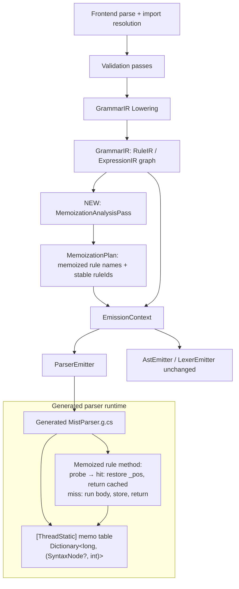
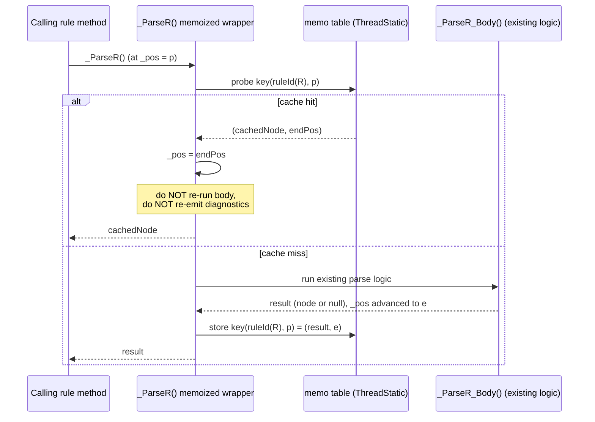

# Design Document: Storm Selective Packrat Memoization

## Overview

The Storm source generator emits a recursive-descent, PEG ordered-choice parser from `Mist.storm`. That parser has no memoization, so any `(rule, position)` pair can be re-entered an exponential number of times during backtracking. A completed measurement investigation (recorded in `specs/parser-type-argument-backtracking/design.md`, section "Confirmed Root Cause (Measured) and Fix-Direction Analysis") proved this concretely: a single `(TypeArgument, position)` pair is entered exactly `2^(N-1)` times for an `N`-element type-argument list (measured N=4→16, N=5→32, … N=8→256, following `T(k)=1+2·T(k-1)`). Two prior grammar refactors removed constant factors but did not change the asymptotics, confirming the defect lives in the generator, not the grammar.

This feature adds **selective packrat memoization** to the generated parser. A new static analysis pass in the generator marks a small set of rules (~15–20 of ~150) as *memoized* using a pure structural heuristic over the grammar IR — no runtime profiling. `ParserEmitter` then emits those rules' methods with a memo-table probe/store wrapper: on a cache hit, the method restores the saved end position and returns the cached subtree in O(1) without re-running its body or re-emitting diagnostics; on a miss, it runs the existing body, stores `(result, endPosition)`, and returns. The memo table is per-parse, `[ThreadStatic]`, and reset on each `Parse()` call.

The design is deliberately conservative. Under-inclusion (failing to memoize a beneficial rule) is only a performance tradeoff and never a correctness risk, because a PEG rule's result at a token position is a pure function of that position (verified explicitly in the Soundness section). Over-inclusion is bounded by the structural predicate and addressed by a future tuning knob, not v1. The non-negotiable bar: the heuristic MUST mark the type-argument recursion cycle, and the existing performance oracle (`FuncActionArityOverloads_ShouldNotGrowExponentially`) MUST go from exponential to linear/under-10s, while the full Mist suite (~2989 tests) and the AllFeatures sample produce byte-for-byte/structurally identical AST, diagnostics, and emitted C#.

---

## Goals and Non-Goals

### Goals

- Eliminate exponential and reduce redundant re-entry of `(rule, position)` pairs in the generated parser.
- Select rules to memoize via a pure static heuristic computed at emission time from the grammar IR.
- Guarantee zero observable change to AST, diagnostics, or emitted C# across the whole suite.
- Keep the generator and generated code warning-free (no new `STORM*`/`CS*` warnings).

### Non-Goals

- Universal memoization of every rule (measured M ≈ 11.6–13.7 rule-entries per token; memoizing all ~150 rules imposes real constant cost for no benefit).
- Runtime profiling or adaptive selection inside the emitter.
- A numeric inclusion threshold in v1 (documented as a future option only).
- Left-recursion support or any grammar-shape change (left recursion is already rejected by `LeftRecursionPass`).

---

## Locked Design Decisions (carried in from the investigation)

These are settled inputs to this design, not open questions:

1. **Approach = Path A: selective packrat memoization.** Cache `(rule, position) → (result, endPosition)`.
2. **Selection = pure static heuristic** over the grammar IR. Predicate: memoize rule `R` if `R` participates in a recursion cycle (reachable from itself through rule references) AND that cycle contains a backtracking construct (a multi-alternative ordered choice, an optional `?`, or a repetition `*`/`+`).
3. **Lean conservative / under-include.** Missing beneficial cycles is acceptable. The predicate MUST catch the type-argument cycle; it is expected to also catch the expression precedence ladder, which is acceptable and beneficial.
4. **No numeric threshold in v1** — structural predicate only. A tuning knob is a documented future option.
5. **Storm is Mist-targeted**, so pragmatic Mist-driven tuning is fine.

---

## Architecture

### Where memoization sits in the generator pipeline

The generator today runs: frontend parse → import resolution → validation passes (`NameResolutionPass`, `ModeValidationPass`, `LeftRecursionPass`, `ReachabilityPass`) → IR lowering (`GrammarIRLowering` → `GrammarIR`) → emission (`AstEmitter`, `LexerEmitter`, `ParserEmitter`). `ParserEmitter` reads an `EmissionContext` that wraps the lowered `GrammarIR`.

This feature inserts one new analysis step **after lowering and before parser emission**, operating on the `GrammarIR` (the same `RuleIR`/`ExpressionIR` graph the emitter consumes). It produces a set of memoized rule names plus a stable integer id per memoized rule, which is attached to the `EmissionContext` and consumed by `ParserEmitter`.



The pass mirrors the structure of `LeftRecursionPass` (builds a rule-reference graph and walks it) and `ReachabilityPass` (classifies per-rule structural properties). It is a pure function of the grammar — deterministic, no I/O, no runtime state.

### Data-flow for a single memoized rule entry at runtime



### Component responsibilities

- **`MemoizationAnalysisPass`** (new, `Source/Storm.SourceGenerator/Analyze/`): consumes `GrammarIR`, returns a `MemoizationPlan`. Pure structural analysis. No diagnostics in v1 (it may optionally log an informational note; see Open Questions).
- **`MemoizationPlan`** (new, small immutable record): the ordered set of memoized rule names and a `rule name → stable int id` map. Stable ordering = grammar declaration order, so ids are deterministic across builds (determinism is already covered by `StormGeneratorDeterminismPropertyTests`).
- **`EmissionContext`** (modified): gains a `MemoizationPlan` property so `ParserEmitter` can ask "is this rule memoized, and what is its id?".
- **`ParserEmitter`** (modified): for a memoized rule, emit the memo-table fields (once), and wrap the rule's internal parse method with the probe/store logic. Non-memoized rules are emitted exactly as today.

---

## Components and Interfaces

### MemoizationPlan

**Purpose**: Immutable result of the analysis pass; the contract between analysis and emission.

```csharp
namespace Storm.SourceGenerator.Analyze;

/// <summary>
/// The set of rules selected for packrat memoization, with a stable integer id
/// per memoized rule. Ids are assigned in grammar declaration order so generated
/// output is deterministic across builds.
/// </summary>
public sealed class MemoizationPlan
{
    /// <summary>Memoized rule names, in declaration order.</summary>
    public IReadOnlyList<string> MemoizedRuleNames { get; }

    /// <summary>Maps a memoized rule name to its stable integer id (0-based, dense).</summary>
    public IReadOnlyDictionary<string, int> RuleIds { get; }

    public bool IsMemoized(string ruleName) => RuleIds.ContainsKey(ruleName);

    public int Count => MemoizedRuleNames.Count;

    public MemoizationPlan(
        IReadOnlyList<string> memoizedRuleNames,
        IReadOnlyDictionary<string, int> ruleIds) { /* ... */ }

    /// <summary>An empty plan: nothing memoized (used as a safe fallback).</summary>
    public static MemoizationPlan Empty { get; }
}
```

**Responsibilities**:
- Carry the analysis result with no behavior beyond lookups.
- Provide stable, dense ids suitable for the runtime key scheme.

### MemoizationAnalysisPass

**Purpose**: Compute which rules to memoize from the `GrammarIR`.

```csharp
namespace Storm.SourceGenerator.Analyze;

/// <summary>
/// Selects rules for selective packrat memoization. A rule R is memoized when:
///   (1) R participates in a recursion cycle (R is reachable from itself through
///       rule references), AND
///   (2) some rule on that cycle contains a backtracking construct
///       (a multi-alternative ordered choice, an optional '?', or a repetition '*'/'+').
/// This is a pure structural analysis over RuleIR/ExpressionIR — no runtime profiling.
/// Conservative by design: under-inclusion is a performance tradeoff, never a
/// correctness risk (a PEG rule's result at a position is a pure function of position).
/// </summary>
public static class MemoizationAnalysisPass
{
    public static MemoizationPlan Run(GrammarIR grammar);
}
```

**Responsibilities**:
- Build the rule-reference graph (edges = "rule A references rule B anywhere in A's body").
- Find rules on a cycle (rules reachable from themselves).
- Determine which of those cycles cross a backtracking construct, and mark the cycle's rules.
- Assign dense stable ids and return a `MemoizationPlan`.

### EmissionContext (modified)

**Purpose**: Make the plan available to the emitter.

```csharp
public sealed class EmissionContext
{
    public string ConsumerNamespace { get; }
    public string GrammarName { get; }
    public GrammarIR Grammar { get; }

    // NEW: never null; defaults to MemoizationPlan.Empty when memoization is disabled.
    public MemoizationPlan Memoization { get; }

    public EmissionContext(
        string consumerNamespace,
        string grammarName,
        GrammarIR grammar,
        MemoizationPlan? memoization = null) { /* memoization ?? MemoizationPlan.Empty */ }
}
```

`AstEmitter` and `LexerEmitter` ignore the new property entirely. Only `ParserEmitter` reads it. Defaulting to `MemoizationPlan.Empty` means an emitter constructed without a plan produces today's exact output — a safety net and the basis for the "disable" escape hatch.

---

## Data Models

### Rule-reference graph (analysis-time, in the generator)

```csharp
// Adjacency: rule name -> set of rule names referenced anywhere in its body.
// Built by walking each RuleIR's alternatives' ExpressionIR trees and collecting
// every RuleRefIR.Rule.Name. Unlike LeftRecursionPass (which only collects the
// LEFTMOST references), this collects ALL references, because re-entry can happen
// at any position in the body, not just the left edge.
Dictionary<string, HashSet<string>> referenceGraph;
```

**Validation rules**:
- Every key is a rule name present in `grammar.Rules`.
- Edges only point to rule names (token refs, string literals, char classes, regex are terminals and never edges).
- Self-loops are allowed and meaningful (a direct self-recursive rule is on a cycle of length 1).

### Backtracking-marker set (analysis-time)

```csharp
// Rule names whose body contains at least one backtracking construct:
//   - a rule with >1 alternative (ordered choice), OR
//   - any OptionalIR / ZeroOrMoreIR / OneOrMoreIR anywhere in any alternative body.
HashSet<string> rulesWithBacktrackingConstruct;
```

**Validation rules**:
- A rule with a single alternative and no `?`/`*`/`+` anywhere is NOT a backtracking rule.
- Nested constructs count (e.g. an optional inside a sequence inside the only alternative).

### Memo table (runtime, in the generated parser)

```csharp
// Key:   (ruleId << 32) | (uint)position   — packed into a long.
// Value: (SyntaxNode? node, int endPos)
//        node == null encodes a cached FAILED parse at that position.
//        endPos is the _pos value to restore on a hit (== entry pos for failures).
[ThreadStatic] private static Dictionary<long, (SyntaxNode? Node, int End)>? _memo;
```

**Validation rules**:
- Key uniqueness: `ruleId` is dense and `< 2^31`; `position` is a token index `< 2^31`; packing is collision-free for any realistic token count.
- The table is allocated fresh in `Init()` (per `Parse()` call) and never shared across parses.
- A stored entry is immutable for the lifetime of one parse: the same `(rule, pos)` always yields the same `(node, endPos)` — the packrat invariant.

---

## Low-Level Design: The Static Analysis Algorithm

The pass runs over `GrammarIR` after lowering. It has three phases: build the reference graph, find rules on a cycle, and intersect with cycles that cross a backtracking construct.

### Phase 1 — Build the full rule-reference graph

Unlike `LeftRecursionPass`, which collects only leftmost references (for left-recursion detection), this pass collects **all** rule references anywhere in a rule body, because exponential re-entry happens at arbitrary positions (e.g. `TypeArgument` is re-entered via the `(COMMA TypeArgument)*` tail, not the left edge).

```csharp
function BuildReferenceGraph(grammar) -> Dictionary<string, HashSet<string>>
    graph = empty dictionary
    for each rule R in grammar.Rules:
        refs = empty set
        for each alternative A in R.Alternatives:
            CollectRuleRefs(A.Expression, refs)
        graph[R.Name] = refs
    return graph

function CollectRuleRefs(expr, refs):  // walk the ExpressionIR tree, collect ALL RuleRefIR
    switch expr:
        case RuleRefIR r:        refs.Add(r.Rule.Name)
        case SequenceIR s:       for each e in s.Elements: CollectRuleRefs(e, refs)
        case AlternationIR a:    for each e in a.Alternatives: CollectRuleRefs(e, refs)
        case OptionalIR o:       CollectRuleRefs(o.Inner, refs)
        case ZeroOrMoreIR z:     CollectRuleRefs(z.Inner, refs)
        case OneOrMoreIR m:      CollectRuleRefs(m.Inner, refs)
        case InlineFragmentIR f: CollectRuleRefs(f.Body, refs)
        // TokenRefIR, StringLiteralIR, CharClassIR, RegexLiteralIR: terminals — no edges
        default: do nothing
```

> Note: at the IR level the body is already lowered, so field labels are represented by the labeled expression itself (no separate label node to recurse through). `FieldLabelIR` lives on the alternative, and its `Expression` is the same object reachable from `alt.Expression`; collecting over `alt.Expression` covers it. The pass must not double-count, but `HashSet` makes that harmless.

### Phase 2 — Find rules on a cycle (reachable-from-self)

A rule `R` is on a cycle iff `R` is reachable from `R` by following one or more edges. Two standard options: Tarjan/Kosaraju SCCs (a rule is on a cycle iff its SCC has size > 1 or it has a self-edge), or a direct reachable-from-self test per rule. SCCs are the cleaner primitive and also give us the cycle membership grouping used in Phase 3.

```csharp
function FindRulesOnCycle(graph) -> (cyclicRules: HashSet<string>, sccOf: Dictionary<string,int>)
    // Tarjan's SCC over the reference graph.
    sccs = Tarjan(graph)                 // list of components; each is a set of rule names
    cyclic = empty set
    sccOf = empty dictionary
    for each component C with index i in sccs:
        for each rule r in C: sccOf[r] = i
        if C.Count > 1:
            cyclic.UnionWith(C)          // mutual recursion => every member is on a cycle
        else:
            r = single member of C
            if graph[r] contains r:      // direct self-recursion (self-edge)
                cyclic.Add(r)
    return (cyclic, sccOf)
```

This catches both kinds of recursion we care about:
- **Direct self-recursion**: a self-edge.
- **Mutual recursion**: an SCC with more than one rule — e.g. `TypeArgument → TypeReference → SingleTypeRef → TypeArgumentList → TypeArgument`, and `Expression → … → Primary → Expression`.

### Phase 3 — Keep only cycles that cross a backtracking construct

Within each non-trivial cycle (SCC), the question is whether *any* rule on that cycle contains a backtracking construct. If so, the redundant re-entry that memoization eliminates is real, and every rule on that cycle is marked. (Marking the whole cycle, rather than only the backtracking rule, is the conservative-but-effective choice: re-entry savings accrue at the cycle's entry points, and the type-argument cycle's backtracking lives in `TypeArgumentList`'s `*` and `SingleTypeRef`'s ordered choice while the most-re-entered node is `TypeArgument`.)

```csharp
function HasBacktrackingConstruct(rule) -> bool
    // (a) ordered choice: more than one alternative
    if rule.Alternatives.Count > 1: return true
    // (b) optional or repetition anywhere in the (single) alternative body
    for each alternative A in rule.Alternatives:
        if ContainsOptionalOrRepetition(A.Expression): return true
    return false

function ContainsOptionalOrRepetition(expr) -> bool
    switch expr:
        case OptionalIR:    return true
        case ZeroOrMoreIR:  return true
        case OneOrMoreIR:   return true
        case SequenceIR s:    return s.Elements.Any(ContainsOptionalOrRepetition)
        case AlternationIR a: return a.Alternatives.Any(ContainsOptionalOrRepetition)
        case InlineFragmentIR f: return ContainsOptionalOrRepetition(f.Body)
        default: return false   // RuleRefIR/TokenRefIR/terminals
```

```csharp
function Run(grammar) -> MemoizationPlan
    graph = BuildReferenceGraph(grammar)
    (cyclic, sccOf) = FindRulesOnCycle(graph)

    // Precompute which rules contain a backtracking construct.
    backtracks = { R.Name : R in grammar.Rules where HasBacktrackingConstruct(R) }

    // For each SCC, does ANY member contain a backtracking construct?
    sccHasBacktracking = empty set of scc-index
    for each rule R in cyclic:
        if backtracks contains R.Name:
            sccHasBacktracking.Add(sccOf[R.Name])

    // Mark every rule whose SCC is cyclic AND crosses a backtracking construct.
    marked = empty list
    for each rule R in grammar.Rules in DECLARATION ORDER:   // stable order => stable ids
        if R.Name in cyclic and sccOf[R.Name] in sccHasBacktracking:
            marked.Add(R.Name)

    // Special case: a length-1 SCC with a self-edge whose own body backtracks.
    // (Already covered: such a rule is in `cyclic`, its scc index is in
    //  sccHasBacktracking iff its own body backtracks.)

    ruleIds = assign 0..marked.Count-1 in order of `marked`
    return new MemoizationPlan(marked, ruleIds)
```

### Worked example: the type-argument cycle

Edges (collected over full bodies) include:
`TypeArgument → TypeReference`, `TypeReference → SingleTypeRef`, `SingleTypeRef → TypeArgumentList` (via the optional `TypeArgumentList?` in `NamedSingleTypeRef`), `TypeArgumentList → TypeArgument` (via `(COMMA TypeArgument)*`). Tarjan groups `{TypeArgument, TypeReference, SingleTypeRef, TypeArgumentList}` (plus any others mutually reachable) into one SCC of size > 1 → all on a cycle. Backtracking constructs on that cycle: `SingleTypeRef` has multiple alternatives (ordered choice), `TypeArgumentList` has a `*`, `SingleTypeRef`'s `TypeArgumentList?` is an optional. So the SCC crosses backtracking → every rule in it is memoized. This satisfies the hard requirement.

### Worked example: the expression precedence ladder

`Expression → … → Primary`, and `Primary` contains a `( Expression )` alternative referencing `Expression`, forming an SCC. Multiple precedence rules have ordered choice / repetition. So the ladder is also marked — expected and beneficial, as it is the dominant re-entry source in ordinary code.

### Complexity

Graph build is O(total IR nodes). Tarjan is O(V + E) over rules. Backtracking detection is O(total IR nodes). All linear in grammar size, run once at generation time. Negligible relative to existing passes.

---

## Low-Level Design: Generated Code Shape for a Memoized Rule

### Shared memo-table fields (emitted once)

Added alongside the existing `[ThreadStatic]` parser state in `EmitParserState`:

```csharp
[ThreadStatic] private static ImmutableArray<Token> _tokens;
[ThreadStatic] private static ImmutableArray<Token> _allTokens;
[ThreadStatic] private static int _pos;
[ThreadStatic] private static bool _hasError;
[ThreadStatic] private static DiagnosticBag? _diagnostics;
[ThreadStatic] private static string? _sourcePath;

// NEW — only emitted when context.Memoization.Count > 0:
[ThreadStatic] private static Dictionary<long, (SyntaxNode? Node, int End)>? _memo;
```

`Init()` allocates a fresh table per parse so nothing leaks between `Parse()` calls:

```csharp
private static void Init(TokenStream ts, DiagnosticBag diag)
{
    _tokens = ts.DefaultChannelTokens;
    _allTokens = ts.AllTokens;
    _pos = 0;
    _hasError = false;
    _diagnostics = diag;
    _sourcePath = ts.Source.Path;
    _memo = new Dictionary<long, (SyntaxNode?, int)>();   // NEW (emitted only if any rule memoized)
}
```

### Key generation scheme

A stable per-memoized-rule integer id (`MemoizationPlan.RuleIds`) combined with the token index:

```csharp
// emitted helper (only when memoization is enabled)
private static long MemoKey(int ruleId, int pos) => ((long)ruleId << 32) | (uint)pos;
```

**Tradeoff considered (and decision for v1)**: a flat `(Node?,int)[ruleCount * tokenCount]` array would be allocation-heavy and sized to the worst case even though only ~15–20 rules are memoized and most positions are never probed for most rules. A `Dictionary<long, …>` allocates only for visited `(rule, pos)` pairs (sparse — exactly the distinct pairs actually re-entered), has O(1) expected probe/store, and needs no up-front sizing. **Decision: `Dictionary<long,(SyntaxNode?,int)>` with the packed `long` key.** This is the lean, simple choice. (A jagged-array or struct-keyed dictionary is a possible future optimization if profiling shows dictionary overhead matters; not needed for v1.)

### Method transformation

Today, a rule `R` emits one internal method `_ParseR()` containing the body (single-alt or multi-alt). The transformation **renames the existing body to `_ParseR_Body()` and emits a thin memoized wrapper `_ParseR()`**. Every existing caller already calls `_ParseR()` and is unchanged. This keeps the body-emission code path (the large `EmitSingleAlt`/`EmitMultiAlt`/`EmitFullExprParse` machinery) completely untouched — it just emits under a different method name when the rule is memoized.

**Non-memoized rule (unchanged):**

```csharp
private static SingleTypeRefNode? _ParseSingleTypeRef()
{
    if (_hasError) return null;
    // ... existing body ...
}
```

**Memoized rule (new wrapper + renamed body):**

```csharp
// Wrapper — emitted for memoized rules. ruleId is the constant from MemoizationPlan.
private static TypeArgumentNode? _ParseTypeArgument()
{
    if (_hasError) return null;                      // preserved fast-fail (see note below)

    var _key = MemoKey(/*ruleId:*/ 3, _pos);
    if (_memo!.TryGetValue(_key, out var _hit))
    {
        _pos = _hit.End;                             // restore end position
        return (TypeArgumentNode?)_hit.Node;         // cached node or cached failure (null)
        // NOTE: body is NOT re-run; NO diagnostics are re-emitted.
    }

    var _entryPos = _pos;
    var _result = _ParseTypeArgument_Body();         // existing logic, verbatim, renamed
    _memo[_key] = (_result, _pos);                   // store (result, endPos); endPos==_entryPos on failure
    return _result;
}

// Body — the existing emitted method, renamed from _ParseTypeArgument().
private static TypeArgumentNode? _ParseTypeArgument_Body()
{
    if (_hasError) return null;
    // ... exactly today's emitted body, unchanged ...
}
```

### Critical: handling shared parser state on a hit

The generated parser threads three pieces of mutable state: `_pos` (token cursor), `_hasError` (halt flag), and `_diagnostics` (the diagnostic bag, truncated on speculative-parse failure via `savedDiagCount`/`TruncateTo`). A correct memo must reproduce, on a hit, exactly the state mutation the body would have produced on a miss — and nothing else.

1. **`_pos`**: stored as `End` and restored on a hit (`_pos = _hit.End`). On a successful parse, `End` is where the body left the cursor; on a cached failure, the body's callers always restore `_pos` themselves (every ordered-choice/optional/star site does `_pos = saved`), so we store `End = _entryPos` and the caller's own restore is consistent with it. Restoring `_pos = _entryPos` on a hit is therefore equivalent to what a fresh failed attempt would have produced.

2. **`_hasError`**: The wrapper only probes/stores when `_hasError` is false on entry (guaranteed by the leading `if (_hasError) return null;`). A successful body leaves `_hasError == false`; we therefore never need to cache a "true" error state — a memo entry is only created for a completed attempt whose outcome is either a node (success, `_hasError==false`) or a clean local failure that the body already reset. Concretely, the body's failure paths inside ordered choice reset `_hasError = savedError` before returning null, so on a miss-failure `_hasError` is already back to false; a hit returns null with `_hasError` untouched (false), matching.

   - **Hard requirement on the body for memoized rules**: a memoized rule's body must return null on failure WITHOUT leaving `_hasError == true` and WITHOUT leaving committed diagnostics — i.e. the rule must be *speculative-safe*. Multi-alternative rules already satisfy this (each alternative resets state; the final fall-through resets to `savedError` and truncates diagnostics). Single-alternative rules that call `Require` can latch `_hasError = true` and emit a hard error. The Soundness section makes "only memoize speculative-safe rules" an explicit, checked constraint, and in practice all rules on the target cycles are multi-alternative or use the position-save/restore optional/star paths.

3. **`_diagnostics`**: This is the subtle one. During a speculative attempt that ultimately fails inside an ordered choice, the body adds diagnostics and then truncates them back via `_diagnostics?.TruncateTo(savedDiagCount)`. The **net** diagnostic effect of a failed memoized attempt is therefore zero (the bag is restored to its pre-attempt length). For a **successful** memoized attempt, the body's net diagnostic effect is also zero for the rules we memoize: the target rules (`TypeArgument`, `TypeReference`, `SingleTypeRef`, `TypeArgumentList`, the expression ladder) succeed by consuming tokens without emitting diagnostics — they only emit via `Require` on the hard-error path, which latches `_hasError` and is excluded by the speculative-safety constraint. Thus:

   - **On a miss**: net diagnostic delta of the body is zero (either a clean failure that truncates its own additions, or a clean success that adds none).
   - **On a hit**: we add no diagnostics. This matches the body's net-zero delta exactly.

   This is the precise sense in which "a cache hit must NOT re-emit diagnostics" is sound: the memoized rules have zero *net* diagnostic effect, so replaying them as a no-op (beyond restoring `_pos`) reproduces identical diagnostics. The Soundness verification step below makes this a checked property rather than an assumption.

### What is cached on a failed parse

A failed attempt is cached as `(null, _entryPos)`. This is essential: the whole point is to avoid re-attempting the same failing `(rule, pos)`. On a subsequent hit, the wrapper restores `_pos = _entryPos` and returns `null`, which is exactly what a fresh failed attempt would do (callers then try the next alternative / stop the star loop, restoring `_pos` themselves). Because failed memoized attempts have zero net diagnostic delta (they truncate their own additions), not re-emitting on a hit is correct.

> **Consistency with `savedDiagCount`**: The existing ordered-choice/optional/star emission already brackets every speculative attempt with `savedDiagCount = _diagnostics?.Count ?? 0` … `_diagnostics?.TruncateTo(savedDiagCount)`. The memo wrapper sits *inside* a caller's speculative bracket. On a hit returning a cached failure, the wrapper performs no diagnostic mutation, and the caller's existing `TruncateTo(savedDiagCount)` (which it runs on the failure path) is a no-op because the count never changed — consistent. On a hit returning a cached success, no diagnostics were added by the body originally (net-zero) and none are added on the hit — consistent.

### Worked trace: why this collapses the exponential

For `Func<T1, …, Tn, void>`, the first full descent populates `_memo[(TypeArgument, p_i)]` for each argument position `p_i`. Every subsequent re-entry of `(TypeArgument, p_i)` — previously `2^(N-1)` times — now hits the table, restores `_pos`, and returns in O(1). Total work becomes proportional to the number of distinct `(memoizedRule, position)` pairs, i.e. linear in input size, satisfying the performance property.

---

## Soundness

Packrat memoization is sound only if a rule's parse result at a position is a pure function of the position (and the immutable token stream) — i.e. parsing is *position-pure* / the grammar is effectively context-free at the rule boundary. This section states the requirement, argues it holds for the Mist grammar, and defines an explicit check.

### Soundness requirement (design constraint)

> **SR-1 (Position purity).** For every memoized rule `R`, the result of `_ParseR_Body()` started at token position `p` — namely the produced node (or failure) and the resulting end position — must depend only on `p` and the immutable token array, never on any other parser state.

> **SR-2 (Speculative safety).** For every memoized rule `R`, a failing invocation of `_ParseR_Body()` must leave `_hasError == false` and produce zero net change to `_diagnostics` (any diagnostics it added during the attempt must have been truncated away). A succeeding invocation must produce zero net change to `_diagnostics`. (Rules that can latch a hard error via `Require` and keep it are excluded from memoization.)

If SR-1 or SR-2 fails for a rule, that rule MUST be excluded from the memoization plan. Excluding a rule is always safe (it just reverts to today's behavior for that rule).

### Why SR-1 holds for the Mist parser

- The generated parser's only inputs to a rule method are `_pos` and the immutable `_tokens`/`_allTokens` arrays. There is no symbol table, no scope stack, no semantic predicate, and no feedback from later phases into parsing. `Peek`, `Cur`, `Eat`, `Match`, `Require`, and `Span` are all pure functions of `_pos` and the token arrays.
- The Mist grammar is a PEG with no syntactic/semantic predicates and no context-sensitive constructs (no "parse X only if Y was seen earlier"). The result of any rule at a position is fully determined by the tokens from that position. This is the standard precondition packrat parsing relies on, and it holds here.
- `_hasError`/`_diagnostics` are *outputs/side-channels*, not inputs that change which tree is produced: the leading `if (_hasError) return null;` is a uniform short-circuit; we only ever populate/consult the memo when `_hasError` is false on entry, so it cannot vary the cached result.

### Why SR-2 holds for the target rules

The target cycles consist of multi-alternative rules and rules using optional/star/plus. The emitter already brackets each alternative and each optional/star with `savedError`/`savedDiagCount` save-and-restore, so a failed attempt resets `_hasError` and truncates diagnostics before returning null. Successful parses of these structural rules consume tokens and build nodes without emitting diagnostics. Hard errors (latched `_hasError`, committed message) only arise from `Require` on a mandatory token after commitment; such rules are detectable and excluded.

### Explicit soundness check (part of the analysis pass + a test)

The design adds a conservative *speculative-safety filter* to `MemoizationAnalysisPass` so SR-2 is enforced structurally, and a verification test for SR-1/SR-2 as a whole:

```csharp
// In MemoizationAnalysisPass, after Phase 3, before finalizing the plan:
// Exclude any candidate rule that is not provably speculative-safe.
function IsSpeculativeSafe(rule) -> bool
    // Multi-alternative rules are bracketed per-alternative by the emitter => safe.
    if rule.Alternatives.Count > 1: return true
    // Single-alternative rules are safe iff their body contains no MANDATORY token
    // match that would latch _hasError (i.e. no bare TokenRef/StringLiteral emitted
    // via Require outside an optional/star). If it can call Require and commit, exclude.
    return not ContainsMandatoryTokenMatch(rule.Alternatives[0].Expression)
```

> The exact predicate is refined during implementation against the emitter's `Require` vs `Match` decision (mandatory sequence elements emit `Require`; elements inside optional/star emit `Match`-style `ok` checks). The conservative default is: if unsure, exclude. The required cycle's most-re-entered rule (`TypeArgument`) is multi-alternative and trivially safe.

**Verification step (must be in the test plan):** a Storm-generator test asserts that for every rule the plan marks, the generated `_ParseR_Body()` reaches its failure return paths with `_hasError == false` and a restored diagnostic count, and that re-invoking a memoized rule at the same position yields an identical node reference and identical `_pos`. The preservation oracle (full suite + AllFeatures, byte-for-byte identical output) is the ultimate empirical confirmation of SR-1.

---

## Correctness Properties

These are the invariants the implementation must uphold. They are the basis for the property/example tests in the Testing Strategy and inform the requirements derived from this design.

> Note (design-first): formal requirements have not been authored yet — they will be derived from this design in the requirements phase. The `Validates` references below name anticipated requirement ids (1.x Preservation, 2.x Soundness, 3.x Heuristic, 4.x Performance, 5.x Determinism, 6.x Quality) and will be confirmed/renumbered when requirements are written.

### Property 1: Output preservation (the hard gate)
_For any_ Mist source file that parses on the pre-feature baseline, the memoized parser SHALL produce a structurally identical AST, an identical diagnostic sequence, and identical emitted C#. (Oracle: full suite ~2989 tests + AllFeatures, byte-for-byte / structural equality.)

**Validates: Requirements 1.1**

### Property 2: Packrat determinism (position purity, SR-1)
_For any_ memoized rule `R` and token position `p`, two invocations of `R` started at `p` over the same token stream SHALL return the same node (reference-identical within a parse) and leave `_pos` at the same end position. The cached result SHALL equal the result the unmemoized body would produce.

**Validates: Requirements 2.1**

### Property 3: Diagnostic neutrality (SR-2)
_For any_ memoized rule `R`, a cache hit SHALL produce zero net change to `_diagnostics` and SHALL NOT set `_hasError`, matching the net-zero diagnostic effect of the corresponding miss (failed attempts truncate their own additions; successful structural rules add none).

**Validates: Requirements 2.2**

### Property 4: Heuristic coverage
The plan SHALL mark every rule on the type-argument cycle (`TypeArgument`, `TypeReference`, `SingleTypeRef`, `TypeArgumentList`). It SHALL NOT mark any rule that is not on a cycle, nor any cycle that contains no backtracking construct.

**Validates: Requirements 3.1**

### Property 5: Linear parse time
_For any_ `Func`/`Action` arity-overload input of size N (0..16), parse time SHALL be proportional to N (not exponential), completing under the 10s-per-step bail-out. (Oracle: `FuncActionArityOverloads_ShouldNotGrowExponentially`.)

**Validates: Requirements 4.1**

### Property 6: Determinism of generated output
_For any_ fixed grammar, repeated generation SHALL assign identical rule ids and emit identical parser source (stable declaration-order id assignment).

**Validates: Requirements 5.1**

### Property 7: Zero-warnings preservation
Building the generator and the `Mist` consumer with the feature SHALL produce zero new `STORM*` and `CS*` warnings.

**Validates: Requirements 6.1**

## Memory Model

- The memo table is `[ThreadStatic]` and allocated fresh in `Init()` on every `Parse()` call, then dropped when the parse returns (eligible for GC). Nothing persists across parses or threads.
- It is sized to the number of distinct `(memoizedRule, position)` pairs actually visited — a sparse subset of `~20 rules × tokenCount`, in practice far smaller because most positions never reach most memoized rules.
- Only the ~15–20 memoized rules ever touch the table; the other ~130 rules are emitted and behave exactly as today (no probe, no store, no allocation impact).
- Entries are immutable for the parse's lifetime (the packrat invariant), so there is no invalidation logic and no concurrency concern within a single parse.
- When the plan is empty (no rule qualifies, or memoization disabled), neither the field nor the helper nor any wrapper is emitted — output is byte-for-byte identical to today.

---

## Error Handling

### Generator-side

- **Empty plan**: if no rule qualifies, `MemoizationAnalysisPass` returns `MemoizationPlan.Empty`; `ParserEmitter` emits today's exact parser. No error.
- **Analysis exception safety**: the pass is pure graph code over already-validated IR (cycles are allowed here, unlike `LeftRecursionPass` which forbids left-recursion). Tarjan handles arbitrary cycles. There is no user input that can crash it beyond what lowering already validated.
- **Zero-warnings**: emitted code must not trip `CS*` (e.g. unused field when plan is non-empty but a rule emits no probe — avoided because fields are only emitted when `Count > 0` and every memoized rule emits a probe). Generator code must not trip `STORM*`. This is a hard acceptance gate (see Testing Strategy).

### Runtime (generated parser)

- A cached failure returns `null` with `_pos` restored — identical to a fresh failure; callers' existing error handling is unchanged.
- The leading `if (_hasError) return null;` is preserved in the wrapper, so a parse already in the hard-error state never probes/stores, matching today's short-circuit.
- No new exceptions are introduced; dictionary access is via `TryGetValue` (no `KeyNotFoundException`).

---

## Testing Strategy

### Preservation oracle (the correctness gate)

The existing full Mist test suite (~2989 tests) plus the AllFeatures sample is the oracle. Memoization MUST NOT change ANY produced AST, diagnostic, or emitted C#. The acceptance bar is byte-for-byte / structurally identical output before and after the feature. Procedure:

1. Run the full suite and build the AllFeatures sample on the pre-feature baseline; capture results.
2. Land the feature; re-run. Every test that passed must still pass with identical assertions; emitted C# for AllFeatures must be unchanged.

This is the empirical confirmation of SR-1 (position purity): if any memoized rule were context-sensitive, some AST/diagnostic/emit would differ and a test would fail.

### Performance oracle

`FuncActionArityOverloads_ShouldNotGrowExponentially` in `Test/Mist.Tests/Parsing/TypeArgumentParsingPerformanceTest.cs` must complete N=0..16 under the 10s-per-step bail-out (i.e. reach linear / under-10s). `TypeParameterParsing_ShouldNotGrowExponentially` must continue to pass. Both run **in-process** (lexer + parser objects, no process spawn) — they already do, and this design keeps them in-process. No new process spawns; the test-process-spawning policy is satisfied (see "Process-spawning review" below).

### Storm-generator unit tests for the analysis pass

New tests in `Test/Storm.SourceGenerator.Tests` (following the in-memory grammar pattern in `ValidationPassTests.cs`), e.g. a `MemoizationAnalysisPassTests` class:

- **Marks the type-argument cycle**: a grammar mirroring `TypeArgument/TypeReference/SingleTypeRef/TypeArgumentList` → all four marked.
- **Marks the expression ladder**: a grammar with `Expr → … → Primary → '(' Expr ')'` → ladder rules marked.
- **Does not mark acyclic rules**: a straight-line grammar → empty plan.
- **Does not mark a cycle with no backtracking**: a cycle of single-alternative rules with no `?`/`*`/`+` → not marked (conservative under-inclusion is correct here).
- **Marks a direct self-recursive rule with a repetition / ordered choice** (self-edge case).
- **Stable, dense ids in declaration order**: ids are `0..count-1` and deterministic across runs (complements `StormGeneratorDeterminismPropertyTests`).
- **Speculative-safety filter excludes a `Require`-committing single-alt rule** (SR-2).

### Generated-parser shape / soundness tests

In `Test/Storm.SourceGenerator.Tests` (emitter-level, e.g. extend `ParserEmitterDiagnosticTests`/`EmitterTests`):

- **Memoized wrapper shape**: emitting a grammar with a marked rule produces `_ParseR()` wrapper + `_ParseR_Body()` and the `_memo` field + `MemoKey` helper; emitting a grammar with no marked rule produces neither (byte-identical to today).
- **Re-entry returns identical node + identical `_pos`** at the same position (packrat invariant) — SR-1 spot check.
- **Cached failure restores entry position and emits no diagnostics** — SR-2 spot check.

These are pure in-process emit/compile/inspect tests (no process spawning).

### Zero-warnings gate

A build of the generator and of `Mist` (which consumes the generated parser) must produce zero `STORM*` and zero `CS*` warnings. This is part of the task's done-criteria; any warning stops work and is raised to the user per the zero-warnings policy.

### Process-spawning review (policy compliance)

Per the spec-process-spawning-approval policy: **no proposed test in this design spawns an external process.** The analysis-pass tests are pure in-memory; the emitter tests compile/inspect in-process; the performance oracle parses in-process (lexer + parser, no `dotnet`/`Process.Start`). There is therefore nothing to approve under that policy. If, during implementation, any test is found to require spawning a process, work must stop and the user must be asked for explicit approval before adding it.

---

## Performance Considerations

- **Generation time**: one extra linear pass (graph build + Tarjan + backtracking scan), negligible next to existing validation/lowering.
- **Parse time**: target is removal of exponential re-entry → linear in the number of distinct `(memoizedRule, position)` pairs. The dominant win is on type-argument lists and the expression ladder.
- **Constant overhead**: only the ~15–20 memoized rules pay a `TryGetValue` + a store per first visit; the other ~130 rules are untouched. This is exactly why selective (not universal) memoization was chosen: measured M ≈ 11.6–13.7 rule-entries per token means universal memoization would add probe/store cost to every entry for little asymptotic gain on already-linear rules.
- **Allocation**: one `Dictionary` per parse, growing only with visited memoized pairs. Cheap relative to token/AST allocation already performed.

---

## Security Considerations

Not security-sensitive. The change is confined to compile-time code generation and in-process parsing of source files the user already controls. No network, filesystem-beyond-source, authentication, or privilege surface is involved. The memo table is thread-local and per-parse, so there is no cross-parse or cross-thread data exposure.

---

## Dependencies

- **No new external packages.** Uses existing BCL types (`Dictionary`, `ImmutableArray`, value tuples) already used by the generator and generated runtime.
- **Internal**: depends on the existing `GrammarIR`/`RuleIR`/`ExpressionIR` model, `EmissionContext`, `ParserEmitter`, and the generated `SyntaxNode`/`DiagnosticBag`/`TokenStream` runtime types. Mirrors patterns established by `LeftRecursionPass` and `ReachabilityPass`.
- **Pipeline**: `StormIncrementalGenerator` must call `MemoizationAnalysisPass.Run(grammar)` after lowering and pass the result into `EmissionContext`.

---

## Future Options (explicitly out of scope for v1)

- **Numeric tuning knob**: if measurement later shows over-inclusion hurts (extra constant cost outweighing benefit), add a threshold — e.g. only memoize cycles whose subtree size exceeds a bound, or discriminate back-edges that pass through a repetition vs an optional. Not in v1; the structural predicate alone must first be measured.
- **Alternative key/storage**: a jagged `(SyntaxNode?,int)[ruleId][]` or a struct-keyed dictionary if the packed-`long` dictionary shows measurable overhead. Not needed for v1.
- **Memo-stat diagnostics**: an optional informational `STORM_*` note listing memoized rules to aid grammar authors. Deferred to avoid any chance of a spurious warning under the zero-warnings policy.

---

## Open Questions

1. **Placement of the pass**: a new `Source/Storm.SourceGenerator/Analyze/` folder (parallel to `Validate/`) vs. adding it under `Validate/`. Proposed: `Analyze/` (it produces a plan, not diagnostics). Confirm during task planning.
2. **Whole-cycle vs. entry-only marking**: v1 marks every rule on a qualifying cycle. An alternative is to mark only the highest-re-entry rule(s). Whole-cycle is simpler and conservative-effective; revisit only if over-inclusion is measured to hurt.
3. **Disable switch**: whether to expose an explicit "disable memoization" path (constructing `EmissionContext` with `MemoizationPlan.Empty`) as a supported escape hatch for debugging. Low cost; recommended.
