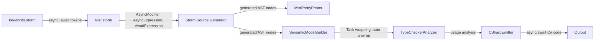
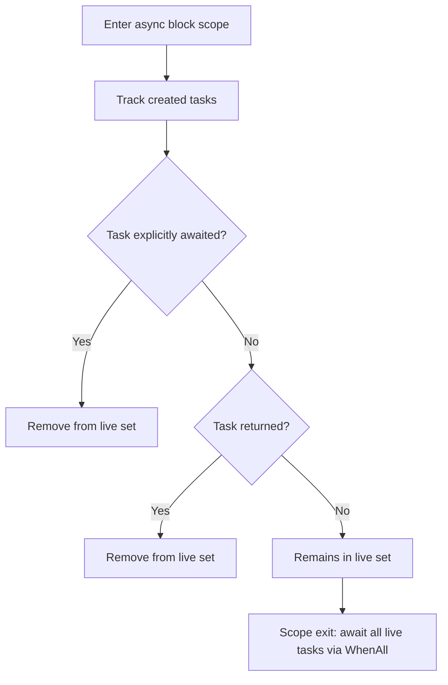

# Design Document: Structured Concurrency

## Overview

This design adds structured concurrency to the Mist language. The model guarantees that no task can outlive its parent scope — every concurrent computation is either explicitly awaited, implicitly awaited at scope exit, or returned to a caller where the same rules apply. There is no function coloring; all methods participate in the same scheduler, and the distinction between sync and async contexts determines only *when* tasks are awaited, not *whether* they can be created.

The core abstractions are:

1. **`Task<T>`** — the sole awaitable type, a promise representing eventual completion
2. **`async` modifier** — declares a method whose return type is implicitly wrapped in `Task<T>`
3. **`async` functor** — lifts any method invocation into a scheduled task, returning `Task<T>`
4. **`await` functor** — unwraps a `Task<T>` to its inner value `T`
5. **Auto-unwrap** — in sync contexts, async method calls are implicitly awaited so the developer sees sequential execution

The implementation touches every compiler stage: grammar, parsing, semantic model, type checking, C# emission, and editor support.

### Design Rationale

Mist's structured concurrency differs from C#'s `async/await` in several key ways:

- **No orphaned tasks**: C# allows fire-and-forget `Task` values. Mist enforces that every task is consumed.
- **No `.Result` or `.GetAwaiter()`**: The only way to unwrap a `Task<T>` is `await`. This prevents deadlocks from synchronous blocking.
- **Auto-unwrap in sync contexts**: Calling an async method from a sync method transparently awaits the result. The developer writes sequential code; the scheduler handles yielding.
- **Task storage restriction**: `Task<T>` cannot be stored in fields, properties, or collections. This prevents tasks from escaping their structured scope.
- **Backend optimization**: The C# backend chooses `ValueTask<T>` vs `Task<T>` based on usage analysis, invisible to the Mist developer.

## Architecture

The feature follows the existing compiler pipeline. Each stage is extended:



### Context Classification

The semantic model classifies each method body as either a **Sync_Context** or **Async_Context** based on the presence of the `async` modifier:

| Context | Async method call behavior | Task<T> obtainable via |
|---|---|---|
| Sync_Context | Auto-unwrap to `T` (implicit await) | `async` functor only |
| Async_Context | Returns `Task<T>` (explicit control) | Direct call or `async` functor |

### Scope-Exit Await Strategy

In an async context, the compiler tracks tasks that are "live" (created but not yet awaited or returned) at each block scope boundary. At scope exit, all live tasks are awaited concurrently via `Task.WhenAll`. This ensures structured concurrency without requiring the developer to manually await every task.



## Components and Interfaces

### 1. Standard Library: Task Declaration (`Source/Standard/Bootstrap/Task.mist`)

```mist
namespace Standard;

intrinsic public class Task<TResult>
{
    intrinsic public static Task Yield();
    intrinsic public static Task Delay(Int32 milliseconds);
    intrinsic public static Task<TResult[]> WhenAll(Task<TResult>[] tasks);
    intrinsic public static Task<TResult> WhenAny(Task<TResult>[] tasks);
}

type Task = Task<void>;
```

The `Task<TResult>` type is declared as an intrinsic class with a single unconstrained type parameter. It has no Mist-visible instance members — `await` is the only way to interact with a task's result. The static utility methods provide explicit scheduler interaction (`Yield`, `Delay`) and task coordination (`WhenAll`, `WhenAny`). The `intrinsic` marker tells the compiler this type is backend-backed (`IsBackendBacked = true`, `SymbolOrigin.Source`).

A type alias `Task` (non-generic) is provided as shorthand for `Task<void>`, used for tasks that represent completion without a result value.

**C# emission mapping:**
- `Task.Yield()` → `Task.Yield()` (returns a `YieldAwaitable`, emitter wraps appropriately)
- `Task.Delay(ms)` → `Task.Delay(ms)`
- `Task.WhenAll(tasks)` → `Task.WhenAll(tasks)`
- `Task.WhenAny(tasks)` → `Task.WhenAny(tasks)` (with result extraction)

### 2. Grammar Changes

#### New Keyword Tokens (`keywords.storm`)

```storm
// Concurrency keywords
token ASYNC = "async";
token AWAIT = "await";
```

#### Modifier Rule Extension (`Mist.storm`)

```storm
rule Modifier
    = PUBLIC    as PublicModifier
    | PRIVATE   as PrivateModifier
    | STATIC    as StaticModifier
    | INTRINSIC as IntrinsicModifier
    | READONLY  as ReadonlyModifier
    | OWNED     as OwnedModifier
    | ASYNC     as AsyncModifier
    ;
```

#### Unary Rule Extension (`Mist.storm`)

```storm
rule Unary
    = LEFT_PARENTHESIS targetType:TypeReference RIGHT_PARENTHESIS operand:Unary  as CastExpression
    | ASYNC operand:Unary                                                         as AsyncExpression
    | AWAIT operand:Unary                                                         as AwaitExpression
    | EXCLAMATION operand:Unary    as LogicalNot
    | MINUS operand:Unary          as Negate
    | primary:Postfix              as PostfixExpression
    ;
```

**Design decisions**:

- `async` and `await` are placed in the `Unary` rule at the same precedence as `!` and `-`. This means `async foo() + 1` parses as `(async foo()) + 1` and `await x + y` parses as `(await x) + y`, matching C# semantics.
- The grammar accepts `async` and `await` before any unary expression syntactically. The constraint that `async` requires a method invocation operand and `await` requires a `Task<T>` operand is enforced semantically, not syntactically. This keeps the grammar simple and produces better error messages.
- `async` in the `Modifier` rule produces `AsyncModifierModifierNode`. `async` in the `Unary` rule produces `AsyncExpressionUnaryNode`. `await` in the `Unary` rule produces `AwaitExpressionUnaryNode`. These are three distinct AST node types.

### 3. AST Nodes (Storm-Generated)

| Grammar Alternative | Generated Node Type | Key Properties |
|---|---|---|
| `ASYNC as AsyncModifier` (Modifier) | `AsyncModifierModifierNode` | — |
| `ASYNC operand:Unary as AsyncExpression` (Unary) | `AsyncExpressionUnaryNode` | `Operand: UnaryNode` |
| `AWAIT operand:Unary as AwaitExpression` (Unary) | `AwaitExpressionUnaryNode` | `Operand: UnaryNode` |

### 4. Pretty-Printer Changes (`MistPrettyPrinter.cs`)

The `EmitUnary` method gains two new cases:

```csharp
case AsyncExpressionUnaryNode asyncExpr:
    return $"async {EmitUnary(asyncExpr.Operand)}";

case AwaitExpressionUnaryNode awaitExpr:
    return $"await {EmitUnary(awaitExpr.Operand)}";
```

The `EmitModifiers` method gains a case for `AsyncModifierModifierNode` emitting the `async` keyword before the return type.

### 5. Semantic Model Changes (`SemanticModelBuilder.cs`)

#### Async Method Return Type Wrapping

When resolving a method declaration that has the `async` modifier:

1. Resolve the declared return type `T` normally
2. Construct a `ConstructedType` representing `Task<T>` using the stdlib `Task` class as the generic definition
3. Record the constructed `Task<T>` as the method's effective return type in the semantic model
4. For `void` return type, construct `Task<Void>` using the stdlib `Void` struct

```csharp
// Pseudo-code for async method resolution
if (method.HasAsyncModifier)
{
    var taskClass = ResolveStdlibType("Task"); // Generic definition
    var effectiveReturnType = new ConstructedType(taskClass, [declaredReturnType]);
    model.SetMethodReturnType(method, effectiveReturnType);
}
```

#### Context-Sensitive Expression Type Resolution

The semantic model builder must track whether it is resolving expressions within a sync or async context. This affects how async method invocations are typed:

**In Sync_Context** (method without `async` modifier):
- Async method invocation → expression type is `T` (auto-unwrap)
- `async` functor on any method → expression type is `Task<T>`
- `await` on `Task<T>` → expression type is `T`

**In Async_Context** (method with `async` modifier):
- Async method invocation → expression type is `Task<T>`
- `async` functor on sync method → expression type is `Task<T>`
- `async` functor on async method → expression type is `Task<Task<T>>` (double-wrap)
- `await` on `Task<T>` → expression type is `T`

#### Discarded Task Tracking

The semantic model builder tracks "live tasks" per block scope in async contexts:

1. When an async method is invoked and the result is not assigned or awaited → add to live task set
2. When a `Task<T>` variable is assigned but never subsequently awaited within the same scope → add to live task set at scope exit
3. When a task is explicitly awaited → remove from live task set
4. When a task is returned → remove from live task set

This information is stored in the semantic model for the emitter to consume.

### 6. Type Checker Changes (`TypeCheckerAnalyzer.cs`)

#### New Diagnostic IDs

| ID | Severity | Description |
|---|---|---|
| `MIST_TC_0070 (historical)` | Error | `async` modifier combined with `intrinsic` |
| `MIST_TC_0071 (historical)` | Error | `async` applied to constructor or operator |
| `MIST_TC_0072 (historical)` | Error | `async` method explicitly declares `Task<T>` return type |
| `MIST_TC_0073 (historical)` | Error | `async` functor applied to non-method-invocation expression |
| `MIST_TC_0074 (historical)` | Error | `await` applied to non-`Task<T>` expression |
| `MIST_TC_0075 (historical)` | Error | `Task<T>` stored in field, property, or collection |
| `MIST_TC_0076 (historical)` | Warning | `async` functor on async method in async context produces `Task<Task<T>>` (likely unintended double-wrap) |

#### Validation Rules

**Modifier validation** (during method declaration checking):
- If method has both `async` and `intrinsic` modifiers → emit `MIST_TC_0070 (historical)`
- If `async` appears on a constructor or operator → emit `MIST_TC_0071 (historical)`
- If method has `async` and the declared return type is `Task<T>` → emit `MIST_TC_0072 (historical)`

**Expression validation** (during expression type checking):
- `AsyncExpressionUnaryNode`: verify operand resolves to a method invocation (check that the operand's AST is an invocation suffix or a direct call). If not → emit `MIST_TC_0073 (historical)`
- `AwaitExpressionUnaryNode`: verify operand type is `Task<T>` (a `ConstructedType` whose generic definition is the stdlib `Task` class). If not → emit `MIST_TC_0074 (historical)`, including the actual type in the message

**Storage restriction** (during assignment/field declaration checking):
- If a field, property, or collection element type is `Task<T>` → emit `MIST_TC_0075 (historical)`
- `Task<T>` in local variables is allowed (subject to scope-exit await)
- `Task<T>` as method parameters is allowed (callee nested in caller's scope)
- `Task<T>` as method return types is allowed (ownership transfer)

### 7. C# Emitter Changes (`CSharpEmitter.cs`)

#### Usage Analysis Pass

Before emission, the emitter performs a usage analysis pass on each method to determine the optimal C# task type:

| Usage Pattern | Emitted C# Type |
|---|---|
| Task awaited at most once, not stored in multi-read variable | `ValueTask<T>` |
| Task awaited multiple times | `Task<T>` |
| Task assigned to variable read from multiple await sites | `Task<T>` |
| Task passed as method argument | `Task<T>` |
| Task returned from method | `Task<T>` |

The analysis is per-method: it determines what the *callee's* return type should be based on how *callers* use the returned task. For the initial implementation, a conservative approach emits `Task<T>` by default and only optimizes to `ValueTask<T>` when the single-await pattern is proven.

#### Method Signature Emission

```csharp
// Mist: async int Compute() { ... }
// C# (single-await usage): async ValueTask<int> Compute() { ... }
// C# (multi-await usage):  async Task<int> Compute() { ... }

// Mist: async void DoWork() { ... }
// C# (value not used): async Task DoWork() { ... }
```

#### Async Functor Emission

The `async` functor wraps the method invocation in `Task.Run`:

```csharp
// Mist: var t = async ComputeSync();
// C#:   var t = Task.Run(() => ComputeSync());

// Mist: var t = async obj.Method();
// C#:   var t = Task.Run(() => obj.Method());
```

For async methods called with the async functor in a sync context (cancelling auto-unwrap):

```csharp
// Mist (sync context): var t = async ComputeAsync();
// C#: var t = ComputeAsync(); // No auto-await, just capture the Task
```

#### Await Functor Emission

```csharp
// Mist: var result = await task;
// C#:   var result = await task;
```

#### Auto-Unwrap Emission (Sync Context)

In sync contexts, async method calls are emitted with `await`:

```csharp
// Mist (sync context): var x = ComputeAsync();
// C#: var x = await ComputeAsync();
```

The enclosing sync method must be emitted as `async` in C# to support the `await` keyword. Its return type is adjusted accordingly:

```csharp
// Mist: int SyncMethod() { var x = ComputeAsync(); return x + 1; }
// C#:   async Task<int> SyncMethod() { var x = await ComputeAsync(); return x + 1; }
```

**Important**: A Mist sync method that transitively calls async methods becomes an `async` method in C#. The Mist type system still treats it as sync (callers in Mist see `int`, not `Task<int>`), but the C# emission must propagate `async` upward. This is handled by a "needs-async" analysis pass that marks methods requiring C# `async` annotation.

#### Scope-Exit Await Emission

For any context (sync or async) with un-awaited `Task<T>` locals obtained via the `async` functor:

```csharp
// Mist (sync context):
// void ProcessAll() {
//     var t1 = async FetchData();   // Task obtained via async functor
//     var t2 = async SendNotification();
//     DoSomethingElse();
// }

// C#:
// async Task ProcessAll() {
//     var t1 = FetchData();
//     var t2 = SendNotification();
//     DoSomethingElse();
//     await Task.WhenAll(t1, t2);
// }
```

For async contexts with discarded or un-awaited tasks:

```csharp
// Mist (async context):
// async void ProcessAll() {
//     FetchData();        // discarded task
//     SendNotification(); // discarded task
//     var t = Compute();  // assigned but never awaited
// }

// C#:
// async Task ProcessAll() {
//     var __task_0 = FetchData();
//     var __task_1 = SendNotification();
//     var t = Compute();
//     await Task.WhenAll(__task_0, __task_1, t);
// }
```

#### Task<Void> Lowering

When the Mist type is `Task<Void>` and the value is only awaited for completion (not used as a value):

```csharp
// Mist: Task<Void> → C#: Task (non-generic)
// Follows the same pattern as Standard.Void → void lowering
```

#### Entry Point Emission

```csharp
// Mist: async int Main() { ... }
// C#:
// static async Task<int> Main(string[] args)
// {
//     // Task scheduler is implicit in C# — the .NET thread pool serves this role
//     return await MainImpl();
// }

// Mist: void Main() { ComputeAsync(); }
// C#:
// static async Task Main(string[] args)
// {
//     await MainImpl();
// }
```

The .NET runtime's built-in `async Main` support and thread pool serve as the task scheduler. No custom scheduler initialization is needed — the C# `async/await` machinery and `ThreadPool` provide the scheduling semantics Mist requires.

### 8. CSharp Type Map Extension

Add to `CSharpTypeMap.BackingTypes`:

```csharp
["Standard.Task"] = "System.Threading.Tasks.Task",
```

The `GetTypeName` method in `CSharpTypeMap` must handle `ConstructedType` instances whose generic definition is `Standard.Task`:

- `Task<T>` where T is not Void → `Task<{GetTypeName(T)}>` or `ValueTask<{GetTypeName(T)}>` (based on usage analysis)
- `Task<Void>` where value not used → `Task` (non-generic)
- `Task<Void>` where value is used → `Task<MistVoid>` (unlikely but handled)

### 9. TextMate Grammar Changes (`mist.tmLanguage.json`)

Add `async` to the storage modifier pattern:

```json
{
    "name": "storage.modifier.mist",
    "match": "\\b(public|private|static|intrinsic|readonly|owned|frozen|borrowed|async)\\b"
}
```

Add `await` to the control keyword pattern:

```json
{
    "name": "keyword.control.mist",
    "match": "\\b(if|else|while|for|foreach|in|return|break|switch|when|await)\\b"
}
```

Both patterns use `\b` word boundaries to prevent matching substrings of larger identifiers.

### 10. Needs-Async Propagation Analysis

A critical implementation detail: in C#, `await` can only appear inside an `async` method. But in Mist, a sync method can call async methods (with auto-unwrap). The emitter must determine which Mist methods need the C# `async` keyword:

1. Any method declared `async` in Mist → emitted as `async` in C#
2. Any sync method that directly invokes an async method (triggering auto-unwrap) → emitted as `async` in C#
3. Any sync method that uses `await` explicitly → emitted as `async` in C#

This analysis propagates: if method A (sync) calls method B (async), then A is emitted as `async Task<T>` in C#. If method C (sync) calls A, C must also be emitted as `async Task<T>` in C# (because A's C# signature now returns `Task<T>`).

The propagation is computed as a fixed-point over the call graph before emission begins.

## Data Models

### New AST Node Types (Storm-Generated)

```
ModifierNode (existing)
└── AsyncModifierModifierNode { }  // new

UnaryNode (existing)
├── AsyncExpressionUnaryNode { Operand: UnaryNode }  // new
├── AwaitExpressionUnaryNode { Operand: UnaryNode }  // new
├── CastExpressionUnaryNode { TargetType, Operand }
├── LogicalNotUnaryNode { Operand }
├── NegateUnaryNode { Operand }
└── PostfixExpressionUnaryNode { Primary, Suffix }
```

### Semantic Model Extensions

#### Method Metadata

The semantic model records additional metadata for methods:

```csharp
// Conceptual additions to method symbol
bool IsAsync;                    // Has async modifier in Mist source
bool NeedsCSharpAsync;           // Requires async keyword in emitted C# (computed)
IType EffectiveReturnType;       // Task<T> for async methods, T for sync
IType DeclaredReturnType;        // What the developer wrote (T, not Task<T>)
```

#### Live Task Tracking (per block scope)

```csharp
// Conceptual model for scope-exit await
class LiveTaskInfo
{
    string GeneratedVariableName;  // __task_0, __task_1, etc.
    IType TaskType;                // Task<T>
    SyntaxNode OriginNode;         // The invocation that created this task
    bool IsExplicitlyAwaited;      // Set to true when await is encountered
    bool IsReturned;               // Set to true when returned from method
}
```

### Type System Integration

`Task<T>` is represented as a `ConstructedType`:
- `GenericDefinition`: The `ClassType` for `Standard.Task` (loaded from stdlib)
- `TypeArguments`: `[T]` where T is the inner type

No new `IType` subtype is needed. The existing `ConstructedType` infrastructure handles `Task<T>` naturally.

### Diagnostic IDs

| ID | Severity | Stage | Description |
|---|---|---|---|
| `MIST_TC_0070 (historical)` | Error | Analysis | `async` combined with `intrinsic` modifier |
| `MIST_TC_0071 (historical)` | Error | Analysis | `async` on constructor or operator |
| `MIST_TC_0072 (historical)` | Error | Analysis | `async` method explicitly declares `Task<T>` return type |
| `MIST_TC_0073 (historical)` | Error | Analysis | `async` functor on non-method-invocation |
| `MIST_TC_0074 (historical)` | Error | Analysis | `await` on non-`Task<T>` expression |
| `MIST_TC_0075 (historical)` | Error | Analysis | `Task<T>` stored in field/property/collection |
| `MIST_TC_0076 (historical)` | Warning | Analysis | `async` functor on async method in async context (double-wrap) |

</text>
</invoke>

## Correctness Properties

*A property is a characteristic or behavior that should hold true across all valid executions of a system — essentially, a formal statement about what the system should do. Properties serve as the bridge between human-readable specifications and machine-verifiable correctness guarantees.*

### Property 1: Async/Await Syntax Round-Trip

*For any* valid Mist source program containing `async` modifiers on methods, `async` functor expressions, and `await` expressions, parsing the source text and then pretty-printing the resulting AST and then parsing the pretty-printed text SHALL produce an equivalent AST.

**Validates: Requirements 12.3, 12.4, 12.5, 12.6, 12.7**

### Property 2: Async Method Return Type Wrapping

*For any* method declared with the `async` modifier and a declared return type `T`, the semantic model SHALL record the method's effective return type as `Task<T>` (a `ConstructedType` whose generic definition is `Standard.Task` and whose type argument is `T`).

**Validates: Requirements 2.1, 2.2**

### Property 3: Async Functor Expression Type

*For any* method invocation expression preceded by the `async` functor, if the method has return type `T`, the resulting expression SHALL have type `Task<T>` in the semantic model.

**Validates: Requirements 3.1, 3.2, 3.3, 3.5**

### Property 4: Await Functor Unwrap Type

*For any* expression of type `Task<T>` preceded by the `await` functor, the resulting expression SHALL have type `T` in the semantic model.

**Validates: Requirements 4.1, 4.2**

### Property 5: Auto-Unwrap in Sync Context

*For any* invocation of an async method within a sync context (a method body without the `async` modifier) where the `async` functor is not used, the expression type at the call site SHALL be `T` (the unwrapped type), not `Task<T>`.

**Validates: Requirements 5.1, 5.2, 5.3**

### Property 6: Scope-Exit Await Insertion

*For any* async context method body containing task-producing expressions that are neither explicitly awaited nor returned, the emitted C# code SHALL contain an `await Task.WhenAll(...)` (or single `await`) at the block scope exit that includes all such un-awaited tasks.

**Validates: Requirements 6.1, 6.4, 7.1, 7.2, 7.4**

### Property 7: Task Storage Restriction

*For any* program that declares a field, property, or collection with element type `Task<T>`, the type checker SHALL emit diagnostic `MIST_TC_0075 (historical)`.

**Validates: Requirements 7.5**

### Property 8: Async-Intrinsic Incompatibility

*For any* method declaration that combines both the `async` and `intrinsic` modifiers, the type checker SHALL emit diagnostic `MIST_TC_0070 (historical)`.

**Validates: Requirements 2.4**

### Property 9: Async Functor Requires Invocation Operand

*For any* use of the `async` functor where the operand is not a method invocation expression (e.g., a variable reference, literal, or property access), the type checker SHALL emit diagnostic `MIST_TC_0073 (historical)`.

**Validates: Requirements 3.7**

### Property 10: Await Requires Task Operand

*For any* use of the `await` functor where the operand's type is not `Task<T>`, the type checker SHALL emit diagnostic `MIST_TC_0074 (historical)` including the actual type of the operand.

**Validates: Requirements 4.3**

### Property 11: ValueTask vs Task Emission

*For any* async method whose returned task is awaited at most once and is never assigned to a multi-read variable, passed as an argument, or returned, the emitted C# return type SHALL be `ValueTask<T>`. For all other usage patterns, the emitted C# return type SHALL be `Task<T>`.

**Validates: Requirements 10.1, 10.2, 10.3**

### Property 12: Task-Void Lowers to Non-Generic Task

*For any* async method with declared return type `void` (effective Mist type `Task<Void>`) where the task value is only awaited for completion, the emitted C# return type SHALL be the non-generic `Task`, not `Task<MistVoid>`.

**Validates: Requirements 10.6**

## Error Handling

### Parse Errors

The Storm-generated parser handles parse errors via its existing error recovery mechanism. If `async` or `await` appears in an unexpected position, the parser emits a `MIST0122` diagnostic and attempts recovery. No special concurrency-specific parse error handling is needed beyond what Storm provides.

### Semantic Errors

Concurrency-related semantic errors are reported as diagnostics with specific IDs (see Diagnostic IDs table above). Each diagnostic includes:
- The diagnostic ID for programmatic identification
- A human-readable message naming the relevant entities (method name, type name)
- The source location of the offending construct
- The compilation unit path

**Error messages**:
- `MIST_TC_0070 (historical)`: "Method '{name}' cannot be both 'async' and 'intrinsic'"
- `MIST_TC_0071 (historical)`: "The 'async' modifier is not valid on {constructors|operators}"
- `MIST_TC_0072 (historical)`: "Async method '{name}' must not explicitly declare 'Task<T>' as its return type; the compiler wraps the return type automatically"
- `MIST_TC_0073 (historical)`: "The 'async' functor requires a method invocation operand, but got {expression kind}"
- `MIST_TC_0074 (historical)`: "The 'await' functor requires an operand of type 'Task<T>', but got '{actual type}'"
- `MIST_TC_0075 (historical)`: "Cannot store 'Task<T>' in a {field|property|collection}; tasks must be awaited or returned to maintain structured concurrency"
- `MIST_TC_0076 (historical)`: "Applying 'async' functor to an async method in an async context produces 'Task<Task<T>>' — this is likely unintended"

### Cascading Error Suppression

Following the existing pattern in the type checker:
- If the operand of `await` has type `UnknownType` (indicating a prior error), the await expression is typed as `UnknownType` without emitting `MIST_TC_0074 (historical)`
- If an async method's declared return type fails to resolve, the effective return type is `Task<UnknownType>` to suppress downstream errors
- If the `async` functor's operand fails to resolve as a method invocation, the expression is typed as `UnknownType`

### Zero Warnings Policy

All new code must compile with zero warnings. The `MIST_TC_0076 (historical)` diagnostic (double-wrap warning) is intentionally a **warning**, not an error — the double-wrap `Task<Task<T>>` is technically valid but almost certainly a mistake. No `#pragma warning disable` suppressions are introduced.

## Testing Strategy

### Dual Testing Approach

The testing strategy uses both property-based tests (for universal properties) and example-based tests (for specific scenarios and edge cases).

### Property-Based Testing

**Library**: FsCheck.Xunit (already in the test project)

**Configuration**: Minimum 100 iterations per property test.

**Process Spawning Policy**: Property-based tests for Properties 1–10 operate in-process using the compiler's internal APIs (`MistLexer`, `MistParser`, `MistPrettyPrinter`, `SemanticModelBuilder`, `TypeCheckerAnalyzer`). No external process spawning occurs during property test iterations.

Properties 11 and 12 (emission properties) verify the emitted C# string structurally (checking for `ValueTask<T>` vs `Task<T>` substrings and `async`/`await` keywords) rather than compiling the output, avoiding process spawning.

**Generator Design**: A `MistAsyncProgramGenerator` will generate random valid Mist source programs containing:
- Methods with/without `async` modifier
- Various return types (primitives, custom types, void)
- `async` functor expressions on method invocations
- `await` expressions on `Task<T>` values
- Sync and async context method bodies
- Discarded tasks and assigned-but-un-awaited tasks

The generator produces complete compilable programs (with class declarations, method bodies, and appropriate `using Standard;` directives) to ensure the full pipeline can process them.

**Tag Format**: Each property test is tagged with a comment referencing the design property:
```csharp
// Feature: structured-concurrency, Property 1: Async/Await Syntax Round-Trip
```

### Property Tests

| Property | Test Class | What It Tests |
|---|---|---|
| 1: Round-Trip | `AsyncAwaitRoundTripPropertyTests` | Parse → print → parse equivalence for async/await syntax |
| 2: Return Type Wrapping | `AsyncMethodReturnTypePropertyTests` | Async methods have Task<T> effective return type |
| 3: Async Functor Type | `AsyncFunctorTypePropertyTests` | Async functor produces Task<T> expression type |
| 4: Await Unwrap Type | `AwaitUnwrapTypePropertyTests` | Await produces T expression type |
| 5: Auto-Unwrap | `SyncContextAutoUnwrapPropertyTests` | Sync context async calls produce T, not Task<T> |
| 6: Scope-Exit Await | `ScopeExitAwaitPropertyTests` | Emitted C# contains scope-exit await for live tasks |
| 7: Storage Restriction | `TaskStorageRestrictionPropertyTests` | Task<T> in fields/properties/collections produces diagnostic |
| 8: Async-Intrinsic | `AsyncIntrinsicDiagnosticPropertyTests` | async + intrinsic produces diagnostic |
| 9: Async Functor Operand | `AsyncFunctorOperandPropertyTests` | Non-invocation operand produces diagnostic |
| 10: Await Operand | `AwaitOperandDiagnosticPropertyTests` | Non-Task operand produces diagnostic |
| 11: ValueTask vs Task | `ValueTaskEmissionPropertyTests` | Correct C# task type based on usage analysis |
| 12: Task-Void Lowering | `TaskVoidLoweringPropertyTests` | Task<Void> emits non-generic Task |

### Example-Based Tests

| Test Class | What It Tests |
|---|---|
| `AsyncParsingTests` | Specific parsing examples for async modifier, async functor, await |
| `AsyncPrecedenceTests` | `async` and `await` at unary precedence level |
| `AsyncMethodDeclarationTests` | async on instance/static/top-level/interface/trait methods |
| `AsyncFunctorContextTests` | async functor in sync vs async context, double-wrap case |
| `AwaitContextTests` | await in sync and async contexts |
| `DiscardedTaskTests` | Specific scope-exit await emission examples |
| `EntryPointAsyncTests` | Entry point emission patterns (async Main, non-async Main with async calls) |
| `TaskTypeResolutionTests` | Task<T> resolves through stdlib, IsBackendBacked flag |

## Future Directions

### Task<T> as Readonly Ref (Ownership Integration)

The current design enforces the "no storing Task<T> in fields" restriction via a special-case diagnostic (`MIST_TC_0075 (historical)`). A more elegant solution would be to model `Task<T>` as inherently `readonly ref` — the task scheduler owns the task, and the developer holds a readonly ref to it. Since readonly refs are non-storable by the existing ownership rules, the field-storage restriction would fall out naturally from the ownership system rather than requiring a bespoke check.

This is not achievable today because Mist's ownership tiers only apply to parameters (lending during a call), not to local variables or return types. When ref types are extended to locals and returns, `Task<T>` could be declared as an inherently-lent type, and the `MIST_TC_0075 (historical)` diagnostic could be removed in favor of the general ownership enforcement.
