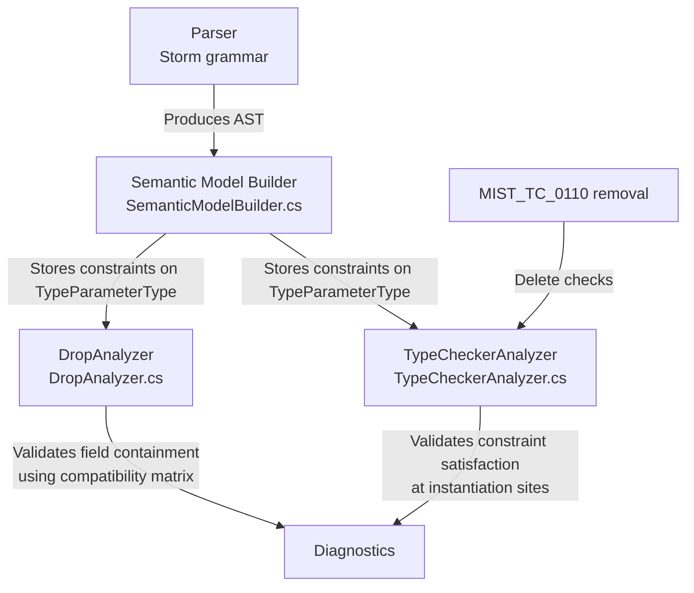
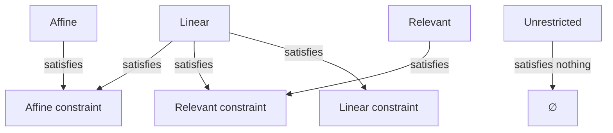

# Design Document: Substructural Field Discipline

## Overview

This design replaces the binary "is the container owned?" field containment check in `DropAnalyzer.cs` with a discipline-compatibility matrix, adds substructural constraint syntax for generic type parameters, enforces the matrix on generic fields at the definition site, validates constraint satisfaction at instantiation sites, and removes the now-obsolete `MIST_TC_0110 (historical)` diagnostic.

The core insight: each substructural discipline makes a specific promise about how many times `Drop()` fires on the container. A field's discipline requires certain guarantees from its container. The compatibility matrix encodes which container promises satisfy which field requirements.

**Discipline drop guarantees:**
| Discipline | Container Drop Guarantee |
|---|---|
| Linear | Exactly once |
| Affine | 0 or 1 times |
| Relevant | 1 or more times |
| Unrestricted | 0 to many |

**Compatibility matrix:**
| Container \ Field | Linear | Affine | Relevant | Unrestricted |
|---|---|---|---|---|
| **Linear** | ✓ | ✓ | ✓ | ✓ |
| **Affine** | ✗ | ✓ | ✗ | ✓ |
| **Relevant** | ✗ | ✗ | ✓ | ✓ |
| **Unrestricted/Owned** | ✗ | ✗ | ✗ | ✓ |

## Architecture

The implementation touches four compiler pipeline stages:



**Stage flow:**
1. **Parsing** — The Storm grammar's `Constraint` rule gains three new alternatives (`LinearConstraint`, `AffineConstraint`, `RelevantConstraint`). The parser already recognizes `linear`, `affine`, `relevant` as keywords.
2. **Semantic model building** — `ResolveConstraintClause` recognizes the new constraint node types and sets corresponding booleans on `TypeParameterConstraints`.
3. **Drop analysis** — `ValidateFieldContainment` replaces the owned check with the compatibility matrix, handling both concrete types and type parameter fields.
4. **Type checking** — A new validation pass checks that type arguments at instantiation sites satisfy substructural constraints, following the discipline lattice. The `MIST_TC_0110 (historical)` check is deleted.

## Components and Interfaces

### 1. Grammar Changes (`Source/Mist/Grammar/Mist.storm`)

The `Constraint` rule gains three new alternatives:

```storm
rule Constraint
    = CLASS                    as ClassConstraint
    | STRUCT                   as StructConstraint
    | READONLY                 as ReadonlyConstraint
    | MUTABLE                  as MutableConstraint
    | OWNED                    as OwnedConstraint
    | LINEAR                   as LinearConstraint       // NEW
    | AFFINE                   as AffineConstraint       // NEW
    | RELEVANT                 as RelevantConstraint     // NEW
    | NEW LEFT_PARENTHESIS paramTypes:ConstraintParameterTypeList? RIGHT_PARENTHESIS as ConstructorConstraint
    | DEFAULT                  as DefaultConstraint
    | type:TypeReference       as TypeConstraint
    ;
```

The `LINEAR`, `AFFINE`, and `RELEVANT` tokens already exist in `keywords.storm` as storage modifiers. They just need to appear as constraint alternatives. The Storm source generator will produce `LinearConstraintConstraintNode`, `AffineConstraintConstraintNode`, and `RelevantConstraintConstraintNode` types.

### 2. Semantic Model Changes (`TypeParameterConstraints.cs`)

Three new boolean properties:

```csharp
public sealed class TypeParameterConstraints
{
    // ... existing properties ...

    /// <summary>Whether the 'linear' substructural constraint is present.</summary>
    public bool HasLinearConstraint { get; init; }

    /// <summary>Whether the 'affine' substructural constraint is present.</summary>
    public bool HasAffineConstraint { get; init; }

    /// <summary>Whether the 'relevant' substructural constraint is present.</summary>
    public bool HasRelevantConstraint { get; init; }
}
```

### 3. SemanticModelBuilder Changes (`ResolveConstraintClause`)

The constraint resolution switch gains three new cases:

```csharp
case LinearConstraintConstraintNode:
    hasLinearConstraint = true;
    break;
case AffineConstraintConstraintNode:
    hasAffineConstraint = true;
    break;
case RelevantConstraintConstraintNode:
    hasRelevantConstraint = true;
    break;
```

A new validation check in `ValidateConstraintCombinations` rejects multiple substructural constraints on the same type parameter:

```csharp
var substructuralCount = (hasLinearConstraint ? 1 : 0)
    + (hasAffineConstraint ? 1 : 0)
    + (hasRelevantConstraint ? 1 : 0);
if (substructuralCount > 1)
{
    diagnostics.Add(/* MIST_CONSTRAINT_XXXX: multiple substructural constraints */);
}
```

### 4. DropAnalyzer — Compatibility Matrix (`ValidateFieldContainment`)

The existing method is rewritten to use the matrix instead of the binary `IsOwnedType` check:

```csharp
private static void ValidateFieldContainment(ISymbol typeSymbol, ISemanticModel model, DiagnosticBag diagnostics)
{
    var containerType = typeSymbol.DeclaredType;
    if (containerType is null) return;

    var memberScope = GetMemberScope(containerType);
    if (memberScope is null) return;

    var containerDiscipline = GetContainerDiscipline(containerType);

    foreach (var member in memberScope.Members)
    {
        if (member.Kind != SymbolKind.Field) continue;

        var fieldType = member.DeclaredType;
        if (fieldType is null) continue;

        var fieldDiscipline = GetEffectiveFieldDiscipline(fieldType);

        // Type parameter fields with no substructural constraint in substructural containers → error
        if (fieldType is TypeParameterType tpType &&
            containerDiscipline != SubstructuralDiscipline.None)
        {
            if (!HasSubstructuralConstraint(tpType))
            {
                ReportUnconstrainedTypeParameter(typeSymbol, member, tpType, containerDiscipline, model, diagnostics);
                continue;
            }
        }

        if (!IsFieldCompatible(containerDiscipline, fieldDiscipline))
        {
            ReportIncompatibleField(typeSymbol, member, containerDiscipline, fieldDiscipline, model, diagnostics);
        }
    }
}
```

**Key helper — `GetContainerDiscipline`:** Returns the container's discipline. For `owned` containers with no substructural modifier, returns `None` (unrestricted rules apply per Requirement 1 AC 5).

**Key helper — `GetEffectiveFieldDiscipline`:** For concrete types, resolves through `ConstructedType` to get discipline. For `TypeParameterType`, reads the constraint to determine effective discipline (linear constraint → `Linear`, affine → `Affine`, relevant → `Relevant`, no constraint → `None`).

**Key helper — `IsFieldCompatible`:** Pure function implementing the matrix:

```csharp
private static bool IsFieldCompatible(SubstructuralDiscipline container, SubstructuralDiscipline field)
{
    if (field == SubstructuralDiscipline.None) return true; // unrestricted fields always OK
    return container switch
    {
        SubstructuralDiscipline.Linear => true, // linear holds anything
        SubstructuralDiscipline.Affine => field == SubstructuralDiscipline.Affine,
        SubstructuralDiscipline.Relevant => field == SubstructuralDiscipline.Relevant,
        _ => false, // unrestricted/owned holds only unrestricted
    };
}
```

### 5. Diagnostic Messages

Three message templates keyed by container discipline:

| Container | Message Template |
|---|---|
| Affine | "Affine type '{Container}' cannot contain {modifier} field '{Field}'. The container may never be dropped, violating the field's requirement of at least one drop." |
| Relevant | "Relevant type '{Container}' cannot contain {modifier} field '{Field}'. The container may be dropped multiple times, violating the field's at-most-once drop requirement." |
| Unrestricted/Owned | "Type '{Container}' cannot contain {modifier} field '{Field}'. The container has no substructural discipline and cannot guarantee the field's drop requirements." |

Unconstrained type parameter message:

"{Discipline} type '{Container}' contains field '{Field}' of unconstrained type parameter '{T}'. Add a substructural constraint (e.g., 'where {T} : {suggested_constraint}') to ensure the field's discipline is compatible."

All use the existing `MIST_DROP_FIELD_NOT_OWNED (historical)` diagnostic ID.

### 6. TypeCheckerAnalyzer — Instantiation-Site Constraint Satisfaction

A new validation method is added to `TypeCheckerAnalyzer` (or a dedicated helper class) that runs at all instantiation sites:

```csharp
private static void ValidateSubstructuralConstraints(
    IType genericDefinition,
    IReadOnlyList<IType> typeArguments,
    SyntaxNode instantiationNode,
    ISemanticModel model,
    DiagnosticBag diagnostics)
{
    var typeParams = GetTypeParameters(genericDefinition);
    for (int i = 0; i < typeParams.Count && i < typeArguments.Count; i++)
    {
        var param = typeParams[i];
        var arg = typeArguments[i];

        if (arg is ErrorType) continue; // suppress cascading errors

        var requiredDiscipline = GetConstraintDiscipline(param.Constraints);
        if (requiredDiscipline == SubstructuralDiscipline.None) continue;

        var argDiscipline = GetArgumentDiscipline(arg);
        if (!SatisfiesConstraint(argDiscipline, requiredDiscipline))
        {
            diagnostics.Add(/* constraint violation diagnostic */);
        }
    }
}
```

**Constraint satisfaction lattice (`SatisfiesConstraint`):**

```csharp
private static bool SatisfiesConstraint(SubstructuralDiscipline argument, SubstructuralDiscipline constraint)
{
    return constraint switch
    {
        SubstructuralDiscipline.Linear => argument == SubstructuralDiscipline.Linear,
        SubstructuralDiscipline.Affine => argument is SubstructuralDiscipline.Affine or SubstructuralDiscipline.Linear,
        SubstructuralDiscipline.Relevant => argument is SubstructuralDiscipline.Relevant or SubstructuralDiscipline.Linear,
        _ => true,
    };
}
```

This runs at: `new` expressions, base class specifications, field type arguments, method call type arguments, variable declarations with explicit generic types.

### 7. MIST_TC_0110 (historical) Removal

Delete from `TypeCheckerAnalyzer.cs`:
- The `TaskStorageRestriction` diagnostic ID declaration
- The `IsTaskLikeType` usage in field/property validation (lines around 3349-3430)
- The section header comment "Task<T> storage restriction (MIST_TC_0110 (historical))"

After removal, `Task<T>` (relevant discipline) and `ValueTask<T>` (linear discipline) are handled by the DropAnalyzer's compatibility matrix like any other substructural type:
- Task in relevant container → ✓ (relevant holds relevant)
- Task in linear container → ✓ (linear holds anything)
- Task in affine container → ✗ (affine can't hold relevant)
- ValueTask in linear container → ✓ (linear holds anything)
- ValueTask in affine/relevant/unrestricted → ✗

## Data Models

### TypeParameterConstraints (extended)

```csharp
public sealed class TypeParameterConstraints
{
    public bool HasClassConstraint { get; init; }
    public bool HasStructConstraint { get; init; }
    public IType? BaseClassConstraint { get; init; }
    public IReadOnlyList<IType> InterfaceConstraints { get; init; }
    public IReadOnlyList<IType> TraitConstraints { get; init; }
    public IReadOnlyList<IReadOnlyList<IType>> ConstructorConstraints { get; init; }
    public bool HasReadonlyConstraint { get; init; }
    public bool HasMutableConstraint { get; init; }
    public bool HasOwnedConstraint { get; init; }
    public bool HasDefaultConstraint { get; init; }
    // NEW:
    public bool HasLinearConstraint { get; init; }
    public bool HasAffineConstraint { get; init; }
    public bool HasRelevantConstraint { get; init; }
}
```

### Discipline Resolution for Type Parameters

When resolving the effective discipline of a `TypeParameterType` for field containment or constraint satisfaction:

```
TypeParameterType.Constraints?.HasLinearConstraint == true   → Linear
TypeParameterType.Constraints?.HasAffineConstraint == true   → Affine
TypeParameterType.Constraints?.HasRelevantConstraint == true → Relevant
otherwise                                                     → None (unrestricted)
```

### Constraint Satisfaction Lattice



## Correctness Properties

*A property is a characteristic or behavior that should hold true across all valid executions of a system — essentially, a formal statement about what the system should do. Properties serve as the bridge between human-readable specifications and machine-verifiable correctness guarantees.*

### Property 1: Discipline-Compatibility Matrix

*For any* container discipline `C` ∈ {linear, affine, relevant, unrestricted} and any field discipline `F` ∈ {linear, affine, relevant, unrestricted}, compiling a container of discipline `C` with a field of discipline `F` SHALL produce zero `MIST_DROP_FIELD_NOT_OWNED (historical)` diagnostics if and only if the compatibility matrix permits the (C, F) pair. When the matrix rejects the pair, exactly one diagnostic SHALL be produced with a message that names the container, the field, the field's discipline keyword, and the specific invariant violation.

**Validates: Requirements 1.1, 1.2, 1.3, 1.4, 1.5, 1.7, 2.1, 2.2, 2.3, 2.4, 9.2, 9.3, 9.4, 9.5**

### Property 2: Substructural Constraint Parsing

*For any* valid type declaration with a `where T : {discipline}` clause (where discipline ∈ {linear, affine, relevant}), parsing the source and building the semantic model SHALL produce a `TypeParameterType` whose `Constraints` has the corresponding `Has{Discipline}Constraint` boolean set to `true` and the other two set to `false`.

**Validates: Requirements 3.1, 3.2**

### Property 3: Constraint Combination Validation

*For any* `where` clause that specifies more than one substructural constraint keyword on the same type parameter, the compiler SHALL emit a diagnostic error. *For any* `where` clause that combines exactly one substructural constraint with any number of non-substructural constraints (class, struct, interface, new(), owned, readonly, mutable, default), the compiler SHALL emit no substructural combination error.

**Validates: Requirements 3.3, 3.4**

### Property 4: Generic Field Containment

*For any* substructural container (linear, affine, or relevant) that declares a field whose type is a type parameter `T`: if `T` has no substructural constraint, the DropAnalyzer SHALL emit a diagnostic indicating the parameter needs a constraint; if `T` has a substructural constraint, the DropAnalyzer SHALL apply the discipline-compatibility matrix using the constraint's discipline as the field's effective discipline.

**Validates: Requirements 4.1, 4.2, 4.3, 4.4, 4.5, 4.6, 4.7, 3.9**

### Property 5: Constraint Satisfaction Lattice

*For any* instantiation site where a type argument with discipline `D` is provided for a type parameter with substructural constraint `R`, the compiler SHALL accept the type argument if and only if the satisfaction lattice permits (D, R): linear satisfies {linear, affine, relevant}; affine satisfies only {affine}; relevant satisfies only {relevant}; unrestricted satisfies nothing. When the lattice rejects the pair, the compiler SHALL emit a diagnostic.

**Validates: Requirements 5.1, 5.2, 5.3, 5.5, 6.1, 6.2, 6.3, 6.4, 6.5, 6.6, 6.7, 6.8, 9.7**

## Error Handling

### Cascading Error Suppression

When a type argument resolves to `ErrorType` (e.g., due to an unresolved type name), the constraint satisfaction check is skipped entirely to avoid cascading errors (Requirement 5 AC 6). The DropAnalyzer similarly skips field containment checks when the field type resolves to `ErrorType`.

### Multiple Errors per Declaration

Each incompatible field produces its own independent diagnostic (Requirement 1 AC 7). The analyzer does not short-circuit after the first error — it continues checking all fields so the developer sees all issues at once.

### Diagnostic Severity

All new and updated diagnostics use `DiagnosticSeverity.Error`. No warnings are introduced.

### Graceful Handling of Missing Constraints Data

If `TypeParameterType.Constraints` is `null` (unconstrained), the type parameter is treated as unrestricted. This is the safe default — the field containment check will require a constraint if the container is substructural.

## Testing Strategy

### Property-Based Tests (FsCheck)

The five correctness properties above are implemented as property-based tests using the **batched compilation** approach (per the Test Process Spawning Policy):

1. **Generate** 100 random scenarios (container/field discipline pairs, constraint combinations, etc.) using FsCheck generators.
2. **Build** a single Mist source file containing all scenarios as separate type declarations.
3. **Compile once** using the in-process `CompilerDriver`.
4. **Assert** each scenario's expected diagnostic presence/absence against the actual diagnostics.

This means each property test spawns **zero** external processes — all compilation runs in-process via `CompilerDriver.Compile()`.

**Library:** FsCheck 2.x with xUnit integration (`FsCheck.Xunit`)
**Iterations:** Minimum 100 per property test
**Tag format:** Each test is tagged with `// Feature: substructural-field-discipline, Property N: {description}`

### Unit Tests (xUnit)

Example-based tests covering:
- Specific instantiation site kinds (new, base class, field, method call, variable)
- Error type suppression (edge case)
- The exact diagnostic message text for each container/field combination
- MIST_TC_0110 (historical) removal verification (Task/ValueTask in various containers)

### Integration Tests

- Sample application (`samples/SubstructuralFieldDiscipline/Program.mist`) compiles with zero diagnostics, runs, and produces exact expected output.
- `samples/AllFeatures` includes the new sample and still compiles/runs cleanly.

### Test Organization

| Test Class | Type | What it Tests |
|---|---|---|
| `DisciplineCompatibilityMatrixPropertyTests` | PBT | Property 1 |
| `SubstructuralConstraintParsingPropertyTests` | PBT | Property 2 |
| `ConstraintCombinationPropertyTests` | PBT | Property 3 |
| `GenericFieldContainmentPropertyTests` | PBT | Property 4 |
| `ConstraintSatisfactionLatticePropertyTests` | PBT | Property 5 |
| `TaskStorageRestrictionDiagnosticTests` (updated) | Unit | MIST_TC_0110 (historical) removal / matrix behavior |
| `TaskStorageRestrictionPropertyTests` (updated) | PBT | Task/ValueTask in containers per matrix |
