# Design Document: Target-Typed New Expressions

## Overview

This design adds target-typed `new()` expressions to Mist, allowing developers to omit the type name in object creation expressions when the type is statically known from context. The implementation spans the full compiler pipeline: grammar (Storm), parser-generated AST, semantic model resolution, type checker validation, C# emission, and pretty-printer formatting.

The core idea is straightforward: when the compiler encounters `new(args)` or `new { ... }` without a type name, it resolves the type from the surrounding context (field initializer, typed local variable, return statement, method argument, or assignment target). The C# emitter always produces fully-typed `new TypeName(args)` output, making this purely syntactic sugar with no runtime impact.

**Design Rationale:**
- Follows the existing pattern of target-type threading already used for void literals (`_voidLiteralTargetType`), empty array literals (`_emptyArrayTargetType`), and lambda expressions (`_lambdaTargetType`).
- Introduces a new `_targetTypedNewTargetType` thread-static field using the same save/set/resolve/restore pattern.
- Grammar ordering ensures fully-typed `new TypeName(...)` always takes priority — the target-typed alternatives are tried only when the parser sees `NEW` followed directly by `(` or `{`.

## Architecture

```mermaid
flowchart TD
    A[Mist Source: new&#40;args&#41;] --> B[Storm Parser]
    B --> C{NEW followed by?}
    C -->|Identifier| D[ObjectCreationExpression &#40;existing&#41;]
    C -->|LEFT_PAREN| E[TargetTypedNewExpression]
    C -->|LEFT_BRACE| F[TargetTypedNewExpressionNoArgs]
    E --> G[SemanticModelBuilder]
    F --> G
    G --> H{Target type available?}
    H -->|Yes| I[Resolve type from context]
    H -->|No| J[Record ErrorType]
    I --> K[TypeCheckerAnalyzer]
    K --> L{Valid instantiation?}
    L -->|Yes| M[CSharpEmitter]
    L -->|No| N[Diagnostic Error]
    M --> O[new TypeName&#40;args&#41; in C#]
```



The feature touches these components:

1. **Grammar** (`Mist.storm`) — Two new `Primary` alternatives
2. **SemanticModelBuilder** — Target type resolution with a new thread-static field
3. **TypeCheckerAnalyzer** — Constructor/instantiability validation
4. **CSharpEmitter** — Emit fully-typed `new TypeName(args)`
5. **MistPrettyPrinter** — Round-trip formatting
6. **TextMate grammar** — No changes needed (existing `new` keyword pattern already covers this)

## Components and Interfaces

### 1. Grammar Changes (Mist.storm)

Two new alternatives are added to the `Primary` rule, placed **after** the existing `ObjectCreationExpression` and `ObjectCreationExpressionNoArgs` alternatives:

```storm
| NEW LEFT_PARENTHESIS arguments:ArgumentList? RIGHT_PARENTHESIS initializer:PropertyInitializerBlock?  as TargetTypedNewExpression
| NEW initializer:PropertyInitializerBlock                                                              as TargetTypedNewExpressionNoArgs
```

**Ordering rationale:** The PEG parser tries alternatives top-to-bottom. The existing rules match `NEW QualifiedIdentifier ...` — since `LEFT_PARENTHESIS` and `LEFT_BRACE` are not valid starts for `QualifiedIdentifier`, the existing rules will fail to match `new(...)` or `new { ... }`, and the parser will fall through to the new alternatives. Placing them after ensures fully-typed expressions always win when a type name is present.

**Generated AST nodes** (produced by Storm source generator):
- `TargetTypedNewExpressionPrimaryNode` with fields:
  - `Arguments: ArgumentListNode?`
  - `Initializer: PropertyInitializerBlockNode?`
- `TargetTypedNewExpressionNoArgsPrimaryNode` with fields:
  - `Initializer: PropertyInitializerBlockNode`

### 2. Semantic Model Builder Changes

A new thread-static field following the existing pattern:

```csharp
[ThreadStatic]
private static IType? _targetTypedNewTargetType;
```

**Target type propagation points** (each saves/sets/resolves/restores):

| Context | Where target type is set |
|---------|--------------------------|
| Field initializer | `ResolveFieldDeclaration` — set from declared field type |
| Typed local variable | `ResolveVariableDeclaration` (TypedVariableDeclaration) — set from declared type |
| Return statement | `ResolveStatement` (ReturnStatement) — set from `_currentMethodReturnType` |
| Method argument | `ResolveArgumentList` — set from parameter type |
| Assignment RHS | `ResolveAssignment` — set from target variable type |

**Resolution of TargetTypedNewExpressionPrimaryNode:**

```csharp
case TargetTypedNewExpressionPrimaryNode targetNew:
{
    var targetType = _targetTypedNewTargetType;
    if (targetType is null || targetType is ErrorType)
    {
        diagnostics.Add(/* MIST_TARGET_NEW_NO_CONTEXT */);
        result = ErrorType.Instance;
        break;
    }
    
    // Resolve arguments using constructor parameter types from target type
    if (targetNew.Arguments is not null)
    {
        IReadOnlyList<IType>? ctorParamTypes = /* lookup from targetType */;
        ResolveArgumentList(targetNew.Arguments, ..., ctorParamTypes);
    }
    
    // Resolve property initializer values
    if (targetNew.Initializer?.Assignments is not null) { /* same as ObjectCreation */ }
    
    result = targetType;
    break;
}
```

The same pattern applies to `TargetTypedNewExpressionNoArgsPrimaryNode` but without arguments.

### 3. Type Checker Analyzer Changes

New validation for target-typed new expressions:

- **No target type available**: Emit `MIST_TARGET_NEW_NO_CONTEXT (historical)` — "The type of 'new()' cannot be inferred from context."
- **Used with `var`**: Emit `MIST_TARGET_NEW_WITH_VAR (historical)` — "The type of 'new()' cannot be inferred because 'var' does not provide a target type."
- **Interface target**: Emit `MIST_TARGET_NEW_INTERFACE (historical)` — "Cannot create an instance of interface type '{name}' with target-typed new."
- **Trait target**: Emit `MIST_TARGET_NEW_TRAIT (historical)` — "Cannot create an instance of trait type '{name}' with target-typed new."
- **Abstract class**: Reuse existing `MIST_ABSTRACT_INSTANTIATION (historical)`.
- **Constructor mismatch**: Reuse existing constructor resolution logic (`CheckObjectCreation` pattern) — validate arguments against accessible constructors on the resolved type.

### 4. C# Emitter Changes

New case in `EmitPrimary`:

```csharp
case TargetTypedNewExpressionPrimaryNode targetNew:
{
    var resolvedType = _model.GetTypeOf(targetNew);
    if (resolvedType is null || resolvedType is ErrorType)
        return "default /* error: unresolved target-typed new */";
    
    var typeName = CSharpTypeMap.GetTypeName(resolvedType);
    var args = EmitArgumentList(targetNew.Arguments);
    
    if (targetNew.Initializer is not null)
    {
        var initParts = EmitPropertyInitializerParts(targetNew.Initializer);
        return $"new {typeName}({args}) {{ {string.Join(", ", initParts)} }}";
    }
    return $"new {typeName}({args})";
}
```

Same pattern for `TargetTypedNewExpressionNoArgsPrimaryNode` — emit `new TypeName() { ... }`.

### 5. Pretty Printer Changes

New cases in `EmitPrimary`:

```csharp
case TargetTypedNewExpressionPrimaryNode targetNew:
{
    var args = EmitArgumentList(targetNew.Arguments);
    if (targetNew.Initializer is not null)
    {
        var assignments = EmitPropertyAssignmentList(targetNew.Initializer);
        return $"new({args}) {{ {assignments} }}";
    }
    return $"new({args})";
}
case TargetTypedNewExpressionNoArgsPrimaryNode targetNewNoArgs:
{
    var assignments = EmitPropertyAssignmentList(targetNewNoArgs.Initializer);
    return $"new {{ {assignments} }}";
}
```

### 6. TextMate Grammar

No changes needed. The existing TextMate grammar already highlights `new` as a keyword regardless of what follows it. The `\\bnew\\b` keyword pattern matches `new` in both `new TypeName(...)` and `new(...)` contexts.

## Data Models

### New AST Nodes (generated by Storm)

```
TargetTypedNewExpressionPrimaryNode
├── Arguments: ArgumentListNode?           (null when no args: `new()`)
└── Initializer: PropertyInitializerBlockNode?  (null when no initializer)

TargetTypedNewExpressionNoArgsPrimaryNode
└── Initializer: PropertyInitializerBlockNode   (always present: `new { ... }`)
```

### Expression Type Recording

The semantic model records the resolved target type on the AST node:
- `expressionTypes[targetNewNode] = resolvedTargetType` (the concrete type inferred from context)
- `expressionTypes[targetNewNode] = ErrorType.Instance` (when no context available)

### Diagnostic IDs

| ID | Severity | Message |
|----|----------|---------|
| `MIST_TARGET_NEW_NO_CONTEXT (historical)` | Error | "The type of 'new()' cannot be inferred from context." |
| `MIST_TARGET_NEW_WITH_VAR (historical)` | Error | "The type of 'new()' cannot be inferred because 'var' does not provide a target type. Use an explicit type or provide the type name after 'new'." |
| `MIST_TARGET_NEW_INTERFACE (historical)` | Error | "Cannot create an instance of interface type '{name}' with target-typed new." |
| `MIST_TARGET_NEW_TRAIT (historical)` | Error | "Cannot create an instance of trait type '{name}' with target-typed new." |


## Correctness Properties

*A property is a characteristic or behavior that should hold true across all valid executions of a system — essentially, a formal statement about what the system should do. Properties serve as the bridge between human-readable specifications and machine-verifiable correctness guarantees.*

### Property 1: Parsing round-trip

*For any* valid Mist source containing a target-typed new expression (with or without arguments, with or without property initializers), parsing the source into an AST, pretty-printing that AST back to source text, and re-parsing should produce an equivalent AST.

**Validates: Requirements 2.5**

### Property 2: Parsing disambiguation

*For any* valid type name and argument list, parsing `new TypeName(args)` SHALL always produce an `ObjectCreationExpressionPrimaryNode`, never a `TargetTypedNewExpressionPrimaryNode`. The target-typed alternative is only selected when no type name is present between `new` and `(`.

**Validates: Requirements 1.4, 1.5**

### Property 3: Target type resolution from context

*For any* typed context (field initializer with declared type T, local variable with declared type T, return statement in a method returning T, argument to a parameter of type T, or assignment to a variable of type T), a target-typed new expression SHALL resolve its expression type to T.

**Validates: Requirements 3.1, 3.2, 3.3, 3.4, 3.5**

### Property 4: Generic type preservation

*For any* generic type `G<T1, T2, ...>` used as a target type, the target-typed new expression SHALL resolve to the fully-constructed generic type including all type arguments, not the open generic definition.

**Validates: Requirements 5.3**

### Property 5: Emission equivalence

*For any* type T, argument list args, and optional property initializer block, the C# code emitted for `T x = new(args)` SHALL be identical to the C# code emitted for `T x = new T(args)` (excluding whitespace differences in the declaration itself).

**Validates: Requirements 6.1, 6.2, 6.3**

### Property 6: Constructor validation

*For any* resolved target type T and argument list, the type checker SHALL accept the target-typed new expression if and only if T has an accessible constructor whose parameter types are compatible with the provided arguments (same validation as fully-typed `new T(args)`).

**Validates: Requirements 4.1, 4.2**

## Error Handling

### Diagnostic Strategy

Errors are reported at two stages:

1. **Semantic Model Builder (Pass 2)** — Records `ErrorType` when no target type is available. Does not emit user-facing diagnostics (the type checker handles that).
2. **Type Checker Analyzer** — Emits user-facing diagnostics for all error conditions.

### Error Conditions

| Condition | Stage | Diagnostic ID | Message |
|-----------|-------|---------------|---------|
| `var x = new()` | Type Checker | `MIST_TARGET_NEW_WITH_VAR (historical)` | "The type of 'new()' cannot be inferred because 'var' does not provide a target type. Use an explicit type or provide the type name after 'new'." |
| No target type available | Type Checker | `MIST_TARGET_NEW_NO_CONTEXT (historical)` | "The type of 'new()' cannot be inferred from context." |
| Target is interface | Type Checker | `MIST_TARGET_NEW_INTERFACE (historical)` | "Cannot create an instance of interface type '{name}' with target-typed new." |
| Target is trait | Type Checker | `MIST_TARGET_NEW_TRAIT (historical)` | "Cannot create an instance of trait type '{name}' with target-typed new." |
| Target is abstract class | Semantic Model | `MIST_ABSTRACT_INSTANTIATION (historical)` | (existing) "Cannot create an instance of abstract type '{name}'." |
| No matching constructor | Type Checker | `MIST_TC_0011 (historical)` / `MIST_TC_0031 (historical)` | (reuse existing) "Type '{name}' does not contain a constructor matching the given arguments" / "No overload for '{name}' constructor matches argument types ({types})" |

### Error Recovery

When the semantic model builder encounters a target-typed new expression with no available target type:
- The expression type is recorded as `ErrorType.Instance`
- Arguments are still resolved (for IDE support / further error reporting)
- Property initializer values are still resolved
- Downstream type checker detects `ErrorType` and emits the appropriate diagnostic

This approach matches existing error recovery for `ObjectCreationExpression` with unresolvable type names.

## Testing Strategy

### Property-Based Tests (PBT)

**Library:** FsCheck (already used in the project)
**Minimum iterations:** 100 per property

Property-based tests are appropriate for this feature because:
- The parsing logic handles a wide input space (any combination of arguments, initializers)
- The round-trip property is a canonical PBT use case for parsers/printers
- The emission equivalence property is a metamorphic property comparing two code paths
- The type resolution property can be parametrized over many type/context combinations

**Test approach for process-spawning properties (3, 4, 5, 6):**
Per the Test Process Spawning Policy, these tests will use a **batched** approach:
1. Generate N scenarios (types, contexts, argument combinations)
2. Build a single Mist source file exercising all scenarios
3. Compile once, run once
4. Compare output lines to expected results

Properties 1 and 2 (parsing/pretty-printing) are in-process and do not require process spawning.

### Unit Tests (Example-Based)

| Test Case | Validates |
|-----------|-----------|
| `var x = new()` emits `MIST_TARGET_NEW_WITH_VAR (historical)` | 5.1 |
| `new()` in expression statement emits `MIST_TARGET_NEW_NO_CONTEXT (historical)` | 5.2 |
| Interface target emits `MIST_TARGET_NEW_INTERFACE (historical)` | 4.4 |
| Trait target emits `MIST_TARGET_NEW_TRAIT (historical)` | 4.5 |
| Abstract class target emits `MIST_ABSTRACT_INSTANTIATION (historical)` | 4.6 |
| Constructor arg count mismatch emits error | 4.3 |
| `new()` with no args produces `new()` in pretty-printer | 2.1 |
| `new { Prop = 1 }` produces correct pretty-printer output | 2.4 |

### Integration Tests

| Test Case | Validates |
|-----------|-----------|
| Sample `TargetTypedNew/Program.mist` compiles and produces expected output | 8.2–8.7 |
| `AllFeatures/Program.mist` includes TargetTypedNew demo call | 8.6 |
| Book snippets compile successfully | 9.3 |

### Test Configuration

Each property test references its design document property with:
```
// Feature: target-typed-new, Property {N}: {property_text}
```

Minimum 100 iterations per property test (FsCheck default or explicit configuration).
