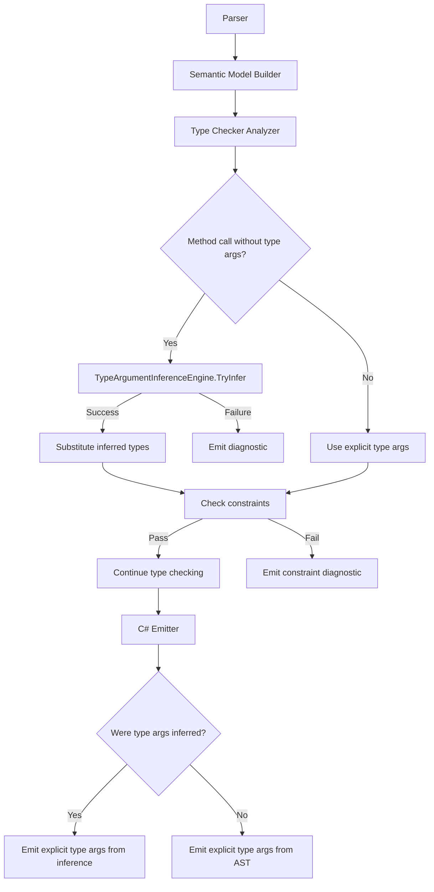

# Design Document: Type Argument Inference

## Overview

This feature adds type argument inference to generic method calls in the Mist compiler. When a caller omits explicit type arguments (e.g., `Identity(42)` instead of `Identity<int>(42)`), the compiler deduces the type arguments by unifying each method parameter's declared type against the corresponding argument's resolved type.

The inference engine is a new pure-function component (`TypeArgumentInferenceEngine`) that sits between the semantic model and the type checker. It is invoked during type checking when a generic method call lacks explicit type arguments. The engine produces either a complete mapping from type parameters to concrete types (success) or a failure result indicating which type parameters could not be resolved or which had conflicting bindings.

Key design decisions:
- **Inference is purely positional**: argument 0 maps to parameter 0, argument 1 to parameter 1, etc.
- **Inference is local**: only the call site's arguments are examined; return type usage context is not considered.
- **Differing bindings fix by dominance, as in C#**: if two arguments produce different bindings for the same type parameter, it is fixed to the binding every other converts to implicitly (`{int, long}` fixes to `long`), and inference fails if there is none. No type is invented that no argument has: `{string, int}` is not fixed to `string | int`, nor `{Dog, Cat}` to a shared base `Animal`, because a union always exists and `unknown` is always a shared supertype, so a rule that looked for one would never fail and would silently accept the calls C# refuses. The caller states such a type argument explicitly.
- **Inference integrates with overload resolution**: when multiple overloads exist, inference is attempted per-candidate and failed candidates are excluded.
- **The emitter always emits explicit type arguments**: because C# inference rules differ from Mist's, the emitter writes out the inferred types explicitly.

## Architecture



The inference engine is invoked from `TypeCheckerAnalyzer.CheckMethodCallArguments` when `methodCall.TypeArgs is null` and the resolved method symbol has type parameters. The engine returns an `InferenceResult` that either contains the inferred type arguments or describes the failure.

### Integration Points

1. **TypeCheckerAnalyzer.CheckMethodCallArguments** — Entry point. When type arguments are absent and the method is generic, calls the inference engine before proceeding with argument type checking.
2. **TypeCheckerAnalyzer.CheckPostfixNode** — After inference succeeds, the inferred type arguments are used for return type substitution (replacing `SubstituteMethodReturnType` which currently only handles explicit type args from the AST).
3. **OverloadResolver.Resolve** — Extended to accept an inference-aware mode where candidates are filtered by inference success before specificity ranking.
4. **CSharpEmitter.EmitPostfixSuffix** — When emitting a `MethodCallSuffixPostfixSuffixNode` that has no `TypeArgs` in the AST but has inferred type arguments recorded on the semantic model, emits the inferred types as explicit C# type arguments.
5. **ISemanticModel / SemanticModel** — Extended with a method to record and retrieve inferred type arguments for a call-site node.

## Components and Interfaces

### TypeArgumentInferenceEngine (new)

A static class in `Mist.Analysis.Builtin` containing the core inference algorithm.

```csharp
namespace Mist.Analysis.Builtin;

/// <summary>
/// The result of type argument inference for a single generic method call site.
/// </summary>
public readonly record struct InferenceResult(
    bool Success,
    IReadOnlyList<IType>? InferredTypeArguments,
    IReadOnlyList<string>? UninferrableTypeParameters,
    IReadOnlyList<(string TypeParameter, IType First, IType Second)>? Conflicts);

/// <summary>
/// Infers type arguments for generic method calls by unifying declared parameter
/// types against resolved argument types. This is a pure static class with no
/// mutable state, designed to be testable in isolation.
/// </summary>
public static class TypeArgumentInferenceEngine
{
    /// <summary>
    /// Attempts to infer all type arguments for a generic method call.
    /// </summary>
    /// <param name="typeParameters">The method's type parameters (from Symbol.TypeParameters).</param>
    /// <param name="parameterTypes">The declared types of the method's parameters.</param>
    /// <param name="argumentTypes">The resolved types of the arguments at the call site.</param>
    /// <returns>An InferenceResult indicating success or failure with details.</returns>
    public static InferenceResult TryInfer(
        IReadOnlyList<IType> typeParameters,
        IReadOnlyList<IType> parameterTypes,
        IReadOnlyList<IType> argumentTypes);
}
```

### Unification Algorithm

The `TryInfer` method implements a constraint-collection approach:

1. **Initialize** an `InferenceContext` — a dictionary mapping each `TypeParameterType.Name` to `null` (unbound).
2. **For each parameter-argument pair** (positional), call `Unify(declaredParamType, argumentType, context)`:
   - If `declaredParamType` is a `TypeParameterType`: add `argumentType` to its bounds, unless an identical type is already there.
   - If `declaredParamType` is a `ConstructedType` and `argumentType` is a `ConstructedType` with the same `GenericDefinition`: recursively unify each type argument position.
   - Otherwise: no bindings produced from this pair (skip silently).
3. **After all pairs are processed**, fix each type parameter from its bounds:
   - If any type parameter has no bound → **Failure** (uninferrable).
   - Else, the first bound every other bound implicitly converts to (Requirement 3.5) → that type.
   - Else, the first refinement-typed bound whose base every other bound implicitly converts to (Requirement 3.6) → that type.
   - Else → **Failure** (conflict).

   Whether one bound converts to another is judged by the same classification that later refuses an argument that does not convert to its parameter, so a conflict is reported only where every choice among the bounds would have had some argument refused.

### Semantic Model Extension

```csharp
// Added to ISemanticModel interface:
/// <summary>
/// Records the inferred type arguments for a method call node where type
/// arguments were omitted in source but successfully inferred.
/// </summary>
void RecordInferredTypeArguments(Storm.Runtime.SyntaxNode callSiteNode, IReadOnlyList<IType> inferredTypeArgs);

/// <summary>
/// Returns the inferred type arguments for a method call node, or null if
/// type arguments were not inferred (either explicit or inference not attempted).
/// </summary>
IReadOnlyList<IType>? GetInferredTypeArguments(Storm.Runtime.SyntaxNode callSiteNode);
```

The `SemanticModel` class stores these in a `Dictionary<Storm.Runtime.SyntaxNode, IReadOnlyList<IType>>`.

### Modified TypeCheckerAnalyzer Flow

In `CheckMethodCallArguments`, after resolving the method symbol and before `CheckArgumentTypesWithSubstitution`:

```csharp
// NEW: Type argument inference when type args are omitted
if (methodCall.TypeArgs is null && methodSymbol is Symbol sym && sym.TypeParameters.Count > 0)
{
    var paramTypes = ParameterSignature.Extract(methodSymbol, model);
    var argTypes = CollectArgumentTypes(methodCall.Arguments, model);
    
    var inferenceResult = TypeArgumentInferenceEngine.TryInfer(
        sym.TypeParameters, paramTypes, argTypes);
    
    if (inferenceResult.Success)
    {
        methodTypeParams = sym.TypeParameters;
        methodTypeArgs = inferenceResult.InferredTypeArguments!;
        
        // Record for the emitter
        model.RecordInferredTypeArguments(methodCall, methodTypeArgs);
        
        // Check constraints (same path as explicit type args)
        for (var i = 0; i < methodTypeParams.Count && i < methodTypeArgs.Count; i++)
        {
            if (methodTypeParams[i] is TypeParameterType methodTP)
                CheckConstraintSatisfaction(methodTypeArgs[i], methodTP, 
                    (SyntaxNode)methodCall, sym.Name, model, diagnostics);
        }
    }
    else
    {
        // Emit inference failure diagnostic
        EmitInferenceFailureDiagnostic(inferenceResult, sym.Name, methodCall, model, diagnostics);
    }
}
```

### Modified Overload Resolution Flow

When multiple overload candidates exist and type arguments are omitted:

1. For each candidate with type parameters, attempt inference.
2. Candidates where inference fails are excluded from the applicable set.
3. Candidates where inference succeeds have their inferred types recorded.
4. The remaining candidates proceed through normal overload resolution (specificity ranking).
5. The winning candidate's inferred types are used for constraint checking and emission.

### Modified CSharpEmitter Flow

In `EmitPostfixSuffix` for `MethodCallSuffixPostfixSuffixNode`:

```csharp
case MethodCallSuffixPostfixSuffixNode methodCall:
{
    var name = methodCall.Name.Lexeme;
    
    // Check for inferred type arguments when AST has none
    var typeArgs = methodCall.TypeArgs is not null
        ? EmitTypeArgumentList(methodCall.TypeArgs)
        : EmitInferredTypeArguments(methodCall);  // NEW
    
    // ... rest of emission logic unchanged
    return $"{target}.{name}{typeArgs}({args})";
}
```

The `EmitInferredTypeArguments` helper queries the semantic model for recorded inferred type arguments and formats them as a C# type argument list string (e.g., `<int, string>`).

### Modified Return Type Substitution

`SubstituteMethodReturnType` is extended to handle inferred type arguments:

```csharp
private static IType? SubstituteMethodReturnType(
    IType? returnType, 
    MethodCallSuffixPostfixSuffixNode methodCall, 
    ISemanticModel model)
{
    // Existing: handle explicit type args from AST
    if (returnType is null)
        return returnType;
    
    var methodSymbol = model.GetDeclaredSymbol(methodCall);
    if (methodSymbol is not Symbol sym || sym.TypeParameters.Count == 0)
        return returnType;
    
    // Try explicit type args first (existing behavior)
    if (methodCall.TypeArgs is not null)
    {
        var methodTypeArgs = ResolveTypeArgumentsFromAst(methodCall.TypeArgs, model);
        if (methodTypeArgs.Count != sym.TypeParameters.Count)
            return returnType;
        return SubstituteType(returnType, sym.TypeParameters, methodTypeArgs);
    }
    
    // NEW: Try inferred type args
    var inferredArgs = model.GetInferredTypeArguments(methodCall);
    if (inferredArgs is not null && inferredArgs.Count == sym.TypeParameters.Count)
    {
        return SubstituteType(returnType, sym.TypeParameters, inferredArgs);
    }
    
    return returnType;
}
```

## Data Models

### InferenceContext (internal to the engine)

```csharp
/// <summary>
/// Mutable context used during inference to accumulate type parameter bindings.
/// </summary>
internal sealed class InferenceContext
{
    private readonly Dictionary<string, IType?> _bindings;
    private readonly List<(string TypeParameter, IType First, IType Second)> _conflicts = new();
    
    public InferenceContext(IReadOnlyList<IType> typeParameters)
    {
        _bindings = new Dictionary<string, IType?>();
        foreach (var tp in typeParameters)
        {
            if (tp is TypeParameterType tpt)
                _bindings[tpt.Name] = null;
        }
    }
    
    /// <summary>
    /// Adds a bound for a type parameter. Bounds are fixed once every argument is
    /// unified, and a conflict is recorded then, when no bound qualifies.
    /// </summary>
    public void AddBound(string typeParameterName, IType bound);
    
    /// <summary>
    /// Returns the bound type for a type parameter, or null if unbound.
    /// </summary>
    public IType? GetBinding(string typeParameterName);
    
    public bool HasConflicts => _conflicts.Count > 0;
    public IReadOnlyList<(string, IType, IType)> Conflicts => _conflicts;
    
    /// <summary>
    /// Returns the names of type parameters that remain unbound after inference.
    /// </summary>
    public IReadOnlyList<string> GetUnboundParameters();
}
```

### Diagnostic IDs

| ID | Condition | Message Format |
|----|-----------|----------------|
| `MIST_TC_0080 (historical)` | Type parameter cannot be inferred (not in any parameter position) | `"Type parameter '{name}' of method '{methodName}' cannot be inferred from the arguments. Provide explicit type arguments."` |
| `MIST_TC_0081 (historical)` | Conflicting inference for same type parameter | `"Type parameter '{name}' of method '{methodName}' has conflicting inferred types: '{type1}' and '{type2}'. Provide explicit type arguments."` |

Constraint violation diagnostics reuse existing IDs (`MIST_TC_0040 (historical)` through `MIST_TC_0047 (historical)`) — the same diagnostics emitted for explicit type argument constraint violations.

### Semantic Model Storage

The `SemanticModel` class gains a new field:

```csharp
private readonly Dictionary<Storm.Runtime.SyntaxNode, IReadOnlyList<IType>> _inferredTypeArguments = new();
```

This is populated by the type checker during inference and read by the emitter during code generation.

## Correctness Properties

*A property is a characteristic or behavior that should hold true across all valid executions of a system — essentially, a formal statement about what the system should do. Properties serve as the bridge between human-readable specifications and machine-verifiable correctness guarantees.*

### Property 1: Direct type parameter inference

*For any* generic method whose parameters include TypeParameterType positions, and *for any* set of concrete argument types at those positions, the inference engine SHALL map each type parameter to the concrete type of the argument at its corresponding position.

**Validates: Requirements 1.2, 1.6, 3.1**

### Property 2: Constructed type recursive unification

*For any* generic method whose parameter type is a ConstructedType containing type parameters at any nesting depth, and *for any* argument whose type is a ConstructedType with the same GenericDefinition at each level, the inference engine SHALL recursively descend and bind each type parameter to the concrete type at its corresponding position in the argument's type arguments.

**Validates: Requirements 2.1, 2.3, 2.4, 2.5**

### Property 3: Consistent multi-position bindings

*For any* generic method where the same type parameter appears in multiple parameter positions, and *for any* set of arguments where all positions for that type parameter resolve to the same concrete type, the inference engine SHALL succeed and record that single concrete type.

**Validates: Requirements 3.2, 3.4**

### Property 4: Conflicting bindings produce diagnostic

*For any* generic method where the same type parameter appears in multiple parameter positions, and *for any* set of arguments where two positions for that type parameter resolve to different types and none of those types is one every other converts to implicitly, the inference engine SHALL report a conflict and the compiler SHALL emit exactly one diagnostic error at the call site. Where one of them is, the engine SHALL fix the type parameter to it and report nothing.

**Validates: Requirements 3.3, 3.5, 3.6, 4.2, 4.3**

### Property 5: Uninferrable type parameters produce diagnostic

*For any* generic method where at least one type parameter does not appear in any parameter position (e.g., only in the return type), and the call omits explicit type arguments, the inference engine SHALL report failure and the compiler SHALL emit exactly one diagnostic error naming the uninferrable type parameter(s).

**Validates: Requirements 1.4, 4.1, 4.3**

### Property 6: Explicit type arguments bypass inference

*For any* generic method call that provides explicit type arguments, the compiler SHALL use those explicit type arguments directly, SHALL NOT attempt inference, and SHALL NOT emit inference-related diagnostics regardless of whether inference would have succeeded or failed.

**Validates: Requirements 1.5, 4.5, 7.5**

### Property 7: Inferred calls emit explicit type arguments in C#

*For any* generic method call where inference succeeds, the emitted C# code SHALL contain explicit type arguments in angle-bracket syntax matching the inferred types in declaration order. The emitted C# SHALL be identical to what would be emitted if the Mist source had provided those type arguments explicitly.

**Validates: Requirements 1.3, 7.1, 7.2, 7.4**

### Property 8: Return type substitution after inference

*For any* generic method call where inference succeeds and the method's return type mentions type parameters, the resolved return type of the call expression SHALL have all type parameters substituted with their inferred concrete types.

**Validates: Requirements 8.1, 8.2, 8.3, 8.4**

### Property 9: Constraint satisfaction uses same diagnostics as explicit

*For any* generic method with constrained type parameters, when inference produces a type argument that violates a constraint, the compiler SHALL emit the same diagnostic ID and message format as when an explicit type argument violates the same constraint. For type parameters with multiple constraints where the inferred type violates more than one, a separate diagnostic SHALL be emitted for each violated constraint.

**Validates: Requirements 4.4, 6.1, 6.2, 6.3, 6.4**

### Property 10: Overload resolution filters by inference success

*For any* generic method call without type arguments that has multiple overload candidates, the compiler SHALL attempt inference independently for each candidate, exclude candidates for which inference fails, and select from the remaining candidates using normal overload resolution rules. When no candidates survive inference, a "no applicable overload" diagnostic SHALL be emitted.

**Validates: Requirements 5.1, 5.2, 5.5**

## Error Handling

### Inference Failures

The inference engine handles failures gracefully without crashing:

1. **Uninferrable type parameters**: When a type parameter doesn't appear in any parameter position, the engine collects its name in the `UninferrableTypeParameters` list and returns `Success = false`.

2. **Conflicting bindings**: When the same type parameter gets different types from different argument positions and fixing finds no bound the others convert to (Requirement 3.5, 3.6), the engine records the type parameter and its bounds in the `Conflicts` list and returns `Success = false`. An argument whose type is an error converts to and from every bound, so it never produces a conflict.

3. **Mismatched ConstructedType**: When a parameter is `List<T>` but the argument is `Map<K,V>` (different GenericDefinition), no bindings are produced from that pair. This is not an error — other parameters may still provide the needed bindings.

4. **Argument count mismatch**: If the number of arguments doesn't match the number of parameters, inference is not attempted (the existing argument-count diagnostic handles this).

5. **ErrorType arguments**: If an argument's resolved type is `ErrorType` (from a prior error), inference skips that argument to avoid cascading errors.

6. **Null/unknown types**: If an argument type is null or `UnknownType`, no binding is produced from that position.

### Diagnostic Emission

- Exactly one inference diagnostic per call site (either uninferrable or conflict, not both — uninferrable takes precedence if both occur).
- Constraint violation diagnostics are emitted separately after inference succeeds (same as explicit type arguments).
- In overload resolution context, inference failure for a candidate is silent — it simply excludes the candidate. Diagnostics are only emitted if ALL candidates fail or if the winning candidate has constraint violations.

### Interaction with Existing Error Recovery

- If the method symbol cannot be resolved (e.g., undefined method), inference is not attempted.
- If the semantic model returns `ErrorType` for an argument, that argument is skipped during unification.
- The inference engine never throws exceptions — all error conditions are represented in the `InferenceResult`.

## Testing Strategy

### Property-Based Tests (FsCheck)

The inference engine is a pure function with clear input/output behavior, making it ideal for property-based testing. Each property test generates random method signatures and argument types, runs the inference engine, and verifies the property holds.

**Test configuration:**
- Library: FsCheck.Xunit (already in the project)
- Minimum iterations: 100 per property
- Tag format: `Feature: type-argument-inference, Property {N}: {description}`

**Test class structure:**
- `TypeArgumentInferencePropertyTests` — Tests Properties 1–5 (inference engine logic)
- `TypeArgumentInferenceEmissionPropertyTests` — Tests Property 7 (emission correctness)
- `TypeArgumentInferenceReturnTypePropertyTests` — Tests Property 8 (return type substitution)

**Process spawning note:** Property tests for the inference engine (Properties 1–5) operate in-process on the `TypeArgumentInferenceEngine` directly — no process spawning needed. Property tests for emission (Property 7) use the batched approach: generate N scenarios, build one Mist program containing all of them, compile once in-process via `CompilerDriver`, and compare the emitted C# output line-by-line.

### Unit Tests (xUnit)

Example-based tests for:
- Specific primitive type inference (`Identity(42)` → `T = int`)
- Specific constructed type inference (`FirstOf(new List<int>())` → `T = int`)
- Specific conflict scenarios with exact diagnostic message verification
- Overload resolution interaction with concrete overload sets
- Constraint violation after inference with exact diagnostic ID verification
- Edge cases: zero-argument methods, methods with no type parameters in parameter positions

### Integration Tests

End-to-end tests that compile complete Mist programs and verify:
- The sample application compiles and produces expected output
- Book snippets compile successfully
- Regression: existing generic method calls with explicit type arguments still work unchanged
