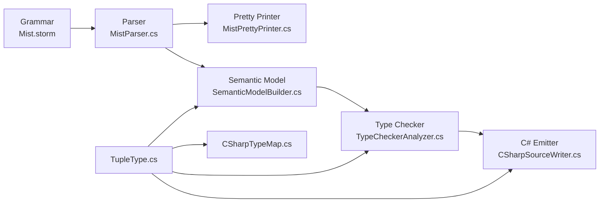

# Design Document: Value Tuples

## Overview

This design adds ValueTuple support to the Mist programming language compiler. Tuples are lightweight, structural value types that group multiple values without requiring a named type declaration. The feature spans the full compiler pipeline: grammar, parser, pretty printer, semantic model, type checker, and C# backend emitter.

Mist tuples map directly to C#'s `System.ValueTuple<...>` at the backend level, leveraging C#'s native tuple syntax for idiomatic interop. The design follows the established `ArrayType` pattern — a structural type marker in the semantic model that the backend maps to the target language representation.

### Key Design Decisions

1. **Structural type marker (like ArrayType)**: `TupleType` is a standalone `IType` implementation, not folded into `ConstructedType`. This mirrors the `ArrayType` precedent and avoids coupling tuple semantics to generic type resolution.

2. **Grammar-level disambiguation**: Tuples reuse parenthesis syntax. The parser distinguishes `(expr)` (parenthesized expression) from `(expr1, expr2)` (tuple literal) by the presence of a comma. Similarly for type references.

3. **Name-erasure for assignability**: Tuple element names are metadata for member access convenience. Two tuples with the same element types are assignable regardless of name differences, matching C# semantics.

4. **Minimum arity of 2**: A tuple must have at least 2 elements. Single-element "tuples" are not supported (they would be ambiguous with parenthesized expressions/types).

## Architecture

The feature touches every compiler pipeline stage in a linear, additive manner:



### Pipeline Changes by Stage

| Stage | File(s) | Change |
|-------|---------|--------|
| Grammar | `Mist.storm` | New `TupleTypeRef`, `TupleElement`, `TupleLiteral`, `TupleDeconstructionStatement` rules |
| Parser | `MistParser.cs` (generated) | Auto-generated from grammar changes |
| Pretty Printer | `MistPrettyPrinter.cs` | Emit tuple types, literals, and deconstructions |
| Semantic Model | `TupleType.cs`, `SemanticModelBuilder.cs` | New `TupleType : IType`, resolve tuple type references |
| Type Checker | `TypeCheckerAnalyzer.cs` | Validate tuple assignability, element access, deconstruction arity |
| C# Backend | `CSharpTypeMap.cs`, `CSharpSourceWriter.cs` | Map `TupleType` to C# tuple syntax, emit tuple expressions |

## Components and Interfaces

### 1. Grammar Extensions (`Mist.storm`)

#### Tuple Type Reference

Add a new alternative to the `TypeReference` rule:

```
rule TypeReference
    = primitiveType:PrimitiveType arrayRank:(LEFT_BRACKET RIGHT_BRACKET)?  as PrimitiveTypeRef
    | VOID                                                                  as VoidTypeRef
    | UNKNOWN                                                               as UnknownTypeRef
    | name:QualifiedIdentifier typeArgs:TypeArgumentList? arrayRank:(LEFT_BRACKET RIGHT_BRACKET)?  as NamedTypeRef
    | LEFT_PARENTHESIS first:TupleTypeElement COMMA rest:TupleTypeElement (COMMA additional:TupleTypeElement)* RIGHT_PARENTHESIS  as TupleTypeRef
    ;

rule TupleTypeElement
    = type:TypeReference name:IDENTIFIER?
    ;
```

The `TupleTypeRef` alternative requires at least two `TupleTypeElement` entries (enforced by the `first COMMA rest` structure). Each element has a type and an optional name.

#### Tuple Literal Expression

Modify the `Primary` rule to add a tuple literal alternative. The key disambiguation: a parenthesized expression has one inner expression with no comma; a tuple literal has two or more comma-separated expressions.

```
rule Primary
    = ... existing alternatives ...
    | LEFT_PARENTHESIS first:TupleLiteralElement COMMA rest:TupleLiteralElement (COMMA additional:TupleLiteralElement)* RIGHT_PARENTHESIS  as TupleLiteralExpression
    | LEFT_PARENTHESIS inner:Expression RIGHT_PARENTHESIS  as ParenthesizedExpression
    | ... remaining alternatives ...
    ;

rule TupleLiteralElement
    = name:IDENTIFIER COLON value:Expression  as NamedTupleLiteralElement
    | value:Expression                         as UnnamedTupleLiteralElement
    ;
```

**Disambiguation strategy**: The `TupleLiteralExpression` alternative is placed before `ParenthesizedExpression` in the grammar. The parser attempts to match the tuple form first; if there is no comma after the first element, it backtracks to the parenthesized expression form. Storm's PEG-style ordered choice handles this naturally.

**Named element disambiguation**: `name: expr` vs `expr` — when the parser sees `IDENTIFIER COLON`, it tries the named form first. If the identifier is actually a variable name in an expression like `x: y` (which is not valid Mist syntax outside tuples), the named form wins. This is correct because `name: expr` is only valid inside tuple literals.

#### Tuple Deconstruction Statement

Add new alternatives to `VariableDeclarationStatement`:

```
rule VariableDeclarationStatement
    = type:TypeReference name:IDENTIFIER EQUAL initializer:Expression SEMICOLON  as TypedVariableDeclaration
    | VAR name:IDENTIFIER EQUAL initializer:Expression SEMICOLON                 as InferredVariableDeclaration
    | VAR LEFT_PARENTHESIS firstName:IDENTIFIER (COMMA restNames:IDENTIFIER)* RIGHT_PARENTHESIS EQUAL initializer:Expression SEMICOLON  as VarTupleDeconstruction
    | LEFT_PARENTHESIS first:TupleDeconstructionElement COMMA rest:TupleDeconstructionElement (COMMA additional:TupleDeconstructionElement)* RIGHT_PARENTHESIS EQUAL initializer:Expression SEMICOLON  as TypedTupleDeconstruction
    ;

rule TupleDeconstructionElement
    = type:TypeReference name:IDENTIFIER
    ;
```

**`var` deconstruction disambiguation**: When the parser sees `var (`, it tries `VarTupleDeconstruction` before `InferredVariableDeclaration`. The `var (name1, name2, ...) = expr;` form requires at least one comma inside the parentheses. If there's no comma, it falls back to `InferredVariableDeclaration` where `(...)` would be parsed as a parenthesized expression initializer.

**Typed deconstruction disambiguation**: `(Type1 name1, Type2 name2) = expr;` starts with `(` which could also be a parenthesized expression statement. The parser distinguishes by looking for the `TypeReference IDENTIFIER COMMA` pattern inside the parentheses, which cannot be a valid expression.

### 2. TupleType (`Source/Mist/Semantics/Model/Types/TupleType.cs`)

```csharp
using Mist.Semantics.Contracts;

namespace Mist.Semantics.Model.Types;

/// <summary>
/// A structural value type representing a fixed-length tuple of element types.
/// Analogous to ArrayType as a structural type marker — not folded into
/// ConstructedType. The C# backend maps this to System.ValueTuple&lt;...&gt;.
/// </summary>
public sealed class TupleType : IType
{
    /// <summary>
    /// The ordered element types of this tuple.
    /// </summary>
    public IReadOnlyList<IType> ElementTypes { get; }

    /// <summary>
    /// Optional element names (parallel to ElementTypes).
    /// Null entries indicate unnamed elements. The entire list is null
    /// if no elements are named.
    /// </summary>
    public IReadOnlyList<string?>? ElementNames { get; }

    public string DisplayName { get; }
    public TypeKind Kind => TypeKind.Struct;

    public TupleType(IReadOnlyList<IType> elementTypes, IReadOnlyList<string?>? elementNames = null)
    {
        ElementTypes = elementTypes;
        ElementNames = elementNames;

        // Build display name: "(int, string)" or "(int x, string y)"
        var parts = new string[elementTypes.Count];
        for (var i = 0; i < elementTypes.Count; i++)
        {
            var name = elementNames is not null && i < elementNames.Count ? elementNames[i] : null;
            parts[i] = name is not null
                ? $"{elementTypes[i].DisplayName} {name}"
                : elementTypes[i].DisplayName;
        }
        DisplayName = $"({string.Join(", ", parts)})";
    }

    /// <summary>
    /// Returns the number of elements in this tuple.
    /// </summary>
    public int Arity => ElementTypes.Count;
}
```

**Design rationale**: `TypeKind.Struct` because `System.ValueTuple` is a value type. The `ElementNames` list is nullable at the top level (all unnamed) and nullable per-element (mixed named/unnamed). This matches C#'s behavior where you can have `(int, string y)` with a mix.

### 3. Semantic Model Builder Changes

The `SemanticModelBuilder` needs to resolve `TupleTypeRef` AST nodes into `TupleType` instances:

- When visiting a `TupleTypeRefTypeReferenceNode`, resolve each element's type reference recursively, collect optional names, and construct a `TupleType`.
- Register tuple element names in the member scope for member access resolution.

For tuple literals:
- Infer the type of each element expression.
- Construct a `TupleType` from the inferred element types and any explicit names.

For tuple deconstructions:
- Create local variable symbols for each deconstruction target.
- For `var` deconstructions, defer type inference to the type checker.

### 4. Type Checker Changes

#### Tuple Assignability

Two `TupleType` instances are assignable if:
1. They have the same arity.
2. Each element type at position `i` in the source is assignable to the element type at position `i` in the target.
3. Element names are **ignored** for assignability (name erasure).

#### Tuple Element Access

When resolving `tuple.X` member access on a `TupleType`:
1. Check positional names: `Item1`, `Item2`, ..., `ItemN` (1-indexed).
2. Check declared names from `ElementNames`.
3. If no match, report an undefined member diagnostic.

The resolved type is the element type at the matched position.

#### Tuple Deconstruction Validation

- Verify the RHS expression has a `TupleType`.
- Verify the number of deconstruction targets matches the tuple arity.
- For typed deconstructions, verify each element type is assignable to the declared type.
- For `var` deconstructions, infer each target's type from the corresponding element type.

### 5. C# Backend Changes

#### CSharpTypeMap

Add a `TupleType` case to `GetTypeName()`:

```csharp
TupleType t => EmitTupleTypeName(t, isValueContext),
```

Where `EmitTupleTypeName` produces:
- `(int, string)` for unnamed tuples
- `(int x, string y)` for named tuples

Each element type is recursively mapped through `GetTypeName()`.

#### CSharpSourceWriter

- **Tuple type references**: Emit `(T1, T2, ...)` or `(T1 name1, T2 name2, ...)`.
- **Tuple literals**: Emit `(expr1, expr2, ...)` or `(name1: expr1, name2: expr2, ...)`.
- **Tuple element access**: Emit `tuple.Item1` or `tuple.name` (pass-through, same syntax as C#).
- **Tuple deconstruction**: Emit `var (a, b) = expr;` or `(int a, string b) = expr;`.

### 6. Pretty Printer Changes

Add cases to `MistPrettyPrinter` for:
- `TupleTypeRefTypeReferenceNode` → `(T1, T2)` or `(T1 name1, T2 name2)`
- `TupleLiteralExpressionPrimaryNode` → `(expr1, expr2)` or `(name1: expr1, name2: expr2)`
- `VarTupleDeconstructionVariableDeclarationStatementNode` → `var (a, b) = expr;`
- `TypedTupleDeconstructionVariableDeclarationStatementNode` → `(int a, string b) = expr;`

## Data Models

### TupleType

| Property | Type | Description |
|----------|------|-------------|
| `ElementTypes` | `IReadOnlyList<IType>` | Ordered element types (length ≥ 2) |
| `ElementNames` | `IReadOnlyList<string?>?` | Optional parallel list of element names |
| `DisplayName` | `string` | Human-readable form: `(int, string)` or `(int x, string y)` |
| `Kind` | `TypeKind` | Always `TypeKind.Struct` |
| `Arity` | `int` | Number of elements (convenience property) |

### AST Nodes (Generated from Grammar)

| Node | Fields | Description |
|------|--------|-------------|
| `TupleTypeRefTypeReferenceNode` | `First`, `Rest`, `Additional` (all `TupleTypeElement`) | Tuple type reference with ≥2 elements |
| `TupleTypeElementNode` | `Type: TypeReferenceNode`, `Name: Token?` | Single element in a tuple type |
| `TupleLiteralExpressionPrimaryNode` | `First`, `Rest`, `Additional` (all `TupleLiteralElement`) | Tuple literal with ≥2 elements |
| `NamedTupleLiteralElementNode` | `Name: Token`, `Value: ExpressionNode` | Named element: `name: expr` |
| `UnnamedTupleLiteralElementNode` | `Value: ExpressionNode` | Unnamed element: `expr` |
| `VarTupleDeconstructionNode` | `FirstName: Token`, `RestNames: Token[]`, `Initializer: ExpressionNode` | `var (a, b) = expr;` |
| `TypedTupleDeconstructionNode` | `First`, `Rest`, `Additional` (all `TupleDeconstructionElement`), `Initializer: ExpressionNode` | `(int a, string b) = expr;` |
| `TupleDeconstructionElementNode` | `Type: TypeReferenceNode`, `Name: Token` | Single element in typed deconstruction |

### Diagnostic IDs

| ID | Stage | Description |
|----|-------|-------------|
| `MIST_TC_0060 (historical)` | TypeChecker | Tuple requires at least 2 elements |
| `MIST_TC_0061 (historical)` | TypeChecker | Tuple deconstruction arity mismatch |
| `MIST_TC_0062 (historical)` | TypeChecker | Tuple element type mismatch in deconstruction |
| `MIST_TC_0063 (historical)` | TypeChecker | Undefined tuple member access |
| `MIST_TC_0064 (historical)` | TypeChecker | RHS of tuple deconstruction is not a tuple type |

## Correctness Properties

*A property is a characteristic or behavior that should hold true across all valid executions of a system — essentially, a formal statement about what the system should do. Properties serve as the bridge between human-readable specifications and machine-verifiable correctness guarantees.*

### Property 1: Tuple syntax round-trip

*For any* valid Mist source text containing tuple type references, tuple literal expressions, and/or tuple deconstruction statements (including nested tuples, named elements, and mixed named/unnamed elements), parsing the source then pretty-printing the AST then parsing the result SHALL produce an equivalent AST.

**Validates: Requirements 1.1, 1.2, 1.5, 1.6, 2.1, 2.2, 2.5, 2.6, 4.1, 4.2, 4.7, 4.8, 7.2, 7.4, 8.1, 8.2**

### Property 2: TupleType DisplayName and Kind invariant

*For any* `TupleType` constructed with an ordered list of element types (length ≥ 2) and an optional parallel list of element names, the `DisplayName` SHALL match the format `(T1, T2, ..., Tn)` for unnamed elements or `(T1 name1, T2 name2, ..., Tn nameN)` for named elements, and `Kind` SHALL always be `TypeKind.Struct`.

**Validates: Requirements 5.1**

### Property 3: Tuple assignability with name erasure

*For any* two `TupleType` instances with the same element types in the same order, the type checker SHALL treat them as assignable to each other regardless of whether their element names differ, are absent, or are partially present. Conversely, *for any* two `TupleType` instances that differ in arity or in any element type at the same position, they SHALL NOT be assignable.

**Validates: Requirements 2.4, 4.3, 4.4, 5.3, 5.4**

### Property 4: Tuple element access resolution

*For any* `TupleType` with arity N, accessing `ItemK` where 1 ≤ K ≤ N SHALL resolve to the element type at position K. Additionally, *for any* `TupleType` with named elements, accessing an element by its declared name SHALL resolve to the same element type as the corresponding positional `ItemK` access.

**Validates: Requirements 3.1, 3.2, 3.3, 3.4**

### Property 5: Invalid tuple member access produces diagnostic

*For any* `TupleType` with arity N and *for any* member name that is neither a valid positional name (`Item1` through `ItemN`) nor a declared element name, the type checker SHALL report an undefined member diagnostic.

**Validates: Requirements 3.5**

### Property 6: C# type name mapping for TupleType

*For any* `TupleType` (including nested tuples), `CSharpTypeMap.GetTypeName()` SHALL produce a C# tuple type string where each element type is recursively mapped through `GetTypeName()`, unnamed elements appear as bare types, and named elements appear as `type name` pairs.

**Validates: Requirements 6.1, 6.2, 8.4**

## Error Handling

### Parse Errors

| Condition | Behavior |
|-----------|----------|
| Single element in tuple position: `(int)` in type context | Falls through to other `TypeReference` alternatives; not parsed as a tuple |
| Single expression in tuple position: `(42)` | Parsed as `ParenthesizedExpression` (existing behavior) |
| Missing comma in tuple: `(int string)` | Parser reports syntax error at unexpected token |
| Trailing comma: `(int, string,)` | Parser reports syntax error at `)` after comma |
| Empty tuple: `()` | Not matched by any tuple rule; parser reports syntax error |

### Type Checker Errors

| Condition | Diagnostic | Message |
|-----------|-----------|---------|
| Deconstruction arity mismatch | `MIST_TC_0061 (historical)` | "Tuple deconstruction has {N} targets but the tuple has {M} elements" |
| Element type mismatch in typed deconstruction | `MIST_TC_0062 (historical)` | "Cannot assign tuple element of type '{actual}' to '{declared}' at position {i}" |
| Undefined member access on tuple | `MIST_TC_0063 (historical)` | "Tuple type '{tupleType}' does not contain a member '{name}'" |
| RHS of deconstruction is not a tuple | `MIST_TC_0064 (historical)` | "Cannot deconstruct expression of type '{type}'; a tuple type is required" |

### Graceful Degradation

- If a tuple type reference contains an unresolvable element type, the type checker reports the error on that element and continues checking other elements. The overall tuple type is marked as containing an error type at that position.
- If a tuple literal contains an expression that fails type inference, the corresponding element type becomes `ErrorType`, and the tuple literal's inferred type reflects this.

## Testing Strategy

### Property-Based Tests (FsCheck)

The project uses **FsCheck.Xunit** (v3.1.0) for property-based testing. Each property test runs a minimum of 100 iterations.

**Test class**: `TuplePropertyTests` in `Test/Mist.Tests/`

| Property | Test Method | Generator | Strategy |
|----------|-------------|-----------|----------|
| Property 1: Round-trip | `TupleSyntaxRoundTrip` | `MistTupleGenerator` | Generate Mist source with tuple types, literals, deconstructions → parse → print → parse → compare ASTs |
| Property 2: DisplayName | `TupleTypeDisplayNameAndKind` | `TupleTypeGenerator` | Generate `TupleType` instances directly → verify `DisplayName` format and `Kind == Struct` |
| Property 3: Assignability | `TupleAssignabilityWithNameErasure` | `TupleTypePairGenerator` | Generate pairs of `TupleType` with same/different types and names → verify assignability |
| Property 4: Element access | `TupleElementAccessResolution` | `TupleTypeGenerator` | Generate `TupleType` instances → verify `ItemK` and named access resolution |
| Property 5: Invalid access | `InvalidTupleMemberAccessDiagnostic` | `TupleTypeAndInvalidNameGenerator` | Generate `TupleType` + invalid name → verify diagnostic |
| Property 6: C# type mapping | `CSharpTupleTypeNameMapping` | `TupleTypeGenerator` | Generate `TupleType` instances → verify `CSharpTypeMap.GetTypeName()` output |

### Generators

A new `MistTupleGenerator` class in `Test/Mist.Tests/Generators/` provides FsCheck generators:

- **Tuple type source strings**: Random arities (2-6), random element types (primitives, named types, nested tuples), optional names.
- **Tuple literal source strings**: Random arities, random expressions (literals, identifiers), optional named elements.
- **Tuple deconstruction source strings**: Both `var` and typed forms, random arities.
- **`TupleType` instances**: Direct construction with random `IType` element types and optional names.
- **`TupleType` pairs**: Same-type pairs with different names (for assignability), different-type pairs (for non-assignability).

### Unit Tests (Example-Based)

**Test class**: `TupleUnitTests` in `Test/Mist.Tests/`

| Test | What it verifies |
|------|-----------------|
| `ParenthesizedExpressionNotTuple` | `(42)` parses as `ParenthesizedExpression`, not tuple (Req 7.1) |
| `SingleTypeNotTupleType` | `(int)` in type position doesn't parse as tuple type (Req 7.3) |
| `VarDeconstructionDisambiguation` | `var (a, b) = expr;` vs `var x = (1, 2);` (Req 7.5) |
| `TupleDeconstructionArityMismatch` | Diagnostic when targets ≠ tuple arity (Req 4.6) |
| `TupleDeconstructionNonTupleRhs` | Diagnostic when RHS is not a tuple (Req 4.6) |
| `EmitterTupleMemberAccess` | `tuple.Item1` and `tuple.name` emit correctly (Req 6.5) |
| `EmitterVarDeconstruction` | `var (a, b) = expr;` emits correctly (Req 6.6) |
| `EmitterTypedDeconstruction` | `(int a, string b) = expr;` emits correctly (Req 6.7) |

### Process Spawning

All property-based tests and unit tests operate **in-process** — they use the parser, pretty printer, semantic model builder, type checker, and `CSharpTypeMap` directly without spawning external processes. No `dotnet run` or `Process.Start` calls are needed.

End-to-end integration tests (if added later) that compile and run emitted C# would follow the batching pattern per the test-process-spawning policy: generate all scenarios upfront, build a single batched program, compile once, run once.

