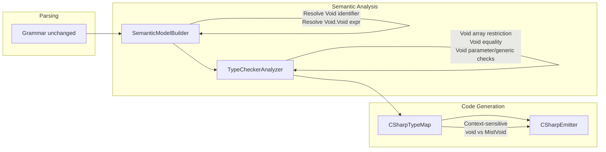

# Design Document: Void Unit Type

## Overview

This design promotes Mist's existing `VoidType` from a return-type-only marker to a fully powered **unit type** — a value type with exactly one instance (`Void.Void`), usable anywhere a type is expected except as an array element type. The `void` keyword remains the canonical alias; the identifier `Void` (capital V) is an alternative name that resolves to the same type.

The changes span four compiler layers:

1. **Semantic Model Builder** — resolve `Void` as a type name and `Void.Void` as a value expression
2. **Type Checker** — allow void in new positions (variables, parameters, generics, equality) and enforce restrictions (arrays)
3. **C# Emitter / Type Map** — context-sensitive emission: C# `void` for fire-and-forget methods, a `MistVoid` struct for value contexts
4. **Grammar** — no grammar changes required; `Void` is already parseable as an `IDENTIFIER` and `void` as a `VOID` keyword token

### Design Rationale

Making void a true unit type eliminates the special-casing that plagues generic code. A `Result<void>` becomes legal without wrapper hacks. The restriction on arrays prevents meaningless storage of zero-information collections while keeping the type system uniform.

---

## Architecture

The feature touches the compiler pipeline at three stages. No new pipeline stages are introduced.



### Data Flow

1. **Parsing**: The parser produces AST nodes as today. `void` in type reference position produces `VoidTypeRefTypeReferenceNode`. `Void` as an identifier produces `IdentifierExpressionPrimaryNode`. `Void.Void` produces a `PostfixNode` with an `IdentifierExpressionPrimaryNode` target and a `MemberAccessSuffixPostfixSuffixNode`.

2. **Semantic Model Building**: `ResolveIdentifierAsType` gains a case for `"Void"` → `VoidType.Instance`. `ResolvePostfixSuffix` (member access) gains a case: when the target type is `VoidType` and the member name is `"Void"`, resolve to `VoidType.Instance` as the expression type.

3. **Type Checking**: New checks in `TypeCheckerAnalyzer`:
   - `CheckArrayCreation` / variable declarations: reject `void[]`
   - `CheckReturnStatement`: accept `return Void.Void;` in void methods
   - `AreEqualityCompatible`: accept `VoidType == VoidType`
   - Existing assignability checks handle void parameters and variables

4. **Code Generation**: `CSharpTypeMap.GetTypeName` becomes context-aware. `CSharpEmitter` tracks whether a void method's return value is consumed and emits accordingly.

---

## Components and Interfaces

### 1. SemanticModelBuilder Changes

#### 1a. `TryResolveWellKnownType` — Add `"Void"` mapping

```csharp
private static IType? TryResolveWellKnownType(string name)
{
    return name switch
    {
        // ... existing cases ...
        "void" => VoidType.Instance,
        "Void" => VoidType.Instance,  // NEW: capital-V identifier
        _ => null,
    };
}
```

This ensures that when `Void` appears as an identifier in type reference position or expression position, it resolves to `VoidType.Instance` through the existing `ResolveIdentifierAsType` → `TryResolveWellKnownType` path.

#### 1b. `ResolvePostfixSuffix` — Handle `Void.Void` member access

In the `MemberAccessSuffixPostfixSuffixNode` case, add a check before the general `LookupMemberType` call:

```csharp
case MemberAccessSuffixPostfixSuffixNode memberAccess:
{
    var memberName = memberAccess.Name.Lexeme;

    // Special case: Void.Void → VoidType instance expression
    if (targetType is VoidType && memberName == "Void")
    {
        expressionTypes[suffix] = VoidType.Instance;
        return VoidType.Instance;
    }

    var memberType = LookupMemberType(...);
    // ... rest unchanged
}
```

When the semantic model builder sees `Void` as an identifier, `ResolveIdentifierAsType` returns `VoidType.Instance`. The postfix `.Void` member access then hits this special case and resolves the full expression `Void.Void` to type `VoidType`.

#### 1c. `ResolveVariableDeclaration` — Void variable type inference

The existing `var` inference path already works: `var x = Void.Void;` resolves the initializer to `VoidType`, and the inferred type becomes `VoidType`. No changes needed for inference.

For explicit `void x = Void.Void;`, the `VoidTypeRefTypeReferenceNode` case in `ResolveTypeReference` already returns `VoidType.Instance`. No changes needed.

### 2. TypeCheckerAnalyzer Changes

#### 2b. Void array restriction

Two locations need checks:

**In `CheckArrayCreation`** — reject `new void[n]`:

```csharp
private void CheckArrayCreation(...)
{
    CheckExpression(arrayCreation.Size, model, diagnostics);

    // NEW: Check element type is not void
    var elementType = model.GetTypeOf(arrayCreation);
    if (elementType is ArrayType at && at.ElementType is VoidType)
    {
        diagnostics.Add(MakeDiagnostic(
            "MIST_TC_0034",
            "Cannot create an array of type 'void'. Void is not permitted as an array element type.",
            arrayCreation,
            model));
        return;
    }

    // ... existing size type check ...
}
```

**In `CheckVariableDeclarationStatement`** — reject `void[] x = ...`:

Add a check when the resolved variable type is `ArrayType` with `VoidType` element:

```csharp
// NEW: Check for void[] variable declarations
if (varType is ArrayType arrayType && arrayType.ElementType is VoidType)
{
    diagnostics.Add(MakeDiagnostic(
        "MIST_TC_0034",
        "Cannot declare a variable of type 'void[]'. Void is not permitted as an array element type.",
        varDeclNode,
        model));
}
```

New diagnostic ID: `MIST_TC_0034 (historical)`.

#### 2c. `CheckReturnStatement` — Accept `return Void.Void;` in void methods

The existing `CheckReturnStatement` already handles `return;` in void methods. For `return Void.Void;`, the current code rejects it because it sees a non-null value expression in a void method. Modify the void-method branch:

```csharp
if (methodReturnType is VoidType)
{
    // Void methods: reject return values UNLESS the value is VoidType
    if (valueType is not null && !IsUnknown(valueType) && valueType is not VoidType)
    {
        diagnostics.Add(MakeDiagnostic(
            "MIST_TC_0008",
            $"Cannot return '{valueType.DisplayName}' from method with return type 'void'",
            returnStmt,
            model));
    }
}
```

The key change: add `&& valueType is not VoidType` to the condition.

#### 2d. `AreEqualityCompatible` — Accept void == void

The existing `AreEqualityCompatible` method uses `ReferenceEquals(left, right)` which returns `true` when both sides are `VoidType.Instance` (same singleton reference). **No changes needed** — void equality already works because both operands resolve to the same `VoidType.Instance` singleton.

For the mixed case (void vs non-void), the existing logic correctly returns `false` since `VoidType` is not in `NumericTypes`, is not a `ClassType`/`StringType`/`ArrayType`, and `DisplayName` won't match.

#### 2e. Void as parameter type and generic type argument

**Parameters**: The existing type checking for method arguments uses `IsAssignable(source, target)`. Since `VoidType` is a singleton, `IsAssignable(VoidType.Instance, VoidType.Instance)` returns `true` through the `TypesEqual` path. Passing `Void.Void` to a `void` parameter works without changes.

**Generics**: The existing generic type argument resolution in `ResolveTypeReference` handles `VoidTypeRefTypeReferenceNode` → `VoidType.Instance`. The `ConstructedType` machinery substitutes type parameters with type arguments, so `Result<void>` correctly substitutes `T` with `VoidType`. No changes needed to the generic infrastructure.

### 3. CSharpTypeMap Changes

#### 3a. Context-sensitive `GetTypeName`

Replace the simple `VoidType => "void"` case with a context-aware method:

```csharp
public static string GetTypeName(IType type, bool isValueContext = false) => type switch
{
    // ... existing cases ...
    VoidType => isValueContext ? "MistVoid" : "void",
    // ... rest unchanged
};
```

The `isValueContext` parameter defaults to `false` for backward compatibility. The emitter passes `true` when emitting void in value positions (variables, parameters, generic arguments, return types of value-returning methods).

#### 3b. `MistVoid` struct definition

The emitter will emit a helper struct in the generated output:

```csharp
[System.Runtime.CompilerServices.CompilerGenerated]
public readonly struct MistVoid : System.IEquatable<MistVoid>
{
    public static readonly MistVoid Instance = default;
    public bool Equals(MistVoid other) => true;
    public override bool Equals(object? obj) => obj is MistVoid;
    public override int GetHashCode() => 0;
    public static bool operator ==(MistVoid left, MistVoid right) => true;
    public static bool operator !=(MistVoid left, MistVoid right) => false;
    public override string ToString() => "Void";
}
```

This struct is emitted once per compilation unit that uses void as a value type.

### 4. CSharpEmitter Changes

#### 4a. Void method return type detection

The emitter needs to determine whether a void method's return value is consumed. This requires a usage analysis pass:

**Strategy**: During emission, track whether any call site assigns the result of a void method to a variable, passes it as an argument, or uses it in an expression. If so, emit the method with return type `MistVoid` and add `return MistVoid.Instance;` at the end. Otherwise, emit standard C# `void`.

**Implementation approach**: Before emitting method declarations, scan the semantic model for all call sites of each void method. Build a `HashSet<string>` of method names whose return values are consumed. During `EmitMethodDeclaration`, check this set.

```csharp
private void EmitMethodDeclaration(MethodDeclarationNode methodDecl)
{
    var modifiers = EmitModifiers(methodDecl.Modifiers);
    var name = methodDecl.Name.Lexeme;
    var typeParams = EmitTypeParameterList(methodDecl.TypeParams);
    var parameters = EmitParameterList(methodDecl.Parameters);

    // Context-sensitive void return type
    var returnType = EmitTypeReference(methodDecl.ReturnType);
    if (methodDecl.ReturnType is VoidTypeRefTypeReferenceNode && _valueReturningVoidMethods.Contains(name))
    {
        returnType = "MistVoid";
    }

    AppendLine($"{modifiers}{returnType} {name}{typeParams}({parameters})");
    EmitBlock(methodDecl.Body);
}
```

#### 4b. `Void.Void` expression emission

When the emitter encounters a `Void.Void` member access expression, emit `MistVoid.Instance`:

```csharp
case MemberAccessSuffixPostfixSuffixNode memberAccess:
{
    // Special case: Void.Void → MistVoid.Instance
    if (target == "Void" && memberAccess.Name.Lexeme == "Void")
    {
        return "MistVoid.Instance";
    }
    // ... existing logic
}
```

#### 4c. Void variable and parameter emission

When emitting typed variable declarations or parameters with void type, use `MistVoid`:

```csharp
// In EmitTypeReference, for value contexts:
case VoidTypeRefTypeReferenceNode:
    return _inValueContext ? "MistVoid" : "void";
```

The emitter tracks `_inValueContext` based on whether it's emitting a variable declaration, parameter, generic type argument, or a value-returning method signature.

#### 4d. Return statement emission in void methods

For void methods that are value-returning (in the `_valueReturningVoidMethods` set):
- `return;` → `return MistVoid.Instance;`
- Implicit end-of-method → append `return MistVoid.Instance;`
- `return Void.Void;` → `return MistVoid.Instance;`

### 5. DiagnosticId Registry

Add new diagnostic IDs to `DiagnosticId.cs`:

```csharp
/// <summary>Void is not permitted as an array element type.</summary>
public static readonly DiagnosticId VoidArrayNotPermitted = new("MIST_TC_0034");
```

### 6. Grammar

No grammar changes are required. The existing grammar already supports:
- `void` as a type reference via `VoidTypeRef` alternative in the `TypeReference` rule
- `Void` as an identifier via the `IDENTIFIER` token (parsed as `IdentifierExpressionPrimaryNode`)
- `Void.Void` as a postfix expression via `PostfixSuffix` → `MemberAccessSuffix`

---

## Data Models

### Existing Types (No Changes)

| Type | Kind | Singleton | Notes |
|------|------|-----------|-------|
| `VoidType` | `TypeKind.Struct` | `VoidType.Instance` | Already correct |
| `UnknownType` | — | `UnknownType.Instance` | Used for error recovery |

### New Diagnostic IDs

| ID | Severity | Message Template |
|----|----------|-----------------|
| `MIST_TC_0034 (historical)` | Error | "Cannot declare/create an array of type 'void'. Void is not permitted as an array element type." |

### New Emitter State

| Field | Type | Purpose |
|-------|------|---------|
| `_valueReturningVoidMethods` | `HashSet<string>` | Tracks void methods whose return values are consumed at any call site |
| `_needsMistVoidStruct` | `bool` | Whether to emit the `MistVoid` helper struct |

### Generated C# Artifact

The `MistVoid` struct is emitted into the generated C# output when any void value usage is detected. It implements `IEquatable<MistVoid>` with all values equal, matching the Mist semantics.

---

## Correctness Properties

*A property is a characteristic or behavior that should hold true across all valid executions of a system — essentially, a formal statement about what the system should do. Properties serve as the bridge between human-readable specifications and machine-verifiable correctness guarantees.*

### Property 1: Void type reference resolution

*For any* Mist program containing a type reference to `void` (keyword) or `Void` (identifier) in any valid position (return type, variable type, parameter type, generic type argument), the semantic model builder SHALL resolve the type reference to `VoidType.Instance`.

**Validates: Requirements 1.4, 1.5, 3.1, 4.1, 5.1, 6.1**

### Property 2: Void.Void expression type

*For any* Mist program containing the expression `Void.Void` in any expression context, the semantic model SHALL assign the type `VoidType` to that expression.

**Validates: Requirements 2.1, 2.2**

### Property 3: Void methods accept missing return values

*For any* Mist method with a `void` return type, the type checker SHALL accept the method body without error regardless of whether it contains `return;`, `return Void.Void;`, or no return statement at all.

**Validates: Requirements 3.2, 3.3, 3.5**

### Property 4: Non-void to void type mismatch

*For any* non-void type T and any context where a `VoidType` value is expected (return statement in void method, assignment to void variable, argument to void parameter), providing a value of type T SHALL produce a type mismatch diagnostic.

**Validates: Requirements 3.4, 4.4, 6.3**

### Property 5: Void array restriction

*For any* program containing a `void[]` type declaration or a `new void[n]` array creation expression, the type checker SHALL emit diagnostic `MIST_TC_0034 (historical)`.

**Validates: Requirements 8.1, 8.2**

### Property 6: Void/non-void equality type mismatch

*For any* non-void type T, comparing a `VoidType` expression with a T expression using `==` or `!=` SHALL produce a type incompatibility diagnostic.

**Validates: Requirements 9.3**

### Property 7: Context-sensitive void C# emission

*For any* Mist program using void as a value type (void variables, void parameters, void generic arguments, or void method return values that are consumed), the emitter SHALL produce C# code using the `MistVoid` struct type. *For any* void method whose return value is never consumed, the emitter SHALL produce standard C# `void`.

**Validates: Requirements 10.1, 10.2, 10.3, 10.4, 10.5**

---

## Error Handling

### New Diagnostics

| Scenario | Diagnostic ID | Severity | Message |
|----------|--------------|----------|---------|
| Array of void declared or created | `MIST_TC_0034 (historical)` | Error | "Cannot declare/create an array of type 'void'. Void is not permitted as an array element type." |

### Existing Diagnostics (Behavior Changes)

| Scenario | Diagnostic ID | Change |
|----------|--------------|--------|
| `return Void.Void;` in void method | `MIST_TC_0008 (historical)` | No longer emitted (was incorrectly rejecting void return values) |
| `return 42;` in void method | `MIST_TC_0008 (historical)` | Still emitted (non-void value in void method) |
| `Void.Void == 42` | `MIST_TC_0005 (historical)` | Still emitted (incompatible equality operands) |

### Error Recovery

- When a void array is detected, the diagnostic is emitted but the array type is still constructed to allow downstream analysis to proceed.
- Unknown member access on `VoidType` (e.g., `Void.Foo`) produces the standard `MIST_UNDEFINED_MEMBER (historical)` diagnostic.

---

## Testing Strategy

### Property-Based Testing

The project uses **FsCheck 3.1.0** with **xunit** for property-based testing. The existing `MistProgramGenerator` provides AST generators for well-typed and ill-typed programs.

**New generators needed**:
- `GenVoidVariableDeclaration()` — programs with `void x = Void.Void;`
- `GenVoidParameterMethod()` — methods with void parameters
- `GenVoidGenericInstantiation()` — generic types instantiated with void
- `GenVoidFieldDeclaration()` — classes/structs with void fields (well-typed)
- `GenVoidArrayDeclaration()` — programs with void[] (ill-typed)
- `GenVoidEqualityComparison()` — programs comparing void with non-void types (ill-typed)
- `GenVoidReturnMismatch()` — void methods returning non-void values (ill-typed)

**Configuration**: Minimum 100 iterations per property test.

**Tag format**: `Feature: void-unit-type, Property {N}: {description}`

### Unit Tests (Example-Based)

| Test | Validates |
|------|-----------|
| `VoidType.Instance.Kind == TypeKind.Struct` | Req 1.1 |
| `VoidType.Instance` is singleton | Req 1.2 |
| `VoidType.Instance.DisplayName == "void"` | Req 1.3 |
| `Void.Void == Void.Void` accepted | Req 9.1 |
| `Void.Void != Void.Void` accepted | Req 9.2 |
| `var x = Void.Void;` infers VoidType | Req 4.3 |
| `void x = Void.Void;` accepted | Req 4.2 |
| `method(Void.Void)` with void param accepted | Req 6.2 |
| `Result<void>` accepted | Req 5.2 |
| `return Void.Void;` in void method accepted | Req 3.5 |
| `Void.Void` is sole explicit void value mechanism | Req 2.3 |
| `void` field in class accepted | Req 7.1 |
| `Void` field in struct accepted | Req 7.2 |
| `void` field assigned `Void.Void` accepted | Req 7.3 |

### Integration Tests

| Test | Validates |
|------|-----------|
| End-to-end compilation of program using `Result<void>` | Req 5.3 |
| Generated C# compiles and runs with `MistVoid` struct | Req 10.1–10.5 |
| Fire-and-forget void method emits C# `void` | Req 10.4 |
| Value-returning void method emits `MistVoid` | Req 10.3 |
